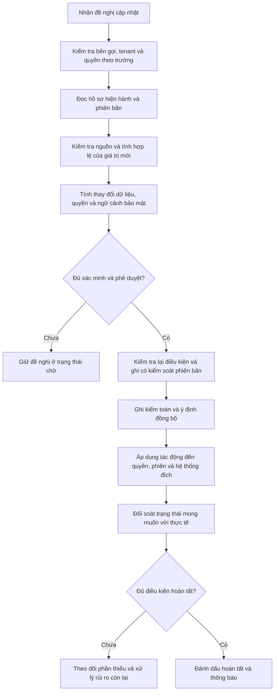

# Identity update

## 1. Cập nhật danh tính có thể làm thay đổi quyền truy cập

Một nhân viên chuyển từ phòng Kỹ thuật sang Tài chính, đổi quản lý trực tiếp và nhận địa chỉ email công việc mới. Nhìn trên giao diện, đây là vài ô thông tin hồ sơ. Trong IAM, chúng có thể ảnh hưởng nhóm quyền, tuyến phê duyệt, phương thức đăng nhập, kênh khôi phục và dữ liệu được truyền sang nhiều ứng dụng.

**Identity update** là quá trình thay đổi thông tin hoặc quan hệ gắn với một danh tính đã tồn tại, đồng thời giữ đúng chủ thể, thẩm quyền nguồn và các điều kiện bảo mật liên quan. Mục tiêu là đưa hệ thống về trạng thái mới có căn cứ, có thể truy vết và được thực thi tại các nơi sử dụng danh tính đó.

Một thao tác `UPDATE users SET ...` chỉ thay đổi bản ghi tại một điểm. Quá trình cập nhật đầy đủ còn phải trả lời: ai được sửa trường nào, giá trị mới cần kiểm tra gì, quyền nào bị ảnh hưởng, phiên cũ có còn phù hợp và các hệ thống đích đã nhận thay đổi chưa.

Trong bài, ví dụ chính là một doanh nghiệp có directory, IdP, hệ thống nhân sự và cổng dự án. Tên trường, trạng thái và quy trình là thiết kế minh họa; khi tích hợp một giao thức cụ thể phải áp dụng schema và yêu cầu tương ứng.

Sau bài học, người học có thể:

1. Phân loại thay đổi danh tính theo ảnh hưởng đến hiển thị, xác thực và phân quyền.
2. Xác định nguồn được phép cập nhật từng thuộc tính và quan hệ.
3. Bảo vệ thay đổi nhạy cảm như email khôi phục hoặc thông tin đã xác minh.
4. Xử lý ghi đè đồng thời, sự kiện lặp và dữ liệu cũ đến muộn.
5. Theo dõi việc áp dụng thay đổi vào quyền, phiên và ứng dụng đích.

## 2. Phân biệt thuộc tính thay đổi với định danh cần giữ ổn định

### 2.1. Không dùng thông tin dễ đổi để quyết định chủ thể

Họ tên, email và username có thể thay đổi. Danh tính nội bộ cần một định danh ổn định trong phạm vi đã chọn để lịch sử tài khoản, liên kết và quyền tiếp tục gắn với đúng chủ thể.

Ví dụ, đổi `displayName` hoặc email không phải lý do tự tạo `identity_id` mới. Ngược lại, việc người khác được cấp lại một địa chỉ email không có nghĩa họ được nhận lịch sử và quyền của người từng dùng địa chỉ đó.

Khi cập nhật, máy chủ phải xác định tài nguyên bằng định danh có căn cứ, kiểm tra tenant và quyền của bên gọi. Một mã khó đoán không thay thế được kiểm tra truy cập.

### 2.2. Phân loại theo cách dữ liệu được sử dụng

| Nhóm thay đổi | Ví dụ | Ảnh hưởng cần xem xét |
| --- | --- | --- |
| Hiển thị và tùy chọn | Tên hiển thị, ngôn ngữ, múi giờ | Chất lượng dữ liệu, khả năng mạo danh trên giao diện, giới hạn tự sửa |
| Thông tin liên hệ | Email, số điện thoại | Thông báo, lời mời, đăng nhập và khôi phục nếu có sử dụng |
| Thuộc tính danh tính đã kiểm tra | Tên được xác minh, ngày sinh hoặc thuộc tính cốt lõi theo chính sách | Căn cứ xác minh của giá trị mới và phạm vi assurance còn phù hợp |
| Quan hệ tổ chức | Phòng ban, quản lý, đơn vị, loại hợp đồng | Vai trò, nhóm, tuyến phê duyệt và phạm vi dữ liệu |
| Quan hệ tài nguyên | Dự án, tenant, người bảo trợ | Membership, quyền gián tiếp và trách nhiệm thu hồi |
| Liên kết đăng nhập | IdP, issuer và subject, username nếu dùng để đăng nhập | Nhận diện chủ thể, đường xác thực và nguy cơ liên kết sai |
| Thành phần bảo mật | Authenticator, kênh recovery, trạng thái tài khoản | Quyền kiểm soát tài khoản, phiên và đường khôi phục |

Mức nhạy cảm phụ thuộc **cách dùng**, không chỉ tên trường. `department` là thông tin hiển thị trong một ứng dụng nhưng có thể quyết định quyền đọc dữ liệu tài chính ở ứng dụng khác. Một trường `manager` có thể làm thay đổi người phê duyệt yêu cầu đặc quyền.

Không xử lý mọi dòng qua một endpoint chỉnh sửa hồ sơ với cùng quyền. Thêm authenticator, chuyển IdP, ghép danh tính hoặc chuyển tài khoản sang tenant khác thường cần quy trình riêng vì thay đổi ranh giới tin cậy.

## 3. Quy định nguồn có thẩm quyền theo từng trường

Một danh tính có thể nhận dữ liệu từ HR, người dùng, quản lý, IdP và các connector. “Nguồn cập nhật cuối cùng thắng” là quy tắc nguy hiểm khi các nguồn có thẩm quyền khác nhau.

Một ma trận cập nhật minh họa:

| Thuộc tính hoặc quan hệ | Nguồn được ghi trong ví dụ | Cách xử lý nguồn khác |
| --- | --- | --- |
| Tên hiển thị ưu tiên | Người dùng trong giới hạn chính sách | Không cho giá trị này thay thế tên đã xác minh |
| Trạng thái và phòng ban nhân viên | HR đã được tích hợp | Yêu cầu từ ứng dụng chỉ là đề nghị sửa tại nguồn, không ghi đè trực tiếp |
| Quan hệ quản lý | Nguồn quản lý tổ chức có thẩm quyền | Kiểm tra quan hệ hợp lệ, tránh tự quản lý hoặc vòng lặp không được phép |
| Email công việc chính | Directory hoặc nguồn được chỉ định | Luồng tự sửa bị giới hạn nếu trường do doanh nghiệp quản lý |
| Email recovery cá nhân | Luồng bảo mật dành cho chủ tài khoản | Không nhận từ một API cập nhật hồ sơ thông thường |
| Quyền dự án | Chủ tài nguyên hoặc chính sách được duyệt | Phòng ban thay đổi chỉ là đầu vào đánh giá, không tự thay thế phê duyệt cần thiết |
| Trạng thái đã xác minh | Dịch vụ hoặc quy trình kiểm tra tương ứng | Client không được tự gửi `verified = true` |

Thẩm quyền ghi phải được thực thi ở máy chủ, theo tài nguyên và trường cụ thể. Người dùng được sửa tên hiển thị của mình không được sửa `tenant_id`, `account_status`, `role` hoặc nguồn của dữ liệu bằng cách thêm các trường này vào JSON.

Nếu dùng PATCH với đường dẫn lồng nhau hoặc bộ lọc, phải kiểm tra cả đường dẫn sau khi được phân tích. Một allowlist chỉ kiểm tra tên đối tượng ngoài cùng có thể bỏ sót thuộc tính bảo mật nằm bên trong.

Với override thủ công, cần ghi người quyết định, lý do, phạm vi và thời hạn. Nếu không xác định override có ưu tiên thế nào, lần đồng bộ sau có thể tự hoàn tác; hoặc override tồn tại mãi khiến nguồn chính không còn khả năng cập nhật.

## 4. Giá trị mới phải có căn cứ riêng

Một thuộc tính từng được xác minh không làm mọi giá trị thay thế về sau tự động được xác minh. Khi email thay đổi, trạng thái xác nhận của email cũ không được sao chép nguyên sang địa chỉ mới. Khi thông tin đã được proofing thay đổi, cần xác định bước kiểm tra nào phải thực hiện lại.

NIST SP 800-63A-4 phân biệt việc tự cập nhật thuộc tính không cốt lõi với cập nhật thuộc tính cốt lõi cần validation; tài liệu cũng đề cập thông báo thay đổi và cách báo cáo cập nhật trái phép. Khi áp dụng chuẩn, phải đối chiếu đầy đủ quy tắc và ngoại lệ của từng loại thuộc tính. [NIST: Subscriber Account Maintenance and Updates](https://pages.nist.gov/800-63-4/sp800-63a/accounts/#subscriber-account-maintenance-and-updates).

Trong thiết kế nội bộ, có thể giữ riêng các thông tin sau:

```text
Giá trị đang được sử dụng:
  current_value
  source
  checked_at
  check_method_reference

Đề nghị thay đổi:
  proposed_value
  requested_by
  request_version
  validation_state
  approval_state
  effective_at
```

Tên trường chỉ để minh họa. Việc giữ đề nghị riêng giúp tránh sử dụng giá trị chưa được kiểm tra cho đăng nhập, recovery hoặc authorization.

Không phải thay đổi nào cũng cần nộp lại toàn bộ giấy tờ. Nếu người dùng đổi tên hiển thị, có thể chỉ cần kiểm tra định dạng và quyền sửa. Nếu một thuộc tính dùng làm căn cứ nhận diện thay đổi, chọn các bước kiểm tra giải quyết đúng phần thay đổi thay vì mặc định yêu cầu dữ liệu không liên quan.

Người dùng không còn kiểm soát kênh xác minh cũ cần một đường recovery hoặc hỗ trợ được thiết kế trước. Không giải quyết bằng cách cho phép bỏ qua kiểm tra nhạy cảm ngay trong endpoint cập nhật.

## 5. Lập kế hoạch thay đổi trước khi áp dụng

### 5.1. Tính phần khác biệt có ý nghĩa

Đầu vào cập nhật nên được diễn giải thành các thay đổi cụ thể, sau khi kiểm tra nguồn, kiểu dữ liệu và phạm vi. Không ghi đè toàn bộ hồ sơ chỉ vì frontend gửi một bản sao của dữ liệu đã đọc từ lâu.

Cần định nghĩa rõ ý nghĩa của các trường hợp:

- Thuộc tính không xuất hiện trong yêu cầu.
- Thuộc tính được đặt thành `null` hoặc chuỗi rỗng.
- Thao tác xóa một giá trị.
- Thay toàn bộ một danh sách hay chỉ sửa một phần tử.
- Giá trị giống hiện tại nhưng nguồn hoặc trạng thái kiểm tra khác.

Ý nghĩa phụ thuộc API và schema. Không mặc định `null`, chuỗi rỗng và thao tác xóa là tương đương. Với danh sách nhiều giá trị như email hoặc group, thay toàn bộ danh sách có thể loại bỏ những phần tử mà bên gọi không có quyền quản lý.

### 5.2. Xác định ảnh hưởng kéo theo

Một kế hoạch thay đổi có thể gồm:

| Phần việc | Ví dụ khi nhân viên chuyển phòng ban |
| --- | --- |
| Dữ liệu gốc | Cập nhật phòng ban và quản lý từ nguồn có thẩm quyền |
| Điều kiện hiệu lực | Áp dụng từ thời điểm chuyển chính thức, theo múi giờ đã quy định |
| Quyền cũ | Đánh giá nhóm và vai trò được cấp do phòng ban cũ |
| Quyền mới | Xác định quyền nền của đơn vị mới và phê duyệt bổ sung cần thiết |
| Xung đột nhiệm vụ | Kiểm tra việc giữ đồng thời hai nhóm quyền có được phép không |
| Phiên và token | Quyết định có cần làm mất hiệu lực ngữ cảnh quyền cũ không |
| Hệ thống đích | Cập nhật directory, nhóm và ứng dụng liên quan |
| Thông báo và kiểm toán | Ghi căn cứ, thời điểm và người chịu trách nhiệm |

Thời điểm yêu cầu, thời điểm nghiệp vụ có hiệu lực và thời điểm từng hệ thống áp dụng có thể khác nhau. Nếu đặt lịch cập nhật tương lai, khi đến thời điểm áp dụng phải kiểm tra lại quan hệ và trạng thái, vì yêu cầu có thể đã bị hủy hoặc thay thế.

Một thay đổi được phê duyệt cho phòng ban B không tự cho phép cập nhật sang phòng ban C. Phê duyệt cần gắn với nội dung và phiên bản thay đổi được xem xét.

## 6. Quy trình cập nhật có kiểm soát



Quy trình phải kiểm tra lại điều kiện tại lúc commit hoặc lúc áp dụng, không chỉ khi người dùng mở biểu mẫu. Trong lúc xác minh hoặc chờ phê duyệt, bên gọi có thể mất quyền và tài khoản đích có thể bị đình chỉ.

Mã giả dưới đây minh họa phần xử lý nội bộ, không phải một triển khai hoàn chỉnh:

```text
applyIdentityUpdate(caller, tenant, request):
    authenticateCaller(caller)
    authorizeObjectAndFields(caller, tenant, request)
    validateRequestSemantics(request)

    begin transaction:
        current = loadCurrentIdentity(tenant, request.identityId)
        requireExpectedVersion(current, request.expectedVersion)
        requireCurrentStateAllowsThisUpdate(current, request)
        requireSourceAuthorityForEachField(caller, request, current)

        proposed = buildProposedState(current, request)
        plan = evaluateDataAndSecurityImpact(current, proposed)

        requireValidationAndApprovalsMatch(plan, request)
        recheckCommitConditions(caller, current, plan)

        saveWithVersionGuard(proposed, current.version)
        recordSecurityEffectsRequired(plan)
        appendAuditRecord(caller, current, plan)
        appendSynchronizationIntents(plan)
    commit transaction

    return updateResultWithPendingEffects(plan)
```

Các kiểm tra trừu tượng cần có quy tắc cụ thể. Ví dụ, một tài khoản đã đình chỉ có thể vẫn cho HR sửa thông tin hành chính, nhưng thao tác đó không được xóa trạng thái đình chỉ hoặc khôi phục đường đăng nhập. Không dùng một điều kiện chung như “có update thì đặt active”.

Mọi tác dụng phụ bên ngoài giao dịch phải được theo dõi riêng. Chỉ trả trạng thái hoàn tất toàn bộ khi đã có căn cứ về các điều kiện mà dịch vụ cam kết hoàn tất.

## 7. Chống ghi đè đồng thời và áp dụng dữ liệu cũ

### 7.1. Optimistic concurrency ngăn mất cập nhật

Giả sử hai người đọc hồ sơ phiên bản 18. Quản lý sửa quan hệ dự án, còn nhân viên sửa tên hiển thị. Nếu cả hai gửi lại toàn bộ hồ sơ và hệ thống chỉ ghi đè, yêu cầu đến sau có thể làm mất thay đổi đến trước.

Một cách kiểm soát là yêu cầu phiên bản dự kiến. Lệnh chỉ được ghi nếu phiên bản hiện tại còn khớp; nếu không, bên gọi đọc lại và tính lại thay đổi. Ở tầng lưu trữ, phép kiểm tra và ghi phải được thực hiện nguyên tử.

Không tự retry nguyên một bản snapshot cũ sau xung đột. Với thay đổi bảo mật, phải đọc trạng thái mới, xác định lại quyền bên gọi và tính lại ảnh hưởng. Việc hợp nhất trường có thể phù hợp với dữ liệu độc lập, nhưng không nên tự hợp nhất các giá trị có quan hệ chặt như vai trò và tenant.

### 7.2. Phiên bản nguồn và phiên bản hồ sơ giải quyết hai vấn đề

- **Phiên bản hồ sơ nội bộ** giúp phát hiện ai đó đã ghi thay đổi kể từ lúc đọc.
- **Phiên bản hoặc số thứ tự từ nguồn** giúp xác định sự kiện nào mới hơn trong phạm vi nguồn đã định nghĩa.

Nếu HR phát sự kiện 28 rồi sự kiện 27 đến muộn, hệ thống không được đưa phòng ban về giá trị cũ chỉ vì sự kiện 27 được nhận sau. Nhưng cũng không lấy số phiên bản HR so với số phiên bản directory như thể chúng có cùng thang đo.

Cần giữ điểm tiến triển riêng theo nguồn, đối tượng và luồng dữ liệu khi cần. Khi nguồn đặt lại số thứ tự hoặc thay cơ chế phát sự kiện, phải xử lý theo hợp đồng tích hợp; không tự coi mọi số nhỏ hơn là vô hiệu mãi mãi.

### 7.3. Idempotency không thay thế kiểm soát thứ tự

Xử lý lại cùng một yêu cầu cập nhật hợp lệ không nên gửi thông báo lặp vô hạn, tạo nhiều tác vụ phê duyệt hoặc thêm trùng membership. Có thể dùng mã yêu cầu được giới hạn theo tenant, bên gọi và thao tác, cùng cơ chế xử lý lặp ở consumer.

Tuy nhiên, hai sự kiện khác nhau vẫn có thể mang dữ liệu mới và cũ cho cùng người. Idempotency chỉ giúp nhận diện yêu cầu lặp; chính sách phiên bản và thẩm quyền nguồn mới quyết định dữ liệu nào được áp dụng.

## 8. Ví dụ nhạy cảm: cập nhật email và kênh recovery

Email có thể dùng cho hiển thị, liên hệ, username, nhận lời mời và recovery. Đổi một địa chỉ có thể cần nhiều quyết định khác nhau; không mặc định một trường email đại diện tất cả các mục đích đó.

### 8.1. Giữ riêng địa chỉ đề nghị và địa chỉ đang có hiệu lực

Một luồng đổi email recovery minh họa:

1. Kiểm tra người yêu cầu có quyền thực hiện, phiên còn hiệu lực và bằng chứng xác thực đủ mới theo chính sách.
2. Ghi địa chỉ mới ở trạng thái chờ; chưa sử dụng nó để khôi phục tài khoản.
3. Xác nhận quyền kiểm soát địa chỉ mới bằng cơ chế được thiết kế cho mục đích đó.
4. Thực hiện các kiểm tra bổ sung hoặc phê duyệt nếu hồ sơ rủi ro yêu cầu.
5. Kiểm tra lại đề nghị còn hiệu lực và chưa bị thay thế; áp dụng thay đổi bằng cập nhật có kiểm soát phiên bản.
6. Xử lý token chờ, kênh cũ, phiên hoặc grant liên quan theo chính sách và gửi thông báo phù hợp.

Token xác nhận cần gắn với tài khoản, tenant, mục đích và đúng đề nghị email; có thời hạn và trạng thái chỉ dùng một lần. Khi người dùng đổi sang một địa chỉ đề nghị khác, token cho đề nghị cũ không được áp dụng cho địa chỉ mới.

Chỉ mở một liên kết bằng HTTP GET không nên hoàn tất thay đổi nhạy cảm. Trình quét email có thể tự truy cập liên kết; thao tác thay đổi cần bước xác nhận có chủ đích và kiểm tra ở máy chủ.

### 8.2. Không dùng chính kênh chưa được tin để thay thế toàn bộ căn cứ

Nếu kẻ tấn công giữ một phiên bị đánh cắp và có thể thay email recovery chỉ bằng cách xác nhận hộp thư mới của họ, họ có thể chuyển quyền kiểm soát tài khoản sang kênh do mình nắm. Vì vậy, xác nhận địa chỉ mới cần đi cùng kiểm tra thẩm quyền và xác thực phù hợp đối với tài khoản hiện tại.

Thông báo về kênh đã được thiết lập trước có thể giúp phát hiện cập nhật trái phép, nhưng thông báo không tự thay thế kiểm soát phòng ngừa. Khi kênh cũ bị nghi xâm phạm hoặc người dùng không còn truy cập được, chuyển sang quy trình recovery được kiểm soát thay vì tự bỏ qua mọi điều kiện.

### 8.3. Đổi email không phải chuyển danh tính

Với OIDC, liên kết chủ thể dựa vào `iss` và `sub` đã được kiểm tra trong ngữ cảnh tin cậy, không dựa vào email. Email có thể thay đổi hoặc được cấp lại; thay giá trị này không tự cho phép ghép hai tài khoản. [OpenID Connect Core: Claim Stability and Uniqueness](https://openid.net/specs/openid-connect-core-1_0.html#ClaimStability).

Đổi username cũng cần kiểm tra tính duy nhất và alias cũ. Nếu giữ alias, phải biết nó còn dùng được cho đăng nhập hay chỉ để hiển thị hoặc nhận thư. Nếu cấp lại alias cho người khác, không để các mapping cũ tiếp tục trỏ đến dữ liệu của chủ trước.

## 9. Cập nhật thuộc tính phải đi cùng đánh giá lại quyền

### 9.1. Phân biệt dữ liệu gốc với quyền suy ra

Ví dụ, HR cập nhật `department = FINANCE`. Chính sách có thể suy ra nhóm quyền nền cho phòng Tài chính, nhưng điều đó không tự cho phép quyền phê duyệt chi hoặc quản trị hệ thống.

RBAC có thể ánh xạ một vai trò nghiệp vụ sang tập quyền; ABAC có thể dùng thuộc tính phòng ban, dự án và trạng thái quan hệ. Mọi đầu vào đều cần nguồn có căn cứ. Cho người dùng tự sửa thuộc tính mà chính sách dùng để cấp quyền có thể trở thành một đường nâng quyền gián tiếp.

Với một thay đổi, cần xác định:

```text
Quyền đang có do chính sách và quan hệ hiện tại
Quyền cần có theo trạng thái mới
Quyền phải loại bỏ
Quyền có thể giữ vì căn cứ độc lập còn hiệu lực
Quyền cần phê duyệt trước khi thêm
Các tổ hợp quyền không được phép tồn tại đồng thời
```

Không xóa mọi quyền chỉ vì một thuộc tính đổi, nhưng cũng không giữ mọi quyền cũ để tránh gián đoạn. Cần biết từng quyền đến từ căn cứ nào: nhóm phòng ban, phê duyệt dự án, ngoại lệ có hạn hay cấp trực tiếp.

### 9.2. Kiểm soát khoảng thời gian có cả quyền cũ và mới

Nếu việc chuyển đơn vị khiến hai nhóm quyền không được phép tồn tại đồng thời, thiết kế có thể yêu cầu xác nhận thu hồi quyền xung đột trước khi mở quyền mới. Các quyền không xung đột có thể có thứ tự khác nếu chính sách chấp nhận.

Một ngoại lệ bàn giao cần nêu người phê duyệt, phạm vi, thời hạn và cách kết thúc. Không biến trạng thái “tạm giữ quyền cũ” thành mặc định vô thời hạn.

Nếu chưa thu hồi được quyền cũ ở một ứng dụng quan trọng, phải có xử lý theo mức rủi ro: chặn thêm quyền mới, hạn chế truy cập tại điểm kiểm soát có hiệu lực hoặc chuyển xử lý khẩn theo quy trình. Không đánh dấu thành công chỉ vì thuộc tính phòng ban đã đổi ở directory.

## 10. Phiên, token và cache có thể còn chứa trạng thái cũ

Sau khi cập nhật danh tính, các hệ thống có thể giữ bản sao dữ liệu trong phiên ứng dụng, JWT, cache authorization hoặc nhóm được đồng bộ từ trước. Quyền ở cơ sở dữ liệu mới chưa chắc đã được dùng ngay trong mọi quyết định.

Một access token đã phát không tự thay nội dung khi phòng ban hoặc vai trò thay đổi. Refresh token cũng không tự bảo đảm mọi quyền được tính lại đúng; việc phát token mới phải đọc và áp dụng chính sách hiện hành.

Các lựa chọn thực thi cần được chọn theo kiến trúc và yêu cầu độ trễ:

| Cách xử lý | Điều kiện và giới hạn cần hiểu |
| --- | --- |
| Kiểm tra trạng thái hoặc quyền hiện hành khi gọi API | Điểm thực thi phải có dữ liệu đủ mới và xử lý được lỗi tra cứu |
| Token thời hạn ngắn | Giới hạn thời gian sử dụng token cũ theo cấu hình, nhưng vẫn có cửa sổ tồn tại |
| Thu hồi phiên hoặc grant liên quan | Phải biết phạm vi thu hồi và hệ thống nào thực sự thực thi |
| Phiên bản quyền hoặc mốc thay đổi bảo mật | Dịch vụ phải đối chiếu với trạng thái máy chủ đủ mới; thêm một claim đơn thuần chưa có tác dụng |
| Vô hiệu hóa hoặc cập nhật cache | Phải xác định cache nào, phạm vi key và điều gì xảy ra khi thông điệp làm mới bị mất |

Không cần bắt mọi người đăng nhập lại chỉ vì đổi ngôn ngữ hiển thị. Nhưng khi giảm quyền quan trọng, thay kênh recovery hoặc đổi liên kết đăng nhập, cần quyết định rõ phiên và token nào còn được tin.

Đăng xuất ở IdP không tự chứng minh mọi phiên ứng dụng đã kết thúc. Xóa cookie trên một trình duyệt cũng không đồng nghĩa đã thu hồi token ở các thiết bị hoặc client khác. Hồ sơ cập nhật cần ghi tác động bảo mật được yêu cầu và kết quả thực tế thay vì chỉ ghi “đã logout”.

## 11. Đồng bộ cập nhật bằng SCIM

SCIM mô tả đặc tính của thuộc tính như khả năng sửa đổi, tính duy nhất và cách trả về dữ liệu. Connector cần dùng schema thực tế; trường có thể ghi theo schema vẫn phải qua authorization của bên gọi. [RFC 7643: Attribute Characteristics](https://www.rfc-editor.org/rfc/rfc7643.html#section-2.2).

SCIM PATCH dùng các thao tác `add`, `remove`, `replace`; tính nguyên tử áp dụng cho một request trên một resource. ETag và `If-Match` hỗ trợ kiểm soát phiên bản khi service provider triển khai khả năng đó. Cần kiểm tra hỗ trợ của đích trước khi dựa vào các cơ chế này. [RFC 7644: PATCH](https://www.rfc-editor.org/rfc/rfc7644.html#section-3.5.2), [Versioning Resources](https://www.rfc-editor.org/rfc/rfc7644.html#section-3.14).

Ví dụ dưới đây cập nhật tên hiển thị của một tài nguyên đã biết. Các giá trị đều giả định; ETag phải lấy từ phản hồi thực tế của server, không tự tính theo tên trường:

```http
PATCH /scim/v2/Users/user-demo-042 HTTP/1.1
Host: directory.example
Content-Type: application/scim+json
Accept: application/scim+json
If-Match: "version-demo-18"

{
  "schemas": ["urn:ietf:params:scim:api:messages:2.0:PatchOp"],
  "Operations": [
    {
      "op": "replace",
      "path": "displayName",
      "value": "Tên hiển thị mới"
    }
  ]
}
```

Ví dụ lược bỏ credential tích hợp. Tích hợp thật cần xác thực connector, phân quyền và giới hạn tenant, trường có thể ghi.

Nếu có lỗi điều kiện phiên bản như `412 Precondition Failed`, connector cần đọc lại và đánh giá thay đổi thay vì gửi lại nguyên dữ liệu cũ. Không dùng PUT với một bản snapshot thiếu thông tin mà chưa hiểu quy tắc thay thế và xử lý thuộc tính bị bỏ qua của API đích. [RFC 7644: Modifying Resources](https://www.rfc-editor.org/rfc/rfc7644.html#section-3.5), [Error Response Handling](https://www.rfc-editor.org/rfc/rfc7644.html#section-3.12).

Một PATCH thành công trên User không đồng nghĩa mọi Group, phiên ứng dụng và hệ thống khác đã cập nhật. Các thao tác trên resource khác và tác động tại ứng dụng cần được theo dõi riêng.

Không tự sửa SCIM `id` để đổi tên người dùng. Mapping tài khoản đích cần tiếp tục gắn với đúng tài nguyên; nếu mục tiêu thực sự là thay chủ thể hoặc chuyển miền tin cậy, dùng quy trình chuyên biệt.

## 12. Đồng bộ phân tán và trạng thái hoàn tất

Một bản ghi danh tính có thể được cập nhật thành công trong hệ thống IAM nhưng connector của ứng dụng tài chính đang lỗi. Cần phân biệt **trạng thái mong muốn**, **trạng thái đã quan sát** và **tác động bảo mật còn thiếu**.

Một mô hình theo dõi minh họa:

| Trạng thái | Ý nghĩa |
| --- | --- |
| REQUESTED | Đã nhận đề nghị, chưa kết luận được áp dụng |
| VALIDATION_PENDING | Chờ kiểm tra giá trị hoặc nguồn |
| APPROVAL_PENDING | Chờ phê duyệt khớp với thay đổi |
| IDENTITY_APPLIED | Dữ liệu nội bộ đã ghi; chưa chứng minh mọi tác động đã hoàn tất |
| EFFECTS_PENDING | Còn quyền, phiên hoặc hệ thống đích chưa áp dụng đủ |
| PARTIAL_FAILURE | Một phần đã áp dụng, một phần cần xử lý lỗi |
| COMPLETED | Đã đáp ứng các điều kiện hoàn tất được định nghĩa cho yêu cầu |
| CANCELLED_OR_SUPERSEDED | Đề nghị đã hủy hoặc được thay bởi yêu cầu khác |

Tên trạng thái phải có định nghĩa nhất quán. `COMPLETED` cần có tiêu chí: những đích nào bắt buộc, độ mới của dữ liệu quan sát và tác động bảo mật nào phải được xác nhận.

Có thể ghi ý định đồng bộ cùng thay đổi nội bộ qua transactional outbox. Consumer xử lý lặp an toàn, lưu mapping đích và đối soát với trạng thái mong muốn. Outbox giúp giữ ý định phát sự kiện nhất quán với giao dịch nội bộ, nhưng không tự làm mọi hệ thống đích có giao dịch chung.

Khi retry tác vụ cũ, phải biết nó còn phù hợp với trạng thái hiện hành không. Một lệnh thêm group vì phòng ban mới không được thực hiện sau khi nhân viên đã bị đình chỉ và lệnh đó đã bị chính sách mới vô hiệu hóa.

Đối soát định kỳ hoặc theo sự kiện giúp phát hiện dữ liệu trôi lệch và cập nhật thủ công ngoài hệ thống trung tâm. Phát hiện khác biệt chưa đồng nghĩa tự ghi đè: cần áp dụng quy tắc nguồn có thẩm quyền và xử lý ngoại lệ đang hiệu lực.

Rollback cũng cần là một quyết định được kiểm tra ở thời điểm hiện tại. Nếu cập nhật A thất bại một phần rồi có thay đổi B hợp lệ, không ghi toàn bộ snapshot trước A để “hoàn tác”, vì có thể xóa B hoặc khôi phục quyền không còn được phép.

## 13. Ví dụ xuyên suốt: chuyển phòng ban và đổi email

Giả sử một nhân viên có `identity_id = identity-demo-042`, đang thuộc Kỹ thuật. HR gửi thay đổi sang Tài chính, còn người dùng đồng thời đề nghị đổi email recovery.

| Tình huống | Xử lý đúng trong thiết kế ví dụ | Rủi ro nếu xử lý như sửa hồ sơ thông thường |
| --- | --- | --- |
| HR gửi phiên bản 28 đổi phòng ban | Kiểm tra thẩm quyền, thời điểm hiệu lực và tính kế hoạch quyền | Chỉ đổi chuỗi hiển thị, giữ nguyên toàn bộ quyền cũ |
| Người dùng đổi tên hiển thị | Cho phép đúng trường, giữ nguyên định danh và căn cứ HR | Ghi đè snapshot cũ làm mất phòng ban mới |
| Sự kiện HR phiên bản 27 đến muộn | Không áp dụng dữ liệu cũ theo hợp đồng thứ tự nguồn | Đưa nhân viên quay về đơn vị cũ và có thể thêm lại group cũ |
| Chính sách mới yêu cầu bỏ một nhóm Kỹ thuật | Thu hồi theo căn cứ cấp quyền; xác nhận hiệu lực tại đích cần thiết | Chỉ gỡ ở directory trong khi ứng dụng còn dùng cache cũ |
| Nhân viên đề nghị email recovery mới | Giữ trạng thái chờ, xác thực phù hợp và xác nhận giá trị mới | Cho email mới nhận recovery ngay khi người dùng bấm lưu |
| Nhân viên gửi một email đề nghị khác | Thay thế đề nghị cũ theo chính sách; token cũ không còn dùng cho đề nghị mới | Token cho địa chỉ trước vẫn hoàn tất được một thay đổi không tương ứng |
| Connector tài chính đang lỗi | Ghi trạng thái phần thiếu và áp dụng cách hạn chế theo rủi ro | Báo hoàn tất dù quyền cũ hoặc dữ liệu cũ còn hiệu lực |
| Tài khoản bị đình chỉ trong lúc còn tác vụ chờ | Kiểm tra lại trạng thái, không cho tác vụ cập nhật làm mở lại tài khoản | Consumer ghi lại `active = true` từ payload cũ |

Trong toàn bộ chuỗi này, định danh nội bộ vẫn gắn với cùng chủ thể. Mỗi đề nghị có nguồn, phiên bản và phạm vi riêng; quyền không được quyết định từ một thuộc tính tự khai.

## 14. Kiểm toán, đặc quyền và tiêu chí vận hành

### 14.1. Ghi đủ để giải thích quyết định

Một sự kiện kiểm toán nên cho biết người hoặc dịch vụ yêu cầu, danh tính và tenant đích, những nhóm trường thay đổi, nguồn, phiên bản trước và sau, thời điểm hiệu lực, chính sách, phê duyệt liên quan và kết quả đồng bộ.

Thông tin trước và sau có thể nhạy cảm. Nhật ký chung không nên chứa mật khẩu, token xác nhận, bí mật MFA, toàn bộ giấy tờ hoặc giá trị định danh đầy đủ không cần thiết. Dùng mã tham chiếu, dữ liệu được che phù hợp và quyền truy cập theo mục đích điều tra.

Thông báo cần phản ánh thực tế: đề nghị đã nhận, giá trị đang chờ xác minh, dữ liệu nội bộ đã đổi hay toàn bộ tác động đã hoàn tất. Người dùng cần có cách báo cáo thay đổi trái phép và nhận hỗ trợ với dữ liệu không đúng.

### 14.2. Tách thao tác quản trị nhạy cảm khỏi sửa hồ sơ

Đổi người sở hữu tenant, tài khoản quản trị, người bảo trợ cho danh tính quan trọng hoặc cấu hình liên kết IdP có thể thay đổi quyền kiểm soát của nhiều tài khoản. Các thao tác này cần authorization cụ thể, xác thực phù hợp, phê duyệt khi cần và dấu vết kiểm toán.

Với workload, thay chủ sở hữu, môi trường hoặc mục đích có thể làm thay đổi phạm vi tin cậy. Không cho một tác vụ sửa metadata chuyển workload từ môi trường thử nghiệm sang production cùng bộ quyền cũ. Đổi credential hoặc trust binding cần được quản lý theo quy trình phù hợp, không xem như chỉnh tên hiển thị.

### 14.3. Đo hiệu lực thực tế của cập nhật

Các chỉ báo hữu ích gồm thời gian từ thay đổi có hiệu lực đến khi quyền cũ hết tác dụng, số yêu cầu chờ xác minh quá hạn, số xung đột phiên bản, dữ liệu cũ bị bỏ qua, lỗi connector kéo dài và khác biệt phát hiện qua đối soát.

Một HTTP response thành công không tự chứng minh cập nhật an toàn. Mức hoàn tất cần được đánh giá theo hậu quả mà dịch vụ phải kiểm soát: đúng dữ liệu, đúng quyền, đúng phiên và đúng chủ thể tại các điểm thực thi liên quan.

Trước khi triển khai, cần xác định rõ ai được sửa từng loại dữ liệu, giá trị mới được kiểm tra ra sao, phiên bản nào được chấp nhận, quyền nào phải đánh giá lại, tác động nào phải có hiệu lực ngay và ai xử lý phần chưa đồng bộ. Những câu trả lời này biến identity update thành một quá trình quản lý vòng đời có căn cứ và có thể truy vết.
