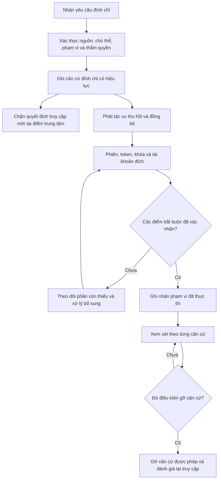

# Identity suspension: đình chỉ danh tính trong vòng đời IAM

## 1. Đình chỉ danh tính để làm gì?

**Identity suspension** là việc tạm thời ngăn hoặc giới hạn khả năng truy cập của một danh tính trong phạm vi được xác định, đồng thời giữ lại hồ sơ và dấu vết cần thiết để quản lý, điều tra hoặc khôi phục theo chính sách.

Ví dụ, một nhân viên tạm ngừng làm việc có thể bị chặn truy cập các ứng dụng doanh nghiệp trong thời gian đó. Một tài khoản có dấu hiệu bị chiếm dụng có thể bị đình chỉ ngay để hạn chế tác động. Một workload xuất hiện ngoài môi trường được cho phép có thể bị ngừng cấp thông tin xác thực và chặn truy cập tài nguyên.

Đình chỉ thường có khả năng được xem xét để gỡ bỏ, nhưng không có nghĩa hệ thống sẽ tự mở lại sau một khoảng thời gian. Việc khôi phục phải dựa trên điều kiện hiện hành và thẩm quyền phù hợp.

Trong IAM, đình chỉ là một thao tác xuyên suốt nhiều lớp:

```text
Quyết định đình chỉ
  → chặn cấp truy cập mới
  → xử lý phiên và thông tin xác thực còn tồn tại
  → thực thi tại các ứng dụng, API và tài nguyên liên quan
  → xác minh hiệu lực
  → xem xét tiếp tục đình chỉ, khôi phục hoặc kết thúc quan hệ
```

Chỉ đổi một trường trạng thái trong cơ sở dữ liệu chưa đủ để khẳng định mọi truy cập đã dừng. Hệ thống cần biết nơi nào đã thực thi, nơi nào còn chờ và khoảng thời gian mà truy cập cũ có thể vẫn được chấp nhận.

## 2. Phân biệt đình chỉ với các thao tác gần giống

Tên trạng thái có thể khác giữa các sản phẩm. Thiết kế nên định nghĩa hành vi thực tế thay vì mặc nhiên coi mọi trường `disabled` hoặc `inactive` đều có cùng tác động.

| Khái niệm | Mục đích | Ranh giới cần nhớ |
|---|---|---|
| Đình chỉ danh tính hoặc quan hệ truy cập | Tạm chặn hoặc giới hạn truy cập theo một phạm vi và lý do | Có thể ảnh hưởng nhiều tài khoản và cơ chế truy cập |
| Vô hiệu hóa một tài khoản | Ngừng sử dụng tài khoản trong một hệ thống cụ thể | Chưa chắc tác động tới tài khoản khác, phiên cũ hoặc token đã cấp |
| Khóa do đăng nhập thất bại | Hạn chế thử xác thực theo cơ chế chống lạm dụng | Không tự thay thế xử lý một sự kiện xâm phạm danh tính |
| Thu hồi một phiên | Ngừng chấp nhận phiên cụ thể | Không nhất thiết ngừng mọi phiên khác hoặc chặn đăng nhập mới |
| Thu hồi một yếu tố hoặc khóa | Ngừng tin một phương thức xác thực | Các yếu tố khác, token và quyền có thể vẫn còn |
| Gỡ một quyền | Bỏ khả năng thực hiện một nhóm hành động | Tài khoản vẫn có thể truy cập các chức năng khác |
| Kết thúc quan hệ và deprovisioning | Chấm dứt tư cách truy cập, thu hồi hoặc dọn tài khoản theo vòng đời | Không đơn thuần là một lần tạm dừng chờ quay lại |
| Xóa hồ sơ | Loại bỏ dữ liệu theo quy trình dữ liệu | Không phải cơ chế mặc định để chặn truy cập tức thời |

Ví dụ, khóa đăng nhập bằng mật khẩu không nhất thiết chặn một phiên SSO đang hoạt động hoặc một API key còn hiệu lực. Tương tự, gỡ vai trò quản trị có thể là kiểm soát đủ cho một trường hợp giới hạn đặc quyền, nhưng chưa đáp ứng yêu cầu đình chỉ toàn bộ truy cập doanh nghiệp.

Đình chỉ cũng không xóa bỏ kết quả kiểm chứng danh tính trước đây. Tổ chức có thể vẫn biết tài khoản thuộc về ai nhưng quyết định người đó hiện không được truy cập. Danh tính, xác thực và quyền sử dụng là các khía cạnh khác nhau.

## 3. Xác định lý do, phạm vi và thẩm quyền

### 3.1. Lý do phải có căn cứ và chủ sở hữu

Những nhóm tình huống thường gặp gồm:

- Quan hệ công việc tạm thời không cho phép truy cập.
- Dấu hiệu tài khoản, thiết bị hoặc thông tin xác thực bị xâm phạm.
- Một điều kiện bắt buộc của quan hệ đối tác chưa còn đáp ứng.
- Tạm ngừng một dịch vụ hoặc môi trường chạy workload.
- Yêu cầu quản trị được người có thẩm quyền phê duyệt theo chính sách.

Mỗi nhóm cần có nguồn khởi tạo, người chịu trách nhiệm và tiêu chí gỡ bỏ riêng. Một thay đổi trạng thái từ nguồn nhân sự có thể giải quyết đình chỉ do quan hệ làm việc; nó không tự kết luận một sự kiện xâm phạm an ninh đã được xử lý.

### 3.2. Phạm vi càng rõ, tác động càng kiểm soát được

Đình chỉ có thể áp dụng ở các cấp:

| Phạm vi | Ví dụ | Điều cần tránh |
|---|---|---|
| Toàn bộ truy cập trong miền quản lý | Chặn mọi tài khoản doanh nghiệp của một chủ thể khi xử lý xâm phạm | Chỉ chặn một tài khoản rồi báo đã dừng toàn bộ |
| Một quan hệ tổ chức hoặc tenant | Đối tác tạm ngừng tham gia dự án của tổ chức A | Vô tình chặn quan hệ độc lập hợp lệ tại tổ chức B |
| Một ứng dụng hoặc nhóm tài nguyên | Tạm dừng truy cập hệ thống tài chính | Dùng tên trạng thái chung khiến các hệ thống hiểu sai phạm vi |
| Đặc quyền hoặc hành động nhạy cảm | Tạm dừng khả năng cấp quyền quản trị | Để quyền tương đương còn tồn tại qua đường cấp khác |
| Một workload hoặc môi trường | Chặn danh tính dịch vụ trong môi trường không được phép | Vô tình dùng tài khoản người vận hành thay thế cho workload bị chặn |

Phạm vi phải được ánh xạ tới tài khoản, liên kết danh tính, phiên và tài nguyên cụ thể. Không nên xác định chủ thể chỉ bằng tên hiển thị hoặc email có thể thay đổi; cần dùng định danh và liên kết đáng tin trong phạm vi phù hợp.

### 3.3. Ai được đình chỉ, ai được gỡ?

Quyền yêu cầu, phê duyệt và thực thi có thể thuộc các vai trò khác nhau. Những thao tác có tác động lớn cần điều kiện xác thực, giới hạn phạm vi và phân tách nhiệm vụ phù hợp.

Nhân viên hỗ trợ không nên tự gỡ một đình chỉ an ninh chỉ vì người dùng gọi đến và trả lời đúng thông tin cá nhân. Người quản lý cũng không tự có quyền giải phóng mọi lệnh giữ từ bộ phận khác.

Một yêu cầu gửi từ ứng dụng hoặc connector phải được xác thực nguồn và phạm vi. Máy chủ không được tin một trường `suspended=false` do client gửi để thay thế quyết định có thẩm quyền.

## 4. Một danh tính có thể có nhiều lý do đình chỉ

Một cờ Boolean duy nhất dễ gây lỗi khi nhiều sự kiện cùng ảnh hưởng một danh tính.

Giả sử tài khoản của An đang bị chặn bởi hai căn cứ:

1. An tạm ngừng làm việc nên quyền doanh nghiệp bị đình chỉ.
2. Bộ phận an ninh đang xử lý nghi vấn lộ thông tin xác thực.

Khi An quay lại làm việc, căn cứ thứ nhất có thể được gỡ. Căn cứ thứ hai vẫn còn, nên tài khoản không được tự mở lại.

Một mô hình hữu ích là lưu **từng căn cứ đình chỉ độc lập**, có mã riêng, nguồn, phạm vi, thời điểm và trạng thái xử lý. Khả năng truy cập được tính từ các căn cứ áp dụng cho yêu cầu hiện tại cùng những điều kiện nền khác.

```text
Cho phép một hành động khi:
  tài khoản và quan hệ truy cập đủ điều kiện
  AND không có căn cứ đình chỉ đang có hiệu lực áp dụng cho hành động đó
  AND quyền hiện hành cho phép
  AND bằng chứng xác thực và ngữ cảnh đáp ứng chính sách
```

Không chỉ đếm tổng số căn cứ mà bỏ qua phạm vi. Một lệnh giữ áp dụng riêng cho ứng dụng A không nhất thiết chặn ứng dụng B. Ngược lại, một lệnh giữ toàn miền phải được xét cho mọi tài nguyên thuộc miền đó.

Ví dụ dữ liệu minh họa, dùng tham chiếu giả:

```json
{
  "subject_ref": "subject-example-A",
  "revision": 12,
  "holds": [
    {
      "hold_ref": "hold-example-1",
      "reason_code": "RELATIONSHIP_PAUSED",
      "scope": "CORPORATE_ACCESS",
      "owner": "WORKFORCE_OPERATIONS",
      "state": "RELEASED"
    },
    {
      "hold_ref": "hold-example-2",
      "reason_code": "CREDENTIAL_COMPROMISE_REVIEW",
      "scope": "CORPORATE_ACCESS",
      "owner": "SECURITY_OPERATIONS",
      "state": "OPEN"
    }
  ],
  "effective_corporate_access": "SUSPENDED"
}
```

Thời điểm xem xét lại cũng cần phân biệt với thời điểm tự hết hiệu lực. “Xem xét sau 24 giờ” không có nghĩa hệ thống được tự gỡ đình chỉ sau 24 giờ. Nếu chính sách cho phép tự kết thúc một hạn chế, phải xác định rõ điều kiện và vẫn kiểm tra các căn cứ còn lại.

## 5. Thiết kế trạng thái và luồng thực thi

Nên theo dõi ít nhất hai khía cạnh:

- **Trạng thái căn cứ:** còn hiệu lực, đang được đề nghị gỡ hoặc đã được gỡ theo quy trình.
- **Trạng thái thực thi:** chưa gửi tới hệ thống đích, đang áp dụng, thành công một phần hoặc đã được xác nhận tại các điểm bắt buộc.

Một căn cứ đã được tạo và có hiệu lực tại IAM có thể vẫn đang chờ ứng dụng cũ xử lý. Không nên che giấu khoảng trễ đó bằng một nhãn “đã hoàn tất” chung.



Mức ưu tiên có thể khác giữa đình chỉ theo lịch và xử lý sự kiện khẩn cấp. Với tình huống cần hạn chế tác động ngay, việc chặn trung tâm và gửi tác vụ thu hồi nên được khởi động sớm trong phạm vi có thẩm quyền, thay vì chờ mọi ứng dụng cập nhật xong mới bắt đầu chặn.

Nếu đình chỉ có thời điểm hiệu lực trong tương lai, hệ thống cần cả tác vụ thực thi đúng thời điểm và kiểm tra điều kiện thời gian tại điểm quyết định phù hợp. Không nên chỉ dựa vào một tác vụ lịch có thể bị bỏ lỡ mà không có cơ chế phát hiện.

## 6. Thu hồi truy cập phải đi qua những lớp nào?

### 6.1. Xác thực và cấp token mới

IdP hoặc hệ thống xác thực cần từ chối các luồng trong phạm vi đình chỉ, bao gồm các phương thức liên quan như mật khẩu, passkey, liên kết danh tính hoặc cấp token máy-máy.

Chỉ chặn mật khẩu có thể để các phương thức khác tiếp tục hoạt động. Một phiên tại IdP cũng có thể cho phép SSO mà không yêu cầu nhập lại mật khẩu, nên cần xử lý đúng trạng thái phiên và điều kiện cấp truy cập mới.

### 6.2. Phiên IdP và phiên ứng dụng

Phiên IdP và phiên ứng dụng thường là những đối tượng khác nhau. Chấm dứt một phiên IdP không tự bảo đảm mọi ứng dụng đã xóa phiên nội bộ của mình.

Ứng dụng cần cơ chế nhận sự kiện, kiểm tra trạng thái hoặc thực thi chặn theo thiết kế. Nếu có nhiều thiết bị hoặc nhiều phiên song song, phải biết phạm vi nào cần thu hồi, thay vì chỉ đăng xuất trình duyệt đang được nhìn thấy.

### 6.3. Access token và refresh token

Thu hồi refresh token ngăn việc sử dụng nó để xin token mới theo cơ chế thực thi tương ứng. Nó không tự làm mọi access token đã phát hành ngừng được tài nguyên chấp nhận ngay.

Với token tự chứa, tài nguyên có thể tiếp tục chấp nhận đến khi token hết hạn nếu không có cơ chế kiểm tra trạng thái, thu hồi hoặc sự kiện cập nhật phù hợp. Thời hạn ngắn giúp giới hạn khoảng phơi nhiễm trong một mô hình nhất định, nhưng không thay thế mọi yêu cầu thu hồi tức thời.

Các lựa chọn thiết kế có thể phối hợp thời hạn token, kiểm tra trạng thái tại tài nguyên, sự kiện thu hồi và bộ nhớ đệm có giới hạn. Cần xác định tác động tới độ trễ và tính sẵn sàng, đồng thời đo hiệu lực thực tế.

### 6.4. Khóa API, chứng thư và thông tin xác thực khác

Danh tính có thể có API key, khóa truy cập từ xa, chứng thư hoặc thông tin xác thực ứng dụng ngoài luồng đăng nhập thông thường. Chúng cần nằm trong danh mục liên kết và kế hoạch xử lý.

Nếu lý do đình chỉ liên quan đến nghi vấn bị lộ bí mật, có thể cần thu hồi hoặc thay thế những thông tin xác thực bị ảnh hưởng. Đình chỉ hành chính và xử lý xâm phạm không nhất thiết dùng cùng một tập tác vụ, nhưng phải cùng đạt mục tiêu truy cập đã định.

### 6.5. Quyền tại ứng dụng và tài nguyên

RBAC/ABAC phải thực thi trạng thái đình chỉ hoặc hạn chế tương ứng tại nơi ra quyết định. Một entitlement còn được lưu để phục vụ kiểm toán không được tự làm yêu cầu truy cập vượt qua lệnh đình chỉ.

Một số hệ thống chọn giữ các gán quyền nhưng áp điều kiện chặn; hệ thống khác gỡ những quyền được chỉ định. Cần ghi rõ tác động và căn cứ của từng cách. Nếu quyền bị gỡ, việc khôi phục sau này không nên sao chép lại toàn bộ ảnh chụp quyền cũ mà không đánh giá chính sách hiện hành.

### 6.6. Tác vụ đã được khởi chạy

Một công việc tải dữ liệu, tác vụ nền hoặc kết nối dài có thể đã được chấp nhận trước lúc đình chỉ. Quy trình phải xác định hành động nào được dừng, kiểm tra lại hoặc cho hoàn tất theo chính sách và đặc tính hệ thống.

Không nên mặc nhiên coi việc từ chối yêu cầu mới là đã hủy mọi tác vụ đang chạy. Đồng thời, không nên dừng tùy tiện một dịch vụ dùng chung mà chưa xác định danh tính thực thi, phạm vi ảnh hưởng và phương án vận hành.

## 7. SSO và provisioning không bảo đảm chặn tức thời mọi nơi

Trong môi trường SSO, ứng dụng có thể dựa vào IdP cho đăng nhập nhưng vẫn giữ phiên và quyền riêng. Vì vậy, cần lập danh mục hệ thống đích và cơ chế đình chỉ tương ứng.

| Loại tích hợp | Điều cần kiểm tra |
|---|---|
| Ứng dụng dùng SSO và phiên riêng | Sự kiện đình chỉ có làm phiên hiện tại mất hiệu lực hay chỉ chặn đăng nhập lần sau? |
| API dùng access token | Token đang tồn tại có bị chặn tại tài nguyên không, và trong khoảng thời gian nào? |
| Ứng dụng được provisioning | Trường trạng thái được ánh xạ sang hành vi nào của ứng dụng? |
| Ứng dụng có tài khoản cục bộ | Có đường đăng nhập độc lập còn hoạt động sau khi IdP chặn không? |
| Tài nguyên dùng khóa hoặc chứng thư | Cơ chế thu hồi hoặc từ chối được thực thi ở đâu? |
| Hệ thống cần thao tác thủ công | Ai chịu trách nhiệm, thời hạn và bằng chứng xác nhận là gì? |

Một cập nhật qua giao thức provisioning như SCIM có thể thay đổi trạng thái tài khoản theo cách ứng dụng hỗ trợ. Không nên tự suy ra rằng việc cập nhật thành công đồng nghĩa mọi phiên, khóa và token của ứng dụng đã bị thu hồi.

Trạng thái thực thi nên có bằng chứng từ hệ thống đích hoặc kiểm tra phù hợp. Việc hàng đợi đã nhận sự kiện mới chứng minh sự kiện đã được tiếp nhận ở một bước, chưa chứng minh tài nguyên đã ngừng cấp quyền.

Nếu một hệ thống không thể đạt mục tiêu thời gian chặn, cần xác định khoảng trễ, rủi ro tồn dư và kiểm soát bổ sung có thể áp dụng. Không nên báo “thu hồi tức thời” trong khi vẫn biết một đường truy cập chưa được xử lý.

## 8. Thực thi tin cậy: xử lý lặp, thứ tự và nguồn dữ liệu

### 8.1. Yêu cầu lặp không tạo trạng thái sai

Một yêu cầu đình chỉ có thể được gửi lại do hết thời gian chờ hoặc mất phản hồi. Hệ thống cần nhận diện cùng yêu cầu để không tạo nhiều căn cứ không liên quan hoặc phát sinh tác dụng phụ lặp ngoài ý muốn.

Tương tự, tác vụ thu hồi gửi lại phải giữ được mục tiêu. Một connector không nên vô hiệu hóa nhầm tài khoản khác vì định danh đích đã bị thay đổi hoặc tái sử dụng.

### 8.2. Sự kiện cũ không được mở lại truy cập

Giả sử một sự kiện `ACTIVE` cũ đến sau sự kiện đình chỉ mới. Nếu hệ thống chỉ áp dụng bản tin đến cuối cùng, tài khoản có thể bị mở lại sai.

Cần có quy tắc phiên bản, thứ tự hoặc đối soát theo từng nguồn và đối tượng. Trạng thái từ nguồn nhân sự cũng không được ghi đè một căn cứ đình chỉ an ninh độc lập.

Mô hình thường phù hợp là nguồn có thẩm quyền cập nhật phần dữ liệu của mình, còn trạng thái truy cập hiệu lực được tính từ tất cả điều kiện áp dụng. Không để nhiều nguồn tùy ý ghi vào cùng một cờ `active` mà không có quy tắc phối hợp.

### 8.3. Thao tác đồng thời phải có điều kiện bảo vệ

Đình chỉ, cấp quyền và cấp token có thể xảy ra gần nhau. Cần xác định điểm mà trạng thái mới trở thành nguồn quyết định, cùng cơ chế ngăn một tác vụ cũ hoàn tất theo giả định không còn đúng.

Một bản ghi thay đổi và sự kiện cần phát có thể được lưu trong cùng giao dịch cục bộ để hạn chế mất sự kiện. Sau đó vẫn cần chuyển phát, xử lý lặp, xác nhận và đối soát; không thể suy ra mọi hệ thống từ xa cập nhật nguyên tử cùng lúc.

Giả mã minh họa cho việc tiếp nhận một căn cứ đình chỉ:

```text
apply_suspension(command):
    require authenticated_and_authorized_source(command)
    require valid_subject_and_scope(command)

    atomically:
        if already_processed(command.request_ref):
            return recorded_result(command.request_ref)

        subject = load_current_subject_for_update(command.subject_ref)
        hold = add_authorized_hold(subject, command)
        increment_access_revision_for_affected_scope(subject, command.scope)
        record_audit_event(hold, command.actor_ref)
        record_pending_enforcement_tasks(hold)
        record_command_result(command.request_ref, hold.reference)

    return suspension_recorded_with_enforcement_pending(hold)
```

`increment_access_revision_for_affected_scope` chỉ có tác dụng ngăn sử dụng trạng thái cũ khi các điểm liên quan thực sự kiểm tra hoặc nhận cập nhật revision đó. Thêm một con số trong cơ sở dữ liệu mà không có nơi thực thi không làm phiên và token cũ tự mất hiệu lực.

## 9. Khôi phục sau đình chỉ là một quyết định mới

Gỡ một căn cứ không đồng nghĩa khôi phục mọi trạng thái trước đây. Trước khi mở lại truy cập, cần đánh giá:

1. Người hoặc nguồn đề nghị gỡ có thẩm quyền đối với đúng căn cứ đó không?
2. Điều kiện kết thúc căn cứ đã được chứng minh chưa?
3. Còn căn cứ đình chỉ nào khác áp dụng không?
4. Quan hệ công việc, tài khoản và nguồn danh tính còn hợp lệ không?
5. Những yếu tố, khóa hoặc thiết bị nào cần thu hồi, thay thế hay kiểm tra lại?
6. Quyền nào còn được phép theo vai trò, thuộc tính và phê duyệt hiện hành?
7. Hệ thống đích nào đã sẵn sàng thực thi trạng thái mới đúng phạm vi?

Với nghi vấn bị chiếm dụng, có thể cần xác minh lại người yêu cầu, xử lý yếu tố bị ảnh hưởng và yêu cầu đăng nhập mới bằng phương thức được chấp nhận. Chỉ đặt lại mật khẩu chưa chắc giải quyết được các yếu tố khác, token hoặc phiên đã bị lộ.

### Không làm sống lại phiên và token cũ

Một lỗi dễ bỏ sót là chỉ kiểm tra trạng thái tài khoản hiện tại. Trong lúc đình chỉ, token cũ bị từ chối vì tài khoản bị chặn. Khi mở lại cờ tài khoản, token đó có thể được chấp nhận trở lại nếu vẫn chưa hết hạn và hệ thống không lưu ranh giới thu hồi.

Vì vậy, thu hồi phiên hoặc thế hệ truy cập cần được giữ hiệu lực sau khi gỡ đình chỉ. Có thể dùng trạng thái phiên đã thu hồi, mốc chấp nhận hoặc thế hệ truy cập theo mô hình hệ thống. Những dữ liệu này phải được kiểm tra từ nguồn đáng tin và không được đặt lại về trạng thái cũ chỉ để tài khoản hoạt động.

Người dùng nên tạo phiên mới sau khôi phục theo chính sách. Nếu tài nguyên không hỗ trợ ngăn token cũ quay lại ngoài thời hạn token, giới hạn đó phải được nhận diện và xử lý trong thiết kế khôi phục, thay vì giả định mọi token đã biến mất.

### Đánh giá quyền hiện hành

Trong thời gian đình chỉ, người dùng có thể đã chuyển bộ phận, dự án kết thúc hoặc chính sách quyền thay đổi. Khôi phục toàn bộ danh sách quyền trước đó có thể tái cấp đặc quyền không còn cần thiết.

Cần tính quyền từ nguồn hiện hành và phê duyệt còn hiệu lực. Lịch sử quyền hữu ích cho điều tra và so sánh, nhưng không phải mệnh lệnh tự động cấp lại.

## 10. Ví dụ xuyên suốt: hai căn cứ đình chỉ chồng nhau

An là nhân viên có tài khoản SSO, phiên ở ứng dụng quản lý dự án và một token gọi API báo cáo. Các thời điểm dưới đây chỉ minh họa luồng xử lý, không phải cam kết thời gian cho mọi hệ thống.

| Thời điểm | Sự kiện | Trạng thái cần có |
|---|---|---|
| T0 | Nguồn nhân sự phát yêu cầu tạm dừng quan hệ truy cập | IAM tạo căn cứ A, chặn truy cập mới theo phạm vi |
| T1 | Tác vụ thu hồi được gửi tới IdP và ứng dụng | Theo dõi riêng kết quả của phiên, token và tài khoản đích |
| T2 | An ninh nhận báo cáo nghi lộ thông tin xác thực | Tạo căn cứ B độc lập, bổ sung tác vụ xử lý phù hợp |
| T3 | Một ứng dụng chưa cập nhật do connector lỗi | Trạng thái thực thi còn thiếu; cần cảnh báo và xử lý bổ sung |
| T4 | Nguồn nhân sự xác nhận An được quay lại | Có thể giải quyết căn cứ A; căn cứ B vẫn chặn truy cập |
| T5 | An ninh xác nhận điều kiện xử lý đã đáp ứng | Gỡ căn cứ B theo thẩm quyền, đánh giá lại quyền và điều kiện tài khoản |
| T6 | An đăng nhập mới bằng phương thức được chấp nhận | Phiên mới được tạo; phiên và token đã thu hồi không được hồi sinh |

Giả sử giữa T0 và T5, An đã được chuyển khỏi dự án cũ. Khi khôi phục, quyền dự án đó không được tự cấp lại từ ảnh chụp trước đình chỉ.

Nếu connector lỗi ở T3, việc IdP đã chặn không đủ để kết luận phiên ứng dụng cũ đã ngừng hoạt động. Nhóm vận hành cần xác định hành vi thực của ứng dụng và thực hiện cách xử lý đã được phê duyệt cho khoảng trễ đó.

Nếu người quản lý yêu cầu mở tài khoản ở T4, hệ thống phải chỉ ra còn căn cứ B cần chủ sở hữu tương ứng xử lý. Một yêu cầu gỡ có phạm vi hẹp không được chuyển thành thao tác xóa mọi căn cứ.

## 11. Danh tính workload và phụ thuộc vận hành

Một workload có thể cần đình chỉ khi bị nghi xâm phạm, chạy sai môi trường hoặc không còn đáp ứng điều kiện vận hành. Phạm vi có thể gồm ngừng cấp token mới, thu hồi thông tin xác thực và chặn truy cập tại dịch vụ đích.

Cần biết workload dùng danh tính nào, tài nguyên nào và chủ sở hữu nào chịu trách nhiệm. Nếu nhiều dịch vụ chia sẻ cùng một thông tin xác thực, đình chỉ có thể ảnh hưởng rộng và khó xác định chính xác phạm vi; đây là lý do cần danh tính và quyền tách biệt phù hợp.

Đình chỉ một nhân viên sở hữu workload không tự có nghĩa mọi workload người đó phụ trách phải dừng. Workload là danh tính riêng, còn trách nhiệm sở hữu cần được chuyển hoặc xem xét theo chính sách. Ngược lại, nếu người đó kiểm soát bí mật của workload và có nghi vấn xâm phạm, các thông tin xác thực liên quan cần được đánh giá trong phạm vi sự kiện.

Khi đình chỉ workload ảnh hưởng chức năng quan trọng, cần phối hợp với chủ dịch vụ để có phương án được phép, chẳng hạn chuyển sang một phiên bản hoặc danh tính dự phòng đã được quản lý. Không dùng tài khoản cá nhân khác hoặc bí mật chia sẻ không kiểm soát để lách lệnh đình chỉ.

Thông tin xác thực bị thu hồi không nên tự được dùng lại sau khôi phục. Nếu cần cấp mới, phải đi qua luồng xác định đúng workload, môi trường, quyền và thời hạn.

## 12. Khi nguồn hoặc hệ thống đích gặp lỗi

Sự cố vận hành phải có trạng thái rõ ràng. Không được hiểu “không đọc được trạng thái đình chỉ” thành “không có đình chỉ”.

| Sự cố | Hướng xử lý thiết kế |
|---|---|
| Connector không gửi được lệnh chặn | Giữ tác vụ chưa hoàn tất, thử lại có giới hạn, cảnh báo và dùng kiểm soát bổ sung theo phạm vi |
| Nguồn trạng thái truy cập không khả dụng | Áp chính sách suy giảm đã xác định cho tài nguyên; không tự gỡ điều kiện chặn |
| Sự kiện thu hồi bị trễ | Dùng thời hạn bộ nhớ đệm, kiểm tra bổ sung và đối soát theo yêu cầu của tài nguyên |
| Hệ thống đích xác nhận lỗi | Phân loại nguyên nhân, giao trách nhiệm xử lý và ghi rủi ro còn lại |
| Phản hồi thao tác bị mất | Kiểm tra trạng thái thực và dùng xử lý lặp an toàn trước khi gửi lại |
| Lệnh gỡ tới trước lệnh đình chỉ cũ | Dùng revision, trạng thái nguồn và đối soát để áp đúng quyết định hiện hành |

Với chức năng đặc quyền hoặc dữ liệu có tác động lớn, chính sách thường cần yêu cầu bằng chứng trạng thái đủ mới trước khi cho phép. Những lựa chọn duy trì chức năng ít nhạy cảm trong sự cố phải được xác định cụ thể; không được làm mất hiệu lực của một lệnh đình chỉ đã biết.

Truy cập khẩn cấp, nếu có, là quy trình riêng với danh tính, phạm vi, thời hạn và giám sát phù hợp. Không nên gỡ toàn bộ đình chỉ trên tài khoản đang điều tra chỉ để khôi phục một chức năng vận hành.

## 13. Nhật ký, dữ liệu nhạy cảm và đo hiệu lực

### Ghi đủ để giải thích quyết định

Nhật ký cần liên kết được yêu cầu, căn cứ, chủ thể, phạm vi, nguồn, người thực hiện, phiên bản chính sách và kết quả tại từng điểm bắt buộc.

Một số câu hỏi phải trả lời được:

- Ai hoặc nguồn nào yêu cầu đình chỉ, vào thời điểm nào?
- Phạm vi nào có hiệu lực từ khi nào?
- Hệ thống nào đã chặn, hệ thống nào còn chờ và bằng chứng xác nhận là gì?
- Ai gỡ căn cứ nào và dựa trên điều kiện nào?
- Sau khi gỡ, còn căn cứ nào khác và quyền nào thực sự được cấp lại?

Lý do đình chỉ có thể chứa thông tin nhân sự hoặc điều tra nhạy cảm. Nên tách mã lý do cần cho thực thi khỏi chi tiết chỉ những vai trò phù hợp mới được xem. Không phát nội dung điều tra đầy đủ tới mọi ứng dụng hoặc đưa toàn bộ vào token.

Không ghi mật khẩu, OTP, mã khôi phục, API key hoặc token truy cập vào nhật ký. Tham chiếu tài khoản, phiên và sự kiện vẫn cần được bảo vệ, có kiểm soát truy cập và thời hạn lưu phù hợp.

### Đo thời gian từ quyết định đến thực thi

Một chỉ số có ích là thời gian từ lúc yêu cầu có thẩm quyền được tiếp nhận đến lúc một tài nguyên cụ thể thực sự từ chối truy cập thuộc phạm vi đình chỉ. Cần đo theo các đường truy cập liên quan, không chỉ thời gian cập nhật bản ghi IAM.

Các số liệu nên theo dõi gồm:

- Độ trễ chặn tại điểm trung tâm và tại từng hệ thống đích.
- Số tác vụ thu hồi chưa hoàn tất, lỗi hoặc quá hạn.
- Số truy cập bị phát hiện sau thời điểm đình chỉ có hiệu lực.
- Các tài khoản, khóa hoặc phiên chưa được ánh xạ vào danh tính quản lý.
- Số lần gỡ sai phạm vi hoặc mở lại khi còn căn cứ khác.
- Chênh lệch giữa trạng thái IAM mong muốn và trạng thái hệ thống đích.

Nếu chỉ quan sát được một phần tài nguyên, phải nêu rõ giới hạn của kết luận. “Đã gửi sự kiện” và “đã xác nhận không còn đường truy cập trong phạm vi kiểm tra” là hai mức bằng chứng khác nhau.

## 14. Những lỗi thiết kế dễ gặp

| Lỗi | Hậu quả | Cách sửa hướng thiết kế |
|---|---|---|
| Chỉ đặt lại mật khẩu | Phiên, token hoặc khóa khác vẫn hoạt động | Lập danh mục và xử lý mọi cơ chế truy cập thuộc phạm vi |
| Dùng một cờ cho mọi căn cứ | Gỡ một lý do làm mất các lệnh giữ khác | Quản lý căn cứ độc lập và tính trạng thái hiệu lực |
| Chỉ chặn IdP | Phiên cục bộ hoặc tài khoản riêng tiếp tục truy cập | Thực thi và xác minh tại ứng dụng, API, tài nguyên |
| Cho rằng thu hồi refresh token xóa mọi access token | Đánh giá thấp khoảng truy cập còn lại | Thiết kế cơ chế token và đo độ trễ tại tài nguyên |
| Coi provisioning thành công là thu hồi hoàn tất | Bỏ sót phiên, khóa hoặc đường đăng nhập khác | Kiểm tra hành vi thực của hệ thống đích |
| Tự mở lại khi đến ngày xem xét | Truy cập được khôi phục khi điều kiện chưa đáp ứng | Phân biệt lịch xem xét với quyền gỡ đình chỉ |
| Khôi phục nguyên trạng mọi quyền | Tái cấp quyền đã không còn cần thiết | Tính lại từ nguồn và phê duyệt hiện hành |
| Mở cờ tài khoản làm token cũ dùng lại được | Phiên bị nghi xâm phạm quay lại sau khôi phục | Giữ ranh giới thu hồi và yêu cầu phiên mới theo thiết kế |
| Tin trạng thái cập nhật đến cuối cùng | Sự kiện cũ ghi đè quyết định mới | Quản lý phiên bản, thẩm quyền nguồn và đối soát |
| Không ghi nhận phần thực thi còn thiếu | Tổ chức tưởng đã chặn toàn bộ | Theo dõi kết quả từng điểm và trách nhiệm xử lý |

## 15. Tự kiểm tra bằng tình huống

**Tình huống 1: tài khoản đã bị khóa do nhập sai mật khẩu nhiều lần. Có thể coi đó là đình chỉ vì nghi bị chiếm dụng không?**

Không tự động. Khóa chống thử đăng nhập có phạm vi và cơ chế riêng. Nếu cần đình chỉ do sự kiện an ninh, phải xác định căn cứ, phạm vi, phiên, token và thông tin xác thực cần xử lý.

**Tình huống 2: một người có hai căn cứ đình chỉ, nhưng nguồn nhân sự đã cập nhật họ trở lại làm việc. Có được mở toàn bộ truy cập không?**

Không. Chỉ căn cứ thuộc phạm vi nguồn nhân sự mới được giải quyết theo thẩm quyền tương ứng. Các căn cứ còn lại phải được xem xét riêng, cùng điều kiện tài khoản và quyền hiện hành.

**Tình huống 3: IdP từ chối đăng nhập mới nhưng ứng dụng vẫn giữ phiên cũ. Đình chỉ đã hoàn tất chưa?**

Chưa thể khẳng định với ứng dụng đó. Cần thực thi chặn phiên hoặc yêu cầu tại ứng dụng bằng cơ chế đã thiết kế, rồi xác minh kết quả theo phạm vi bắt buộc.

**Tình huống 4: gỡ đình chỉ khiến một token trước sự kiện lại được chấp nhận. Vấn đề nằm ở đâu?**

Hệ thống đã dùng trạng thái hiện tại mà không giữ hiệu lực thu hồi của thế hệ truy cập cũ. Cần bảo vệ ranh giới thu hồi hoặc trạng thái phiên phù hợp, để khôi phục tài khoản không hồi sinh thông tin truy cập đã bị loại bỏ.

**Tình huống 5: một nhân viên bị đình chỉ nhưng dịch vụ họ quản lý vẫn cần chạy. Có nên cho dịch vụ dùng tài khoản đồng nghiệp không?**

Không. Cần xác định danh tính workload riêng, đánh giá thông tin xác thực bị ảnh hưởng và chuyển trách nhiệm hoặc vận hành dự phòng theo quy trình. Dùng tài khoản cá nhân khác làm mờ trách nhiệm và có thể lách phạm vi đình chỉ.

Một thiết kế identity suspension đầy đủ phải trả lời được đang chặn ai, chặn điều gì, do căn cứ nào, đã có hiệu lực ở đâu và cần điều kiện gì để khôi phục. Trạng thái trong IAM, phiên và token, quyền tại tài nguyên cùng vòng đời khôi phục phải thống nhất để việc đình chỉ tạo ra giới hạn truy cập thực sự.
