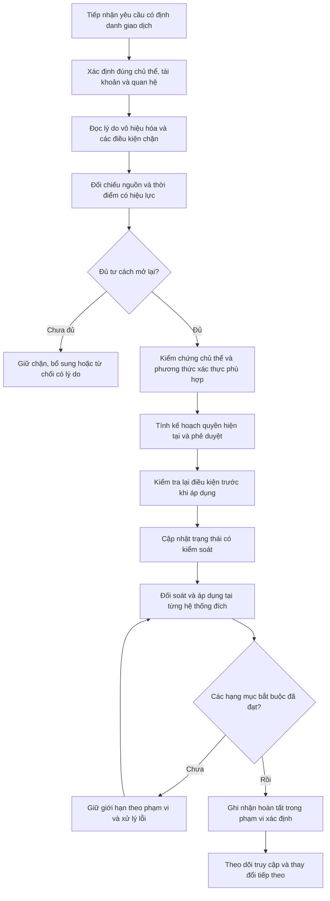

# Identity reactivation — Kích hoạt lại danh tính

## 1. Kích hoạt lại danh tính là gì?

An từng có tài khoản nhân viên trong một tổ chức. Khi An tạm nghỉ, tổ chức vô hiệu hóa khả năng truy cập. Một thời gian sau, An quay lại làm việc và quản lý yêu cầu mở lại tài khoản.

Thao tác đổi `enabled=false` thành `enabled=true` có thể làm tài khoản đăng nhập được, nhưng chưa trả lời những câu hỏi quan trọng:

- Quan hệ làm việc của An có đang hợp lệ không?
- Tài khoản bị vô hiệu hóa chỉ vì tạm nghỉ hay còn một lý do an ninh chưa được giải quyết?
- Các phương thức xác thực cũ có còn được tin cậy không?
- Những quyền nào vẫn cần thiết cho công việc hiện tại?
- Các ứng dụng đích có còn giữ nhóm, vai trò hoặc liên kết cũ không?

**Identity reactivation là quá trình đánh giá và khôi phục khả năng hoạt động của một danh tính hoặc các tài khoản liên quan sau thời gian không hoạt động hay bị vô hiệu hóa, theo điều kiện và chính sách hiện hành.** Trong IAM, đây là một chuyển trạng thái có kiểm soát của vòng đời danh tính, bao gồm điều kiện đủ tư cách, xác thực, phân quyền và trạng thái ở các hệ thống liên quan.

Mục tiêu là đưa đúng chủ thể trở lại khả năng truy cập cần thiết cho hiện tại. Lịch sử tài khoản giúp điều tra và đối soát, nhưng không phải bản sao cấu hình để tự động khôi phục mọi quyền cũ.

## 2. Phân biệt với các thao tác gần nhau

| Hoạt động | Vấn đề chính | Quan hệ với reactivation |
| --- | --- | --- |
| Mở khóa đăng nhập | Một cơ chế xác thực đang chặn thử đăng nhập, chẳng hạn do nhiều lần thất bại | Có thể chỉ xử lý khóa kỹ thuật; không tự thay đổi tư cách hoạt động của danh tính |
| Khôi phục tài khoản | Người dùng mất khả năng sử dụng phương thức xác thực hoặc cần lấy lại quyền kiểm soát | Có thể cần trong reactivation, nhưng không tự xác nhận người dùng còn đủ điều kiện truy cập |
| Đặt lại mật khẩu | Thay một bí mật xác thực | Không tự xóa lý do vô hiệu hóa hoặc khôi phục quyền |
| Reactivation | Chủ thể hoặc tài khoản cần trở lại hoạt động sau thời gian bị giới hạn | Cần đánh giá điều kiện hiện tại và phối hợp nhiều thành phần IAM |
| Cấp lại quyền | Một quyền cụ thể được phê duyệt và cấp mới hoặc cấp lại | Có thể đi sau reactivation; cần xét riêng theo công việc |
| Tuyển lại hoặc tiếp nhận lại | Tổ chức thiết lập một quan hệ mới với người từng làm việc | Có thể dùng lại liên kết danh tính khi được kiểm chứng, nhưng quyền phải xét theo quan hệ mới |
| Khôi phục dữ liệu | Lấy lại hồ sơ, tài liệu hoặc dữ liệu từ kho lưu | Không đồng nghĩa cho người cũ quyền truy cập dữ liệu đó |

Một tài khoản có thể đang hoạt động về mặt vòng đời nhưng bị khóa đăng nhập tạm thời. Ngược lại, mật khẩu có thể đúng và MFA có thể thành công, trong khi tài khoản vẫn không được phép sử dụng vì quan hệ tổ chức đã chấm dứt.

Đối với tài khoản đã xóa, không mặc nhiên coi việc phục hồi bản ghi từ bản sao lưu là reactivation hợp lệ. Tổ chức cần xác định có được khôi phục hay phải tạo tài khoản mới, cách giữ định danh và cách bảo vệ liên kết với chủ thể. Không tái sử dụng định danh của người cũ cho một người khác chỉ vì tên đăng nhập đã trống.

## 3. Trước hết phải hiểu lý do vô hiệu hóa

Lý do vô hiệu hóa quyết định điều kiện mở lại. Một quy trình duy nhất chỉ yêu cầu “quản lý đồng ý” sẽ bỏ sót các tình huống có bản chất khác nhau.

| Nguyên nhân | Điều cần xác nhận trước khi mở lại | Điểm cần tránh |
| --- | --- | --- |
| Tạm nghỉ và nay trở lại | Quan hệ hiện tại, ngày có hiệu lực và công việc được phân công | Giữ nguyên mọi quyền của vị trí trước khi nghỉ |
| Không sử dụng trong thời gian dài | Chủ thể còn đủ điều kiện, nhu cầu sử dụng và độ tin cậy của phương thức xác thực | Cho rằng chưa có sự cố nghĩa là mọi dữ liệu cũ vẫn phù hợp |
| Nghi tài khoản bị chiếm | Kết luận xử lý sự cố, điều kiện gỡ chặn và các phương thức phải thay thế | Mở lại chỉ vì người dùng đặt được mật khẩu mới |
| Chấm dứt quan hệ rồi quay lại | Quan hệ mới có hiệu lực, cách liên kết đúng người và chính sách tiếp nhận lại | Khôi phục vai trò và dữ liệu truy cập của quan hệ đã kết thúc |
| Vô hiệu hóa nhầm hoặc lỗi đồng bộ | Nguồn đúng, nguyên nhân và phiên bản trạng thái hiện tại | Dùng một sự kiện cũ để ghi đè lần vô hiệu hóa mới hơn |
| Bị chặn bởi nhiều chính sách | Mỗi điều kiện chặn đã được xử lý bởi bên có trách nhiệm | Gỡ một điều kiện rồi bỏ qua các điều kiện chặn còn lại |

Một tài khoản có thể có nhiều lý do chặn đồng thời. Ví dụ, nguồn nhân sự cho biết An đã quay lại, nhưng bộ phận an ninh vẫn giữ điều kiện chặn liên quan đến sự cố. Hai thông tin không phủ định lẫn nhau: An có thể đủ tư cách nhân viên nhưng tài khoản chưa đủ điều kiện hoạt động.

Cần mô hình hóa từng điều kiện thay vì lưu một trường văn bản “disabled” rồi để người cuối cùng cập nhật quyết định tất cả. Bên xác nhận quan hệ tổ chức không mặc nhiên có thẩm quyền kết thúc một biện pháp chặn an ninh.

## 4. Những lớp trạng thái phải xem xét riêng

Một danh tính thường liên quan đến nhiều lớp dữ liệu và quyền kiểm soát:

1. **Chủ thể:** tài khoản này đang đại diện cho ai?
2. **Quan hệ với tổ chức:** người đó là nhân viên, đối tác hay thành viên nào, trong giai đoạn nào?
3. **Tài khoản và điều kiện chặn:** tài khoản được phép hoạt động hay đang bị giới hạn vì lý do cụ thể?
4. **Phương thức xác thực và khôi phục:** mật khẩu, passkey, khóa bảo mật hoặc kênh khôi phục nào còn được chấp nhận?
5. **Quyền được cấp:** nhóm, vai trò, quyền trực tiếp, quyền có thời hạn và quyền quản trị nào đang tồn tại?
6. **Phiên và token:** các khả năng truy cập đã phát hành trước đó được xử lý ra sao?
7. **Hệ thống đích:** mỗi ứng dụng, thư mục hoặc môi trường hạ tầng đã áp dụng thay đổi nào?

Các lớp này không luôn chuyển trạng thái cùng lúc. Tài khoản ở IAM có thể đã sẵn sàng, trong khi ứng dụng đích vẫn đang bị chặn chờ đối soát quyền. Cũng có thể tài khoản trung tâm đã bị tắt nhưng một tài khoản cục bộ hoặc token cũ ở nơi khác vẫn còn được chấp nhận.

Thiết kế cần xác định trạng thái và trách nhiệm cho từng lớp, đồng thời thể hiện rõ phạm vi nào đã hoàn tất. Một thông báo “đã kích hoạt lại” phải đi kèm khả năng biết nó áp dụng cho tài khoản trung tâm hay cả các hệ thống đích bắt buộc.

## 5. Các điều kiện để đủ tư cách kích hoạt lại

### 5.1. Nguồn có thẩm quyền phải xác nhận quan hệ hiện tại

Nguồn nhân sự có thể quản lý quan hệ lao động; hệ thống quản lý đối tác có thể quản lý hợp đồng hoặc người bảo trợ của khách. Nguồn cần phù hợp với loại chủ thể và quan hệ đang xét.

Không dùng một email “tôi đã quay lại” làm bằng chứng duy nhất rằng quan hệ tổ chức đã có hiệu lực. Yêu cầu của quản lý có thể là một đầu vào cho quy trình, nhưng cần biết quản lý được phê duyệt điều gì và dữ liệu nguồn nào phải được đối chiếu.

Nếu nguồn không truy cập được hoặc dữ liệu mâu thuẫn, hệ thống chưa có đủ cơ sở kết luận. Không tự chuyển “không biết” thành “đang hoạt động”.

### 5.2. Phải gỡ đúng những điều kiện chặn cần thiết

Mỗi điều kiện chặn nên có loại, chủ thể chịu trách nhiệm, thời điểm và trạng thái xử lý. Việc xóa một cờ trong IAM không nên thay thế quyết định của bên có thẩm quyền đối với lý do chặn đó.

Ví dụ:

```text
Quan hệ nhân viên hiện tại:          hợp lệ
Điều kiện chặn do tạm nghỉ:          đã được gỡ
Điều kiện chặn do sự cố an ninh:      chưa được gỡ
Kết luận cho yêu cầu mở lại:         chưa đủ điều kiện
```

Nếu có quy trình truy cập khẩn cấp, đó phải là một cơ chế được quy định riêng về người phê duyệt, phạm vi, thời hạn và kiểm toán. Không dùng reactivation như một cách ngầm bỏ qua điều kiện chặn còn hiệu lực.

### 5.3. Liên kết với đúng chủ thể

Tìm được một hồ sơ cũ trùng tên chưa đủ để kết luận người đang yêu cầu là chủ thể của hồ sơ đó. Dùng định danh ổn định và liên kết được kiểm soát; trường hợp chưa rõ cần kiểm chứng bổ sung.

Với người quay lại sau khi chấm dứt quan hệ, tổ chức có thể giữ cùng một định danh chủ thể nếu chính sách cho phép và việc đối chiếu đủ tin cậy. Quan hệ làm việc mới vẫn cần được phân biệt với quan hệ cũ. Một số hệ thống có thể cần tài khoản mới; lựa chọn đó không được dẫn tới tự động kế thừa quyền chỉ vì là cùng một người.

### 5.4. Kiểm tra thời điểm có hiệu lực

Phê duyệt trước ngày trở lại không đồng nghĩa tài khoản được mở ngay. Cần xác định thời điểm cho phép áp dụng và kiểm tra lại điều kiện khi thực sự chuyển trạng thái.

Trong khoảng từ lúc phê duyệt tới lúc thực thi, nguồn có thể thay đổi, người dùng có thể rời tổ chức hoặc xuất hiện điều kiện chặn mới. Một yêu cầu được chấp thuận hôm qua không nên là mệnh lệnh vô điều kiện cho mọi thời điểm sau đó.

## 6. Kiểm tra lại xác thực, MFA và khả năng khôi phục

### 6.1. Chọn biện pháp theo lý do và rủi ro

Không phải mọi reactivation đều cần thu lại toàn bộ bằng chứng danh tính hoặc thay tất cả phương thức xác thực. Cần đánh giá độ tin cậy hiện tại và nguyên nhân vô hiệu hóa.

- Nếu tài khoản tạm nghỉ có kiểm soát, phương thức xác thực vẫn còn được chấp nhận và không có dấu hiệu mất kiểm soát, chính sách có thể cho tiếp tục dùng sau bước xác nhận phù hợp.
- Nếu tài khoản bị nghi chiếm quyền, cần xử lý những phương thức, bí mật và khả năng khôi phục có thể bị ảnh hưởng theo kết luận sự cố.
- Nếu người dùng không còn phương thức đáng tin cậy, phải đi qua quy trình khôi phục hoặc đăng ký lại phù hợp, giữ liên kết với đúng chủ thể.

Một phương thức đã bị thu hồi không được tự động chuyển trở lại tin cậy chỉ vì tài khoản được mở. Với thông tin có khả năng đã lộ, việc dùng lại có thể khôi phục chính khả năng truy cập của kẻ tấn công.

### 6.2. Đăng ký lại không được trở thành đường bỏ qua

Người đang đề nghị mở tài khoản không thể tự xác nhận mình bằng cách khai một email mới rồi dùng email đó để đăng ký MFA, nếu các bước ấy chưa đáp ứng yêu cầu chứng minh chủ thể.

Máy chủ cần bảo vệ liên kết giữa yêu cầu reactivation, kết quả kiểm chứng hoặc khôi phục và phương thức xác thực mới. Nếu cho thêm khóa bảo mật, passkey hay phương thức khác, kết quả phải thuộc đúng tài khoản và ngữ cảnh đã được cho phép.

Thông báo về thay đổi có thể giúp chủ thể phát hiện bất thường, nhưng việc gửi thông báo không tự thay thế kiểm chứng hay phê duyệt.

### 6.3. Không khôi phục phiên hoặc token đã bị thu hồi

Kích hoạt lại tài khoản không nên làm sống lại các phiên đã kết thúc, mã khôi phục đã dùng hoặc token đã bị thu hồi. Người dùng cần thiết lập khả năng truy cập mới theo điều kiện hiện tại.

Hệ thống cũng phải biết khả năng thu hồi thực tế của từng thành phần. Tắt hoặc bật tài khoản tại nhà cung cấp danh tính không có nghĩa mọi ứng dụng lập tức kiểm tra lại tất cả token đã phát hành. Tùy kiến trúc, cần kiểm tra trạng thái tại tài nguyên, cơ chế thu hồi, giới hạn thời gian chấp nhận hoặc chính sách phiên phù hợp.

Nếu một ứng dụng còn chấp nhận thông tin cũ, đây là khoảng trễ cần được quản lý, không phải bằng chứng việc thu hồi hay reactivation đã hoàn tất trên toàn hệ thống.

## 7. Tính lại quyền theo hiện tại

### 7.1. Lịch sử quyền chỉ là dữ liệu tham khảo

Trước khi nghỉ, An từng là quản trị viên dự án Phoenix. Khi quay lại, An làm việc ở dự án Atlas với nhiệm vụ đọc tài liệu. Sao chép lại nhóm và vai trò cũ sẽ cấp quyền không cần thiết.

Một kế hoạch quyền hiện tại có thể gồm:

| Hạng mục | Lịch sử | Quyết định cho lần trở lại |
| --- | --- | --- |
| Quyền cơ bản của nhân viên | Đã từng có | Tính từ quan hệ hiện tại và chính sách đang áp dụng |
| Thành viên Phoenix | Đã kết thúc | Không tự khôi phục |
| Quyền đọc Atlas | Chưa từng có | Cấp sau khi có quan hệ hoặc phê duyệt phù hợp |
| Quản trị sản xuất | Đã từng được cấp | Yêu cầu phê duyệt và điều kiện đặc quyền hiện tại |
| Ngoại lệ có thời hạn | Đã hết hiệu lực | Không mở lại chỉ vì tài khoản hoạt động trở lại |

Nếu cần cấp lại một quyền đã kết thúc, nên ghi nhận đó là một quyết định hiện tại với phạm vi và thời hạn mới. Không xóa dấu vết kết thúc trong lịch sử để làm như quyền chưa bao giờ bị thu hồi.

### 7.2. RBAC và ABAC đều cần dữ liệu mới

Với RBAC, hệ thống tính vai trò từ nhiệm vụ, đơn vị, quan hệ và các phê duyệt hiện tại. Việc gán lại mọi vai trò cũ làm suy yếu nguyên tắc ít quyền nhất và có thể tạo xung đột nhiệm vụ.

Với ABAC, các thuộc tính như trạng thái nhân viên, tổ chức, tư cách dự án và trạng thái thiết bị cần có nguồn và độ mới phù hợp. Một tài khoản vừa bật lại vẫn có thể bị đánh giá sai nếu bộ máy chính sách nhận thuộc tính cũ trong cache hoặc token.

Quyền quản trị và quyền được cấp đúng lúc cần luồng riêng phù hợp với rủi ro. Reactivation của tài khoản thông thường không đồng nghĩa mở lại phiên quản trị hoặc đặc quyền trước đây.

### 7.3. Dữ liệu cũ và quyền sở hữu tài nguyên

Một hộp thư, kho mã hoặc thư mục cũ có thể chứa thông tin từ vai trò trước. Quyết định cho phép truy cập chúng phải dựa trên nhu cầu và chính sách hiện tại, không chỉ dựa vào việc đó từng là tài khoản của An.

Nếu tài nguyên đã chuyển người quản lý, đã lưu trữ hoặc đã được phân loại khác, cần xử lý theo trạng thái đó. Khôi phục khả năng đăng nhập, khôi phục dữ liệu và trao quyền sở hữu là các quyết định cần phân biệt.

## 8. Quy trình reactivation từ yêu cầu tới đối soát



### 8.1. Tiếp nhận và ghi nhận quyết định

Yêu cầu cần nêu chủ thể, tài khoản, tổ chức, lý do, thời điểm mong muốn và bên đề nghị. Quyền tạo yêu cầu không đồng nghĩa quyền phê duyệt hoặc tự thực thi.

Quyết định nên gắn với một phạm vi và chính sách cụ thể. Nếu cần phân tách nhiệm vụ, người có lợi từ quyền được mở không tự phê duyệt cho mình. Những thay đổi nhạy cảm cần có trách nhiệm rõ ràng thay vì một thao tác quản trị không ghi nhận lý do.

### 8.2. Tính kế hoạch trước khi bật hệ thống đích

Với mỗi hệ thống đích, cần biết trạng thái mong muốn: tài khoản có cần hoạt động không, thuộc nhóm nào, có quyền trực tiếp nào phải xóa và những thông tin xác thực cũ nào phải được xử lý.

Nếu bật tài khoản đích trước khi loại bỏ quyền cũ, có thể xuất hiện một khoảng thời gian người dùng được truy cập bằng các quyền không còn phù hợp. Khi hệ thống hỗ trợ, hãy chuẩn bị hoặc điều chỉnh quyền trong trạng thái bị chặn, xác nhận kết quả rồi mới mở khả năng sử dụng theo chính sách.

Nếu một đích không hỗ trợ thứ tự an toàn đó, cần một thiết kế kiểm soát khác phù hợp với khả năng của nó. Không báo thành công chỉ vì API bật tài khoản trả về kết quả thuận lợi.

### 8.3. Kiểm tra lại ngay trước khi chuyển trạng thái

Tại thời điểm áp dụng, cần xác nhận điều kiện nguồn và phê duyệt vẫn phù hợp, không có điều kiện chặn mới, kế hoạch quyền chưa bị thay thế và yêu cầu chưa bị hủy hoặc hết hạn.

Kiểm tra và cập nhật cục bộ nên được bảo vệ bằng cơ chế chuyển trạng thái có điều kiện thích hợp. Ghi nhận phiên bản đã đánh giá giúp phát hiện trường hợp một thay đổi mới xuất hiện trong lúc yêu cầu đang xử lý.

Một giao dịch cơ sở dữ liệu cục bộ không thể bảo đảm mọi nguồn bên ngoài giữ nguyên trạng thái. Vì vậy, ngoài điều kiện chuyển trạng thái, hệ thống còn cần xử lý sự kiện mới, đối soát và thực thi chính sách truy cập hiện tại.

### 8.4. Theo dõi trạng thái theo từng đích

Có thể quản lý trạng thái yêu cầu như sau:

| Trạng thái | Ý nghĩa |
| --- | --- |
| `requested` | Yêu cầu đã được tiếp nhận |
| `pending_checks` | Đang kiểm tra nguồn, điều kiện chặn hoặc phương thức xác thực |
| `pending_approval` | Cần quyết định từ bên có thẩm quyền |
| `scheduled` | Đủ điều kiện lập lịch nhưng chưa tới thời điểm áp dụng |
| `applying` | Đang thực hiện kế hoạch và cập nhật các đích |
| `partially_applied` | Một số đích đã đạt, một số còn chờ hoặc lỗi |
| `completed` | Các điều kiện và đích bắt buộc trong phạm vi yêu cầu đã được xác nhận |
| `rejected` | Không đủ điều kiện và đã kết thúc yêu cầu |
| `cancelled` | Yêu cầu đã hủy, không được tiếp tục áp dụng |

Đây là mô hình minh họa, không phải danh sách trạng thái bắt buộc. Trạng thái yêu cầu phải tách khỏi trạng thái tài khoản và trạng thái từng hệ thống đích. Việc hoàn tất ở một phạm vi không được làm ứng dụng khác tự mở quyền chưa được kiểm tra.

## 9. Sự kiện cũ, xử lý lặp và thay đổi đồng thời

### 9.1. Sự kiện đến muộn không được làm sống lại tài khoản

Giả sử nguồn nhân sự phát sự kiện cho An trở lại làm việc, sau đó phát một thay đổi mới chấm dứt quan hệ. Nếu sự kiện trở lại đến IAM muộn hơn, hệ thống không nên áp dụng nó chỉ vì vừa nhận được.

Cần phân biệt thời điểm sự kiện đến với thứ tự hoặc phiên bản thay đổi tại nguồn. Có thể dùng phiên bản theo hồ sơ nguồn, kiểm tra trạng thái hiện tại hoặc cơ chế tương đương mà nguồn hỗ trợ. Không so sánh một cách tùy ý các số phiên bản từ những nguồn khác nhau như thể chúng cùng một dãy.

Thông tin về thời điểm có hiệu lực cũng cần được hiểu đúng. Một bản tin mới hơn về mặt tiếp nhận có thể chứa thay đổi cũ hoặc một điều kiện chỉ có hiệu lực trong tương lai.

### 9.2. Thử lại an toàn không có nghĩa thực hiện lại mọi lần

Một yêu cầu có thể được gửi lại vì lỗi mạng. Các bước cập nhật cần nhận diện giao dịch và có cách áp dụng lặp an toàn, tránh cấp lại nhiều lần hoặc tạo tài khoản trùng.

Nếu yêu cầu reactivation đã hoàn tất rồi tài khoản bị vô hiệu hóa bởi một sự kiện mới, gửi lại yêu cầu cũ chỉ nên trả hoặc ghi nhận kết quả cũ theo quyền được phép xem. Nó không được kích hoạt tài khoản lần nữa. Lần mở lại tiếp theo cần một quyết định mới trên trạng thái hiện tại.

### 9.3. Khi kế hoạch chỉ áp dụng được một phần

Giả sử cổng tài liệu đã sẵn sàng, nhưng hệ thống quản lý dự án chưa xóa được một nhóm cũ. Không nên mở tài khoản tại đích đó trước khi giải quyết sai lệch. Trạng thái một phần cần nêu rõ hạng mục nào còn bị chặn và ai xử lý.

Việc khắc phục thất bại không có nghĩa sao chép lại toàn bộ cấu hình cũ. Nếu bước cấp quyền mới lỗi, giữ trạng thái bảo vệ phù hợp và đối soát lại kế hoạch. Nếu có thay đổi an ninh mới, phải dừng hoặc điều chỉnh các bước còn lại theo chính sách.

Không giả định hệ thống IAM và tất cả ứng dụng đích hỗ trợ một giao dịch nguyên tử chung. Cần quản lý việc gửi lại, kết quả từng bước và kiểm tra trạng thái thực tế ở đích.

## 10. Ví dụ xuyên suốt: An quay lại với nhiệm vụ mới

### 10.1. Trạng thái trước khi quay lại

An từng là quản trị viên Phoenix. Trong thời gian tạm nghỉ, tài khoản IAM bị vô hiệu hóa, các phiên bị xử lý theo chính sách và tư cách dự án đã kết thúc. Một ứng dụng cũ vẫn còn lưu tên nhóm quản trị nhưng tài khoản tại đó đang bị chặn.

Khi trở lại, An được phân công đọc tài liệu Atlas. Không có yêu cầu khôi phục quyền quản trị Phoenix.

### 10.2. Kiểm tra tư cách và độ tin cậy

Nguồn nhân sự xác nhận quan hệ hiện tại và ngày trở lại. Hệ thống kiểm tra không còn điều kiện chặn khác. Quy trình cũng xác nhận người nhận lại tài khoản là đúng An và đánh giá phương thức xác thực hiện có theo chính sách.

Nếu có lý do nghi ngờ phương thức cũ, An thực hiện quy trình thay thế phù hợp. Các phiên đã thu hồi không được khôi phục; lần sử dụng mới cần xác thực theo điều kiện hiện tại.

### 10.3. Lập và áp dụng kế hoạch quyền

Kế hoạch gồm quyền cơ bản của nhân viên và quyền đọc Atlas đã được phê duyệt. Quyền quản trị Phoenix không được đưa vào kế hoạch.

Ở ứng dụng cũ, hệ thống phải loại bỏ nhóm quản trị còn lưu và xác nhận trạng thái phù hợp trước khi cho An sử dụng tài khoản tại đó. Nếu thao tác xóa nhóm thất bại, đích này vẫn bị chặn; các phần khác chỉ được mở trong phạm vi chính sách cho phép.

### 10.4. Một điều kiện mới xuất hiện

Trong lúc chờ đích cuối cùng, bộ phận an ninh thêm một điều kiện chặn mới. Hệ thống phải tiếp nhận thay đổi đó, dừng các bước chưa áp dụng và xử lý những khả năng truy cập đã mở theo chính sách tương ứng.

Phê duyệt trước đó không được dùng để bỏ qua điều kiện mới. Sau khi điều kiện chặn được giải quyết, hệ thống đánh giá lại trên dữ liệu hiện tại thay vì tiếp tục vô điều kiện từ điểm đã dừng.

### 10.5. Hoàn tất có bằng chứng

Yêu cầu chỉ hoàn tất khi các điều kiện và đích bắt buộc trong phạm vi đã đạt. Kiểm toán ghi nhận tài khoản được mở theo quan hệ nào, kế hoạch quyền nào, ai phê duyệt và kết quả áp dụng ở đâu.

Khi nhiệm vụ của An thay đổi lần nữa, quyền tiếp tục được quản lý theo vòng đời. Reactivation không biến kế hoạch quyền hiện tại thành một cấu hình cố định cho tương lai.

## 11. Dữ liệu cần lưu và trách nhiệm quyết định

Một bản ghi quy trình có thể giữ các thông tin tối thiểu để điều phối và đối soát. Ví dụ sau chỉ minh họa mô hình nội bộ:

```json
{
  "requestId": "rea_demo_014",
  "subjectId": "usr_demo_0042",
  "accountId": "acct_demo_018",
  "organizationId": "org_demo_a",
  "relationshipReference": "employment_demo_new_03",
  "reason": "return_from_leave",
  "workflowStatus": "pending_checks",
  "policyId": "workforce-reactivation-v1",
  "effectiveNotBefore": "2026-06-01T01:00:00Z",
  "entitlementPlanReference": "plan_demo_029",
  "approvalReferences": [],
  "targetResults": []
}
```

Trong ví dụ, `pending_checks` cho biết các bước chưa hoàn tất; một kế hoạch quyền đã có tham chiếu không đồng nghĩa đã được phê duyệt hoặc áp dụng. Thời điểm `effectiveNotBefore` chỉ là giới hạn không áp dụng sớm hơn, không phải lệnh tự động bỏ qua các kiểm tra khi tới giờ.

Những dữ liệu cần đối chiếu như phiên bản quan hệ, điều kiện chặn, kết quả kiểm tra phương thức xác thực và phiên bản kế hoạch có thể được lưu trực tiếp hoặc tham chiếu trong hệ thống điều phối. Cần phân biệt bằng chứng lịch sử với dữ liệu hiện tại được dùng để thực thi.

Phân công trách nhiệm thường gồm:

| Vai trò | Trách nhiệm điển hình |
| --- | --- |
| Nguồn quản lý quan hệ | Xác nhận quan hệ tổ chức và thời điểm có hiệu lực |
| Bên quản lý điều kiện chặn | Xác định khi nào lý do chặn thuộc phạm vi của mình đã được xử lý |
| Quản lý công việc hoặc chủ tài nguyên | Xác nhận nhu cầu và phạm vi quyền hiện tại |
| Hệ thống IAM | Điều phối chính sách, liên kết chủ thể, trạng thái tài khoản và yêu cầu cấp phát |
| Chủ ứng dụng đích | Bảo đảm thay đổi được áp dụng và có thể đối soát tại đích |
| Chủ thể được mở lại | Hoàn thành bước xác nhận hoặc đăng ký phương thức theo yêu cầu |

Phạm vi thực tế phụ thuộc tổ chức, nhưng cần rõ ai có thẩm quyền cho quyết định nào. Một tài khoản quản trị có khả năng kỹ thuật sửa trạng thái không có nghĩa người dùng tài khoản đó được tự phê duyệt mọi trường hợp.

## 12. SSO, liên kết danh tính và workload

### 12.1. Mở tài khoản ở nhà cung cấp danh tính chưa đủ

Trong kiến trúc SSO, cần kiểm tra cả trạng thái ở nhà cung cấp danh tính và tài khoản cục bộ của ứng dụng. Một ứng dụng có đăng nhập cục bộ, khóa API hoặc phiên riêng có thể có đường truy cập khác với SSO.

Ngược lại, ứng dụng có thể tự tạo tài khoản khi đăng nhập lần đầu hoặc khi thấy tài khoản chưa tồn tại. Luồng đó không nên vô tình tạo lại quyền cho người đang bị chặn hoặc bỏ qua quy trình reactivation. Điều kiện tiếp nhận và ánh xạ chủ thể phải nhất quán với trạng thái vòng đời hiện tại.

Với OAuth/OIDC hoặc liên kết danh tính, phản hồi đăng nhập hợp lệ không tự mang ý nghĩa “được phép khôi phục mọi quyền cũ”. Cần hiểu định danh trong phạm vi bên phát hành, ngữ nghĩa các thuộc tính và cách thay đổi trạng thái được truyền sang bên nhận.

### 12.2. Workload có điều kiện trở lại hoạt động riêng

Với dịch vụ nền, container hoặc tác vụ tự động, không dùng hồ sơ nhân sự làm cơ sở duy nhất cho việc kích hoạt lại danh tính của phần mềm. Cần xác nhận workload còn được triển khai, có chủ sở hữu chịu trách nhiệm, có mục đích hoạt động và đáp ứng các điều kiện của môi trường.

Nếu thông tin xác thực của workload đã bị thu hồi hoặc có khả năng lộ, không khôi phục lại chỉ để dịch vụ chạy được. Cần cấp khả năng xác thực mới theo cơ chế phù hợp và tính lại phạm vi quyền cần thiết. Quyền của workload cũng không tự đi theo quyền cá nhân trước đây của người vận hành.

## 13. Kiểm toán, bảo vệ dữ liệu và theo dõi vận hành

### 13.1. Kiểm toán phải cho biết vì sao tài khoản được mở lại

Dấu vết cần hỗ trợ trả lời:

- Tài khoản bị vô hiệu hóa vì những lý do nào?
- Điều kiện nào đã được gỡ, ai chịu trách nhiệm và bằng quyết định nào?
- Quan hệ tổ chức và danh tính chủ thể được xác nhận ra sao?
- Chính sách, dữ liệu và kế hoạch quyền nào được dùng khi áp dụng?
- Phương thức xác thực nào được giữ, thay thế hoặc tiếp tục bị thu hồi?
- Hệ thống đích nào đã đạt, thất bại hoặc vẫn bị chặn?
- Có sự kiện mới nào làm thay đổi quyết định trong lúc xử lý không?

Không ghi mật khẩu, mã OTP, mã khôi phục hay token truy cập vào log. Thông tin sự cố và bằng chứng danh tính có thể nhạy cảm; cần phân quyền đọc theo nhiệm vụ và chỉ giữ dữ liệu cần thiết cho mục đích đã xác định.

### 13.2. Các chỉ báo hữu ích

Theo dõi thời gian từ khi đủ điều kiện có hiệu lực tới khi khả năng truy cập cần thiết được khôi phục, số yêu cầu chờ theo từng nguyên nhân, tỷ lệ lỗi ở các đích và độ trễ đối soát.

Cũng cần theo dõi quyền cũ bị phát hiện còn tồn tại, yêu cầu bị chặn vì sự kiện mới, các lần xử lý ngoại lệ và trường hợp mở nhầm được xác nhận. Tỷ lệ mở lại thành công cao không tự chứng minh quy trình đúng nếu hệ thống bỏ qua kiểm tra hoặc không biết trạng thái thực tế tại đích.

Đánh giá vận hành nên bao gồm cả khả năng phục hồi công việc cho người hợp lệ và khả năng ngăn người chưa đủ điều kiện quay lại truy cập.

## 14. Những ngộ nhận và câu hỏi kiểm tra

| Ngộ nhận | Cách hiểu đúng |
| --- | --- |
| Reactivation chỉ là bật lại một cờ | Cần xem xét quan hệ, điều kiện chặn, xác thực, quyền và các đích liên quan |
| Nhân sự báo active thì có thể bỏ mọi chặn | Nguồn nhân sự xác nhận quan hệ; điều kiện chặn khác vẫn cần xử lý đúng thẩm quyền |
| Đã là cùng người thì dùng lại toàn bộ quyền cũ | Quyền phụ thuộc công việc và chính sách hiện tại |
| Đặt lại mật khẩu là đủ sau mọi sự cố | Còn phải xem các phương thức, phiên, token, quyền và điều kiện xử lý sự cố liên quan |
| Phê duyệt một lần thì không cần kiểm tra lại lúc áp dụng | Dữ liệu và điều kiện chặn có thể thay đổi trong thời gian chờ |
| Yêu cầu cũ gửi lại phải tiếp tục bật tài khoản | Yêu cầu cũ không được ghi đè một lần vô hiệu hóa mới |
| IAM báo thành công nghĩa là mọi ứng dụng đã sẵn sàng | Cần xác nhận theo từng đích và phạm vi hoàn tất |

Để tự kiểm tra một thiết kế, hãy trả lời:

1. Nếu nguồn nhân sự báo hợp lệ nhưng có điều kiện chặn an ninh, hệ thống quyết định theo nguyên tắc nào?
2. Nếu tài khoản từng là quản trị viên nhưng công việc mới chỉ cần đọc tài liệu, quyền nào được cấp lại và ai phê duyệt?
3. Nếu sự kiện kích hoạt lại cũ đến sau sự kiện vô hiệu hóa mới, hệ thống nhận biết bằng cách nào?
4. Nếu một đích chưa xóa được nhóm cũ, tài khoản tại đích đó được giữ ở trạng thái nào?
5. Nếu người dùng mất phương thức xác thực, quy trình nào chứng minh người nhận phương thức mới là đúng chủ thể?
6. Nếu yêu cầu đã hoàn tất nhưng sau đó bị chặn lại, gửi lại yêu cầu cũ có thể làm mở tài khoản không?

Những câu hỏi này giúp kiểm tra tính liên tục của quyết định qua nhiều lớp IAM, thay vì chỉ kiểm tra một API cập nhật trạng thái.

## 15. Điểm cần ghi nhớ

Identity reactivation là quyết định khôi phục khả năng hoạt động dựa trên điều kiện hiện tại. Quy trình cần hiểu lý do vô hiệu hóa, xác nhận quan hệ và chủ thể, xử lý các điều kiện chặn, kiểm tra phương thức xác thực và tính lại quyền theo nguyên tắc ít quyền nhất.

Kết quả chỉ có ý nghĩa khi trạng thái tại các hệ thống liên quan được áp dụng và đối soát rõ ràng. Quyền, phiên hoặc thông tin xác thực đã thu hồi không tự sống lại; yêu cầu và sự kiện cũ không được ghi đè quyết định mới. Sau khi mở lại, danh tính vẫn tiếp tục được quản lý qua xác thực, phân quyền, giám sát và thu hồi trong suốt vòng đời.
