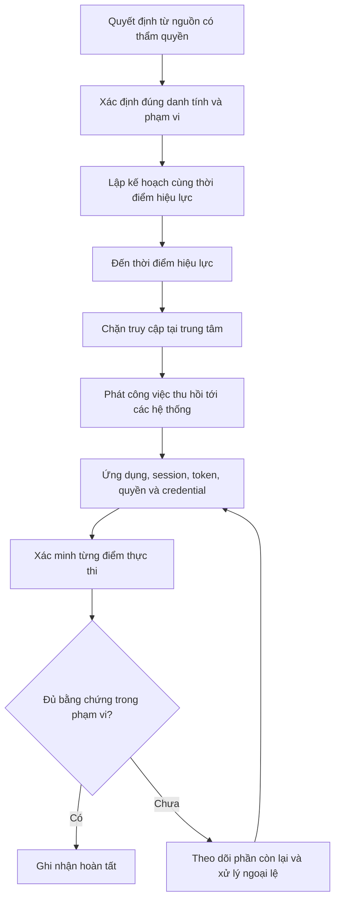

# Identity deactivation

## Mục tiêu và bối cảnh

**Identity deactivation** là việc ngừng cho phép một danh tính sử dụng các khả năng truy cập thuộc phạm vi đã xác định, theo quyết định có thẩm quyền và từ thời điểm có hiệu lực. Trong hệ thống IAM, thao tác này có thể tác động tới tài khoản, quyền, phiên, token, khóa và các ứng dụng liên kết.

Ví dụ, nhân viên Mai kết thúc hợp đồng lúc 17:00. Khóa đăng nhập tại IdP vào đúng thời điểm đó là một bước cần thiết. Tuy nhiên, nếu Mai vẫn dùng được phiên cổng nội bộ hoặc personal access token đã cấp, mục tiêu ngừng truy cập chưa hoàn tất.

Bài học thuộc chương **Identity lifecycle**, giúp người học:

- Phân biệt deactivation với khóa tạm, gỡ quyền, xóa tài khoản và xóa dữ liệu.
- Xác định phạm vi cần vô hiệu hóa ở danh tính người dùng và danh tính workload.
- Thiết kế luồng xử lý có thời điểm hiệu lực, chống sự kiện cũ và chịu được lỗi đồng bộ.
- Đánh giá hiệu lực bằng bằng chứng từ hệ thống đích, phiên và đường truy cập.
- Kết nối deactivation với SSO, OAuth/OIDC, SCIM, quản lý đặc quyền và kiểm toán.

Các trạng thái, dữ liệu và pseudocode trong bài là ví dụ thiết kế. Chi tiết API và hành vi cần được đối chiếu với từng nhà cung cấp.

## 1. Vô hiệu hóa điều gì?

### 1.1. Phân biệt các thao tác trong vòng đời

| Thao tác | Mục đích chính | Điều chưa thể suy ra |
| --- | --- | --- |
| Deactivation | Ngừng khả năng truy cập trong phạm vi quyết định | Dữ liệu đã bị xóa hoặc mọi ứng dụng đã xử lý xong |
| Suspension | Tạm ngừng theo một điều kiện hoặc quyết định | Khi hết thời gian thì mọi quyền cũ đều nên phục hồi |
| Lockout | Chặn hoặc trì hoãn xác thực, thường do cơ chế bảo vệ đăng nhập | Mọi phiên, token hoặc đường truy cập khác đã bị thu hồi |
| Entitlement revocation | Gỡ một vai trò, nhóm hoặc quyền cụ thể | Toàn bộ danh tính không còn được phép hoạt động |
| Deprovisioning | Thực hiện quá trình thu hồi cấp phát tài khoản và quyền | Mọi bước đều phải là xóa vật lý |
| Deletion | Xóa tài khoản hoặc dữ liệu theo phạm vi xác định | Mọi credential và bản sao dữ liệu đã hết tác dụng |

Tên trạng thái giữa các sản phẩm có thể khác nhau. Hồ sơ tích hợp cần mô tả hành vi thực tế, không chỉ ánh xạ từ “disabled” của hệ thống này sang “inactive” của hệ thống khác.

NIST SP 800-63A-4 phân biệt vòng đời tài khoản subscriber, đình chỉ hoặc kết thúc tài khoản và xử lý thông tin sau kết thúc theo chính sách lưu giữ. Điều này hỗ trợ việc tách ngừng truy cập khỏi xóa dữ liệu ngay lập tức. [NIST — Subscriber Accounts](https://pages.nist.gov/800-63-4/sp800-63a/accounts/).

### 1.2. Một người có thể có nhiều tài khoản

Mai có thể có:

- Tài khoản làm việc thông thường.
- Tài khoản quản trị riêng.
- Tài khoản cục bộ tại một ứng dụng.
- Danh tính khách tại một tenant đối tác.
- Credential cá nhân để truy cập Git hoặc API.
- Quyền quản trị một service account.

Cần lập ánh xạ từ định danh nội bộ ổn định tới các tài khoản và quan hệ liên quan. Chỉ tìm theo email có thể bỏ sót alias, tài khoản quản trị hoặc email đã đổi.

Một quan hệ công việc kết thúc cũng chưa chắc đồng nghĩa mọi quan hệ của cùng người đều kết thúc. Ví dụ, một người vừa có quan hệ nhân viên vừa có tài khoản khách được bảo trợ cho công việc khác. Chính sách phải chỉ rõ quyết định áp dụng cho quan hệ nào, tenant nào và tài nguyên nào.

### 1.3. Trạng thái quản trị khác với hiệu lực thực thi

Có thể nhìn deactivation qua ba lớp:

| Lớp | Câu hỏi |
| --- | --- |
| Quyết định | Ai yêu cầu ngừng quyền truy cập, với căn cứ và thời điểm nào? |
| Thực thi | Hệ thống nào đã chặn đăng nhập, ngừng cấp token và thu hồi quyền? |
| Xác minh | Có bằng chứng nào cho thấy các đường truy cập đã bị chặn theo yêu cầu? |

Một ticket đã được duyệt chứng minh có quyết định. Nó chưa chứng minh ứng dụng đang từ chối truy cập.

Tương tự, connector báo đã gửi yêu cầu chưa chứng minh phía nhận đã áp dụng hoặc các phiên cũ đã bị vô hiệu hóa.

## 2. Khi nào cần deactivation và ai có thẩm quyền?

### 2.1. Các tác nhân khởi phát

| Tình huống | Nguồn quyết định điển hình | Điều cần xác định |
| --- | --- | --- |
| Kết thúc hợp đồng hoặc nghỉ việc | Nguồn nhân sự được chỉ định | Thời điểm hiệu lực và phạm vi quan hệ |
| Hết hạn tài khoản cộng tác viên | Chính sách cùng người bảo trợ | Có gia hạn hợp lệ hay không |
| Tài khoản bị chiếm hoặc credential bị lộ | Quy trình ứng phó sự cố | Phạm vi cần chặn ngay và cách khôi phục |
| Tài khoản không còn nhu cầu | Chủ hệ thống hoặc chương trình rà soát quyền | Quan hệ với công việc và tài nguyên |
| Workload ngừng hoạt động | Chủ dịch vụ và quản lý thay đổi | Tài khoản máy, khóa và phụ thuộc còn lại |
| Người dùng yêu cầu đóng tài khoản | Quy trình tiếp nhận được bảo vệ | Xác định đúng chủ thể và dữ liệu cần xử lý |

Đây là các ví dụ về phân công. Tổ chức cần xác định nguồn có thẩm quyền cho từng thuộc tính và từng loại quyết định.

Một email tự do hoặc một sự kiện webhook chưa được xác thực không đủ để vô hiệu hóa tài khoản của người khác. Connector phải kiểm tra nguồn, quyền và ánh xạ danh tính.

### 2.2. Thời điểm có hiệu lực

Nên phân biệt:

- Thời điểm quyết định được ghi nhận.
- Thời điểm yêu cầu bắt đầu có hiệu lực.
- Thời điểm danh tính bị chặn tại trung tâm.
- Thời điểm từng hệ thống đích đã áp dụng.
- Thời điểm có đủ bằng chứng xác minh.

Nếu việc kết thúc hợp đồng được lên lịch từ trước, hệ thống có thể chuẩn bị kế hoạch và thực thi tại thời điểm được phê duyệt. Nếu credential bị lộ, quy trình có thể yêu cầu chặn khẩn cấp.

Thời hạn xử lý và mức chậm trễ chấp nhận được phải do tổ chức xác định theo rủi ro, loại truy cập và năng lực thực thi. Không nên gọi một mốc như “24 giờ” là yêu cầu chung cho mọi trường hợp khi chưa có căn cứ áp dụng.

Thời gian cần được biểu diễn có múi giờ hoặc quy đổi thống nhất. “17:00 ngày cuối hợp đồng” mà không biết múi giờ có thể gây vô hiệu hóa sớm hoặc muộn.

### 2.3. Trường hợp chuyển công việc

Nếu Mai chỉ chuyển từ dự án A sang dự án B, mục tiêu có thể là gỡ quyền của dự án A và cấp quyền mới được phê duyệt. Vô hiệu hóa toàn bộ danh tính có thể không phù hợp.

Ngược lại, giữ tài khoản hoạt động không phải lý do giữ tất cả quyền cũ. Vòng đời quyền cần đi cùng vòng đời quan hệ công việc để tránh tích lũy quyền.

## 3. Phạm vi thu hồi cần bao quát những gì?

Một kế hoạch deactivation nên có danh sách các điểm thực thi:

| Thành phần | Hành động cần thiết kế và xác minh |
| --- | --- |
| Directory và IdP | Chặn xác thực mới, ngừng phát hành kết quả đăng nhập theo chính sách |
| Ứng dụng nội bộ | Vô hiệu hóa tài khoản cục bộ và đường đăng nhập thay thế |
| Phiên | Kết thúc hoặc làm mất hiệu lực session phù hợp |
| OAuth grants và refresh token | Ngăn cấp thêm token dựa trên quyền đã thu hồi |
| Access token | Chặn sử dụng theo cơ chế kiểm tra và thu hồi của hệ thống |
| Credential cá nhân | Xử lý PAT, API key, SSH key, chứng thư hoặc mật khẩu riêng |
| Vai trò và nhóm | Gỡ quyền trong phạm vi quyết định, gồm quyền trực tiếp và kế thừa |
| Hệ thống đặc quyền | Chặn cấp đặc quyền mới, xử lý phiên và quyền đang được kích hoạt |
| Quyền sở hữu tài nguyên | Chuyển hoặc thu hồi quyền quản trị tài nguyên theo kế hoạch |
| SaaS và tài khoản khách | Thực thi tại từng tenant, ứng dụng và danh tính liên quan |

Việc kiểm kê không chỉ dựa vào các ứng dụng được liệt kê trên trang SSO. Một dịch vụ có thể chấp nhận API key hoặc tài khoản cục bộ mà không qua IdP.

Các authenticator như passkey hoặc khóa bảo mật cũng phải được xem xét trong phạm vi danh tính. Có thể ngừng chấp nhận authenticator cho tài khoản đã vô hiệu hóa mà không cần thu hồi thiết bị vật lý ngay tại cùng thời điểm. Với credential bị lộ, cần thêm biện pháp xử lý tương ứng.

## 4. Phiên và token là phần dễ bỏ sót

### 4.1. Vì sao khóa IdP chưa đủ?

Sau khi SSO thành công, ứng dụng thường có session riêng. Lần truy cập tiếp theo có thể chỉ dùng cookie của ứng dụng mà không hỏi IdP lại.

Do đó, IdP từ chối lần đăng nhập mới không tự làm mọi session đã có tại ứng dụng biến mất. Cần cơ chế thông báo, kiểm tra trạng thái hoặc quản lý phiên tại các relying party, gọi là RP.

Đăng xuất khỏi trình duyệt trên một thiết bị cũng không tự chặn phiên trên thiết bị khác, token API hoặc credential cá nhân.

### 4.2. OIDC Back-Channel Logout

OpenID Connect Back-Channel Logout cho phép OpenID Provider gửi yêu cầu đăng xuất trực tiếp tới RP. RP xác minh Logout Token rồi xác định và làm mất hiệu lực các phiên liên quan; cách kết thúc phiên bên trong RP phụ thuộc triển khai. [OpenID Connect — Back-Channel Logout](https://openid.net/specs/openid-connect-backchannel-1_0.html).

Hồ sơ tích hợp cần xác định:

- IdP và RP có hỗ trợ, cấu hình và kết nối được với nhau không?
- Yêu cầu đăng xuất áp dụng cho session nào?
- RP có kiểm tra nguồn phát hành, chữ ký, audience và các điều kiện của Logout Token không?
- Khi RP tạm không khả dụng, cơ chế gửi lại và xác minh là gì?

Đây là cơ chế đăng xuất, không phải giao thức quản lý toàn bộ vòng đời tài khoản.

Đặc tả còn phân biệt việc thu hồi refresh token theo thuộc tính offline access trong ngữ cảnh logout thông thường. Vì vậy, deactivation phải có chính sách thu hồi token riêng; không nên suy ra rằng một lần logout đã thu hồi mọi quyền truy cập ngoại tuyến. [OpenID Connect — Back-Channel Logout Actions](https://openid.net/specs/openid-connect-backchannel-1_0.html#LogoutActions).

### 4.3. Access token và refresh token

Refresh token có thể được dùng để xin token mới. Access token đã cấp có thể vẫn được API chấp nhận nếu API chỉ kiểm tra chữ ký, audience và hạn dùng mà không biết trạng thái mới.

RFC 7009 định nghĩa cơ chế thu hồi token. Quan hệ thu hồi giữa token, grant và các token liên quan cần xét hành vi máy chủ cùng loại token được hỗ trợ. Phản hồi HTTP 200 còn được dùng khi token được gửi tới đã không hợp lệ. [RFC 7009 — OAuth 2.0 Token Revocation](https://datatracker.ietf.org/doc/html/rfc7009).

Do đó, một phản hồi thành công cho một token không tự là bằng chứng đã xử lý hết token của danh tính trên mọi client và resource server.

Một kế hoạch cần xác định cả:

1. Ngừng phát hành hoặc gia hạn token cho quyền đã bị thu hồi.
2. Xử lý token đang tồn tại tại những điểm sử dụng.
3. Xác minh credential ngoài OAuth không tạo đường truy cập còn lại.

### 4.4. Kiểm tra trạng thái token và độ mới của dữ liệu

RFC 7662 cung cấp introspection để resource server hỏi authorization server về trạng thái token. Đặc tả lưu ý rằng cache kết quả có thể tạo khoảng thời gian token đã bị thu hồi nhưng tài nguyên vẫn dựa vào trạng thái cũ. [RFC 7662 — Token Introspection](https://www.rfc-editor.org/rfc/rfc7662.html).

Một thiết kế có thể dùng introspection, kiểm tra trạng thái danh tính, dữ liệu thu hồi hoặc phiên bản bảo mật tùy kiến trúc. Cần ghi rõ:

- Dữ liệu trạng thái được cập nhật bằng cách nào.
- Cache có hiệu lực bao lâu và được làm mới khi có deactivation ra sao.
- Khi nguồn trạng thái không khả dụng, hành vi theo rủi ro của tài nguyên là gì.
- Trường hợp nào chỉ còn bảo đảm ngừng truy cập sau khi token hết hạn.

Ví dụ, JWT còn hạn 20 phút và API chỉ xác minh offline có thể tạo cửa sổ truy cập còn lại tương ứng nếu không có kiểm soát khác. Token ngắn hạn giúp giới hạn cửa sổ, nhưng không tự tạo khả năng thu hồi tức thời.

Không nên xoay khóa ký chung chỉ để xử lý một người dùng khi có cơ chế phù hợp hơn; thao tác trên khóa chung có thể ảnh hưởng toàn bộ các chủ thể và dịch vụ sử dụng khóa đó.

## 5. SCIM và trạng thái tài khoản ở ứng dụng đích

### 5.1. Hiểu đúng `active=false`

SCIM định nghĩa `active` là trạng thái quản trị của người dùng. Ý nghĩa cụ thể do service provider xác định; ví dụ thường gặp là `false` biểu thị tài khoản bị đình chỉ. [RFC 7643 — User Resource Schema](https://www.rfc-editor.org/rfc/rfc7643.html#section-4.1.1).

Không thể mặc định rằng thuộc tính này ở mọi nhà cung cấp đều đồng thời:

- Hủy session đang tồn tại.
- Thu hồi mọi API key.
- Gỡ toàn bộ nhóm.
- Xóa dữ liệu.
- Chặn mọi đường xác thực cục bộ.

Đó là những hành vi cần được xác nhận trong hợp đồng tích hợp và kiểm tra thực tế.

### 5.2. Ví dụ yêu cầu cập nhật

Nếu hệ thống đích hỗ trợ SCIM PATCH, có thể dùng yêu cầu minh họa sau:

```http
PATCH /scim/v2/Users/u-1042 HTTP/1.1
Host: app.example.test
Content-Type: application/scim+json
Authorization: Bearer <credential-cua-connector>

{
  "schemas": [
    "urn:ietf:params:scim:api:messages:2.0:PatchOp"
  ],
  "Operations": [
    {
      "op": "replace",
      "path": "active",
      "value": false
    }
  ]
}
```

Đây là mẫu để đọc hiểu, không phải lệnh được thực thi. Endpoint, tài khoản đích và phương thức xác thực phải theo tích hợp thực tế.

RFC 7644 quy định PATCH là khả năng tùy chọn và có cơ chế khám phá hỗ trợ từ service provider. Khi hệ thống hỗ trợ versioning, có thể dùng điều kiện phiên bản phù hợp để giảm nguy cơ ghi đè thay đổi đồng thời. [RFC 7644 — Modifying with PATCH](https://www.rfc-editor.org/rfc/rfc7644.html#section-3.5.2).

### 5.3. Kiểm tra sau cập nhật

Connector có thể đọc lại tài khoản và ghi nhận `active=false`. Đây là bằng chứng của thuộc tính tài khoản tại hệ thống đích.

Để kết luận ngừng truy cập, còn phải xem hành vi của hệ thống: đăng nhập mới, session cũ, PAT và những đường truy cập đã được xác định trong kế hoạch.

Nếu tài khoản không tìm thấy, cần xác nhận ánh xạ đúng và khả năng tồn tại tài khoản khác. Một phản hồi “không tìm thấy” do connector trỏ sai tenant không chứng minh người đó không còn quyền.

## 6. Luồng deactivation có thể theo dõi và phục hồi lỗi

### 6.1. Thực thi theo kế hoạch



Các công việc có thể thực hiện song song. Với rủi ro cao, cần ưu tiên điểm chặn hiệu quả thay vì chờ một chuỗi tác vụ phụ kết thúc mới ngừng truy cập.

Ví dụ, không nên trì hoãn việc khóa quyền đăng nhập của Mai chỉ vì tác vụ chuyển quyền sở hữu một thư mục đang gặp lỗi. Công việc chuyển giao vẫn được theo dõi và xử lý riêng.

### 6.2. Tách trạng thái mong muốn và trạng thái quan sát được

Một bản ghi minh họa:

```json
{
  "identity_id": "person-1042",
  "scope": "corporate-workforce",
  "decision_id": "decision-82c1",
  "decision_revision": 18,
  "desired_access_state": "DISABLED",
  "effective_at": "2026-11-30T10:00:00Z",
  "central_access_state": "DISABLED",
  "workflow_state": "PARTIALLY_VERIFIED",
  "targets": [
    {
      "target_id": "hr-portal",
      "account_state": "DISABLED_CONFIRMED",
      "session_state": "REVOKED_CONFIRMED"
    },
    {
      "target_id": "project-saas",
      "account_state": "RETRY_PENDING",
      "session_state": "NOT_VERIFIED"
    }
  ]
}
```

Thời điểm và mã định danh chỉ là ví dụ. Trạng thái trung tâm đã DISABLED không được dùng để che việc SaaS còn đang chờ xử lý.

Tên trạng thái tổng thể nên phản ánh đúng bằng chứng. Nếu có ngoại lệ được chấp nhận theo thẩm quyền, báo cáo phải nêu rõ ngoại lệ và kiểm soát thay thế; không gọi đó là hoàn tất vô điều kiện.

### 6.3. Vai trò chịu trách nhiệm

| Vai trò | Trách nhiệm minh họa |
| --- | --- |
| Chủ nguồn quyết định | Xác nhận quan hệ, căn cứ và thời điểm |
| Đội IAM | Điều phối, ánh xạ danh tính và thực thi tại trung tâm |
| Chủ ứng dụng | Bảo đảm hành vi vô hiệu hóa, phiên và đường truy cập cục bộ |
| Đội vận hành connector | Theo dõi đồng bộ, retry và đối soát |
| Đội an ninh | Xử lý chặn khẩn cấp, nghi vấn và rủi ro còn lại |
| Chủ dữ liệu hoặc dịch vụ | Chuyển giao tài nguyên và trách nhiệm liên quan |

Đối với tác vụ chưa hoàn tất, cần có người nhận xử lý, thời hạn và mức ưu tiên. Đưa thông điệp vào hàng đợi lỗi mà không có cơ chế cảnh báo không giải quyết được quyền truy cập còn lại.

## 7. Chống sự kiện cũ, lặp và ghi đè trạng thái

### 7.1. Hai lỗi thứ tự thường gặp

**Sự kiện cũ kích hoạt lại:** bản ghi “đang làm việc” từ lần đồng bộ trước đến sau quyết định nghỉ việc và làm tài khoản active trở lại.

**Công việc vô hiệu hóa cũ đến muộn:** một người đã được phê duyệt quay lại nhưng lệnh deactivation cũ vẫn chạy, làm tài khoản bị khóa lại.

Để tránh hai lỗi này, cần biết trạng thái mong muốn hiện tại và phiên bản quyết định. Dấu thời gian nhận thông điệp không tự đủ để xác định quyết định nào mới hơn.

Nếu có nhiều nguồn, không nên so trực tiếp các số revision do những nguồn khác nhau tạo. Cần quy tắc thẩm quyền và cơ chế tổng hợp thành quyết định vòng đời nhất quán cho từng phạm vi.

### 7.2. Idempotency và transactional outbox

**Idempotency** giúp cùng một quyết định được xử lý lặp mà không tạo tác dụng phụ không mong muốn. Ví dụ, gửi lại lệnh “đảm bảo tài khoản không hoạt động” khác với một thao tác “đảo trạng thái hiện tại”.

**Transactional outbox** là cách ghi thay đổi nội bộ cùng các công việc cần phát ra trong một giao dịch bền vững. Nhờ đó, tránh tình huống tài khoản đã bị đánh dấu DISABLED nhưng công việc thu hồi chưa từng được gửi do tiến trình dừng.

Pseudocode cho bước thực thi tại trung tâm:

```text
execute_deactivation(decision_reference):
    begin_database_transaction()

    decision = load_approved_decision(decision_reference)
    identity = load_identity_for_update(decision.identity_id)

    require(decision.scope matches identity_scope)
    require(decision.is_authorized)

    current = resolve_current_lifecycle_decision(identity, decision.scope)

    if decision.revision != current.revision:
        record_superseded_work(decision)
        commit_database_transaction()
        return

    if now < decision.effective_at:
        ensure_scheduled_execution(decision)
        commit_database_transaction()
        return

    if decision_already_applied(decision.id):
        commit_database_transaction()
        return

    require(current.desired_state == DISABLED)

    identity.access_state = DISABLED
    identity.access_epoch = identity.access_epoch + 1
    identity.applied_revision = current.revision

    mark_local_sessions_invalid(identity, current.scope)

    for target in current.required_targets:
        insert_outbox_work_once(
            identity_id = identity.id,
            decision_revision = current.revision,
            target = target,
            desired_state = DISABLED
        )

    append_audit_record(identity, decision)
    mark_decision_applied(decision.id)

    commit_database_transaction()
```

Các API ngoài hệ thống được xử lý bởi worker sau commit. Không giữ một giao dịch cơ sở dữ liệu mở trong khi chờ mọi SaaS trả lời.

`access_epoch` là cơ chế nội bộ của ví dụ, không phải claim chuẩn do OAuth hoặc SCIM bắt buộc.

### 7.3. Connector vẫn cần kiểm soát cạnh tranh

Trước khi thực hiện công việc, connector kiểm tra quyết định hiện tại. Nếu hệ thống đích hỗ trợ phiên bản hoặc điều kiện cập nhật, có thể tận dụng để tránh lệnh cũ ghi đè trạng thái mới.

Chỉ kiểm tra tại nguồn rồi gọi API chưa loại bỏ mọi cuộc đua: trạng thái có thể đổi giữa hai thời điểm. Tùy khả năng hệ thống đích, cần kết hợp tuần tự hóa công việc theo danh tính và đích, kiểm soát phiên bản, cùng đối soát lại trạng thái mong muốn.

Nếu API đích không hỗ trợ cơ chế đó, phải ghi rõ giới hạn và xác minh sau thao tác. Không nên mô tả toàn quy trình phân tán như một giao dịch nguyên tử khi thực tế không có bảo đảm đó.

### 7.4. Đối soát thay vì chỉ tin sự kiện

**Reconciliation — đối soát** là việc định kỳ hoặc theo yêu cầu so trạng thái mong muốn với trạng thái thực tế.

Đối soát có thể phát hiện:

- Thông điệp bị bỏ lỡ.
- Quản trị viên ứng dụng tự bật lại tài khoản.
- Một ứng dụng phát sinh tài khoản cục bộ mới.
- JIT provisioning tạo lại tài khoản từ lần đăng nhập liên kết.
- Credential bị bỏ sót trong lần thu hồi đầu.

Đường JIT cũng cần kiểm tra trạng thái hiện tại của danh tính. Không được cho phép một assertion hoặc cấu hình cấp phát cũ tự khôi phục người đã bị vô hiệu hóa.

## 8. Thực thi tại ứng dụng và API

Một ứng dụng chỉ kiểm tra quyền lúc đăng nhập có thể tiếp tục chấp nhận người đã bị deactivation. Cần xác định những điểm phải đánh giá lại trạng thái trong vòng đời request và session.

Một logic minh họa:

```text
authorize_request(request):
    credential = validate_request_credential(request)
    subject = resolve_subject_in_expected_tenant(credential)

    security_state = read_security_state_with_required_freshness(subject)

    if security_state.disallows_current_access:
        deny_request()

    if credential_has_security_epoch(credential):
        require(credential.security_epoch == security_state.current_epoch)

    require(session_is_acceptable_if_present(request, security_state))
    require(current_permissions_allow(
        subject,
        request.action,
        request.resource
    ))

    allow_request()
```

Thiết kế này chỉ có hiệu lực khi ứng dụng lấy được trạng thái đủ mới và kiểm tra đúng tại điểm thực thi. Nếu epoch chỉ được đặt trong JWT mà API không so với trạng thái hiện tại, token cũ vẫn có thể được chấp nhận.

Không nên chỉ thêm `is_active` vào giao diện hoặc ẩn nút. Backend phải chặn hành động tương ứng.

Trong ABAC, trạng thái quan hệ công việc có thể là một điều kiện chặn. Trong RBAC, việc gỡ nhóm hoặc role vẫn cần tới các bản sao và cache. Một tài khoản bị vô hiệu hóa có quyền cũ trong token không được tiếp tục có quyền chỉ vì token mang role đó.

Với thao tác dài, kết nối lâu dài hoặc công việc đã được gửi trước thời điểm vô hiệu hóa, cần chính sách riêng. Ví dụ, một kết nối WebSocket đang mở hoặc lệnh xuất dữ liệu đã được xếp hàng có thể không đi qua cùng điểm kiểm tra như request mới.

## 9. Danh tính đặc quyền và workload

### 9.1. Đặc quyền cần được kiểm kê riêng

Mai có tài khoản thường và tài khoản quản trị. Nếu hệ thống chỉ vô hiệu hóa tài khoản thường, quyền quản trị còn lại có thể gây rủi ro lớn hơn.

Kế hoạch cần bao gồm các tài khoản quản trị riêng, quyền kích hoạt đặc quyền, phiên quản trị đang tồn tại và quyền lấy bí mật từ vault.

Nếu Mai đã biết credential dùng chung hoặc đã lấy bí mật có thể tái sử dụng, chặn tài khoản cá nhân không tự khiến bí mật đó mất hiệu lực. Có thể cần luân chuyển credential, thay đổi quyền và đánh giá các hệ thống sử dụng nó.

Việc luân chuyển phải có kế hoạch phụ thuộc để tránh vô tình làm gián đoạn hệ thống quan trọng. Trong trường hợp sự cố, mức ưu tiên và phạm vi ngắt truy cập do quy trình ứng phó quyết định.

### 9.2. Chủ sở hữu nghỉ việc khác với workload ngừng hoạt động

Giả sử Mai là người tạo service account chạy báo cáo đêm. Có hai quyết định cần tách:

1. Mai có còn được quản trị hoặc dùng credential của workload không?
2. Workload có còn được phép chạy nhiệm vụ báo cáo không?

Nếu workload vẫn cần hoạt động, có thể chuyển người chịu trách nhiệm, thu hồi quyền cá nhân của Mai và xử lý credential từng bị phơi lộ. Không nên để workload phụ thuộc lâu dài vào tài khoản hoặc refresh token cá nhân của người đã nghỉ việc.

Nếu chính workload bị deactivation, cần ngừng cấp credential mới và xử lý credential, workload identity binding, quyền cùng phiên còn lại theo kiến trúc của nó.

### 9.3. Credential ngắn hạn và quyền cấp mới

Một workload có thể sử dụng token hoặc chứng thư ngắn hạn. Ngừng cấp mới không tự hủy mọi credential đã được phát hành.

Cần xác định nơi còn chấp nhận credential cũ, cửa sổ hiệu lực còn lại và biện pháp thực thi khi yêu cầu chặn nhanh hơn thời gian hết hạn.

Đồng thời, chặn đúng đường cấp credential: còn quyền giả danh service account hoặc gọi token exchange có thể cho phép tạo credential mới dù một khóa cũ đã bị xóa.

## 10. Dữ liệu, quyền sở hữu và khôi phục

### 10.1. Ngừng truy cập không phải bàn giao dữ liệu

Tài khoản của Mai có thể sở hữu tài liệu, lịch chạy, kho mã hoặc phê duyệt đang chờ. Những tài nguyên đó cần người tiếp nhận và kiểm soát phù hợp.

Bàn giao không nên thực hiện bằng cách giao mật khẩu hoặc phiên của Mai cho người khác. Cần dùng cơ chế chuyển quyền sở hữu, cấp quyền quản trị hoặc truy cập dữ liệu theo thẩm quyền, đồng thời giữ dấu vết đúng chủ thể.

Deactivation cũng không thể thu hồi những bản sao dữ liệu đã được tải ra trước đó chỉ bằng một cờ tài khoản. Những rủi ro về dữ liệu, thiết bị hoặc sự cố phải được xử lý bằng cơ chế tương ứng.

### 10.2. Lưu giữ và quyền riêng tư

Sau khi truy cập bị ngừng, tổ chức có thể vẫn cần giữ một phần hồ sơ để vận hành, kiểm toán hoặc xử lý công việc theo chính sách áp dụng.

Cần phân biệt:

- Thông tin định danh phục vụ đối chiếu.
- Bằng chứng quyết định và thực thi.
- Dữ liệu công việc do tài khoản từng quản lý.
- Credential và bí mật không còn được dùng.
- Dữ liệu cần xóa khi hết mục đích hoặc thời hạn.

Không nên dùng “để kiểm toán” làm lý do giữ mọi dữ liệu và bí mật vô thời hạn. Thời hạn và quyền tiếp cận phải được xác định cho từng nhóm dữ liệu.

### 10.3. Khôi phục phải là quyết định riêng

Nếu deactivation bị áp dụng nhầm hoặc người dùng được phê duyệt quay lại, hệ thống cần luồng reactivation có thẩm quyền.

Luồng đó nên xem xét:

- Xác nhận đúng người và đúng quan hệ hiện tại.
- Kiểm tra căn cứ kích hoạt lại.
- Credential nào phải được đăng ký lại hoặc thay thế.
- Quyền nào được cấp theo vai trò hiện tại.
- Ứng dụng nào cần đồng bộ.
- Phiên và token cũ có được tiếp tục chấp nhận hay không.

Không nên mặc định khôi phục toàn bộ nhóm, quyền đặc quyền và token cũ từ một snapshot. Đặc biệt, credential bị lộ không trở nên an toàn chỉ vì tài khoản được bật lại.

Trong ví dụ dùng security epoch, khi kích hoạt lại cần duy trì quy tắc khiến credential hoặc session đã thu hồi không tự sống lại.

Một email hoặc tên đăng nhập được tái sử dụng cũng không được làm chủ thể mới nhận lịch sử và quyền của chủ thể cũ. Cần phân biệt định danh ổn định với nhãn liên hệ có thể thay đổi.

## 11. Xác minh và đo hiệu quả

### 11.1. Bằng chứng cần theo từng mục tiêu

| Mục tiêu | Bằng chứng minh họa |
| --- | --- |
| Không đăng nhập mới | Kết quả kiểm tra hoặc log thực thi tại IdP và ứng dụng |
| Không dùng session cũ | Kết quả thu hồi cùng hành vi từ chối session theo phạm vi |
| Không cấp token mới | Trạng thái grant, refresh token và đường cấp credential |
| Không dùng token hoặc khóa còn lại | Kiểm tra tại resource server và hệ thống liên quan |
| Không còn quyền đặc quyền | Trạng thái role, membership, entitlement và phiên đặc quyền |
| Không bị tự kích hoạt lại | Đối soát và kiểm tra các luồng cấp phát, JIT, đồng bộ |
| Hoàn tất chuyển giao | Xác nhận chủ sở hữu mới và quyền phù hợp |

Các phép kiểm tra phải được thiết kế để không làm lộ bí mật hoặc dùng credential của người thật tùy tiện. Có thể xác minh bằng dữ liệu quản trị đáng tin cậy và thử nghiệm với tài khoản kiểm thử được phê duyệt.

### 11.2. Đo thời gian có ý nghĩa

Gọi:

- `T_effective`: thời điểm quyết định có hiệu lực.
- `T_block_i`: thời điểm hệ thống đích i đã thực sự chặn các đường truy cập trong phạm vi.
- `L_i = T_block_i - T_effective`: độ trễ thực thi tại đích i.

Độ trễ trung tâm không thay cho độ trễ lớn nhất của các hệ thống bắt buộc. Nếu một hệ thống chưa có bằng chứng, không được bỏ nó khỏi báo cáo để làm số liệu đẹp hơn.

Ví dụ giả định, tính từ 17:00:

| Hệ thống hoặc đường truy cập | Thời điểm được xác minh là đã chặn |
| --- | --- |
| IdP | 17:00:05 |
| Cổng nội bộ và session | 17:00:20 |
| Git và PAT | 17:01:00 |
| SaaS dự án | Chưa xác minh |

Báo cáo phù hợp là đã xác minh ba mục và còn một mục chưa có bằng chứng. Chưa thể kết luận toàn bộ quá trình hoàn tất trong một phút.

Với số liệu tổng hợp, nên theo dõi cả phân bố thời gian, các trường hợp quá hạn, số credential bị bỏ sót, lỗi connector và các lần phát hiện tài khoản bị bật lại ngoài quy trình.

### 11.3. Khi hệ thống đích không hỗ trợ đủ

Có ứng dụng không hỗ trợ thu hồi session hoặc token ngay. Giới hạn này cần được ghi rõ cùng mức rủi ro và biện pháp thay thế đã được phê duyệt.

Ví dụ, có thể cần chặn ở gateway, ngừng đường mạng thích hợp hoặc dùng cơ chế quản trị khác trong phạm vi được phép. Tính hiệu quả của từng biện pháp cần kiểm chứng; không phải mọi tài nguyên đều đi qua cùng gateway.

Nếu chưa chặn hết, trạng thái phải tiếp tục phản ánh phần chưa hoàn tất hoặc ngoại lệ đang được chấp nhận. Việc connector không có tính năng không làm mục tiêu an ninh tự biến mất.

## 12. Tình huống kiểm thử thiết kế

Các tình huống dưới đây là đề xuất cho triển khai minh họa; chúng chưa phải kết quả kiểm thử một hệ thống đang chạy.

| Tình huống | Kết quả mong đợi |
| --- | --- |
| Tài khoản bị vô hiệu hóa nhưng trình duyệt còn cookie ứng dụng | Request tiếp theo bị xử lý theo chính sách phiên đã thu hồi |
| Refresh token còn được gửi sau thời điểm hiệu lực | Không cấp thêm quyền truy cập thuộc phạm vi đã thu hồi |
| JWT cũ còn hạn và API dùng cache | Cửa sổ truy cập còn lại đáp ứng chính sách đã xác định |
| SCIM xác nhận `active=false` nhưng PAT vẫn dùng được | Không đánh dấu hoàn tất; xử lý đường PAT |
| Một SaaS timeout | Các bước đã thành công được giữ, bước lỗi được retry và cảnh báo |
| Cùng quyết định được gửi nhiều lần | Không tạo tác dụng phụ trùng hoặc đảo trạng thái |
| Sự kiện nhân sự cũ tới sau quyết định ngừng truy cập | Không tự bật lại tài khoản |
| Công việc deactivation cũ tới sau reactivation hợp lệ | Không ghi đè trạng thái hiện tại |
| JIT đăng nhập cố tạo lại tài khoản | Kiểm tra trạng thái hiện hành và chặn theo quyết định |
| Người dùng có tài khoản quản trị riêng | Được kiểm kê và xử lý trong đúng phạm vi |
| Chủ sở hữu workload nghỉ việc | Thu hồi quyền cá nhân, xử lý credential và trách nhiệm workload theo kế hoạch |
| Một người có nhiều quan hệ còn hiệu lực | Áp dụng đúng phạm vi quyết định, tránh ngắt ngoài phạm vi |
| Kích hoạt lại sau sự cố | Quyền được xét lại; credential và phiên đã thu hồi không tự phục hồi |

Identity deactivation có thể được đánh giá bằng một câu hỏi cụ thể: sau thời điểm hiệu lực, những đường truy cập nào của chủ thể đã bị ngừng, đường nào còn chờ và bằng chứng nằm ở đâu? Câu trả lời cần bao quát tài khoản, quyền, phiên và credential thay vì chỉ một trạng thái trong directory.

