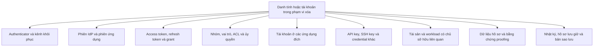

# Identity deletion: xóa danh tính và khép kín vòng đời truy cập

## 1. Identity deletion giải quyết vấn đề gì?

**Identity deletion** là quá trình loại bỏ một danh tính hoặc tài khoản khỏi phạm vi hoạt động đã xác định, xử lý các liên kết truy cập của nó và xóa dữ liệu theo chính sách áp dụng. Trong hệ thống IAM thực tế, đây thường là một quy trình nhiều bước qua nhiều hệ thống, không phải chỉ một câu lệnh xóa bản ghi người dùng.

Ví dụ, khi một nhà thầu kết thúc công việc, tài khoản tại IdP có thể bị xóa nhưng phiên đăng nhập trong ứng dụng vẫn còn, một personal access token vẫn gọi được API và tài khoản SaaS chưa được xử lý. Giao diện quản trị không còn hiển thị người dùng không có nghĩa mọi khả năng truy cập đã chấm dứt.

Một quy trình deletion cần làm rõ hai kết quả:

1. **Kết thúc khả năng truy cập trong phạm vi yêu cầu:** không đăng nhập, không tiếp tục dùng quyền hoặc nhận credential mới trái chính sách.
2. **Xử lý vòng đời dữ liệu:** xóa phần được phép xóa, giới hạn phần còn phải giữ và giải thích được những việc chưa hoàn tất.

Trong nền tảng quản lý danh tính và quyền truy cập (IAM), deletion nối quản lý tài khoản với MFA, phiên, cấp phát ứng dụng, RBAC/ABAC, OAuth/OIDC, danh tính workload, đặc quyền và kiểm toán. Nếu thiếu một mắt xích, tài khoản mồ côi hoặc credential còn hiệu lực có thể trở thành đường truy cập ngoài quản lý.

Sau bài này, người học có thể:

- Phân biệt deletion với disable, suspension, termination, deprovisioning và data erasure.
- Xác định phạm vi tài khoản, quyền, phiên và credential phải xử lý.
- Thiết kế thứ tự thực hiện mà không chờ xóa dữ liệu mới thu hồi truy cập.
- Hiểu giới hạn của SCIM DELETE, token revocation và logout.
- Theo dõi kết quả ở từng hệ thống, xử lý lỗi một phần và chống tái tạo danh tính từ sự kiện cũ.

## 2. Phân biệt những thao tác gần nghĩa

| Khái niệm | Ý nghĩa chính | Điều không tự bảo đảm |
| --- | --- | --- |
| Disable | Tắt một khả năng hoặc tài khoản theo cơ chế của sản phẩm | Dữ liệu đã bị xóa hoặc mọi phiên đã kết thúc |
| Suspension | Đình chỉ, thường có khả năng xem xét khôi phục | Quan hệ tài khoản đã kết thúc vĩnh viễn |
| Termination/account closure | Kết thúc tài khoản theo vòng đời | Mọi dữ liệu phải biến mất ngay tại thời điểm đó |
| Deprovisioning | Gỡ quyền, ngừng cấp phát hoặc xử lý tài khoản ở hệ thống đích | Mọi bản sao ngoài hệ thống đích đã bị xóa |
| Soft delete | Đánh dấu đã xóa hoặc ẩn bản ghi khỏi luồng thông thường | Authenticator, token và phiên không còn được chấp nhận |
| Hard delete/purge | Xóa bản ghi hoặc dữ liệu khỏi một kho cụ thể | Những kho, bản sao lưu và nhà cung cấp khác cũng đã xóa |
| Anonymization | Xử lý để dữ liệu không còn nhận diện cá nhân theo đánh giá phù hợp | Chỉ thay tên hoặc băm một field là đã đạt mục tiêu |
| Unlink | Gỡ một liên kết danh tính hoặc tài khoản | Tài khoản gốc và những liên kết khác cũng bị xóa |

Tên gọi khác nhau giữa sản phẩm. Vì vậy, đặc tả cần mô tả hiệu quả thực tế: endpoint nào bị chặn, dữ liệu nào biến mất, phần nào còn giữ và có thể khôi phục bằng cơ chế nào.

Theo NIST SP 800-63A-4, việc đình chỉ hoặc chấm dứt subscriber account và việc xóa thông tin cá nhân sau chấm dứt là các yêu cầu có quan hệ nhưng được mô tả riêng. Xóa dữ liệu phải tuân theo chính sách lưu giữ, xử lý đã được tài liệu hóa; không được suy ra một thời hạn xóa chung cho mọi tổ chức. [Nguồn: NIST SP 800-63A-4, mục 5.4](https://pages.nist.gov/800-63-4/sp800-63a/accounts/#subscriber-account-suspension-or-termination).

## 3. Xác định đúng đối tượng và phạm vi xóa

### 3.1. Một người có thể liên quan đến nhiều danh tính

Một cá nhân có thể có tài khoản nhân viên, tài khoản quản trị riêng, tư cách khách trong tenant khác và tài khoản khách hàng không liên quan đến công việc. Một tài khoản ứng dụng cũng có thể liên kết nhiều IdP.

Do đó, yêu cầu “xóa người dùng” cần xác định:

- Danh tính nội bộ hoặc tài khoản nào là đối tượng?
- Trong tenant, tổ chức và quan hệ nghiệp vụ nào?
- Xóa toàn bộ tài khoản, một tư cách thành viên hay chỉ một liên kết federation?
- Tài khoản nào ở hệ thống đích nằm trong phạm vi quản lý?
- Tài sản, dữ liệu dùng chung và danh tính dịch vụ nào có liên quan nhưng không thuộc phạm vi xóa trực tiếp?

Nếu một người rời dự án A nhưng vẫn làm dự án B, việc gỡ quyền dự án A không nên trở thành xóa toàn bộ danh tính. Ngược lại, nếu họ rời doanh nghiệp, chỉ gỡ một nhóm ở ứng dụng A có thể để sót phần lớn quyền.

### 3.2. Ràng buộc bằng định danh ổn định

Yêu cầu deletion nên gắn với định danh nội bộ, tenant và phiên bản hoặc lần tồn tại cụ thể của tài khoản. Không dùng email làm tiêu chí duy nhất để tìm và xóa trên mọi hệ thống.

Email có thể đổi hoặc được cấp lại. Nếu một tác vụ xóa chậm tìm lại người dùng theo email, nó có thể xóa nhầm tài khoản mới được cấp cho người khác. Bản đồ liên kết cần giữ đủ thông tin để tác vụ nhắm đúng resource đã được phê duyệt.

Với federation, subject cần được hiểu trong phạm vi issuer. Gỡ một cặp issuer–subject không tự chứng minh nên xóa tài khoản RP nếu tài khoản đó còn liên kết hợp lệ khác.

### 3.3. Nguồn yêu cầu phải có thẩm quyền

Yêu cầu có thể đến từ nguồn nhân sự, hệ thống quản lý nhà thầu, người dùng tự đóng tài khoản hoặc người quản trị có thẩm quyền. Mỗi luồng cần có quy tắc xác thực, phân quyền, phạm vi và thời điểm có hiệu lực.

Đối với tự phục vụ, phải ngăn kẻ chỉ lấy được một phiên yếu hoặc giả mạo request thực hiện xóa trái phép. Đối với quản trị, cần kiểm tra quyền đối với đúng tenant và tài khoản đích. Với webhook hoặc sự kiện nguồn, cần xác minh nguồn và chống xử lý nhầm dữ liệu cũ.

Xác thực lại hoặc phê duyệt bổ sung có thể phù hợp với rủi ro, nhưng không có một quy tắc trong bài yêu cầu mọi loại deletion đều dùng cùng một số người phê duyệt. Chính sách cần phân biệt đóng tài khoản thông thường, tình huống khẩn cấp và yêu cầu có phạm vi lớn.

## 4. Lập bản đồ phụ thuộc trước khi xóa bản ghi gốc

Một danh tính là điểm nối của nhiều đối tượng. Xóa điểm nối quá sớm có thể làm mất khả năng xác định những tài khoản và credential còn phải thu hồi.



Danh mục xử lý có thể bao gồm:

| Nhóm | Ví dụ cần tìm |
| --- | --- |
| Đăng nhập | Tài khoản IdP, tài khoản cục bộ, các liên kết SSO |
| Xác thực | Mật khẩu, passkey credential, TOTP secret, recovery code, credential dự phòng |
| Phiên và token | Cookie phiên phía máy chủ, refresh token, OAuth grant, personal access token |
| Quyền | Vai trò trực tiếp, nhóm lồng nhau, ACL tài nguyên, quyền tạm thời, delegation |
| Cấp phát | Resource ID ở SaaS, tài khoản VPN, hệ thống nội bộ |
| Credential bổ sung | API key, SSH public key được chấp nhận, chứng thư và quyền truy cập secret |
| Sở hữu | Repository, dashboard, lịch chạy, ứng dụng OAuth, workload và tài khoản dịch vụ |
| Dữ liệu | Hồ sơ, ảnh giấy tờ, sinh trắc, bản export, cache, log, backup |

Không nhất thiết mọi hệ thống đều có tất cả đối tượng trên. Điều quan trọng là biết rõ tài sản nào có thể tiếp tục cho phép hành động thay mặt danh tính đó và dữ liệu nào tồn tại ở đâu.

## 5. Tổ chức quy trình thành các giai đoạn có kết quả riêng

### 5.1. Thu hồi khả năng truy cập trước, xử lý dữ liệu theo vòng đời

Một trình tự tham khảo:

1. Tiếp nhận và xác minh yêu cầu, phạm vi, thời điểm hiệu lực.
2. Ngăn đăng nhập mới, cấp token mới, activation và recovery không còn được phép.
3. Thu hồi phiên, credential, grant và quyền trong phạm vi yêu cầu.
4. Xử lý tài khoản ứng dụng và chuyển giao tài sản cần thiết.
5. Xóa hoặc giảm dữ liệu theo phân loại retention, xử lý phần cần giữ.
6. Đối soát các hệ thống và báo cáo kết quả, ngoại lệ còn lại.

Một số bước có thể chạy song song. Khi cần chặn truy cập ngay, không nên trì hoãn chỉ vì việc chuyển quyền sở hữu một dashboard chưa xong. Việc bàn giao có thể do một chủ thể khác có thẩm quyền thực hiện sau khi tài khoản đã bị chặn.

### 5.2. Trạng thái vòng đời và tiến độ công việc là hai chiều

Ví dụ mô hình nội bộ:

```text
Trạng thái tài khoản:
    ACTIVE -> ACCESS_BLOCKED -> CLOSED

Tiến độ công việc deletion:
    REQUESTED -> VALIDATED -> EXECUTING -> VERIFYING -> COMPLETED
                                |
                                -> PARTIAL_FAILURE -> RETRYING

Tiến độ dữ liệu:
    PENDING_CLASSIFICATION -> PURGING -> PURGED
                           -> RETAINED_BY_POLICY -> REVIEW_DUE
```

Đây là mô hình minh họa, không phải state machine bắt buộc của NIST hay SCIM. Tài khoản có thể đã bị chặn trong khi một tác vụ purge ở nhà cung cấp vẫn chờ xử lý. Không dùng trạng thái công việc “đang chờ” để cho phép tài khoản tiếp tục hoạt động.

Ngược lại, không báo “đã xóa mọi dữ liệu” chỉ vì tài khoản đã closed. Giao diện và API nên trình bày kết quả đúng với phạm vi đã hoàn tất.

## 6. Thu hồi đăng nhập, phiên và token

### 6.1. Ngăn tạo khả năng truy cập mới

Điểm chặn cần áp dụng tại nơi có thể tạo đăng nhập, token hoặc credential mới. Ví dụ, ngoài cờ đình chỉ ở IdP, cần xử lý luồng tạo tài khoản theo SSO, lời mời pending, reset mật khẩu và các liên kết recovery liên quan.

Một người đã bị kết thúc không được dùng một invitation cũ để tái kích hoạt. Một cơ chế just-in-time provisioning cũng không được tạo lại tài khoản chỉ vì nhận được assertion từ một IdP vẫn đang hoạt động trong phạm vi khác.

### 6.2. Phiên IdP và phiên RP cần được xem xét riêng

IdP quản lý phiên của mình, còn ứng dụng RP có thể quản lý phiên cục bộ. Xóa tài khoản hoặc đăng xuất ở một nơi không có nghĩa mọi ứng dụng đã nhận và thực thi cùng một quyết định.

OIDC Back-Channel Logout cung cấp cơ chế để OP gửi Logout Token đến RP tham gia nhằm kết thúc những phiên được chỉ ra. Đây là cơ chế quản lý phiên, không phải yêu cầu xóa dữ liệu tài khoản; phạm vi hỗ trợ phải được xác nhận trong triển khai. [Nguồn: OpenID Connect Back-Channel Logout 1.0, mục 2](https://openid.net/specs/openid-connect-backchannel-1_0.html).

Với ứng dụng không hỗ trợ cơ chế đó, cần phương án thực thi khác: thu hồi phiên phía máy chủ, kiểm tra trạng thái tài khoản ở điểm truy cập hoặc tích hợp quản trị phù hợp. Nếu tồn tại khoảng trễ, cần biết giới hạn và rủi ro của nó.

### 6.3. Token OAuth có vòng đời riêng

Refresh token, access token và authorization grant cần được kiểm kê theo cơ chế hệ thống hỗ trợ. RFC 7009 mô tả token revocation; với access token tự chứa được resource server kiểm tra độc lập, hiệu quả thu hồi còn phụ thuộc thiết kế liên lạc và kiểm tra trạng thái. Chỉ xóa bản ghi người dùng không sửa nội dung một JWT đã phát hành. [Nguồn: RFC 7009, mục 2–3](https://datatracker.ietf.org/doc/html/rfc7009).

Một thiết kế có thể dùng token ngắn hạn, introspection, kiểm tra trạng thái hoặc danh sách thu hồi phù hợp. Mỗi cách có độ trễ và chi phí; cần xác định lúc nào API thực sự ngừng chấp nhận token cũ, không chỉ lúc yêu cầu revocation được gửi.

Không coi logout là thao tác mặc định thu hồi mọi grant offline hoặc mọi credential gọi API. Deletion cần có chính sách thu hồi riêng cho những khả năng truy cập còn lại đó.

### 6.4. Authenticator và credential không chỉ gồm mật khẩu

| Loại | Cần xử lý trong phạm vi liên quan |
| --- | --- |
| Password và verifier | Ngăn xác thực, xử lý dữ liệu lưu theo chính sách |
| TOTP và recovery code | Không còn chấp nhận secret hoặc mã dự phòng của tài khoản đã đóng |
| WebAuthn/passkey credential | Gỡ hoặc vô hiệu liên kết credential tại RP/CSP cần xử lý |
| SSH key hoặc chứng thư | Gỡ quyền sử dụng, thu hồi hoặc thay đổi trust theo hạ tầng áp dụng |
| API key và personal access token | Thu hồi ở hệ thống phát hành hoặc nơi kiểm tra hiệu lực |
| Credential dùng chung đã từng bị truy cập | Đánh giá việc thay credential và cập nhật bên sử dụng hợp lệ |

Gỡ một passkey credential phía máy chủ không có nghĩa hệ thống có thể xóa toàn bộ thiết bị hoặc kho passkey cá nhân của người dùng. Chỉ xử lý tài khoản và liên kết thuộc phạm vi quản lý; không xóa credential của các tài khoản không liên quan.

## 7. Gỡ quyền truy cập theo mọi đường cấp quyền

Quyền có thể đến từ nhiều đường: role trực tiếp, nhóm lồng nhau, thuộc tính ABAC, ACL của từng tài nguyên, quyền được ủy quyền hoặc phiên đặc quyền đang hoạt động. Deletion cần tính đến những đường này, không chỉ xóa membership nhìn thấy trên một màn hình.

Ví dụ, người dùng đã rời nhóm “Developers” nhưng vẫn được gán trực tiếp quyền quản trị repository. Hoặc nhóm đã được gỡ nhưng một phiên đặc quyền tạm thời còn hiệu lực. Các khả năng truy cập đó phải được kiểm tra theo phạm vi yêu cầu.

Những điểm dễ bỏ sót gồm:

- Membership gián tiếp qua nhóm lồng nhau hoặc đồng bộ từ nguồn khác.
- Resource policy tham chiếu subject, username hoặc email.
- Quyền sở hữu cho phép sửa policy và cấp lại quyền.
- Delegation hoặc quyền hành động thay mặt người khác.
- Cache quyết định quyền chưa được làm mới.
- Luồng tự cấp lại quyền dựa trên thuộc tính nguồn đã cũ.

Nếu chuyển quyền sở hữu, cần chọn người hoặc nhóm có thẩm quyền và ghi nhận phạm vi. Không tự thay mọi chỗ bằng tài khoản quản trị chung, vì cách đó có thể tạo đặc quyền tập trung và làm mất trách nhiệm giải trình.

## 8. Deprovisioning bằng SCIM và giới hạn của DELETE

SCIM hỗ trợ yêu cầu xóa resource bằng HTTP DELETE. RFC 7644 cho phép service provider không xóa vĩnh viễn dữ liệu nội bộ, nhưng resource đã xóa phải không còn xuất hiện trong kết quả truy vấn và các thao tác với resource cũ trả lỗi 404. DELETE thành công trả 204. Vì vậy, kết quả giao thức không tự chứng minh mọi bản sao dữ liệu đã bị purge. [Nguồn: RFC 7644, mục 3.6](https://www.rfc-editor.org/rfc/rfc7644.html#section-3.6).

Minh họa request qua một kết nối được bảo vệ và có xác thực phù hợp; không phải lệnh để chạy trực tiếp:

```http
DELETE /scim/v2/Users/user-demo-008 HTTP/1.1
Host: iam.example.org

HTTP/1.1 204 No Content
```

Cần xác nhận thêm hành vi ứng dụng đối với phiên, đăng nhập cục bộ, credential và dữ liệu được giữ lại. Đặt `active = false` là thay đổi trạng thái quản trị, không đồng nhất với DELETE.

### 8.1. Đối soát resource chính xác

Kết quả “không tìm thấy” có thể hữu ích khi xác nhận mục tiêu không còn tồn tại, nhưng không được tự coi mọi lỗi 404 là thành công. Cần biết request đã đi tới đúng tenant, đúng ứng dụng, đúng endpoint và đúng resource đã được liên kết từ trước.

Nếu một connector gọi nhầm ID, nó có thể nhận 404 trong khi tài khoản thật vẫn hoạt động. Nếu định danh bị tái sử dụng hoặc ánh xạ sai, connector còn có thể tác động nhầm người.

### 8.2. Theo dõi riêng từng ứng dụng

Không đánh dấu toàn bộ deprovisioning thành công chỉ vì lần gọi đầu tiên đã được nhận. Mỗi hệ thống đích cần trạng thái yêu cầu, phản hồi, lần kiểm tra, lỗi và việc xử lý tiếp theo.

Nếu ứng dụng chỉ cung cấp disable hoặc soft delete, cần ghi đúng mức xử lý và thực hiện phần xóa dữ liệu bằng cơ chế mà ứng dụng hỗ trợ. Không dùng tên chức năng “Delete user” thay cho việc xác nhận hành vi thực tế.

## 9. Tài sản, tài khoản dịch vụ và workload liên quan

### 9.1. Sở hữu không đồng nghĩa phải xóa tài sản

Một nhân viên có thể là chủ sở hữu repository, dashboard, lịch chạy hoặc ứng dụng tích hợp. Xóa tài khoản của họ không có nghĩa xóa tài sản dùng chung của tổ chức.

Trước khi mất khả năng tra cứu liên kết, cần xác định tài sản nào được chuyển giao, tài sản nào chấm dứt và ai chịu trách nhiệm. Có thể lưu trạng thái “chờ chuyển giao” trong công việc deletion mà vẫn giữ tài khoản người dùng ở trạng thái không được truy cập.

### 9.2. Workload có danh tính riêng vẫn cần owner hợp lệ

Nếu workload identity vẫn phục vụ nghiệp vụ, có thể cần chuyển owner và đánh giá lại quyền, thay vì xóa nó cùng tài khoản người tạo. Ngược lại, workload không còn cần thiết phải được kết thúc vòng đời, thu hồi credential và loại bỏ trust tương ứng.

Một tác vụ CI chạy bằng personal access token của người nghỉ việc là dấu hiệu liên kết sai giữa danh tính con người và máy. Khi xử lý, cần chuyển sang danh tính workload phù hợp và thu hồi token cũ; không để tài khoản người dùng tiếp tục active chỉ để tránh sửa tác vụ.

### 9.3. Secret đã được biết không thể bị “quên” bằng thao tác xóa user

Nếu người dùng từng đọc một secret dùng chung, xóa quyền đọc trong vault không làm bản sao họ đã có biến mất. Cần đánh giá thay secret và cập nhật các bên sử dụng hợp lệ theo quy trình quản lý bí mật.

Phạm vi thay thế phải dựa trên credential có nguy cơ và kiến trúc thực tế. Không mặc nhiên thay mọi khóa ký của toàn hệ thống chỉ vì xóa một tài khoản thông thường; cũng không bỏ qua secret dùng chung chỉ vì tài khoản cá nhân đã bị đóng.

## 10. Xóa dữ liệu theo phân loại và chính sách lưu giữ

### 10.1. Đóng tài khoản và xóa dữ liệu có thời điểm khác nhau

Hồ sơ tài khoản có thể chứa thông tin liên hệ, thuộc tính đã validation, bằng chứng proofing, sinh trắc và lịch sử sự kiện. Những nhóm dữ liệu này có thể có mục đích lưu giữ khác nhau sau khi tài khoản đóng.

NIST SP 800-63A-4 yêu cầu xóa thông tin cá nhân khỏi subscriber account records sau termination theo các yêu cầu retention và disposal đã được ghi trong practice statement. Cần diễn đạt đúng phần này thay vì hứa mọi dữ liệu biến mất tức thì hoặc cho rằng nhật ký được phép giữ vô hạn. [Nguồn: NIST SP 800-63A-4, mục 5.4](https://pages.nist.gov/800-63-4/sp800-63a/accounts/#subscriber-account-suspension-or-termination).

| Nhóm dữ liệu | Câu hỏi cần giải quyết |
| --- | --- |
| Hồ sơ vận hành | Thuộc tính nào không còn mục đích và có thể xóa? |
| Bằng chứng proofing | Ảnh giấy tờ, video và kết quả còn cần giữ theo điều kiện nào? |
| Sinh trắc | Mẫu, template và bản sao ở nhà cung cấp được xử lý ra sao? |
| Credential | Dữ liệu bí mật hoặc liên kết còn tồn tại ở đâu sau thu hồi? |
| Dữ liệu nghiệp vụ | Thuộc sở hữu cá nhân hay là hồ sơ giao dịch, tài sản dùng chung cần xử lý riêng? |
| Audit log | Giữ thông tin tối thiểu nào để giải trình và trong thời gian nào? |
| Backup và export | Khi nào hết hạn, ai được truy cập và cách xử lý khi phục hồi? |

Những điều kiện lưu giữ bắt buộc hoặc tạm hoãn xóa theo quy trình có thẩm quyền phải được ghi nhận cụ thể. Bài không đặt một thời hạn chung và không coi một nhãn “compliance” là lý do đủ để giữ mọi trường dữ liệu.

### 10.2. Dữ liệu được giữ phải có mục đích và quyền riêng

Nếu một phần hồ sơ còn được giữ để xử lý tranh chấp hoặc đáp ứng điều kiện áp dụng, cần giới hạn người truy cập, mục đích sử dụng và thời điểm xem xét lại. Không để dữ liệu đó tiếp tục xuất hiện trong danh sách người dùng active hoặc phục vụ tiếp thị ngoài mục đích đã xác định.

Giữ hồ sơ sau đóng tài khoản cũng không có nghĩa giữ khả năng đăng nhập của người đó. Kho lưu giữ và cơ chế cho phép hoạt động cần được phân tách.

### 10.3. Xóa phải đi qua các bản sao thực tế

Các nơi dễ bị bỏ sót gồm thumbnail, file tạm, cache, search index, bản export, attachment trong ticket, hàng đợi lỗi, hệ thống phân tích và kho của nhà cung cấp. Một luồng xóa chỉ biết bảng `users` sẽ không bao phủ được những nơi này.

NIST yêu cầu tài liệu hóa chính sách retention, protection và deletion của dữ liệu cá nhân, nhạy cảm và sinh trắc, kể cả việc xử lý khi CSP ngừng hoặc chuyển hoạt động. Đây là một phần của thiết kế dịch vụ, không chỉ một tác vụ dọn database. [Nguồn: NIST SP 800-63A-4, mục 3.1 và 3.3](https://pages.nist.gov/800-63-4/sp800-63a/ial-general/).

## 11. Tombstone, định danh lịch sử và tránh nhận nhầm người

### 11.1. Không cấp lại định danh bất biến cho người khác

Nếu subject ID cũ được gán lại, ACL hoặc nhật ký lịch sử có thể bị hiểu thành liên quan đến người mới. Thiết kế cần phân biệt định danh tài nguyên ổn định với username hoặc địa chỉ có thể đổi.

SCIM quy định `id` là định danh ổn định, không được gán lại cho resource khác. Đây là một đặc tính của `id`, không phải cam kết rằng mọi username hay email sẽ bị giữ vĩnh viễn. [Nguồn: RFC 7643, mục 3.1](https://www.rfc-editor.org/rfc/rfc7643.html#section-3.1).

Nếu một người quay lại, tổ chức cần quyết định cách tạo hoặc liên kết danh tính theo chính sách hiện tại. Không tự cấp lại toàn bộ quyền cũ chỉ vì họ dùng lại địa chỉ email trước đây.

### 11.2. Tombstone là một công cụ, không phải lý do giữ toàn bộ hồ sơ

Một tombstone tối thiểu có thể giúp nhận biết resource đã kết thúc, ngăn sự kiện cũ tái tạo nó và đối soát tác vụ xóa. Tùy thiết kế, nó có thể chỉ cần mã nội bộ, phiên bản kết thúc và tham chiếu công việc.

Tombstone vẫn có thể liên quan đến cá nhân nếu tra ngược hoặc liên kết được. Cần xác định mục đích, quyền truy cập và vòng đời của nó, không lưu lại toàn bộ hồ sơ dưới tên “đã xóa”.

### 11.3. Giữ khả năng giải trình mà không sửa lịch sử sang người mới

Khi một tài khoản bị xóa, ứng dụng có thể hiển thị tác giả cũ bằng một biểu diễn tối thiểu phù hợp. Không nên thay tác giả mọi thao tác quá khứ thành người tiếp quản tài sản, vì người tiếp quản không phải người đã thực hiện hành động đó.

Tách quyền sở hữu hiện tại, tác giả lịch sử và dữ liệu định danh được giữ giúp giải quyết nhu cầu nghiệp vụ mà không đồng nhất chúng thành một cột `owner` bị thay thế hàng loạt.

## 12. Deletion trong hệ thống phân tán

### 12.1. Không có một giao dịch cơ sở dữ liệu bao trùm mọi SaaS

IAM, IdP, các ứng dụng và nhà cung cấp có thể độc lập về giao dịch. Một hệ thống thành công, hệ thống khác timeout, rồi thông báo được giao lại. Vì vậy, cần xem deletion như một công việc có thể tiếp tục và đối soát, không giả định tất cả cùng commit.

Một cách tổ chức logic minh họa:

```text
Tiếp nhận yêu cầu đã được xác minh:
    xác định subject, tenant, phạm vi và phiên bản tài khoản
    xác định các resource đích và điều kiện xử lý dữ liệu

Trong giao dịch cục bộ:
    ghi nhận ý định kết thúc và phiên bản vòng đời mới
    chặn đường cấp truy cập mới trong phạm vi quản lý
    lưu công việc deletion và danh sách phụ thuộc cần theo dõi
    ghi sự kiện vào outbox
    commit

Với từng hệ thống đích:
    kiểm tra đúng resource và phạm vi
    thực hiện thu hồi hoặc xóa theo khả năng tích hợp
    ghi phản hồi và bằng chứng đối soát
    nếu lỗi tạm thời: retry có giới hạn và điều phối phù hợp
    nếu lỗi cần can thiệp: chuyển người có thẩm quyền xử lý

Với dữ liệu:
    phân loại phần xóa, phần chờ và phần được giữ theo chính sách
    theo dõi cả kho nội bộ và nhà cung cấp

Chỉ kết thúc công việc theo tiêu chí đã định:
    mọi bước bắt buộc đã được xác nhận
    ngoại lệ được ghi rõ và có người chịu trách nhiệm
    kết quả báo cáo phản ánh đúng phần còn tồn tại
```

Đây là giả mã giải thích thiết kế, không phải script thực thi. Transactional outbox có thể giúp tránh mất sự kiện sau commit, nhưng không tự bảo đảm mọi hệ thống xử lý đúng một lần.

### 12.2. Retry phải nhắm đúng lần tồn tại của tài khoản

Tác vụ cần mang resource ID, tenant và ngữ cảnh phiên bản phù hợp. Nếu chỉ mang email rồi tra cứu lại, một lần retry sau nhiều ngày có thể tác động đến tài khoản mới.

Xử lý lặp nên không tạo tác hại mới. Ví dụ, retry yêu cầu gỡ quyền đã gỡ không được chuyển sang xóa một tài khoản khác chỉ vì mapping cũ không tìm thấy.

### 12.3. Ngăn tái sinh từ dữ liệu và sự kiện cũ

Những nguồn có thể vô tình tạo lại danh tính gồm đồng bộ nhân sự cũ, job provisioning đang chờ, sự kiện activation giao muộn, luồng JIT hoặc thao tác restore database.

Thiết kế cần có thứ tự hoặc phiên bản vòng đời, kiểm tra trạng thái mong muốn hiện tại và quy tắc ưu tiên nguồn có thẩm quyền. Nếu chỉ xóa bản ghi mà không xử lý nguồn đang ra lệnh tạo lại, danh tính có thể xuất hiện lại ngay ở chu kỳ đồng bộ tiếp theo.

### 12.4. Lỗi purge không nên tự bật lại truy cập

Không thể hoàn tác an toàn mọi bước đã thực hiện bằng cách mở lại tài khoản. Một số credential đã thu hồi hoặc dữ liệu đã purge không thể khôi phục nguyên vẹn.

Khi một bước xóa dữ liệu thất bại, nên giữ trạng thái không được hoạt động và tiếp tục xử lý phần còn lại theo quy trình. Nếu cần khôi phục do yêu cầu sai, đó là một quyết định mới có xác minh và giới hạn rõ, không phải phản ứng tự động với lỗi connector.

## 13. Backup, phục hồi và giới hạn của việc xác nhận xóa

### 13.1. Bản sao lưu có vòng đời riêng

Xóa khỏi hệ thống vận hành không tự loại bỏ dữ liệu trong mọi bản backup. Chính sách cần xác định thời hạn bản sao lưu, quyền truy cập, cách hết hạn và những điều kiện sử dụng khi phải restore.

Nếu phục hồi một bản sao trước thời điểm deletion, hệ thống phải tránh làm tài khoản trở lại active. Có thể cần giữ hoặc tái áp dụng các quyết định kết thúc và yêu cầu xóa phát sinh sau thời điểm bản sao được tạo.

### 13.2. Mã hóa không đồng nghĩa xóa

Mã hóa giúp bảo vệ dữ liệu còn lưu. Việc hủy khóa chỉ có ý nghĩa xóa theo thiết kế khi phạm vi khóa, bản sao, bản lưu khóa và khả năng phục hồi đã được kiểm soát phù hợp.

Không nên tuyên bố đã xóa toàn bộ chỉ vì một khóa bị vô hiệu, trong khi vẫn có bản dữ liệu giải mã được bằng khóa khác hoặc bản export ở nơi khác. Cũng không được hủy một khóa dùng chung để xử lý một người nếu việc đó làm mất dữ liệu của nhiều chủ thể không liên quan.

### 13.3. Báo đúng khả năng của hệ thống

Nếu một nhà cung cấp chỉ xác nhận đã nhận yêu cầu xóa, công việc vẫn cần phản ánh trạng thái chờ. Nếu backup sẽ hết hạn theo lịch, cần diễn đạt đúng việc dữ liệu đã bị loại khỏi sử dụng thông thường và phần bản sao còn tồn tại theo chính sách.

Việc không thể quan sát trực tiếp từng bit trên hạ tầng bên thứ ba không được biến thành một cam kết xóa tuyệt đối không có căn cứ. Cần xác định bằng chứng hoàn tất nào có thể thu thập và trách nhiệm của các bên.

## 14. Kiểm tra kết quả và bằng chứng hoàn tất

### 14.1. Phân biệt ý định và trạng thái đã quan sát

Đối với mỗi hệ thống, có thể ghi nhận trạng thái mong muốn, trạng thái đã xác nhận, lần kiểm tra gần nhất và phần chưa giải quyết. Không nên chỉ lưu `deleteRequested = true` rồi coi đó là kết quả cuối cùng.

Các điều kiện kết thúc có thể bao gồm:

- Đường đăng nhập mới và phát hành credential mới trong phạm vi đã bị chặn.
- Những phiên, token, credential và quyền bắt buộc đã được xử lý theo thiết kế.
- Tài khoản đích đã ở trạng thái tương ứng và không bị tạo lại bởi đồng bộ.
- Tài sản dùng chung được chuyển hoặc kết thúc theo quyết định có thẩm quyền.
- Dữ liệu cần xóa đã được xử lý; phần giữ lại có mục đích và vòng đời rõ.
- Những lỗi hoặc giới hạn còn lại có chủ thể chịu trách nhiệm và thời điểm xử lý tiếp.

Đây là các tiêu chí thiết kế kiểm chứng cho hệ thống IAM, không phải việc chỉ thử tìm user trên giao diện. Nếu kiểm tra hiệu lực truy cập trong môi trường thực tế, cần phương pháp được phép và không ghi lại bí mật hay dùng credential trái thẩm quyền.

### 14.2. Ví dụ báo cáo nội bộ theo phạm vi

```json
{
  "operation_ref": "deletion_demo_008",
  "subject_ref": "subject_demo_a",
  "lifecycle_state": "closed",
  "access_status": "revoked_for_confirmed_targets",
  "targets": [
    {"target": "idp", "state": "confirmed"},
    {"target": "saas_a", "state": "confirmed"},
    {"target": "saas_b", "state": "manual_action_required"}
  ],
  "data_purge_state": "partial",
  "retained_record_classes": ["audit_records_under_policy"]
}
```

Đây là schema minh họa. Trong ví dụ, không được diễn giải `closed` là mọi hệ thống đã thu hồi xong: SaaS B vẫn cần xử lý và purge còn một phần. Trạng thái tổng thể phải bộc lộ giới hạn đó cho người vận hành.

### 14.3. Nhật ký đủ giải trình và tối thiểu dữ liệu

Nhật ký nên cho biết yêu cầu nào, ai phê duyệt hoặc dịch vụ nào phát hành, phạm vi nào, lúc nào, bước nào thành công và bằng chứng nào hỗ trợ kết luận. Tránh ghi password, token, khóa riêng, recovery code hoặc toàn bộ bằng chứng danh tính.

Mã subject và mã công việc vẫn có thể liên quan đến cá nhân. Chúng cần phân quyền và retention phù hợp. Không tự xem dữ liệu là ẩn danh chỉ vì thay tên người bằng một giá trị băm.

## 15. Ví dụ: kết thúc tài khoản nhà thầu có tích hợp nhiều hệ thống

An kết thúc hợp đồng. Doanh nghiệp quản lý tài khoản IdP, tài khoản repository, hai SaaS và một dashboard do An sở hữu. Một tác vụ CI vẫn đang dùng personal access token của An.

1. Nguồn hợp đồng phát yêu cầu có hiệu lực. IAM xác định đúng subject, tenant và những tài khoản trong phạm vi; không tìm mục tiêu chỉ bằng email.
2. Đến thời điểm hiệu lực, hệ thống chặn đăng nhập và phát hành credential mới, xử lý lời mời hoặc recovery pending, đồng thời bắt đầu thu hồi phiên và token liên quan.
3. Quyền nhóm, quyền trực tiếp và quyền đặc quyền được gỡ theo bản đồ truy cập. Các ứng dụng có tài khoản cục bộ được xử lý riêng.
4. Dashboard được chuyển cho nhóm có trách nhiệm mà không đổi tác giả của các hành động lịch sử. Không chờ An đăng nhập lại để bàn giao sau khi truy cập đã bị chặn.
5. Tác vụ CI được chuyển sang workload identity phù hợp. Token cá nhân của An bị thu hồi; những secret dùng chung mà An từng biết được đánh giá để thay theo rủi ro.
6. Một SaaS xác nhận xóa tài khoản, SaaS còn lại gặp lỗi tích hợp. Công việc ghi lỗi cần can thiệp và tiếp tục đối soát; không báo hoàn tất toàn bộ chỉ vì IdP đã đóng.
7. Hồ sơ và bằng chứng được phân loại theo chính sách lưu giữ. Phần hết mục đích được xóa ở các kho liên quan, phần còn giữ bị giới hạn truy cập và có lịch xử lý tiếp.
8. Khi xác nhận các bước bắt buộc đã đạt, báo cáo ghi rõ phạm vi thu hồi, trạng thái dữ liệu và phần lưu giữ. Các chu kỳ đồng bộ sau đó không được tái tạo tài khoản từ sự kiện cũ.

Nếu An quay lại làm việc sau này, quy trình mới phải đánh giá liên kết chủ thể, điều kiện nhân sự, authenticator và quyền hiện tại. Dùng lại email không tự cho phép kế thừa token hoặc quyền quản trị của lần làm việc trước.

## 16. Những hiểu lầm thường gặp

| Nhận định | Cách hiểu đúng |
| --- | --- |
| “Xóa user ở IdP là hết mọi truy cập.” | Ứng dụng, token, phiên và credential khác có thể có vòng đời riêng. |
| “Disable cũng chính là xóa dữ liệu.” | Disable chủ yếu thay đổi khả năng hoạt động theo sản phẩm. |
| “SCIM DELETE 204 chứng minh dữ liệu đã bị purge hết.” | Đây là kết quả xử lý resource theo giao thức; cần xác nhận phần dữ liệu và hệ thống khác. |
| “Logout sẽ thu hồi mọi offline grant.” | Quản lý phiên và thu hồi grant cần được xem xét riêng. |
| “JWT đã phát hành tự mất hiệu lực khi xóa user.” | Resource server phải có cơ chế thực thi trạng thái hoặc giới hạn hiệu lực phù hợp. |
| “Retry bằng email là đủ.” | Email có thể đổi hoặc được cấp lại; cần ràng buộc đúng resource và phạm vi. |
| “Giữ audit nghĩa là giữ toàn bộ hồ sơ mãi mãi.” | Cần tối thiểu hóa, giới hạn mục đích và retention cụ thể. |
| “Xóa người tạo thì phải xóa cả workload.” | Cần đánh giá vòng đời workload và chuyển owner hoặc kết thúc riêng. |
| “Purge lỗi thì mở lại tài khoản để khôi phục.” | Xử lý lỗi dữ liệu không mặc nhiên cho phép phục hồi truy cập. |
| “Restore backup có thể bỏ qua những yêu cầu xóa trước đó.” | Quy trình phục hồi phải ngăn tái sinh tài khoản và dữ liệu ngoài chính sách. |

Identity deletion cần được xác nhận bằng trạng thái thực tế của truy cập và dữ liệu trong phạm vi yêu cầu. Một quy trình khép kín giữ được khả năng truy vết đến khi các phụ thuộc được xử lý, không tái tạo tài khoản từ dữ liệu cũ và không cam kết xóa rộng hơn bằng chứng mà hệ thống có thể cung cấp.

## Tài liệu tham khảo

- [NIST SP 800-63A-4 — Subscriber Accounts: suspension, termination và xóa dữ liệu theo retention](https://pages.nist.gov/800-63-4/sp800-63a/accounts/).
- [NIST SP 800-63A-4 — Identity Proofing Requirements: hồ sơ, quyền riêng tư và chính sách lưu giữ](https://pages.nist.gov/800-63-4/sp800-63a/ial-general/).
- [RFC 7644 — SCIM Protocol, mục 3.6: Deleting Resources](https://www.rfc-editor.org/rfc/rfc7644.html#section-3.6).
- [RFC 7643 — SCIM Core Schema, mục 3.1: định danh resource ổn định, không gán lại](https://www.rfc-editor.org/rfc/rfc7643.html#section-3.1).
- [RFC 7009 — OAuth 2.0 Token Revocation](https://datatracker.ietf.org/doc/html/rfc7009).
- [OpenID Connect Back-Channel Logout 1.0: kết thúc phiên tại RP tham gia](https://openid.net/specs/openid-connect-backchannel-1_0.html).
