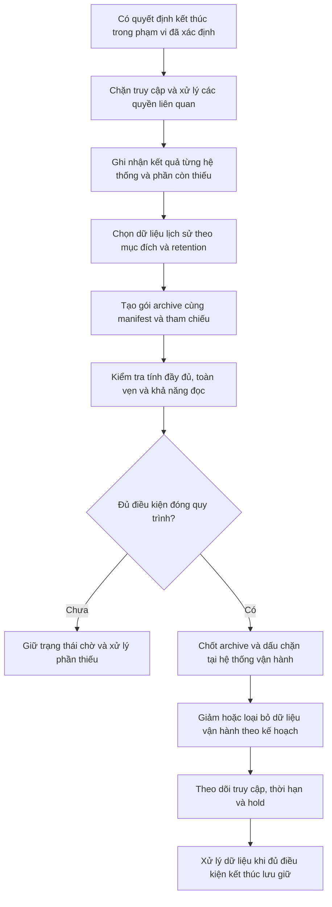

# Identity archival

## 1. Lưu được lịch sử mà không giữ lại quyền truy cập

Một nhà thầu kết thúc hợp đồng với doanh nghiệp. Người này không còn được đăng nhập vào cổng dự án, nhưng các quyết định phê duyệt trước đây vẫn cần giải thích được: ai đã phê duyệt, với tư cách gì và vào thời điểm nào. Nếu xóa ngay mọi bản ghi, lịch sử có thể mất liên kết với chủ thể. Nếu giữ nguyên tài khoản cùng credential và nhóm quyền, tổ chức lại để lại đường truy cập không còn cần thiết.

**Identity archival** là việc đưa hồ sơ danh tính đã kết thúc sử dụng sang chế độ lưu trữ có kiểm soát, giữ những thông tin cần thiết cho mục đích đã xác định trong thời hạn phù hợp. Hồ sơ lưu trữ phục vụ việc tra cứu lịch sử, kiểm toán hoặc xử lý một yêu cầu có căn cứ; nó không tiếp tục là nguồn cấp quyền sử dụng dịch vụ.

Trong IAM, archival nằm trong vòng đời danh tính và có quan hệ với đóng tài khoản, thu hồi quyền, quản lý credential, lưu giữ dữ liệu và xóa dữ liệu. Các công việc này cần phối hợp nhưng có mục tiêu khác nhau. Chuyển một dòng dữ liệu sang bảng `archived_users` chưa chứng minh tài khoản đã mất quyền hoặc dữ liệu đã được quản lý đúng.

Bài học dùng ví dụ doanh nghiệp có IdP, directory, cổng dự án và kho kiểm toán. Tên trạng thái, schema và quy trình là thiết kế minh họa, không phải một định nghĩa archival bắt buộc của mọi hệ thống.

Sau bài học, người học có thể:

1. Phân biệt lưu trữ danh tính với đình chỉ, thu hồi quyền, xóa và backup.
2. Xác định dữ liệu cần giữ, dữ liệu phải loại bỏ và cách bảo toàn liên kết lịch sử.
3. Thiết kế điều kiện chuyển hồ sơ sang lưu trữ mà không để lại đường truy cập hoạt động.
4. Quản lý quyền đọc kho lưu trữ, thời hạn giữ và trường hợp tạm dừng xóa có căn cứ.
5. Ngăn đồng bộ, JIT hoặc khôi phục backup làm sống lại tài khoản đã kết thúc.

## 2. Phân biệt archival với các thao tác gần nhau

| Thao tác | Mục tiêu chính | Điều không thể tự suy ra |
| --- | --- | --- |
| Suspend hoặc disable | Tạm chặn việc sử dụng theo chính sách | Chưa chắc mọi phiên, token và tài khoản đích đã mất hiệu lực |
| Deprovision | Loại bỏ hoặc chấm dứt các tài khoản, quan hệ và quyền không còn cần | Chưa tự xác định dữ liệu lịch sử nào phải giữ và đến khi nào |
| Close hoặc terminate | Kết thúc quan hệ sử dụng tài khoản theo quy trình | Chưa đồng nghĩa mọi bản sao dữ liệu đã được xóa |
| Archive | Giữ hồ sơ lịch sử cần thiết trong chế độ lưu trữ có kiểm soát | Không tạo quyền đăng nhập và không có nghĩa giữ vĩnh viễn |
| Delete hoặc purge | Loại bỏ dữ liệu hoặc tài nguyên trong phạm vi đã xác định | Một kết quả API thành công chưa chứng minh xóa hết backup và bản sao ngoài phạm vi |
| Backup | Có bản sao phục vụ khôi phục sau sự cố | Không thay thế hệ thống tra cứu lịch sử, retention hoặc kiểm soát quyền |
| Pseudonymize | Giảm khả năng nhận diện trực tiếp bằng mã hoặc tham chiếu thay thế | Không tự làm dữ liệu trở thành vô danh nếu vẫn có thể liên kết lại |

NIST SP 800-63A-4 gắn việc xử lý thông tin sau khi kết thúc subscriber account với yêu cầu lưu giữ và hủy bỏ đã được tài liệu hóa. Vì vậy, đóng tài khoản không phải căn cứ mặc định để giữ mọi thông tin vô thời hạn. [NIST: Subscriber Account Suspension or Termination](https://pages.nist.gov/800-63-4/sp800-63a/accounts/#subscriber-account-suspension-or-termination).

Một tài khoản bị khóa vì nghi ngờ xâm phạm có thể vẫn đang trong quan hệ sử dụng hợp lệ. Trường hợp đó không nên tự được diễn giải thành đã hoàn tất lưu trữ danh tính. Ngược lại, một hồ sơ đã archival không nên được mở lại chỉ vì người dùng hoàn tất một luồng reset mật khẩu.

## 3. Xác định đúng phạm vi kết thúc

Một người có thể có nhiều quan hệ trong cùng tổ chức: nhân viên, đại diện một đối tác, thành viên dự án hoặc quản trị viên riêng. Kết thúc một quan hệ không luôn đồng nghĩa kết thúc mọi danh tính và tài khoản của người đó.

Với ví dụ nhà thầu, cần xác định:

- Hợp đồng và membership dự án nào đã kết thúc.
- Có quan hệ độc lập nào còn hiệu lực trong tenant không.
- Những tài khoản nào thuộc phạm vi phải đóng.
- Tài khoản quản trị hoặc quyền đặc biệt nào đi kèm quan hệ đã kết thúc.
- Tài sản, công việc và phê duyệt đang chờ nào cần chuyển người chịu trách nhiệm.
- Dữ liệu lịch sử nào cần giữ và nằm trong hệ thống nào.

Không dùng email làm căn cứ duy nhất để gom mọi tài khoản vào cùng một lần archival. Cần dựa vào định danh và mapping đã được quản lý, trong đúng tenant và miền tin cậy.

Một workload cũng cần phân biệt với người từng tạo nó. Khi người sở hữu nghỉ việc, có thể phải chuyển trách nhiệm của service account còn cần thiết, thay credential liên quan hoặc chấm dứt workload đã hết mục đích. Không tự xóa một dịch vụ sản xuất chỉ vì tên người tạo có trong sự kiện kết thúc hợp đồng.

Phạm vi rõ giúp tránh hai lỗi đối nghịch: bỏ sót tài khoản phải đóng và đóng nhầm một quan hệ vẫn hợp lệ.

## 4. Điều kiện để archival không để lại đường truy cập

### 4.1. Thu hồi quyền là công việc phải có hiệu lực thực tế

Việc chặn truy cập cần bắt đầu theo thời điểm kết thúc hoặc quy trình xử lý rủi ro, không chờ kho lưu trữ hoàn tất. Khi cần giữ bằng chứng về quyền trước khi thu hồi, có thể ghi nhận trạng thái và sự kiện trong quy trình, nhưng không vì chờ xuất hồ sơ mà kéo dài quyền của người đã hết thẩm quyền.

Trước khi đánh dấu một hồ sơ đã hoàn tất archival, thiết kế phải có căn cứ về các đường truy cập thuộc phạm vi cam kết:

| Đường hoặc đối tượng | Điều cần kiểm tra |
| --- | --- |
| Đăng nhập tại IdP và directory | Trạng thái chặn có hiệu lực, các đường đăng nhập khác đã được xét |
| Tài khoản cục bộ ở ứng dụng | Không còn đường dùng mật khẩu cục bộ để bỏ qua SSO đã bị chặn |
| Phiên ứng dụng | Phiên bị thu hồi hoặc không còn được chấp nhận theo cơ chế thực thi đã chọn |
| Access token và refresh token | Phạm vi, khả năng thu hồi và cửa sổ còn hiệu lực được xử lý theo chính sách |
| API key, personal access token, SSH key | Credential gắn với tài khoản đã được xử lý tại đúng hệ thống đích |
| Membership và quyền trực tiếp | Vai trò, group, quyền cấp trực tiếp và quyền đặc biệt đã được đánh giá |
| Recovery và lời mời đang chờ | Không còn token hoặc luồng có thể mở lại quyền ngoài ý muốn |
| Grant và ủy quyền cho ứng dụng | Các quyền truy cập được ủy quyền còn tồn tại đã được xét riêng |

Một JWT đã phát không tự thay đổi khi hồ sơ chuyển sang `ARCHIVED`. Xóa cookie ở một trình duyệt không đồng nghĩa token ở mọi thiết bị đã vô hiệu. Cơ chế thực thi có thể cần kiểm tra trạng thái hiện hành, thu hồi grant hoặc giới hạn thời gian token; lựa chọn phụ thuộc kiến trúc và yêu cầu độ trễ.

### 4.2. Lưu bằng chứng đóng quyền, không lưu quyền còn dùng được

Kho lưu trữ có thể giữ sự kiện rằng một vai trò từng được cấp và đã thu hồi, nếu có mục đích phù hợp. Nó không nên giữ một cấu hình membership có thể được đồng bộ ngược như trạng thái mong muốn đang hoạt động.

Tương tự, có thể giữ mã tham chiếu hoặc sự kiện thu hồi credential phục vụ kiểm toán. Không sao chép mật khẩu, seed OTP, recovery code, private key hoặc token còn dùng được vào gói archive chỉ để có “bản đầy đủ”.

Nếu một hệ thống đích chưa xử lý xong, hồ sơ có thể được chuẩn bị lưu trữ và dữ liệu được bảo vệ, nhưng trạng thái hoàn tất phải phản ánh phần còn thiếu. Không đổi nhãn sang “đã archive an toàn” chỉ để đóng ticket trong khi một quyền quan trọng chưa được xác nhận hết hiệu lực.

## 5. Chọn dữ liệu giữ lại theo mục đích

Nguyên tắc thực hành là xác định câu hỏi lịch sử cần trả lời, rồi chọn dữ liệu tối thiểu hỗ trợ câu trả lời đó. Không bắt đầu bằng việc sao chép toàn bộ bảng người dùng cùng mọi bảng liên quan.

| Nhóm dữ liệu | Cách cân nhắc trong hồ sơ lưu trữ | Lưu ý |
| --- | --- | --- |
| Định danh nội bộ và phạm vi | Giữ tham chiếu đủ để liên kết sự kiện trong phạm vi cần thiết | Không dùng lại mã cho một chủ thể khác |
| Thông tin kết thúc | Giữ thời điểm, nguồn quyết định, phạm vi và mã lý do phù hợp | Hạn chế chi tiết nhạy cảm không phục vụ mục đích tra cứu |
| Lịch sử quyền | Giữ sự kiện hoặc bản tổng hợp có căn cứ về quyền đã từng tồn tại | Tách khỏi cấu hình cấp quyền đang hoạt động |
| Mapping hệ thống đích | Giữ phần cần cho đối soát hoặc giải thích lịch sử | Xác định thời hạn, quyền đọc và cách loại bỏ khi không còn cần |
| Thông tin cá nhân | Chỉ giữ thuộc tính thật sự cần với căn cứ và thời hạn đã xác định | Tên, email hoặc số định danh không mặc định phải đi cùng mọi sự kiện |
| Bằng chứng proofing | Quản lý theo chính sách riêng của loại bằng chứng | Không mặc định sao chép ảnh giấy tờ hoặc sinh trắc học sang archive |
| Credential và bí mật | Thu hồi và loại bỏ theo quy trình tương ứng | Không giữ bí mật để thuận tiện mở lại tài khoản |
| Tài liệu nghiệp vụ | Xử lý theo quyền sở hữu và retention của hệ thống nghiệp vụ | Archive danh tính không tự xóa hợp đồng, hóa đơn hoặc thiết kế dự án |

Ví dụ, để biết ai phê duyệt bản thiết kế, có thể cần tham chiếu chủ thể, thời điểm, vai trò tại lúc phê duyệt và sự kiện phê duyệt. Không nhất thiết cần ảnh giấy tờ nhận dạng hoặc danh sách mọi số điện thoại người đó từng sử dụng.

Dữ liệu ở một kho khác không mất trách nhiệm quản lý chỉ vì không nằm trong archive. Nếu bằng chứng proofing, mailbox hoặc nhật ký ứng dụng có chính sách lưu riêng, hồ sơ điều phối cần biết hệ thống nào chịu trách nhiệm, thay vì tuyên bố một gói archive đã bao phủ mọi dữ liệu về người dùng.

## 6. Bảo toàn lịch sử mà không gán nhầm cho người mới

### 6.1. Định danh lịch sử không được tái gán

Một sự kiện cũ cần tiếp tục tham chiếu đúng chủ thể trong phạm vi của nó. Nếu mã người dùng cũ được cấp lại cho người mới, báo cáo có thể hiển thị người mới như người đã thực hiện các hành động trước đây.

Trong SCIM, RFC 7643 quy định `id` của resource là định danh ổn định và không được tái gán. Cần phân biệt điều đó với username hoặc email có thể chịu chính sách sử dụng lại khác. [RFC 7643: Common Attributes](https://www.rfc-editor.org/rfc/rfc7643.html#section-3.1).

Quy tắc không tái gán định danh không đồng nghĩa phải giữ toàn bộ hồ sơ cá nhân mãi mãi. Có thể thiết kế mã không tái sử dụng cùng dữ liệu liên kết tối thiểu, và quản lý riêng việc giữ hoặc loại bỏ thuộc tính nhận diện theo mục đích.

### 6.2. Nhãn hiển thị lịch sử cần có phạm vi

Nếu báo cáo luôn tra tên hiện tại để hiển thị mọi sự kiện quá khứ, đổi tên hoặc xóa hồ sơ có thể làm báo cáo khó hiểu. Một thiết kế có thể giữ nhãn lịch sử cần thiết tại sự kiện hoặc dùng dịch vụ tra cứu lịch sử có quyền kiểm soát.

Tuy nhiên, một nhãn lịch sử vẫn có thể là dữ liệu cá nhân. Cần quyết định báo cáo nào thật sự cần tên và báo cáo nào chỉ cần mã chủ thể hoặc nhãn “tài khoản đã kết thúc”. Không sao chép tên và email đầy đủ vào mọi hệ thống chỉ để thuận tiện hiển thị.

Khi sửa một sai sót trong hồ sơ lưu trữ, giữ được dấu vết của việc sửa và lý do. Không lặng lẽ thay đổi tác giả của một sự kiện cũ để khớp người đang giữ cùng username hiện tại.

### 6.3. Pseudonymization không tự là anonymization

Nếu archive dùng mã thay thế nhưng còn một bảng ánh xạ có thể nhận diện lại người, dữ liệu vẫn có khả năng liên kết. Bảng ánh xạ cần quyền truy cập và vòng đời riêng.

Băm email hoặc số định danh không tự bảo đảm vô danh. Giá trị có thể đoán được hoặc được dùng giống nhau ở nhiều nơi vẫn tạo khả năng tra cứu và tương quan. Chọn biện pháp dựa trên mục tiêu giảm liên kết thực tế, không chỉ đổi tên cột thành `anonymous_id`.

## 7. Thiết kế hồ sơ archive và dấu chặn ở hệ thống vận hành

Không phải mọi hệ thống đều cần kho lưu trữ tách biệt. Tuy nhiên, cần tách về ý nghĩa giữa bản ghi phục vụ lịch sử và bản ghi có thể tham gia xác thực hoặc authorization.

Một cấu trúc minh họa bằng dữ liệu giả định:

```json
{
  "archiveId": "archive-demo-009",
  "tenantRef": "tenant-demo-A",
  "subjectRef": "identity-demo-042",
  "archiveState": "SEALED",
  "closureDecisionRef": "closure-demo-018",
  "closureVersion": 12,
  "accessState": "DENIED",
  "revocationEvidenceRef": "revocation-report-demo-018",
  "historyPackageRef": "archive-object-demo-009",
  "manifestRef": "manifest-demo-009",
  "retentionItems": [
    {
      "category": "identity-closure-history",
      "policyRef": "retention-policy-demo-v3",
      "eligibilityStatus": "NOT_DUE",
      "holdRefs": []
    }
  ],
  "readPolicyRef": "case-scoped-archive-reader"
}
```

Đây là schema ứng dụng tự định nghĩa. Hệ thống thật còn cần thời điểm, người hoặc dịch vụ thực hiện, trạng thái từng đích, quy tắc tính hạn và thông tin kiểm tra toàn vẹn phù hợp. `accessState` là kết quả theo dõi; việc chặn thật vẫn phải được thực thi tại các điểm truy cập.

Một **tombstone** là bản ghi tối thiểu cho biết tài nguyên hoặc quan hệ đã kết thúc, cùng thông tin cần để xử lý tham chiếu và tác vụ đến muộn. Nó không phải bản sao hồ sơ đầy đủ và cũng cần chính sách dữ liệu phù hợp.

Tombstone có thể giúp hệ thống từ chối một lệnh cập nhật cũ muốn đặt tài khoản trở lại hoạt động. Phải có mã thực thi quy tắc đó; sự tồn tại của một cột `archived_at` không tự ngăn các connector ghi đè trạng thái.

## 8. Quy trình chuyển sang lưu trữ



### 8.1. Chốt một phạm vi và phiên bản có thể giải thích

Gói archive cần biết nó phản ánh danh tính, quan hệ và thời điểm nào. Nếu quá trình kéo dài, có thể phát sinh thêm sự kiện thu hồi hoặc phát hiện tài khoản bị bỏ sót. Các sự kiện đó cần được bổ sung theo cơ chế có phiên bản, không làm mất ý nghĩa của bản ghi trước.

Manifest có thể mô tả các phần được giữ, nguồn xuất, mã tham chiếu, phiên bản và kết quả kiểm tra. Không đưa bí mật vào manifest. Một dấu băm giúp phát hiện thay đổi khi có căn cứ đối chiếu đáng tin, nhưng dấu băm tự nó không chứng minh nguồn dữ liệu là đúng hoặc người xuất có thẩm quyền.

### 8.2. Không xóa nguồn trước khi kiểm tra bản lưu

Nếu quyết định di chuyển dữ liệu thay vì chỉ đánh dấu trạng thái, cần kiểm tra gói lưu trữ có đủ nội dung dự kiến và có thể đọc bằng công cụ được duy trì. Tệp có kích thước khác 0 chưa chứng minh đủ trường, đủ sự kiện hoặc có khóa giải mã dùng được.

Sau khi archive được chấp nhận, việc giảm dữ liệu trong hệ thống vận hành thực hiện theo kế hoạch riêng. Không xóa hàng loạt mọi quan hệ tham chiếu mà chưa xét ràng buộc dữ liệu nghiệp vụ.

### 8.3. Xử lý tác vụ lặp và trạng thái thay đổi

Giao dịch nội bộ có thể lưu quyết định archive, manifest đã chấp nhận, trạng thái tối thiểu và ý định đồng bộ. Các thao tác bên ngoài cần có cơ chế retry và đối soát; không giả định cả directory, object storage và mọi ứng dụng cùng một giao dịch.

Mã giả minh họa bước chốt hồ sơ:

```text
finalizeArchive(actor, tenant, request):
    authorize(actor, tenant, "identity:archive")

    begin transaction:
        identity = loadCurrentIdentity(tenant, request.subjectRef)
        requireExpectedLifecycleVersion(identity, request.expectedVersion)
        requireClosureDecisionStillApplies(identity, request.closureRef)
        requireMandatoryRevocationResultsAreSufficient(identity)
        requireArchivePackageAccepted(request.packageRef)
        requireCurrentRetentionPlanApproved(request.retentionPlanRef)

        if sameArchiveAlreadyFinalized(request.archiveKey):
            return authorizedExistingResult(request.archiveKey)

        recordArchiveReferencesAndClosureState(identity, request)
        recordMinimalBlockingState(identity)
        appendArchiveAuditEvent(actor, identity, request)
        appendApprovedCleanupIntents(identity, request)
    commit transaction

    return archiveResultWithTrackedFollowUp
```

Mã giả không thực hiện xóa trực tiếp. Mỗi tác vụ cleanup phải kiểm tra lại chính sách và điều kiện hiện hành, đặc biệt khi xuất hiện yêu cầu giữ dữ liệu hoặc thay đổi phạm vi. Hoàn tất bước chốt không thay thế bằng chứng các tác vụ sau đã thực hiện.

## 9. Bảo vệ kho lưu trữ theo nguyên tắc ít quyền nhất

### 9.1. Đọc archive là một quyền riêng

Nhân viên hỗ trợ có thể cần biết tài khoản đã kết thúc mà không cần xem toàn bộ lịch sử hoặc thông tin cá nhân. Người kiểm toán có thể cần một số sự kiện của một tenant và một vụ việc, không cần quyền tìm kiếm mọi hồ sơ.

Có thể kết hợp RBAC với ABAC để giới hạn theo vai trò, tenant, mục đích, vụ việc và thời gian. Quyền đọc, xuất, giải mã, sửa chính sách retention và thực hiện purge nên được phân biệt theo trách nhiệm và mức rủi ro.

Một service account ghi archive không mặc nhiên cần quyền mở lại tài khoản. Một dịch vụ cấp quyền đăng nhập cũng không mặc nhiên cần quyền đọc giấy tờ hoặc dữ liệu trong kho lịch sử.

Mọi truy cập có ý nghĩa cần được ghi nhận phù hợp: ai đọc hoặc xuất, phạm vi nào, vì mục đích gì và kết quả ra sao. Link tải gói archive cần kiểm soát người nhận và hiệu lực; không dùng một URL chia sẻ lâu dài làm cơ chế phân quyền duy nhất.

### 9.2. Giữ tính bí mật, toàn vẹn và khả năng sử dụng

Dữ liệu cần được bảo vệ khi truyền và khi lưu, với quản lý khóa và quyền giải mã tương ứng. Nếu kho dùng cơ chế bất biến hoặc chống sửa đổi, vẫn phải quản lý người có quyền cấu hình, thời hạn và các bản xuất ngoài kho.

Tính bất biến không tự giải quyết quyền riêng tư. Một cấu hình giữ không thể sửa trong thời gian quá dài có thể khiến tổ chức không thực hiện được chính sách hủy đã chọn. Cần thiết kế đơn vị dữ liệu và thời hạn trước khi áp dụng cơ chế khóa lưu giữ.

OWASP khuyến nghị hạn chế dữ liệu nhạy cảm trong log, bảo vệ quyền truy cập và kiểm soát vòng đời các bản sao. Áp dụng cùng cách suy nghĩ khi chọn phần nhật ký đưa vào hồ sơ archive: giữ căn cứ cần thiết mà không biến kho thành nơi tập trung bí mật. [OWASP Logging Cheat Sheet](https://cheatsheetseries.owasp.org/cheatsheets/Logging_Cheat_Sheet.html#data-to-exclude).

Kho lưu trữ cũng cần khả năng đọc về sau: định dạng, schema, khóa và công cụ tra cứu phải được quản lý. Một gói dữ liệu còn tồn tại nhưng không thể giải mã hoặc diễn giải không đáp ứng mục đích kiểm toán.

## 10. Thời hạn lưu và yêu cầu giữ dữ liệu có căn cứ

### 10.1. Đặt retention theo từng loại dữ liệu

Không có một thời hạn chung phù hợp cho mọi hồ sơ IAM. Chính sách phải dựa trên mục đích sử dụng và các yêu cầu áp dụng cho tổ chức, loại dữ liệu và hệ thống. Bài học không đặt số ngày hoặc năm cố định cho ví dụ.

Một kế hoạch retention nên xác định:

| Nội dung | Câu hỏi cần trả lời |
| --- | --- |
| Loại dữ liệu | Thông tin đóng tài khoản, lịch sử quyền, log hay bằng chứng proofing? |
| Mục đích và căn cứ | Giữ để giải quyết nhu cầu cụ thể nào, ai chịu trách nhiệm xác nhận? |
| Mốc tính thời hạn | Từ lúc quan hệ kết thúc, lúc phát sinh sự kiện hay mốc nghiệp vụ khác? |
| Thời hạn và lần xem xét | Khi nào đủ điều kiện loại bỏ, khi nào cần đánh giá lại? |
| Phạm vi bản sao | Kho chính, bản xuất, chỉ mục, cache, backup và hệ thống ngoài nào có liên quan? |
| Cách kết thúc lưu giữ | Xóa, giảm trường, loại bỏ mapping hay biện pháp được chấp nhận khác? |
| Bằng chứng thực hiện | Hệ thống lưu kết quả và phần chưa hoàn tất bằng cách nào? |

Hai loại dữ liệu trong cùng hồ sơ có thể có thời hạn khác nhau. Không nên giữ ảnh giấy tờ chỉ vì một sự kiện kiểm toán còn cần tồn tại lâu hơn.

OWASP nhấn mạnh việc xử lý thời hạn phải tính cả log, dữ liệu tạm và các bản sao hoặc bản xuất. Điều này giúp tránh tình trạng kho chính đã xóa nhưng cùng dữ liệu vẫn còn trong một báo cáo tải xuống không được quản lý. [OWASP: Disposal of Logs](https://cheatsheetseries.owasp.org/cheatsheets/Logging_Cheat_Sheet.html#disposal-of-logs).

### 10.2. Hold là một trạng thái riêng, không phải gia hạn mọi dữ liệu mãi mãi

Một yêu cầu giữ dữ liệu có thẩm quyền, thường được gọi là hold, có thể tạm ngăn việc loại bỏ một phạm vi dữ liệu để phục vụ vụ việc hoặc nghĩa vụ cụ thể. Quy trình cần ghi người có thẩm quyền, phạm vi, lý do, thời điểm và điều kiện xem xét hoặc kết thúc.

Không diễn giải hold của một vụ việc thành quyền giữ mọi dữ liệu về người đó hoặc mọi tenant. Dữ liệu ngoài phạm vi vẫn được quản lý theo chính sách tương ứng. Hold cũng không khôi phục quyền đăng nhập của chủ thể.

Khi hold kết thúc, tính lại điều kiện retention theo quy tắc được phê duyệt. Không tự bắt đầu lại toàn bộ thời hạn chỉ vì có thao tác cập nhật trạng thái, trừ khi chính sách có căn cứ quy định như vậy.

Nhóm IAM thực thi các quyết định giữ và loại bỏ trong phạm vi hệ thống; người chịu trách nhiệm về yêu cầu áp dụng phải xác nhận căn cứ. Không để một cờ tùy ý do người dùng cuối gửi lên vô hiệu hóa quy trình xóa vô thời hạn.

## 11. Kết thúc lưu giữ và quản lý bản sao

Đến hạn không có nghĩa có thể xóa ngay mà không kiểm tra. Trước khi loại bỏ, cần xác nhận đúng loại dữ liệu, chính sách hiện hành, các hold còn hiệu lực, quyền của tác vụ và phạm vi phải xử lý.

Điều kiện phải được kiểm tra gần thời điểm thực hiện. Nếu có hold mới trong lúc tác vụ đang chạy, cần cơ chế phối hợp để chặn các bước tiếp theo theo phạm vi và ghi lại phần đã xử lý. Một kiểm tra boolean ở đầu tác vụ kéo dài không tự giải quyết xung đột này.

Xóa phân tán thường không có tính nguyên tử trên mọi hệ thống. Có thể phải theo dõi riêng:

- Dữ liệu trong kho archive chính và các phiên bản đối tượng liên quan.
- Chỉ mục tìm kiếm, cache, ảnh thu nhỏ hoặc dữ liệu đã trích xuất.
- Bản xuất phục vụ một vụ việc và bản sao do đơn vị khác quản lý.
- Dữ liệu tại nhà cung cấp dịch vụ trong phạm vi hợp đồng tích hợp.
- Backup, snapshot và quy trình làm dữ liệu đến hạn không quay lại sử dụng.

Không tuyên bố “đã xóa mọi dữ liệu” nếu chỉ xóa một bản ghi SQL. Báo cáo phải nêu phạm vi đã hoàn tất, phần chờ xử lý theo vòng đời bản sao và bằng chứng cần thiết để theo dõi.

Nếu sử dụng kỹ thuật loại bỏ khóa mã hóa để làm dữ liệu không thể đọc, phải kiểm tra phạm vi khóa, các bản sao khóa và dữ liệu có thể tồn tại ở dạng khác. Không hủy khóa dùng chung cho nhiều hồ sơ hoặc dữ liệu còn cần giữ chỉ để xử lý một danh tính.

Kết quả cuối có thể còn một dấu vết tối thiểu về việc đã thực hiện hủy, nếu có mục đích và thời hạn phù hợp. Dấu vết đó không nên tự tái tạo đầy đủ thông tin vừa bị loại bỏ.

## 12. Không để đồng bộ và khôi phục làm sống lại danh tính

### 12.1. SCIM DELETE không phải chứng nhận xóa toàn bộ dữ liệu

RFC 7644 cho phép service provider không xóa vật lý vĩnh viễn resource sau DELETE, nhưng phải xử lý tài nguyên đã xóa như không còn qua API theo yêu cầu của giao thức. Vì vậy, cần tìm hiểu retention và cơ chế xóa của hệ thống đích thay vì suy từ HTTP response. [RFC 7644: Deleting Resources](https://www.rfc-editor.org/rfc/rfc7644.html#section-3.6).

SCIM không định nghĩa một trạng thái archival chung cho mọi sản phẩm. `active: false`, DELETE và một tính năng archive riêng của nhà cung cấp có thể có tác động khác nhau. Connector phải có mapping và tiêu chí kiểm tra rõ ràng cho từng đích.

### 12.2. Chặn tác vụ cũ và JIT ngoài ý muốn

Sau khi kết thúc, một sự kiện HR cũ hoặc lệnh retry có thể còn mang trạng thái active. Worker cần kiểm tra trạng thái và phiên bản vòng đời hiện hành trước khi áp dụng; không để payload cũ ghi đè dấu kết thúc.

Nếu người dùng còn đăng nhập được ở một IdP khác, JIT của ứng dụng không được tự tạo lại membership đã chấm dứt chỉ vì kết quả xác thực hợp lệ. Authentication thành công không tự chứng minh còn quan hệ được cấp quyền.

Trường hợp người đó quay lại làm việc cần một quyết định nghiệp vụ mới và quy trình đối chiếu có kiểm soát. Có thể liên hệ với lịch sử cũ khi có căn cứ, nhưng quyền, thời hạn quan hệ và authenticator được đánh giá theo chính sách hiện hành. Không giải nén archive rồi khôi phục toàn bộ group và credential cũ.

### 12.3. Khôi phục backup cần tái áp dụng trạng thái kết thúc

Một backup được tạo trước khi đóng tài khoản có thể chứa trạng thái active và credential cũ. Nếu khôi phục trực tiếp vào môi trường phục vụ người dùng, tài khoản đã kết thúc có thể được mở lại.

Quy trình khôi phục cần vùng kiểm soát, nguồn quyết định vòng đời đủ mới và các bước đối soát trước khi mở dịch vụ. Các quyết định chặn, thu hồi và xử lý dữ liệu đến hạn phải được tái áp dụng trong phạm vi thích hợp.

Nguồn chứa quyết định kết thúc hoặc danh sách xử lý dữ liệu cũng cần được bảo vệ và có phương án khôi phục; không dựa duy nhất vào chính bản backup cũ đang được khôi phục. Khóa giải mã có mặt trở lại cũng không phải lý do để đưa dữ liệu đã đến hạn xóa trở lại sử dụng.

## 13. Ví dụ xuyên suốt: lưu trữ hồ sơ một nhà thầu

Giả sử nhà thầu có định danh nội bộ `identity-demo-042`, tham gia dự án Alpha và từng phê duyệt một số thay đổi thiết kế. Sau khi hợp đồng kết thúc, doanh nghiệp vẫn cần tra cứu các phê duyệt trong phạm vi chính sách lưu giữ đã xác định.

| Sự kiện hoặc yêu cầu | Cách xử lý trong thiết kế ví dụ |
| --- | --- |
| Hợp đồng kết thúc | Chốt đúng quan hệ, chặn đường truy cập và điều phối thu hồi tài khoản liên quan |
| Một ứng dụng vẫn còn phiên | Giữ phần việc chưa hoàn tất, xử lý hiệu lực phiên; không coi việc khóa IdP là đủ |
| Cần giữ tác giả của phê duyệt cũ | Giữ tham chiếu lịch sử và thông tin tối thiểu cần thiết, với quyền đọc phù hợp |
| Có ảnh giấy tờ trong hệ thống proofing | Xử lý theo chính sách riêng, không tự sao chép vào archive danh tính |
| Nhà thầu từng tạo một pipeline còn được dùng | Chuyển trách nhiệm và xử lý credential liên quan theo quyết định quản lý workload |
| Gói archive đã tạo và kiểm tra | Ghi manifest, phạm vi, phiên bản, retention và trạng thái đóng quyền; sau đó thực hiện cleanup được duyệt |
| Một vụ việc yêu cầu giữ một nhóm sự kiện | Áp dụng hold đúng phạm vi, ghi căn cứ và không mở lại quyền của nhà thầu |
| Có yêu cầu đọc lịch sử | Kiểm tra người đọc, tenant, mục đích và phạm vi; ghi nhận việc đọc hoặc xuất |
| Sự kiện active cũ đến muộn | Từ chối hoặc bỏ qua theo phiên bản và trạng thái vòng đời, không tái cấp membership |
| Nhà thầu quay lại ở hợp đồng mới | Thực hiện tiếp nhận mới, đối chiếu danh tính có căn cứ và cấp quyền theo nhu cầu hiện tại |
| Một phần dữ liệu đến hạn loại bỏ | Kiểm tra hold và thực hiện xử lý theo từng loại dữ liệu, theo dõi cả bản sao |

Kết quả mong muốn là lịch sử vẫn giải thích được trong thời gian cần thiết, quyền cũ không còn hiệu lực và dữ liệu không còn mục đích sẽ được xử lý theo chính sách. Ba kết quả này cần được đo riêng.

## 14. Tiêu chí hoàn tất và trách nhiệm vận hành

Một quy trình archival cần có chủ sở hữu cho quyết định kết thúc, thu hồi ở từng ứng dụng, lưu dữ liệu, cấp quyền đọc và xử lý hết hạn. Nếu mọi việc được giao chung cho “IAM”, có thể không ai chịu trách nhiệm về bản xuất hoặc tài khoản nằm ngoài directory.

Các tiêu chí thực hành trước khi đánh dấu hoàn tất gồm:

1. Phạm vi chủ thể, tenant và quan hệ đã kết thúc được xác định rõ.
2. Các đường truy cập bắt buộc đã được kiểm tra, với phần thiếu được xử lý đúng mức rủi ro.
3. Dữ liệu giữ lại có mục đích, loại retention và người chịu trách nhiệm.
4. Gói archive có thể đọc, có tham chiếu nguồn và cơ chế kiểm tra toàn vẹn phù hợp.
5. Credential không còn dùng được và không bị sao chép vào kho để mở lại thuận tiện.
6. Quyền đọc, xuất và sửa chính sách kho được giới hạn và có kiểm toán.
7. Đồng bộ, JIT và khôi phục backup có cách ngăn tái cấp quyền ngoài ý muốn.
8. Dữ liệu vận hành, bản sao và dữ liệu đến hạn có kế hoạch xử lý có thể theo dõi.

Các chỉ báo hữu ích là số hồ sơ còn quyền chưa xác nhận thu hồi, số gói archive không đọc được, số lần truy cập không phù hợp, lượng dữ liệu quá hạn, hold thiếu người chịu trách nhiệm và sự kiện tái tạo tài khoản ngoài ý muốn.

Identity archival hoàn thành mục tiêu khi tổ chức giữ được đúng lịch sử cần thiết, trong đúng phạm vi và thời gian, đồng thời tách lịch sử đó khỏi mọi cơ chế có thể cấp quyền hoạt động. Đây là một phần quản lý vòng đời dữ liệu và danh tính, cần được thiết kế cùng với thu hồi quyền và xử lý dữ liệu cuối kỳ.
