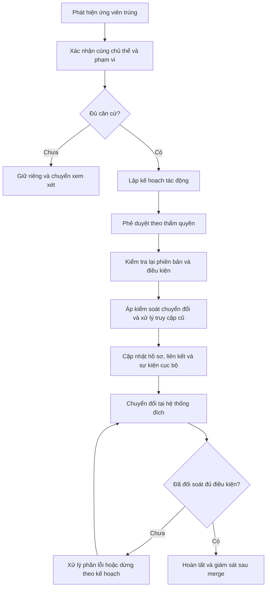

# Identity merge: hợp nhất danh tính trong vòng đời IAM

## 1. Identity merge là gì?

**Identity merge** là quy trình hợp nhất các hồ sơ danh tính đã được xác định là đại diện cho cùng một chủ thể, theo một chính sách và kế hoạch chuyển đổi được phê duyệt. Kết quả thường có một hồ sơ chuẩn để quản lý về sau, cùng các liên kết có kiểm soát tới hồ sơ cũ và lịch sử liên quan.

Ví dụ, một nhân viên từng có hồ sơ nhà thầu, sau đó được tạo thêm hồ sơ nhân viên. Hai hồ sơ có thể cùng chỉ một người nhưng gắn với những quan hệ công việc, tài khoản và quyền khác nhau. Hệ thống cần xác định có thực sự nên hợp nhất hồ sơ hay chỉ nên liên kết chúng dưới một chủ thể chung.

Các nguyên nhân tạo hồ sơ trùng thường gồm:

- Nhập dữ liệu từ nhiều nguồn chưa có quy tắc liên kết thống nhất.
- Người dùng tự đăng ký trước khi nhận lời mời chính thức.
- Tạo lại hồ sơ sau khi đổi email, thay nguồn nhân sự hoặc quay lại tổ chức.
- Chuyển đổi IdP hoặc tích hợp thêm nguồn liên kết danh tính.
- Thử lại provisioning nhưng thiếu cơ chế xử lý lặp phù hợp.

Merge không chỉ là dọn dữ liệu trùng. Trong IAM, thay đổi quan hệ giữa danh tính và tài khoản có thể thay đổi người được nhận quyền, người được khôi phục tài khoản và cách token được hiểu. Vì vậy, đây là một thao tác quản trị nhạy cảm cần có căn cứ, giới hạn quyền và khả năng truy vết.

## 2. Phân biệt hợp nhất hồ sơ, liên kết tài khoản và chuyển dữ liệu

Trước khi thực hiện, phải nêu rõ đối tượng nào được hợp nhất. Một quyết định ở tầng hồ sơ không tự kéo theo quyết định ở mọi tầng khác.

| Thao tác | Mục đích | Điều không tự động kéo theo |
|---|---|---|
| Identity resolution | Xác định những bản ghi nào có thể hoặc thực sự cùng chủ thể | Không tự thay đổi tài khoản, quyền hoặc thông tin xác thực |
| Identity linking | Ghi quan hệ giữa các hồ sơ hoặc danh tính ngoài | Không nhất thiết loại bỏ hồ sơ độc lập |
| Identity merge | Chọn mô hình hồ sơ chuẩn và hợp nhất trong phạm vi đã duyệt | Không mặc nhiên cộng tất cả quyền và yếu tố xác thực |
| Account linking | Cho phép một tài khoản nội bộ liên kết với danh tính hoặc cách đăng nhập khác | Không chứng minh mọi thuộc tính ngoài đời của hai hồ sơ đều giống nhau |
| Account consolidation | Thu gọn những tài khoản cụ thể theo kế hoạch | Không nhất thiết hợp nhất mọi quan hệ công việc |
| Data migration | Chuyển dữ liệu hoặc quyền sở hữu ở ứng dụng nghiệp vụ | Không tự chứng minh người nhận dữ liệu được phép xem toàn bộ dữ liệu cũ |
| Duplicate suppression | Đánh dấu hoặc ẩn bản ghi trùng khỏi một màn hình | Không xử lý xong các đường đăng nhập, token và quyền còn tồn tại |

Một người có thể cần nhiều tài khoản hợp lệ: tài khoản làm việc thường ngày, tài khoản quản trị và tài khoản thuộc một quan hệ tổ chức khác. Chúng không trở thành bản ghi lỗi chỉ vì cùng thuộc một người.

Tương tự, cùng một người tham gia hai tenant không có nghĩa có thể gộp dữ liệu hoặc quyền giữa hai tenant. Phạm vi tổ chức, ranh giới quản lý và mục đích sử dụng phải được giữ rõ ràng.

## 3. Vì sao gộp sai là một sự kiện an ninh?

Nếu hai người khác nhau bị gộp, hậu quả có thể vượt xa việc hiển thị sai tên:

- Người A có thể nhận quyền xem dữ liệu của người B.
- Yếu tố xác thực hoặc kênh khôi phục của một tài khoản yếu hơn có thể trở thành đường vào tài khoản nhạy cảm.
- Lệnh đình chỉ, điều kiện nghỉ việc hoặc giới hạn tổ chức có thể bị bỏ qua.
- Nhật ký có thể được diễn giải sai người thực hiện.
- Ứng dụng nghiệp vụ có thể chuyển nhầm dữ liệu hoặc trách nhiệm phê duyệt.

Một số tác động không thể đảo ngược chỉ bằng việc tách lại hồ sơ. Nếu dữ liệu đã được tiết lộ hoặc một giao dịch đã được thực hiện, sửa liên kết danh tính không làm các tác động đó biến mất.

Ngược lại, không xử lý hồ sơ trùng cũng tạo rủi ro: quyền tồn tại ở nhiều tài khoản, thu hồi bỏ sót, hoặc khôi phục nhầm một tài khoản cũ. Mục tiêu là hợp nhất có kiểm soát, với phạm vi đủ rõ để không đánh đổi sự an toàn lấy một cơ sở dữ liệu trông gọn hơn.

## 4. Điều kiện trước khi đề nghị merge

Một yêu cầu merge cần trả lời được những câu hỏi sau:

1. Hai hồ sơ thực sự đại diện cho cùng chủ thể hay mới chỉ giống một số thuộc tính?
2. Nguồn nào có thẩm quyền xác nhận, và căn cứ còn phù hợp ở thời điểm ra quyết định không?
3. Việc hợp nhất có được phép trong cùng phạm vi tổ chức, mục đích và chính sách dữ liệu không?
4. Có lý do cần giữ tài khoản hoặc quan hệ độc lập không?
5. Ai được đề nghị, ai được xem bằng chứng và ai được phê duyệt?
6. Những quyền, phiên, yếu tố xác thực, liên kết ngoài và ứng dụng nào sẽ bị ảnh hưởng?
7. Có phương án xử lý khi một bước thất bại hoặc khi phát hiện gộp sai không?

Người dùng chứng minh quyền kiểm soát cả hai tài khoản có thể là một điều kiện quan trọng trong một số luồng tự phục vụ. Tuy nhiên, điều đó không tự chứng minh mọi danh tính pháp lý hoặc quan hệ nhân sự trong hai tài khoản đều thuộc cùng một người. Một tài khoản cũng có thể đang bị chiếm dụng hoặc được khôi phục bằng luồng yếu.

Với hồ sơ do tổ chức quản lý, cần kết hợp căn cứ từ nguồn có thẩm quyền và các kiểm tra phù hợp. Với trường hợp ít bảo đảm hơn, chính sách có thể chấp nhận phạm vi liên kết hẹp hơn, nhưng không được mô tả kết quả như một merge có mức tin cậy cao hơn thực tế.

Khi không đủ căn cứ, nên giữ các hồ sơ riêng và chuyển xem xét. Áp lực dọn dữ liệu không làm thông tin chưa chắc chắn trở thành bằng chứng đã xác nhận.

## 5. Tìm ứng viên và xác nhận cùng chủ thể

### 5.1. Dấu hiệu tìm kiếm không phải kết luận

Những thuộc tính như tên, email, số điện thoại hoặc ngày sinh có thể giúp tìm ứng viên. Chúng cần được hiểu trong ngữ cảnh:

| Dấu hiệu | Có thể hỗ trợ điều gì? | Giới hạn |
|---|---|---|
| Họ tên giống nhau | Tìm hồ sơ cần xem xét | Nhiều người cùng tên; cách viết và chuyển tự có thể khác |
| Email trùng | Tìm liên hệ giữa các lần đăng ký | Email có thể được cấp lại, dùng chung hoặc có nguồn xác nhận khác nhau |
| Số điện thoại trùng | Phát hiện khả năng trùng kênh liên lạc | Số có thể đổi chủ hoặc dùng cho nhiều người |
| Một mã nội bộ được nguồn có thẩm quyền xác nhận | Hỗ trợ liên kết trong đúng phạm vi nguồn đó | Mã phải được xác minh nguồn, phạm vi và quy tắc tái sử dụng |
| Kết quả kiểm chứng trước đây | Cung cấp căn cứ về danh tính đã được kiểm tra | Phải xem đúng chủ thể, phương pháp, thời điểm và phạm vi kết quả |
| Người dùng kiểm soát hai tài khoản | Hỗ trợ xác nhận ý định và quyền kiểm soát | Không tự chứng minh các hồ sơ ngoài đời đã gắn đúng ngay từ đầu |

Việc chuẩn hóa tên hoặc email để tìm ứng viên phải giữ được giá trị gốc và quy tắc đã sử dụng. So khớp gần đúng không nên trực tiếp tạo tác động lên quyền.

### 5.2. Xem xét tính độc lập của nguồn

Hai hệ thống có thể cùng sao chép dữ liệu từ một nguồn ban đầu. Việc chúng trả về cùng tên và ngày sinh không nhất thiết là hai xác nhận độc lập.

Cần ghi nguồn của từng thuộc tính và điều nguồn đó được phép xác nhận. Một bản ghi nhân sự đáng tin cho quan hệ công việc không tự thay thế mọi kiểm tra danh tính ngoài phạm vi quản lý của nguồn.

### 5.3. Kết quả resolution nên rõ ràng

Có thể phân biệt các kết quả:

- **Cùng chủ thể đã được xác nhận theo chính sách:** đủ căn cứ để lập kế hoạch merge trong phạm vi được phép.
- **Chỉ là ứng viên:** cần bổ sung hoặc xem xét trước khi quyết định.
- **Khác chủ thể:** không merge; xử lý sai sót thuộc tính nếu có bằng quy trình riêng.
- **Chưa thể kết luận:** giữ riêng, không biến sự thiếu dữ liệu thành quyết định hợp nhất.

Nếu sử dụng điểm so khớp, cần hiểu cách hiệu chỉnh và các trường hợp sai. Một điểm cao không tự thay thế kiểm tra bắt buộc, không phải mặc nhiên là xác suất cùng một người, và không xóa được ranh giới tenant.

## 6. Chọn hồ sơ chuẩn và giữ nguồn gốc dữ liệu

Hồ sơ được giữ làm chuẩn thường được gọi là canonical record hoặc survivor. Cách chọn phải dựa trên chính sách, chẳng hạn nguồn quản lý chính, định danh ổn định và khả năng tích hợp. Không nên mặc định chọn hồ sơ mới nhất, hồ sơ có nhiều quyền nhất hoặc hồ sơ có email thuận tiện nhất.

Một mô hình dữ liệu có thể giữ:

| Thành phần | Mục đích |
|---|---|
| Hồ sơ chuẩn | Điểm quản lý danh tính sau merge trong phạm vi đã định |
| Hồ sơ nguồn ở trạng thái đã chuyển đổi | Giữ tham chiếu, nguồn gốc và ngăn sử dụng lại không có kiểm soát |
| Bản ghi alias hoặc mapping | Cho phép tìm mối liên hệ với định danh cũ theo mục đích được phép |
| Merge case | Lưu căn cứ, kế hoạch, phê duyệt, phiên bản và kết quả |
| Quan hệ tổ chức riêng | Giữ thời hạn, trạng thái và quyền theo từng quan hệ |
| Lịch sử thay đổi | Hỗ trợ giải thích, đối soát và xử lý gộp sai |

Một alias dùng để tra cứu lịch sử không nên tự trở thành đường cấp quyền. Nếu hệ thống chỉ đổi mọi định danh cũ sang định danh chuẩn trong bước authorization, token cũ của một tài khoản hạn chế có thể vô tình được hưởng quyền của hồ sơ chuẩn.

Do đó, phải phân biệt hai thao tác:

```text
Tra cứu liên hệ lịch sử:
  định danh cũ → hồ sơ chuẩn, kèm nguồn gốc và phạm vi

Chấp nhận một yêu cầu truy cập:
  token/phiên hợp lệ → chủ thể và tài khoản được chấp nhận
  → trạng thái, quyền, phạm vi và điều kiện hiện hành
```

Thao tác thứ hai cần toàn bộ kiểm tra truy cập, không chỉ một phép chuyển alias. Định danh cũ cũng không nên bị cấp lại cho một người khác rồi tiếp tục mang liên hệ lịch sử của người trước.

## 7. Lập kế hoạch merge có thể xem xét trước khi thực thi

Trước khi sửa trạng thái, tạo một kế hoạch thể hiện cụ thể kết quả dự kiến. Người phê duyệt cần thấy tác động, không chỉ hai tên và một nút xác nhận.

Kế hoạch nên bao gồm:

- Hồ sơ nguồn, hồ sơ chuẩn, tenant và quan hệ liên quan.
- Căn cứ xác nhận cùng chủ thể, nguồn và thời điểm.
- Thuộc tính nào được giữ, thay đổi hoặc chuyển xem xét.
- Tài khoản và liên kết ngoài nào được giữ, chuyển hoặc vô hiệu hóa.
- Quyền nào vẫn hợp lệ, quyền nào phải gỡ và quyền nào cần phê duyệt mới.
- Căn cứ đình chỉ hoặc hạn chế nào tiếp tục áp dụng theo phạm vi.
- Phiên, token, yếu tố xác thực và kênh khôi phục cần xử lý thế nào.
- Ứng dụng nào cần chuyển đổi, ai chịu trách nhiệm và điều kiện hoàn tất.
- Khả năng khôi phục, giới hạn của việc tách lại và thời điểm cần dừng.

Ví dụ cấu trúc kế hoạch tối giản, dùng tham chiếu giả:

```json
{
  "merge_case_ref": "merge-example-010",
  "tenant_ref": "tenant-example-A",
  "source_identity_ref": "identity-example-old",
  "canonical_identity_ref": "identity-example-main",
  "policy_version": "merge-policy-example-v1",
  "source_revision": 8,
  "canonical_revision": 15,
  "actions": {
    "permissions": "RECALCULATE_FROM_CURRENT_AUTHORITY",
    "suspension_holds": "PRESERVE_APPLICABLE_HOLDS",
    "sessions": "REVOKE_AFFECTED_SESSIONS",
    "authenticators": "REVIEW_AND_REBIND_IF_APPROVED",
    "application_data": "REQUIRES_OWNER_APPROVAL"
  },
  "state": "AWAITING_APPROVAL"
}
```

Đây là ví dụ minh họa, không phải bộ hành động mặc định cho mọi trường hợp. Một triển khai cần thể hiện chi tiết đủ để biết đối tượng và hành vi nào được phê duyệt.

Kế hoạch phải gắn với phiên bản dữ liệu. Nếu trong lúc chờ duyệt có thêm quyền quản trị, lệnh đình chỉ hoặc liên kết xác thực mới, kế hoạch cũ có thể không còn đúng. Những thay đổi ảnh hưởng trọng yếu cần được đánh giá và phê duyệt lại theo chính sách.

## 8. Xử lý xung đột: không cộng tất cả mọi thứ

### 8.1. Thuộc tính hồ sơ

Mỗi thuộc tính cần có nguồn ưu tiên và quy tắc riêng. Tên hiển thị có thể do người dùng chọn, còn trạng thái nhân sự phải đến từ nguồn được phép. Quy tắc “giữ giá trị cập nhật mới nhất” không phù hợp cho mọi trường.

Nếu hai nguồn có thẩm quyền trả về dữ liệu mâu thuẫn, cần xác định phạm vi, độ mới và nguyên nhân. Không âm thầm ghi đè chỉ để hồ sơ hết cảnh báo. Giá trị được chọn cần giữ được nguồn gốc và căn cứ.

### 8.2. Quan hệ công việc và quyền

Không mặc định lấy hợp của toàn bộ quyền từ hai hồ sơ. Cũng không nhất thiết lấy giao của mọi quyền, vì có thể làm mất quyền hợp lệ mà không có lý do. Cần tính lại từ các quan hệ hiện hành, phê duyệt và chính sách RBAC/ABAC.

Ví dụ, quyền nhà thầu hết hạn không được tiếp tục chỉ vì hồ sơ nhà thầu đã merge vào hồ sơ nhân viên. Quyền đặc quyền cần giữ cơ chế phê duyệt, thời hạn và phân tách nhiệm vụ.

Một ứng dụng có thể cần tách tài khoản quản trị khỏi tài khoản thường dù chúng cùng thuộc một người. Merge hồ sơ danh tính không được làm tài khoản thường tự nhận các đặc quyền của tài khoản quản trị.

### 8.3. Đình chỉ và các hạn chế

Căn cứ đình chỉ, điều kiện chấm dứt quan hệ và hạn chế an ninh phải được đánh giá theo phạm vi. Không chọn trạng thái `ACTIVE` chỉ vì một trong hai hồ sơ đang hoạt động.

Nếu hồ sơ nguồn có lệnh giữ an ninh áp dụng cho toàn bộ truy cập của chủ thể trong miền quản lý, chuyển sang hồ sơ chuẩn không được làm mất lệnh giữ đó. Nếu một hạn chế chỉ áp dụng cho một quan hệ đã kết thúc, cần xử lý theo đúng phạm vi thay vì chặn hoặc mở mọi quan hệ tùy ý.

### 8.4. Mức bảo đảm và kết quả proofing

Kết quả kiểm chứng cần giữ chủ thể, nguồn, phương pháp, thời điểm và điều kiện áp dụng. Không chọn nhãn mức bảo đảm cao nhất trong hai hồ sơ rồi áp cho mọi tài khoản, phiên và quan hệ.

Một lần xác thực mạnh trên tài khoản A không trở thành bằng chứng rằng phiên hiện tại của tài khoản B vừa xác thực mạnh. Khi merge thay đổi đường truy cập, có thể cần xác thực lại hoặc kiểm chứng bổ sung theo chính sách.

### 8.5. Yếu tố xác thực và kênh khôi phục

Không sao chép mật khẩu, khóa hoặc mã khôi phục giữa các hồ sơ như dữ liệu thông thường. Mỗi phương thức phải được đánh giá về nguồn đăng ký, quyền kiểm soát, phạm vi và mức đáp ứng chính sách.

Email hoặc số điện thoại cũ không tự trở thành kênh khôi phục của hồ sơ chuẩn. Một yếu tố đáng ngờ, bị thu hồi hoặc đăng ký từ luồng không đủ mạnh không được hồi sinh sau merge.

Khi cần đăng ký lại, sử dụng một luồng binding được bảo vệ. Nhân viên không được yêu cầu người dùng gửi mật khẩu, OTP hoặc mã khôi phục để hỗ trợ chuyển đổi.

### 8.6. Phiên và token đang tồn tại

Cần xác định phiên nào mất hiệu lực do thay đổi danh tính, quyền hoặc liên kết. Có thể phải thu hồi phiên của cả hồ sơ nguồn và tài khoản đích bị ảnh hưởng, rồi yêu cầu đăng nhập mới theo kế hoạch.

Token mang định danh cũ không được tự động đổi thành danh tính có quyền rộng hơn chỉ vì alias đã được tạo. Hệ thống phải giữ hiệu lực thu hồi hoặc ranh giới thế hệ truy cập phù hợp. Token mới chỉ được cấp sau khi điều kiện xác thực, tài khoản và quyền hiện hành đáp ứng.

## 9. Liên kết danh tính ngoài và ranh giới tenant

Trong OIDC, issuer và subject đã được xác minh có ý nghĩa trong phạm vi tích hợp. Subject có thể được cấp khác nhau giữa các client hoặc nhóm client; hai chuỗi subject khác nhau không tự chứng minh là hai người khác nhau, và email giống nhau cũng không tự chứng minh là cùng người.

Việc chuyển liên kết cần dựa vào cấu hình tin cậy và căn cứ đã được duyệt. Không sửa issuer hoặc subject trong một token có chữ ký để làm cho nó trông như token của hồ sơ chuẩn. Phản hồi giao thức phải được xác minh nguyên vẹn; ánh xạ nội bộ là một bước riêng có kiểm soát.

Những ràng buộc duy nhất của liên kết cần được xác định trong đúng không gian định danh, tenant và quan hệ với provider. Không để cùng một danh tính ngoài bị gắn trái phép vào nhiều tài khoản cạnh tranh, hoặc bị lấy từ tenant này sang tenant khác chỉ vì cấu hình đăng nhập có tên tương tự.

Một claim `email_verified` nói về thuộc tính email theo ngữ nghĩa của nguồn. Nó không phải lệnh cho phép merge mọi tài khoản có cùng email, không thay thế kiểm chứng cùng chủ thể và không cho phép chuyển dữ liệu giữa tổ chức.

Nếu cần chuyển đổi IdP, kế hoạch phải mô tả cách xác nhận liên hệ giữa định danh cũ và mới. Không nên suy ra quan hệ đó từ tên hiển thị hoặc để lần đăng nhập đầu tiên tự quyết định người nào sở hữu hồ sơ cũ.

## 10. Quy trình thực thi và trạng thái thành công một phần

Một luồng thực hiện có thể tách thành các giai đoạn sau:



### Chuẩn bị và hạn chế thay đổi đồng thời

Cần xác định những thay đổi nào bị tạm giữ trong thời gian chuyển đổi, chẳng hạn thêm yếu tố xác thực, liên kết IdP hoặc cấp đặc quyền trên các tài khoản liên quan. Phạm vi và thời gian hạn chế phải đủ rõ, không khóa toàn bộ hệ thống chỉ vì một hồ sơ đang merge.

Trước khi áp dụng, kiểm tra lại revision, trạng thái tài khoản, căn cứ đình chỉ và phê duyệt. Nếu kế hoạch đã lệch khỏi dữ liệu hiện hành, chuyển lại bước phù hợp thay vì tiếp tục theo ảnh chụp cũ.

### Giao dịch cục bộ và chuyển đổi phân tán

Cập nhật hồ sơ chuẩn, liên kết nguồn và bản ghi sự kiện có thể được thực hiện trong một giao dịch cục bộ. Những cập nhật tại ứng dụng từ xa vẫn cần cơ chế gửi, xử lý lặp, xác nhận và đối soát.

Gửi sự kiện thành công không chứng minh ứng dụng đã chuyển dữ liệu đúng. Cũng không thể mặc định mọi hệ thống cùng đổi trạng thái nguyên tử.

### Trạng thái phải phản ánh thực tế

Có thể sử dụng các trạng thái như đề xuất, chờ xem xét, đã duyệt, đang áp dụng, đang đối soát, hoàn tất hoặc cần xử lý lỗi. Những tên này là minh họa; điều quan trọng là phân biệt phần đã làm với phần chưa có kết luận.

Nếu điều kiện bảo vệ tại một hệ thống bắt buộc chưa hoàn tất, không mở đường truy cập mới chỉ để báo merge thành công. Với một tích hợp tùy chọn, chính sách có thể cho phép hoàn tất phạm vi khác, nhưng phải ghi rõ giới hạn và trạng thái còn chờ.

## 11. Giả mã áp dụng kế hoạch merge

Giả mã sau chỉ mô tả các điều kiện bảo vệ chính, không phải mã triển khai hoàn chỉnh:

```text
apply_merge(case_ref):
    plan = load_current_approved_plan(case_ref)
    require actor_is_authorized_for(plan.scope)
    require plan.has_required_approvals
    require plan.same_subject_evidence_is_acceptable
    require plan.tenant_and_relationship_rules_satisfied

    prepare_transition_controls(plan)
    require required_transition_controls_confirmed(plan)

    atomically:
        source, target = load_both_identities_for_update(plan)
        require source.revision == plan.source_revision
        require target.revision == plan.canonical_revision
        require current_holds_and_relationships_match_approved_plan(plan)
        require no_conflicting_merge_is_in_progress(source, target)

        apply_approved_attribute_decisions(plan)
        preserve_applicable_restrictions_and_provenance(plan)
        apply_approved_identity_links(plan)
        mark_source_as_merged_with_controlled_reference(plan)
        record_merge_history_and_pending_target_tasks(plan)
        mark_case_reconciling(plan)

    reconcile_required_targets(plan)
    complete_only_when_required_conditions_confirmed(plan)
```

Việc khóa hoặc kiểm tra phiên bản cần được thiết kế nhất quán để hai yêu cầu merge không cùng dùng một hồ sơ theo hai hướng khác nhau. Lần gọi lại do mất phản hồi phải nhận diện được công việc đã làm; không tạo thêm chuỗi alias hoặc chuyển quyền lần nữa.

`prepare_transition_controls` có thể chứa thao tác ở hệ thống ngoài. Nếu bước cập nhật cục bộ sau đó thất bại, không được tự phục hồi phiên hoặc yếu tố đã thu hồi chỉ để quay về trạng thái cũ. Cần giữ trạng thái an toàn, ghi phần đã làm và chuyển xử lý phù hợp.

Tương tự, sau khi commit cục bộ, tác vụ hệ thống đích phải đọc trạng thái và revision hiện hành. Một tác vụ cũ không được ghi đè lệnh đình chỉ hoặc thay đổi quyền mới xuất hiện trong lúc đối soát.

## 12. Ví dụ xuyên suốt: hồ sơ nhà thầu và hồ sơ nhân viên

Mai từng có hồ sơ nhà thầu tại một công ty. Sau khi chuyển sang nhân viên, quy trình mới tạo thêm hồ sơ thứ hai. Công ty muốn có một điểm quản lý danh tính chung, nhưng vẫn phải giữ lịch sử và phân biệt các quan hệ công việc.

### Bước 1: xác định đúng chủ thể

Hệ thống phát hiện tên và một kênh liên lạc giống nhau. Các dấu hiệu này chỉ tạo ứng viên. Người có trách nhiệm đối chiếu nguồn tổ chức và căn cứ cần thiết để xác nhận hai hồ sơ thuộc cùng Mai trong phạm vi được phép.

Nếu nguồn chưa đủ rõ, hai hồ sơ được giữ riêng. Không merge chỉ vì Mai hiện đăng nhập được một tài khoản và nhớ tên tài khoản còn lại.

### Bước 2: lập kế hoạch

Hồ sơ nhân viên được chọn làm chuẩn theo chính sách quản lý. Quan hệ nhà thầu vẫn được giữ trong lịch sử với trạng thái đã kết thúc; nó không được chuyển thành quan hệ đang hoạt động.

Quyền vào dự án nhà thầu đã hết hạn được đánh dấu không cấp lại. Tài khoản quản trị, nếu có lý do tách riêng, tiếp tục được quản lý độc lập thay vì biến thành một phương thức đăng nhập cho tài khoản thường.

### Bước 3: xử lý bảo đảm và truy cập

Kế hoạch xem xét yếu tố xác thực, kênh khôi phục và phiên của các tài khoản bị ảnh hưởng. Email khôi phục cũ không tự được thêm vào hồ sơ chuẩn. Những phiên hoặc token cần thu hồi được xử lý trước khi mở đường truy cập mới theo kế hoạch.

Nếu hồ sơ nhà thầu đang có một căn cứ đình chỉ an ninh áp dụng cho chủ thể trong toàn miền, căn cứ đó phải được giữ và đánh giá đúng phạm vi. Việc hồ sơ nhân viên đang hoạt động không xóa được lệnh giữ.

### Bước 4: chuyển đổi ứng dụng

Ứng dụng quản lý dự án giữ lịch sử công việc với tác giả ban đầu, đồng thời có thể tra cứu liên hệ đến hồ sơ chuẩn khi người xem có quyền. Không đổi mọi sự kiện lịch sử thành định danh mới rồi làm mất thông tin nguồn.

Việc chuyển quyền xem dữ liệu nhà thầu sang tài khoản nhân viên được chủ ứng dụng xem xét riêng. Cùng một người không có nghĩa mọi dữ liệu của quan hệ cũ phải tự động xuất hiện trong quan hệ mới.

### Bước 5: hoàn tất và kiểm tra

Sau khi hệ thống đích bắt buộc được đối soát, Mai đăng nhập lại theo luồng được chấp nhận. Quyền được tính từ quan hệ nhân viên hiện hành; các quyền đã hết hạn không quay lại.

Token cũ mang định danh nhà thầu không được tự nhận quyền nhân viên chỉ nhờ alias. Hồ sơ nguồn được giữ theo chính sách dữ liệu và lịch sử, đồng thời không còn là một đường đăng ký hoặc khôi phục độc lập ngoài kế hoạch.

## 13. Gộp sai, rollback và unmerge

Khả năng tách lại phải được xem xét trước khi merge, không đợi đến lúc xảy ra sự cố. Cần biết những thay đổi nào có thể đảo lại bằng dữ liệu đã lưu và những tác động nào không thể đảo ngược tự động.

Các thông tin hỗ trợ gồm:

- Hồ sơ và revision trước thay đổi, trong phạm vi được phép lưu.
- Nguồn gốc của thuộc tính, quyền, liên kết và quan hệ được chuyển.
- Danh sách hành động ở hệ thống đích cùng kết quả xác nhận.
- Các thay đổi xảy ra sau merge, để tránh ghi đè dữ liệu mới hợp lệ.
- Người đề nghị, người phê duyệt và căn cứ của quyết định ban đầu.

Nếu phát hiện nghi vấn gộp sai, cần hạn chế các đường truy cập bị ảnh hưởng và đánh giá phạm vi dữ liệu hoặc hành động đã phát sinh. Không chờ hoàn tất toàn bộ phân tích rồi mới xem xét kiểm soát truy cập có thể đang sai.

Unmerge không nên chỉ phục hồi một bản sao cơ sở dữ liệu cũ. Trong thời gian sau merge có thể đã phát sinh dữ liệu mới, thay đổi quyền hoặc thu hồi thông tin xác thực. Việc tách phải có kế hoạch xác định dữ liệu thuộc chủ thể nào, quyền nào được phép và những đối tượng nào cần được đăng ký lại.

Không khôi phục mật khẩu, khóa hoặc phiên đã bị thu hồi chỉ vì chúng từng có trong ảnh chụp trước merge. Những thông tin này cần được xử lý theo trạng thái an ninh hiện hành.

Nếu đã có tiết lộ dữ liệu hoặc giao dịch sai, cần xử lý như một sự kiện có tác động thực tế. Unmerge sửa cấu trúc liên kết, không xóa được việc dữ liệu đã bị xem hoặc hành động đã được thực hiện.

## 14. Nhật ký, quyền riêng tư và vận hành

### Giữ lịch sử đúng người thực hiện

Nhật ký lịch sử nên giữ định danh người thực hiện và ngữ cảnh gốc. Có thể bổ sung thông tin “định danh này hiện liên quan tới hồ sơ chuẩn nào” cho mục đích tra cứu được phép, nhưng không nên viết lại lịch sử như thể mọi hành động từ trước đều dùng tài khoản chuẩn.

Một bản ghi merge cần cho phép trả lời: ai yêu cầu, ai duyệt, căn cứ nào được dùng, dữ liệu nào đổi, hệ thống đích nào xác nhận và quyền truy cập thay đổi ra sao.

Các bản ghi cần được bảo vệ khỏi sửa hoặc xóa trái phép. Khi sửa sai hợp lệ, giữ dấu vết quyết định trước và căn cứ thay đổi, thay vì làm như merge sai chưa từng xảy ra.

### Hạn chế dữ liệu và phạm vi xem xét

Hồ sơ merge có thể chứa thông tin nhận dạng, quan hệ công việc và dữ liệu điều tra nhạy cảm. Người phê duyệt chỉ nên xem phần cần cho nhiệm vụ; không mặc định mọi quản trị viên đều cần toàn bộ bằng chứng.

Không ghi mật khẩu, OTP, mã khôi phục, API key hoặc token vào kế hoạch và log. Không nhân bản toàn bộ ảnh giấy tờ sang mọi ứng dụng chỉ vì danh tính đã được hợp nhất.

Chính sách lưu giữ phải xét cả hồ sơ chuẩn, hồ sơ nguồn, alias, bằng chứng và bản sao ở hệ thống đích. Không dùng merge như một cách bỏ qua yêu cầu bảo vệ hoặc xử lý dữ liệu của từng phạm vi tổ chức.

### Đo hiệu quả và phát hiện bất thường

Các chỉ số hữu ích gồm số ứng viên cần xem xét, tỷ lệ merge bị từ chối, số lần kế hoạch phải duyệt lại, số trường hợp gộp sai đã xác nhận và số hệ thống đích chưa đối soát xong.

Nên theo dõi những thay đổi bất thường sau merge như tăng đặc quyền không có phê duyệt, kênh khôi phục mới ngoài kế hoạch hoặc truy cập từ định danh nguồn đã được chuyển đổi. Những dấu hiệu này cần điều tra trong ngữ cảnh, không phải tự động kết luận người dùng gian lận.

Không dùng riêng số lượng bản ghi được giảm để đánh giá thành công. Một quy trình xử lý ít hồ sơ hơn nhưng giữ đúng ranh giới danh tính có thể an toàn hơn việc tự động gộp nhiều hồ sơ mà thiếu căn cứ.

## 15. Những lỗi thường gặp và tự kiểm tra

| Lỗi thiết kế | Hậu quả | Hướng xử lý |
|---|---|---|
| Merge theo email hoặc tên trùng | Gộp nhầm người hoặc nhầm tổ chức | Tách tìm ứng viên khỏi xác nhận cùng chủ thể |
| Gộp mọi tài khoản của cùng người | Mất phân tách tài khoản thường, đặc quyền hoặc quan hệ | Xác định rõ tầng dữ liệu và phạm vi cần hợp nhất |
| Cộng toàn bộ quyền | Tự nâng quyền hoặc giữ quyền đã hết hạn | Tính lại từ nguồn, quan hệ và phê duyệt hiện hành |
| Chọn nhãn bảo đảm cao nhất | Gán bằng chứng vượt phạm vi thực tế | Giữ nguồn, thời điểm, phương pháp và liên kết của kết quả |
| Chuyển mọi yếu tố và kênh khôi phục | Tạo đường vào yếu hơn cho tài khoản nhạy cảm | Đánh giá và binding lại theo kế hoạch được duyệt |
| Alias cũ tự mang quyền hồ sơ chuẩn | Token cũ nhận quyền rộng hơn | Phân biệt tra cứu lịch sử với quyết định truy cập |
| Bỏ lệnh đình chỉ khi chọn hồ sơ hoạt động | Vượt kiểm soát an ninh hoặc vòng đời | Giữ các hạn chế còn áp dụng theo đúng phạm vi |
| Viết lại toàn bộ tác giả lịch sử | Mất căn cứ kiểm toán | Giữ định danh và ngữ cảnh gốc, bổ sung liên hệ có kiểm soát |
| Báo hoàn tất khi ứng dụng đích còn lỗi | Trạng thái phân tán không nhất quán | Theo dõi tác vụ, xử lý lặp và đối soát |
| Unmerge bằng phục hồi mọi dữ liệu cũ | Ghi đè thay đổi mới hoặc hồi sinh bí mật đã thu hồi | Lập kế hoạch tách dựa trên nguồn gốc và trạng thái hiện hành |

**Tình huống 1: hai tài khoản có cùng email đã được xác minh. Có đủ để merge không?**

Chưa thể kết luận. Cần biết email được nguồn nào xác minh, có thể được cấp lại hay không, hai hồ sơ thuộc phạm vi nào và chính sách yêu cầu căn cứ gì. Xác minh email không tự chứng minh đầy đủ cùng một chủ thể.

**Tình huống 2: một hồ sơ có quyền quản trị, hồ sơ kia có phương thức đăng nhập thuận tiện hơn. Có thể gộp cả quyền và phương thức không?**

Không tự động. Đây là thay đổi đường truy cập vào đặc quyền. Cần đánh giá sự tách biệt tài khoản, mức bảo đảm, nguồn đăng ký yếu tố và phê duyệt quyền; có thể phải giữ tài khoản quản trị riêng.

**Tình huống 3: hồ sơ nguồn bị đình chỉ, hồ sơ chuẩn đang hoạt động. Có thể bỏ trạng thái nguồn không?**

Không chỉ từ nhãn trạng thái. Phải đánh giá căn cứ và phạm vi đình chỉ. Các hạn chế vẫn áp dụng cho chủ thể hoặc quan hệ liên quan phải tiếp tục có hiệu lực.

**Tình huống 4: hệ thống đã tạo alias nên token mang subject cũ có thể dùng quyền mới không?**

Không nên suy ra như vậy. Token và phiên phải được kiểm tra theo chính sách chuyển đổi, thu hồi và quyền hiện hành. Alias phục vụ liên hệ dữ liệu không phải một sự phê duyệt cấp quyền.

**Tình huống 5: merge đã chuyển nhầm dữ liệu và sau đó được tách lại. Có thể coi sự cố đã được xóa hoàn toàn không?**

Không. Cần xác định dữ liệu đã được xem, hành động đã phát sinh và hệ thống nào còn giữ bản sao hoặc liên kết sai. Tách lại là một phần khắc phục, không đảo ngược mọi tác động đã xảy ra.

Một thiết kế identity merge đầy đủ phải chứng minh được vì sao các hồ sơ cùng chủ thể, phạm vi nào được hợp nhất và từng đường truy cập được xử lý ra sao. Hồ sơ chuẩn, quyền, phương thức xác thực, hạn chế và lịch sử cần được quản lý theo căn cứ riêng để việc giảm trùng lặp không làm mất ranh giới bảo vệ của IAM.
