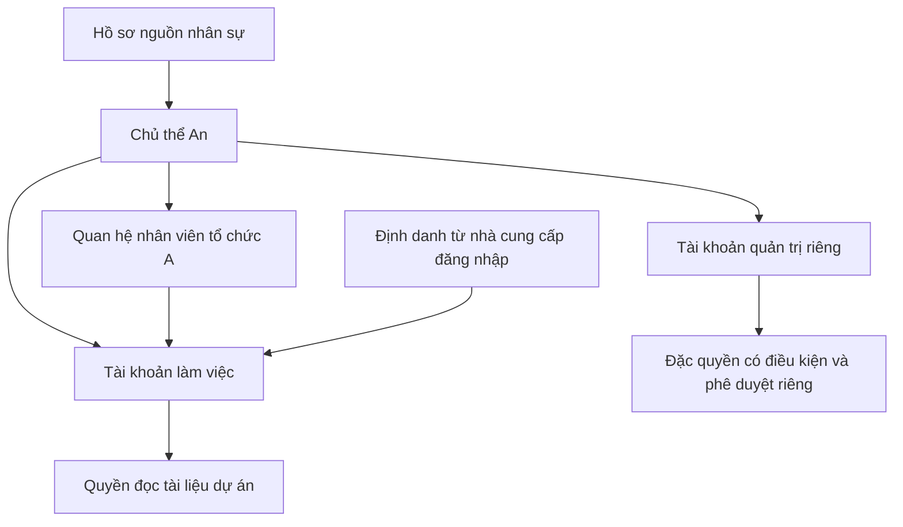
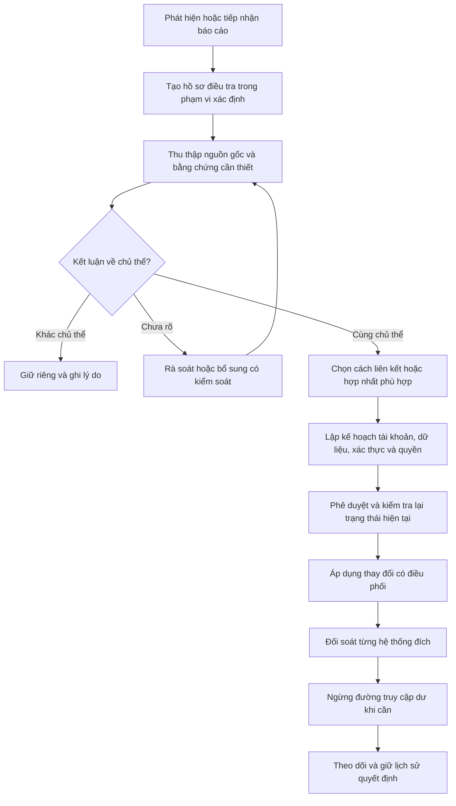

# Identity duplicate — Danh tính trùng lặp

## 1. Danh tính trùng lặp là gì?

An tự đăng ký tài khoản bằng email cá nhân để dùng cổng cộng tác. Khi An trở thành nhân viên, hệ thống nhân sự cấp phát thêm một hồ sơ danh tính và tài khoản bằng email công ty. Sau đó, một ứng dụng tạo tài khoản cục bộ khi An đăng nhập SSO lần đầu vì không tìm thấy liên kết tới hồ sơ đã có.

Cùng một người có thể đang được biểu diễn bằng nhiều bản ghi không được liên kết đúng. Một hồ sơ bị vô hiệu hóa khi nghỉ việc, trong khi hồ sơ khác vẫn giữ quyền. Quản lý xem lịch sử một tài khoản và tưởng đã thu hồi toàn bộ truy cập, nhưng An còn có thể dùng tài khoản còn lại.

**Identity duplicate là tình trạng một chủ thể được biểu diễn bởi nhiều bản ghi danh tính một cách ngoài ý muốn trong phạm vi mà hệ thống cần nhận diện và quản lý nhất quán.** Có thể gọi là danh tính trùng lặp. Vấn đề không chỉ là số lượng bản ghi, mà là hệ thống không biết những bản ghi nào thực sự thuộc cùng một chủ thể và vòng đời nào phải được phối hợp.

Trước khi kết luận “trùng”, cần xác định phạm vi và mô hình dữ liệu. Một người có tài khoản làm việc và tài khoản quản trị riêng có thể là thiết kế hợp lệ. Hai người trùng họ tên lại là hai chủ thể khác nhau. Gộp nhầm trường hợp này có thể trao dữ liệu hoặc quyền của người này cho người kia.

Trong IAM, xử lý danh tính trùng liên quan trực tiếp đến nhận diện chủ thể, cấp phát tài khoản, liên kết danh tính, xác thực, phân quyền, thu hồi và kiểm toán. Mục tiêu là tạo liên kết chính xác và quản lý vòng đời đúng, không phải làm cho cơ sở dữ liệu có ít dòng nhất.

## 2. Phân biệt các trường hợp dễ nhầm

| Trường hợp | Ví dụ | Có phải danh tính trùng ngoài ý muốn không? |
| --- | --- | --- |
| Một người có hai hồ sơ danh tính không được liên kết trong cùng miền quản lý | Tự đăng ký trước, sau đó được cấp phát thêm hồ sơ thứ hai | Có thể là trùng cần điều tra |
| Một người có nhiều tài khoản đúng mục đích | Tài khoản công việc và tài khoản quản trị tách biệt | Không nhất thiết; cần giữ sự phân tách theo chính sách |
| Hai người trùng tên | Hai nhân viên cùng tên Nguyễn Minh An | Không; tên giống nhau không chứng minh cùng người |
| Nhiều người dùng chung một địa chỉ liên hệ | Hộp thư nhóm của bộ phận | Không được coi cùng người chỉ vì email giống nhau |
| Một danh tính được đồng bộ sang nhiều ứng dụng | Hồ sơ IAM có tài khoản liên kết ở cổng tài liệu và kho mã | Thường là mô hình cấp phát bình thường nếu liên kết rõ ràng |
| Một người tham gia nhiều tổ chức | Cùng chuyên gia làm việc cho hai khách hàng | Các quan hệ và quyền phải giữ đúng phạm vi; không tự gộp giữa các tổ chức |
| Một tên đăng nhập bị cấp lại cho người khác | Người mới nhận địa chỉ email trước đây của người đã nghỉ | Không phải cùng danh tính; liên kết nhầm có thể làm lộ dữ liệu cũ |
| Kẻ giả mạo dùng thông tin của người thật | Hồ sơ mới có tên và thông tin giống nạn nhân | Có thể là gian lận, không phải cơ sở để gộp tài khoản |

Cần phân biệt **bản ghi giống nhau**, **nhiều tài khoản của cùng người** và **nhiều hồ sơ danh tính ngoài ý muốn**. Chúng đòi hỏi quyết định khác nhau.

Một lỗi nghiêm trọng là coi việc khớp một số thuộc tính như kết luận chắc chắn. Một lỗi khác là xóa tất cả tài khoản phụ của cùng người mà không xem chúng có phục vụ việc tách đặc quyền, phân tách nhiệm vụ hoặc các quan hệ hợp lệ hay không.

## 3. Vì sao danh tính trùng xuất hiện?

### 3.1. Nhiều đường tạo tài khoản không dùng chung cơ chế liên kết

Người dùng tự đăng ký, hệ thống nhân sự cấp phát, quản trị viên tạo thủ công và ứng dụng tạo tài khoản khi đăng nhập lần đầu có thể chạy độc lập. Mỗi luồng chỉ kiểm tra dữ liệu cục bộ của mình rồi tạo hồ sơ mới.

Nếu các luồng không thống nhất cách xác định chủ thể, cùng một người có thể nhận nhiều hồ sơ ngay cả khi từng luồng riêng lẻ đều hoạt động theo thiết kế.

### 3.2. Dùng thuộc tính thay đổi được làm khóa danh tính

Email, tên hiển thị, tên đăng nhập và đơn vị công tác có thể thay đổi. Khi email công ty của An đổi, một bộ đồng bộ chỉ tìm theo email mới có thể không thấy tài khoản cũ và tạo tài khoản khác.

Chiều ngược lại cũng nguy hiểm: email cũ được cấp cho người khác, hệ thống tìm thấy tài khoản lịch sử rồi liên kết người mới với tài khoản đó. Vì vậy, tránh tạo trùng và tránh gộp nhầm phải được giải quyết cùng nhau.

### 3.3. Thử lại, xử lý đồng thời và sự kiện đến muộn

Hai yêu cầu có thể cùng kiểm tra “chưa có hồ sơ” trước khi một trong hai ghi dữ liệu. Một callback hoặc yêu cầu cấp phát có thể bị gửi lại khi mạng lỗi. Nếu mỗi lần đều tạo mới, hệ thống phát sinh bản ghi trùng.

Sự kiện cũ cũng có thể tạo lại tài khoản đã được xử lý nếu hệ thống không giữ đủ thông tin liên kết và vòng đời. Việc xóa một hồ sơ phụ chưa giải quyết nguyên nhân nếu bộ đồng bộ tiếp tục coi nó là tài khoản còn thiếu.

### 3.4. Thay đổi nguồn và tổ chức

Di chuyển hệ thống nhân sự, thay nhà cung cấp danh tính, tiếp nhận lại nhân viên hoặc hợp nhất tổ chức có thể tạo định danh nguồn mới. Không phải mọi bản ghi có khóa mới đều là người mới; cũng không phải mọi bản ghi có thông tin giống nhau đều là cùng người.

Việc chuyển đổi cần một kế hoạch ánh xạ có bằng chứng và phạm vi rõ ràng. Không dùng thao tác “nếu email bằng nhau thì gộp” làm quy tắc chung cho toàn bộ quá trình.

## 4. Mô hình danh tính giúp tránh nhầm lẫn

### 4.1. Tách chủ thể, tài khoản và quan hệ

Một mô hình dễ hiểu có thể gồm:

- **Chủ thể nội bộ:** biểu diễn người hoặc thực thể được IAM quản lý.
- **Tài khoản:** phương tiện tham gia một hệ thống, có vòng đời và mục đích riêng.
- **Quan hệ tổ chức:** người đó tham gia với tư cách nào, trong phạm vi và thời gian nào.
- **Liên kết nguồn:** ánh xạ bản ghi của một nguồn tới chủ thể hoặc tài khoản nội bộ.
- **Phương thức xác thực:** được đăng ký cho một tài khoản theo điều kiện cụ thể.
- **Quyền:** được cấp cho phạm vi và nhiệm vụ, không chỉ vì bản ghi thuộc cùng một người.

Ví dụ hợp lệ:



Hai tài khoản trong sơ đồ không cần bị gộp chỉ vì cùng thuộc An. Liên kết về cùng chủ thể có thể hỗ trợ quản lý vòng đời, trong khi ranh giới tài khoản và đặc quyền vẫn được duy trì.

### 4.2. Khóa liên kết phải có phạm vi

Một mã nhân sự thường chỉ có ý nghĩa trong nguồn và phạm vi cấp phát tương ứng. Một định danh đăng nhập bên ngoài phải được hiểu cùng bên phát hành và ngữ cảnh áp dụng. Chuỗi `0042` từ hai nguồn khác nhau không tự đại diện cho cùng người.

Ví dụ mô hình liên kết nguồn nội bộ:

```json
{
  "organizationId": "org_demo_a",
  "sourceSystem": "hr_demo_a",
  "sourceNamespace": "workforce",
  "sourceSubjectId": "person_demo_0042",
  "internalSubjectId": "subj_demo_018",
  "linkStatus": "confirmed",
  "linkDecisionReference": "decision_demo_071"
}
```

Đây là mô hình minh họa, không phải định dạng chuẩn của giao thức. Ý chính là giữ nguồn, phạm vi và quyết định liên kết thay vì chỉ lưu một giá trị email.

Trong phạm vi ánh xạ được thiết kế, một định danh nguồn đang có hiệu lực không nên trỏ đồng thời tới nhiều chủ thể nội bộ trái với mô hình. Nếu có lịch sử chuyển đổi hoặc quan hệ qua nhiều tổ chức, cần biểu diễn rõ các khoảng hiệu lực và phạm vi; không áp đặt một ràng buộc toàn cục tùy ý làm mất những quan hệ hợp lệ.

### 4.3. Liên kết dữ liệu khác liên kết đăng nhập

Một tham chiếu cho biết hai bản ghi cần được xem cùng trong báo cáo không có nghĩa mọi phương thức xác thực của chúng được quyền đăng nhập vào cùng tài khoản. Một ánh xạ hồ sơ cũng không tự cấp quyền truy cập tài nguyên.

Phải xác định riêng:

1. Những bản ghi nào mô tả cùng chủ thể?
2. Tài khoản nào tiếp tục tồn tại và phục vụ mục đích gì?
3. Định danh đăng nhập hoặc phương thức xác thực nào được phép truy cập tài khoản nào?
4. Quyền nào phù hợp với công việc và quan hệ hiện tại?

Không biến một bảng “bí danh” dùng cho tra cứu dữ liệu thành một cơ chế tự động cho mọi credential truy cập tài khoản chính.

## 5. Phát hiện bản ghi nghi trùng

### 5.1. Tạo ứng viên trước, kết luận sau

Phát hiện trùng thường bắt đầu bằng cách tìm các bản ghi đáng kiểm tra. Hệ thống có thể dùng các tín hiệu như:

- Nhiều hồ sơ cùng tham chiếu một định danh ổn định từ nguồn được chấp nhận.
- Hai yêu cầu cấp phát cùng tương ứng một bản ghi nguồn.
- Một thay đổi email làm xuất hiện hồ sơ mới trong khi hồ sơ cũ vẫn tồn tại.
- Nhiều hồ sơ có tổ hợp thuộc tính giống nhau trong cùng phạm vi.
- Người dùng hoặc chủ hệ thống báo họ đang có nhiều tài khoản ngoài ý muốn.

**Một ứng viên nghi trùng không phải kết luận cùng người.** Tín hiệu tìm kiếm có thể nhạy để giảm bỏ sót, còn quyết định gộp hoặc liên kết cần tiêu chí phù hợp với hậu quả của sai lầm.

### 5.2. Giá trị của từng tín hiệu

| Tín hiệu | Có thể giúp gì? | Giới hạn |
| --- | --- | --- |
| Cùng định danh nguồn ổn định trong đúng phạm vi | Phát hiện hai hồ sơ có thể được tạo từ cùng một bản ghi | Cần kiểm tra nguồn, việc ánh xạ và khả năng lỗi dữ liệu |
| Cùng email | Tìm ứng viên và phát hiện thay đổi luồng đăng ký | Email có thể dùng chung, thay đổi, bị cấp lại hoặc chưa được kiểm chứng |
| Cùng tên, ngày sinh hoặc thuộc tính nhận dạng | Hỗ trợ đối chiếu theo chính sách | Có thể trùng tự nhiên hoặc bị sao chép; không đủ để tự động gộp mọi trường hợp |
| Cùng thiết bị hoặc địa chỉ mạng | Hỗ trợ một số điều tra ngữ cảnh | Nhiều người có thể dùng chung; một người cũng có thể dùng nhiều thiết bị |
| Người dùng kiểm soát cả hai tài khoản | Hỗ trợ một quy trình liên kết tài khoản có kiểm soát | Chứng minh quyền kiểm soát tại thời điểm kiểm tra, chưa tự chứng minh mọi thông tin đời thực |
| Cùng ảnh hoặc tài liệu | Có thể chỉ ra bằng chứng được dùng lại | Có thể là giả mạo, dữ liệu bị đánh cắp hoặc bằng chứng không đủ chất lượng |

Không nên thu thêm dữ liệu nhạy cảm chỉ vì muốn tăng số trường để so khớp. Cần biết tín hiệu nào thực sự hỗ trợ mục tiêu và thông tin nào được phép sử dụng trong phạm vi dịch vụ.

### 5.3. Chuẩn hóa không phải chứng minh

Chuẩn hóa khoảng trắng, cách biểu diễn tên hoặc mã tổ chức có thể giúp tìm ứng viên. Tuy nhiên, chuẩn hóa quá mạnh có thể làm các giá trị khác nhau trở nên giống nhau.

Không mặc nhiên xóa dấu, bỏ mọi ký tự đặc biệt hoặc biến đổi định danh của mọi nguồn theo cùng một cách. Quy tắc phải phù hợp với ngữ nghĩa của trường. Giá trị chuẩn hóa phục vụ so khớp nên được phân biệt với giá trị gốc và không tự trở thành khóa chứng minh chủ thể.

## 6. Đánh giá bằng chứng và ra quyết định

### 6.1. Hai loại sai cần quản lý

**Gộp nhầm** xảy ra khi hệ thống kết luận hai chủ thể khác nhau là một. Hậu quả có thể là người này nhận quyền, dữ liệu hoặc phương thức khôi phục của người kia; lịch sử cũng bị diễn giải sai.

**Bỏ sót trùng** xảy ra khi hệ thống không nhận ra hai hồ sơ thực sự thuộc cùng một chủ thể. Hậu quả có thể là thu hồi không đầy đủ, quyền phân tán, báo cáo sai và trải nghiệm đăng nhập khó hiểu.

Cách cân bằng phụ thuộc rủi ro của dịch vụ. Với dữ liệu hoặc quyền nhạy cảm, tác hại của gộp nhầm có thể rất lớn. Không nên chọn ngưỡng tự động chỉ dựa vào mong muốn giảm số lượng hồ sơ.

### 6.2. Tách xác nhận chủ thể khỏi xác nhận quyền kiểm soát

Trong dịch vụ cho phép liên kết hai tài khoản, yêu cầu xác thực lại trên cả hai tài khoản có thể là điều kiện quan trọng. Các bước cần gắn với đúng giao dịch, có thời hạn và được kiểm tra phía máy chủ.

Tuy nhiên, kiểm soát cả hai tài khoản không tự chứng minh người dùng là chủ thể đời thực mà cả hai hồ sơ khai báo. Một tài khoản có thể bị chiếm hoặc được người khác ủy quyền sử dụng. Nếu quyết định ảnh hưởng dữ liệu nhạy cảm, danh tính nhân viên hay đặc quyền, có thể cần nguồn có thẩm quyền và kiểm chứng bổ sung theo chính sách.

Không cho phép chỉ đăng nhập tài khoản A rồi nhập email của B để nhận quyền của B. Việc kênh liên hệ trùng nhau cũng không thay thế toàn bộ quy trình liên kết.

### 6.3. Xử lý mâu thuẫn

Hai hồ sơ có thể cùng tên nhưng có các quan hệ tổ chức khác nhau. Trước tiên cần xem đó là mâu thuẫn dữ liệu hay hai quan hệ hợp lệ của cùng người. Nguồn nhân sự có thẩm quyền về quan hệ nhân viên không nhất thiết có thẩm quyền về tài khoản cá nhân trước đó.

Nếu bằng chứng không đủ, giữ trạng thái chưa kết luận và chuyển tới bên có trách nhiệm. Không chọn giá trị cập nhật gần nhất chỉ để có một hồ sơ hoàn chỉnh; nguồn mới hơn chưa chắc đáng tin hơn hoặc có cùng ý nghĩa.

Một điểm số so khớp có thể hỗ trợ phân loại, nhưng không phải bằng chứng độc lập. Nếu dùng tự động hóa, cần biết hệ thống được đánh giá trên những trường hợp nào, loại lỗi nào có thể xuất hiện và khi nào phải chuyển sang rà soát.

## 7. Các cách xử lý không chỉ có gộp

| Cách xử lý | Khi phù hợp | Điều cần giữ |
| --- | --- | --- |
| Giữ riêng và đánh dấu đã xác nhận khác chủ thể | Có bằng chứng hai người khác nhau | Tránh liên tục đưa cùng cặp vào hàng chờ mà không có tín hiệu mới |
| Liên kết về cùng chủ thể, giữ tài khoản riêng | Một người có nhiều tài khoản đúng mục đích | Ranh giới xác thực, quyền và vai trò của từng tài khoản |
| Chọn một hồ sơ quản lý chính và chuyển liên kết có kiểm soát | Hai hồ sơ ngoài ý muốn thực sự thuộc cùng chủ thể | Nguồn gốc, lịch sử, kế hoạch quyền và kết quả từng bước |
| Ngừng sử dụng tài khoản dư sau khi chuyển đổi phù hợp | Một tài khoản không còn cần thiết | Không để tài khoản dư tiếp tục truy cập hoặc bị tự động tạo lại |
| Giữ trạng thái cần điều tra | Dữ liệu mâu thuẫn, nghi giả mạo hoặc chưa đủ bằng chứng | Không trao quyền từ hồ sơ này sang hồ sơ kia khi chưa có cơ sở |

Chọn hồ sơ chính là một quyết định quản lý dữ liệu. Nó không làm mọi giá trị trong hồ sơ đó trở thành đúng, và cũng không đồng nghĩa mọi quyền của hồ sơ phụ phải được chuyển sang.

Các thuộc tính cần được giải quyết theo từng nguồn và ý nghĩa. Ví dụ, giữ tên hiển thị người dùng mong muốn có thể phù hợp cho giao diện, nhưng đơn vị công tác dùng trong phân quyền cần được lấy từ nguồn được giao trách nhiệm.

## 8. Quy trình xử lý một cặp danh tính nghi trùng



### 8.1. Ghi nhận phạm vi và chặn thay đổi gây nhầm

Hồ sơ xử lý cần có định danh giao dịch, những bản ghi đang xét, tổ chức liên quan, lý do và bên chịu trách nhiệm. Chỉ người hoặc dịch vụ có nhiệm vụ phù hợp mới được xem và thực hiện thay đổi.

Tùy rủi ro, có thể cần tạm hạn chế một số thao tác nhạy cảm trong lúc chuyển đổi, chẳng hạn thay liên kết đăng nhập hoặc thêm phương thức khôi phục. Không phải mọi nghi trùng đều cần khóa toàn bộ tài khoản; quyết định phải dựa trên bằng chứng và hậu quả.

### 8.2. Lập kế hoạch riêng cho dữ liệu, xác thực và quyền

Một kế hoạch cần trả lời:

1. Bản ghi hoặc định danh nội bộ nào tiếp tục làm điểm tham chiếu quản lý?
2. Các liên kết nguồn được giữ hoặc chuyển như thế nào?
3. Tài khoản nào tồn tại, tài khoản nào ngừng sử dụng?
4. Dữ liệu nghiệp vụ, quyền sở hữu và quan hệ tài nguyên được xử lý ra sao?
5. Phương thức xác thực và khôi phục nào được chấp nhận, thu hồi hoặc đăng ký lại?
6. Quyền hiện tại được tính từ nguồn, quan hệ và phê duyệt nào?
7. Các ứng dụng đích cần áp dụng thay đổi theo thứ tự nào?

**Không lấy hợp của mọi quyền từ các hồ sơ rồi cấp vào tài khoản chính.** Cũng không mặc nhiên lấy giao của mọi quyền vì cách đó có thể bỏ quyền hợp lệ mà không giải quyết đúng nguồn gốc. Cần tính lại kế hoạch theo nhu cầu và chính sách hiện tại.

Nếu một tài khoản có quyền quản trị còn tài khoản kia là tài khoản công việc thường ngày, việc cùng chủ thể không phải lý do phá bỏ sự tách biệt. RBAC, ABAC, phân tách nhiệm vụ và quyền có thời hạn vẫn phải được duy trì.

### 8.3. Không hợp nhất phương thức xác thực một cách cơ học

Mật khẩu, passkey, khóa bảo mật, bí mật dùng chung hoặc mã khôi phục không phải những trường dữ liệu hồ sơ thông thường. Giữ tất cả chúng làm đường đăng nhập vào tài khoản chính có thể giữ lại cả đường truy cập của bên không còn được tin cậy.

Cần xác định phương thức nào thuộc đúng chủ thể, đúng tài khoản và vẫn đáp ứng chính sách. Một số trường hợp cần thu hồi hoặc yêu cầu đăng ký lại. Không hiển thị hay trao đổi mật khẩu và bí mật giữa các hồ sơ để “kiểm tra chúng có giống nhau”.

Các phiên, token và đường khôi phục cũng phải được đánh giá. Nếu tài khoản phụ bị ngừng sử dụng, cần xử lý khả năng truy cập đã phát hành theo kiến trúc của từng hệ thống. Tắt đăng nhập mới chưa chắc làm mọi phiên cũ mất hiệu lực ngay.

### 8.4. Áp dụng và đối soát có kiểm soát

Trước khi thực thi, kiểm tra dữ liệu và quyết định vẫn phù hợp. Nếu hồ sơ đã nhận sự kiện nghỉ việc, điều kiện chặn mới hoặc thay đổi quyền quan trọng, cần đánh giá lại kế hoạch thay vì tiếp tục theo một ảnh chụp cũ.

Trong phạm vi dữ liệu cục bộ, bảo vệ cập nhật liên kết bằng giao dịch hoặc điều kiện phiên bản phù hợp. Với nhiều hệ thống đích, cần theo dõi từng bước, thử lại an toàn và đối soát; không giả định mọi nơi cùng tham gia một giao dịch nguyên tử.

Nếu chuyển liên kết nguồn xong nhưng vô hiệu hóa tài khoản phụ thất bại, không báo toàn bộ xử lý đã hoàn tất. Phải biết đường truy cập nào còn tồn tại và áp dụng giới hạn phù hợp trong lúc xử lý.

### 8.5. Giữ lịch sử mà không giữ đường truy cập dư

Không nên xóa sạch hồ sơ phụ ngay khi bắt đầu để làm báo cáo đẹp hơn. Có thể cần giữ bản ghi lịch sử hoặc trạng thái ngừng sử dụng để đối soát và ngăn nguồn tạo lại.

Các sự kiện kiểm toán cũ nên giữ định danh tài khoản, chủ thể và nguồn tại thời điểm phát sinh. Báo cáo hiện tại có thể tra cứu liên kết đã được xác nhận, nhưng không viết lại mọi sự kiện cũ thành “đã xảy ra dưới tài khoản chính” nếu điều đó làm mất sự thật lịch sử.

Nếu dùng ánh xạ tới hồ sơ quản lý chính, cần tránh vòng lặp và chuỗi không rõ nghĩa. Việc đi theo ánh xạ để tra cứu lịch sử không tự cho phép một tài khoản đăng nhập bằng credential của tài khoản khác.

## 9. Ví dụ xuyên suốt: tài khoản tự đăng ký và tài khoản nhân viên

### 9.1. Tình huống ban đầu

An có tài khoản cộng tác trước khi trở thành nhân viên. Sau khi tiếp nhận, nguồn nhân sự tạo hồ sơ nhân viên mới. Hai hồ sơ cùng thuộc An nhưng chưa liên kết; ứng dụng dự án cũng có hai tài khoản cục bộ.

Tài khoản cộng tác còn quyền đọc Phoenix theo lời mời cũ. Tài khoản nhân viên có quyền cơ bản và đang được xét tham gia Atlas. Một báo cáo phát hiện thông tin giống nhau đưa hai hồ sơ vào danh sách nghi trùng.

### 9.2. Đánh giá thay vì gộp ngay theo tên

Bên xử lý kiểm tra nguồn gốc và liên kết với hồ sơ nhân sự, đồng thời thực hiện quy trình xác nhận phù hợp cho tài khoản cộng tác. Việc tên giống nhau chỉ giúp tìm ứng viên, không phải lý do duy nhất để chuyển quyền.

Nếu chỉ tìm thấy email trùng nhưng không chứng minh được liên kết, hồ sơ phải tiếp tục ở trạng thái chưa kết luận. Nếu có dấu hiệu tài khoản cộng tác đã bị người khác kiểm soát, cần xử lý vấn đề đó trước khi trao bất kỳ khả năng truy cập mới nào.

### 9.3. Lập kế hoạch hiện tại

Sau khi có đủ cơ sở xác nhận cùng chủ thể, tổ chức chọn một hồ sơ quản lý chính và lập kế hoạch:

| Hạng mục | Cách xử lý minh họa |
| --- | --- |
| Liên kết nhân sự | Gắn đúng hồ sơ nguồn vào chủ thể quản lý chính |
| Tài khoản cộng tác | Ngừng sử dụng sau các bước chuyển đổi và kiểm tra cần thiết |
| Quyền Phoenix cũ | Xem lại theo quan hệ hiện tại; không mặc nhiên chuyển tiếp |
| Quyền Atlas | Chỉ cấp khi có tư cách thành viên hoặc phê duyệt tương ứng |
| Dữ liệu do tài khoản cộng tác tạo | Xử lý quyền sở hữu theo chính sách tài nguyên, giữ dấu vết tác giả gốc |
| Phương thức xác thực | Chọn các phương thức đáp ứng chính sách; thu hồi hoặc đăng ký lại khi cần |
| Lịch sử kiểm toán | Giữ tài khoản gốc và quyết định liên kết để đối soát |

### 9.4. Đồng bộ và kết thúc

Hệ thống cập nhật liên kết ở IAM và các ứng dụng đích, xác nhận tài khoản dư không còn đường truy cập ngoài ý muốn. Nguồn cấp phát được điều chỉnh để không tiếp tục tạo lại tài khoản phụ.

Nếu sau này An nghỉ việc, các tài khoản cần chịu tác động phải được tìm theo liên kết và quan hệ hiện tại. Tài khoản quản trị riêng, nếu có, vẫn giữ ranh giới riêng nhưng phải nằm trong phạm vi thu hồi phù hợp.

Kết quả tốt không chỉ là còn một hồ sơ hiển thị trên giao diện. Kết quả cần là nhận diện đúng chủ thể, quyền hiện tại đúng và vòng đời được thực thi đầy đủ trên các đường truy cập liên quan.

## 10. Ngăn trùng từ luồng đăng ký và cấp phát

### 10.1. Dùng định danh nguồn ổn định và liên kết có trách nhiệm

Luồng cấp phát nên tìm theo liên kết nguồn đã được xác lập, thay vì coi email là khóa toàn cục của con người. Khi email đổi, cập nhật thuộc tính phù hợp; không tự tạo người mới chỉ vì khóa tìm kiếm dựa trên email không còn khớp.

Khi nguồn cấp định danh mới hoặc quan hệ mới, cần xem chính sách liên kết và vòng đời. Không đoán rằng cùng tên là cùng người, cũng không đoán rằng khóa mới luôn nghĩa là chủ thể mới.

### 10.2. Xử lý đồng thời ngay tại nơi lưu liên kết

Một chuỗi “kiểm tra chưa tồn tại rồi tạo” không đủ khi nhiều yêu cầu chạy đồng thời. Cần cơ chế bảo vệ tính duy nhất theo đúng khóa và phạm vi trong kho dữ liệu, kết hợp xử lý xung đột và nhận diện yêu cầu gửi lại.

Các điều kiện thiết kế có thể diễn đạt như sau:

```text
Trong phạm vi một ánh xạ nguồn đang có hiệu lực:
    cùng source + namespace + sourceSubjectId
    không được tạo nhiều chủ thể đích ngoài ý muốn.

Với cùng một yêu cầu cấp phát được gửi lại:
    trả hoặc tiếp tục kết quả đã có,
    không tự tạo thêm chủ thể hay tài khoản.

Nếu phát hiện xung đột liên kết:
    chuyển sang xử lý xung đột có kiểm soát,
    không ghi đè chủ thể hiện có theo dữ liệu từ người gửi.
```

Đây là các bất biến minh họa. Ràng buộc cụ thể phụ thuộc mô hình phạm vi, lịch sử và loại tài khoản; không dùng chúng để cấm mọi tài khoản hợp lệ của cùng người.

### 10.3. Kiểm soát cấp phát khi đăng nhập SSO lần đầu

Ứng dụng tạo tài khoản đúng lúc khi người dùng đăng nhập cần hiểu định danh bên ngoài, bên phát hành và ánh xạ nội bộ. Không tự liên kết tài khoản cũ chỉ vì claim email bằng nhau.

Trong liên kết danh tính và OIDC, một định danh chủ thể phải được hiểu trong ngữ cảnh phát hành tương ứng. Cùng người có thể nhận các định danh khác nhau ở các phạm vi khác nhau; các giá trị giống nhau từ hai bên phát hành cũng không tự nói đến cùng người.

Một token được kiểm tra hợp lệ hỗ trợ tin cậy phản hồi theo giao thức, nhưng không tự chứng minh mọi thông tin đời thực hoặc cho phép hợp nhất quyền. OAuth/OIDC và SSO không thay thế chính sách liên kết tài khoản.

### 10.4. Đóng nguyên nhân tạo trùng

Sau khi xử lý một cặp, cần biết vì sao nó xuất hiện. Có thể phải sửa cấu hình ánh xạ, đường tạo thủ công, luồng đăng ký hoặc cách xử lý sự kiện thử lại.

Giữ tham chiếu cần thiết cho tài khoản đã ngừng sử dụng giúp phân biệt “đã xử lý” với “chưa từng tồn tại”. Sự kiện cũ không được tạo lại quyền đã thu hồi hoặc tài khoản đã kết thúc chỉ vì một lần đồng bộ không thấy bản ghi đang hoạt động.

## 11. Khi phát hiện đã gộp nhầm

Gộp nhầm cần được xử lý như một sai lệch có thể ảnh hưởng truy cập và dữ liệu, không chỉ là lỗi hiển thị. Trước tiên xác định những tài khoản, phương thức xác thực, phiên, quyền và tài nguyên nào đã bị liên kết sai.

Tùy phạm vi và rủi ro, các bước có thể gồm:

1. Giới hạn đường truy cập bị ảnh hưởng và ngăn tiếp tục chuyển quyền hoặc dữ liệu.
2. Bảo toàn bằng chứng và lịch sử quyết định để xác định thay đổi đã xảy ra.
3. Khôi phục mô hình chủ thể và liên kết đúng theo nguồn được kiểm tra.
4. Thu hồi hoặc thay thế các khả năng xác thực, khôi phục và phiên bị ảnh hưởng khi cần.
5. Tính lại quyền cho từng chủ thể và đối soát từng hệ thống đích.
6. Đánh giá dữ liệu hoặc hành động đã bị truy cập sai và xử lý theo quy trình của tổ chức.

Tách lại hai bản ghi không thể làm người nhận quên dữ liệu đã xem hoặc tự đảo ngược mọi hành động đã thực hiện. Vì vậy, kế hoạch phục hồi cần dựa trên tác động thực tế, không chỉ trên khả năng hoàn tác một cập nhật cơ sở dữ liệu.

Đây cũng là lý do nên giữ nguồn gốc, kế hoạch chuyển đổi và lịch sử theo thời gian. Một nút “undo merge” không có đủ thông tin về các tác động phía sau sẽ tạo cảm giác phục hồi sai.

## 12. Bảo vệ dữ liệu và kiểm toán

Quá trình tìm trùng có thể tập hợp dữ liệu từ nhiều nguồn và khiến người rà soát nhìn thấy thông tin mà bình thường họ không cần truy cập. Phạm vi xem dữ liệu phải gắn với nhiệm vụ; dữ liệu của các tổ chức khác nhau không được vô tình mở chung chỉ để tiện so khớp.

Các nguyên tắc cần xem xét:

- Chỉ sử dụng thuộc tính cần thiết cho quyết định và mục đích đã xác định.
- Hạn chế đưa tài liệu nhận dạng hoặc bằng chứng gốc vào danh sách hàng loạt.
- Bảo vệ dữ liệu so khớp, tham chiếu nguồn và kết quả điều tra khi truyền và lưu.
- Không ghi mật khẩu, token hay bí mật xác thực vào log hoặc hồ sơ xử lý.
- Có thời gian lưu phù hợp cho ứng viên, bằng chứng và quyết định đã kết thúc.
- Phân quyền riêng cho việc xem ứng viên, kết luận cùng chủ thể và thực thi chuyển đổi nếu rủi ro yêu cầu.

Dấu vết kiểm toán nên cho biết ai hoặc dịch vụ nào phát hiện cặp nghi trùng, bằng chứng và chính sách nào được sử dụng, quyết định do ai phê duyệt, những liên kết và quyền nào thay đổi, kết quả ở từng đích ra sao.

Lưu cả những kết luận “khác chủ thể” hoặc “chưa đủ bằng chứng” ở mức cần thiết giúp giải thích vì sao không gộp. Một quyết định có thể cần xem lại khi có thông tin mới, nhưng không nên bị ghi đè mà mất lý do ban đầu.

## 13. Đo lường chất lượng và mở rộng sang workload

### 13.1. Không đo thành công bằng số hồ sơ đã xóa

Những chỉ báo có ích gồm:

- Số ứng viên nghi trùng theo nguồn phát sinh và nguyên nhân.
- Tỷ lệ ứng viên được xác nhận cùng chủ thể, khác chủ thể hoặc chưa rõ.
- Số trường hợp gộp nhầm đã được xác nhận và tác động của chúng.
- Trường hợp bỏ sót được phát hiện qua thu hồi, đối soát hoặc phản hồi người dùng.
- Thời gian xử lý và số yêu cầu chuyển đổi chưa hoàn tất ở các đích.
- Tỷ lệ tài khoản phụ bị tạo lại sau xử lý.
- Sai lệch quyền hoặc khả năng truy cập còn tồn tại sau chuyển đổi.

Nếu đánh giá thuật toán so khớp bằng độ chính xác hoặc mức bao phủ, cần một tập trường hợp có kết luận đáng tin và biết phạm vi đánh giá. Chỉ thống kê các cặp đã được duyệt không đủ để suy ra đã tìm thấy mọi bản ghi trùng trong toàn bộ hệ thống.

Giảm số hồ sơ có thể chỉ phản ánh việc xóa nhiều dữ liệu, không phản ánh chất lượng nhận diện hay an toàn truy cập.

### 13.2. Workload cũng cần phân biệt bản sao và danh tính riêng

Hai dịch vụ cùng tên hoặc dùng cùng mã nguồn không nhất thiết là một workload cần gộp danh tính. Môi trường phát triển và sản xuất thường cần ranh giới quyền khác nhau; các bản triển khai cũng có thể có mục đích và vòng đời riêng.

Khi nghi workload bị tạo danh tính trùng, cần đối chiếu nguồn cấp phát, môi trường, chủ sở hữu chịu trách nhiệm và mục đích hoạt động. Không gộp một tài khoản dịch vụ với tài khoản của người vận hành chỉ vì cùng email liên hệ.

Bài học chung là nhận diện chủ thể phải dựa trên mô hình và bằng chứng phù hợp. Sự giống nhau của tên, nhãn hoặc người sở hữu chưa đủ để hợp nhất đường xác thực và quyền.

## 14. Điểm cần ghi nhớ

Identity duplicate xuất hiện khi một chủ thể có nhiều bản ghi danh tính ngoài ý muốn trong một phạm vi cần quản lý nhất quán. Phát hiện trùng chỉ tạo ứng viên; quyết định liên kết hoặc hợp nhất cần bằng chứng về đúng chủ thể và hiểu rõ mô hình tài khoản.

Xử lý tốt phải tách dữ liệu hồ sơ, liên kết đăng nhập, phương thức xác thực, quyền và lịch sử kiểm toán. Quyền cần được tính theo quan hệ hiện tại, tài khoản hợp lệ có thể tiếp tục được tách riêng, và đường tạo trùng phải được sửa để lỗi không tái diễn. Trong toàn bộ quá trình, tránh gộp nhầm quan trọng không kém việc tìm ra các bản ghi còn sót.
