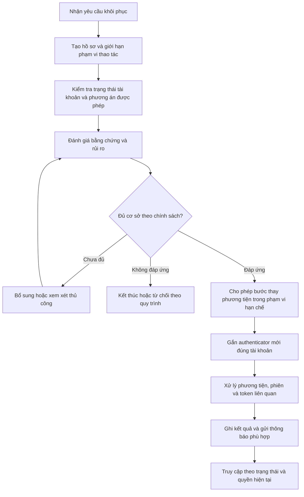

# Identity recovery

## Mục tiêu bài học

Một người dùng có thể mất điện thoại, quên mật khẩu, mất khóa bảo mật hoặc không còn truy cập được kênh liên hệ đã đăng ký. Tổ chức cũng có thể phát hiện tài khoản bị chiếm quyền và cần đưa quyền kiểm soát trở lại đúng chủ thể. **Identity recovery** là phần của vòng đời danh tính giúp xử lý những tình huống đó mà vẫn bảo vệ mối liên hệ giữa chủ thể, tài khoản và phương tiện xác thực.

Khôi phục không chỉ là giúp người dùng đăng nhập lại. Đây là một quy trình nhạy cảm vì nó có thể thay đổi ai được phép kiểm soát một tài khoản đang có dữ liệu và quyền truy cập.

Sau bài này, bạn có thể:

- Phân biệt khôi phục danh tính với đổi mật khẩu, mở khóa tài khoản và tái kích hoạt tài khoản.
- Xác định cơ sở để liên kết người yêu cầu với đúng tài khoản cần khôi phục.
- Thiết kế phương án dự phòng trước khi người dùng mất phương tiện xác thực.
- Kiểm soát việc gắn authenticator mới và xử lý phương tiện, phiên, token cũ.
- Mô tả luồng khôi phục có trạng thái, giới hạn quyền, kiểm toán và xử lý ngoại lệ.

## 1. Identity recovery khôi phục điều gì?

Trong bài này, **identity recovery** được hiểu là quá trình tái thiết lập khả năng kiểm soát hợp lệ đối với danh tính số đã tồn tại, khi chủ thể không thể tiếp tục sử dụng cơ chế truy cập thông thường hoặc khi cơ chế đó không còn đáng tin cậy.

Đối tượng được khôi phục là quan hệ liên tục giữa:

```text
Chủ thể hợp lệ
    ↔ hồ sơ danh tính/tài khoản đã tồn tại
    ↔ phương tiện xác thực được phép sử dụng
```

Hệ thống phải có đủ cơ sở cho rằng người yêu cầu được tiếp tục kiểm soát tài khoản đó. Chỉ chứng minh một người có tên hoặc giấy tờ hợp lệ chưa chắc chứng minh họ là chủ thể của tài khoản đang yêu cầu khôi phục.

Ví dụ, Lan đã có tài khoản nhân viên với mã chủ thể nội bộ ổn định. Khi Lan mất khóa bảo mật, hệ thống cần giúp đúng Lan gắn phương tiện thay thế vào tài khoản đó. Hệ thống không nên tạo một tài khoản mới rồi tự chuyển quyền của tài khoản cũ chỉ vì hai tài khoản có cùng tên hoặc email.

### Hai bài toán liên quan nhưng khác nhau

| Bài toán | Câu hỏi cần giải quyết | Ví dụ |
|---|---|---|
| Khôi phục khả năng truy cập | Chủ thể hợp lệ dùng cách nào để đăng nhập lại? | Dùng phương tiện dự phòng để đăng ký khóa mới |
| Khôi phục sau chiếm quyền | Làm thế nào trả quyền kiểm soát về đúng chủ thể và loại bỏ khả năng truy cập của kẻ khác? | Thu hồi phương tiện do kẻ gian gắn vào, xử lý phiên và kiểm tra các thay đổi liên quan |

Bài toán thứ hai thường cần điều tra và biện pháp ngăn chặn rộng hơn. Việc đặt lại mật khẩu có thể chỉ giải quyết một phần rất nhỏ của sự cố.

## 2. Phân biệt với các thao tác vòng đời khác

| Thao tác | Điều kiện hoặc mục đích chính | Điều không nên suy ra |
|---|---|---|
| Đổi mật khẩu | Người dùng đã chứng minh quyền thao tác theo chính sách và muốn thay mật khẩu | Mọi phương tiện khác và mọi phiên cũ đều đã an toàn |
| Đặt lại mật khẩu | Khôi phục khả năng dùng một loại thông tin xác thực | Đã khôi phục toàn bộ tài khoản có MFA hoặc nhiều authenticator |
| Thay authenticator | Gắn phương tiện mới và xử lý phương tiện cũ | Chỉ cần biết tên tài khoản là được thực hiện |
| Mở khóa sau nhiều lần đăng nhập sai | Giải quyết trạng thái khóa do cơ chế bảo vệ đăng nhập | Người yêu cầu chắc chắn là chủ tài khoản |
| Khôi phục danh tính | Tái thiết lập quyền kiểm soát đúng tài khoản theo chính sách | Tài khoản được miễn mọi hạn chế nghiệp vụ hiện tại |
| Tái kích hoạt tài khoản | Cho phép tài khoản bị vô hiệu hóa sử dụng trở lại khi có thẩm quyền | Quy trình khôi phục có quyền tự đảo quyết định đình chỉ hoặc nghỉ việc |
| Khôi phục dữ liệu hoặc bản sao lưu | Đưa dữ liệu hệ thống về trạng thái mong muốn | Quyền cũ trong bản sao lưu vẫn còn phù hợp ở hiện tại |

Một nhân viên đã nghỉ việc có thể chứng minh họ đúng là chủ thể từng có tài khoản. Điều đó không tạo ra quyền được kích hoạt lại tài khoản nhân viên. Quan hệ lao động và chính sách hiện tại vẫn phải được kiểm tra.

Tương tự, tài khoản đang bị đình chỉ để xử lý sự cố không được tự gỡ hạn chế chỉ vì người yêu cầu hoàn thành thử thách khôi phục.

## 3. Vì sao khôi phục là một ranh giới tin cậy quan trọng?

### 3.1. Quy trình có thể thay đổi người kiểm soát tài khoản

Nếu một người có thể gắn authenticator mới, họ có thể kiểm soát những lần đăng nhập tiếp theo. Vì vậy, bước khôi phục cần được bảo vệ tương xứng với giá trị và yêu cầu bảo đảm của tài khoản.

Một tài khoản dùng khóa bảo mật mạnh nhưng cho phép thay khóa chỉ bằng trả lời câu hỏi công khai sẽ có một đường chiếm quyền yếu hơn luồng đăng nhập thông thường. Việc luồng chính yêu cầu MFA không bù được cho lỗ hổng trong luồng khôi phục.

### 3.2. Tác nhân tấn công có thể biết nhiều dữ liệu đúng

Tên, email, số điện thoại cũ, mã nhân viên hoặc nội dung công việc có thể bị lộ hoặc biết được từ nguồn khác. Những dữ liệu này có thể giúp tìm tài khoản, nhưng không tự chứng minh quyền kiểm soát tài khoản.

Các câu hỏi như ngày sinh, tên trường hoặc thông tin gia đình cũng có thể được biết, đoán hoặc chia sẻ. Không nên mặc định xem kiến thức cá nhân là bí mật mạnh.

### 3.3. Một phiên đang mở chưa chắc đủ cho thao tác nhạy cảm

Phiên có thể đã bị lấy cắp hoặc được mở trên thiết bị dùng chung. Với thay đổi quan trọng như gắn phương tiện mới, chính sách có thể yêu cầu xác thực lại hoặc kiểm tra bổ sung bằng cơ chế phù hợp.

Không nên cho phép một phiên bất kỳ tự đổi đồng thời email liên hệ, số điện thoại và authenticator rồi dùng chính những thông tin vừa đổi để chứng minh việc khôi phục.

### 3.4. Kênh hỗ trợ cũng là một phần của hệ thống bảo vệ

Nhân viên hỗ trợ có thể chịu sức ép từ yêu cầu khẩn cấp hoặc câu chuyện thuyết phục. Quy trình cần có cơ sở xác minh, thẩm quyền và dấu vết rõ, thay vì cho phép một nhân viên tự sửa bất kỳ tài khoản nào thành trạng thái truy cập được.

Đối với tài khoản đặc quyền, việc tách người kiểm tra và người phê duyệt có thể là một kiểm soát phù hợp theo chính sách của tổ chức.

## 4. Chuẩn bị khả năng khôi phục trước khi xảy ra sự cố

Một quy trình tốt bắt đầu từ lúc ghi danh và tiếp tục được duy trì trong vòng đời tài khoản.

### 4.1. Các phương án thường gặp

| Phương án | Cơ sở tin cậy chính | Giới hạn và điều cần bảo vệ |
|---|---|---|
| Authenticator dự phòng đã đăng ký | Chủ thể còn kiểm soát phương tiện đã liên kết với tài khoản | Phải phù hợp chính sách; tránh phụ thuộc hoàn toàn vào cùng thiết bị bị mất |
| Mã khôi phục | Người yêu cầu có bí mật dự phòng đã được cấp cho tài khoản | Mã cần khó đoán, dùng một lần theo thiết kế và được bảo vệ khi lưu, nhập, xử lý |
| Kênh liên hệ đã đăng ký | Quyền kiểm soát kênh liên hệ ở thời điểm kiểm tra | Email hoặc số điện thoại có thể bị chiếm quyền, thay chủ hoặc cùng phụ thuộc thiết bị đã mất |
| Xác minh lại theo chính sách | Có cơ sở mới gắn người yêu cầu với danh tính và tài khoản | Bằng chứng hợp lệ phải được liên kết với đúng tài khoản; không chỉ trùng tên |
| Hỗ trợ có kiểm soát của tổ chức | Quy trình tổ chức, nguồn nhân sự hoặc người có thẩm quyền phù hợp | Sự xác nhận của quản lý không tự thay thế mọi yêu cầu chứng minh danh tính |

Không có một phương án phù hợp cho mọi tài khoản. Mức yêu cầu cần phản ánh rủi ro, kiểu danh tính và mô hình dịch vụ. Nếu phương án còn lại không đủ đáp ứng chính sách, hệ thống không nên âm thầm khôi phục đầy đủ quyền như thể mọi điều kiện đã được đáp ứng.

### 4.2. Phương án dự phòng cần đủ độc lập

Mật khẩu, mã OTP và email khôi phục đều có thể nằm trên cùng một điện thoại. Khi thiết bị bị mất hoặc bị chiếm quyền, nhiều cơ chế có thể mất tác dụng cùng lúc.

Tương tự, hai passkey đồng bộ qua cùng một tài khoản nền tảng có thể cùng phụ thuộc việc khôi phục tài khoản nền tảng đó. Không nên chỉ đếm số phương tiện mà bỏ qua quan hệ phụ thuộc giữa chúng.

Mục tiêu là chọn phương án dự phòng thực sự hữu ích cho tình huống mất mát đã dự kiến, đồng thời không tạo một đường truy cập dễ bị chiếm dụng hơn mức tổ chức chấp nhận.

### 4.3. Duy trì dữ liệu và hướng dẫn

Người dùng cần biết phương án nào đã đăng ký, cách lưu mã dự phòng và cách thông báo khi thiết bị bị mất. Thay đổi kênh khôi phục cũng là thao tác nhạy cảm, cần kiểm tra phù hợp và thông báo qua kênh đáng tin khi có thể.

Không nên đợi tới lúc người dùng mất mọi phương tiện mới phát hiện email dự phòng không còn dùng được hoặc tài khoản chưa có đường khôi phục phù hợp.

## 5. Một luồng khôi phục có kiểm soát

Sơ đồ sau là luồng minh họa. Từng dịch vụ có thể có các bước và tên trạng thái khác nhau.



### Bước 1: Tiếp nhận yêu cầu mà không cấp quyền sớm

Hệ thống tạo mã yêu cầu và lưu phạm vi khôi phục. Người yêu cầu chưa được dùng tài khoản bình thường chỉ vì đã biết email hoặc mở một trang khôi phục.

Phản hồi công khai cần hạn chế tiết lộ tài khoản có tồn tại hay không. Các API liên quan cần kiểm soát tần suất và chống sử dụng để dò tài khoản hoặc gây quá tải.

Việc gửi thông báo hoặc tạo hồ sơ chờ không nên tự khóa ngay mọi tài khoản chỉ dựa trên một yêu cầu không được xác minh. Nếu không, kẻ khác có thể lạm dụng luồng để gây gián đoạn cho người dùng hợp lệ. Trường hợp có dấu hiệu chiếm quyền thật cần được xử lý theo cơ chế ngăn chặn sự cố riêng.

### Bước 2: Kiểm tra tài khoản có được phép khôi phục không

Cần xét trạng thái tài khoản, loại chủ thể, phạm vi tổ chức và nguyên nhân hạn chế. Các quyết định như đình chỉ do sự cố, hết hợp đồng hoặc tài khoản đã đóng phải được giữ riêng.

Một trường hợp có thể được xác minh đúng danh tính nhưng vẫn chưa được mở truy cập. Khi đó, luồng cần ghi rõ điều kiện chưa đáp ứng hoặc chuyển tới bên có thẩm quyền, không tự bỏ hạn chế.

### Bước 3: Chọn cơ sở chứng minh phù hợp

Hệ thống sử dụng phương án đã được chính sách cho phép: authenticator dự phòng, mã khôi phục, xác minh lại hoặc quy trình hỗ trợ có kiểm soát.

Khi cần xác minh lại, kết quả phải gắn với đúng yêu cầu và đúng tài khoản. Một người chứng minh được tên thật chưa chắc có quyền nhận một tài khoản có tên tương tự. Cần giải quyết tính liên tục với hồ sơ đã tồn tại bằng cơ sở phù hợp.

Tín hiệu như thiết bị mới, vị trí mạng hoặc lịch sử thao tác có thể hỗ trợ đánh giá rủi ro. Chúng không nên tự trở thành bằng chứng tuyệt đối về quyền kiểm soát tài khoản.

### Bước 4: Cấp quyền hạn chế cho bước khôi phục

Khi đủ cơ sở, hệ thống có thể cấp một phiên hoặc quyền tạm chỉ dùng cho hành động cụ thể, chẳng hạn đăng ký authenticator thay thế. Quyền này cần có thời hạn, được ràng buộc với đúng hồ sơ và được sử dụng theo số lần cho phép.

Đừng biến nó thành phiên đăng nhập đầy đủ trước khi các bước cần thiết đã hoàn tất. Một quyền cho phép gắn khóa mới không nên cho phép đọc dữ liệu nghiệp vụ, đổi vai trò hoặc liên kết thêm tài khoản tùy ý.

Máy chủ phải kiểm tra phạm vi quyền này. Các tham số như `subjectId` hoặc `recoveryVerified=true` do trình duyệt gửi không tự quyết định tài khoản đích và kết quả xác minh.

### Bước 5: Gắn authenticator mới và xử lý phương tiện cũ

Việc gắn cần đi qua cơ chế đăng ký của loại authenticator tương ứng và ràng buộc đúng tài khoản. Chỉ tạo một bản ghi có nhãn “khóa mới” trong cơ sở dữ liệu chưa đủ để chứng minh việc đăng ký hợp lệ.

Nếu phương tiện cũ đã mất hoặc nghi bị chiếm dụng, cần thu hồi liên kết theo chính sách. Nếu một authenticator dự phòng vẫn an toàn và được phép giữ, không nhất thiết phải xóa toàn bộ mọi phương tiện. Quyết định phải dựa trên nguyên nhân khôi phục và phạm vi sự cố.

Mã khôi phục đã sử dụng cần bị vô hiệu hóa theo thiết kế. Nếu cấp bộ mã mới để thay thế, bộ cũ phải được xử lý nhất quán và bí mật mới không được đưa vào log hoặc phản hồi cho bên không có thẩm quyền.

### Bước 6: Xử lý khả năng truy cập còn tồn tại

Khôi phục sau chiếm quyền cần xem xét các phiên, token và liên kết có thể còn nằm trong tay kẻ khác. Thay mật khẩu không tự bảo đảm mọi cơ chế truy cập khác đã dừng.

Phần tiếp theo phân tích riêng việc này vì đây là nơi nhiều hệ thống chỉ khôi phục được một nửa quy trình.

## 6. Phiên, token và SSO sau khôi phục

### 6.1. Các loại khả năng truy cập cần rà soát

| Thành phần | Vì sao cần xem xét | Hướng xử lý theo chính sách |
|---|---|---|
| Authenticator cũ | Có thể bị mất hoặc đã bị kẻ khác kiểm soát | Thu hồi liên kết hoặc đánh dấu không được dùng |
| Phiên tại ứng dụng | Có thể tiếp tục hoạt động sau khi mật khẩu đổi | Kết thúc phiên hoặc yêu cầu đánh giá lại ở phía máy chủ |
| Phiên tại nhà cung cấp danh tính | Có thể tiếp tục phát hành kết quả đăng nhập SSO | Xử lý phiên tại nhà cung cấp danh tính trong phạm vi quản lý |
| Refresh token | Có thể tiếp tục tạo access token | Thu hồi hoặc vô hiệu hóa theo cơ chế của hệ thống |
| Access token | Có thể vẫn được bên tài nguyên chấp nhận | Áp dụng cơ chế kiểm tra trạng thái, thu hồi hoặc giới hạn hiệu lực phù hợp kiến trúc |
| Mã khôi phục và lời mời còn hiệu lực | Có thể tạo thêm đường gắn phương tiện | Vô hiệu hóa những bí mật hoặc yêu cầu không còn được phép |
| Liên kết danh tính, API key hoặc ủy quyền liên quan | Có thể đã được tạo hoặc thay đổi trong thời gian bị chiếm quyền | Rà soát và xử lý theo phạm vi sự cố, không mặc định mọi liên kết đều an toàn |

Không phải thành phần nào cũng cần được thu hồi trong mọi trường hợp. Nhưng phải biết những gì tồn tại và có quyết định rõ cho từng nhóm khi có nghi vấn chiếm quyền.

### 6.2. Thay đổi ở IdP không tự kết thúc mọi phiên ứng dụng

Trong SSO, ứng dụng có thể có phiên cục bộ riêng ngoài phiên tại Identity Provider, gọi tắt là IdP. Việc khôi phục tại IdP không tự chứng minh mọi phiên cục bộ đã được kết thúc.

Tương tự, một access token có chữ ký còn hợp lệ có thể tiếp tục được chấp nhận nếu bên tài nguyên chỉ kiểm tra chữ ký và thời hạn. Thu hồi refresh token cũng không tự làm mọi access token đã phát hành biến mất ngay.

Thiết kế cần xác định cơ chế thực thi tại từng bên: kiểm tra trạng thái, cập nhật phiên, cơ chế thu hồi được hỗ trợ hoặc giới hạn khoảng thời gian còn có thể sử dụng. Không nên hứa “đã đăng xuất tất cả nơi” khi hệ thống mới xử lý một phần.

### 6.3. Bảo đảm quyền hiện tại khi quay lại sử dụng

Sau khôi phục, người dùng phải được đánh giá theo trạng thái và quyền hiện tại. Nếu vai trò quản trị đã hết hạn hoặc người dùng đã chuyển bộ phận, việc lấy lại khả năng đăng nhập không được phục hồi những quyền cũ đó.

RBAC, ABAC và chính sách đặc quyền tiếp tục quyết định hành động được phép. Recovery khôi phục quyền kiểm soát danh tính; nó không phải cơ chế cấp thêm đặc quyền.

## 7. Mô hình trạng thái và dữ liệu minh họa

Nên tách trạng thái yêu cầu khôi phục khỏi trạng thái tài khoản. Một yêu cầu đã xác minh không có nghĩa tài khoản đã kích hoạt hoặc việc thu hồi ở mọi hệ thống đã hoàn tất.

| Trạng thái yêu cầu | Ý nghĩa minh họa |
|---|---|
| `REQUESTED` | Đã tiếp nhận yêu cầu, chưa xác minh quyền khôi phục |
| `EVIDENCE_PENDING` | Cần phương tiện dự phòng hoặc cơ sở bổ sung |
| `VERIFIED` | Đã đáp ứng yêu cầu xác minh cho phạm vi khôi phục được phép |
| `PENDING_EXECUTION` | Đang gắn phương tiện hoặc áp dụng các biện pháp cần thiết |
| `COMPLETED` | Những điều kiện hoàn tất đã được chính sách yêu cầu đều đáp ứng |
| `REJECTED` | Không đáp ứng điều kiện của yêu cầu |
| `EXPIRED` | Hết thời hạn tiếp tục yêu cầu |
| `CANCELLED` | Yêu cầu đã bị hủy theo quy trình |

Đây là tập trạng thái tham khảo cho bài học, không phải tiêu chuẩn bắt buộc.

### Ví dụ dữ liệu

Ví dụ dùng định danh và thời điểm giả. Không có mã khôi phục hoặc bí mật xác thực trong bản ghi.

```json
{
  "recoveryRequestId": "recovery_demo_42",
  "subjectId": "sub_demo_19",
  "organizationId": "org_demo_5",
  "requestStatus": "PENDING_EXECUTION",
  "accountStatus": "ACTIVE",
  "reason": "LOST_AUTHENTICATOR",
  "policyVersion": "employee-recovery-v1",
  "verifiedMethod": "PRE_REGISTERED_BACKUP_AUTHENTICATOR",
  "authorizedActions": [
    "BIND_REPLACEMENT_AUTHENTICATOR"
  ],
  "verifiedAt": "2026-01-15T08:00:00Z",
  "verificationValidUntil": "2026-01-15T08:15:00Z",
  "executionState": {
    "replacementBinding": "PENDING",
    "oldBindingHandling": "PENDING",
    "sessionHandling": "PENDING"
  },
  "correlationId": "corr_demo_67"
}
```

Khoảng thời gian trong ví dụ chỉ để minh họa quyền xác minh có hiệu lực hữu hạn, không phải thời hạn áp dụng chung. `accountStatus=ACTIVE` cũng không đủ để cho phiên khôi phục truy cập nghiệp vụ; loại phiên, phạm vi và các hạn chế hiện tại vẫn phải được thực thi.

Bản ghi cần được bảo vệ vì có thể dùng để suy ra tài khoản đang gặp sự cố. Không nên trả toàn bộ cấu trúc nội bộ cho một người chưa được xác minh.

### Xử lý yêu cầu lặp và đồng thời

Mã dự phòng hoặc quyền tạm không được dùng thành công nhiều lần ngoài thiết kế chỉ vì hai yêu cầu đến đồng thời. Việc tiêu thụ quyền và ghi nhận hành động cần có cơ chế cập nhật nhất quán.

Khi tích hợp nhiều hệ thống, không phải mọi bước đều có thể nằm trong cùng một giao dịch dữ liệu. Cần lưu tiến độ bền vững, xử lý lặp an toàn và thử lại có kiểm soát. Trong thời gian xử lý dở, áp dụng những hạn chế mà chính sách yêu cầu thay vì báo hoàn tất quá sớm.

Phản hồi cũ không được gắn phương tiện vào một yêu cầu đã hủy, hết hạn hoặc đã được thay thế bằng quyết định mới.

## 8. Logic kiểm soát minh họa

Giả mã sau mô tả điều kiện cho phép đăng ký phương tiện thay thế. Nó không phải mã triển khai đầy đủ hoặc quy trình xác minh cho mọi loại tài khoản.

```text
choPhepGanPhuongTienThayThe(yeuCau, quyenKhoiPhuc):
    kiemTraNguonVaTinhToanVen(quyenKhoiPhuc)
    kiemTraQuyenThuocDungYeuCauChuTheVaToChuc()
    kiemTraMucDichLaGanPhuongTienThayThe()
    kiemTraThoiHanVaTinhTrangChuaSuDung()
    kiemTraYeuCauChuaBiHuyHoacThayThe()
    kiemTraDaDapUngChinhSachXacMinhHienTai()
    kiemTraTrangThaiTaiKhoanKhongCamThaoTacNay()

    dangKyPhuongTienMoiTheoCoCheTuongUng()
    ghiNhanHanhDongVaTieuThuQuyenNhatQuan()
    thucHienXuLyPhuongTienCuVaPhienTheoChinhSach()

    neu moiDieuKienHoanTatBatBuocDaDapUng():
        danhDauYeuCauHoanTat()
    nguocLai:
        giuTrangThaiDangXuLyVaCacHanCheCanThiet()
```

Nếu dùng phiên dựa trên cookie cho thao tác thay đổi trạng thái, cần cơ chế bảo vệ yêu cầu phù hợp, bao gồm chống giả mạo yêu cầu liên trang khi áp dụng. Link khôi phục cần được bảo vệ khỏi lộ qua log, bên theo dõi hoặc các kênh không cần thiết.

Bí mật khôi phục được lưu bằng cơ chế phù hợp với loại bí mật; không nên lưu nguyên văn chỉ để tiện hỗ trợ. Bảo vệ lưu trữ không thay thế giới hạn thử, thời hạn và kiểm soát sử dụng một lần.

## 9. Ví dụ xuyên suốt: nhân viên mất điện thoại

### 9.1. Bối cảnh

Lan có tài khoản nội bộ, đăng nhập SSO và một authenticator trên điện thoại. Lan còn một khóa dự phòng đã đăng ký, được cất riêng. Khi mất điện thoại, Lan không thể dùng phương tiện thường ngày.

### 9.2. Tiếp nhận và xác minh

Lan mở luồng khôi phục chính thức. Hệ thống tạo yêu cầu, kiểm tra tài khoản và xác định phương án dùng khóa dự phòng là phù hợp với chính sách.

Lan chứng minh quyền kiểm soát khóa dự phòng qua cơ chế tương ứng. Hệ thống ràng buộc kết quả với đúng yêu cầu và tài khoản, sau đó cho phép đăng ký phương tiện thay thế trong phạm vi giới hạn.

Nếu tài khoản đã bị đình chỉ vì một lý do khác, việc kiểm soát khóa dự phòng không tự gỡ đình chỉ đó. Luồng cần xử lý đúng thẩm quyền và điều kiện đang có.

### 9.3. Thay phương tiện và loại bỏ đường truy cập cũ

Lan đăng ký phương tiện mới. Hệ thống xử lý authenticator trên điện thoại mất, cùng các phiên và token liên quan theo chính sách của tình huống mất thiết bị.

Nếu có dấu hiệu điện thoại hoặc tài khoản đã bị chiếm dụng, cần kiểm tra các thay đổi bất thường như thêm phương tiện, đổi liên hệ hoặc tạo ủy quyền. Chỉ thay phương tiện chính chưa đủ để loại bỏ mọi khả năng truy cập của kẻ khác.

### 9.4. Hoàn tất và thông báo

Khi các bước bắt buộc đã đáp ứng, hệ thống ghi kết quả và thông báo qua kênh phù hợp. Nội dung thông báo nên giúp Lan nhận biết điều gì đã thay đổi, thời điểm và cách báo lại nếu không phải do Lan thực hiện.

Lan quay lại sử dụng theo quyền hiện tại. Quyền quản trị tạm thời đã hết hạn từ trước không được cấp lại chỉ vì vừa hoàn tất khôi phục.

### 9.5. Nếu Lan không còn phương tiện dự phòng

Luồng cần chuyển sang phương án khác được chính sách cho phép, có thể bao gồm xác minh lại và xử lý thủ công. Quản lý xác nhận Lan đang làm việc có thể hỗ trợ xác nhận quan hệ lao động, nhưng không tự chứng minh người đang yêu cầu là Lan hoặc cho phép bỏ mọi bước còn lại.

Nếu không có đủ cơ sở để liên kết người yêu cầu với tài khoản, không nên tự gắn phương tiện mới. Trạng thái chờ hoặc không thể khôi phục theo phương án hiện tại là kết quả có thể cần thiết, đi kèm hướng xử lý rõ ràng.

## 10. Các trường hợp đặc biệt trong vòng đời danh tính

### 10.1. Kênh liên hệ đã đổi chủ

Số điện thoại hoặc địa chỉ email cũ có thể không còn thuộc chủ thể ban đầu. Gửi một mã tới kênh đó chỉ chứng minh người nhận đang kiểm soát kênh ở thời điểm hiện tại.

Vì vậy, không nên coi quyền kiểm soát một kênh liên hệ lâu ngày không được duy trì là bằng chứng đủ cho mọi tài khoản. Mức tin cậy phải phù hợp chính sách và lịch sử thay đổi.

### 10.2. Tài khoản đã đóng hoặc người quay lại tổ chức

Khôi phục không đồng nghĩa hủy quyết định đóng tài khoản. Một người được tuyển lại cần đi qua quyết định quan hệ lao động và cấp quyền hiện tại.

Việc tái sử dụng hồ sơ hay tạo quan hệ tài khoản mới là lựa chọn theo mô hình tổ chức, nhưng phải giữ dấu vết và tránh hồi sinh quyền cũ. Không tái cấp một định danh đã gắn với người này cho một người khác chỉ vì tên đăng nhập được dùng lại.

### 10.3. Có nhiều danh tính liên kết

Người dùng có thể đăng nhập qua nhiều nhà cung cấp danh tính. Việc chứng minh quyền kiểm soát một danh tính bên ngoài chỉ hỗ trợ khôi phục nếu liên kết với tài khoản đích đã được thiết lập và vẫn được chính sách cho phép sử dụng.

Không tự tạo liên kết khôi phục chỉ vì email trong hai hồ sơ trùng nhau. Kẻ tấn công có thể lợi dụng cách hợp nhất thiếu kiểm soát để nhận quyền của tài khoản hiện hữu.

### 10.4. Tài khoản quản trị và truy cập khẩn cấp

Tài khoản đặc quyền cần phương án dự phòng được chuẩn bị và bảo vệ theo rủi ro. Nếu tổ chức có cơ chế truy cập khẩn cấp, cơ chế đó phải có chủ sở hữu, giới hạn sử dụng và kiểm toán rõ ràng.

Truy cập khẩn cấp là một quy trình vận hành riêng. Nó không có nghĩa mọi yêu cầu hỗ trợ khẩn đều được bỏ qua xác minh hoặc được cấp quyền quản trị.

### 10.5. Danh tính workload

Workload không khôi phục danh tính bằng câu hỏi cá nhân hoặc giấy tờ của một người dùng. Khi bí mật, chứng thư hoặc liên kết danh tính workload bị mất hay bị lộ, cần xác minh chủ sở hữu và môi trường cấp phát qua hệ thống có thẩm quyền.

Quy trình thường liên quan đến phát hành lại hoặc xoay vòng thông tin xác thực, thu hồi thông tin cũ và xác nhận workload tiếp tục nhận đúng quyền. Việc khôi phục cũng phải tính tới các hệ thống phụ thuộc để tránh vừa để lại bí mật cũ vừa gây gián đoạn ngoài dự kiến.

## 11. Kiểm toán và vận hành

### 11.1. Dấu vết cần đủ để giải trình

Hồ sơ kiểm toán nên trả lời:

- Yêu cầu nào liên quan tới chủ thể và tổ chức nào?
- Nguyên nhân khôi phục và phương án xác minh là gì?
- Chính sách nào được áp dụng, ai thực hiện và ai phê duyệt nếu có?
- Authenticator nào được thêm hoặc xử lý, bằng mã tham chiếu phù hợp?
- Các phiên và token liên quan đã được xử lý tới đâu?
- Yêu cầu hoàn tất, bị từ chối, hết hạn hay được hủy vào thời điểm nào?

Không cần ghi mật khẩu, mã OTP, mã khôi phục hoặc khóa bí mật để trả lời những câu hỏi này. Bằng chứng xác minh lại, nếu cần lưu, nên có kiểm soát truy cập và thời gian lưu theo mục đích.

### 11.2. Theo dõi hiệu quả thực tế

Một quy trình khôi phục có thể an toàn trên sơ đồ nhưng khó dùng trong thực tế. Cần theo dõi thời gian hoàn tất, số hồ sơ bị chờ, tỷ lệ phải chuyển hỗ trợ và các trường hợp bị kết luận sai.

Cũng cần quan sát yêu cầu lặp bất thường, nhiều lần thất bại trên một tài khoản, thay đổi kênh liên hệ gần thời điểm khôi phục và các sự cố chiếm quyền được phát hiện sau đó. Đây là tín hiệu để điều tra, không tự là bằng chứng chắc chắn người dùng gian lận.

Thông báo cho người dùng là cơ chế giúp phát hiện thay đổi không mong muốn, nhưng không thay thế kiểm soát thực thi. Nếu tài khoản đã bị chiếm quyền, thông báo gửi riêng vào kênh bị chiếm dụng có thể không đến được đúng chủ thể.

### 11.3. Trạng thái hoàn tất phải phản ánh việc đã làm

Nếu dịch vụ bên ngoài chưa xử lý xong một bước bắt buộc, cần giữ trạng thái phù hợp và cơ chế thử lại. Không chỉ dựa vào việc đã gửi yêu cầu thu hồi để kết luận việc thu hồi đã có hiệu lực.

Điều kiện hoàn tất cần thể hiện rõ phạm vi. Một hệ thống không kiểm soát được mọi phiên ở ứng dụng bên ngoài phải mô tả đúng giới hạn vận hành đó và có chính sách xử lý khoảng còn lại.

## 12. Những lỗi thường gặp

| Lỗi | Hậu quả | Hướng thiết kế phù hợp |
|---|---|---|
| Dùng dữ liệu công khai làm bằng chứng duy nhất | Người khác có thể chiếm quyền bằng thông tin đã biết | Dùng cơ sở khôi phục phù hợp mức bảo đảm của tài khoản |
| Chỉ đặt lại mật khẩu sau chiếm quyền | Phiên, token hoặc authenticator của kẻ khác vẫn còn | Xử lý các đường truy cập trong phạm vi sự cố |
| Tự gộp tài khoản theo email hoặc tên | Gắn nhầm dữ liệu và quyền sang người khác | Bảo vệ tính liên tục với đúng chủ thể và tài khoản |
| Cấp phiên đầy đủ ngay khi mở link khôi phục | Link bị lộ có thể trở thành quyền truy cập rộng | Quyền tạm có mục đích và phạm vi hạn chế |
| Cho thay mọi phương tiện từ một phiên yếu | Kẻ giữ phiên có thể giành quyền kiểm soát lâu dài | Đánh giá lại trước thao tác nhạy cảm |
| Dùng lại mã dự phòng hoặc quyền tạm | Có thể tạo nhiều lần gắn phương tiện ngoài ý muốn | Kiểm soát thời hạn, số lần dùng và cập nhật đồng thời |
| Khôi phục tự gỡ đình chỉ hoặc khôi phục vai trò cũ | Vượt quyết định vòng đời và chính sách cấp quyền | Tách quyết định khôi phục khỏi kích hoạt và authorization |
| Hỗ trợ sửa trực tiếp tài khoản không có dấu vết | Khó kiểm soát lạm quyền và điều tra | Giới hạn thẩm quyền, ghi căn cứ và kiểm soát ngoại lệ |
| Báo thu hồi hoàn tất khi mới gửi lệnh | Khả năng truy cập cũ có thể vẫn tồn tại | Theo dõi hiệu lực và tiến độ các bước bắt buộc |
| Chỉ có các phương án dự phòng trên một thiết bị | Mất thiết bị làm mất toàn bộ khả năng khôi phục | Xem xét mức độc lập và quan hệ phụ thuộc |

## 13. Những điểm cần ghi nhớ

- Identity recovery tái thiết lập quyền kiểm soát hợp lệ với danh tính số đã tồn tại, không tự cấp thêm quyền nghiệp vụ.
- Cần chứng minh mối liên hệ với đúng tài khoản; dữ liệu cá nhân đúng hoặc tên trùng nhau chưa đủ.
- Phương án dự phòng nên được chuẩn bị từ trước và đánh giá cả quan hệ phụ thuộc giữa các phương tiện.
- Quyền khôi phục cần giới hạn mục đích, thời gian và số lần sử dụng; việc gắn authenticator phải được kiểm soát phía máy chủ.
- Sau mất thiết bị hoặc chiếm quyền, cần quyết định rõ cách xử lý phương tiện, phiên, token và liên kết liên quan.
- Tài khoản bị đình chỉ, đã đóng hoặc hết quan hệ lao động không tự được tái kích hoạt nhờ recovery.
- Kiểm toán, hỗ trợ có kiểm soát và trạng thái hoàn tất phản ánh đúng việc đã thực thi là những phần thiết yếu của quy trình.
