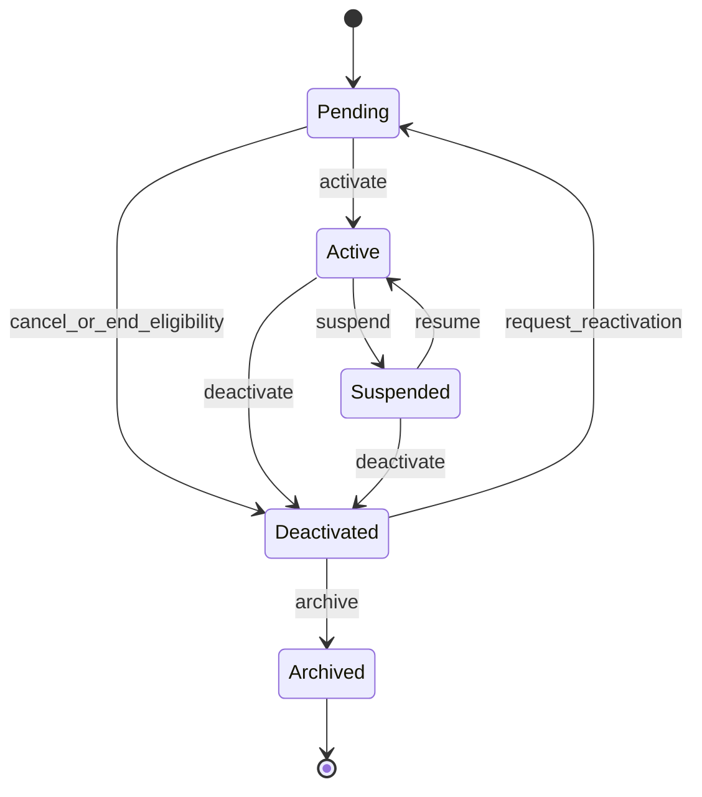

# Lifecycle state transition — Chuyển trạng thái vòng đời danh tính

## 1. Vì sao cần mô hình chuyển trạng thái?

An đã được tiếp nhận vào tổ chức và có tài khoản chờ kích hoạt. Sau khi hoàn tất các điều kiện ghi danh, tài khoản được mở. Khi An tạm nghỉ, tổ chức tạm ngừng truy cập. An có thể trở lại làm việc, chuyển vị trí hoặc chấm dứt quan hệ với tổ chức.

Nếu mọi thay đổi chỉ là thao tác tùy ý sửa một trường `active`, hệ thống khó trả lời:

- Vì sao tài khoản được mở hoặc bị chặn?
- Ai được phép thực hiện thay đổi đó?
- Những điều kiện nào phải đúng tại thời điểm thay đổi?
- Phải xử lý nhóm, vai trò, phiên và tài khoản ứng dụng như thế nào?
- Nếu sự kiện cũ đến muộn, điều gì ngăn nó mở lại tài khoản đã bị vô hiệu hóa?

**Lifecycle state transition là sự chuyển đổi có kiểm soát từ một trạng thái vòng đời sang trạng thái khác khi một sự kiện hoặc yêu cầu được chấp nhận, các điều kiện cần thiết được đáp ứng và những hành động liên quan được ghi nhận hoặc thực hiện.**

Trong IAM, mô hình này biến những thao tác như kích hoạt, đình chỉ, khôi phục hay kết thúc tài khoản thành các quyết định có ngữ nghĩa rõ ràng. Một chuyển trạng thái không chỉ thay đổi dữ liệu; nó còn xác định khả năng truy cập nào phải được tạo, giữ, giới hạn hoặc thu hồi.

## 2. Những thành phần của một chuyển trạng thái

Một mô hình cơ bản có thể được biểu diễn như sau:

```text
Trạng thái hiện tại
    + sự kiện hoặc yêu cầu hợp lệ
    + các điều kiện bảo vệ được đáp ứng
    → trạng thái tiếp theo
    + bản ghi quyết định
    + những tác động cần thực thi
```

Các thành phần có vai trò riêng:

| Thành phần | Ý nghĩa | Ví dụ trong IAM |
| --- | --- | --- |
| State — trạng thái | Tình trạng hiện tại của đối tượng đang được quản lý | Tài khoản đang chờ kích hoạt |
| Event — sự kiện | Thông tin cho biết một việc đã xảy ra | Nguồn nhân sự xác nhận quan hệ đã kết thúc |
| Command — yêu cầu hành động | Đề nghị hệ thống thực hiện một thao tác | Người có thẩm quyền yêu cầu tạm ngừng tài khoản |
| Guard — điều kiện bảo vệ | Điều phải đúng để chấp nhận chuyển trạng thái | Không có điều kiện chặn còn hiệu lực trước khi mở lại |
| Transition — quy tắc chuyển | Quy định trạng thái nào được đi tới trạng thái nào | Từ `pending` sang `active` qua thao tác kích hoạt |
| Action — hành động | Thay đổi hoặc công việc phát sinh từ quyết định | Chặn đăng nhập, tính lại quyền, gửi yêu cầu tới ứng dụng đích |
| Evidence — bằng chứng quyết định | Thông tin cần để đối soát vì sao thay đổi được chấp nhận | Nguồn, phiên bản, phê duyệt và chính sách đã dùng |

Sự kiện “nguồn nhân sự báo đang làm việc” không đồng nghĩa mệnh lệnh “bỏ mọi chặn và mở toàn bộ tài khoản”. Hệ thống vẫn phải xét nguồn có thẩm quyền cho thuộc tính nào, trạng thái hiện tại và các điều kiện khác.

Tương tự, người gửi yêu cầu có thể muốn mở tài khoản nhưng không có quyền phê duyệt hoặc chưa đủ bằng chứng. Cần phân biệt tiếp nhận yêu cầu với chấp nhận chuyển trạng thái.

## 3. Trước hết phải xác định trạng thái của đối tượng nào

### 3.1. Danh tính, quan hệ và tài khoản có thể có vòng đời khác nhau

Một người có thể có định danh nội bộ ổn định, một quan hệ nhân viên đã kết thúc, một quan hệ đối tác còn hiệu lực và nhiều tài khoản phục vụ những mục đích khác nhau.

Nếu chỉ có một trường `person.active`, hệ thống có thể vô tình giữ quyền nhân viên vì người đó vẫn có quan hệ đối tác. Chiều ngược lại, kết thúc một quan hệ không nên xóa lịch sử chủ thể hay tự động làm sai mọi quan hệ độc lập còn hợp lệ.

Các lớp cần phân biệt gồm:

- Chủ thể hoặc hồ sơ danh tính nội bộ.
- Quan hệ với từng tổ chức và phạm vi tham gia.
- Tài khoản ở miền IAM hoặc ứng dụng cụ thể.
- Phương thức xác thực và khả năng khôi phục.
- Nhóm, vai trò, quyền trực tiếp và các phê duyệt có thời hạn.
- Phiên, token và các khả năng truy cập đã phát hành.
- Yêu cầu xử lý và trạng thái thực thi tại từng hệ thống đích.

Mỗi lớp cần mô hình phù hợp. Không dùng một trạng thái quy trình như `waiting_for_approval` để thay thế mọi trạng thái tài khoản hoặc trạng thái quan hệ.

### 3.2. Tránh tạo một trạng thái cho mọi tổ hợp điều kiện

Nếu ghép trạng thái tài khoản với tình trạng MFA, kết quả proofing, quan hệ lao động và tiến độ cấp phát, số tổ hợp sẽ tăng rất nhanh. Các tên như “active nhưng chưa có MFA và ứng dụng A đang chờ” vừa khó quản lý vừa không thể hiện rõ trách nhiệm.

Một cách thiết kế dễ hiểu hơn là lưu các chiều riêng và định nghĩa điều kiện sử dụng:

```text
Được phép thực hiện hành động
    = trạng thái vòng đời cho phép
      và quan hệ phù hợp đang có hiệu lực
      và không có điều kiện chặn áp dụng
      và yêu cầu xác thực được đáp ứng
      và chính sách phân quyền cho phép
```

Biểu thức này là cách tư duy, không phải công thức áp dụng nguyên xi cho mọi hệ thống. Nó nhấn mạnh rằng `active` không tự đồng nghĩa với “được làm mọi việc”.

## 4. Một máy trạng thái tài khoản minh họa

Phần này chọn một tài khoản nhân viên làm đối tượng quản lý. Các tên và ý nghĩa dưới đây là mô hình học tập, không phải quy ước bắt buộc của mọi sản phẩm IAM.

| Trạng thái | Ý nghĩa trong mô hình | Khả năng sử dụng |
| --- | --- | --- |
| `pending` | Tài khoản tồn tại nhưng chưa hoàn tất điều kiện kích hoạt | Chỉ có thể dùng chức năng giới hạn phục vụ hoàn tất quy trình nếu chính sách cho phép |
| `active` | Tài khoản được phép tham gia truy cập theo chính sách | Vẫn cần xác thực và phân quyền cho từng hành động |
| `suspended` | Tài khoản tạm bị chặn, có thể được xem xét tiếp tục sử dụng | Không cho phép truy cập nghiệp vụ bị chặn bởi trạng thái này |
| `deactivated` | Tài khoản đã bị vô hiệu hóa theo quyết định vòng đời | Không dùng để truy cập; mở lại cần một quy trình được chấp nhận |
| `archived` | Tài khoản được giữ cho mục đích lịch sử trong mô hình này | Không có đường kích hoạt trực tiếp trong máy trạng thái minh họa |



Các mũi tên mô tả những đường có thể được xem xét. Mỗi mũi tên còn phải có điều kiện bảo vệ; sơ đồ không cho phép bỏ qua kiểm chứng, thời điểm hoặc thẩm quyền.

Trong mô hình này, reactivation từ `deactivated` quay về `pending` để đánh giá lại trước khi kích hoạt. Một tổ chức có thể chọn quy trình khác, nhưng phải chỉ rõ cách bảo đảm điều kiện hiện tại. Với `archived`, nếu chính sách cho phép người quay lại, việc tạo tài khoản hoặc thiết lập lại quan hệ cần một quy trình riêng; không âm thầm vượt đường chuyển đã định nghĩa.

Lưu trữ lịch sử và xóa dữ liệu là hai vấn đề khác nhau. Trạng thái `archived` không có nghĩa hệ thống được giữ mọi dữ liệu mãi mãi, cũng không có nghĩa bản ghi đã bị xóa vật lý.

## 5. Bảng chuyển trạng thái và điều kiện bảo vệ

Sơ đồ dễ nhìn, nhưng bảng chuyển giúp diễn đạt chính xác điều kiện và tác động của từng đường.

| Từ | Yêu cầu hoặc sự kiện | Sang | Điều kiện chính | Tác động cần xem xét |
| --- | --- | --- | --- | --- |
| `pending` | Kích hoạt | `active` | Đủ tư cách, điều kiện ghi danh và phương thức xác thực đáp ứng chính sách, không còn chặn áp dụng | Cho phép sử dụng theo phạm vi, cấp phát quyền hiện tại |
| `active` | Tạm ngừng | `suspended` | Sự kiện từ nguồn phù hợp hoặc yêu cầu có thẩm quyền | Chặn khả năng sử dụng liên quan, xử lý phiên và thông báo tới các đích |
| `suspended` | Tiếp tục sử dụng | `active` | Lý do tạm ngừng đã được xử lý, không còn chặn khác, điều kiện hiện tại vẫn đạt | Tính lại quyền và cho phép truy cập mới theo chính sách |
| `active` hoặc `suspended` | Vô hiệu hóa | `deactivated` | Quyết định vòng đời hợp lệ theo nguồn hoặc bên có thẩm quyền | Thu hồi khả năng truy cập, xử lý nhóm, vai trò và các đích |
| `deactivated` | Bắt đầu mở lại | `pending` | Được phép bắt đầu quy trình theo quan hệ và chính sách hiện tại | Đánh giá lại danh tính, xác thực và kế hoạch quyền; chưa mở truy cập nghiệp vụ |
| `deactivated` | Lưu trữ | `archived` | Đáp ứng điều kiện kết thúc, xử lý tài nguyên và chính sách lưu giữ áp dụng | Giữ phần lịch sử cần thiết, duy trì trạng thái không truy cập |

### 5.1. Điều kiện phải được kiểm tra lúc áp dụng

Một phê duyệt được tạo hôm qua có thể không còn đủ để mở tài khoản hôm nay. Trong thời gian chờ, quan hệ tổ chức có thể kết thúc hoặc xuất hiện một điều kiện chặn an ninh mới.

Vì vậy, cần kiểm tra lại các điều kiện liên quan khi thực sự chuyển trạng thái. Phê duyệt nên gắn với tài khoản, tổ chức, hành động, phạm vi và bối cảnh đã được xét; không phải giấy phép vô hạn để lặp lại cùng thao tác trong tương lai.

### 5.2. Có nhiều điều kiện chặn thì phải xét đầy đủ

Nguồn nhân sự có thể xác nhận An đã trở lại làm việc, trong khi bộ phận an ninh vẫn giữ một điều kiện chặn riêng. Sự kiện mới từ nhân sự không được tự xóa điều kiện chặn đó.

Một mô hình phù hợp có thể giữ từng lý do, nguồn chịu trách nhiệm và trạng thái xử lý. Quyết định mở lại xét tổng hợp các điều kiện áp dụng. Không để bên cập nhật sau cùng thắng chỉ vì nó ghi vào một cờ chung.

### 5.3. Từ chối chuyển không đồng nghĩa lỗi kỹ thuật

Yêu cầu `resume` khi tài khoản đã `deactivated` có thể là yêu cầu không còn phù hợp với trạng thái hiện tại. Nguồn đang lỗi có thể khiến chưa đủ dữ liệu để đánh giá. Người gửi thiếu thẩm quyền lại là một trường hợp khác.

Phân biệt các nguyên nhân giúp chọn đúng hướng xử lý: bắt đầu quy trình mở lại, chờ dữ liệu, yêu cầu phê duyệt hoặc từ chối. Không thử lại vô hạn một yêu cầu bị từ chối bởi chính sách như thể đó chỉ là lỗi mạng.

## 6. Không phải mọi sự kiện đều đổi trạng thái vòng đời

An chuyển từ Phoenix sang Atlas nhưng vẫn làm việc bình thường. Tài khoản có thể tiếp tục ở `active`, trong khi quyền dự án phải thay đổi. Đây là sự kiện quan trọng đối với IAM dù trạng thái vòng đời không đổi.

Có thể mô hình hóa việc này là một thao tác cập nhật giữ nguyên trạng thái hoặc một chuyển tự thân được định nghĩa rõ. Điều cần thiết là vẫn kiểm tra nguồn, áp dụng chính sách, cập nhật quyền và ghi nhận lịch sử liên quan.

Tương tự:

- Đăng ký thêm phương thức MFA không nhất thiết đổi trạng thái tài khoản.
- Hết hạn một quyền quản trị không nhất thiết vô hiệu hóa tài khoản làm việc.
- Một lần xác thực thất bại không mặc nhiên kết thúc quan hệ nhân viên.
- Đổi email không nên tạo chủ thể mới hoặc tự thay đổi quyền.

Sự kiện, thay đổi thuộc tính, thay đổi quyền và chuyển trạng thái vòng đời có liên quan nhưng không đồng nhất. Mô hình tốt chỉ đổi trạng thái khi ý nghĩa của đối tượng thực sự thay đổi theo quy tắc đã xác định.

## 7. Hành động đi kèm chuyển trạng thái

### 7.1. Chia phần ghi nhận nội bộ và phần thực thi bên ngoài

Khi chấp nhận vô hiệu hóa, IAM có thể ghi trạng thái mới, lý do và quyết định trong kho dữ liệu của mình. Sau đó cần thực hiện các công việc như:

- Chặn đăng nhập hoặc phát hành khả năng truy cập mới.
- Thu hồi hoặc giới hạn phiên, token và các đường khôi phục theo chính sách.
- Xóa hoặc kết thúc nhóm, vai trò và quyền liên quan.
- Vô hiệu hóa tài khoản ở các ứng dụng đích.
- Chuyển quyền quản lý tài nguyên khi cần.
- Ghi thông báo hoặc yêu cầu xử lý tới bên chịu trách nhiệm.

Các công việc không phải lúc nào cũng hoàn tất trong một thao tác nguyên tử. Nếu một ứng dụng ngừng phục vụ, quyết định vô hiệu hóa vẫn có ý nghĩa, nhưng tiến độ thực thi tại đích đó đang thiếu.

### 7.2. Trạng thái mong muốn khác trạng thái quan sát được

Một mô hình đối soát có thể giữ:

```json
{
  "accountId": "acct_demo_018",
  "lifecycleState": "deactivated",
  "stateVersion": 24,
  "targetId": "project_portal_demo",
  "desiredAccessState": "blocked",
  "observedAccessState": "enabled",
  "operationStatus": "retry_pending"
}
```

Ví dụ này không phải định dạng chuẩn. Nó cho thấy tài khoản đã có quyết định vòng đời mới, nhưng một hệ thống đích chưa đạt trạng thái mong muốn. Sự khác biệt cần được nhìn thấy và xử lý, không bị che bằng một kết quả “thành công” chung.

Một phản hồi API có thể chỉ xác nhận đã tiếp nhận yêu cầu. Tùy khả năng của đích, cần kết quả xử lý hoặc bước đối soát phù hợp để biết trạng thái thực tế. Đồng thời, mọi quan sát đều có thời điểm; một lần kiểm tra không thay thế theo dõi những thay đổi tiếp theo.

### 7.3. Không đảo ngược quyết định an toàn chỉ vì tác động bị lỗi

Nếu vô hiệu hóa tài khoản ở một đích thất bại, không tự chuyển tài khoản IAM về `active` để “rollback” cho đồng nhất. Cần giữ quyết định bảo vệ, thực hiện biện pháp giới hạn phù hợp và tiếp tục xử lý sai lệch.

Tương tự, khi kích hoạt chỉ hoàn tất một phần, không bật những đích còn quyền cũ chưa được xử lý. Hành động khắc phục phải hướng tới trạng thái đúng theo chính sách hiện tại, không phải đơn giản đưa mọi dữ liệu về ảnh chụp trước đó.

## 8. Thời gian, thứ tự sự kiện và nguồn có thẩm quyền

### 8.1. Các thời điểm có ý nghĩa khác nhau

| Thời điểm | Ý nghĩa |
| --- | --- |
| Thời điểm sự việc phát sinh | Sự kiện nghiệp vụ xảy ra khi nào |
| Thời điểm có hiệu lực | Điều kiện hoặc thay đổi bắt đầu áp dụng khi nào |
| Thời điểm nguồn phát hành | Nguồn gửi thông tin khi nào |
| Thời điểm IAM tiếp nhận | IAM nhận được thông tin khi nào |
| Thời điểm quyết định | IAM đánh giá và chấp nhận chuyển trạng thái khi nào |
| Thời điểm thực thi được xác nhận | Hệ thống liên quan đạt yêu cầu khi nào |

Một sự kiện đến muộn có thể nói về thay đổi đã có hiệu lực từ trước. Một quyết định được phê duyệt trước cũng có thể chỉ được áp dụng vào ngày tương lai. Cần biểu diễn thời gian rõ ràng, có múi giờ hoặc quy ước thời gian nhất quán.

Với thay đổi được lập lịch, tới thời điểm thực hiện vẫn phải kiểm tra điều kiện hiện tại. Một tác vụ đã hẹn không được bỏ qua quyết định hủy, sự kiện kết thúc quan hệ hoặc điều kiện chặn mới.

### 8.2. Thời điểm nhận không phải thứ tự nghiệp vụ

Giả sử nguồn phát sự kiện “An trở lại” rồi sau đó phát sự kiện mới hơn “quan hệ của An đã kết thúc”. Nếu mạng làm sự kiện trở lại đến sau, xử lý theo thứ tự nhận có thể mở lại tài khoản sai.

Cần cơ chế phù hợp như phiên bản theo hồ sơ nguồn, đối chiếu trạng thái nguồn hiện tại hoặc quy tắc xử lý thứ tự do kiến trúc xác định. Không dùng một dấu thời gian tự khai từ phía không tin cậy để ghi đè quyết định mới.

Số phiên bản có ý nghĩa trong phạm vi của nó. Phiên bản của hồ sơ nhân sự không thể so trực tiếp với phiên bản của một điều kiện chặn an ninh từ nguồn khác như thể chúng cùng một dãy số.

### 8.3. Phân biệt các loại định danh và phiên bản

| Dữ liệu | Dùng để làm gì? | Không thay thế điều gì? |
| --- | --- | --- |
| `eventId` | Nhận diện một sự kiện để xử lý gửi lại | Không tự cho biết sự kiện còn phù hợp với trạng thái hiện tại |
| `sourceVersion` | Theo dõi thứ tự thay đổi trong phạm vi nguồn tương ứng | Không là thứ tự toàn cục của mọi nguồn |
| `stateVersion` | Phát hiện thay đổi đồng thời của đối tượng nội bộ | Không chứng minh dữ liệu từ nguồn là đúng |
| `policyVersion` | Cho biết quy tắc nào đã được dùng để quyết định | Không thay thế bằng chứng nguồn và thẩm quyền |

Giữ riêng các ý nghĩa này giúp tránh lỗi như dùng sự kiện có mã mới để áp dụng một quyết định nghiệp vụ cũ, hoặc dùng phiên bản cao từ nguồn không đúng thẩm quyền để xóa điều kiện chặn.

## 9. Xử lý lặp và thay đổi đồng thời

### 9.1. Nhận lại cùng yêu cầu phải an toàn

Mạng lỗi có thể làm một yêu cầu gửi lại nhiều lần. Cùng một quyết định không nên tạo thêm tài khoản, cấp quyền trùng hoặc thực hiện các tác động không cần thiết mỗi lần nhận.

Hệ thống có thể ghi nhận định danh yêu cầu và kết quả trong đúng phạm vi. Nếu cùng định danh được gửi lại với nội dung khác, phải xử lý xung đột thay vì âm thầm dùng kết quả cũ cho một hành động mới.

Xử lý lặp an toàn không có nghĩa luôn thực hiện lại trạng thái đích. Nếu yêu cầu kích hoạt cũ đã hoàn tất, sau đó tài khoản bị vô hiệu hóa, gửi lại yêu cầu cũ không được mở tài khoản lần nữa. Nó chỉ có thể trả hoặc ghi nhận kết quả xử lý cũ theo quyền được phép xem.

### 9.2. Hai yêu cầu không được ghi đè nhau tùy ý

Một người đang phê duyệt mở lại tài khoản trong khi hệ thống khác vừa thêm điều kiện chặn. Nếu cả hai đều đọc trạng thái cũ rồi ghi trạng thái mới, lần ghi sau có thể xóa hiệu lực của lần ghi trước.

Cần cơ chế như kiểm tra phiên bản hoặc khóa phù hợp trong phạm vi dữ liệu nội bộ, đồng thời đánh giá lại khi phát hiện trạng thái đã thay đổi. Các lý do chặn nên được quản lý riêng theo nguồn và thẩm quyền, thay vì bị ghi đè bằng một giá trị `enabled` chung.

### 9.3. Luồng xử lý cục bộ minh họa

Giả mã sau tập trung vào một quyết định và các bản ghi cục bộ. `require` biểu thị điều kiện bắt buộc; nếu không đạt, giao dịch phải kết thúc mà không ghi các thay đổi quyết định.

```text
handleLifecycleCommand(command, trustedActorContext):
    require actor may address this account and organization
    validate command identity, purpose and input

    begin local database transaction

    if this authorized command was already processed:
        finish transaction without applying it again
        return recordedResultWithCurrentStateInformation

    account = load account with concurrency protection
    require expected state version matches

    context = load current local relationship, holds and approval context
    transition = resolve transition(account.state, command.action)

    require transition exists
    require actor may perform this transition in this scope
    require transition guards pass for context and effective time

    update account state and increment stateVersion
    append transition decision and necessary audit references
    append required target operations to local outbox
    record command processing result

    commit local database transaction
    return decisionAcceptedWithTargetProgressPending
```

Việc ghi quyết định và công việc cần phát vào cùng giao dịch cục bộ giúp tránh trường hợp đã đổi trạng thái nhưng mất dấu công việc cần thực thi. Thành phần gửi và các bên nhận vẫn phải xử lý gửi lại và thất bại.

Mã giả không bảo đảm một giao dịch chung với nguồn nhân sự hay mọi ứng dụng đích. Dữ liệu bên ngoài cần được tiếp nhận và đối soát theo cơ chế phù hợp; thay đổi mới phải tiếp tục tác động tới quyết định và khả năng truy cập. Đây là điểm khác giữa bảo vệ cập nhật cục bộ và bảo đảm nhất quán toàn hệ thống.

## 10. Ví dụ: từ tạm ngừng tới vô hiệu hóa

### 10.1. Bối cảnh

An có tài khoản `active`. Tổ chức có nguồn nhân sự quản lý quan hệ lao động và nguồn an ninh quản lý điều kiện chặn riêng. Các phiên bản dưới đây chỉ minh họa những thay đổi đã ghi nhận trên đối tượng nội bộ.

| Bước | Sự kiện hoặc yêu cầu | Trạng thái và cách xử lý |
| --- | --- | --- |
| 1 | An bắt đầu tạm nghỉ theo nguồn hợp lệ | Chuyển `active` sang `suspended`, ghi quyết định và phát công việc chặn liên quan |
| 2 | Có điều kiện chặn an ninh mới | Giữ `suspended`, ghi nhận thêm điều kiện; không cần đổi tên trạng thái vòng đời |
| 3 | Nguồn nhân sự xác nhận An trở lại | Cập nhật quan hệ, nhưng chưa chấp nhận `resume` vì điều kiện chặn vẫn còn |
| 4 | Bên có thẩm quyền gỡ điều kiện chặn an ninh | Đánh giá lại yêu cầu theo điều kiện và quyền hiện tại; không chỉ sửa một cờ tùy ý |
| 5 | Trước lúc hoàn tất mở lại, quan hệ của An kết thúc | Chấp nhận vô hiệu hóa theo nguồn và chính sách, chuyển sang `deactivated` |
| 6 | Yêu cầu `resume` cũ được gửi lại | Không mở tài khoản; yêu cầu cũ không được vượt trạng thái và quyết định mới |

### 10.2. Quyền và phiên phải đi cùng quyết định

Ở bước tạm ngừng, hệ thống không chỉ thay trạng thái mà phải xử lý các khả năng truy cập theo phạm vi đã định. Ở bước dự kiến mở lại, quyền được tính theo nhiệm vụ hiện tại, không mặc nhiên khôi phục mọi quyền trước khi nghỉ.

Ở bước vô hiệu hóa, các công việc tại đích cần phản ánh quyết định mới nhất. Nếu một công việc mở tài khoản cũ còn nằm trong hàng đợi, bên thực thi cần cơ chế phát hiện nó không còn phù hợp trước khi áp dụng, chẳng hạn đối chiếu phiên bản hoặc trạng thái mong muốn hiện tại.

### 10.3. Sai lệch ở một ứng dụng phải nhìn thấy được

Giả sử cổng tài liệu đã chặn nhưng kho mã chưa xử lý được do lỗi kết nối. Trạng thái vòng đời tại IAM vẫn là `deactivated`; tiến độ thu hồi cần nêu rõ kho mã còn chưa xác nhận.

Cần tiếp tục giới hạn và khắc phục theo khả năng của hệ thống. Không dùng thành công của cổng tài liệu làm bằng chứng toàn bộ truy cập đã kết thúc, cũng không mở lại IAM để che sự khác biệt.

## 11. Liên hệ với xác thực, phân quyền và liên kết danh tính

### 11.1. Authentication và MFA không ghi đè vòng đời

Một người có thể chứng minh quyền kiểm soát mật khẩu và MFA nhưng tài khoản vẫn bị chặn bởi vòng đời. Xác thực thành công không phải quyết định bỏ qua trạng thái `suspended` hoặc `deactivated`.

Khi kích hoạt hoặc mở lại, phương thức xác thực cũng phải đáp ứng chính sách. Phương thức đã bị thu hồi, mã khôi phục đã dùng hoặc bí mật có khả năng bị lộ không tự được tin lại vì tài khoản chuyển sang `active`.

### 11.2. RBAC, ABAC và đặc quyền

RBAC cần cập nhật vai trò theo quan hệ và công việc. ABAC cần thuộc tính có nguồn gốc và độ mới phù hợp. Cả hai đều có thể cho kết quả sai nếu thông tin vòng đời cũ còn trong cache hoặc các bản sao chưa được cập nhật.

Một tài khoản `active` chỉ là một điều kiện đầu vào. Quyền quản trị có thể cần phê duyệt riêng, giới hạn thời gian, MFA phù hợp và kiểm toán. Chuyển trạng thái không nên phá nguyên tắc ít quyền nhất hoặc gộp mọi đặc quyền vào quyền đăng nhập.

### 11.3. SSO, OAuth/OIDC và ứng dụng đích

Chặn tài khoản ở nhà cung cấp danh tính không tự chứng minh mọi ứng dụng đã hủy phiên cục bộ hoặc ngừng chấp nhận token cũ. Cần hiểu cơ chế cập nhật, kiểm tra trạng thái và giới hạn thời gian ở từng thành phần.

Token hoặc phản hồi đăng nhập được kiểm tra hợp lệ không thay thế chính sách vòng đời của ứng dụng. Một luồng tạo tài khoản khi đăng nhập SSO lần đầu cũng không được vô tình tạo lại khả năng truy cập cho chủ thể đang bị chặn.

Định danh từ các bên phát hành cần được ánh xạ đúng phạm vi. Không chọn tài khoản để chuyển trạng thái chỉ từ email do bên gửi khai báo, vì email có thể đổi, dùng chung hoặc được cấp lại.

### 11.4. Workload có máy trạng thái riêng

Danh tính dịch vụ, tác vụ tự động và môi trường thực thi cũng có thể cần trạng thái như chờ cấp, hoạt động, bị chặn hoặc kết thúc. Nguồn sự kiện thường là hệ thống triển khai, bộ điều phối hoặc bên quản lý workload, thay vì chỉ dựa trên quan hệ nhân sự.

Cần phân biệt vòng đời của chủ sở hữu chịu trách nhiệm với vòng đời của phần mềm. Một người nghỉ việc có thể làm phát sinh yêu cầu chuyển trách nhiệm, kiểm tra credential và quyền của workload, nhưng không tự xác định mọi dịch vụ do người đó quản lý phải có cùng trạng thái.

Các nguyên tắc chung vẫn áp dụng: đúng đối tượng, đúng nguồn, điều kiện rõ ràng, thử lại an toàn và kiểm chứng tác động tại tài nguyên.

## 12. Kiểm toán và trách nhiệm vận hành

Một bản ghi chuyển trạng thái cần hỗ trợ trả lời:

- Đối tượng và tổ chức nào được thay đổi?
- Trạng thái trước và sau là gì?
- Sự kiện hoặc yêu cầu nào kích hoạt quyết định?
- Ai hoặc dịch vụ nào gửi, phê duyệt và thực thi?
- Nguồn, phiên bản, thời điểm có hiệu lực và chính sách nào được dùng?
- Điều kiện nào được xác nhận hoặc khiến yêu cầu bị từ chối?
- Những tác động nào đã hoàn tất, còn chờ hoặc thất bại?

Không cần sao chép toàn bộ bằng chứng nhạy cảm vào log. Có thể giữ tham chiếu có kiểm soát, đồng thời bảo vệ dữ liệu nguồn và giới hạn người được xem theo nhiệm vụ. Không ghi mật khẩu, mã OTP, token hoặc bí mật của phương thức xác thực vào bản ghi quyết định.

Phân công trách nhiệm phải cho biết ai sửa nguồn sai, ai giải quyết phê duyệt, ai chịu trách nhiệm connector và ai xử lý đích không đạt trạng thái mong muốn. Quyền kỹ thuật sửa trực tiếp cơ sở dữ liệu không nên thay thế quy trình quyết định có kiểm soát.

## 13. Theo dõi chất lượng của chuyển trạng thái

Các chỉ báo hữu ích gồm:

- Độ trễ từ nguồn tới lúc IAM nhận sự kiện.
- Thời gian xử lý và thời gian chờ do thiếu bằng chứng hoặc phê duyệt.
- Độ trễ tới khi các đích bắt buộc xác nhận trạng thái mong muốn.
- Số sự kiện trùng, sự kiện cũ bị bỏ qua và xung đột phiên bản.
- Số yêu cầu chuyển không hợp lệ theo trạng thái hoặc thẩm quyền.
- Sai lệch giữa quyết định IAM và trạng thái quan sát được tại đích.
- Trường hợp tài khoản bị mở lại ngoài ý muốn hoặc quyền cũ còn tồn tại được xác nhận.

Cần đo từ thời điểm có ý nghĩa nghiệp vụ. Một sự kiện đã có hiệu lực từ lâu nhưng tới IAM muộn không nên được coi là thu hồi nhanh chỉ vì bước xử lý nội bộ diễn ra trong thời gian ngắn.

Tỷ lệ API thành công không đủ để kết luận toàn bộ vòng đời được thực thi đúng. Cần cả bằng chứng áp dụng, thông tin sai lệch và khả năng giải thích những chuyển trạng thái đã diễn ra.

## 14. Những sai lầm thường gặp

| Sai lầm | Hậu quả | Cách thiết kế phù hợp |
| --- | --- | --- |
| Gán trạng thái trực tiếp từ dữ liệu người gửi | Bỏ qua đường chuyển, điều kiện và thẩm quyền | Nhận hành động có ngữ nghĩa, kiểm tra quy tắc phía máy chủ |
| Xem `active` như đủ mọi quyền | Cấp quyền quá rộng | Đánh giá quan hệ, xác thực và phân quyền cho hành động cụ thể |
| Dùng một cờ cho mọi lý do chặn | Một nguồn xóa chặn của nguồn khác | Quản lý điều kiện chặn theo phạm vi trách nhiệm |
| Chỉ kiểm tra khi phê duyệt | Áp dụng quyết định cũ sau thay đổi mới | Đánh giá lại điều kiện liên quan lúc thực thi |
| Xử lý theo thứ tự nhận thuần túy | Sự kiện cũ ghi đè trạng thái mới | Dùng cơ chế thứ tự, phiên bản và đối soát phù hợp với nguồn |
| Gửi lại yêu cầu là thực hiện lại hành động | Kích hoạt lại tài khoản đã bị vô hiệu hóa sau đó | Ghi nhận yêu cầu đã xử lý và bảo vệ trạng thái hiện tại |
| Đổi trạng thái nhưng không theo dõi tác động | Quyền hoặc tài khoản ở đích vẫn còn dùng được | Lưu công việc cần thực thi và đối soát kết quả |
| Khôi phục trạng thái cũ khi một đích lỗi | Bỏ quyết định bảo vệ để che lỗi đồng bộ | Giữ giới hạn phù hợp và xử lý sai lệch có điều phối |
| Đồng nhất lưu trữ với xóa | Giữ dữ liệu quá lâu hoặc mất dấu lịch sử cần thiết | Quản lý chính sách dữ liệu riêng với khả năng truy cập |

## 15. Câu hỏi để tự kiểm tra mô hình

1. Trạng thái đang mô tả chủ thể, quan hệ, tài khoản hay một yêu cầu xử lý?
2. Mỗi mũi tên trong sơ đồ có sự kiện, thẩm quyền và điều kiện bảo vệ rõ ràng không?
3. Có trường hợp chuyển dự án hoặc hết hạn quyền mà trạng thái vòng đời vẫn giữ nguyên không?
4. Hai nguồn có thể ghi đè điều kiện chặn của nhau không?
5. Điều gì xảy ra nếu phê duyệt mở lại và sự kiện kết thúc quan hệ đến gần nhau?
6. Một yêu cầu cũ được gửi lại sau lần vô hiệu hóa mới có làm tài khoản hoạt động lại không?
7. Máy chủ biết việc đã chấp nhận quyết định khác việc đã áp dụng ở mọi đích như thế nào?
8. Nếu chỉ một đích thất bại, đường truy cập nào còn tồn tại và ai xử lý?
9. Các phiên, token và quyền cũ được xử lý ở đâu trong kế hoạch chuyển?
10. Có đủ dữ liệu để giải thích trạng thái hiện tại và chuỗi quyết định đã tạo ra nó không?

Những câu hỏi này giúp kiểm tra ý nghĩa và tính thực thi của máy trạng thái, thay vì chỉ kiểm tra giao diện có hiển thị đúng nhãn hay không.

## 16. Điểm cần ghi nhớ

Lifecycle state transition là một quyết định có điều kiện về sự thay đổi vòng đời của đúng đối tượng. Cần mô tả rõ trạng thái, sự kiện, thẩm quyền, điều kiện bảo vệ và những hành động phát sinh; không xem việc sửa một cờ dữ liệu là toàn bộ quá trình.

Trong IAM, quyết định phải phối hợp với quan hệ tổ chức, xác thực, MFA, phiên, quyền và các hệ thống đích. Xử lý đúng thứ tự, sự kiện lặp, thay đổi đồng thời và sai lệch thực thi giúp ngăn trạng thái cũ làm sống lại truy cập đã thu hồi, đồng thời duy trì khả năng kiểm toán trong suốt vòng đời danh tính.
