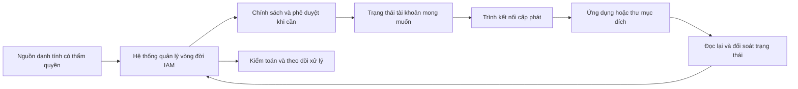

# Account provisioning

## Mục tiêu bài học

**Account provisioning** là quá trình tạo và cấu hình tài khoản tại một hệ thống đích để đúng chủ thể có thể sử dụng dịch vụ theo chính sách. Quá trình này thường bao gồm liên kết tài khoản với danh tính nguồn, đặt thuộc tính được quản lý, thiết lập trạng thái và áp dụng quyền ban đầu đã được phép.

Trong IAM, tạo thành công một dòng trong bảng người dùng mới chỉ là một phần của cấp phát. Tài khoản còn phải thuộc đúng người hoặc workload, nằm đúng tổ chức, có quyền phù hợp và chỉ được sử dụng khi đáp ứng điều kiện kích hoạt.

Sau bài này, bạn có thể:

- Phân biệt cấp phát tài khoản với ghi danh danh tính, xác thực, cấp quyền và đăng nhập SSO.
- Mô tả luồng từ nguồn danh tính đến tài khoản tại ứng dụng đích.
- So sánh cấp phát thủ công, tự động theo sự kiện và cấp phát khi đăng nhập lần đầu.
- Thiết kế liên kết tài khoản, quyền ban đầu và điều kiện kích hoạt theo nguyên tắc ít quyền nhất.
- Xử lý yêu cầu lặp, lỗi từng phần, sự kiện cũ và sai lệch giữa trạng thái mong muốn với trạng thái thực tế.

## 1. Cấp phát tài khoản tạo ra điều gì?

Một tài khoản là đối tượng mà hệ thống đích dùng để nhận diện chủ thể trong phạm vi của nó. Tài khoản có thể có định danh nội bộ, thuộc tính hồ sơ, liên kết đăng nhập, trạng thái và quan hệ với các quyền truy cập.

Ví dụ, công ty tuyển Lan và duy trì hồ sơ của Lan trong hệ thống nhân sự. Để Lan sử dụng cổng tài liệu, hệ thống cần tạo tài khoản cục bộ hoặc thiết lập liên kết tài khoản mà cổng đó hiểu được. Nếu Lan còn cần hệ thống chấm công và công cụ hỗ trợ khách hàng, mỗi hệ thống có thể có một tài khoản tương ứng.

Quan hệ thường gặp là:

```text
Danh tính nguồn của Lan
    ├── tài khoản tại cổng tài liệu
    ├── tài khoản tại hệ thống chấm công
    └── tài khoản tại công cụ hỗ trợ khách hàng
```

Không phải một người luôn chỉ có một tài khoản trong toàn tổ chức. Một chủ thể có thể có tài khoản thông thường và tài khoản quản trị riêng theo chính sách. Ngược lại, việc có nhiều tài khoản không được làm mất khả năng xác định chủ sở hữu và mục đích của từng tài khoản.

### Những đối tượng cần phân biệt

| Đối tượng | Vai trò | Ví dụ |
|---|---|---|
| Hồ sơ danh tính nguồn | Cơ sở nhận diện và quản lý chủ thể trong phạm vi tổ chức | Hồ sơ nhân viên đang có quan hệ lao động |
| Tài khoản đích | Biểu diễn chủ thể tại một hệ thống cụ thể | Tài khoản của Lan tại cổng tài liệu |
| Authenticator | Phương tiện chứng minh quyền kiểm soát tài khoản hoặc danh tính đăng nhập | Passkey đã được đăng ký |
| Quyền truy cập | Hành động được phép trên tài nguyên trong phạm vi cụ thể | Đọc chính sách dành cho nhân viên |
| Giấy phép sử dụng dịch vụ | Điều kiện sử dụng tính năng theo mô hình sản phẩm | Giấy phép cho công cụ cộng tác |

Cấp giấy phép không tự chứng minh danh tính, cũng không thay thế kiểm tra quyền đối với dữ liệu. Tương tự, tài khoản có thể đã được tạo nhưng chưa có authenticator cục bộ vì việc đăng nhập được giao cho một nhà cung cấp danh tính.

## 2. Vị trí của provisioning trong IAM

### 2.1. Khác với identity proofing và ghi danh

Identity proofing đánh giá chủ thể có đúng là người họ khai nhận trong phạm vi yêu cầu hay không. Ghi danh thiết lập quan hệ danh tính và các cơ chế cần thiết theo chính sách. Provisioning đưa tài khoản và cấu hình cần thiết tới hệ thống đích.

Một sự kiện tạo hồ sơ nhân sự có thể là đầu vào cấp phát, nhưng không tự chứng minh mọi yêu cầu xác minh hoặc kích hoạt đã hoàn tất. Với dịch vụ cho phép thông tin tự khai, hệ thống vẫn cần thể hiện đúng giới hạn đó thay vì xem mọi tài khoản được tạo là danh tính đã được xác minh ở mức cao.

### 2.2. Khác với authentication

Authentication kiểm tra người hoặc workload đang truy cập có kiểm soát phương tiện xác thực phù hợp không. Provisioning chuẩn bị đối tượng tài khoản và cấu hình để chủ thể có thể được hệ thống đích nhận diện.

Một tài khoản tồn tại không có nghĩa chủ thể đã đăng nhập. Một lần xác thực thành công cũng không tự có nghĩa mọi ứng dụng đã có tài khoản hoặc đã cấp quyền cho chủ thể đó.

### 2.3. Khác với authorization

Provisioning có thể thực thi quyết định gán nhóm hoặc vai trò, nhưng quyết định đó cần đến từ chính sách và thẩm quyền phù hợp. Không nên để trình kết nối tự suy ra quyền quản trị chỉ vì một tài khoản mới được tạo.

Khi chủ thể sử dụng dịch vụ, hệ thống vẫn phải kiểm tra quyền đối với hành động và tài nguyên hiện tại. Trạng thái `ACTIVE` không có nghĩa tài khoản được truy cập mọi dữ liệu.

### 2.4. Khác với SSO và liên kết danh tính

SSO giúp người dùng sử dụng quan hệ đăng nhập qua nhà cung cấp danh tính. Ứng dụng có thể vẫn cần tài khoản cục bộ để lưu cấu hình, quyền, giấy phép hoặc dữ liệu nghiệp vụ.

OAuth/OIDC và cơ chế đăng nhập liên kết không tự là quy trình quản lý đầy đủ vòng đời tài khoản. Một hệ thống có thể sử dụng SSO để đăng nhập và một kênh provisioning riêng để tạo, cập nhật hoặc vô hiệu hóa tài khoản.

## 3. Các thành phần trong kiến trúc cấp phát



### 3.1. Nguồn danh tính có thẩm quyền

Nguồn có thẩm quyền cung cấp dữ liệu được tổ chức cho phép sử dụng để quản lý một loại chủ thể hoặc thuộc tính cụ thể.

| Loại chủ thể | Nguồn hoặc quy trình có thể được sử dụng | Nội dung cần làm rõ |
|---|---|---|
| Nhân viên | Hệ thống nhân sự | Quan hệ lao động, thời điểm hiệu lực và đơn vị công tác |
| Nhà thầu hoặc đối tác | Quy trình quản lý hợp đồng, người bảo trợ được phân công | Chủ sở hữu quan hệ, phạm vi và ngày hết hạn |
| Khách hàng | Luồng đăng ký và quản lý khách hàng của dịch vụ | Điều kiện ghi danh và mức bảo đảm theo dịch vụ |
| Workload | Nền tảng cấp phát hoặc hệ thống quản lý môi trường chạy | Chủ sở hữu, dự án, môi trường và mục đích sử dụng |

Một nguồn có thể có thẩm quyền đối với thuộc tính này nhưng không có thẩm quyền đối với mọi quyền truy cập. Ví dụ, hệ thống nhân sự có thể xác nhận phòng ban, nhưng việc cấp quyền quản trị cơ sở dữ liệu vẫn cần chính sách và người có thẩm quyền riêng.

### 3.2. Hệ thống điều phối vòng đời

Thành phần này nhận sự kiện hoặc đọc dữ liệu nguồn, xác định tài khoản cần có, áp dụng chính sách và theo dõi việc thực hiện. Nó cần biết mỗi trường dữ liệu và mỗi nhóm quyền do bên nào quản lý.

Nếu có nhiều nguồn, cần quy định nguồn ưu tiên theo từng thuộc tính hoặc quyết định. Không nên để bản ghi cập nhật gần nhất tùy ý ghi đè mọi dữ liệu, bất kể nguồn đó có thẩm quyền hay không.

### 3.3. Trình kết nối và hệ thống đích

Trình kết nối chuyển trạng thái mong muốn thành thao tác mà hệ thống đích hỗ trợ, chẳng hạn gọi API, cập nhật thư mục hoặc sử dụng giao thức cấp phát tài khoản.

Trình kết nối cần xử lý khác biệt về tên trường, nhóm quyền, trạng thái và giới hạn kỹ thuật. Trạng thái `DISABLED` ở một hệ thống không nhất thiết có cùng mọi tác động với một trường trạng thái có tên tương tự ở hệ thống khác.

## 4. Các mô hình provisioning thường gặp

| Mô hình | Cách thực hiện | Điểm mạnh | Điểm cần kiểm soát |
|---|---|---|---|
| Thủ công | Người vận hành tạo tài khoản theo yêu cầu được phép | Dùng được khi hệ thống chưa có tích hợp | Sai sót thao tác, thiếu dấu vết và cấu hình không nhất quán |
| Theo lịch hoặc xử lý lô | Định kỳ đọc nguồn rồi tạo/cập nhật tài khoản | Phù hợp tích hợp không có sự kiện tức thời | Độ trễ và cách phát hiện thay đổi giữa hai lần chạy |
| Theo sự kiện | Sự kiện vòng đời kích hoạt quá trình cấp phát | Rút ngắn thời gian từ thay đổi nguồn tới hệ thống đích | Yêu cầu lặp, sai thứ tự, sự kiện cũ và lỗi từng phần |
| JIT, just-in-time | Tạo tài khoản khi chủ thể đăng nhập lần đầu theo chính sách | Không phải tạo trước mọi tài khoản có thể không dùng | Liên kết sai chủ thể, quyền mặc định và khả năng quản lý sau đăng nhập |
| Qua API hoặc giao thức chuyên dụng | Sử dụng kênh được hệ thống đích hỗ trợ để quản lý tài khoản | Tự động hóa và đối soát có cấu trúc | Quyền của connector, ngữ nghĩa API và mức hỗ trợ thực tế |

SCIM là một ví dụ về giao thức dùng để trao đổi và quản lý đối tượng danh tính giữa các hệ thống. Việc một sản phẩm hỗ trợ SCIM không tự bảo đảm nó hỗ trợ mọi thao tác, mọi thuộc tính hoặc mọi ngữ nghĩa trạng thái mà tổ chức cần.

### JIT không loại bỏ trách nhiệm quản lý vòng đời

Với JIT, ứng dụng phải kiểm tra kết quả đăng nhập theo giao thức và cấu hình tin cậy trước khi tạo hoặc liên kết tài khoản. Nhà phát hành, mã chủ thể và phạm vi tổ chức cần được kiểm soát.

Không nên tự nhận tài khoản hiện hữu chỉ vì email trong một kết quả đăng nhập trùng với email đã lưu. Các nhà cung cấp danh tính và các tổ chức khác nhau có thể có phạm vi định danh khác nhau.

JIT cũng không tự thu hồi quyền khi người dùng không đăng nhập lại. Tổ chức vẫn cần cơ chế xử lý thay đổi quan hệ, đóng tài khoản và đối soát tài khoản đã tồn tại.

## 5. Luồng cấp phát từ đầu đến cuối

### Bước 1: Xác nhận nhu cầu và thời điểm hiệu lực

Hệ thống cần biết vì sao tài khoản được tạo: một nhân viên mới, một yêu cầu sử dụng ứng dụng, một đối tác được bảo trợ hay một workload được triển khai.

Đầu vào phải đến từ nguồn hoặc quy trình được phép. Việc người dùng tự nhập tên bộ phận hoặc gửi `createAdmin=true` từ trình duyệt không đủ để phát sinh quyền tương ứng.

Nếu có ngày bắt đầu và ngày kết thúc, cần đưa chúng vào quyết định. Một hồ sơ tuyển dụng đã tồn tại không tự cho phép sử dụng toàn bộ dịch vụ trước ngày có hiệu lực.

### Bước 2: Phân giải và liên kết đúng chủ thể

Hệ thống cần định danh nguồn ổn định và quan hệ ánh xạ tới tài khoản đích. Tên hiển thị, email hoặc tên đăng nhập có thể đổi hoặc được sử dụng lại theo chính sách của từng hệ thống.

Ví dụ về một quan hệ ánh xạ:

```text
Tổ chức: org_demo_4
Danh tính nguồn: person_demo_52
Hệ thống đích: knowledge-portal
Mục đích tài khoản: STANDARD
Tài khoản đích: account_demo_73
```

Tổ hợp khóa tương quan cần phù hợp mô hình dữ liệu thực tế. Nếu tổ chức cho phép tài khoản quản trị riêng, mục đích tài khoản có thể là một phần cần thiết để không gộp nhầm hai tài khoản hợp lệ.

Khi gặp một tài khoản có cùng email, hệ thống cần xác minh quan hệ ánh xạ theo quy trình. Không tự gắn quyền của người mới vào tài khoản cũ chỉ để tránh lỗi trùng.

### Bước 3: Tính cấu hình và quyền được phép

Hệ thống xác định trạng thái mong muốn: thuộc tính được quản lý, nhóm cơ bản, giấy phép cần thiết và các quyền đã được phép cấp.

Một số quyền có thể được cấp tự động theo chính sách; quyền nhạy cảm có thể cần phê duyệt hoặc điều kiện bổ sung. Việc cấp quyền cơ bản nên giới hạn vào nhu cầu đã xác định, tránh dùng một vai trò quá rộng để giảm công cấu hình.

RBAC có thể ánh xạ hồ sơ truy cập sang nhóm hoặc vai trò. ABAC có thể sử dụng thuộc tính như tổ chức, quan hệ lao động và phạm vi tài nguyên. Dù dùng mô hình nào, thuộc tính ảnh hưởng quyền phải có nguồn cập nhật và thẩm quyền rõ ràng.

### Bước 4: Tạo hoặc cập nhật tài khoản đích

Trình kết nối thực hiện thao tác được phép. Với hệ thống hỗ trợ, có thể tạo tài khoản ở trạng thái chờ kích hoạt để chuẩn bị thuộc tính và quyền trước khi cho truy cập bình thường.

Nếu hệ thống đích tạo tài khoản hoạt động ngay theo mặc định, luồng phải có kiểm soát tương đương để không làm lộ tài nguyên hoặc tạo quyền tạm quá rộng trong lúc cấu hình dở.

Khi tài khoản đã có ánh xạ hợp lệ, một sự kiện lặp thường cần cập nhật hoặc xác nhận trạng thái thay vì tạo thêm tài khoản. Các thay đổi chỉ nên chạm vào những trường và quyền nằm trong phạm vi mà luồng quản lý.

### Bước 5: Chuẩn bị cơ chế đăng nhập

Tùy kiến trúc, tài khoản có thể dùng xác thực cục bộ hoặc đăng nhập liên kết. Với tài khoản cục bộ, cần quy trình thiết lập authenticator an toàn. Với SSO, cần thiết lập liên kết đúng danh tính được nhà cung cấp xác nhận.

Không nên gửi mật khẩu dùng lâu dài dưới dạng văn bản rõ qua email. Một lời mời kích hoạt cần có phạm vi, thời hạn và cách sử dụng được kiểm soát; mở lời mời không tự cấp mọi quyền trước khi hoàn tất các điều kiện cần thiết.

Việc đăng ký MFA cần phù hợp yêu cầu của tài khoản. Provisioning không nên tự đánh dấu “đã bật MFA” chỉ vì tài khoản đã tồn tại tại IdP.

### Bước 6: Kích hoạt theo điều kiện

Tài khoản chỉ nên được sử dụng bình thường khi đáp ứng điều kiện liên quan, chẳng hạn quan hệ nguồn đang hiệu lực, kiểm tra ghi danh đã hoàn tất, cơ chế đăng nhập phù hợp và không có quyết định chặn kích hoạt.

Một công việc được lên lịch từ trước phải kiểm tra lại trạng thái tại thời điểm chạy. Nếu nhân viên hủy nhận việc hoặc hợp đồng đã kết thúc, công việc kích hoạt cũ không được làm tài khoản hoạt động trở lại.

### Bước 7: Đọc lại, ghi kết quả và đối soát

Gửi lệnh thành công chưa chắc hệ thống đích đã áp dụng xong. Với thao tác xử lý bất đồng bộ, cần theo dõi kết quả hoặc đọc lại trạng thái theo cơ chế được hỗ trợ.

Kết quả cần ghi rõ tài khoản nào đã được tạo, quyền nào được áp dụng và bước nào còn chờ. Sau đó, đối soát định kỳ hoặc theo sự kiện giúp phát hiện tài khoản thiếu, dư hoặc có cấu hình lệch khỏi chính sách.

## 6. Trạng thái mong muốn và trạng thái thực tế

### 6.1. Vì sao cần cả hai?

**Trạng thái mong muốn** mô tả tài khoản nên có gì theo nguồn và chính sách. **Trạng thái thực tế** mô tả hệ thống đích đang có gì tại lần quan sát liên quan.

Ví dụ:

| Thành phần | Mong muốn | Thực tế | Cách hiểu |
|---|---|---|---|
| Tài khoản cổng tài liệu | Tồn tại | Đã tồn tại | Điều kiện tạo tài khoản đã đáp ứng |
| Nhóm đọc chính sách nhân viên | Có | Chưa có | Còn bước gán quyền hoặc có lỗi |
| Trạng thái tài khoản | Chờ kích hoạt | Chờ kích hoạt | Đúng điều kiện trước ngày bắt đầu |
| Tài khoản công cụ hỗ trợ | Chưa được phép tạo | Đã tồn tại | Có sai lệch cần kiểm tra nguồn gốc |

Không nên coi một yêu cầu đã hoàn tất chỉ vì đã đặt `provisioned=true` ở hệ thống điều phối. Cờ đó cần có ý nghĩa và phạm vi rõ: đã gửi lệnh, đã tạo tài khoản hay đã đạt toàn bộ cấu hình yêu cầu.

### 6.2. Tách trạng thái xử lý khỏi trạng thái tài khoản

| Loại trạng thái | Ví dụ minh họa | Ý nghĩa |
|---|---|---|
| Tiến độ cấp phát | `PENDING`, `RUNNING`, `PARTIAL`, `FAILED`, `SUCCEEDED` | Quá trình thực hiện đang ở đâu |
| Trạng thái tài khoản đích | `PENDING_ACTIVATION`, `ACTIVE`, `DISABLED` | Tài khoản có được sử dụng theo ngữ nghĩa của hệ thống đích không |
| Tình trạng đồng bộ | `IN_SYNC`, `DRIFT_DETECTED`, `UNKNOWN` | Mức phù hợp giữa mong muốn và kết quả đã quan sát |

Các tên này chỉ là ví dụ thiết kế. Một tài khoản có thể đã được tạo đúng ở trạng thái chờ kích hoạt và bước cấp phát tương ứng được xem là thành công. Ngược lại, tài khoản đang hoạt động nhưng dư quyền có thể là sai lệch cần xử lý.

### 6.3. Ví dụ bản ghi mong muốn

Dữ liệu dưới đây dùng định danh và thời điểm giả, không phải định dạng giao thức bắt buộc.

```json
{
  "provisioningRequestId": "prov_demo_28",
  "organizationId": "org_demo_4",
  "sourceSubjectId": "person_demo_52",
  "sourceRevision": 17,
  "targetSystem": "knowledge-portal",
  "accountPurpose": "STANDARD",
  "desiredAccountStatus": "PENDING_ACTIVATION",
  "accessProfile": "employee-basic",
  "managedEntitlements": [
    "employee-policy-reader"
  ],
  "effectiveFrom": "2026-01-20T01:00:00Z",
  "policyVersion": "employee-provisioning-v1",
  "correlationId": "corr_demo_61"
}
```

`sourceRevision` minh họa phiên bản dữ liệu trong phạm vi một nguồn, không phải số thứ tự có thể so sánh tùy ý giữa mọi nguồn. `managedEntitlements` nêu những quyền mà luồng chịu trách nhiệm quản lý; không tự đại diện cho mọi quyền đang tồn tại trong hệ thống đích.

Bản ghi không chứa mật khẩu hoặc bí mật kết nối. Những bí mật cần cho connector phải được quản lý qua cơ chế phù hợp, không đưa vào sự kiện hoặc log cấp phát.

## 7. Xử lý lỗi trong hệ thống phân tán

### 7.1. Yêu cầu lặp và tính lũy đẳng

Sự kiện có thể được gửi lại, kết nối có thể mất ngay sau khi hệ thống đích đã tạo tài khoản, hoặc người vận hành có thể thử lại một bước chưa rõ kết quả.

**Tính lũy đẳng** ở đây nghĩa là xử lý lại cùng một yêu cầu không tạo thêm tác động ngoài trạng thái được phép, chẳng hạn không tạo hai tài khoản hoặc gán quyền ngoài ý muốn.

Cần có mã yêu cầu, ánh xạ chủ thể ổn định và ràng buộc dữ liệu phù hợp. Chỉ kiểm tra “chưa thấy tài khoản” rồi tạo bằng hai thao tác không được bảo vệ có thể gặp xung đột khi hai tiến trình cùng chạy.

### 7.2. Kết quả không rõ do lỗi kết nối

Khi API tạo tài khoản hết thời gian chờ, không nên mặc định thao tác đã thất bại và gọi tạo mới vô điều kiện. Tài khoản có thể đã tồn tại tại hệ thống đích.

Luồng cần dùng cơ chế lũy đẳng của API nếu có, hoặc tra cứu bằng quan hệ tương quan đáng tin cậy để xác định kết quả. Một bản ghi trùng email chưa đủ để kết luận đó là tài khoản mà yêu cầu này vừa tạo.

### 7.3. Lỗi từng phần

Ví dụ tài khoản đã tạo, nhóm cơ bản đã gán nhưng bước cấp giấy phép thất bại. Kết quả là `PARTIAL`, không phải mọi thứ đều chưa làm và cũng chưa chắc đã hoàn tất.

Hệ thống cần lưu tiến độ, xác định có được phép kích hoạt trong tình huống đó không và thử lại bước phù hợp. Không nên xóa mọi tài khoản đã tạo chỉ để làm lại nếu hành động đó có thể mất dữ liệu hoặc tạo thêm tác động.

### 7.4. Sự kiện đến sai thứ tự

Một sự kiện tuyển mới cũ có thể đến sau sự kiện hủy tuyển hoặc chấm dứt quan hệ. Nếu áp dụng theo thứ tự nhận mà không kiểm tra, hệ thống có thể tạo hoặc kích hoạt lại tài khoản không còn được phép.

Luồng cần xét phiên bản nguồn, trạng thái hiệu lực và quy tắc ưu tiên của loại quyết định. Tại bước thực hiện, nên kiểm tra lại trạng thái mong muốn hiện tại thay vì mù quáng phát lại mọi hành động cũ.

Một lần thử lại gán quyền từ tuần trước không được làm quyền đã bị thu hồi hôm nay xuất hiện trở lại.

### 7.5. Giới hạn tốc độ và nguồn không khả dụng

Khi hệ thống đích giới hạn tốc độ hoặc ngừng hoạt động, cần có hàng đợi, khoảng chờ thử lại và cảnh báo phù hợp. Không nên tăng số lần gọi không giới hạn hoặc bỏ kiểm tra để hoàn tất cho nhanh.

Đặc biệt, khi không biết trạng thái hiện tại, cần thể hiện `UNKNOWN` hoặc trạng thái chờ tương đương. Không tự coi tài khoản đã sẵn sàng chỉ vì không nhận được lỗi mới.

## 8. Đối soát và quyền sở hữu cấu hình

Đối soát, hay reconciliation, là so sánh dữ liệu nguồn và trạng thái mong muốn với những gì hệ thống đích thực sự có.

Các sai lệch thường gặp gồm:

- Nguồn yêu cầu có tài khoản nhưng hệ thống đích chưa có.
- Tài khoản tồn tại nhưng không tìm được chủ sở hữu hoặc căn cứ duy trì phù hợp.
- Thuộc tính được quản lý khác nguồn.
- Tài khoản còn quyền đã hết hiệu lực hoặc chưa nhận quyền được phép.
- Tài khoản bị vô hiệu hóa nhưng một lần đồng bộ khác đang cố kích hoạt lại.

### Không tự sửa mọi khác biệt theo cùng một cách

Một tài khoản có thể bị đội an ninh đình chỉ thủ công vì sự cố. Nguồn nhân sự vẫn ghi nhân viên đang làm việc không có nghĩa connector được phép tự đảo quyết định đình chỉ.

Tương tự, có những thuộc tính do ứng dụng quản lý riêng và những quyền do quy trình phê duyệt khác quản lý. Luồng cấp phát cần biết phạm vi của mình để tránh ghi đè cấu hình hợp lệ ngoài phạm vi đó.

Đối với quyền dư hoặc không rõ nguồn gốc, tổ chức cần chính sách phát hiện, xem xét và xử lý. “Không thuộc luồng quản lý” không có nghĩa được phép bỏ qua một quyền quản trị bất thường.

### Đọc lại cũng có giới hạn thời gian

Kết quả quan sát có thể là bản chụp tại một thời điểm hoặc chịu độ trễ đồng bộ của hệ thống đích. Cần lưu thời điểm quan sát và biết khi nào có thể kết luận hội tụ.

Mục tiêu là đưa trạng thái về đúng chính sách và biết rõ những gì còn chưa xác nhận, thay vì chỉ tạo thêm cờ báo thành công trong hệ thống điều phối.

## 9. Ví dụ xuyên suốt: cấp phát tài khoản nhân viên mới

### 9.1. Trước ngày bắt đầu

Hệ thống nhân sự tạo hồ sơ của Lan với ngày bắt đầu trong tương lai. Chính sách cho phép chuẩn bị trước tài khoản cổng tài liệu và hệ thống chấm công, nhưng chưa mở quyền sử dụng bình thường.

Hệ thống IAM liên kết hồ sơ nguồn với các tài khoản đích, tạo trạng thái chờ và áp dụng cấu hình được phép. Quyền quản trị hoặc quyền xử lý dữ liệu khách hàng không nằm trong gói cơ bản nên không được cấp.

### 9.2. Hoàn tất cơ chế đăng nhập

Lan thực hiện các bước ghi danh và thiết lập authenticator theo chính sách. Với SSO, ứng dụng đích sử dụng liên kết tới đúng chủ thể tại nhà cung cấp danh tính.

Nếu một ứng dụng đã có tài khoản cùng email, hệ thống không tự lấy tài khoản đó cho Lan. Trường hợp cần được xác định bằng quan hệ chủ thể và quy trình liên kết phù hợp.

### 9.3. Tới thời điểm hiệu lực

Công việc kích hoạt kiểm tra lại quan hệ nhân sự, điều kiện ghi danh và những quyết định hạn chế đang có. Chỉ khi đáp ứng yêu cầu, các tài khoản liên quan mới được phép sử dụng theo phạm vi chính sách.

Hệ thống đọc lại kết quả. Nếu cổng tài liệu đã sẵn sàng nhưng hệ thống chấm công còn lỗi connector, báo cáo cần chỉ rõ trạng thái của từng đích thay vì thông báo chung rằng mọi tài khoản đều sẵn sàng.

### 9.4. Sau khi Lan chuyển bộ phận

Một thay đổi bộ phận có thể làm thay đổi hồ sơ truy cập. Luồng cần tính lại quyền hiện tại, xử lý những quyền không còn căn cứ và cấp quyền mới khi đáp ứng điều kiện.

Đừng chỉ cộng thêm quyền theo mỗi lần thay đổi. Cách làm đó dễ tạo tích lũy đặc quyền. Chi tiết xử lý thay đổi thuộc vòng đời tài khoản, nhưng ngay từ thiết kế provisioning cần lưu nguồn gốc quyền để hỗ trợ bước này.

### 9.5. Nếu Lan hủy nhận việc

Nguồn cập nhật quan hệ không còn hiệu lực. Một công việc kích hoạt cũ hoặc một yêu cầu thử lại không được tạo lại trạng thái hoạt động.

Các tài khoản đã chuẩn bị phải được xử lý theo quy trình kết thúc tương ứng. Việc tài khoản chưa từng đăng nhập không phải lý do để bỏ qua quản lý vòng đời.

## 10. Provisioning cho workload và tài khoản đặc quyền

### 10.1. Workload cần chủ sở hữu và mục đích rõ ràng

Workload có thể là dịch vụ, tác vụ tự động hoặc thành phần ứng dụng. Tài khoản hoặc danh tính được cấp cần gắn với chủ sở hữu vận hành, dự án, môi trường và quyền tối thiểu cho nhiệm vụ.

Không nên mặc định cho workload đăng nhập tương tác như người dùng hoặc dùng chung tài khoản cá nhân của một nhân viên. Nếu nền tảng hỗ trợ danh tính và thông tin xác thực được quản lý, thiết kế cần xem xét cách sử dụng phù hợp thay vì sao chép bí mật dùng lâu dài vào nhiều nơi.

Khi workload bị xóa hoặc chuyển chủ sở hữu, các liên kết và quyền liên quan cũng cần được quản lý. Một tài khoản dịch vụ không có chủ sở hữu là khó khăn lớn cho việc rà soát và thu hồi quyền sau này.

### 10.2. Tài khoản đặc quyền không nằm trong mặc định rộng

Một tài khoản nhân viên hoạt động không tự dẫn đến tài khoản quản trị hoạt động. Quyền đặc quyền cần nhu cầu công việc, phạm vi, phê duyệt khi áp dụng và cơ chế xác thực phù hợp.

Tách tài khoản hoặc phiên đặc quyền là một lựa chọn theo chính sách. Trong mọi trường hợp, hệ thống phải liên kết được tài khoản với chủ thể chịu trách nhiệm và theo dõi được việc cấp quyền.

## 11. Bảo vệ kênh cấp phát

### 11.1. Connector là thành phần có quyền nhạy cảm

Connector có thể tạo tài khoản và gán nhóm, nên thông tin xác thực của nó cần được quản lý cẩn thận. Quyền nên giới hạn vào hệ thống đích, tổ chức, thuộc tính và thao tác mà nhiệm vụ yêu cầu.

Không dùng một thông tin xác thực quản trị toàn bộ nếu có thể cấp phạm vi hẹp hơn phù hợp. Không đặt bí mật connector trong sự kiện, log hoặc cấu hình được công khai cho người dùng ứng dụng.

### 11.2. Bảo vệ nguồn sự kiện và phạm vi tổ chức

Máy chủ cần kiểm tra nguồn sự kiện, cấu trúc và mối liên hệ với chủ thể nguồn. Một yêu cầu từ tổ chức A không được phép tạo hoặc cập nhật tài khoản trong tổ chức B chỉ vì bên gửi sửa trường `organizationId`.

Ánh xạ vai trò cần được kiểm soát ở phía máy chủ. Các giá trị tự khai như `department`, `role` hoặc `accountPurpose` không tự trở thành quyết định cấp đặc quyền.

### 11.3. Bảo vệ kích hoạt và liên kết đăng nhập

Lời mời và liên kết kích hoạt cần tránh bị lộ qua log hoặc các kênh không cần thiết. Việc dùng lại hoặc chuyển tiếp không được tạo quyền ngoài phạm vi mà chính sách cho phép.

Nếu luồng yêu cầu bằng chứng người nhận hoặc xác thực bổ sung, cần kiểm tra các điều kiện đó trước khi hoàn tất. Không coi việc có đường link là đủ cho mọi mức rủi ro.

## 12. Kiểm toán và đánh giá vận hành

Mỗi thao tác nên có dấu vết đủ để trả lời:

- Tài khoản được tạo hoặc cập nhật cho chủ thể nào và trong tổ chức nào?
- Nguồn hoặc yêu cầu nào làm phát sinh thao tác?
- Chính sách và phê duyệt nào cho phép các quyền ban đầu?
- Tài khoản đích, thuộc tính và quyền nào đã được áp dụng?
- Kết quả đã được xác nhận ở đích hay mới chỉ được gửi đi?
- Có lỗi từng phần, ngoại lệ hoặc xử lý thủ công nào không?

Mã tương quan giúp theo dõi một yêu cầu qua nhiều thành phần. Nhật ký không cần chứa mật khẩu, token truy cập hoặc toàn bộ dữ liệu cá nhân để đáp ứng mục tiêu này.

Các chỉ số hữu ích gồm thời gian từ sự kiện có hiệu lực tới khi tài khoản sẵn sàng, số yêu cầu thất bại hoặc xử lý dở, độ trễ đối soát, tài khoản không có chủ sở hữu và số trường hợp dư quyền. Một tỷ lệ gọi API thành công cao không tự chứng minh mọi tài khoản đã đúng chính sách.

Phạm vi báo cáo cần rõ. “Đã tạo tài khoản”, “đã cấu hình quyền cơ bản” và “đã sẵn sàng cho người dùng” có thể là ba mốc khác nhau.

## 13. Những lỗi thường gặp

| Lỗi | Hậu quả | Hướng thiết kế phù hợp |
|---|---|---|
| Coi một dòng `users` là hoàn tất provisioning | Tài khoản có thể thiếu quyền, đăng nhập hoặc trạng thái đúng | Định nghĩa điều kiện hoàn tất cho từng hệ thống đích |
| Dùng email làm căn cứ duy nhất để liên kết | Có thể gắn nhầm tài khoản và quyền | Dùng định danh ổn định, phạm vi tổ chức và quan hệ ánh xạ được kiểm soát |
| Cấp vai trò rộng để người dùng khỏi thiếu quyền | Vi phạm ít quyền nhất và khó thu hồi về sau | Hồ sơ truy cập tối thiểu cùng quy trình quyền bổ sung |
| Tự bật tài khoản ngay khi nguồn có hồ sơ | Truy cập sớm hoặc bỏ qua điều kiện ghi danh | Kiểm tra thời điểm hiệu lực và điều kiện kích hoạt |
| Thử lại thao tác tạo mà không kiểm tra kết quả cũ | Tạo trùng tài khoản hoặc cấu hình ngoài ý muốn | Xử lý lũy đẳng và xác định kết quả bằng tương quan đáng tin cậy |
| Phát lại sự kiện cũ theo thứ tự nhận | Kích hoạt lại tài khoản hoặc quyền đã bị thu hồi | Kiểm tra phiên bản, trạng thái hiện tại và quy tắc ưu tiên |
| Chỉ cộng thêm quyền qua các lần thay đổi | Tích lũy đặc quyền | Tính trạng thái mong muốn và quản lý nguồn gốc quyền |
| Đồng bộ ghi đè mọi trạng thái thủ công | Có thể đảo quyết định đình chỉ an ninh | Quy định quyền sở hữu trường và ưu tiên quyết định |
| Xem JIT hoặc SSO là quản lý đầy đủ vòng đời | Bỏ sót tài khoản và quyền khi quan hệ thay đổi | Có cơ chế cập nhật, kết thúc và đối soát riêng |
| Báo thành công ngay khi gửi lệnh | Không nhận ra lỗi xử lý dở ở hệ thống đích | Theo dõi kết quả và đọc lại theo cơ chế hỗ trợ |

## 14. Những điểm cần ghi nhớ

- Account provisioning đưa tài khoản và cấu hình được phép tới đúng hệ thống đích; tạo bản ghi người dùng chỉ là một phần của quá trình.
- Danh tính nguồn, tài khoản, authenticator, giấy phép và quyền truy cập có vai trò khác nhau.
- Liên kết tài khoản cần định danh ổn định và phạm vi rõ; tên hoặc email trùng nhau chưa đủ để tự hợp nhất.
- Quyền ban đầu phải có căn cứ, giới hạn theo nhu cầu và không bỏ qua điều kiện kích hoạt.
- Tự động hóa cần xử lý yêu cầu lặp, sự kiện cũ, lỗi từng phần và khác biệt ngữ nghĩa giữa các hệ thống.
- Trạng thái mong muốn, trạng thái thực tế và đối soát giúp biết tài khoản có thật sự đúng chính sách hay không.
- Provisioning là khởi đầu của quản lý tài khoản; thiết kế phải hỗ trợ thay đổi, thu hồi quyền, kiểm toán và nguyên tắc ít quyền nhất trong toàn bộ vòng đời.
