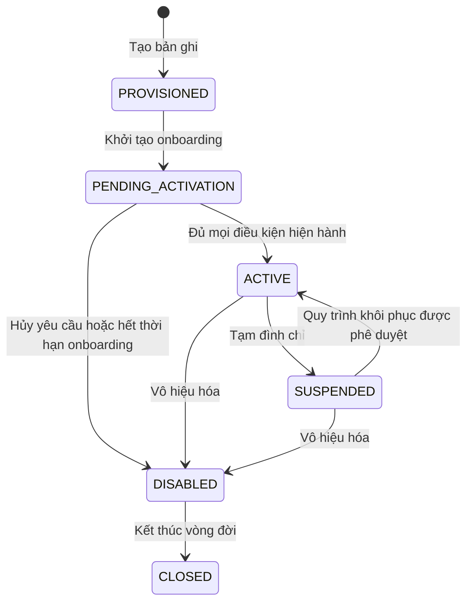

# Account activation — Kích hoạt tài khoản

## 1. Kích hoạt tài khoản trong vòng đời IAM

Một bản ghi tài khoản đã được tạo chưa có nghĩa chủ tài khoản được phép sử dụng hệ thống. **Kích hoạt tài khoản** là quá trình chuyển tài khoản từ trạng thái chưa sẵn sàng sang trạng thái đủ điều kiện tham gia các luồng đăng nhập và truy cập đã được chính sách cho phép.

Trong quản lý danh tính và quyền truy cập (IAM), bước này nối quá trình cấp phát tài khoản với việc sử dụng tài khoản thực tế. Nó tạo ra một điểm kiểm soát: trước khi chấp nhận tài khoản hoạt động, hệ thống phải có đủ bằng chứng và phê duyệt phù hợp với loại danh tính, tài nguyên và mức rủi ro.

Ví dụ, công ty tạo tài khoản cho nhân viên sẽ bắt đầu làm việc vào thứ Hai. Bản ghi đã tồn tại từ thứ Sáu để chuẩn bị, nhưng tài khoản chỉ được chuyển sang hoạt động khi hồ sơ nhân sự hợp lệ, ngày bắt đầu đã đến và các điều kiện bảo mật bắt buộc đã hoàn tất. Tương tự, một người tự đăng ký dịch vụ có thể cần xác minh email trước khi sử dụng một số chức năng.

Sau bài học, người học có thể:

- Phân biệt tạo tài khoản, xác minh, kích hoạt, đăng nhập và cấp quyền.
- Thiết kế trạng thái và điều kiện kích hoạt cho các loại tài khoản khác nhau.
- Giải thích vòng đời token kích hoạt và các kiểm soát chống chiếm đoạt tài khoản.
- Xử lý việc kích hoạt đồng thời, gửi lại lời mời và đồng bộ nhiều hệ thống.
- Xác định dữ liệu cần kiểm toán và các tình huống cần kiểm thử.

## 2. Phân biệt các thao tác thường bị gộp chung

| Thao tác | Câu hỏi được giải quyết | Ví dụ |
|---|---|---|
| Tạo hoặc cấp phát tài khoản | Hệ thống đã có đối tượng tài khoản chưa? | Tạo bản ghi người dùng từ sự kiện nhân sự hoặc biểu mẫu đăng ký. |
| Xác minh kênh liên hệ | Người thực hiện có kiểm soát kênh đã khai báo không? | Người dùng chứng minh quyền kiểm soát hộp thư bằng một token. |
| Xác minh danh tính | Có đủ bằng chứng gắn người yêu cầu với danh tính cần quản lý không? | Đối chiếu hồ sơ nhân sự theo quy trình của tổ chức. |
| Phê duyệt | Có chủ thể được ủy quyền đồng ý cho tài khoản tham gia không? | Chủ sở hữu workspace chấp nhận lời mời cho một cộng tác viên. |
| Kích hoạt | Tài khoản đã đáp ứng điều kiện để hoạt động chưa? | Chuyển từ `PENDING_ACTIVATION` sang `ACTIVE`. |
| Xác thực | Yêu cầu hiện tại đã chứng minh quyền sử dụng một danh tính chưa? | Đăng nhập bằng passkey hoặc qua nhà cung cấp danh tính. |
| Cấp quyền | Danh tính được thực hiện hành động nào trên tài nguyên nào? | Cho phép xem một dự án bằng vai trò đã được duyệt. |

Xác minh email chỉ chứng minh một mức độ kiểm soát hộp thư tại thời điểm kiểm tra. Nó không tự chứng minh tên pháp lý, quan hệ lao động, quyền đại diện doanh nghiệp hoặc quyền quản trị hệ thống.

Kích hoạt cũng không tự cấp mọi quyền. Một tài khoản hoạt động có thể chưa có quyền vào bất kỳ dự án nào. Khi truy cập một tài nguyên, hệ thống vẫn phải kiểm tra phiên xác thực, trạng thái tài khoản, tư cách thành viên và quyền theo RBAC hoặc ABAC.

Một số sản phẩm gộp xác minh email và kích hoạt thành một giao dịch. Cách này phù hợp khi chính sách chỉ yêu cầu bằng chứng kiểm soát email. Khi có thêm điều kiện như phê duyệt của quản lý hoặc ngày bắt đầu làm việc, xác minh email thành công mới hoàn thành một phần điều kiện kích hoạt.

## 3. Xác định đúng đối tượng được kích hoạt

Từ “tài khoản” có thể chỉ nhiều đối tượng. Thiết kế cần làm rõ đối tượng nào đang được bật hoạt động.

| Đối tượng | Ý nghĩa của kích hoạt | Điều kiện ví dụ |
|---|---|---|
| Tài khoản khách hàng tự đăng ký | Cho phép sử dụng những chức năng đã định trong dịch vụ. | Kênh liên hệ được xác minh; kiểm tra chống lạm dụng đạt yêu cầu. |
| Tài khoản nhân viên | Cho phép danh tính tổ chức tham gia môi trường làm việc. | Hồ sơ nhân sự hợp lệ; đến ngày bắt đầu; cấu hình đăng nhập sẵn sàng. |
| Thành viên trong tenant hoặc workspace | Cho phép một danh tính đã tồn tại gia nhập phạm vi cụ thể. | Lời mời còn hiệu lực; đúng tenant; người có thẩm quyền đã phê duyệt. |
| Tài khoản đặc quyền | Cho phép sử dụng danh tính có khả năng tác động lớn. | Phê duyệt bổ sung; đăng ký phương thức xác thực phù hợp; áp dụng chính sách PAM. |
| Danh tính workload hoặc tài khoản dịch vụ | Cho phép một ứng dụng hoặc tiến trình xác thực và nhận quyền. | Chủ sở hữu rõ ràng; workload được xác thực; cơ chế cấp thông tin xác thực đã sẵn sàng. |

Với ứng dụng nhiều tenant, cần tách **trạng thái danh tính toàn cục** khỏi **trạng thái thành viên của từng tenant**. Một người có thể đã hoạt động ở tenant A nhưng vẫn chờ phê duyệt ở tenant B. Chấp nhận lời mời của B không được tự thay đổi trạng thái hay quyền của họ ở A.

Không áp dụng máy móc quy trình bấm liên kết email cho workload. Danh tính workload thường được kích hoạt qua quy trình triển khai có kiểm soát, danh tính nền tảng, liên kết danh tính hoặc phê duyệt cấp quyền. Mục tiêu chung vẫn là chỉ cho danh tính hoạt động khi nguồn gốc và phạm vi sử dụng đã được xác định.

## 4. Mô hình trạng thái và điều kiện chuyển trạng thái

Một mô hình đơn giản có thể sử dụng các trạng thái sau:

| Trạng thái | Ý nghĩa | Hành vi thông thường |
|---|---|---|
| `PROVISIONED` | Tài khoản đã được tạo nhưng chưa bắt đầu đầy đủ quy trình kích hoạt. | Không được truy cập tài nguyên nghiệp vụ. |
| `PENDING_ACTIVATION` | Đang chờ một hoặc nhiều điều kiện kích hoạt. | Có thể thực hiện các thao tác onboarding được giới hạn. |
| `ACTIVE` | Đã đáp ứng chính sách kích hoạt. | Được tham gia đăng nhập và kiểm tra quyền thông thường. |
| `SUSPENDED` | Tài khoản bị tạm dừng vì lý do vận hành hoặc bảo mật. | Từ chối truy cập theo chính sách đình chỉ. |
| `DISABLED` | Tài khoản đã bị vô hiệu hóa. | Không được sử dụng lời mời cũ để tự bật lại. |
| `CLOSED` | Vòng đời tài khoản đã kết thúc theo chính sách lưu trữ. | Không cho phép quay lại bằng quy trình kích hoạt ban đầu. |

Đây là mô hình minh họa. Hệ thống có thể dùng tên hoặc cấu trúc khác, nhưng phải xác định rõ các chuyển trạng thái hợp lệ và chủ thể nào được thực hiện chúng.



Liên kết kích hoạt hết hạn không nhất thiết làm tài khoản hết hạn. Có thể giữ tài khoản ở `PENDING_ACTIVATION` và cho phép yêu cầu token mới. Ngược lại, nếu chính lời mời hoặc thời hạn onboarding đã kết thúc thì việc phát token mới không được tự kéo dài quyền gia nhập.

Không nên dùng một chuỗi trạng thái quá dài để biểu diễn mọi tổ hợp điều kiện. Có thể lưu trạng thái tổng quát cùng các bằng chứng riêng:

```text
account.status                 = PENDING_ACTIVATION
contact_verification.status    = VERIFIED
approval.status                = APPROVED
employment.start_at            = 2026-12-01T01:00:00Z
required_authenticator.status  = ENROLLED
```

Trong ví dụ này, hệ thống vẫn phải chờ đến thời điểm bắt đầu làm việc. Việc email đã được xác minh không đủ để chuyển sang `ACTIVE`.

Có thể mô tả chính sách kích hoạt bằng một biểu thức khái niệm:

```text
can_activate =
    state_allows_initial_activation
    AND identity_or_membership_is_still_eligible
    AND required_evidence_is_valid
    AND required_approvals_are_valid
    AND start_time_has_arrived
    AND required_authenticator_is_ready
    AND no_blocking_security_condition
```

Chỉ yêu cầu những điều kiện thực sự thuộc chính sách của loại tài khoản đó. Nếu MFA chỉ bắt buộc trước khi truy cập tài nguyên nhạy cảm, có thể cho tài khoản hoạt động nhưng giới hạn truy cập cho tới khi đăng ký MFA. Nếu MFA là điều kiện kích hoạt, trạng thái phải tiếp tục chờ cho tới khi điều kiện này hoàn tất. Cần mô tả rõ lựa chọn để tránh một tài khoản được coi là hoàn tất trong khi vẫn thiếu bảo vệ bắt buộc.

## 5. Thiết kế luồng kích hoạt qua email hoặc lời mời

Một luồng tham khảo cho người dùng được mời gồm các bước sau:

1. **Nhận yêu cầu hợp lệ.** Hệ thống kiểm tra người mời có quyền mời vào đúng tenant và chọn đúng vai trò được phép cấp hay không.
2. **Tạo tài khoản hoặc membership ở trạng thái chờ.** Ghi nhận nguồn yêu cầu, người mời, phạm vi, thời hạn lời mời và chính sách áp dụng.
3. **Phát hành token kích hoạt.** Token gắn với một mục đích cụ thể, một tài khoản hoặc lời mời, kênh liên hệ cần xác minh và thời hạn.
4. **Gửi thông báo.** Thông báo giải thích người dùng đang kích hoạt điều gì, lời mời từ đâu và cách xử lý khi không nhận ra yêu cầu.
5. **Mở trang xác nhận.** Trang hiển thị ngữ cảnh cần thiết và cho người dùng chủ động tiếp tục. Chỉ mở liên kết chưa được làm tài khoản hoạt động.
6. **Kiểm tra token và điều kiện hiện tại ở máy chủ.** Xác minh hạn dùng, trạng thái sử dụng, việc thu hồi, đúng tenant, đúng đối tượng và các điều kiện kích hoạt khác.
7. **Hoàn tất các điều kiện còn thiếu.** Có thể cần đăng nhập vào danh tính đã tồn tại, thiết lập phương thức xác thực hoặc chờ phê duyệt.
8. **Thực hiện chuyển trạng thái hợp lệ.** Tiêu thụ bằng chứng dùng một lần và cập nhật trạng thái bằng thao tác có tính nguyên tử phù hợp.
9. **Ghi kiểm toán và thông báo kết quả.** Phát sự kiện cho các hệ thống liên quan, đồng thời chỉ cấp quyền khởi đầu đã được phê duyệt.

Nếu token chỉ xác minh email nhưng tài khoản còn chờ phê duyệt, hệ thống nên ghi nhận `contact_verified_at`, tiêu thụ token và giữ tài khoản ở trạng thái chờ. Khi phê duyệt tới sau, hệ thống đánh giá lại các điều kiện đã lưu. Người dùng không cần giữ token đã dùng để hoàn thành bước sau.

### Tránh kích hoạt chỉ bằng việc tải một URL

Công cụ quét email, hệ thống kiểm tra liên kết và chức năng xem trước có thể tự truy cập đường dẫn trước người nhận. Nếu một yêu cầu `GET` tự kích hoạt tài khoản hoặc tiêu thụ token, người dùng có thể gặp tình trạng liên kết đã dùng dù họ chưa thực hiện thao tác.

Một cách thiết kế là để `GET` mở trang giải thích, sau đó dùng thao tác xác nhận chủ động gửi `POST` để tiếp tục. Yêu cầu thay đổi trạng thái cần kiểm soát CSRF phù hợp với mô hình cookie và phiên của ứng dụng. Không dùng JavaScript tự động gửi xác nhận ngay khi trang vừa tải.

Trang xác nhận cũng phải hạn chế để token bị lộ qua mã phân tích, tài nguyên bên thứ ba, log URL hoặc referrer. Có thể đổi token trong URL lấy một ngữ cảnh onboarding ngắn hạn rồi chuyển hướng sang URL sạch; thao tác trao đổi này chưa làm tài khoản hoạt động hoặc tiêu thụ bằng chứng kích hoạt cuối cùng. Nếu nhiều ngữ cảnh onboarding được tạo từ cùng một token, giao dịch cuối vẫn chỉ được chấp nhận một lần.

## 6. Token kích hoạt: bằng chứng ngắn hạn, đúng mục đích

Một token kích hoạt là thông tin nhạy cảm: trong nhiều luồng, ai giữ token đều có thể thực hiện bước mà token đại diện. Độ an toàn của quy trình phụ thuộc cả cách tạo, lưu, truyền, kiểm tra và thu hồi token.

### 6.1. Đặc điểm cần có

| Thuộc tính | Cách áp dụng |
|---|---|
| Khó đoán | Sinh bằng bộ sinh số ngẫu nhiên mật mã; không dùng ID tăng dần, email hay timestamp làm bí mật. |
| Đủ entropy | Với token ngẫu nhiên dài, có thể chọn 32 byte ngẫu nhiên làm giá trị khởi đầu cho thiết kế rồi mã hóa URL-safe. |
| Đúng mục đích | Token kích hoạt không được dùng thay token đặt lại mật khẩu hoặc mã mời quản trị. |
| Đúng đối tượng | Gắn với ID tài khoản hoặc lời mời và tenant cụ thể; không dựa vào email truyền lại từ phía trình duyệt. |
| Có hạn dùng | Kiểm tra thời điểm hết hạn phía máy chủ, dựa trên thời gian nhất quán. |
| Dùng một lần | Ghi nhận đã tiêu thụ bằng cập nhật nguyên tử để ngăn phát lại. |
| Có thể thu hồi | Hủy khi lời mời bị rút, email mục tiêu đổi, tài khoản bị vô hiệu hóa hoặc phát hiện sự cố. |
| Không lộ qua vận hành | Không ghi token thô vào log, sự kiện phân tích hoặc công cụ hỗ trợ khách hàng. |

Ví dụ cấu trúc lưu trữ khái niệm:

```text
activation_challenge
  challenge_id
  account_id
  membership_id          # Chỉ dùng nếu kích hoạt membership
  tenant_id
  purpose                # Ví dụ: VERIFY_CONTACT hoặc ACCEPT_INVITATION
  token_digest
  target_contact_version
  issued_at
  expires_at
  consumed_at
  revoked_at
  policy_version
```

Với token dài được sinh ngẫu nhiên bằng nguồn mật mã, có thể lưu giá trị băm để đối chiếu thay vì lưu token thô. Đây là trường hợp khác với mật khẩu do con người chọn: mật khẩu cần cơ chế băm mật khẩu có chi phí phù hợp để chống đoán ngoại tuyến. Không áp dụng lập luận về token ngẫu nhiên dài cho mã số ngắn.

Nếu dùng mã ngắn để người dùng nhập tay, cần bổ sung giới hạn số lần thử, thời hạn phù hợp và cơ chế phát hành lại có kiểm soát. Mã ngắn có không gian đoán nhỏ hơn nhiều so với token ngẫu nhiên dài.

### 6.2. Hết hạn và gửi lại

Thời hạn token phụ thuộc mức rủi ro, độ trễ chuyển thông báo và trải nghiệm onboarding. Một con số như 30 phút chỉ có ý nghĩa khi được giải thích trong bối cảnh cụ thể; không có thời hạn chung phù hợp cho mọi hệ thống.

Khi người dùng yêu cầu gửi lại, cần quyết định rõ:

- Có thu hồi các token cũ chưa dùng hay không. Chính sách chỉ cho token mới nhất còn hiệu lực thường dễ giải thích và giảm số bí mật đang tồn tại.
- Bao lâu được gửi lại một lần và giới hạn theo tài khoản, địa chỉ nhận, nguồn yêu cầu hoặc tín hiệu rủi ro nào.
- Khi nào tài khoản chờ hoặc chính lời mời hết hạn và phải xin phê duyệt mới.
- Trường hợp email gửi thất bại sẽ được thử lại thế nào mà không làm trạng thái tài khoản thay đổi sai.

Thay đổi email trong lúc chờ phải làm mất hiệu lực bằng chứng dành cho địa chỉ cũ. Việc ràng buộc token với phiên bản thông tin liên hệ giúp ngăn một token cũ xác minh nhầm địa chỉ mới.

### 6.3. Token có chữ ký và token dạng opaque

Token dạng opaque là một giá trị ngẫu nhiên được tra cứu hoặc đối chiếu với trạng thái phía máy chủ. Token có chữ ký có thể mang các trường như chủ thể, đối tượng nhận và thời điểm hết hạn. Chữ ký giúp phát hiện sửa đổi nội dung; nó không tự bảo đảm dùng một lần, không tự thu hồi token và không tự mã hóa dữ liệu bên trong.

Nếu dùng token có chữ ký, vẫn cần cơ chế kiểm soát phát lại và thu hồi phù hợp. Mỗi lần xử lý phải đối chiếu trạng thái tài khoản hoặc lời mời hiện tại. Không được kích hoạt một tài khoản đã bị đình chỉ chỉ vì chữ ký token vẫn hợp lệ.

## 7. Bảo đảm nhất quán khi nhiều yêu cầu xảy ra cùng lúc

Một thiết kế chỉ kiểm tra rồi cập nhật riêng rẽ có thể bị tranh chấp:

```text
Yêu cầu A đọc token: chưa dùng
Yêu cầu B đọc token: chưa dùng
Yêu cầu A kích hoạt và cấp quyền
Yêu cầu B kích hoạt và cấp quyền lần nữa
```

Vấn đề không chỉ là trạng thái tài khoản cuối cùng. Hệ thống có thể tạo hai membership, gửi hai sự kiện hoặc chạy hai quy trình cấp đặc quyền.

### 7.1. Giao dịch trong một hệ thống

Mã giả dưới đây minh họa trường hợp bước xác nhận cuối cùng đã có đủ mọi điều kiện và trạng thái tài khoản, token cùng nằm trong một kho dữ liệu giao dịch:

```text
confirmActivation(rawToken, requestContext):
    digest = hashHighEntropyToken(rawToken)

    begin transaction
        challenge = findChallengeForUpdate(digest)
        require challenge exists
        require challenge.purpose == EXPECTED_PURPOSE
        require challenge.revoked_at is null
        require challenge.consumed_at is null
        require database_now() < challenge.expires_at

        account = findAccountForUpdate(challenge.account_id)
        require account.status == PENDING_ACTIVATION
        require tenantAndSubjectMatch(challenge, requestContext)
        require contactVersionStillMatches(challenge, account)
        require allActivationConditionsHoldNow(account, challenge)

        markChallengeConsumed(challenge)
        setAccountActive(account)
        insertAuditRecordWithoutSecrets(account, challenge)
        insertOutboxEventWithUniqueId(account, "AccountActivated")
    commit transaction

    return activationCompleted
```

Các câu lệnh `require` là kiểm tra phía máy chủ. Các hàm khóa và transaction chỉ là khái niệm; cách triển khai cụ thể phụ thuộc kho dữ liệu. Có thể dùng khóa hàng hoặc cập nhật có điều kiện kèm kiểm tra số bản ghi bị ảnh hưởng, miễn chỉ một yêu cầu giành được quyền chuyển trạng thái.

Một giao dịch kích hoạt đồng thời với yêu cầu vô hiệu hóa cũng phải được tuần tự hóa hoặc phát hiện xung đột. Nếu lệnh vô hiệu hóa đã có hiệu lực, kích hoạt phải thất bại. Nếu kích hoạt hoàn tất trước, lệnh vô hiệu hóa kế tiếp vẫn phải đưa tài khoản về trạng thái bị chặn. Không được để một bản ghi cũ ghi đè quyết định mới hơn.

Với trường hợp xác minh email và phê duyệt là hai bước riêng, giao dịch xác minh chỉ tiêu thụ token và lưu bằng chứng đã xác minh. Sau đó, bộ đánh giá điều kiện mới quyết định có chuyển sang `ACTIVE` được hay chưa.

### 7.2. Tính idempotent và trải nghiệm thử lại

Idempotent nghĩa là lặp lại một yêu cầu hợp lệ không tạo thêm tác dụng phụ ngoài ý định ban đầu. Điều này không có nghĩa token đã tiêu thụ được phép sử dụng lại để thực hiện một thao tác mới.

Sau khi kích hoạt thành công, người dùng có thể bấm lại vì mạng bị ngắt trước khi hiển thị kết quả. Hệ thống cần tránh cấp quyền hoặc phát thông báo lần nữa. Nếu có ngữ cảnh đủ tin cậy, có thể hiển thị “Tài khoản đã được kích hoạt, hãy đăng nhập”. Nếu không có ngữ cảnh đó, trả một thông báo chung rằng liên kết không còn sử dụng được và cung cấp lối tiếp tục an toàn.

Không dùng một endpoint kiểm tra token để công khai trạng thái chi tiết của một tài khoản bất kỳ.

### 7.3. Đồng bộ nhiều hệ thống

Khi IAM trung tâm, ứng dụng đích và hệ thống gửi email hoạt động độc lập, một transaction cục bộ không thể tự bao phủ toàn bộ luồng. Có thể áp dụng cách tiếp cận sau:

- Commit trạng thái tài khoản và sự kiện outbox trong cùng giao dịch cục bộ.
- Phát sự kiện bằng worker có khả năng thử lại.
- Cho consumer nhận biết `event_id` đã xử lý và áp dụng thay đổi theo phiên bản phù hợp.
- Theo dõi hệ thống đích còn chờ hoặc đã thất bại; chạy đối soát để phát hiện sai lệch.
- Không cấp quyền ở hệ thống đích khi chưa có bằng chứng phê duyệt cần thiết.

Việc đánh dấu `ACTIVE` ở IAM không có nghĩa mọi ứng dụng đã sẵn sàng ngay lập tức. Giao diện nên phân biệt tài khoản đã kích hoạt với việc tài nguyên đang được chuẩn bị. Với các tài nguyên nhạy cảm, chỉ cho phép truy cập khi cả trạng thái và điều kiện cấp quyền tại đích đã đạt yêu cầu.

## 8. Mật khẩu, MFA, phiên và SSO trong bước kích hoạt

### 8.1. Thiết lập phương thức xác thực

Không gửi mật khẩu dùng lâu dài trong email mời. Quy trình có thể cho phép thiết lập mật khẩu qua ngữ cảnh onboarding giới hạn, đăng ký passkey hoặc sử dụng SSO theo chính sách của tổ chức.

Nếu token chỉ cho phép xác minh email, không được ngầm biến nó thành quyền đổi phương thức xác thực của một tài khoản đã tồn tại. Với tài khoản có sẵn, những thay đổi nhạy cảm cần chứng minh quyền sử dụng tài khoản theo quy trình phù hợp.

Trong bước đăng ký MFA, cần lưu ý tài khoản sẽ bị ràng buộc với yếu tố nào và ai có quyền đăng ký yếu tố đầu tiên. Nếu kẻ tấn công có lời mời của người khác, việc cho họ tự đăng ký MFA không làm lời mời trở nên đáng tin hơn. Hệ thống vẫn phải giải quyết đúng việc gắn danh tính và kiểm tra điều kiện tham gia.

### 8.2. Phiên onboarding và phiên truy cập

Phiên dùng để hoàn tất onboarding nên có thời hạn và phạm vi hẹp: xem lời mời, xác nhận kênh liên hệ hoặc đăng ký yếu tố bắt buộc. Nó không nên được các API nghiệp vụ chấp nhận như một phiên truy cập đầy đủ.

Khi hoàn tất onboarding, một lựa chọn rõ ràng là yêu cầu người dùng đăng nhập bằng phương thức vừa thiết lập. Nếu sản phẩm chọn tự đăng nhập, phải xác định mức bảo đảm mà bằng chứng kích hoạt cung cấp, thay đổi định danh phiên phù hợp và chỉ cấp phạm vi tương ứng. Một token xác minh email không mặc nhiên đáp ứng yêu cầu MFA của ứng dụng.

Khi tài khoản bị đình chỉ hoặc vô hiệu hóa, việc chặn phiên đang tồn tại cần được giải quyết bằng chính sách kiểm tra trạng thái và thu hồi phiên. Cơ chế kích hoạt không thay thế cơ chế quản lý phiên.

### 8.3. Kích hoạt khi sử dụng SSO, OAuth và OIDC

SSO có thể giúp người dùng hoàn tất xác thực qua nhà cung cấp danh tính (IdP), nhưng ứng dụng vẫn phải quyết định tài khoản hoặc membership cục bộ có được hoạt động không. Xác thực tại IdP thành công không tự tạo ra quyền gia nhập mọi tenant.

Với OIDC, ứng dụng cần kiểm tra ID token theo luồng đã cấu hình, ánh xạ danh tính bằng cặp định danh ổn định trong ngữ cảnh nhà phát hành như `iss` và `sub`, rồi áp dụng chính sách onboarding cục bộ. Không coi một chuỗi email nhận được là đủ để liên kết tài khoản hoặc chấp nhận lời mời. Trường thông tin về email chỉ được tin trong giới hạn của IdP và cấu hình liên kết đã được tổ chức phê duyệt.

OAuth phục vụ việc ủy quyền truy cập; một access token không mặc nhiên là bằng chứng đăng nhập phù hợp để kích hoạt tài khoản. Nếu dùng danh tính liên kết, cần làm rõ đâu là bằng chứng xác thực, đâu là quyền được ủy quyền và đâu là điều kiện kích hoạt của ứng dụng.

Trong mô hình tạo tài khoản khi đăng nhập lần đầu, có thể tạo bản ghi ở thời điểm người dùng trở về từ IdP, nhưng vẫn phải kiểm tra nguồn danh tính được tin cậy, tenant được phép tham gia và quyền khởi đầu. Không tự nối tài khoản đã tồn tại với một danh tính mới chỉ vì chúng khai báo cùng email.

## 9. Nguyên tắc ít quyền nhất và quản trị đặc quyền

Kích hoạt chỉ nên mở mức sử dụng ban đầu cần thiết. Những quyền cao hơn phải có quy trình và bằng chứng tương ứng.

Ví dụ, nhân viên mới có thể được cấp vai trò cơ bản để xem thông báo nội bộ. Quyền vào kho mã nguồn của một dự án cần membership dự án được duyệt. Quyền quản trị sản xuất có thể cần một quy trình PAM riêng với thời hạn, phê duyệt và mức xác thực phù hợp.

Trong RBAC, cần kiểm tra vai trò khởi đầu và người có quyền gán vai trò đó. Không cho một người chỉ có quyền mời thành viên tự chọn vai trò quản trị. Trong ABAC, cần kiểm tra nguồn và độ mới của các thuộc tính như đơn vị, loại hợp đồng hoặc trạng thái làm việc; không dùng các thuộc tính mà người tự đăng ký có thể sửa để quyết định đặc quyền.

Đối với tài khoản đang bị đình chỉ, một lời mời kích hoạt cũ không được trở thành đường khôi phục. Khôi phục tài khoản là một quyết định khác, có thể cần xử lý nguyên nhân đình chỉ và phê duyệt mới.

Đối với workload, quyền ban đầu phải giới hạn theo nhiệm vụ, môi trường và tài nguyên. Tránh kích hoạt bằng cách phát một bí mật dùng chung với quyền rộng rồi để việc thu hẹp quyền cho một bước không có người chịu trách nhiệm.

## 10. Tình huống thực tế: cộng tác viên được mời vào workspace

Workspace “Thanh toán” mời một cộng tác viên kiểm thử vào vai trò `TEST_VIEWER`. Người này đã có tài khoản ở một workspace khác.

Quy trình mong muốn:

1. Người mời phải có quyền thêm thành viên vào workspace “Thanh toán” và được phép gán `TEST_VIEWER`.
2. Hệ thống tạo membership `PENDING_ACTIVATION`, gắn với workspace, lời mời và địa chỉ nhận đang dùng.
3. Liên kết mở trang xác nhận đúng workspace và yêu cầu người nhận đăng nhập vào danh tính được phép nhận lời mời.
4. Máy chủ kiểm tra người dùng hiện tại có đáp ứng quy tắc ràng buộc lời mời hay không. Nếu đang đăng nhập bằng một tài khoản khác, hệ thống cho đổi tài khoản; không tự nối các tài khoản theo email.
5. Khi lời mời còn hiệu lực và điều kiện phê duyệt vẫn đúng, hệ thống kích hoạt membership và cấp đúng vai trò đã duyệt trong một luồng nhất quán.
6. Tài khoản toàn cục và membership tại workspace cũ giữ trạng thái độc lập. Quyền ở workspace “Thanh toán” được đánh giá theo membership mới.

Giả sử người mời đã rút lời mời trước bước 5. Dù token chưa đến hạn, thao tác chấp nhận phải bị từ chối vì quyền gia nhập không còn hiệu lực.

Giả sử người mời đổi vai trò từ `TEST_VIEWER` sang một vai trò nhạy cảm trong lúc người nhận đang mở trang xác nhận. Chính sách cần xác định liệu có phải phê duyệt hoặc phát lời mời mới hay không. Khi xác nhận, máy chủ phải dùng dữ liệu hiện hành và kiểm tra phiên bản đã được chấp nhận; không nhận vai trò từ trường ẩn trên giao diện.

Nếu email gửi bị chậm và người nhận có hai liên kết do đã yêu cầu gửi lại, chỉ liên kết còn hiệu lực theo chính sách được chấp nhận. Giao diện cần hướng dẫn dùng thông báo mới nhất và cho phép yêu cầu lại bằng quy trình có giới hạn.

## 11. Các lỗi thiết kế thường gặp

| Lỗi | Hậu quả | Hướng xử lý |
|---|---|---|
| Chuyển sang `ACTIVE` ngay sau khi ghi bản đăng ký | Người chưa đáp ứng điều kiện có thể sử dụng hệ thống. | Tách tạo bản ghi khỏi quyết định kích hoạt. |
| Đánh đồng email đã xác minh với danh tính đã được thẩm định | Cấp quyền dựa trên bằng chứng không đủ. | Mô tả rõ mỗi bằng chứng chứng minh điều gì. |
| Đưa `account_id`, `tenant_id` hoặc vai trò từ request vào quyết định mà không đối chiếu | Kích hoạt nhầm đối tượng hoặc nâng quyền. | Ràng buộc token với dữ liệu phía máy chủ và kiểm tra phạm vi. |
| Cho token kích hoạt mở lại tài khoản bị vô hiệu hóa | Vượt qua quyết định quản trị mới hơn. | Chỉ cho phép chuyển trạng thái kích hoạt ban đầu đã định. |
| Để token cũ tồn tại sau khi đổi email hoặc rút lời mời | Người giữ bằng chứng cũ vẫn hoàn tất quy trình. | Thu hồi hoặc làm mất hiệu lực theo phiên bản đối tượng. |
| Chỉ kiểm tra token hợp lệ rồi bỏ qua trạng thái hiện tại | Chấp nhận bằng chứng không còn phù hợp. | Đánh giá lại điều kiện tại thời điểm xác nhận. |
| Gửi sự kiện cấp quyền trước khi commit trạng thái | Hệ thống đích có thể nhận một quyết định chưa thành công. | Dùng cơ chế nhất quán như transactional outbox. |
| Đưa token vào log hỗ trợ hoặc mã phân tích | Bí mật bị lan truyền ngoài phạm vi cần thiết. | Che hoặc loại bỏ token trước khi ghi nhận. |
| Trả “email này đã đăng ký” cho mọi yêu cầu công khai | Hỗ trợ dò tìm tài khoản. | Dùng phản hồi công khai phù hợp; giữ chi tiết trong kênh đã xác thực. |
| Kích hoạt đồng nghĩa với cấp quản trị mặc định | Tài khoản mới có đặc quyền quá mức. | Chỉ cấp quyền nền đã được duyệt; tách việc cấp đặc quyền. |

Phản hồi chung không đủ nếu đường dẫn xử lý, thời gian phản hồi hoặc giới hạn gửi lại vẫn tiết lộ rõ tài khoản tồn tại. Cần xem xét cả hành vi của luồng, đồng thời bảo đảm người dùng hợp lệ vẫn có cách tiếp tục rõ ràng.

## 12. Kiểm toán và quan sát vận hành

Các sự kiện có thể cần ghi nhận gồm:

- `ActivationRequested`: yêu cầu kích hoạt hoặc lời mời được tạo.
- `ActivationChallengeIssued`: phát hành token, chỉ lưu ID tham chiếu.
- `ContactVerified`: bằng chứng xác minh kênh liên hệ được chấp nhận.
- `ActivationAttemptRejected`: từ chối vì hết hạn, đã dùng, bị thu hồi hoặc không đáp ứng điều kiện.
- `AccountActivated` hoặc `MembershipActivated`: đối tượng đã chuyển sang hoạt động.
- `ActivationCanceled`: quy trình bị hủy bởi người có thẩm quyền hoặc chính sách.

Mỗi bản ghi nên có thời điểm, ID sự kiện, đối tượng, tenant, chủ thể thực hiện, nguồn yêu cầu, trạng thái trước và sau, mã kết quả, phiên bản chính sách và mã tương quan. Dữ liệu mạng hoặc thiết bị chỉ thu thập theo nhu cầu vận hành và chính sách dữ liệu của hệ thống.

Không ghi mật khẩu, token thô, mã dự phòng MFA hoặc bí mật khôi phục. Hạn chế quyền đọc log và xác định thời hạn lưu dữ liệu. Thông báo lỗi cho người dùng có thể ngắn gọn, trong khi log nội bộ lưu mã lý do đủ để điều tra.

Chỉ số vận hành hữu ích gồm:

| Chỉ số | Câu hỏi vận hành |
|---|---|
| Tỷ lệ hoàn tất kích hoạt theo nhóm yêu cầu | Người dùng có bị mắc kẹt ở onboarding không? |
| Thời gian từ tạo yêu cầu đến hoạt động | Chậm do gửi email, phê duyệt hay cấp phát hệ thống đích? |
| Số tài khoản chờ vượt thời hạn chính sách | Có cần thu hồi lời mời hoặc làm sạch bản ghi chờ không? |
| Tỷ lệ gửi lại và lỗi chuyển thông báo | Có vấn đề ở kênh gửi hoặc hướng dẫn người dùng không? |
| Số lần thử token sai, hết hạn hoặc đã dùng | Có thao tác nhầm, quét liên kết hoặc hành vi lạm dụng không? |
| Độ trễ từ kích hoạt đến sẵn sàng tại hệ thống đích | Đồng bộ quyền có đang bị kẹt không? |

Một lần dùng lại token có thể chỉ là thao tác bấm lại. Cần kết hợp các tín hiệu trước khi kết luận có tấn công. Đồng thời, tăng tỷ lệ kích hoạt thành công không được trở thành lý do bỏ qua điều kiện kiểm soát đã xác định.

## 13. Các kịch bản cần kiểm tra khi triển khai

Danh sách sau phục vụ thiết kế và kiểm thử triển khai một hệ thống thực tế:

| Kịch bản | Kết quả mong đợi |
|---|---|
| Token hợp lệ và mọi điều kiện đã đủ | Đúng đối tượng chuyển sang hoạt động; chỉ có một tác dụng phụ nghiệp vụ tương ứng. |
| Token hợp lệ nhưng còn chờ phê duyệt | Chỉ lưu bằng chứng phù hợp; tài khoản vẫn chưa được truy cập nghiệp vụ. |
| Token hết hạn, bị sửa hoặc không tồn tại | Không thay đổi trạng thái; trả phản hồi phù hợp. |
| Hai yêu cầu dùng cùng token đồng thời | Chỉ một yêu cầu tiêu thụ token và thực hiện chuyển trạng thái. |
| Thử lại sau khi thành công nhưng mất phản hồi | Không cấp quyền hoặc phát tác dụng phụ trùng lặp. |
| Dùng token của tenant A cho membership ở B | Bị từ chối. |
| Đổi địa chỉ nhận sau khi phát token | Token của địa chỉ cũ không xác minh được địa chỉ mới. |
| Rút lời mời sau khi phát token | Không thể chấp nhận lời mời đã rút. |
| Tài khoản bị vô hiệu hóa trước khi xác nhận | Token cũ không thể bật lại tài khoản. |
| Lệnh vô hiệu hóa chạy cùng giao dịch kích hoạt | Xung đột được xử lý; quyết định vô hiệu hóa không bị mất. |
| Trình quét email tự mở liên kết | Không tiêu thụ bằng chứng cuối cùng hoặc kích hoạt tài khoản. |
| Lỗi gửi email hoặc lỗi đồng bộ ứng dụng đích | Có thể thử lại và đối soát; trạng thái phản ánh đúng phần đã hoàn tất. |
| Phiên onboarding gọi API nghiệp vụ | Bị từ chối vì chưa có phiên và quyền phù hợp. |
| SSO thành công nhưng membership chưa được duyệt | Không được truy cập tenant chỉ dựa trên xác thực tại IdP. |
| Yêu cầu gửi lại liên tục hoặc đoán mã ngắn | Bị kiểm soát tần suất và số lần thử theo chính sách. |

## 14. Câu hỏi tự kiểm tra

1. Một người đã xác minh email nhưng chưa được chủ workspace phê duyệt có nên được truy cập dữ liệu workspace không? Điều kiện nào đang thiếu?
2. Vì sao token còn hạn và đúng chữ ký vẫn không đủ để kích hoạt tài khoản?
3. Khi đổi email mục tiêu, hệ thống phải xử lý token đã phát và bằng chứng xác minh trước đó như thế nào?
4. Làm sao phân biệt người dùng bấm lại liên kết với việc cho phép token thực hiện tác dụng phụ lần thứ hai?
5. Vì sao đăng nhập SSO thành công không đồng nghĩa membership cục bộ đã hoạt động?
6. Với nhân viên chưa đến ngày bắt đầu, việc hoàn tất MFA có đủ để chuyển sang `ACTIVE` không?
7. Khi tài khoản hoạt động ở IAM nhưng ứng dụng đích chưa cấp phát xong, giao diện và kiểm tra truy cập nên phản ánh điều gì?

Khi thiết kế quy trình, hãy trả lời được ba câu hỏi bằng dữ liệu phía máy chủ: **đối tượng nào được kích hoạt, điều kiện nào cho phép kích hoạt ngay lúc này và quyền tối thiểu nào được mở sau đó**. Những câu trả lời này giúp bước kích hoạt trở thành một quyết định IAM có thể kiểm soát và kiểm toán xuyên suốt vòng đời tài khoản.