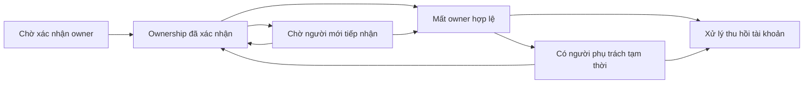

# Account ownership: Xác định và duy trì chủ sở hữu tài khoản

Trong IAM, **account ownership** là việc xác định rõ ai chịu trách nhiệm về nhu cầu tồn tại, mục đích sử dụng và vòng đời của một tài khoản. Một tài khoản có thể đăng nhập thành công, bật MFA và chỉ được cấp một số quyền giới hạn nhưng vẫn trở thành rủi ro nếu tổ chức không biết ai phải xử lý khi mục đích sử dụng thay đổi.

Bài học thuộc chương **Account lifecycle**, tập trung vào cách gắn trách nhiệm với tài khoản từ lúc yêu cầu tạo, trong quá trình sử dụng và chuyển giao, cho đến khi thu hồi. Nội dung áp dụng cho tài khoản nhân viên, đối tác, quản trị, tài khoản ứng dụng và danh tính workload.

Sau bài học, bạn có thể:

- Phân biệt người sử dụng tài khoản, chủ sở hữu chịu trách nhiệm và người quản trị kỹ thuật.
- Thiết kế thông tin ownership đủ để vận hành và kiểm toán.
- Xử lý thay đổi nhân sự, chuyển giao ứng dụng và tài khoản mất chủ.
- Kết nối ownership với phê duyệt quyền, rà soát định kỳ và nguyên tắc ít quyền nhất.

## 1. Ownership trả lời câu hỏi gì?

Một bản ghi ownership hữu ích phải giúp tổ chức trả lời được:

1. **Tài khoản này phục vụ ai hoặc hệ thống nào?**
2. **Ai chịu trách nhiệm xác nhận rằng nó còn cần thiết?**
3. **Ai có thể giải thích và đề nghị điều chỉnh phạm vi truy cập của nó?**
4. **Ai phải phản hồi khi có cảnh báo, thay đổi tổ chức hoặc yêu cầu thu hồi?**
5. **Nếu người phụ trách không còn làm việc, trách nhiệm được chuyển cho ai?**

Đối với tài khoản cá nhân, người đứng tên thường là người sử dụng tài khoản. Tuy nhiên, việc người đó có nên tiếp tục được cấp tài khoản và những quyền nào còn cần thiết phải được xác nhận bởi các vai trò có thẩm quyền như quản lý trực tiếp, người bảo trợ hoặc chủ tài nguyên.

Đối với tài khoản chạy tác vụ tự động, người tạo tài khoản có thể chỉ là kỹ sư thực hiện yêu cầu. Chủ sở hữu phải gắn với dịch vụ hoặc nhóm nghiệp vụ cần tác vụ đó, kèm người chịu trách nhiệm hiện hành.

> Ownership là trách nhiệm có thể truy vết. Biết mật khẩu, giữ khóa API hoặc tạo ra tài khoản không tự động làm một người trở thành chủ sở hữu hợp lệ.

### 1.1. Những khái niệm cần tách riêng

| Khái niệm | Câu hỏi được giải quyết | Ví dụ |
|---|---|---|
| Chủ thể danh tính | Ai hoặc thành phần nào đang được đại diện? | Nhân viên A, dịch vụ xuất hóa đơn |
| Người sử dụng | Ai trực tiếp thao tác bằng tài khoản? | Nhân viên A sử dụng tài khoản công việc |
| Chủ sở hữu chịu trách nhiệm | Ai xác nhận nhu cầu, mục đích và theo dõi vòng đời? | Quản lý bộ phận, chủ dịch vụ |
| Người quản trị kỹ thuật | Ai triển khai thay đổi đã được cho phép? | Nhóm IAM hoặc quản trị ứng dụng |
| Chủ tài nguyên | Ai quyết định quyền truy cập vào tài nguyên? | Chủ cơ sở dữ liệu khách hàng |
| Người giữ thông tin xác thực | Ai hoặc cơ chế nào quản lý mật khẩu, khóa, chứng thư? | Kho bí mật và quy trình vận hành của nhóm |
| Người rà soát | Ai đánh giá lại tính phù hợp theo phân công? | Quản lý, chủ tài nguyên hoặc người kiểm tra độc lập |

Một người có thể kiêm nhiều vai trò trong hệ thống nhỏ. Với tài khoản đặc quyền hoặc tài nguyên nhạy cảm, cần xem xét tách người đề nghị, người phê duyệt và người thực hiện để hạn chế tự cấp quyền.

### 1.2. Ownership không phải là quyền truy cập

Trường `owner` trong hệ thống quản trị danh tính là dữ liệu quản trị. Nó không nên tự động trao quyền quản trị, quyền đọc dữ liệu hoặc quyền xem bí mật cho người được ghi tên.

Ví dụ, chủ dịch vụ thanh toán chịu trách nhiệm về một danh tính workload. Người này có thể xác nhận rằng workload cần ghi trạng thái giao dịch, nhưng quyền truy cập cơ sở dữ liệu vẫn phải được chủ tài nguyên phê duyệt và hệ thống IAM thực thi.

Tương tự, tài khoản quản trị được gán cho một nhân viên không có nghĩa nhân viên đó được tự phê duyệt việc duy trì đặc quyền của mình.

## 2. Thiết lập ownership theo loại tài khoản

### 2.1. Tài khoản cá nhân của nhân viên

Tài khoản cần liên kết với một danh tính nhân sự xác định được, thông qua mã định danh ổn định của tổ chức. Email hiển thị có thể thay đổi hoặc được cấp lại nên không phù hợp làm căn cứ duy nhất để liên kết.

Thông tin trách nhiệm thường gồm:

- Nhân viên là chủ thể sử dụng và chịu trách nhiệm về hành vi của mình.
- Quản lý hoặc vai trò được phân công xác nhận nhu cầu công việc.
- Chủ tài nguyên phê duyệt quyền theo phạm vi quản lý của họ.
- Bộ phận IAM thực hiện hoặc điều phối cấp phát và thu hồi.

Khi nhân viên chuyển phòng ban, danh tính vẫn có thể giữ nguyên nhưng quản lý, đơn vị chịu chi phí và các quyền cần thiết có thể thay đổi. Cập nhật ownership phải đi cùng đánh giá lại quyền liên quan.

### 2.2. Tài khoản đối tác, nhà thầu và người dùng bên ngoài

Ngoài danh tính người sử dụng, cần có **người bảo trợ nội bộ** chịu trách nhiệm xác nhận nhu cầu truy cập của bên ngoài.

Một bản ghi tốt nêu rõ đơn vị đối tác, mục đích truy cập, người bảo trợ, phạm vi công việc và mốc kết thúc hoặc rà soát. Nếu người bảo trợ nghỉ việc, hệ thống phải đưa các tài khoản liên quan vào quy trình tái chỉ định trách nhiệm.

Ngày kết thúc hợp đồng không nên chỉ nằm trong ghi chú tự do. Khi dùng để điều khiển vòng đời, nó cần là dữ liệu có cấu trúc để phát hiện tài khoản đã hết nhu cầu nhưng vẫn hoạt động.

### 2.3. Tài khoản dịch vụ và danh tính workload

Tài khoản dịch vụ thường tồn tại lâu hơn nhiệm kỳ của người tạo. Vì vậy, cần liên kết nó với:

- Dịch vụ hoặc ứng dụng sử dụng danh tính đó.
- Nhóm chịu trách nhiệm vận hành.
- Người chịu trách nhiệm chính đang còn hiệu lực.
- Người dự phòng hoặc tuyến tiếp nhận khi người chính không phản hồi.
- Môi trường sử dụng và mục đích truy cập.

Dùng tên nhóm giúp trách nhiệm không phụ thuộc hoàn toàn vào một cá nhân, nhưng một nhóm chỉ hữu ích nếu có thành viên hiện hành và quy trình tiếp nhận việc rõ ràng. Nhóm không ai theo dõi không giải quyết được tình trạng mất chủ.

Nếu một danh tính workload được nhiều ứng dụng dùng chung, cần xem xét tách danh tính theo ứng dụng hoặc ranh giới tin cậy. Việc gắn nhiều chủ sở hữu vào một tài khoản dùng chung thường làm khó việc thu hồi riêng, áp dụng ít quyền nhất và quy trách nhiệm.

### 2.4. Tài khoản đặc quyền và tài khoản khẩn cấp

Tài khoản quản trị cá nhân cần liên kết với đúng nhân viên và tách mục đích sử dụng khỏi tài khoản công việc thường ngày. Người phê duyệt nhu cầu đặc quyền có thể khác người sử dụng.

Với tài khoản khẩn cấp, cần xác định đơn vị chịu trách nhiệm, người được phép kích hoạt, cách lưu giữ thông tin xác thực và người đánh giá sau sử dụng. Khi phải dùng tài khoản không gắn với một cá nhân tại thời điểm tạo, quy trình cấp quyền sử dụng và nhật ký vẫn phải cho phép truy vết ai đã sử dụng trong từng lần.

Quyền sử dụng tài khoản khẩn cấp không nên mặc nhiên thuộc về mọi thành viên của nhóm được ghi là owner.

### 2.5. Tài khoản dùng chung

Tài khoản dùng chung cho nhiều người làm giảm khả năng xác định ai đã thực hiện hành động. Khi hệ thống hỗ trợ, ưu tiên tài khoản riêng cho từng người và cấp quyền qua nhóm hoặc vai trò.

Nếu hạn chế kỹ thuật buộc phải duy trì tài khoản dùng chung, cần có chủ sở hữu nghiệp vụ, danh sách người được phép sử dụng, cơ chế cấp phát hoặc ghi nhận lượt sử dụng và phương án thay đổi thông tin xác thực khi thành viên rời nhóm. Owner của tài khoản dùng chung không thay thế được bằng chứng về người thực sự thao tác.

## 3. Thông tin ownership cần quản lý

Không có một bộ tên trường bắt buộc cho mọi tổ chức. Điều quan trọng là dữ liệu đủ rõ để ra quyết định và thực hiện quy trình.

| Nhóm thông tin | Nội dung nên có | Mục đích |
|---|---|---|
| Định danh | Mã tài khoản, hệ thống đích, loại tài khoản | Phân biệt đúng đối tượng |
| Chủ thể sử dụng | Mã nhân sự, mã đối tác hoặc mã dịch vụ | Liên kết tài khoản với danh tính |
| Trách nhiệm | Người chịu trách nhiệm chính, nhóm và tuyến dự phòng | Giao việc và xử lý khi có thay đổi |
| Nhu cầu | Mục đích sử dụng, môi trường, đơn vị sử dụng | Xác nhận vì sao tài khoản tồn tại |
| Liên hệ với quyền | Vai trò hoặc hồ sơ quyền, tham chiếu phê duyệt | Hỗ trợ đánh giá tính phù hợp |
| Vòng đời | Trạng thái, ngày kết thúc nếu áp dụng, ngày xác nhận ownership | Phát hiện dữ liệu hết hiệu lực |
| Bằng chứng | Yêu cầu tạo, chấp thuận chuyển giao, lần rà soát | Giải thích quyết định trong kiểm toán |

Thông tin ownership không phải nơi lưu mật khẩu, khóa bí mật, mã MFA hoặc token. Chỉ lưu tham chiếu đến hệ thống quản lý thông tin xác thực nếu cần.

### 3.1. Ví dụ bản ghi cho một tài khoản dịch vụ

Ví dụ dưới đây minh họa mô hình dữ liệu quản trị, không phải cấu hình áp dụng cho một sản phẩm IAM cụ thể:

```json
{
  "accountId": "svc-invoice-export-prod",
  "targetSystem": "billing-platform",
  "accountType": "workload",
  "subjectRef": "service:invoice-export",
  "purpose": "Xuat bao cao hoa don da phe duyet",
  "environment": "production",
  "ownership": {
    "accountableOwnerRef": "person:EMP-204",
    "responsibleTeamRef": "team:billing-operations",
    "backupOwnerRef": "person:EMP-219",
    "state": "confirmed",
    "confirmedAt": "2026-10-01T03:00:00Z",
    "nextReviewAt": "2027-01-01T03:00:00Z"
  },
  "credentialStoreRef": "vault-item:billing/invoice-export",
  "approvalRef": "request:IAM-8421",
  "accountState": "active"
}
```

Các mã và thời điểm trong ví dụ là giả định. Chu kỳ rà soát phải được tổ chức lựa chọn theo mức độ rủi ro, không suy ra rằng mọi tài khoản đều phải rà soát theo đúng khoảng thời gian này.

Bản ghi cố ý tách `ownership.state` khỏi `accountState`. Ownership đã được xác nhận không chứng minh tài khoản đang hoạt động an toàn; tài khoản còn hoạt động cũng không chứng minh ownership vẫn hợp lệ.

### 3.2. Nguồn dữ liệu và nơi quyết định

Ownership có thể liên quan đến dữ liệu từ quản lý nhân sự, quản lý đối tác, danh mục ứng dụng và hệ thống yêu cầu truy cập. Cần xác định nguồn nào có thẩm quyền với từng thuộc tính:

- Nguồn nhân sự xác nhận tình trạng làm việc và quan hệ quản lý của nhân viên.
- Nguồn quản lý đối tác xác nhận thời hạn hoặc người bảo trợ.
- Danh mục dịch vụ xác nhận nhóm phụ trách ứng dụng.
- Hệ thống quản trị IAM lưu quyết định ownership và bằng chứng phê duyệt theo quy trình.

Một người còn xuất hiện trong danh bạ không đủ để kết luận họ còn đủ thẩm quyền làm owner. Dữ liệu cần được đối chiếu với nguồn phù hợp và thời điểm có hiệu lực.

Nếu có sự không nhất quán, phải đưa vào hàng đợi xử lý thay vì để hệ thống đích cuối cùng tự ghi đè dữ liệu một cách ngẫu nhiên.

## 4. Ownership trong vòng đời tài khoản

### 4.1. Khi yêu cầu tạo tài khoản

Yêu cầu cần xác định chủ thể sử dụng, mục đích, owner phù hợp và người có quyền phê duyệt. Với tài khoản dịch vụ, cần có thông tin dịch vụ nhận tài khoản và cách liên hệ nhóm vận hành.

Trước khi cấp phát, quy trình nên kiểm tra:

1. Owner có tồn tại và còn đủ điều kiện chịu trách nhiệm không?
2. Owner đã chấp nhận trách nhiệm hay chỉ bị người yêu cầu điền tên?
3. Mục đích có rõ và liên quan đến công việc hoặc dịch vụ đang tồn tại không?
4. Quyền đề nghị đã đi qua đúng người phê duyệt chưa?
5. Có mốc hết hạn hoặc điều kiện kết thúc phù hợp không?

Đối với yêu cầu thông thường thiếu owner hợp lệ, đưa yêu cầu về trạng thái chờ bổ sung. Trường hợp khẩn cấp cần đi theo cơ chế ngoại lệ đã quy định, có người chịu trách nhiệm tạm thời, thời hạn và bằng chứng; không để tài khoản không có trách nhiệm quản lý ngay từ lúc tạo.

### 4.2. Trong quá trình sử dụng

Owner phải có khả năng nhận được thông báo và thực hiện các trách nhiệm đã phân công, chẳng hạn:

- Xác nhận tài khoản còn phục vụ đúng mục đích.
- Đề nghị thu hẹp quyền khi nhu cầu thay đổi.
- Phản hồi yêu cầu rà soát hoặc cảnh báo liên quan.
- Thông báo khi ứng dụng ngừng hoạt động hoặc người dùng kết thúc công việc.
- Khởi động việc chuyển giao trước khi thay đổi trách nhiệm.

Không yêu cầu owner ghi nhớ mọi quyền kỹ thuật bằng trí nhớ. Hệ thống cần cung cấp thông tin dễ hiểu về tài khoản, quyền hiện có, tài nguyên liên quan và các thay đổi quan trọng để họ ra quyết định có căn cứ.

### 4.3. Khi nhân sự hoặc cơ cấu thay đổi

Các sự kiện sau có thể làm ownership hết phù hợp:

- Nhân viên nghỉ việc, nghỉ dài hạn hoặc chuyển bộ phận.
- Người bảo trợ đối tác không còn phụ trách hợp đồng.
- Nhóm vận hành bị giải thể hoặc hợp nhất.
- Ứng dụng chuyển sang đơn vị khác.
- Dịch vụ bị thay thế hoặc ngừng cung cấp.

Cần tìm cả những tài khoản do người đó sử dụng và những tài khoản họ chịu trách nhiệm quản lý. Thu hồi tài khoản cá nhân của một quản lý không tự chuyển giao các tài khoản dịch vụ mà quản lý đó đang làm owner.

Cũng không nên tự thu hồi tất cả tài khoản dịch vụ chỉ vì owner nghỉ việc. Quyết định kỹ thuật phải xét mức độ rủi ro, phụ thuộc vận hành và quy trình xử lý mất chủ; trách nhiệm của người cũ cần chấm dứt theo thời điểm có hiệu lực.

### 4.4. Khi kết thúc nhu cầu

Owner hoặc người tiếp quản xác nhận rằng tài khoản không còn cần thiết. Quy trình thu hồi cần xác định và xử lý các thành phần liên quan:

- Quyền, nhóm và vai trò đã gán.
- Mật khẩu, khóa, chứng thư hoặc phương thức xác thực của tài khoản.
- Phiên đăng nhập và các loại token còn hiệu lực, theo khả năng của hệ thống.
- Tác vụ, tích hợp và dữ liệu có phụ thuộc vào tài khoản.
- Bằng chứng cần lưu theo chính sách của tổ chức.

Khóa đăng nhập ở một nơi không đảm bảo mọi phiên hoặc quyền truy cập đã bị vô hiệu hóa trên tất cả hệ thống đích. Cần xác minh kết quả thực thi, xử lý lỗi đồng bộ và ghi nhận phần còn chờ hoàn tất.

Việc xóa bản ghi tài khoản và việc giữ lịch sử ownership là hai quyết định khác nhau. Có thể cần giữ bằng chứng phục vụ truy vết trong thời gian phù hợp với chính sách lưu giữ, với quyền truy cập được giới hạn.

## 5. Chuyển giao ownership đúng cách

Chuyển giao không chỉ là thay một địa chỉ email trong biểu mẫu. Người nhận cần hiểu họ đang nhận trách nhiệm với tài khoản nào, cho mục đích gì và với những phụ thuộc nào.

Một quy trình tham khảo:

1. **Lập phạm vi:** liệt kê đúng các tài khoản, môi trường và dịch vụ cần chuyển.
2. **Chỉ định người nhận:** kiểm tra người hoặc nhóm mới có thẩm quyền và đủ khả năng phụ trách.
3. **Xem lại nhu cầu và quyền:** xác nhận tài khoản còn cần thiết; chuyển giao không mặc nhiên hợp thức hóa toàn bộ quyền hiện có.
4. **Chấp nhận trách nhiệm:** ghi nhận chấp thuận của người nhận và phê duyệt theo quy trình.
5. **Thực hiện thay đổi:** cập nhật owner, nhóm chịu trách nhiệm, tuyến dự phòng và nơi nhận thông báo.
6. **Xử lý quyền và bí mật liên quan:** thu hồi quyền vận hành của người cũ; đánh giá việc thay đổi thông tin xác thực nếu họ từng biết hoặc có thể lấy bí mật.
7. **Xác minh và lưu bằng chứng:** kiểm tra các hệ thống liên quan đã nhận thay đổi và ghi lại kết quả.

Nếu người cũ nghỉ việc đột ngột, quy trình không nên phụ thuộc vào việc họ phải đăng nhập để bàn giao. Người có thẩm quyền cần tiếp quản hoặc chỉ định người chịu trách nhiệm tạm thời, kèm bằng chứng và thời hạn xử lý.

### 5.1. Phân biệt chuyển trách nhiệm và chuyển quyền

Ví dụ, dịch vụ xuất hóa đơn chuyển từ nhóm A sang nhóm B:

| Hạng mục | Thay đổi cần xem xét |
|---|---|
| Ownership | Nhóm B và người chịu trách nhiệm mới chấp nhận quản lý tài khoản |
| Quyền của nhân sự | Thu hồi quyền quản trị không còn cần thiết của nhóm A; cấp quyền cần thiết cho nhóm B qua phê duyệt |
| Quyền của workload | Đánh giá lại theo công việc thực tế của workload |
| Thông tin xác thực | Xem ai từng có thể đọc bí mật; thay đổi hoặc thu hồi khi cần |
| Kênh vận hành | Chuyển cảnh báo và yêu cầu rà soát sang người nhận phù hợp |
| Phụ thuộc | Kiểm tra lịch chạy, kho bí mật và hệ thống đích sau thay đổi |

Một danh tính workload có thể giữ nguyên nếu chức năng và ranh giới tin cậy vẫn phù hợp. Trong trường hợp phải tách hệ thống hoặc đổi mô hình tin cậy, có thể cần danh tính mới và kế hoạch chuyển đổi riêng.

### 5.2. Trạng thái chuyển giao

Có thể dùng các trạng thái quản trị như:



Đây là trạng thái của **quy trình ownership**, không phải một mô hình đăng nhập. Tài khoản có thể đang bị khóa trong khi chờ xác nhận owner, hoặc còn hoạt động có kiểm soát trong thời gian xử lý chuyển giao đã được phê duyệt.

## 6. Tài khoản mất chủ và cách xử lý

**Tài khoản mất chủ** là tài khoản không có người hoặc đơn vị chịu trách nhiệm hợp lệ, hoặc không có bằng chứng đủ tin cậy để xác nhận trách nhiệm hiện tại.

Các dấu hiệu thường gặp:

- Trường owner bị bỏ trống hoặc trỏ tới người đã nghỉ việc.
- Nhóm chịu trách nhiệm đã giải thể.
- Người được ghi là owner phủ nhận việc tiếp quản.
- Mục đích sử dụng không còn xác định được.
- Người bảo trợ tài khoản bên ngoài đã hết vai trò.
- Không có ai nhận hoặc xử lý yêu cầu rà soát trong thời hạn của quy trình.

Tài khoản mất chủ có thể vẫn đang được sử dụng. Ngược lại, tài khoản lâu không đăng nhập có thể có owner hợp lệ, chẳng hạn danh tính chỉ dùng cho tác vụ theo mùa hoặc tình huống khẩn cấp. Hoạt động đăng nhập và ownership là hai tín hiệu khác nhau.

### 6.1. Trình tự xử lý

**Bước 1 — Xác nhận tín hiệu.** Kiểm tra mã định danh và thời điểm hiệu lực từ nguồn có thẩm quyền. Lỗi đồng bộ hoặc thay đổi email có thể tạo cảnh báo sai.

**Bước 2 — Đánh giá rủi ro và phụ thuộc.** Xem tài khoản có đặc quyền không, truy cập dữ liệu nào, còn được sử dụng bởi tác vụ gì và việc hạn chế truy cập có ảnh hưởng đến dịch vụ nào.

**Bước 3 — Giao trách nhiệm tạm thời.** Chuyển trường hợp đến quản lý, chủ ứng dụng hoặc tuyến vận hành đã định nghĩa. Người phụ trách tạm thời phải có nhiệm vụ và thời hạn rõ ràng.

**Bước 4 — Áp dụng biện pháp phù hợp.** Tùy rủi ro, có thể hạn chế thay đổi quyền, khóa đăng nhập, thu hẹp truy cập hoặc cho phép hoạt động trong ngoại lệ có thời hạn và giám sát. Khi có dấu hiệu bị lạm dụng, ưu tiên quy trình ứng phó sự cố.

**Bước 5 — Kết thúc bằng một quyết định có bằng chứng.** Hoặc owner mới chấp nhận và quyền được xác nhận lại, hoặc tài khoản được thu hồi và các phụ thuộc được xử lý. Không đóng trường hợp chỉ vì đã gửi một email nhắc việc.

Thời hạn phản hồi và mức hạn chế phải được tổ chức xác định trước theo loại tài khoản, mức độ rủi ro và ảnh hưởng vận hành. Không có một thời hạn duy nhất phù hợp cho mọi hệ thống.

### 6.2. Ví dụ: owner dịch vụ nghỉ việc

Giả sử tài khoản `svc-invoice-export-prod` chạy tác vụ xuất hóa đơn ban đêm. Owner chính nghỉ việc nhưng ứng dụng vẫn cần hoạt động.

Cách xử lý có thể là:

1. Sự kiện nghỉ việc kích hoạt việc tìm các tài khoản mà người đó là owner.
2. Hệ thống mở trường hợp chuyển giao cho quản lý của nhóm phụ trách dịch vụ.
3. Nhóm chỉ định người phụ trách tạm thời và đánh giá quyền truy cập của tài khoản.
4. Quyền truy cập kho bí mật của người đã nghỉ việc bị thu hồi theo quy trình nghỉ việc.
5. Nếu người đó từng có thể lấy bí mật còn hiệu lực, nhóm xử lý thay đổi thông tin xác thực theo kế hoạch phù hợp với mức độ rủi ro và phụ thuộc.
6. Owner mới chấp nhận trách nhiệm; hệ thống cập nhật thông báo và lịch rà soát.
7. Nhóm kiểm tra tác vụ chạy thành công và lưu bằng chứng xử lý.

Nếu không tìm được nhu cầu nghiệp vụ hợp lệ, quy trình chuyển sang thu hồi tài khoản và dừng tác vụ có kiểm soát.

## 7. Ownership liên quan thế nào đến các cơ chế IAM khác?

### 7.1. Xác thực, MFA và phiên

MFA giúp tăng độ tin cậy khi xác thực người sử dụng. Nó không xác định ai chịu trách nhiệm cho tài khoản khi người dùng nghỉ việc hoặc dịch vụ ngừng hoạt động.

Khi ownership thay đổi, cần xem xét quyền của người vận hành cũ, các phiên quản trị và khả năng tiếp cận thông tin xác thực. Không nên coi việc cập nhật trường owner là đã thu hồi quyền của người cũ.

### 7.2. RBAC và ABAC

Với RBAC, quyền được gán thông qua vai trò. Owner hỗ trợ xác nhận nhu cầu sử dụng vai trò, trong khi quyền phê duyệt vẫn phụ thuộc vào phân công quản trị.

Với ABAC, hệ thống có thể dùng các thuộc tính như bộ phận, trạng thái hợp đồng hoặc môi trường để quyết định truy cập. Dữ liệu ownership lỗi thời có thể làm sai quy trình phê duyệt hoặc đánh giá trách nhiệm. Không nên dùng điều kiện như `requester == owner` để mặc nhiên cho phép truy cập tài nguyên nhạy cảm.

### 7.3. SSO, liên kết danh tính và tài khoản cục bộ

Một người dùng có thể đăng nhập qua nhà cung cấp danh tính nhưng vẫn có tài khoản tại nhiều ứng dụng. Cần liên kết được các tài khoản này với cùng chủ thể và xác định ai chịu trách nhiệm tại từng lớp.

Chủ sở hữu quan hệ tích hợp SSO khác với người sử dụng tài khoản đăng nhập. Việc chuyển nhóm quản lý ứng dụng có thể yêu cầu cập nhật owner của tích hợp, nơi nhận cảnh báo và quy trình xử lý lỗi cấp phát.

Không nên giả định khóa tài khoản tại nhà cung cấp danh tính sẽ lập tức chấm dứt tất cả phiên ở mọi ứng dụng. Quy trình thu hồi cần xét cơ chế phiên và kết quả thực thi ở hệ thống đích.

### 7.4. OAuth/OIDC và danh tính ứng dụng

Đăng ký ứng dụng, OAuth client và danh tính workload cũng cần trách nhiệm quản lý rõ ràng. Owner của ứng dụng cần có tuyến xử lý khi ứng dụng ngừng hoạt động, redirect URI thay đổi, bí mật client cần thay thế hoặc quyền được cấp cần rà soát.

Owner của ứng dụng không đồng nghĩa với người được phép tự chấp thuận mọi quyền mà ứng dụng yêu cầu. Các quyền, sự chấp thuận và thông tin xác thực phải được quản lý theo cơ chế của hệ thống liên quan.

## 8. Kiểm toán và theo dõi chất lượng ownership

Nhật ký thay đổi ownership nên cho phép trả lời:

- Tài khoản nào được thay đổi?
- Ai đề nghị, ai chấp nhận và ai thực hiện?
- Owner cũ và mới là ai?
- Thay đổi có hiệu lực khi nào, vì lý do gì?
- Yêu cầu hoặc bằng chứng nào hỗ trợ quyết định?
- Phần cập nhật nào đã thành công và phần nào còn lỗi?

Hạn chế quyền sửa dữ liệu ownership và bảo vệ nhật ký khỏi việc sửa tùy tiện. Nếu một người có thể tự ghi mình làm owner rồi tự duyệt quyền, quy trình sẽ tạo ra đường vòng để nâng quyền.

Một số chỉ số hữu ích:

| Chỉ số | Cách hiểu |
|---|---|
| Tỷ lệ tài khoản có ownership hợp lệ | Tài khoản có người chịu trách nhiệm còn hiệu lực và bằng chứng xác nhận trong phạm vi được kiểm kê |
| Số trường hợp mất chủ còn mở | Khối lượng cần xử lý, nên phân theo rủi ro và loại tài khoản |
| Thời gian hoàn tất chuyển giao | Khoảng thời gian từ khi phát sinh nhu cầu đến khi người mới tiếp nhận và việc cập nhật được xác minh |
| Tỷ lệ rà soát quá hạn | Các trường hợp chưa được xử lý theo thời hạn đã đặt |
| Số ngoại lệ hết hạn | Các tài khoản vẫn hoạt động sau khi thời hạn ngoại lệ đã kết thúc |

Cần xác định rõ mẫu số và phạm vi kiểm kê. Tỷ lệ hoàn hảo trong một danh mục thiếu tài khoản dịch vụ hoặc tài khoản cục bộ không chứng minh toàn hệ thống đã được quản lý đầy đủ.

## 9. Những sai lầm thường gặp

| Sai lầm | Hậu quả | Cách cải thiện |
|---|---|---|
| Luôn lấy người tạo làm owner | Kỹ sư triển khai bị gắn trách nhiệm lâu dài cho dịch vụ không thuộc phạm vi của mình | Ghi nhận owner theo nhu cầu và thẩm quyền, có chấp thuận |
| Chỉ lưu email owner | Đổi hoặc cấp lại email gây liên kết sai | Dùng mã định danh ổn định và kiểm tra trạng thái |
| Gán owner cho một nhóm không được duy trì | Cảnh báo có nơi gửi nhưng không ai xử lý | Có nhóm hiện hành, người chịu trách nhiệm và tuyến dự phòng |
| Xem owner là người được toàn quyền | Có thể dẫn đến tự cấp quyền hoặc truy cập bí mật không cần thiết | Tách trách nhiệm ownership khỏi quyền kỹ thuật |
| Chỉ thay trường owner khi bàn giao | Người cũ còn quyền, thông báo vẫn gửi sai nơi | Chuyển cả trách nhiệm, quyền vận hành và các liên kết liên quan |
| Coi không đăng nhập là mất chủ | Có thể xử lý nhầm tài khoản dùng theo đợt | Đánh giá ownership và mức sử dụng riêng |
| Chỉ rà soát theo lịch | Bỏ lỡ thay đổi nhân sự hoặc ngừng dịch vụ giữa hai kỳ | Kết hợp sự kiện vòng đời và rà soát định kỳ |
| Xóa lịch sử khi xóa tài khoản | Khó giải thích ai từng chịu trách nhiệm | Giữ bằng chứng theo chính sách lưu giữ |

## 10. Bài tập vận dụng

Một công ty có ba tài khoản:

| Tài khoản | Tình trạng |
|---|---|
| `partner-an` | Tài khoản nhà thầu còn hoạt động; người bảo trợ nội bộ đã chuyển bộ phận |
| `svc-stock-sync` | Đồng bộ tồn kho; owner là người tạo tài khoản từ hai năm trước, hiện đã nghỉ việc |
| `admin-linh` | Tài khoản quản trị cá nhân; người sử dụng đồng thời đang tự phê duyệt rà soát đặc quyền |

Hãy xác định thông tin còn thiếu, người cần tham gia xử lý và bằng chứng cần thu thập trước khi kết thúc từng trường hợp.

Gợi ý lập luận:

- Với `partner-an`, cần xác nhận công việc còn hiệu lực, tìm người bảo trợ phù hợp và đánh giá phạm vi truy cập cùng mốc kết thúc. Việc người bảo trợ cũ chuyển bộ phận không tự chứng minh nhà thầu đã hết nhu cầu.
- Với `svc-stock-sync`, cần tìm dịch vụ và nhóm vận hành đang phụ thuộc, chỉ định trách nhiệm tạm thời, đánh giá quyền và thông tin xác thực, sau đó chuyển giao hoặc thu hồi. Không chỉ đổi tên owner cho xong.
- Với `admin-linh`, cần xem lại phân công phê duyệt và yêu cầu tách nhiệm vụ đối với đặc quyền. Người sử dụng có thể giải trình nhu cầu nhưng việc xác nhận cuối cùng phải tuân theo thẩm quyền đã quy định.

Trong cả ba trường hợp, kết quả cần thể hiện bằng dữ liệu và bằng chứng thực thi: ai đã nhận trách nhiệm, quyền nào được giữ hoặc thu hồi, việc cập nhật đã hoàn tất ở đâu và phần nào còn chờ xử lý.

## 11. Điểm cần ghi nhớ

- Mọi tài khoản trong phạm vi quản lý cần có trách nhiệm ownership xác định được trong suốt vòng đời.
- Người tạo, người sử dụng, người giữ bí mật và người phê duyệt quyền là các vai trò có thể khác nhau.
- Ownership phải gắn với nguồn dữ liệu và người hoặc nhóm còn hiệu lực, có khả năng phản hồi.
- Chuyển giao cần có chấp nhận trách nhiệm, xử lý quyền liên quan và xác minh kết quả.
- Tài khoản mất chủ phải được đánh giá rủi ro, giao xử lý và kết thúc bằng chuyển giao hợp lệ hoặc thu hồi.
- Ownership giúp tổ chức biết ai chịu trách nhiệm; xác thực, cấp quyền, quản lý phiên và kiểm toán vẫn cần được thực hiện đầy đủ.
