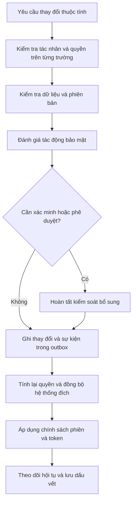

# Thay đổi thuộc tính tài khoản trong vòng đời IAM

## Mục tiêu bài học

Thay đổi thuộc tính tài khoản (account attribute change) là việc cập nhật những dữ liệu mô tả một tài khoản hoặc danh tính: tên hiển thị, email, phòng ban, người quản lý, địa điểm làm việc, loại hợp đồng hay các nhãn phục vụ kiểm soát truy cập. Trong quản lý danh tính và quyền truy cập (IAM), một thay đổi dữ liệu có thể đồng thời làm thay đổi cách đăng nhập, cách khôi phục tài khoản và quyền sử dụng tài nguyên.

Bài học thuộc chương **Account lifecycle** của nền tảng IAM. Nội dung tập trung vào giai đoạn tài khoản đang tồn tại nhưng thông tin thay đổi, đặc biệt là tình huống nhân sự chuyển vị trí hoặc đơn vị. Đây thường được gọi là phần **mover** trong chu trình joiner–mover–leaver: gia nhập, thay đổi công việc và rời tổ chức.

Sau bài này, bạn có thể:

- Phân loại thuộc tính theo mức độ ảnh hưởng tới xác thực, phân quyền và vận hành.
- Xác định nguồn dữ liệu có thẩm quyền và chủ thể được phép thay đổi từng thuộc tính.
- Thiết kế luồng cập nhật có kiểm tra quyền, xác minh, kiểm toán và xử lý đồng bộ thất bại.
- Giải thích vì sao sửa hồ sơ chưa chắc đã làm thay đổi quyền đang được sử dụng trong phiên hoặc token.
- Xử lý chuyển phòng ban mà không để quyền cũ tích lũy ngoài nhu cầu công việc.

## 1. Thuộc tính thay đổi, danh tính vẫn cần được nhận diện ổn định

Một nhân viên có thể đổi họ tên, email hoặc phòng ban nhiều lần. Hệ thống vẫn phải nhận biết đây là cùng một danh tính để bảo toàn lịch sử kiểm toán, quyền sở hữu dữ liệu và liên kết tài khoản.

Ví dụ một bản ghi danh tính được IAM quản lý:

```json
{
  "identityId": "usr-4821",
  "displayName": "Nguyễn An",
  "primaryEmail": "an.nguyen@example.org",
  "departmentCode": "SALES",
  "managerId": "usr-0107",
  "employmentType": "EMPLOYEE",
  "accountStatus": "ACTIVE",
  "identityRevision": 57
}
```

Trong ví dụ này:

- `identityId` là mã nội bộ ổn định, không đổi theo tên hoặc email và không được tái sử dụng cho người khác.
- `departmentCode`, `managerId` và `employmentType` có thể thay đổi theo nghiệp vụ.
- `accountStatus` biểu diễn trạng thái vòng đời. Trường này cần luồng chuyển trạng thái riêng; cập nhật phòng ban không tự đưa tài khoản bị khóa trở lại hoạt động.
- `identityRevision` là số phiên bản của bản ghi IAM, giúp phát hiện cập nhật đồng thời và phân biệt trạng thái mới với trạng thái cũ.

Không dùng email làm khóa định danh duy nhất xuyên suốt các ứng dụng. Email có thể đổi, có bí danh, hoặc được cấp lại sau khi người cũ rời tổ chức. Nếu một ứng dụng liên kết tài khoản chỉ dựa trên email, người nhận địa chỉ được tái cấp có thể bị gắn nhầm với dữ liệu của người trước.

Trong liên kết danh tính OIDC, cặp issuer và subject thường là căn cứ liên kết danh tính bên ngoài. Việc đổi email không phải bằng chứng để tự chuyển liên kết đó sang một người khác. Nếu nhà cung cấp hoặc cơ chế liên kết thay đổi, cần một quy trình liên kết lại có kiểm soát.

## 2. Không phải thuộc tính nào cũng có cùng mức rủi ro

Tên trường không đủ để xác định mức rủi ro. Cần xem toàn bộ các hệ thống đang sử dụng trường đó. Một nhãn vốn chỉ để hiển thị có thể trở thành thuộc tính nhạy cảm khi được đưa vào chính sách cấp quyền.

| Nhóm thuộc tính | Ví dụ | Ảnh hưởng cần xem xét | Kiểm soát thường cần |
|---|---|---|---|
| Hồ sơ hiển thị | Tên hiển thị, cách xưng hô | Giao diện, tìm kiếm, nhận diện người dùng | Kiểm tra quyền sửa, định dạng và nội dung đầu vào |
| Đăng nhập và liên hệ | Tên đăng nhập, email, số điện thoại | Đăng nhập, thông báo, khôi phục tài khoản | Kiểm tra tính duy nhất theo phạm vi, xác minh kênh mới, xác thực bổ sung khi cần |
| Tổ chức và công việc | Phòng ban, chức danh, người quản lý, loại hợp đồng | Quyền suy ra, phạm vi dữ liệu, luồng phê duyệt | Nguồn có thẩm quyền, đối chiếu chính sách, thời điểm hiệu lực |
| Đầu vào phân quyền | Nhóm nghiệp vụ, nhãn vùng dữ liệu, mức tin cậy | RBAC, ABAC, quyền truy cập dữ liệu | Hạn chế bên được ghi, phê duyệt phù hợp, cập nhật điểm thực thi quyền |
| Trạng thái và đặc quyền | Trạng thái khóa, quyền quản trị, ngoại lệ đặc quyền | Khả năng sử dụng tài khoản, quyền quản lý hệ thống | Quy trình chuyên biệt, kiểm soát phân tách nhiệm vụ, kiểm toán chặt chẽ |

Mật khẩu, khóa truy cập, thông tin đăng ký MFA và thông tin xác thực của workload là đối tượng bảo mật riêng. Chúng không nên được sửa qua API cập nhật hồ sơ chung. Ví dụ, đổi số điện thoại liên hệ không mặc nhiên thay đổi yếu tố MFA đang đăng ký; nếu cùng một số phục vụ cả hai mục đích, hệ thống phải xử lý rõ cả hai tác động.

Một câu hỏi thiết kế hữu ích là: **Nếu kẻ tấn công sửa được trường này, họ có thể đăng nhập, khôi phục tài khoản hoặc được cấp quyền nhiều hơn không?** Nếu có, đây là đầu vào bảo mật cần bảo vệ tương ứng.

## 3. Xác định nguồn có thẩm quyền cho từng thuộc tính

Không nên coi một hệ thống là nguồn có thẩm quyền cho mọi dữ liệu. Hệ thống nhân sự có thể quản lý phòng ban, nhưng thường không quyết định người dùng đã xác minh địa chỉ email khôi phục hay chưa. Từng thuộc tính cần có chủ sở hữu nghiệp vụ và đường cập nhật rõ ràng.

| Thuộc tính | Nguồn có thẩm quyền trong ví dụ | Bên có thể khởi tạo thay đổi | Điều kiện ghi nhận |
|---|---|---|---|
| Tên hiển thị tùy chọn | Cổng hồ sơ người dùng | Chủ tài khoản | Chính sách cho phép tự sửa |
| Phòng ban, người quản lý | Hệ thống nhân sự | Nhân sự hoặc luồng chuyển vị trí được phê duyệt | Sự kiện hợp lệ, đúng thời điểm hiệu lực |
| Email đăng nhập do công ty cấp | Hệ thống danh bạ hoặc quản trị danh tính | Quy trình cấp địa chỉ đã được tổ chức quy định | Không xung đột và có căn cứ về quyền sở hữu địa chỉ |
| Email khôi phục cá nhân | Dịch vụ khôi phục tài khoản | Chủ tài khoản sau xác thực phù hợp | Xác minh địa chỉ mới, áp dụng chính sách chống chiếm đoạt |
| Nhãn phục vụ phân quyền | Chủ dữ liệu hoặc bộ phận IAM theo chính sách | Quy trình được kiểm soát | Đúng thẩm quyền, có phê duyệt khi cần |
| Ngoại lệ quyền quản trị | Hệ thống quản lý đặc quyền | Người được ủy quyền và bên phê duyệt | Có lý do, phạm vi và thời hạn |

Đây là cách phân công minh họa. Mỗi tổ chức phải công bố hợp đồng dữ liệu của chính mình: ai sở hữu trường nào, ai được gửi yêu cầu, ai được duyệt và hệ thống nào thực thi.

### 3.1. Phân biệt quyền gửi dữ liệu với quyền quyết định dữ liệu

Một connector có quyền đồng bộ hồ sơ không đồng nghĩa được quyền sửa mọi trường. Nếu connector của hệ thống nhân sự được gửi `displayName` và `departmentCode`, dịch vụ IAM vẫn phải từ chối một trường ngoài phạm vi như `isAdmin`.

API cần dùng danh sách trường được phép theo từng loại tác nhân. Không gán trực tiếp toàn bộ JSON đầu vào vào đối tượng tài khoản. Kiểu gán hàng loạt thiếu kiểm soát có thể cho phép người dùng chèn thêm các trường như:

```json
{
  "displayName": "Nguyễn An",
  "departmentCode": "SECURITY_ADMIN",
  "isAdmin": true,
  "accountStatus": "ACTIVE"
}
```

Nếu endpoint chỉ cho phép tự sửa tên hiển thị, yêu cầu chứa các trường quản trị phải bị từ chối theo hợp đồng API. Giao diện ẩn trường không phải là kiểm soát quyền; máy chủ phải kiểm tra cả tài khoản đích và từng thuộc tính được yêu cầu thay đổi.

### 3.2. Phân biệt dữ liệu đã xác minh và dữ liệu đang chờ xác minh

Với email hoặc số điện thoại nhạy cảm, cần biểu diễn được trạng thái chờ xác minh. Ví dụ:

```text
primaryEmail = an.nguyen@example.org
pendingEmail = an.new@example.org
pendingEmailState = AWAITING_VERIFICATION
```

Trong thời gian chờ, địa chỉ mới chưa được sử dụng như một kênh khôi phục đã tin cậy. Khi xác minh hoàn tất và các kiểm tra cần thiết đều đạt, hệ thống mới chuyển giá trị chính thức. Mã hoặc liên kết xác minh phải có thời hạn, dùng một lần và ràng buộc với đúng yêu cầu thay đổi, tài khoản cùng địa chỉ mới.

Đối với địa chỉ do tổ chức quản lý, bằng chứng có thể đến từ quy trình quản trị hoặc danh bạ đáng tin cậy thay vì một luồng tự xác minh qua hộp thư. Cần lựa chọn rõ cơ chế, không coi việc nhập một chuỗi email là đủ chứng minh quyền sở hữu.

## 4. Luồng cập nhật thuộc tính có kiểm soát

Một luồng đầy đủ thường gồm các bước sau:

1. **Tiếp nhận yêu cầu:** Xác định tác nhân, tài khoản đích, các trường cần đổi, lý do và thời điểm hiệu lực. Dùng định danh ổn định để chọn tài khoản đích.
2. **Kiểm tra thẩm quyền:** Xác nhận tác nhân được sửa đúng tài khoản, đúng phạm vi tổ chức hoặc tenant và đúng các trường được gửi.
3. **Kiểm tra dữ liệu:** Chuẩn hóa theo hợp đồng, kiểm tra định dạng, tham chiếu phòng ban hoặc người quản lý, tính duy nhất và phiên bản hiện tại.
4. **Đánh giá tác động:** Xác định thay đổi có ảnh hưởng tới đăng nhập, MFA, khôi phục, quyền suy ra, phạm vi dữ liệu, phiên, token và các ứng dụng phụ thuộc hay không.
5. **Xác minh hoặc phê duyệt:** Thực hiện xác thực lại, MFA, xác minh kênh liên hệ hoặc phê duyệt nghiệp vụ tương ứng với rủi ro. Không bắt mọi thay đổi nhỏ đi qua cùng một quy trình nặng.
6. **Ghi nhận thay đổi hợp lệ:** Lưu bản ghi cùng phiên bản mới và thông tin kiểm toán. Nếu cần phát sự kiện, bảo đảm thay đổi không bị mất khỏi hàng đợi xử lý.
7. **Áp dụng tác động:** Đồng bộ các ứng dụng, tính lại quyền suy ra, thu hồi quyền không còn hợp lệ và xử lý phiên hoặc token theo chính sách.
8. **Theo dõi kết quả:** Phân biệt dữ liệu đã được ghi với việc các hệ thống đích đã áp dụng thành công. Thông báo phù hợp cho chủ tài khoản hoặc người vận hành.



Sơ đồ thể hiện đường đi thành công. Nếu quyền sửa, xác minh hoặc phê duyệt không đạt, yêu cầu dừng trước khi thay đổi có hiệu lực. Không được ghi thuộc tính đang chờ duyệt vào nơi mà bộ máy cấp quyền coi là dữ liệu đã tin cậy.

Nếu quy trình kéo dài, cần kiểm tra lại những điều kiện có thể đã đổi trước khi cam kết, chẳng hạn phiên bản bản ghi, trạng thái tài khoản và thẩm quyền của người phê duyệt. Phê duyệt không phải giấy phép để ghi một trạng thái đã lỗi thời.

## 5. Chuyển phòng ban: cập nhật dữ liệu phải đi cùng điều chỉnh quyền

Giả sử An đang ở bộ phận Kinh doanh và được chuyển sang Hỗ trợ khách hàng. Trước khi chuyển, An có:

- Quyền dùng CRM do nhóm Kinh doanh cấp.
- Quyền xem cơ hội bán hàng của khu vực phụ trách.
- Quyền đọc tài liệu nội bộ dành cho mọi nhân viên.
- Một ngoại lệ có thời hạn để hỗ trợ báo cáo doanh thu.

Nếu IAM chỉ đổi `departmentCode` từ `SALES` sang `SUPPORT` và bổ sung nhóm Hỗ trợ, tài khoản có thể giữ cả quyền cũ lẫn quyền mới. Sau nhiều lần chuyển vị trí, quyền tích lũy vượt xa nhu cầu thực tế.

### 5.1. Tính lại quyền theo nguồn cấp

Với RBAC, thuộc tính công việc có thể được dùng để quyết định người dùng thuộc vai trò hoặc nhóm nào. Điều đó không có nghĩa mọi chức danh đều tự động tương ứng với một vai trò đặc quyền.

Có thể biểu diễn quyền suy ra như sau:

```text
D_cũ = quyền suy ra từ thuộc tính cũ theo chính sách
D_mới = quyền suy ra từ thuộc tính mới theo chính sách

Cần thu hồi từ nguồn suy ra này = D_cũ - D_mới
Cần bổ sung từ nguồn suy ra này = D_mới - D_cũ
```

Phép so sánh trên chỉ áp dụng cho cùng nguồn cấp quyền đang được tính lại. Hệ thống cần lưu được quyền đến từ nhóm nào, chính sách nào hoặc ngoại lệ nào. Một quyền có thể đồng thời được cấp từ nhiều nguồn; gỡ quyền từ nhóm Kinh doanh không chắc đã chấm dứt quyền hiệu lực nếu một nhóm khác vẫn cấp quyền đó.

Vì vậy, sau khi điều chỉnh cần kiểm tra cả **quyền hiệu lực**. Các ngoại lệ và quyền cấp trực tiếp phải được rà soát lại theo ngữ cảnh công việc mới. Không giữ chúng vô thời hạn chỉ vì chúng không nằm trong nhóm tự động.

Quyền quản trị hoặc quyền đặc biệt thường cần phê duyệt riêng. Việc đổi chức danh thành “quản lý” không nên tự cấp quyền quản trị hệ thống.

### 5.2. Thuộc tính trong ABAC cũng là dữ liệu bảo mật

Với ABAC, quyết định truy cập có thể phụ thuộc trực tiếp vào thuộc tính:

```text
Cho phép đọc hồ sơ khi:
  tài khoản đang hoạt động
  VÀ departmentCode = SUPPORT
  VÀ vùng được giao của người dùng chứa vùng của hồ sơ
  VÀ hành động thuộc phạm vi hỗ trợ được phép
```

Khi một trong các thuộc tính thay đổi, kết quả cấp quyền có thể thay đổi ngay ở lần đánh giá tiếp theo — nhưng chỉ nếu điểm đánh giá sử dụng dữ liệu đủ mới. Nếu hệ thống lấy `departmentCode` từ token phát hành trước đó, nó vẫn có thể ra quyết định theo giá trị cũ.

Không cho người dùng tự sửa thuộc tính đang được ABAC tin cậy để cấp quyền. Cũng cần định nghĩa cách xử lý khi thuộc tính quan trọng bị thiếu hoặc nguồn dữ liệu quá cũ; không diễn giải “không có phòng ban” thành “được truy cập mọi phòng ban”.

### 5.3. Chọn thứ tự thu hồi và cấp mới theo rủi ro

Một thay đổi trong cơ sở dữ liệu IAM không tạo ra giao dịch nguyên tử trên tất cả ứng dụng đích. Có thể xảy ra khoảng thời gian một ứng dụng đã đổi quyền còn ứng dụng khác chưa đổi.

Với quyền nhạy cảm hoặc quyền xung đột về phân tách nhiệm vụ, cần ưu tiên chấm dứt quyền cũ trước khi cấp quyền mới có thể tạo xung đột. Nếu hệ thống đích chưa thu hồi được, quy trình có thể tạm dừng cấp mới hoặc chặn truy cập nhạy cảm bằng cơ chế mà kiến trúc thực sự hỗ trợ.

Với thay đổi ít rủi ro, tổ chức có thể chấp nhận một khoảng đồng bộ được đo lường. Quyết định này cần có giới hạn rõ: những ứng dụng nào được phép chậm, tối đa bao lâu, và khi vượt giới hạn thì ai xử lý.

Không dùng thao tác “xóa toàn bộ quyền rồi cấp lại” như một giải pháp mặc định. Cách đó có thể xóa quyền hợp lệ không thuộc phạm vi thay đổi, làm mất dấu vết nguồn cấp và tạo gián đoạn ngoài dự kiến.

## 6. Email, số điện thoại và thay đổi kênh khôi phục

Một thay đổi email có thể chỉ phục vụ thông báo, nhưng cũng có thể thay đổi tên đăng nhập hoặc nơi nhận liên kết khôi phục. Cần biết chính xác địa chỉ đó đang được sử dụng vào những mục đích nào.

Ví dụ luồng đổi email khôi phục do người dùng tự yêu cầu:

1. Người dùng đăng nhập và thực hiện xác thực lại phù hợp với độ nhạy của thao tác.
2. Máy chủ kiểm tra quyền trên tài khoản, giới hạn tần suất và tạo yêu cầu đang chờ.
3. Hệ thống xác minh quyền kiểm soát địa chỉ mới bằng bằng chứng phù hợp.
4. Khi xác minh đạt, máy chủ kiểm tra lại yêu cầu chưa hết hạn, chưa bị hủy và vẫn là yêu cầu hiện hành.
5. Hệ thống chuyển địa chỉ chính thức, ghi nhận kiểm toán và xử lý các yêu cầu khôi phục cũ theo chính sách.
6. Thông báo thay đổi được gửi qua các kênh tin cậy phù hợp, có thể gồm kênh cũ để giúp phát hiện chiếm đoạt tài khoản.

Không ghi đè địa chỉ hiện hành ngay khi người dùng nhập địa chỉ mới rồi mới bắt đầu xác minh. Cũng không tự đánh dấu email đã xác minh chỉ vì tài khoản gửi yêu cầu đang có một phiên đăng nhập.

Xác minh địa chỉ mới chứng minh khả năng kiểm soát kênh đó tại thời điểm xác minh. Nó không tự chứng minh người thực hiện là chủ tài khoản hợp lệ; vì vậy vẫn cần kiểm soát phiên, xác thực lại và quyền thay đổi.

Nếu người dùng mất kênh cũ, sử dụng quy trình khôi phục được thiết kế riêng. Không để nhân viên hỗ trợ bỏ qua xác minh chỉ dựa trên tên, chức danh hoặc một email yêu cầu thay đổi. Với tài khoản có MFA, việc thay đổi yếu tố hoặc số điện thoại dùng cho MFA phải đi qua quy trình quản lý yếu tố xác thực tương ứng.

## 7. Phiên, token và SSO có thể tiếp tục mang dữ liệu cũ

Giả sử lúc 08:00 người dùng nhận access token có thông tin phòng ban là `SALES`. Lúc 09:00, IAM cập nhật sang `SUPPORT`. Token đã được phát hành vẫn chứa giá trị cũ cho đến khi hết hạn hoặc bị hệ thống tài nguyên từ chối bằng cơ chế có hỗ trợ.

Một hệ thống chỉ kiểm tra chữ ký và thời hạn của JWT có thể tiếp tục chấp nhận token đó. Sửa hồ sơ ở Identity Provider (IdP) không tự sửa nội dung JWT đã ký.

| Thành phần | Tác động có thể gặp sau thay đổi | Cách xử lý cần thiết kế |
|---|---|---|
| Phiên tại IdP | Vẫn tồn tại dù thuộc tính đã đổi | Đánh giá có cần xác thực lại hoặc kết thúc phiên hay không |
| Phiên tại từng ứng dụng SSO | Có thể lưu thông tin và quyền riêng | Cơ chế cập nhật hoặc kết thúc phiên tại chính ứng dụng đó |
| Access token đã phát hành | Chứa claims cũ hoặc vẫn được chấp nhận | Thời hạn phù hợp; kiểm tra quyền hiện hành, phiên bản hoặc thu hồi nếu kiến trúc hỗ trợ |
| Refresh token | Có thể tiếp tục lấy access token mới | Áp dụng chính sách thu hồi hoặc đánh giá lại khi phát token mới |
| Bộ nhớ đệm phân quyền | Có thể giữ quyền hoặc thuộc tính cũ | Vô hiệu hóa, đánh phiên bản hoặc giới hạn độ cũ theo yêu cầu |

Khi access token mới được cấp, dịch vụ phát token cần lấy dữ liệu theo hợp đồng cập nhật đã thiết kế. Không mặc định refresh sẽ luôn nạp lại mọi thuộc tính từ nguồn gốc.

Introspection cũng chỉ hữu ích nếu máy chủ ủy quyền và dịch vụ tài nguyên thực sự phối hợp cập nhật, kiểm tra trạng thái cần thiết. Việc tồn tại một endpoint introspection không bảo đảm các quyền hoặc claims luôn phản ánh dữ liệu mới nhất.

OIDC ID token phục vụ cung cấp thông tin xác thực cho ứng dụng khách. Không dùng nó như một bản ghi quyền hiện hành cho mọi yêu cầu đến API. Dịch vụ tài nguyên cần mô hình xác thực và phân quyền phù hợp với access token cùng dữ liệu chính sách của mình.

Với thay đổi tên hiển thị, cập nhật ở lần tải hồ sơ tiếp theo có thể là đủ. Với thay đổi làm mất quyền truy cập dữ liệu nhạy cảm, yêu cầu có thể là ngăn quyền cũ có hiệu lực trong một khoảng thời gian rất ngắn. Để đạt yêu cầu đó phải kiểm soát các điểm thực thi thực tế; đăng xuất một phiên ở cổng IAM không mặc nhiên kết thúc mọi phiên SSO hoặc vô hiệu mọi access token.

## 8. Đồng bộ thay đổi trong hệ thống phân tán

Một hệ thống IAM thường liên kết nhân sự, danh bạ, IdP, SaaS và ứng dụng nội bộ. Sự kiện có thể tới trễ, tới lặp hoặc tới sai thứ tự. Thiết kế cập nhật cần chịu được các tình huống này.

### 8.1. Ghi thay đổi và ý định phát sự kiện cùng nhau

Nếu lưu bản ghi trước rồi tiến trình dừng trước khi gửi sự kiện, các hệ thống đích có thể không biết có thay đổi. Nếu phát sự kiện trước rồi giao dịch lưu thất bại, hệ thống đích có thể áp dụng một trạng thái chưa từng được cam kết.

Một cách giải quyết là **transactional outbox**: trong cùng giao dịch tại kho IAM, lưu thay đổi hợp lệ và một bản ghi sự kiện chờ phát. Tiến trình riêng chuyển sự kiện đến hệ thống nhận và có thể thử lại. Cách này tránh mất ý định phát sự kiện, nhưng không tạo ra giao dịch nguyên tử trên toàn bộ các ứng dụng.

Ví dụ sự kiện do kho danh tính trung tâm phát sau khi cam kết:

```json
{
  "eventId": "evt-0058-usr-4821",
  "type": "IdentityAttributesChanged",
  "identityId": "usr-4821",
  "identityRevision": 58,
  "changedAttributes": ["departmentCode", "managerId"],
  "effectiveAt": "2026-11-26T02:00:00Z",
  "correlationId": "change-request-7420"
}
```

Sự kiện ví dụ chỉ báo có thay đổi. Consumer lấy trạng thái hiện hành từ kho có thẩm quyền qua kênh được bảo vệ, rồi cập nhật phần dữ liệu mà nó chịu trách nhiệm. Không cần phát toàn bộ hồ sơ, email khôi phục hoặc dữ liệu cá nhân không liên quan cho mọi consumer.

Trong ví dụ này, `identityRevision` được kho IAM trung tâm cấp cho cùng một luồng phiên bản của danh tính. Không so sánh trực tiếp số phiên bản từ hai hệ thống nguồn độc lập nếu chúng không có cùng quy ước thứ tự.

### 8.2. Chống áp dụng trùng và quay lui dữ liệu

Consumer cần xử lý được các nguyên tắc sau:

- **Áp dụng lặp vẫn an toàn:** Nhận lại một sự kiện không được cấp thêm quyền trùng hoặc tạo lại tài khoản.
- **Không ghi đè bằng trạng thái cũ:** Nếu bản đích đã áp dụng revision 58, sự kiện revision 57 không được đưa dữ liệu trở về trạng thái trước đó.
- **Giữ được thứ tự trên cùng danh tính:** Kiểm tra phiên bản và ghi nhận kết quả cần có bảo vệ đồng thời, để hai worker không cùng kiểm tra rồi ghi ngược thứ tự.
- **Phân biệt đã nhận và đã áp dụng:** Không đánh dấu hoàn tất khi mới nhận sự kiện mà thao tác ở hệ thống đích chưa thành công.
- **Có cách phục hồi:** Thử lại lỗi tạm thời, đưa lỗi kéo dài vào danh sách xử lý và có đối soát định kỳ giữa trạng thái mong muốn với trạng thái thực tế.

Nếu consumer lấy được revision mới hơn sự kiện đang xử lý, nó có thể đồng bộ thẳng tới trạng thái mới nhất theo hợp đồng của hệ thống. Nếu nguồn đọc trả về trạng thái cũ hơn revision sự kiện, không coi việc đọc đó là bằng chứng đã đồng bộ xong.

Cần thiết kế cả khoảng hở giữa cập nhật hệ thống đích và lưu tiến độ tại consumer. Nếu tiến trình dừng ở giữa, lần xử lý lại phải nhận biết hoặc áp dụng lại an toàn. Chỉ lưu `eventId` trong một bảng không tự làm thao tác ở dịch vụ bên ngoài trở nên nguyên tử.

### 8.3. Thay đổi có hiệu lực trong tương lai

Một quyết định chuyển đơn vị có thể được nhập hôm nay nhưng bắt đầu từ tuần sau. Cần phân biệt:

- Thời điểm người vận hành gửi yêu cầu.
- Thời điểm yêu cầu được phê duyệt và ghi nhận.
- Thời điểm thay đổi được phép có hiệu lực.
- Thời điểm từng hệ thống đích thực sự áp dụng.

Không cấp quyền của vị trí mới ngay khi nhận yêu cầu nếu thời điểm hiệu lực chưa tới. Cần quy định múi giờ, cách xử lý yêu cầu bị hủy hoặc thay thế, và cách đối soát nếu tiến trình xử lý thời điểm hiệu lực bị gián đoạn.

## 9. Cập nhật đồng thời và xử lý thay đổi sai

Hai người vận hành có thể cùng mở hồ sơ revision 57. Người thứ nhất sửa phòng ban; người thứ hai sửa người quản lý từ màn hình cũ. Nếu mỗi yêu cầu gửi lại toàn bộ hồ sơ và máy chủ ghi đè không kiểm tra, thay đổi đầu tiên có thể bị mất.

Một cách xử lý là optimistic concurrency control: yêu cầu gửi kèm phiên bản đã đọc; máy chủ chỉ ghi nếu phiên bản vẫn khớp. Nếu không khớp, trả về xung đột để bên gửi tải lại và quyết định thay đổi trên dữ liệu hiện hành.

```text
Yêu cầu: cập nhật managerId, kỳ vọng identityRevision = 57
Bản ghi hiện tại: identityRevision = 58
Kết quả: từ chối cập nhật theo dữ liệu cũ; yêu cầu đọc lại
```

Việc chỉ gửi các trường cần đổi làm giảm nguy cơ ghi đè vô tình, nhưng không thay thế kiểm tra quan hệ nghiệp vụ. Phòng ban và người quản lý có thể cần được kiểm tra như một tập thay đổi thống nhất.

Khi phát hiện thay đổi sai, không khôi phục mù toàn bộ ảnh chụp cũ. Giả sử sau một lần chuyển phòng ban nhầm, tài khoản đã bị khóa do sự cố bảo mật. Khôi phục cả bản ghi cũ có thể vô tình đưa tài khoản về `ACTIVE`.

Cách phục hồi phù hợp thường là một **thay đổi bù** có kiểm soát: xác định các thuộc tính cần sửa dựa trên trạng thái hiện tại, phê duyệt nếu cần, ghi revision mới và điều chỉnh quyền tương ứng. Lịch sử thay đổi cũ vẫn được giữ để phục vụ điều tra.

## 10. Kiểm toán, quan sát và bảo vệ dữ liệu

Một bản ghi kiểm toán hữu ích cần trả lời được:

- Ai yêu cầu, ai phê duyệt và thành phần nào thực thi thay đổi?
- Tài khoản nào bị tác động, ở phạm vi tổ chức hoặc tenant nào?
- Những trường nào đổi, giá trị trước và sau cần lưu ở mức nào?
- Thay đổi dựa trên lý do, yêu cầu nghiệp vụ hoặc sự kiện nguồn nào?
- Khi nào yêu cầu được gửi, có hiệu lực và được từng hệ thống áp dụng?
- Kết quả thành công, bị từ chối hay còn hệ thống chưa đồng bộ?

Không ghi mật khẩu, mã OTP, liên kết khôi phục còn hiệu lực hoặc token xác minh vào log. Giá trị trước và sau có thể chứa dữ liệu cá nhân; chỉ lưu phần cần thiết trong kho kiểm toán được bảo vệ, với quyền đọc và thời gian lưu phù hợp. Không sao chép toàn bộ thông tin nhạy cảm vào log vận hành phổ thông.

Những tín hiệu vận hành đáng theo dõi gồm:

| Tín hiệu | Ý nghĩa |
|---|---|
| Thời gian từ lúc thay đổi có hiệu lực tới lúc các hệ thống đích áp dụng | Đo khoảng dữ liệu và quyền có thể còn cũ |
| Số thay đổi có bước thu hồi quyền đang thất bại | Phát hiện rủi ro giữ quyền không còn hợp lệ |
| Sai lệch giữa quyền mong muốn và quyền thực tế | Phát hiện bỏ sót sự kiện, thay đổi thủ công hoặc lỗi mapping |
| Yêu cầu sửa trường nhạy cảm bị từ chối | Phát hiện lỗi tích hợp hoặc hành vi vượt quyền |
| Tần suất thay đổi email, điện thoại hoặc yêu cầu xác minh | Hỗ trợ phát hiện hành vi bất thường |

Không coi `profileUpdated = true` là bằng chứng hoàn tất việc đổi quyền trên toàn hệ thống. Giao diện vận hành nên thể hiện rõ thay đổi đã ghi, bước xác minh còn chờ và những hệ thống chưa áp dụng xong, đặc biệt khi việc thu hồi quyền đang thất bại.

## 11. Tình huống minh họa từ đầu đến cuối

Công ty chuyển An từ Kinh doanh sang Hỗ trợ lúc 09:00 theo múi giờ đã quy định. Nhân sự là nguồn có thẩm quyền cho phòng ban và người quản lý. IAM quản lý quyền suy ra; CRM và hệ thống hỗ trợ có phiên riêng.

**Trước thời điểm hiệu lực:** Yêu cầu được phê duyệt và lưu ở trạng thái chờ. IAM tính trước tác động: gỡ quyền bán hàng theo nguồn cấp từ phòng ban cũ, bổ sung quyền hỗ trợ và yêu cầu rà soát ngoại lệ báo cáo doanh thu. Chưa cấp quyền vị trí mới.

**Tại thời điểm hiệu lực:** IAM kiểm tra yêu cầu vẫn hợp lệ, áp dụng thuộc tính mới với revision mới và tạo sự kiện trong outbox. Luồng điều chỉnh quyền thu hồi những quyền cũ cần chấm dứt, rồi cấp quyền mới theo chính sách phân tách nhiệm vụ.

**Khi đồng bộ:** Hệ thống hỗ trợ cập nhật thành công, nhưng CRM tạm thời không phản hồi. IAM ghi nhận CRM chưa thu hồi xong, tiếp tục thử lại và cảnh báo nếu vượt giới hạn vận hành. Nếu CRM có cơ chế chặn truy cập được hỗ trợ, quy trình có thể sử dụng cơ chế đó cho rủi ro nhạy cảm. Không báo hoàn tất thu hồi quyền CRM chỉ vì một yêu cầu mạng đã được gửi đi.

**Với phiên đang mở:** Access token và phiên CRM cũ được xử lý theo cơ chế đã triển khai. Nếu CRM chỉ chấp nhận JWT đến hết hạn, khoảng tồn tại quyền cũ phải được tính vào mục tiêu thu hồi; muốn rút ngắn khoảng đó cần bổ sung kiểm tra quyền hoặc cơ chế từ chối token phù hợp.

**Sau khi hệ thống đích phục hồi:** Consumer đồng bộ trạng thái mong muốn, xác nhận quyền hiệu lực và cập nhật kết quả. Đối soát kiểm tra rằng An có quyền hỗ trợ cần thiết, không còn quyền bán hàng ngoài ngoại lệ còn hợp lệ, và ngoại lệ đó đã được phê duyệt lại hoặc chấm dứt.

Tình huống cho thấy một thay đổi `departmentCode` chỉ là điểm khởi đầu. Hoàn tất thay đổi đòi hỏi đồng bộ dữ liệu, điều chỉnh quyền, xử lý trạng thái phiên và có bằng chứng về kết quả ở những nơi thực thi truy cập.

## 12. Áp dụng nguyên tắc tương tự cho danh tính workload

Workload cũng có thuộc tính có thể thay đổi: nhóm sở hữu dịch vụ, môi trường triển khai, ứng dụng liên kết hoặc vùng dữ liệu được phép truy cập. Ví dụ chuyển một dịch vụ sang nhóm vận hành khác phải cập nhật người chịu trách nhiệm và quy trình phê duyệt, đồng thời rà soát quyền của service account.

Nguồn có thẩm quyền có thể là nền tảng triển khai hoặc danh mục dịch vụ. Không tin một nhãn do chính workload tự gửi để tự cấp quyền sản xuất. Việc đổi nhãn `environment` từ `test` sang `production` phải dựa trên bằng chứng triển khai hoặc quy trình quản trị được tin cậy.

Đổi chủ sở hữu không tự chuyển giao an toàn mọi thông tin xác thực. Nếu người cũ từng nắm giữ bí mật hoặc có quyền quản trị liên quan, cần đánh giá việc thu hồi quyền và xoay vòng thông tin xác thực bằng quy trình chuyên biệt. Thuộc tính mô tả và vòng đời credential có liên quan, nhưng không thể thay thế cho nhau.

## 13. Những lỗi thiết kế cần nhận ra

| Lỗi | Hậu quả | Cách xử lý |
|---|---|---|
| Dùng email làm khóa liên kết tài khoản lâu dài | Đổi hoặc cấp lại email dẫn tới liên kết nhầm | Dùng định danh ổn định và quản lý liên kết có kiểm soát |
| Cho tự sửa mọi trường hồ sơ | Người dùng sửa thuộc tính để vượt quyền | Kiểm tra quyền trên từng trường tại máy chủ |
| Chỉ thêm quyền khi đổi phòng ban | Quyền cũ tích lũy sau nhiều lần chuyển vị trí | Tính lại theo nguồn cấp và kiểm tra quyền hiệu lực |
| Ghi email mới thành kênh tin cậy trước khi xác minh | Có thể chuyển hướng khôi phục tài khoản | Tách giá trị chờ xác minh khỏi giá trị có hiệu lực |
| Cho rằng JWT tự đổi khi hồ sơ đổi | API tiếp tục sử dụng dữ liệu phân quyền cũ | Thiết kế độ mới của quyền, token và bộ nhớ đệm |
| Xử lý sự kiện không có bảo vệ phiên bản | Sự kiện chậm làm dữ liệu quay về trạng thái cũ | Phiên bản cùng luồng, cập nhật có điều kiện và đối soát |
| Khôi phục toàn bộ ảnh chụp để sửa một trường | Ghi đè thay đổi hợp lệ, có thể mở lại tài khoản bị khóa | Tạo thay đổi bù trên trạng thái hiện hành |
| Báo hoàn tất sau khi chỉ ghi vào IAM | Hệ thống đích có thể vẫn giữ quyền cũ | Theo dõi kết quả áp dụng và lỗi thu hồi riêng |

## 14. Câu hỏi tự kiểm tra

1. Nếu người dùng tự sửa phòng ban trong cổng hồ sơ và ABAC tin vào trường đó, điều gì có thể xảy ra? Kiểm soát nên đặt ở đâu?
2. Vì sao đã xóa người dùng khỏi một nhóm vẫn chưa đủ chứng minh họ mất quyền truy cập một tài nguyên?
3. Cần làm gì khi người dùng đổi email khôi phục nhưng chưa xác minh địa chỉ mới?
4. Điều gì xảy ra nếu sự kiện revision 57 đến sau revision 58? Nếu hai consumer cùng cập nhật một tài khoản thì cần thêm kiểm soát gì?
5. Vì sao kết thúc phiên tại IdP chưa chắc đã chấm dứt quyền đang được dùng trong một ứng dụng SSO?
6. Khi nguồn nhân sự thay đổi phòng ban nhưng CRM chưa thu hồi quyền cũ, trạng thái vận hành nên thể hiện điều gì?
7. Nếu một tài khoản đã bị khóa, quá trình sửa lại thuộc tính sai cần tránh thao tác nào?

Bạn đã nắm được bài khi có thể lần theo một thay đổi từ **nguồn dữ liệu có thẩm quyền → xác minh và phê duyệt → ghi nhận có phiên bản → điều chỉnh quyền → xử lý phiên/token → xác nhận ở hệ thống đích**, đồng thời chỉ ra nơi dữ liệu cũ hoặc quyền cũ vẫn có thể tồn tại.