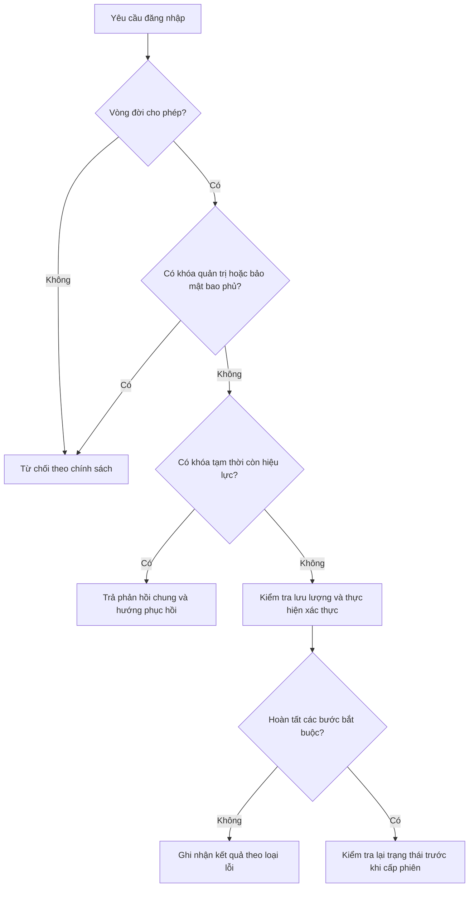

# Account lock — Khóa tài khoản trong vòng đời IAM

Khóa tài khoản là biện pháp làm gián đoạn một hoặc nhiều khả năng xác thực, sử dụng phiên hoặc truy cập của một danh tính theo chính sách đã xác định. Khi thấy thông báo “tài khoản bị khóa”, người vận hành cần biết rõ: khóa do nguyên nhân nào, có hiệu lực ở đâu, ai có quyền gỡ và điều kiện nào cho phép gỡ.

Trong nền tảng quản lý danh tính và quyền truy cập (IAM), account lock nằm ở giao điểm giữa xác thực, vòng đời tài khoản và vận hành bảo mật. Một người dùng có thể vẫn là nhân viên đang làm việc, vẫn được gán vai trò đúng, nhưng tạm thời không được đăng nhập vì xuất hiện nhiều lần xác thực thất bại. Ngược lại, một danh tính đã bị đình chỉ do quyết định quản trị không được hoạt động trở lại chỉ vì thời gian khóa chống đoán mật khẩu đã hết.

Bài học tập trung vào cách xác định phạm vi khóa, thiết kế điều kiện khóa và mở khóa, xử lý phiên đang tồn tại, đồng bộ với SSO và ghi nhận trách nhiệm kiểm toán. Các mô hình dữ liệu, thời gian và ngưỡng trong ví dụ là lựa chọn minh họa để giải thích thiết kế, không phải cấu hình chuẩn cho mọi hệ thống.

## 1. Khóa tài khoản khác gì với các thao tác vòng đời khác?

Các hệ thống có thể đặt tên trạng thái khác nhau. Điều cần thống nhất là ý nghĩa nghiệp vụ của từng thao tác.

| Thao tác | Mục đích chính | Khả năng phục hồi | Điều cần chú ý |
| --- | --- | --- | --- |
| Khóa tạm thời do xác thực thất bại | Giảm tốc độ thử bí mật trực tuyến | Có thể tự hết hạn hoặc được gỡ theo quy trình | Không chứng minh tài khoản đã bị chiếm đoạt |
| Khóa bảo mật | Ngăn tiếp tục sử dụng danh tính đang bị nghi xâm phạm | Chỉ gỡ sau khi đáp ứng điều kiện xử lý sự cố | Có thể cần chặn cả phiên và token đã cấp |
| Khóa quản trị | Thực thi một quyết định có thẩm quyền | Do người hoặc quy trình được phân quyền xử lý | Không tự hết hạn nếu chính sách không quy định |
| Vô hiệu hóa hoặc đình chỉ | Tạm ngừng tư cách hoạt động của tài khoản | Phải có quyết định kích hoạt lại | Bộ đếm đăng nhập không quyết định trạng thái này |
| Thu hồi một authenticator | Ngừng chấp nhận một phương tiện xác thực, như khóa bảo mật hoặc mật khẩu | Có thể cần đăng ký phương tiện thay thế | Không nhất thiết khóa toàn bộ danh tính |
| Thu hồi quyền | Loại bỏ role, group hoặc entitlement | Theo quy trình cấp quyền | Người dùng có thể vẫn đăng nhập được |
| Xóa hoặc kết thúc tài khoản | Kết thúc một phần vòng đời danh tính | Phụ thuộc chính sách lưu giữ và khôi phục | Không nên được dùng thay cho biện pháp khóa tạm thời |

**Ví dụ:** Lan nhập sai mật khẩu trên cổng nhân sự và bị khóa phương thức mật khẩu trong một khoảng thời gian ngắn. Việc này không tự xóa vai trò `EMPLOYEE`. Nếu Lan nghỉ việc, quy trình kết thúc tài khoản phải thu hồi quyền và các khả năng truy cập liên quan; không thể thay bằng một thời điểm `locked_until` rồi chờ nó hết hạn.

Khóa cũng không thay thế RBAC hoặc ABAC. Sau khi xác thực được phép tiếp tục, mỗi hành động vẫn phải được kiểm tra quyền trên tài nguyên đích.

## 2. Một quyết định khóa cần có những chiều nào?

### 2.1. Nguyên nhân và chủ thể ra quyết định

Tách nguyên nhân giúp hệ thống lựa chọn cách phục hồi đúng:

- `AUTH_FAILURE`: vượt ngưỡng xác thực thất bại của một chính sách.
- `SECURITY_HOLD`: nghi ngờ chiếm đoạt, lộ bí mật hoặc hoạt động bất thường cần điều tra.
- `ADMIN_HOLD`: yêu cầu quản trị đã được phê duyệt.

Không nên dùng một trường boolean `locked` làm toàn bộ thông tin về khóa. Giá trị `true` không cho biết khóa có được tự hết hạn hay không, nhân viên hỗ trợ có được gỡ hay không và có cần xử lý sự cố trước khi mở lại hay không.

### 2.2. Phạm vi thực thi

Một quyết định khóa có thể áp dụng cho:

| Phạm vi | Ví dụ | Kết quả mong muốn |
| --- | --- | --- |
| Một phương thức xác thực | Tạm chặn mật khẩu của tài khoản A | Phương thức thay thế chỉ được dùng nếu chính sách cho phép và đạt mức bảo đảm yêu cầu |
| Một ứng dụng hoặc tenant | Khóa quyền sử dụng cổng quản trị của tổ chức X | Không tự tác động tới tài khoản cùng tên trong tổ chức Y |
| Toàn bộ đăng nhập của danh tính | Chặn mọi đường đăng nhập của A | Mật khẩu, SSO và đường thay thế đều phải chịu kiểm tra tương ứng |
| Phiên và token | Chặn tiếp tục sử dụng danh tính đang bị chiếm đoạt | Cần cơ chế thu hồi hoặc từ chối tại nơi sử dụng phiên/token |

Khóa tên đăng nhập trên một màn hình không đồng nghĩa khóa danh tính trên mọi ứng dụng. Thiết kế phải chỉ rõ điểm nào ra quyết định và điểm nào cưỡng chế quyết định đó.

### 2.3. Thời hạn và điều kiện giải phóng

Một khóa tạm thời có thể có `expires_at`. Khóa cần điều tra có thể không có thời điểm tự hết hạn. Ngoài thời gian, điều kiện mở lại có thể gồm xác minh chủ tài khoản, thay bí mật bị lộ, đăng ký lại MFA, thu hồi phiên hoặc quyết định của người phụ trách sự cố.

Một bản ghi minh họa:

```text
lock_id          = lock-7f2
subject_id       = usr-184
tenant_id       = tenant-acme
reason           = AUTH_FAILURE
scope            = PASSWORD_LOGIN
created_by       = auth-policy-engine
created_at       = 2026-11-26T02:00:00Z
expires_at       = 2026-11-26T02:10:00Z
state            = OPEN
revision         = 3
policy_version   = password-policy-7
case_reference   = null
```

`subject_id` là định danh ổn định sau khi hệ thống đã phân giải tên đăng nhập. Các bí danh hợp lệ như email và username cần quy về cùng danh tính theo quy tắc định danh của hệ thống. Không tự ý viết thường hoặc biến đổi mọi loại định danh nếu nhà cung cấp danh tính không quy định như vậy.

## 3. Đừng gộp trạng thái vòng đời và khóa vào cùng một công tắc

Một mô hình đơn giản là giữ ba nhóm dữ liệu độc lập:

```text
lifecycle_status: ACTIVE | SUSPENDED | TERMINATED
lock_records: nhiều khóa có nguyên nhân, phạm vi và điều kiện riêng
access_grants: role, group, entitlement và thuộc tính phục vụ chính sách
```

Tại thời điểm đăng nhập, có thể diễn đạt một phần điều kiện cho phép như sau:

```text
được tiếp tục xác thực
    = vòng đời cho phép
      AND không có khóa còn hiệu lực bao phủ phương thức đang dùng
      AND phương thức còn được phép sử dụng
      AND yêu cầu vượt qua các kiểm soát lưu lượng liên quan
```

Đây mới là điều kiện để tiếp tục quá trình xác thực, chưa phải kết luận đã xác thực thành công hoặc đã có quyền truy cập tài nguyên.



Nếu một danh tính đồng thời có khóa tạm thời và `SECURITY_HOLD`, việc hết hạn khóa tạm thời chỉ làm mất hiệu lực khóa đó. `SECURITY_HOLD` vẫn tiếp tục chặn truy cập trong phạm vi của nó. Lệnh mở khóa phải nhắm tới bản ghi và nguyên nhân cụ thể, tránh thao tác chung kiểu “đặt tài khoản thành ACTIVE”.

## 4. Khóa chống đoán bí mật và rủi ro bị lợi dụng

Các cuộc thử đăng nhập có hình dạng khác nhau:

| Kiểu hoạt động | Dấu hiệu cơ bản | Hạn chế của một bộ đếm đơn lẻ |
| --- | --- | --- |
| Brute force vào một tài khoản | Thử nhiều bí mật cho cùng một danh tính | Đếm theo IP có thể bị vượt qua bằng nhiều nguồn |
| Password spraying | Thử ít mật khẩu phổ biến trên nhiều tài khoản | Mỗi tài khoản có thể chưa chạm ngưỡng khóa |
| Credential stuffing | Thử cặp tên đăng nhập và mật khẩu đã lộ | Một số lần thử có thể thành công ngay |
| Cố tình gây khóa | Thử sai vào tài khoản mục tiêu để chặn chủ tài khoản | Khóa quá dễ kích hoạt trở thành công cụ từ chối dịch vụ |
| Lỗi cấu hình ứng dụng | Thiết bị hoặc job tiếp tục dùng bí mật cũ | Khóa lặp lại ngay sau khi hỗ trợ vừa mở |

Theo OWASP, chính sách lockout cần xác định ngưỡng thất bại, cửa sổ quan sát và thời gian khóa; bộ đếm gắn với tài khoản giúp xử lý việc thay đổi IP. Chính sách đồng thời phải cân nhắc khả năng kẻ tấn công gây khóa người dùng hợp lệ. Xem [OWASP Authentication Cheat Sheet — Account Lockout](https://cheatsheetseries.owasp.org/cheatsheets/Authentication_Cheat_Sheet.html#account-lockout).

Từ các tình huống trên, thiết kế cho cổng nhân sự trong bài dùng nhiều lớp: giới hạn lưu lượng trước khi chạy thao tác kiểm tra bí mật tốn tài nguyên, theo dõi theo danh tính, đồng thời quan sát mẫu thử trên nhiều danh tính. IP và thiết bị là tín hiệu hỗ trợ; một IP có thể đại diện cho cả văn phòng hoặc mạng di động, còn địa chỉ nguồn có thể bị phân tán trên nhiều máy.

Khóa không chữa được việc đánh cắp một phiên đã tồn tại hoặc việc sử dụng ngay một mật khẩu đúng đã bị lộ. Vì vậy, khi nguyên nhân là nghi chiếm đoạt, cần chuyển sang luồng xử lý sự cố thay vì chỉ tăng thời gian khóa chống thử sai.

## 5. Thiết kế chính sách khóa tạm thời

### 5.1. Các tham số phải có ý nghĩa rõ ràng

Ví dụ dưới đây mô tả một chính sách phục vụ học tập:

| Thành phần | Giá trị minh họa | Ý nghĩa |
| --- | --- | --- |
| Ngưỡng | 5 lần thất bại | Lần thất bại thứ 5 kích hoạt khóa trong phạm vi đang xét |
| Cửa sổ quan sát | 10 phút trượt | Chỉ tính các thất bại thuộc 10 phút gần nhất |
| Thời gian khóa | 10 phút | Được tính từ lúc khóa được kích hoạt |
| Đường bị khóa | Đăng nhập bằng mật khẩu | Không tự kết luận mọi phương thức khác bị cấm |
| Yêu cầu trong lúc khóa | Bị từ chối, ghi nhận riêng | Không tự kéo dài thời hạn khóa bằng mỗi yêu cầu mới |
| Khi khóa hết hạn | Mở lại đường mật khẩu nếu không còn chặn khác | Không tự cấp phiên hoặc phục hồi quyền đã thu hồi |

Cửa sổ trượt khác cửa sổ cố định. Nếu dùng các khoảng cố định 10 phút, một đợt thử có thể dồn ở cuối khoảng trước và đầu khoảng sau. Nếu tài liệu gọi là “10 phút trượt” nhưng triển khai chỉ xóa bộ đếm vào các mốc tròn, ý nghĩa chính sách đã thay đổi.

Một cách giảm tốc độ khác là backoff tăng dần, chẳng hạn tăng thời gian phải chờ tới một giới hạn trên. Thiết kế vẫn cần giới hạn tổng số lần thử và định nghĩa khi nào được đặt lại bộ đếm; chỉ thêm khoảng chờ không đủ để diễn đạt mọi yêu cầu bảo vệ authenticator.

### 5.2. Khóa tạm thời khác vô hiệu hóa authenticator

NIST SP 800-63B-4, mục 3.2.2, quy định giới hạn số lần xác thực thất bại liên tiếp bằng một authenticator cụ thể; trừ yêu cầu riêng, giới hạn trên là 100 và khi vượt giới hạn phải vô hiệu hóa authenticator đó. Authenticator bị vô hiệu hóa cần được gắn lại theo quy trình phù hợp trước khi sử dụng tiếp. Đây là giới hạn trên trong phạm vi tiêu chuẩn, không phải lời khuyên đặt ngưỡng 100 cho mọi ứng dụng. Xem [NIST SP 800-63B-4 — Rate Limiting](https://pages.nist.gov/800-63-4/sp800-63b.html#rate-limiting).

Vì vậy, bộ đếm cửa sổ ngắn trong ví dụ và bộ đếm thất bại liên tiếp phục vụ chính sách authenticator có thể là hai dữ liệu khác nhau. Hết 10 phút rồi xóa mọi dấu vết thất bại sẽ không tự đáp ứng yêu cầu về giới hạn thất bại liên tiếp. Một bản thiết kế cần nêu rõ từng bộ đếm bảo vệ điều gì.

### 5.3. Xác định đúng sự kiện được đếm

Đừng gộp mọi kết quả lỗi thành “sai mật khẩu”:

- Mật khẩu sai được ghi vào luồng thất bại của phương thức mật khẩu.
- OTP sai được tính theo chính sách của bước OTP và authenticator tương ứng.
- Lỗi kết nối tới IdP hoặc timeout của kho bí mật là lỗi phụ thuộc, không phải bằng chứng người dùng nhập sai.
- Yêu cầu bị chặn trước xác thực do giới hạn lưu lượng được đo riêng.
- Gửi lại cùng một yêu cầu do retry cần có cách nhận diện phù hợp để tránh xử lý trùng kết quả.

Tương tự, mật khẩu đúng chưa có nghĩa toàn bộ đăng nhập thành công nếu MFA vẫn bắt buộc. Việc đặt lại bộ đếm nào sau một bước thành công phải được nêu rõ; không được dùng thành công của bước mật khẩu để liên tục xóa bộ đếm OTP rồi cho phép đoán không giới hạn.

## 6. Luồng xử lý đăng nhập và tính nhất quán

Trong một ứng dụng có nhiều instance, biến đếm trong bộ nhớ của từng tiến trình không tạo thành giới hạn chung. Đường web, ứng dụng di động và các đường đăng nhập khác cũng có thể cùng xác thực một danh tính.

Luồng minh họa:

```text
1. Áp dụng kiểm soát lưu lượng trước xác thực.
2. Phân giải tenant và định danh theo quy tắc của hệ thống.
3. Đọc trạng thái vòng đời, khóa và chính sách áp dụng.
4. Nếu đường xác thực bị chặn, trả phản hồi chung.
5. Thực hiện kiểm tra authenticator được phép sử dụng.
6. Ghi nhận kết quả bằng thao tác nhất quán theo danh tính/phương thức.
7. Nếu chưa hoàn tất MFA, chỉ tạo trạng thái xác thực trung gian có giới hạn.
8. Trước khi cấp phiên đầy đủ, kiểm tra lại các điều kiện đang có hiệu lực.
9. Chỉ phát hành phiên nếu quyết định cuối cùng vẫn cho phép.
```

Đây là mô hình xử lý, không phải mã máy chủ hoàn chỉnh. Việc quản lý bí mật, chống replay, bảo vệ trạng thái MFA trung gian và xác minh giao thức cần cơ chế riêng của hệ thống xác thực.

### 6.1. Cập nhật bộ đếm và khóa phải nguyên tử

Giả sử bộ đếm là 4 và ngưỡng là 5. Hai instance cùng đọc giá trị 4 rồi cùng ghi 5 có thể làm mất một sự kiện. Một instance khác có thể quyết định cấp phiên dựa trên trạng thái đã cũ.

Các thao tác ghi nhận thất bại, xác định vượt ngưỡng và tạo khóa cần có tính nguyên tử phù hợp. Có thể dùng giao dịch tại kho dữ liệu, thao tác nguyên tử của kho trạng thái dùng chung hoặc cơ chế tuần tự hóa theo danh tính. Khóa định danh cần bao gồm tenant khi các tenant có không gian tài khoản riêng.

Nếu yêu cầu sản phẩm là tuyệt đối không cho thêm lần kiểm tra bí mật nào sau ngưỡng, phải kiểm soát cả yêu cầu đang xử lý bằng cơ chế admission hoặc tuần tự hóa. Chỉ tăng bộ đếm nguyên tử sau khi kiểm tra xong vẫn có thể cho một số yêu cầu đồng thời đi qua bước kiểm tra trước khi khóa được tạo.

Không giữ một giao dịch cơ sở dữ liệu kéo dài qua toàn bộ cuộc gọi tới IdP hoặc quá trình xác minh mật khẩu tốn tài nguyên. Có thể kiểm tra bí mật ngoài giao dịch ngắn, sau đó dùng phiên bản trạng thái để xác nhận kết quả vẫn áp dụng được. Nếu credential đã bị thay hoặc tài khoản vừa nhận khóa bảo mật, kết quả từ ảnh chụp cũ không được tự động cấp phiên.

### 6.2. Cấp phiên và thay đổi trạng thái có thể cạnh tranh

Tình huống cần xử lý:

```text
T1: yêu cầu A xác minh thành công trên dữ liệu cũ
T2: SOC tạo SECURITY_HOLD cho cùng danh tính
T3: yêu cầu A chuẩn bị phát hành phiên
```

Tại T3, hệ thống cần nhìn thấy quyết định ở T2 hoặc có cơ chế khiến phiên vừa cấp không thể được dùng sau điểm có hiệu lực đã cam kết. Kiểm tra trạng thái chỉ ở đầu yêu cầu là chưa đủ.

Một lựa chọn thiết kế là gắn phiên với phiên bản bảo mật của danh tính và kiểm tra phiên bản tại nơi sử dụng. Lựa chọn khác là kho phiên tập trung và thu hồi có kiểm soát. Mỗi lựa chọn cần mô tả độ trễ áp dụng và hành vi khi không đọc được trạng thái; không nên hứa “khóa ngay lập tức trên toàn hệ thống” nếu các điểm cưỡng chế chỉ đồng bộ định kỳ.

### 6.3. Hết hạn phải có hiệu lực ngay trong phép kiểm tra

Với khóa có thời hạn, điều kiện còn hiệu lực có thể là:

```text
state == OPEN
AND (expires_at chưa được đặt OR thời_gian_máy_chủ < expires_at)
```

Đồng hồ phía máy chủ hoặc kho dữ liệu là nguồn tham chiếu; không dùng đồng hồ do trình duyệt gửi lên. Job nền có thể chuyển các bản ghi hết hạn sang trạng thái phục vụ báo cáo, nhưng việc cho phép đăng nhập không nên phụ thuộc hoàn toàn vào việc job có chạy đúng phút hay không.

## 7. Mở khóa là một thao tác có phân quyền

Mở khóa thay đổi khả năng sử dụng danh tính, nên cần xác định rõ ai được thao tác và bằng chứng nào được chấp nhận.

| Chủ thể | Phạm vi ví dụ | Giới hạn cần thực thi |
| --- | --- | --- |
| Người dùng | Tự phục hồi khóa tạm thời qua đường đã đăng ký | Phải hoàn tất xác minh; không được tự gỡ khóa điều tra |
| Nhân viên hỗ trợ | Gỡ `AUTH_FAILURE` cho người dùng thuộc tenant được giao | Không tự cấp lại role, tắt MFA hoặc sửa trạng thái nghỉ việc |
| Nhân viên SOC | Giải phóng `SECURITY_HOLD` trong vụ việc phụ trách | Cần căn cứ xử lý sự cố và kiểm toán tương ứng |
| Quản trị danh tính | Xử lý khóa quản trị trong phạm vi được cấp | Tài khoản đặc quyền có thể cần người phê duyệt độc lập |
| Policy engine | Cho khóa tạm thời hết hiệu lực theo thời gian | Không được gỡ khóa có nguyên nhân khác |

RBAC có thể cung cấp quyền như `account.lock.release.auth_failure`. ABAC có thể bổ sung điều kiện người thực hiện thuộc đúng tổ chức, tài khoản đích thuộc phạm vi quản lý và vụ việc đang ở trạng thái được xử lý. Có một role hỗ trợ không đồng nghĩa được phép mở mọi tài khoản trong mọi tenant.

### 7.1. Quy trình mở khóa thủ công

1. Xác thực nhân viên thực hiện và kiểm tra quyền trên tài khoản đích.
2. Đọc lại khóa hiện tại, nguyên nhân, phạm vi và phiên bản bản ghi.
3. Xác minh yêu cầu phục hồi theo quy trình; không coi việc biết email hoặc mã nhân viên là đủ bằng chứng sở hữu tài khoản.
4. Xử lý nguyên nhân còn tồn tại, ví dụ một thiết bị vẫn dùng mật khẩu cũ hoặc một phiên nghi bị đánh cắp.
5. Giải phóng đúng khóa đủ điều kiện, ghi nhận người thực hiện và căn cứ.
6. Thông báo qua kênh đã xác minh và yêu cầu đăng nhập lại theo chính sách.

Nếu một khóa mới xuất hiện trong lúc nhân viên hỗ trợ thao tác, lệnh cũ không được vô tình xóa khóa mới. Điều kiện cập nhật theo `lock_id`, tenant và `revision` giúp phát hiện tình huống đó.

Ví dụ SQL dưới đây chỉ thể hiện **tự giải phóng một khóa chống thử sai đã hết hạn**; không phải API mở khóa đầy đủ:

```sql
UPDATE account_lock
SET state = 'RELEASED',
    released_at = CURRENT_TIMESTAMP,
    released_by = :policy_engine_id,
    revision = revision + 1
WHERE lock_id = :lock_id
  AND tenant_id = :tenant_id
  AND subject_id = :subject_id
  AND revision = :expected_revision
  AND state = 'OPEN'
  AND reason = 'AUTH_FAILURE'
  AND expires_at IS NOT NULL
  AND expires_at <= CURRENT_TIMESTAMP;
```

Phía gọi phải kiểm tra số dòng cập nhật. Nếu không có dòng nào, đọc lại trạng thái và xác định nguyên nhân; không mặc nhiên báo mở khóa thành công. Việc giải phóng một khóa cũng không chứng minh toàn bộ tài khoản đã được phép truy cập, vì có thể còn khóa khác hoặc trạng thái vòng đời không cho phép.

### 7.2. Tự phục hồi không được trở thành đường vượt khóa

Với thiết kế minh họa, token mở khóa có thể gắn với tài khoản, mục đích, bản ghi khóa hoặc phiên bản trạng thái. Token hết hiệu lực sau khi dùng hoặc khi điều kiện liên quan đã thay đổi. Một token phát hành trước lúc xuất hiện khóa bảo mật không được gỡ khóa bảo mật mới.

Đối với cơ chế dùng token qua email hoặc kênh phục hồi, OWASP yêu cầu chú ý tính khó đoán, thời hạn, sử dụng một lần và kiểm soát lưu lượng. Việc gửi yêu cầu quên mật khẩu không nên tự làm tài khoản bị khóa, vì người ngoài có thể lợi dụng để gây gián đoạn. Xem [OWASP Forgot Password Cheat Sheet](https://cheatsheetseries.owasp.org/cheatsheets/Forgot_Password_Cheat_Sheet.html).

Đổi mật khẩu và mở khóa là hai kết quả khác nhau. Quy trình có thể kết hợp chúng khi được thiết kế rõ, nhưng đổi mật khẩu không tự gỡ quyết định đình chỉ, không tự tắt MFA và không tự khôi phục quyền đã thu hồi.

## 8. Khóa ảnh hưởng thế nào tới phiên và token?

Có ít nhất ba quyết định độc lập:

1. Có cho bắt đầu hoặc hoàn tất đăng nhập mới không?
2. Có cho sử dụng phiên hoặc access token đã cấp không?
3. Có cho dùng refresh token để tiếp tục nhận token mới không?

Một cờ khóa chỉ được đọc tại màn hình đăng nhập không xử lý hai quyết định sau.

| Tình huống | Cách xử lý minh họa | Điều phải đánh giá |
| --- | --- | --- |
| Gõ sai mật khẩu nhiều lần, chưa có dấu hiệu xâm phạm | Chặn đường mật khẩu; có thể giữ phiên hợp lệ hiện hữu | Việc hủy mọi phiên có thể giúp kẻ gây khóa mở rộng tác động |
| Nghi tài khoản bị chiếm đoạt | Chặn đăng nhập theo phạm vi sự cố, thu hồi phiên và refresh token liên quan | Access token còn hiệu lực ở API nào và trong bao lâu? |
| Khóa chỉ trong một ứng dụng | Cưỡng chế tại ứng dụng và API liên quan | Các ứng dụng khác có thuộc phạm vi quyết định không? |
| Khóa danh tính đặc quyền | Hạn chế truy cập quản trị và xử lý các phiên đặc quyền | Có đường quản trị dự phòng được kiểm soát khi cần xử lý sự cố không? |

Thu hồi phiên cần hành động ở phía máy chủ hoặc tại điểm kiểm tra phiên. Xóa cookie trên một trình duyệt không làm mất hiệu lực bản sao của một thông tin phiên đã bị lấy cắp. Xem [OWASP Session Management Cheat Sheet — Session Expiration](https://cheatsheetseries.owasp.org/cheatsheets/Session_Management_Cheat_Sheet.html#session-expiration).

Với JWT được API kiểm tra hoàn toàn ngoại tuyến, thay đổi trạng thái tài khoản không tự sửa token đã ký. Thiết kế có thể phối hợp access token sống ngắn, kiểm tra trạng thái trực tuyến, danh sách thu hồi hoặc phiên bản bảo mật có nguồn trạng thái được cập nhật. Nhúng một con số phiên bản vào token mà API không đối chiếu với trạng thái hiện tại thì chưa tạo ra cơ chế thu hồi.

Một chỉ tiêu vận hành có ích là “thời gian từ lúc khóa bảo mật được chấp nhận tới lúc các điểm truy cập liên quan từ chối”. Chỉ tiêu này phải gắn với đường kiểm tra thực tế, thời hạn cache và khả năng phát hiện lỗi đồng bộ.

## 9. Account lock trong SSO và liên kết danh tính

Trong SSO, IdP xác thực người dùng và ứng dụng dựa vào kết quả xác thực đó. Hai hệ thống có thể có trạng thái hoạt động riêng:

- IdP chưa khóa người dùng nhưng ứng dụng đang khóa tài khoản cục bộ của người đó.
- IdP đã khóa người dùng nhưng ứng dụng vẫn giữ một phiên từ trước.
- Ứng dụng cho phép cả SSO và mật khẩu cục bộ, trong khi lệnh khóa mới được áp dụng ở một đường.

Kết quả OIDC hợp lệ chỉ chứng minh kết quả xác thực theo giao thức và các điều kiện đã kiểm tra. Ứng dụng vẫn cần quyết định tài khoản cục bộ có được hoạt động hay không trước khi cấp phiên của mình. Callback SSO không được trở thành đường bỏ qua khóa toàn danh tính hoặc trạng thái `SUSPENDED`.

Ngược lại, một khóa chỉ có phạm vi `PASSWORD_LOGIN` có thể cho phép authenticator thay thế đã đăng ký tiếp tục hoạt động nếu chính sách chấp nhận. Đây phải là quyết định rõ ràng dựa trên mức bảo đảm, không phải hệ quả ngẫu nhiên vì một đường đăng nhập quên đọc trạng thái khóa.

Với tài khoản có nhiều danh tính liên kết, cần xác định khóa áp dụng cho tài khoản nội bộ hay chỉ cho một liên kết. Trong các hệ thống OIDC, thông tin như cặp issuer và subject giúp phân biệt danh tính từ nhà phát hành; không dùng email trùng nhau làm căn cứ duy nhất để kết luận hai danh tính là một.

Thông báo khóa giữa IdP và ứng dụng có thể giúp đồng bộ, nhưng cần tính tới sự kiện trễ, mất hoặc đến sai thứ tự. Mỗi bên phải biết nguồn có thẩm quyền cho từng loại trạng thái và thực thi quyết định trong phạm vi của mình.

## 10. Danh tính workload và tài khoản đặc quyền

### 10.1. Workload có thể bị khóa liên tục bởi chính quá trình retry

Giả sử một dịch vụ đồng bộ vẫn dùng mật khẩu cũ sau đợt xoay bí mật. Mỗi instance retry làm tăng thất bại và có thể liên tục khóa tài khoản dịch vụ. Mở khóa mà không sửa cấu hình sẽ chỉ lặp lại sự cố.

Luồng xử lý phù hợp với tình huống này gồm xác định workload phát sinh lỗi, dừng hoặc giới hạn retry, thay cấu hình dùng bí mật mới, kiểm tra credential bị lộ nếu có và chỉ sau đó giải phóng khóa đủ điều kiện. Chủ sở hữu workload phải được xác định từ trước; không dùng quy trình “gửi email cho chủ tài khoản để đặt lại mật khẩu” như đối với người dùng cuối.

Nơi hạ tầng hỗ trợ, danh tính workload với credential ngắn hạn và phạm vi quyền hẹp giúp giảm phụ thuộc vào một mật khẩu dùng chung lâu dài. Dù dùng cơ chế nào, cần biết thao tác khóa sẽ làm gián đoạn những job hoặc dịch vụ nào.

### 10.2. Đặc quyền cao cần kiểm soát quyền mở khóa chặt hơn

Người có thể mở khóa tài khoản quản trị có khả năng phục hồi một đường truy cập nhạy cảm. Phân quyền theo nguyên tắc ít quyền nhất cần áp dụng cho cả thao tác này: phạm vi tài khoản đích, nguyên nhân khóa được xử lý và mức xác minh bổ sung.

Một tổ chức có thể yêu cầu phê duyệt độc lập cho việc giải phóng khóa bảo mật của quản trị viên. Nếu có tài khoản truy cập khẩn cấp, đường đó cần được bảo vệ, kiểm toán và diễn tập riêng; sự tồn tại của nó không phải lý do bỏ mọi kiểm soát khóa cho các tài khoản quản trị thông thường.

## 11. Thông báo cho người dùng và kiểm toán

### 11.1. Phản hồi công khai và thông tin vận hành có mục tiêu khác nhau

Trước khi chứng minh quyền kiểm soát tài khoản, một thông báo chi tiết như “email tồn tại và đang bị SOC khóa” có thể tiết lộ thông tin về danh tính. Có thể dùng thông báo chung:

> Không thể hoàn tất đăng nhập. Hãy thử lại sau hoặc sử dụng kênh hỗ trợ khôi phục tài khoản.

Thông tin phục hồi cụ thể hơn được cung cấp qua kênh phù hợp sau xác minh. Thiết kế cũng cần xét khác biệt trong mã trạng thái, nội dung phản hồi và thời gian xử lý; chỉ đổi một dòng chữ chưa bao quát mọi khả năng suy đoán trạng thái tài khoản.

Khi cần mô phỏng kiểm tra mật khẩu cho định danh không tồn tại để giảm khác biệt thời gian, vẫn phải có giới hạn lưu lượng và chi phí. Không nên biến cơ chế bảo vệ chống dò tài khoản thành điểm tiêu tốn tài nguyên không giới hạn.

### 11.2. Sự kiện kiểm toán cần trả lời được ai, làm gì, vì sao

Ví dụ sự kiện mở một khóa tạm thời:

```json
{
  "event_type": "account_lock_released",
  "event_id": "evt-8c1",
  "occurred_at": "2026-11-26T02:10:01Z",
  "tenant_id": "tenant-acme",
  "subject_id": "usr-184",
  "lock_id": "lock-7f2",
  "reason": "AUTH_FAILURE",
  "scope": "PASSWORD_LOGIN",
  "actor_id": "auth-policy-engine",
  "release_method": "EXPIRED",
  "policy_version": "password-policy-7",
  "correlation_id": "req-b31",
  "outcome": "RELEASED"
}
```

Sự kiện trên chỉ khẳng định một khóa đã được giải phóng. Không suy diễn `outcome: RELEASED` thành “tài khoản chắc chắn đăng nhập được”, vì còn các điều kiện khác.

Với thao tác thủ công, thêm định danh nhân viên, căn cứ hoặc mã vụ việc và phê duyệt nếu chính sách yêu cầu. Không ghi mật khẩu, OTP, recovery token hoặc token phiên nguyên vẹn vào log. Quyền đọc log và thời hạn lưu giữ cũng cần phù hợp với dữ liệu danh tính được ghi nhận.

Nếu việc thay đổi trạng thái và phát sự kiện đi qua hai hệ thống khác nhau, cần xử lý khả năng một bên thành công còn bên kia thất bại. Có thể ghi trạng thái và bản ghi sự kiện vào cùng giao dịch, sau đó chuyển sự kiện bằng cơ chế outbox. Consumer cần xử lý trùng và kiểm tra phiên bản để tránh một sự kiện mở khóa cũ lấn át khóa mới.

### 11.3. Chỉ số giúp phân biệt tấn công và lỗi vận hành

Theo dõi số lần khóa theo nguyên nhân, tỷ lệ người dùng bị ảnh hưởng, thời gian phục hồi, số lần khóa lặp lại sau khi mở và độ trễ cưỡng chế khóa bảo mật. Một đợt khóa tập trung ở tài khoản workload sau thời điểm triển khai có thể gợi ý lỗi cấu hình; một mẫu thất bại rải trên nhiều người dùng có thể cần điều tra password spraying.

Số lần khóa cao không tự chứng minh chính sách tốt. Có thể chính sách đang gây gián đoạn cho người dùng hợp lệ. Các chỉ số phải được đọc cùng kết quả xác minh, lưu lượng thất bại và tình hình hỗ trợ.

## 12. Ví dụ xuyên suốt: một tài khoản có hai nguyên nhân bị chặn

Cổng nhân sự của công ty dùng SSO và một đường mật khẩu phục hồi được quản lý riêng. Mai có tài khoản vòng đời `ACTIVE` và role `EMPLOYEE`.

| Thời điểm | Sự kiện | Trạng thái và cách xử lý |
| --- | --- | --- |
| 09:00–09:04 | Có 5 lần sai mật khẩu trong cửa sổ minh họa | Tạo khóa `AUTH_FAILURE` cho `PASSWORD_LOGIN` tới 09:14 |
| 09:06 | SOC nhận bằng chứng một phiên của Mai đã bị đánh cắp | Tạo `SECURITY_HOLD` bao phủ truy cập; xử lý phiên và token liên quan |
| 09:08 | Mai liên hệ hỗ trợ để mở khóa | Hỗ trợ xác minh yêu cầu nhưng không có quyền gỡ khóa bảo mật |
| 09:14 | Khóa tạm thời hết thời hạn | Đường mật khẩu hết khóa thử sai; tài khoản vẫn bị `SECURITY_HOLD` chặn |
| 09:20 | Quy trình xử lý sự cố hoàn tất các điều kiện cần thiết | SOC giải phóng đúng khóa bảo mật, ghi nhận căn cứ và người thực hiện |
| 09:22 | Mai đăng nhập lại và hoàn tất MFA | Ứng dụng kiểm tra vòng đời, khóa và quyền hiện tại trước khi cho truy cập |

Nếu chỉ dùng một trường `locked_until`, hệ thống có thể tự mở mọi đường truy cập lúc 09:14 dù sự cố chưa được xử lý. Nếu nhân viên hỗ trợ có nút “mở mọi khóa” không phân biệt nguyên nhân, cùng một sai sót có thể xảy ra sớm hơn.

Role `EMPLOYEE` không được tự thêm lại bởi thao tác mở khóa. Nếu trong thời gian đó quyền của Mai đã thay đổi theo một quy trình khác, quyết định truy cập phải dùng dữ liệu quyền hiện tại.

## 13. Những lỗi thiết kế thường gặp

| Lỗi | Hệ quả | Cách diễn đạt thiết kế rõ hơn |
| --- | --- | --- |
| Chỉ lưu `locked = true/false` | Không phân biệt được nguyên nhân và quyền giải phóng | Lưu nguyên nhân, phạm vi, thời hạn và chủ thể chịu trách nhiệm |
| Cứ có yêu cầu mới là gia hạn khóa | Kẻ ngoài có thể giữ tài khoản bị khóa liên tục | Định nghĩa riêng cách xử lý yêu cầu trong lúc khóa |
| Chỉ đếm theo từng IP | Không thấy một danh tính bị thử từ nhiều nguồn | Kết hợp trạng thái theo danh tính với kiểm soát nguồn và hành vi |
| Mỗi instance có một bộ đếm | Giới hạn bị chia nhỏ theo số instance | Dùng trạng thái chung và thao tác cập nhật nhất quán |
| Mở khóa bằng cách đặt vòng đời thành `ACTIVE` | Có thể kích hoạt lại tài khoản đã bị đình chỉ | Chỉ giải phóng đúng bản ghi khóa được phép |
| Tắt MFA để “giúp người dùng vào nhanh” | Hạ mức bảo đảm của quá trình phục hồi | Xử lý mở khóa và thay authenticator bằng các điều kiện riêng |
| Chỉ chặn màn hình đăng nhập mật khẩu | SSO hoặc đường thay thế có thể bỏ qua khóa toàn danh tính | Áp dụng phạm vi khóa tại mọi đường có liên quan |
| Khóa tài khoản nhưng giữ nguyên mọi phiên khi nghi xâm phạm | Phiên bị đánh cắp vẫn có thể hoạt động | Định nghĩa hành vi thu hồi và thời gian cưỡng chế |
| Tự mở khóa mà không điều tra retry từ workload | Khóa tái xuất hiện và dịch vụ tiếp tục gián đoạn | Xử lý nguồn dùng credential lỗi trước khi mở |
| Ghi nhận thành công dù cập nhật không tác động dòng nào | Báo cáo khác trạng thái thực tế | Kiểm tra kết quả cập nhật và đọc lại khi có xung đột |

Account lock hiệu quả cần một quyết định có nguyên nhân, phạm vi và điều kiện phục hồi rõ ràng. Khi thực hiện đúng, cơ chế này hạn chế khả năng lạm dụng mà vẫn giữ được trách nhiệm vận hành: khóa nào còn hiệu lực, ai có quyền giải phóng, phiên nào phải bị chặn và bằng chứng nào chứng minh thay đổi đã được thực thi.
