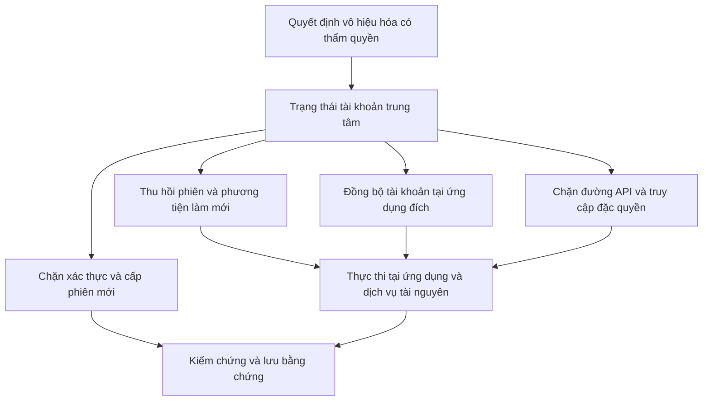

# Account disable — Vô hiệu hóa tài khoản

## 1. Mục tiêu và phạm vi

Trong vòng đời tài khoản, **account disable** là thao tác chuyển tài khoản sang trạng thái không được phép sử dụng để truy cập hệ thống. Tài khoản thường vẫn tồn tại để giữ liên kết với dữ liệu nghiệp vụ, lịch sử thay đổi, người sở hữu và bằng chứng kiểm toán.

Điểm cốt lõi của bài học này là: **đổi trạng thái tài khoản ở một nơi chưa đủ chứng minh rằng mọi đường truy cập đã bị chặn**. Một người có thể đang giữ phiên đăng nhập tại ứng dụng, access token, refresh token, khóa API hoặc kết nối dài hạn. Hiệu quả vô hiệu hóa phụ thuộc vào cách từng thành phần kiểm tra trạng thái và thu hồi quyền sử dụng các phương tiện đó.

Sau bài học, người học có thể:

- Phân biệt vô hiệu hóa với khóa đăng nhập tạm thời, xóa tài khoản và gỡ quyền.
- Thiết kế luồng vô hiệu hóa bao gồm đăng nhập mới, phiên hiện có, token và tài khoản tại các hệ thống đích.
- Xử lý các tình huống nghỉ việc, nghi ngờ bị chiếm tài khoản và thay đổi trách nhiệm.
- Xác định thời điểm truy cập thực sự bị chặn, ghi nhận ngoại lệ và kiểm chứng kết quả.
- Mở lại tài khoản theo quy trình có kiểm soát mà không vô tình khôi phục quyền hoặc phiên cũ.

Bài học nằm trong nền tảng IAM: việc vô hiệu hóa phải phối hợp với xác thực, quản lý phiên, SSO, OAuth/OIDC, phân quyền và kiểm toán. Nội dung tập trung vào tài khoản người dùng; các lưu ý về danh tính workload chỉ nhằm xử lý những phụ thuộc liên quan khi vô hiệu hóa tài khoản đó.

## 2. Vô hiệu hóa thay đổi điều gì?

### 2.1. Tồn tại tài khoản không đồng nghĩa được phép truy cập

Một bản ghi tài khoản có thể vẫn chứa mã định danh, tên hiển thị, nhóm, vai trò và liên kết dữ liệu sau khi bị vô hiệu hóa. Trạng thái tài khoản phải tham gia vào quyết định truy cập để những thuộc tính còn lưu không trở thành quyền đang có hiệu lực.

Mô hình tư duy đơn giản:

```text
Cho phép truy cập khi:
    danh tính và thông tin xác thực hợp lệ
    VÀ trạng thái tài khoản cho phép truy cập
    VÀ phiên hoặc token còn được chấp nhận
    VÀ chính sách cho phép hành động trên tài nguyên
```

Đây là mô hình khái niệm, không phải yêu cầu mọi hệ thống phải truy vấn cơ sở dữ liệu tài khoản trong từng request. Hệ thống có thể sử dụng dữ liệu trạng thái được phân phối hoặc cơ chế thu hồi tương đương, miễn có giới hạn độ trễ rõ ràng và không bỏ sót đường truy cập.

RBAC trả lời tài khoản có vai trò nào; ABAC có thể xét trạng thái, đơn vị, thiết bị hoặc điều kiện khác. Dù sử dụng mô hình nào, trạng thái `DISABLED` phải dẫn đến từ chối trên các đường truy cập thuộc phạm vi vô hiệu hóa. Việc tài khoản còn vai trò `admin` trong kho dữ liệu không được phép vượt qua điều kiện này.

### 2.2. Phân biệt các thao tác gần nhau

Tên gọi cụ thể thay đổi giữa các sản phẩm. Khi tích hợp, cần kiểm tra hành vi thực tế thay vì suy ra từ tên nút trên giao diện.

| Thao tác | Mục đích chính | Điểm cần nhớ |
|---|---|---|
| Vô hiệu hóa tài khoản | Ngừng khả năng sử dụng tài khoản theo quyết định quản trị hoặc chính sách | Có thể giữ bản ghi, dữ liệu và lịch sử; cần xử lý cả truy cập đang tồn tại |
| Khóa do đăng nhập thất bại | Hạn chế thử mật khẩu hoặc xử lý tín hiệu xác thực bất thường | Có thể tự hết hạn; thường không thay thế quy trình vô hiệu hóa |
| Gỡ nhóm hoặc vai trò | Thu hồi một tập quyền | Tài khoản có thể vẫn đăng nhập và sử dụng quyền đến từ nguồn khác |
| Thu hồi phiên hoặc token | Chấm dứt một hay nhiều phương tiện truy cập | Nếu tài khoản vẫn hoạt động, người dùng có thể xác thực để lấy phương tiện mới |
| Xóa tài khoản | Loại bỏ bản ghi theo chính sách vòng đời dữ liệu | Không tự chứng minh rằng token, tài khoản đích hay khóa truy cập đã hết hiệu lực |
| Lưu trữ tài khoản | Giữ dữ liệu phục vụ tra cứu hoặc lưu giữ | Phải quy định riêng tài khoản có còn được phép truy cập hay không |

Ví dụ: khóa đăng nhập trong 15 phút sau nhiều lần nhập sai mật khẩu không phù hợp để xử lý nhân viên nghỉ việc. Đổi mật khẩu cũng không tương đương vô hiệu hóa: phiên hiện có, token hoặc phương thức xác thực khác có thể tiếp tục hoạt động tùy thiết kế.

## 3. Những tình huống cần vô hiệu hóa

### 3.1. Nghỉ việc hoặc chấm dứt hợp đồng

Tài khoản bị vô hiệu hóa tại thời điểm hiệu lực do quy trình nhân sự và người có thẩm quyền xác nhận. Hệ thống cần phân biệt thời điểm nhận yêu cầu, thời điểm yêu cầu được lên lịch và thời điểm phải bắt đầu chặn truy cập.

Một người nghỉ lúc 17:00 không có nghĩa worker đồng bộ chạy vào sáng hôm sau là đáp ứng yêu cầu. Ngược lại, với lịch nghỉ đã duyệt trong tương lai, vô hiệu hóa ngay khi nhận sự kiện có thể ngăn họ hoàn tất công việc được phép.

### 3.2. Nghi ngờ tài khoản bị chiếm quyền

Tổ chức có thể cần vô hiệu hóa khẩn cấp để ngăn đăng nhập mới, thu hồi phiên và hạn chế thiệt hại. Phạm vi xử lý phải bao gồm các phương tiện truy cập có khả năng đã bị lộ, cùng việc bảo toàn bằng chứng phục vụ điều tra.

Chỉ thu hồi một phiên quan sát được là chưa đủ nếu kẻ tấn công còn giữ refresh token hoặc khóa API. Sau khi khống chế truy cập, nhóm ứng phó tiếp tục xác định dữ liệu đã bị truy cập, quyền đã bị thay đổi và thông tin xác thực nào cần thay thế.

### 3.3. Tài khoản không còn nhu cầu sử dụng

Tài khoản nhà thầu hết hạn, tài khoản thử nghiệm đã kết thúc hoặc tài khoản không còn chủ sở hữu là những ứng viên cho quy trình vô hiệu hóa. Cần dựa trên chủ sở hữu, thời hạn và chính sách được xác nhận; một dấu thời gian đăng nhập cũ chưa phản ánh đầy đủ việc tài khoản có đang được dùng qua API hay tác vụ nền hay không.

Chuyển nhóm hoặc đổi vị trí thường đòi hỏi điều chỉnh quyền. Chỉ vô hiệu hóa toàn bộ khi quyết định nghiệp vụ hoặc yêu cầu an ninh thực sự cần ngừng toàn bộ truy cập của tài khoản.

## 4. Các lớp truy cập phải được xử lý

Giả sử một người dùng có tài khoản tại nhà cung cấp danh tính, đăng nhập SSO vào cổng nội bộ, có phiên riêng ở ứng dụng SaaS và dùng khóa API cho một công cụ tự động hóa. Vô hiệu hóa tài khoản tại nhà cung cấp danh tính chỉ tác động trực tiếp đến những quyết định mà hệ thống đó kiểm soát.



Sơ đồ thể hiện các trách nhiệm cần phối hợp. Thứ tự chạy cụ thể có thể song song, nhưng kết quả cuối cùng phải được xác nhận cho từng hệ thống.

| Lớp | Tác động cần đạt | Điều không nên mặc định |
|---|---|---|
| Kho danh tính hoặc IdP | Từ chối xác thực và những lần cấp mới thuộc tài khoản bị vô hiệu hóa | Thay đổi tại IdP tự động đóng mọi phiên của ứng dụng |
| Phiên tại IdP | Ngừng dùng phiên IdP để tiếp tục SSO theo phạm vi yêu cầu | Phiên ứng dụng sẽ hết ngay khi phiên IdP bị xóa |
| Phiên ứng dụng | Phiên hiện có không tiếp tục thực hiện thao tác được bảo vệ | Cookie biến mất trên trình duyệt là bằng chứng duy nhất cần có |
| Refresh token và grant liên quan | Không cho tiếp tục nhận token mới qua đường bị thu hồi | Chặn đăng nhập bằng mật khẩu đồng thời chặn mọi luồng làm mới |
| Access token | Dịch vụ tài nguyên từ chối trong thời hạn chặn truy cập đã cam kết | Token có chữ ký đúng chứng minh tài khoản hiện vẫn hoạt động |
| Tài khoản tại hệ thống đích | Bị vô hiệu hóa hoặc bị chặn bằng biện pháp tương đương | SSO là đường đăng nhập duy nhất của hệ thống đích |
| Khóa API, PAT, khóa SSH, chứng thư gắn với cá nhân | Không còn mở đường truy cập trong phạm vi thu hồi | Tất cả các loại khóa đều được quản lý bởi IdP |
| VPN, PAM, kết nối dài hạn | Chặn mở kết nối mới và xử lý kết nối đang tồn tại | Chặn đăng nhập mới sẽ tự kết thúc kết nối đã mở |

Danh mục này phải điều chỉnh theo kiến trúc thực tế. Không phải hệ thống nào cũng có tất cả các loại phương tiện truy cập trên.

### 4.1. SSO không xóa trách nhiệm quản lý phiên của ứng dụng

Một ứng dụng có thể xác thực người dùng qua IdP rồi tạo phiên riêng kéo dài nhiều giờ. Nếu ứng dụng không nhận thông báo thu hồi, không kiểm tra trạng thái và không có cơ chế hủy phiên, người dùng vẫn có thể thao tác bằng phiên đã tạo.

Ngoài ra, ứng dụng đích có thể cho đăng nhập bằng mật khẩu cục bộ, mã khôi phục hoặc phương thức khác. Quy trình phải xác định các đường này và bảo đảm chúng cũng chịu quyết định vô hiệu hóa. Việc vô hiệu hóa liên kết SSO đơn lẻ có thể để nguyên một tài khoản cục bộ vẫn sử dụng được.

### 4.2. OAuth/OIDC: dừng cấp mới và dừng sử dụng là hai việc khác nhau

Khi có OAuth/OIDC, cần kiểm tra hành vi của authorization server và dịch vụ tài nguyên đối với:

1. Yêu cầu xác thực hoặc cấp token mới sau thời điểm vô hiệu hóa.
2. Refresh token được cấp trước đó, gồm các nhánh liên quan theo mô hình quản lý token của hệ thống.
3. Access token đã được phát hành và vẫn còn hạn.
4. Phiên ứng dụng được tạo từ quá trình đăng nhập trước đó.

ID token mô tả kết quả xác thực tại một thời điểm; không dùng nó thay access token để gọi API, cũng không xem nó là bằng chứng liên tục rằng tài khoản hiện còn hoạt động.

Với access token JWT được dịch vụ tài nguyên chỉ kiểm tra chữ ký và thời hạn, thay đổi tài khoản tại IdP có thể chưa được quan sát cho tới khi token hết hạn. Hệ thống cần cơ chế bổ sung nếu thời gian đó dài hơn yêu cầu nghiệp vụ: kiểm tra trạng thái, kiểm tra phiên bản bảo mật, danh sách thu hồi hoặc một phương án phù hợp khác.

Token opaque kết hợp introspection có thể hỗ trợ kiểm tra hiệu lực tập trung, nhưng chỉ hữu ích cho bài toán này khi kết quả phản ánh trạng thái vô hiệu hóa và bộ nhớ đệm không giữ kết quả cho phép quá lâu. Kiểu định dạng token tự nó không bảo đảm khả năng thu hồi tức thời.

### 4.3. Quyền được giữ lại và quyền đang có hiệu lực

Đôi khi tổ chức giữ thông tin nhóm hoặc vai trò để điều tra hay đối soát. Điều đó chỉ an toàn khi mọi đường sử dụng đều thực thi trạng thái tài khoản. Một ứng dụng bỏ qua trạng thái có thể tiếp tục diễn giải nhóm cũ thành quyền truy cập.

Gỡ nhóm là một lớp bổ sung, không thay thế chặn tài khoản và xử lý phiên. Với quyền đặc quyền hoặc quyền không còn nhu cầu, cần thu hồi theo chính sách thay vì dựa hoàn toàn vào trạng thái lưu giữ.

## 5. Mô hình trạng thái và dữ liệu tối thiểu

Nên phân biệt **trạng thái cho phép truy cập của tài khoản** với **tiến độ công việc vô hiệu hóa**. Nếu dùng một trường duy nhất cho cả hai, trạng thái “đang xử lý” có thể bị diễn giải nhầm thành vẫn được truy cập.

Ví dụ minh họa dữ liệu nội bộ:

```json
{
  "accountId": "usr-7f42",
  "accessState": "DISABLED",
  "disabledAt": "2026-11-26T10:00:00+07:00",
  "reasonCode": "EMPLOYMENT_ENDED",
  "requestId": "offboard-4821",
  "securityVersion": 18,
  "propagationState": "IN_PROGRESS"
}
```

Đây là mô hình minh họa, không phải định dạng bắt buộc hay hợp đồng của một sản phẩm IAM.

- `accountId` là mã định danh ổn định; không nên dùng email làm khóa liên kết duy nhất vì email có thể đổi hoặc được cấp lại.
- `accessState` quyết định tài khoản có được tiếp tục truy cập hay không.
- `disabledAt`, `reasonCode`, `requestId` liên kết quyết định với thời điểm, lý do và hồ sơ xử lý.
- `securityVersion` là một cách mô hình hóa thế hệ hiệu lực; nó chỉ có tác dụng nếu thành phần thực thi thực sự đối chiếu và xử lý phiên bản cũ.
- `propagationState` mô tả tiến độ ở các hệ thống liên quan, không biến kết quả một phần thành hoàn tất.

Có thể quản lý tiến độ công việc theo các trạng thái sau:

```text
REQUESTED -> CENTRAL_BLOCK_APPLIED -> PROPAGATING -> VERIFIED
                                  -> ACTION_REQUIRED
```

`ACTION_REQUIRED` nghĩa là có thành phần chưa chặn được hoặc chưa có bằng chứng xác nhận. Nó không phải lý do tự mở lại tài khoản trung tâm. Kết quả từng đích cần được lưu riêng để biết chính xác đích nào đang lỗi.

## 6. Quy trình vô hiệu hóa có kiểm soát

### Bước 1: Xác nhận đúng tài khoản, thẩm quyền và thời điểm

Yêu cầu cần nêu rõ mã tài khoản, người hoặc hệ thống khởi tạo, lý do, thời điểm hiệu lực và người có thẩm quyền quyết định. Với sự kiện nhân sự, cần đối chiếu định danh nhân sự với định danh IAM để tránh vô hiệu hóa nhầm người có tên giống nhau.

Quyền gọi chức năng vô hiệu hóa phải tuân theo nguyên tắc ít quyền nhất. Nhân viên hỗ trợ không mặc nhiên được vô hiệu hóa mọi quản trị viên; dịch vụ tự động cũng cần phạm vi đối tượng và hành động cụ thể. Quy trình khẩn cấp có thể cho phép người trực an ninh hành động ngay theo thẩm quyền đã định, kèm hồ sơ và hậu kiểm.

### Bước 2: Xác định các đường truy cập và phụ thuộc

Từ danh mục ứng dụng, dữ liệu cấp phát và quyền đã cấp, lập danh sách những nơi cần tác động:

- IdP, thư mục danh tính và ứng dụng có tài khoản cục bộ.
- Phiên ứng dụng, grant, token và các khóa do cá nhân sở hữu.
- VPN, công cụ quản trị, hệ thống PAM, máy chủ và kho mã nguồn nếu thuộc phạm vi.
- Công việc định kỳ hoặc tích hợp đang chạy dưới danh tính cá nhân.
- Tài nguyên cần chuyển người sở hữu, chẳng hạn tài liệu, hàng đợi công việc hoặc cấu hình triển khai.

Với sự cố khẩn cấp, không chờ danh mục hoàn hảo mới áp dụng biện pháp chặn đã có. Vừa chặn những đường đã biết vừa tiếp tục tìm các đường còn thiếu và ghi nhận phạm vi chưa xác minh.

### Bước 3: Chặn tại nguồn có thẩm quyền

Đặt tài khoản về trạng thái không cho truy cập tại nguồn điều phối IAM và cập nhật cơ chế hiệu lực liên quan. Đường cấp phiên, cấp token hoặc xác thực phải kiểm tra trạng thái này trước khi hoàn tất.

Cần xử lý trường hợp đăng nhập đang diễn ra cùng lúc với thao tác vô hiệu hóa. Ví dụ: người dùng bắt đầu xác thực khi tài khoản còn hoạt động, nhưng hoàn tất sau khi quản trị viên đã vô hiệu hóa. Nếu chỉ kiểm tra trạng thái ở đầu luồng, hệ thống vẫn có thể cấp phiên mới từ quyết định cũ.

Một hướng giải quyết là kiểm tra lại trạng thái hoặc phiên bản bảo mật khi cấp phiên/token, kết hợp cơ chế khiến mọi phiên bản cũ bị từ chối ở nơi sử dụng. Thiết kế phải bao phủ cả phiên vừa được tạo trong khoảng tranh chấp đó.

### Bước 4: Thu hồi truy cập đang tồn tại

Áp dụng các hành động phù hợp với từng phương tiện truy cập:

- Hủy hoặc vô hiệu hóa phiên tại IdP và ứng dụng.
- Thu hồi refresh token, grant hoặc phạm vi liên quan theo chính sách và khả năng hệ thống.
- Làm access token hiện có không còn được chấp nhận trong thời hạn yêu cầu.
- Thu hồi khóa cá nhân hoặc phương tiện truy cập độc lập với đăng nhập tương tác.
- Kết thúc hoặc cô lập kết nối đặc quyền và kết nối dài hạn nếu cần.

Không yêu cầu người dùng tự đăng xuất như một biện pháp kiểm soát chính. Thu hồi phải có hiệu lực phía máy chủ; xóa cookie ở một trình duyệt không ngăn việc dùng bản sao cookie hoặc token ở nơi khác.

Nếu cá nhân từng biết bí mật dùng chung, cần đánh giá và thay thế bí mật đó khi có nguy cơ họ tiếp tục sử dụng. Về lâu dài, giảm bí mật dùng chung giúp thu hồi theo từng danh tính chính xác hơn.

### Bước 5: Đồng bộ đến hệ thống đích

Connector có thể dùng API quản trị, giao thức cấp phát như SCIM hoặc tác vụ do người vận hành thực hiện. Cần xác minh thao tác mà đích hỗ trợ: đổi trạng thái có chặn xác thực hay không, có hủy phiên hay không và có ảnh hưởng tới các khóa được cấp trước đó hay không.

Ví dụ, một connector dùng thuộc tính `active` để biểu diễn trạng thái tài khoản cần kiểm tra cách hệ thống đích diễn giải giá trị đó. Không suy ra rằng một bản cập nhật thuộc tính sẽ tự thu hồi toàn bộ phiên và phương tiện truy cập.

Phản hồi “đã nhận yêu cầu” chỉ chứng minh tác vụ được tiếp nhận. Với xử lý bất đồng bộ, cần theo dõi trạng thái hoàn thành hoặc đọc lại trạng thái đích và kiểm chứng tác động phù hợp.

### Bước 6: Xử lý dữ liệu và quyền sở hữu

Vô hiệu hóa không tự quyết định xóa email, tài liệu hay dữ liệu nghiệp vụ. Việc giữ, chuyển giao hoặc xóa dữ liệu cần theo chính sách riêng về sở hữu và lưu giữ.

Nếu một pipeline triển khai đang dùng token của nhân viên nghỉ việc, không mở lại tài khoản người đó chỉ để giữ pipeline chạy. Cần chuyển công việc sang danh tính workload có chủ sở hữu và quyền tối thiểu, thay thông tin xác thực liên quan và kiểm chứng lại công việc. Tình huống khẩn cấp phải có phương án xử lý được phê duyệt, giới hạn thời gian và theo dõi rõ ràng.

### Bước 7: Kiểm chứng trước khi đóng yêu cầu

Xác nhận từng đích đã chặn theo yêu cầu, ghi bằng chứng, thời điểm và các ngoại lệ còn tồn tại. Một yêu cầu chỉ nên được đánh dấu hoàn tất khi tiêu chí hoàn tất của phạm vi đã được đáp ứng.

Nếu còn ứng dụng chưa thể thu hồi phiên ngay, hồ sơ cần thể hiện thời gian truy cập còn có thể tồn tại, biện pháp giảm thiểu và người chịu trách nhiệm xử lý. Không ghi “đã vô hiệu hóa toàn bộ” chỉ dựa trên một trường trạng thái ở IdP.

## 7. Tự động hóa an toàn: lặp lại, sai thứ tự và lỗi một phần

Các thao tác quản trị thường chạy qua hàng đợi, connector và API mạng. Timeout không luôn cho biết thao tác chưa xảy ra: đích có thể đã áp dụng thay đổi nhưng phản hồi bị mất.

### 7.1. Thiết kế thao tác lặp lại được

Gửi lại cùng yêu cầu vô hiệu hóa không được tạo ra hành động trái ngược hay làm mất lịch sử ban đầu. Có thể sử dụng `requestId` để nhận diện yêu cầu và khóa thao tác theo tài khoản.

```text
function disableAccount(command):
    authorize(command.actor, "account.disable", command.accountId)
    requireValidReasonAndEffectiveTime(command)

    transaction:
        account = loadAccountForUpdate(command.accountId)

        if alreadyApplied(command.requestId):
            return existingJob(command.requestId)

        account.accessState = DISABLED
        account.securityVersion = account.securityVersion + 1
        save(account)
        saveAuditEvent(command, account.securityVersion)
        enqueueDurablyAfterCommit(
            account.id, account.securityVersion, DISABLED, command.requestId
        )

    return jobReference(command.requestId)
```

Đây là mã giả mô tả ý tưởng. `enqueueDurablyAfterCommit` yêu cầu cơ chế không làm mất sự kiện giữa cập nhật tài khoản và phát công việc, chẳng hạn transactional outbox hoặc phương án có bảo đảm tương đương. Nó không có nghĩa một hàm gửi mạng thông thường có thể tham gia nguyên tử vào giao dịch cơ sở dữ liệu.

Đường truy cập thực tế vẫn phải thực thi trạng thái hoặc phiên bản bảo mật. Việc tăng một con số trong cơ sở dữ liệu không tự thu hồi token tại các dịch vụ không đọc con số đó.

### 7.2. Không để sự kiện cũ mở lại tài khoản

Giả sử có ba thay đổi liên tiếp: vô hiệu hóa phiên bản 18, mở lại phiên bản 19, rồi vô hiệu hóa phiên bản 20. Nếu sự kiện mở lại phiên bản 19 đến đích sau phiên bản 20, áp dụng mù quáng có thể làm tài khoản hoạt động trở lại.

Connector cần kiểm soát thứ tự hoặc so sánh thế hệ thay đổi theo tài khoản. Khi đích không hỗ trợ phiên bản, tầng điều phối cần tránh tác vụ xung đột và đối soát trạng thái mong muốn hiện tại với trạng thái thực tế. Nhận diện trùng `requestId` giải quyết lặp cùng một yêu cầu; nó không tự giải quyết sai thứ tự giữa các yêu cầu khác nhau.

### 7.3. Lỗi một đích không được che khuất các đích khác

Theo dõi kết quả riêng cho từng đích, đặt thời hạn và thử lại theo chính sách. Lỗi kéo dài cần được chuyển tới người chịu trách nhiệm với thông tin đủ để can thiệp.

Trong khi một SaaS đang lỗi, vẫn tiếp tục chặn các đường độc lập khác. Không tự đảo ngược trạng thái trung tâm chỉ để tất cả đích trông đồng nhất. Nếu cần thao tác thủ công tại đích, phải ghi lại kết quả để lần đối soát tiếp theo không vô tình khôi phục trạng thái cũ.

## 8. Độ trễ thu hồi và thời điểm thực sự mất quyền truy cập

“Ngay lập tức” chỉ có ý nghĩa khi được chuyển thành tiêu chí đo được. Nên ghi ít nhất:

- `T0`: thời điểm quyết định bắt đầu có hiệu lực, hoặc thời điểm yêu cầu khẩn cấp hợp lệ được tiếp nhận theo cam kết vận hành.
- `Tcentral`: thời điểm tài khoản trung tâm đã chặn.
- `Ttarget[i]`: thời điểm có bằng chứng đích thứ `i` đã chặn theo yêu cầu.
- `Teffective`: thời điểm mọi đường truy cập trong phạm vi đều đã đáp ứng yêu cầu chặn.

Trong phạm vi đã kiểm kê và xác minh đầy đủ:

```text
Teffective = thời điểm chặn được xác nhận muộn nhất trong các đường truy cập
Độ trễ vô hiệu hóa hiệu dụng = Teffective - T0
```

Nếu còn một đích chưa xác minh hoặc một đường truy cập chưa kiểm kê, chưa đủ cơ sở kết luận đã biết `Teffective` cho toàn bộ phạm vi.

### Ví dụ: trạng thái IdP đúng nhưng truy cập API vẫn còn

Giả sử yêu cầu có hiệu lực lúc 09:00:00:

| Thời điểm | Diễn biến |
|---|---|
| 08:59:50 | Người dùng nhận access token có thời hạn 15 phút |
| 09:00:00 | Bắt đầu yêu cầu vô hiệu hóa |
| 09:00:08 | IdP đã chặn đăng nhập và cấp token mới, thu hồi phương tiện làm mới liên quan |
| 09:00:30 | Cổng nội bộ đã hủy phiên ứng dụng |
| 09:02:00 | Ứng dụng SaaS xác nhận tài khoản bị chặn |
| Khoảng 09:14:50 | Token cũ đến hạn; API chỉ kiểm tra chữ ký và thời hạn mới bắt đầu từ chối token này |

Nếu API cho phép dung sai đồng hồ, khoảng chấp nhận thực tế có thể kéo dài thêm theo cấu hình đó. Nếu còn token nào được cấp trong cửa sổ trước khi chặn cấp mới có hiệu lực, phải xét thời hạn của token được cấp muộn nhất, không chỉ token trong ví dụ.

Kết luận: thời gian chặn tại IdP là 8 giây, nhưng điều đó chưa chứng minh thời gian chặn truy cập hiệu dụng là 8 giây. Nếu yêu cầu của tổ chức là tối đa 60 giây, đường API trên chưa đáp ứng và cần thay đổi cơ chế thực thi hoặc có biện pháp chặn bổ sung.

Các nguồn độ trễ thường gặp là bộ nhớ đệm trạng thái, bộ nhớ đệm introspection, chu kỳ đồng bộ, hàng đợi, thao tác thủ công và thời hạn token. Không cộng mọi giá trị một cách máy móc: những bước nối tiếp có thể cộng dồn, còn những nhánh song song phải xét thời điểm nhánh chậm nhất hoàn tất.

Khi không đọc được trạng thái hiệu lực, hệ thống cần chính sách lỗi rõ ràng. Không được mặc định lỗi tra cứu đồng nghĩa tài khoản vẫn hoạt động. Với thao tác nhạy cảm, từ chối khi không xác nhận được trạng thái thường là lựa chọn phù hợp; nếu có cơ chế dùng dữ liệu đệm để duy trì dịch vụ, phải giới hạn tuổi dữ liệu và tính khoảng chậm đó vào cam kết thu hồi.

## 9. Tình huống thực tế: nhân viên vận hành nghỉ việc

Một kỹ sư có các đường truy cập sau:

- Đăng nhập cổng nội bộ và công cụ theo dõi sự cố qua SSO.
- Truy cập VPN và mở phiên quản trị máy chủ qua PAM.
- Có PAT của kho mã nguồn và khóa SSH đã đăng ký.
- Sở hữu một lịch đồng bộ dữ liệu đang dùng token cá nhân.

Đến thời điểm nghỉ việc có hiệu lực, nhóm IAM thực hiện:

1. Xác nhận mã nhân sự, tài khoản liên quan, thời điểm và hồ sơ phê duyệt.
2. Vô hiệu hóa tài khoản tại nguồn danh tính; chặn xác thực và cấp phương tiện truy cập mới.
3. Thu hồi phiên IdP, phiên cổng nội bộ và phương tiện làm mới liên quan.
4. Vô hiệu hóa tài khoản tại công cụ theo dõi sự cố; xác nhận không còn đường đăng nhập cục bộ sử dụng được.
5. Ngắt VPN và phiên đặc quyền đang mở theo quy trình; chặn kết nối mới.
6. Thu hồi PAT, gỡ quyền sử dụng khóa SSH ở các đích liên quan và xử lý các bản cấp phát còn tồn tại.
7. Chuyển lịch đồng bộ sang danh tính workload được quản lý, với quyền chỉ đủ cho tác vụ; thay token cá nhân.
8. Chuyển quyền sở hữu công việc, giữ dữ liệu và nhật ký theo chính sách.
9. Kiểm chứng cả đăng nhập mới lẫn truy cập bằng phương tiện đã tồn tại trước khi vô hiệu hóa.

Nếu bước 4 gặp lỗi API, tài khoản trung tâm vẫn bị chặn và các bước khác tiếp tục. Hồ sơ thể hiện công cụ theo dõi sự cố chưa hoàn tất, cùng biện pháp chặn tại đích và người chịu trách nhiệm. Chỉ sau khi có bằng chứng phù hợp mới kết thúc yêu cầu.

Tình huống này cho thấy một điểm quan trọng của nguyên tắc ít quyền nhất: danh tính cá nhân cần được tách khỏi danh tính chạy công việc tự động để quyết định về con người không làm gián đoạn ngoài dự kiến hoặc buộc tổ chức duy trì tài khoản đã hết nhu cầu.

## 10. Kiểm chứng, nhật ký và bằng chứng hoàn tất

### 10.1. Kiểm chứng hành vi, không chỉ đọc cờ trạng thái

| Kiểm tra | Kết quả mong đợi | Bằng chứng gợi ý |
|---|---|---|
| Đăng nhập mới bằng các phương thức đã bật | Bị từ chối | Sự kiện xác thực và trạng thái tài khoản |
| Dùng phiên IdP cũ để vào ứng dụng | Không tạo được truy cập mới ngoài chính sách | Nhật ký IdP và ứng dụng |
| Gọi chức năng được bảo vệ bằng phiên ứng dụng cũ | Bị từ chối trong thời hạn yêu cầu | Kết quả kiểm tra tại ứng dụng, mã phiên đã băm hoặc định danh tham chiếu |
| Dùng refresh token có trước khi vô hiệu hóa | Không nhận được token mới theo phạm vi đã thu hồi | Kết quả từ authorization server |
| Gọi API bằng access token cũ | Bị từ chối trong thời hạn cam kết | Nhật ký tại dịch vụ tài nguyên |
| Đăng nhập cục bộ ở ứng dụng đích | Bị từ chối nếu thuộc phạm vi tài khoản | Trạng thái đích và sự kiện đăng nhập |
| Dùng khóa API, PAT, SSH hoặc kết nối đặc quyền liên quan | Không còn truy cập trong phạm vi thu hồi | Nhật ký của đích tương ứng |
| Gửi lại cùng yêu cầu vô hiệu hóa | Không phát sinh kết quả trái ngược | Cùng hồ sơ xử lý hoặc kết quả tương đương |

Các kiểm tra sử dụng token hoặc phiên cũ nên được thiết kế trước với tài khoản kiểm thử trong môi trường được phép. Không sao chép bí mật thật của người nghỉ việc để kiểm chứng. Khi xử lý tài khoản thật, kết hợp thông tin quản trị, sự kiện thu hồi và nhật ký thực thi theo cơ chế được tổ chức cho phép.

Mã phản hồi HTTP cụ thể phụ thuộc hợp đồng API. Một ứng dụng trả về trang đăng nhập hoặc một API trả lỗi chưa đủ chứng minh toàn bộ hệ thống đã chặn; bằng chứng phải gắn với đường truy cập đang kiểm tra và thời điểm kiểm tra.

### 10.2. Ghi gì vào nhật ký?

Hồ sơ nên trả lời được:

- Ai hoặc hệ thống nào yêu cầu, ai được phép quyết định và tài khoản nào bị tác động?
- Lý do và thời điểm có hiệu lực là gì?
- Trạng thái trước, sau và phiên bản thay đổi là gì?
- Tác vụ nào đã gửi tới đích, kết quả và số lần thử lại ra sao?
- Phiên hoặc loại phương tiện truy cập nào đã được thu hồi?
- Đã kiểm chứng ở đâu, lúc nào, bằng phương pháp nào?
- Còn ngoại lệ, thời hạn xử lý hoặc chủ sở hữu công việc nào?

Sử dụng mã tài khoản, mã yêu cầu và mã tương quan để kết nối sự kiện giữa các hệ thống. Không ghi mật khẩu, access token, refresh token, cookie phiên hoặc khóa bí mật vào log. Bản thân nhật ký quản trị cũng cần kiểm soát truy cập và bảo vệ khỏi thay đổi trái phép.

Các chỉ số vận hành hữu ích gồm độ trễ chặn tại trung tâm, độ trễ chặn hiệu dụng, số đích quá hạn và số yêu cầu còn bằng chứng chưa đầy đủ. Cần xem cả các trường hợp chậm nhất hoặc quá hạn; thời gian trung bình tốt có thể che khuất một số tài khoản vẫn còn truy cập.

## 11. Mở lại tài khoản sau khi vô hiệu hóa

Mở lại là một quyết định mới, không phải nút hoàn tác toàn bộ quy trình. Trước khi thực hiện, cần xác nhận:

1. Có lý do hợp lệ và người có thẩm quyền đồng ý cho truy cập trở lại.
2. Tài khoản đúng với danh tính cần mở, đặc biệt khi người dùng quay lại làm việc hoặc email đã được cấp lại.
3. Những nguyên nhân an ninh dẫn tới vô hiệu hóa đã được xử lý đủ để cho phép hoạt động.
4. Nhóm, vai trò, quyền đặc quyền và các liên kết ứng dụng được xét lại theo nhu cầu hiện tại.
5. Thông tin xác thực và phương thức MFA được xử lý theo rủi ro; trường hợp bị chiếm tài khoản cần có quy trình khôi phục danh tính phù hợp.
6. Phiên và token từng bị thu hồi vẫn không được sử dụng lại chỉ vì trạng thái đã chuyển về hoạt động.

Điểm cuối cần được kiểm thử rõ ràng. Nếu hệ thống chỉ kiểm tra `account.active`, token cũ còn hạn có thể hoạt động trở lại ngay khi mở tài khoản. Cơ chế phiên bản bảo mật, hồ sơ thu hồi hoặc phương án tương đương phải giữ được hiệu lực thu hồi cũ; người dùng xác thực lại để nhận phiên mới theo chính sách.

Không tự khôi phục mọi quyền trước đây. Một người quay lại ở vị trí khác cần quyền cho vị trí hiện tại; quyền quản trị, ủy quyền và ngoại lệ cũ phải được xét lại. Tác vụ mở lại cũng cần chống sự kiện sai thứ tự để không ghi đè một quyết định vô hiệu hóa mới hơn.

## 12. Các sai lầm thường gặp

| Sai lầm | Hệ quả | Cách xử lý |
|---|---|---|
| Chỉ đặt cờ disabled tại IdP | Phiên ứng dụng hoặc token cũ vẫn hoạt động | Kiểm kê đường truy cập và thực thi thu hồi ở từng lớp |
| Chỉ đổi mật khẩu | Các phương tiện khác có thể vẫn dùng được | Vô hiệu hóa trạng thái và xử lý phương tiện truy cập liên quan |
| Chỉ gỡ một vai trò | Quyền từ nhóm, chính sách khác hoặc phiên cũ vẫn còn | Xét đầy đủ trạng thái tài khoản và mọi nguồn quyền |
| Xem phản hồi nhận tác vụ là hoàn tất | Đích vẫn đang chờ xử lý hoặc đã lỗi | Theo dõi kết quả cuối và đọc lại trạng thái cần thiết |
| Đồng bộ theo email duy nhất | Nhầm tài khoản khi đổi hoặc tái sử dụng email | Liên kết bằng định danh ổn định và kiểm tra ánh xạ |
| Giữ tài khoản người đã nghỉ để chạy tác vụ | Danh tính không còn chủ thể hợp lệ vẫn có quyền | Chuyển tác vụ sang danh tính workload được quản lý |
| Xóa tài khoản ngay để chặn truy cập | Có thể mất liên kết kiểm toán mà truy cập cũ vẫn chưa bị chặn | Chặn truy cập, xử lý phiên và thực hiện lưu giữ hoặc xóa theo chính sách |
| Mở lại bằng cách phục hồi toàn bộ trạng thái cũ | Quyền thừa và phương tiện cũ có thể hoạt động lại | Xét quyền hiện tại, giữ hiệu lực thu hồi và yêu cầu phiên mới |
| Kết luận hoàn tất khi một connector còn lỗi | Còn đường truy cập chưa được xác minh | Giữ yêu cầu ở trạng thái cần xử lý với trách nhiệm rõ ràng |

## 13. Bài tập tự kiểm tra

### Tình huống 1: còn phiên SaaS

Một tài khoản bị vô hiệu hóa ở IdP lúc 10:00. Người dùng không đăng nhập SSO mới được nhưng vẫn chỉnh sửa tài liệu trong SaaS bằng tab đã mở từ sáng. Điều gì còn thiếu?

**Gợi ý trả lời:** SaaS có phiên độc lập và chưa thực thi việc thu hồi. Cần kiểm tra cơ chế hủy phiên hoặc chặn tài khoản tại SaaS, bao gồm đường đăng nhập cục bộ. Kết quả tại IdP chỉ chứng minh một phần của quy trình.

### Tình huống 2: JWT còn hạn

API chỉ xác minh chữ ký và hạn token. Token có thời hạn 30 phút, còn yêu cầu của tổ chức là chặn truy cập trong hai phút kể từ quyết định vô hiệu hóa. Có thể tuyên bố đáp ứng chỉ bằng việc chặn refresh token không?

**Gợi ý trả lời:** Không. Chặn refresh token ngăn tiếp tục lấy token mới theo đường đã thu hồi, nhưng không tự làm access token đã phát hành hết hiệu lực. Cần cơ chế chặn ở nơi sử dụng hoặc thiết kế thời hạn và phân phối trạng thái đáp ứng yêu cầu, có tính đến thời điểm cấp cuối, bộ nhớ đệm và dung sai đồng hồ.

### Tình huống 3: mở lại sau sự cố

Sau khi điều tra, tài khoản được mở lại. Một access token cũ chưa hết hạn bỗng gọi API được. Đây có phải hành vi chấp nhận được chỉ vì tài khoản đã hoạt động?

**Gợi ý trả lời:** Không nên để thao tác mở lại phục hồi phương tiện đã bị thu hồi. Cần giữ cơ chế phân biệt thế hệ hiệu lực hoặc bằng chứng thu hồi cũ, xét lại quyền và yêu cầu xác thực mới theo chính sách. Đồng thời kiểm tra đường API đã thực thi cơ chế đó hay chưa.

### Tình huống 4: một đích chưa phản hồi

Mọi hệ thống đã xác nhận trừ một ứng dụng quản trị. Worker đồng bộ đã thử lại ba lần nhưng chưa có kết quả cuối. Có được đánh dấu toàn bộ yêu cầu là hoàn tất không?

**Gợi ý trả lời:** Chưa. Cần xác định trạng thái thực tại đích, áp dụng biện pháp chặn phù hợp nếu cần và chuyển người có trách nhiệm xử lý. Ghi rõ phần đã hoàn tất, phần chưa có bằng chứng và thời gian quá hạn; không suy ra thành công từ việc không nhận được lỗi mới.

## 14. Tiêu chí một quy trình account disable đạt yêu cầu

Một quy trình được coi là có thể vận hành khi chứng minh được các điểm sau:

- Quyết định tác động đúng danh tính, đúng thẩm quyền và đúng thời điểm.
- Tài khoản không tiếp tục tạo truy cập mới qua các đường thuộc phạm vi.
- Phiên, token và phương tiện truy cập đã tồn tại bị chặn trong thời hạn cam kết.
- Các hệ thống đích có kết quả riêng, có đối soát và không bỏ qua lỗi một phần.
- Dữ liệu, quyền sở hữu và phụ thuộc được xử lý mà không duy trì truy cập không còn hợp lệ.
- Nhật ký đủ truy vết nhưng không chứa bí mật truy cập.
- Mở lại tài khoản không làm sống lại phiên, token hoặc quyền cũ ngoài quyết định mới.

Giá trị của account disable được đo bằng khả năng ngừng truy cập có hiệu lực và có bằng chứng. Trạng thái tài khoản là điểm khởi đầu để điều phối quyết định đó trên toàn bộ hệ thống IAM.
