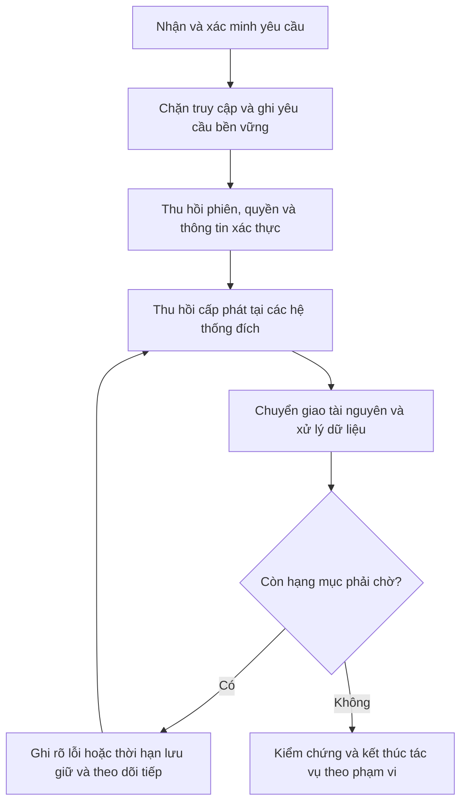

# Account deletion — Xóa tài khoản trong vòng đời IAM

Xóa tài khoản là bước kết thúc một danh tính trong phạm vi quản lý nhất định: tài khoản không còn được phép xác thực, không còn nắm quyền truy cập và được xử lý dữ liệu theo chính sách đã xác định. Công việc này liên quan đến nhiều thành phần hơn một bản ghi trong bảng `users`: nhà cung cấp danh tính, phiên đăng nhập, token, nhóm quyền, ứng dụng SaaS, khóa API, tài nguyên sở hữu và bằng chứng kiểm toán.

Trong chương **Account lifecycle** của module nền tảng quản lý danh tính và quyền truy cập, mục tiêu của bài là thiết kế việc xóa tài khoản sao cho quyền truy cập thực sự chấm dứt, các hệ thống phụ thuộc hội tụ về đúng trạng thái và dữ liệu được xử lý có kiểm soát. Các kiến thức về xác thực, MFA, RBAC, ABAC, SSO, OAuth/OIDC và nguyên tắc ít quyền nhất đều tham gia vào quy trình này.

## 1. Mục tiêu học tập

Sau bài học, bạn có thể:

- Phân biệt khóa tài khoản, vô hiệu hóa, thu hồi cấp phát, xóa mềm, xóa vật lý và ẩn danh dữ liệu.
- Xác định phạm vi cần xóa khi một người có nhiều tài khoản, nhiều vai trò hoặc thuộc nhiều tổ chức.
- Thiết kế luồng thu hồi quyền, phiên, token và thông tin xác thực trước khi dọn dữ liệu.
- Xử lý phụ thuộc, lỗi từng phần, yêu cầu lặp, sự kiện đến muộn và khôi phục từ bản sao lưu.
- Đưa ra bằng chứng kiểm chứng cho việc chấm dứt truy cập và trạng thái xử lý dữ liệu.

## 2. Xóa tài khoản không chỉ là xóa một hàng dữ liệu

Giả sử Lan nghỉ việc. Tài khoản của Lan xuất hiện trong một IdP, một ứng dụng quản lý dự án, VPN và kho mã nguồn. Lan cũng có phiên web đang mở, refresh token trên điện thoại, personal access token và quyền phê duyệt thanh toán.

Nếu quản trị viên chỉ xóa bản ghi của Lan trong cơ sở dữ liệu nhân sự, các hệ thống khác có thể tiếp tục hoạt động như trước. Nếu chỉ xóa người dùng tại IdP, ứng dụng đích vẫn có thể chấp nhận phiên cục bộ hoặc token mà nó chưa kiểm tra lại. Nếu xóa luôn dữ liệu sở hữu, nhóm có thể mất tài liệu hoặc tác vụ vận hành cần thiết.

Một quy trình đầy đủ phải trả lời ba câu hỏi độc lập:

1. **Truy cập đã bị chặn chưa?** Tài khoản, phiên, token và các đường truy cập liên quan có còn dùng được không?
2. **Cấp phát và phụ thuộc đã được xử lý chưa?** Những hệ thống nào đã nhận thay đổi, tài nguyên nào cần chuyển chủ sở hữu?
3. **Dữ liệu đã được xử lý đến đâu?** Dữ liệu nào đã xóa, dữ liệu nào cần giữ, trong bao lâu và vì mục đích gì?

Không nên dùng một cờ `deleted = true` để ngụ ý rằng cả ba việc đã hoàn tất.

### 2.1. Các thao tác thường bị gọi chung là “xóa”

| Thao tác | Tác dụng chính | Điều không nên mặc định |
| --- | --- | --- |
| Khóa xác thực tạm thời | Chặn một số lần đăng nhập, chẳng hạn sau nhiều lần nhập sai mật khẩu | Không đồng nghĩa tài khoản đã bị thu hồi toàn bộ quyền hoặc mọi phiên đã hết hiệu lực |
| Vô hiệu hóa tài khoản | Chuyển tài khoản sang trạng thái không được phép sử dụng | Dữ liệu, nhóm quyền và thông tin xác thực có thể vẫn còn |
| Thu hồi cấp phát, deprovisioning | Gỡ quyền, nhóm, giấy phép hoặc tài khoản tại các hệ thống đích | Không bảo đảm mọi hệ thống đều xóa vật lý dữ liệu |
| Xóa mềm, soft delete | Giữ bản ghi nhưng đánh dấu đã xóa, thường có thời gian khôi phục | Không phải một cơ chế bảo vệ nếu đường xác thực và phân quyền bỏ qua dấu này |
| Xóa vật lý, hard delete hoặc purge | Loại bỏ dữ liệu trong một phạm vi lưu trữ xác định | Không tự xóa bản sao lưu, log, chỉ mục tìm kiếm hoặc bản sao ở hệ thống khác |
| Ẩn danh dữ liệu | Biến đổi dữ liệu để không còn nhận diện được cá nhân theo mô hình đã xác định | Đổi tên thành mã số chưa đủ để chứng minh dữ liệu đã được ẩn danh |

Thay định danh trực tiếp bằng một mã có thể đối chiếu lại thường là **giả danh hóa**, không phải bảo đảm ẩn danh. Dữ liệu hoạt động, quan hệ hoặc bảng ánh xạ còn lại vẫn có thể cho phép nhận diện người dùng.

### 2.2. Ba chiều thời gian cần tách biệt

- **Thời điểm chấm dứt truy cập:** mốc tài khoản phải mất khả năng thực hiện hành động.
- **Thời gian xử lý hệ thống đích:** khoảng thời gian để các ứng dụng hoàn thành việc thu hồi cấp phát.
- **Thời hạn xử lý dữ liệu:** thời điểm dữ liệu được xóa hoặc hết thời gian lưu giữ, bao gồm quy trình áp dụng cho bản sao lưu.

Ví dụ, tổ chức có thể yêu cầu chặn truy cập lúc nhân sự kết thúc làm việc, xử lý các ứng dụng trong một khoảng vận hành đã cam kết và dọn dữ liệu theo lịch lưu giữ riêng. Đây là chính sách cần xác định rõ; không có một thời hạn chung phù hợp cho mọi tổ chức.

## 3. Xác định chính xác danh tính và phạm vi xóa

Trong IAM, “một người” và “một tài khoản” không phải lúc nào cũng là một đối tượng.

Một người có thể có tài khoản nhân viên, tài khoản quản trị riêng, tài khoản khách trong tenant đối tác và tài khoản cá nhân trên sản phẩm. Ngược lại, một danh tính workload có thể thuộc sở hữu của một nhóm mà không đại diện cho một người cụ thể.

Trước khi xóa, cần xác định:

- Định danh tài khoản bất biến trong hệ thống nguồn.
- Tổ chức hoặc tenant mà yêu cầu áp dụng.
- Quan hệ giữa danh tính nguồn và tài khoản trong từng ứng dụng đích.
- Loại danh tính: nhân viên, khách hàng, khách mời, quản trị viên hay workload.
- Hành động mong muốn: gỡ thành viên khỏi một tổ chức, xóa tài khoản ứng dụng hay xóa danh tính toàn cục.

**Ví dụ:** Minh rời công ty A nhưng vẫn dùng tài khoản cá nhân để tham gia công ty B trên cùng một nền tảng. Xóa quan hệ thành viên tại A phải chặn quyền vào A; yêu cầu này không tự cho phép xóa tài khoản toàn cục của Minh và dữ liệu tại B.

### 3.1. Dùng định danh ổn định, tránh dựa vào email

Email là thuộc tính có thể đổi hoặc được cấp lại. Nếu sự kiện xóa chỉ mang `email = lan@example.test`, sự kiện đến muộn có thể tác động nhầm tài khoản mới đã nhận địa chỉ đó.

Nên dùng khóa nội bộ bất biến cùng phạm vi tổ chức và phiên bản vòng đời, ví dụ:

```json
{
  "eventType": "AccountDeletionRequested",
  "accountId": "usr_72af",
  "tenantId": "tenant_a",
  "lifecycleVersion": 18,
  "requestId": "delreq_1042",
  "requestedAt": "2026-04-03T09:00:00Z"
}
```

Các tên trường trong bài là thiết kế minh họa. `lifecycleVersion` cần có quy tắc tăng và kiểm tra thống nhất trong hệ thống; việc thêm trường này vào thông điệp tự nó chưa xử lý được xung đột.

Với liên kết OIDC, ánh xạ danh tính ngoài cần dựa trên định danh do bên phát hành cung cấp trong đúng phạm vi, thường bao gồm cặp `iss` và `sub`, thay vì email hiển thị. Khi xóa hoặc tạo lại tài khoản, không tự nối tài khoản mới với dữ liệu cũ chỉ vì hai bên có cùng email.

### 3.2. Kiểm tra thẩm quyền yêu cầu

Quy trình phải xác minh người yêu cầu có quyền đối với **đúng tài khoản và đúng phạm vi**. Một quản trị viên tenant không mặc nhiên có quyền xóa danh tính toàn cục hoặc tài khoản của tenant khác.

Với yêu cầu tự xóa, có thể cần xác thực lại hoặc bước xác minh bổ sung phù hợp mức rủi ro. Không nên coi một cookie phiên lâu ngày là bằng chứng đầy đủ cho mọi thao tác nhạy cảm. Trường hợp người dùng mất yếu tố MFA cần đi qua quy trình khôi phục được kiểm soát, không bỏ qua xác minh chỉ vì yêu cầu là xóa tài khoản.

Yêu cầu do HR, quản trị viên hoặc hệ thống tự động gửi cũng cần nguồn phát đáng tin cậy, kiểm soát quyền và khả năng truy vết. Tách yêu cầu chấm dứt truy cập khẩn cấp khỏi yêu cầu dọn dữ liệu để có thể xử lý đúng mức ưu tiên.

## 4. Mô hình trạng thái: tách truy cập, cấp phát và dữ liệu

Một mô hình triển khai có thể dùng ba trường trạng thái độc lập:

```text
accessState:        ACTIVE | BLOCKED
provisioningState:  PROVISIONED | REMOVAL_PENDING | REMOVED | PARTIAL_FAILURE
dataState:          PRESENT | RETENTION_HOLD | PURGE_PENDING | PURGED
```

Ngoài ra, một tác vụ xóa có trạng thái tiến trình như `REQUESTED`, `RUNNING`, `WAITING`, `COMPLETED` hoặc `FAILED`. Trạng thái tác vụ phục vụ điều phối; nó không thay thế trạng thái truy cập thực tế.

Các bất biến quan trọng:

1. Khi đã có lệnh chặn hiệu lực, lỗi dọn dữ liệu hoặc lỗi kết nối hệ thống đích không được tự mở lại truy cập.
2. Tài khoản bị chặn không được cấp phiên mới, refresh token mới hoặc quyền mới thông qua luồng thông thường.
3. Sự kiện cấp phát cũ không được kích hoạt lại tài khoản đã đi sang phiên bản vòng đời mới hơn.
4. Gọi lại cùng yêu cầu xóa không tạo thêm tác dụng phụ nguy hiểm.
5. Chỉ ghi hoàn tất trong phạm vi đã được kiểm chứng; mục đang chờ lưu giữ phải được thể hiện rõ.



Sơ đồ là trình tự điều phối khái quát. Một số bước có thể chạy song song sau khi quyết định chặn truy cập đã được ghi nhận. Việc tiếp nhận yêu cầu, chuyển giao tài nguyên hay chờ phê duyệt dọn dữ liệu không nên vô tình kéo dài truy cập quá thời điểm chấm dứt đã xác định.

## 5. Quy trình xóa tài khoản từ đầu đến cuối

### Bước 1: Tiếp nhận, xác minh và ghi nhận phạm vi

Lưu một yêu cầu có định danh riêng, người hoặc hệ thống khởi tạo, tài khoản đích, tenant, lý do nghiệp vụ, thời điểm hiệu lực và phạm vi dữ liệu. Tránh đưa mật khẩu, token, mã khôi phục hoặc dữ liệu cá nhân không cần thiết vào yêu cầu và log.

Tra cứu các phụ thuộc dựa trên danh mục cấp phát và quan hệ sở hữu. Nếu tài khoản có đặc quyền cao, một phần của ứng phó sự cố hoặc sở hữu tác vụ quan trọng, đưa vào nhánh xử lý thích hợp. Kiểm tra tài nguyên trước giúp chuẩn bị chuyển giao; điều này không bắt buộc phải trì hoãn việc chặn truy cập khẩn cấp.

### Bước 2: Chặn khả năng có thêm truy cập

Ghi trạng thái chặn vào nguồn có thẩm quyền. Tại các điểm xác thực và cấp quyền, bảo đảm trạng thái này thực sự được kiểm tra hoặc được truyền đến cơ chế thực thi trong giới hạn đã cam kết.

Tùy kiến trúc, cần chặn:

- Đăng nhập bằng mật khẩu, passkey hoặc danh tính liên kết.
- Tạo phiên mới, trao đổi thông tin xác thực và phát hành token mới.
- Gia hạn phiên, dùng refresh token hoặc phát hành lại personal access token.
- Cấp lại nhóm quyền, vai trò hoặc giấy phép bằng tác vụ tự động thông thường.
- Luồng tự đăng ký, tự khôi phục hoặc JIT provisioning có thể tái tạo tài khoản trong phạm vi đã chấm dứt.

JIT provisioning là việc tự tạo tài khoản khi đăng nhập qua liên kết danh tính. Nếu chỉ xóa tài khoản ứng dụng nhưng vẫn giữ điều kiện cho phép JIT, lần đăng nhập SSO sau có thể tạo lại tài khoản.

### Bước 3: Thu hồi phiên và thông tin xác thực

Không dừng ở thao tác đổi mật khẩu. Cần kiểm kê và xử lý các phương tiện truy cập tương ứng:

| Đối tượng | Việc cần kiểm tra hoặc thực hiện |
| --- | --- |
| Phiên web, phiên di động | Hủy phiên trong kho phiên; bảo đảm ứng dụng kiểm tra phiên còn hợp lệ |
| Refresh token | Thu hồi grant hoặc họ refresh token phù hợp; ngăn tiếp tục phát hành access token |
| Access token | Xác định cơ chế từ chối token đã phát hành và giới hạn thời gian token còn có thể được chấp nhận |
| Personal access token, khóa API gắn người dùng | Thu hồi theo danh tính sở hữu; kiểm tra đường sử dụng ngoài giao diện web |
| Khóa SSH, chứng thư cá nhân | Gỡ khỏi nơi tin cậy hoặc áp dụng cơ chế thu hồi tương ứng; kiểm tra hệ thống thực thi |
| MFA, passkey, mã khôi phục | Hủy hiệu lực phía máy chủ hoặc gỡ liên kết theo chính sách; dọn dữ liệu còn lại đúng thời điểm |
| Quyền ứng dụng được người dùng ủy quyền | Xử lý grant và thông tin xác thực liên quan; phân biệt quyền theo người dùng với quyền độc lập của ứng dụng |

Không thể mặc định xóa một bản ghi credential trên máy chủ sẽ xóa vật liệu khóa đã có trên thiết bị người dùng. Điều cần bảo đảm là máy chủ không còn chấp nhận vật liệu đó cho tài khoản đã bị chặn.

### Bước 4: Thu hồi quyền và cấp phát tại hệ thống đích

Gỡ thành viên nhóm, vai trò trực tiếp, thuộc tính dùng cho ABAC, quyền tạm thời và quyền đặc biệt trong hệ thống PAM nếu có. Kiểm tra cả quyền được kế thừa từ nhiều nguồn; xóa một vai trò trực tiếp có thể vẫn để lại quyền tương đương qua nhóm.

Sau đó, thực hiện deprovisioning tại các ứng dụng đã tích hợp. Với hệ thống dùng SCIM, một lệnh cập nhật trạng thái không hoạt động và một lệnh xóa tài nguyên có thể mang ngữ nghĩa khác nhau ở sản phẩm đích. Cần xác định khả năng và chính sách của từng kết nối thay vì suy ra rằng mọi đích đều xóa vật lý giống nhau.

Kết quả của mỗi đích phải có trạng thái riêng: đang chờ, thành công, cần thử lại hoặc cần can thiệp. Đích chưa phản hồi không được ghi là đã hoàn thành chỉ vì yêu cầu đã vào hàng đợi.

### Bước 5: Xử lý sở hữu và phụ thuộc

Trước khi dọn các bản ghi có quan hệ, xác định tài nguyên nào cần giữ lại và ai tiếp quản:

- Tài liệu, kho mã nguồn, bảng điều khiển, lịch và nhóm do người dùng sở hữu.
- Quy trình phê duyệt, nhiệm vụ đang mở và lịch chạy tự động.
- Ứng dụng tích hợp, OAuth client hoặc workload do người dùng từng tạo.
- Tài khoản dịch vụ và bí mật dùng chung mà người dùng từng có thể truy cập.
- Quyền quản trị cuối cùng của tenant hoặc nhóm vận hành.

Chuyển chủ sở hữu tài nguyên không có nghĩa là chuyển mật khẩu hoặc chia sẻ tài khoản cũ. Nếu công việc tự động đang dùng token cá nhân của người nghỉ việc, cần thay bằng danh tính workload có quyền tối thiểu và chủ sở hữu vận hành rõ ràng.

Với bí mật dùng chung mà người dùng từng biết, xóa tài khoản cá nhân không làm bí mật đó biến mất khỏi trí nhớ hoặc thiết bị của họ. Cần đánh giá việc xoay vòng bí mật và xác nhận các hệ thống sử dụng đã cập nhật. Danh tính workload cũng cần quy trình vòng đời riêng; không tự xóa mọi workload chỉ vì người tạo ban đầu rời tổ chức.

### Bước 6: Xử lý dữ liệu theo chính sách

Phân loại dữ liệu để xác định hành động phù hợp:

| Nhóm dữ liệu | Cách xử lý cần quyết định |
| --- | --- |
| Hồ sơ cá nhân và tùy chọn tài khoản | Xóa hoặc biến đổi theo phạm vi yêu cầu và chính sách áp dụng |
| Bí mật và vật liệu xác thực | Ngừng chấp nhận ngay khi chặn truy cập; dọn lưu trữ theo quy trình quản lý bí mật |
| Nội dung nghiệp vụ | Chuyển giao, giữ lại có giới hạn hoặc xóa theo quyền sở hữu và chính sách |
| Nhật ký an ninh và bằng chứng kiểm toán | Giữ thông tin tối thiểu cần thiết, giới hạn quyền truy cập và thời hạn lưu giữ |
| Chỉ mục tìm kiếm, cache, dữ liệu phân tích | Lan truyền yêu cầu xóa hoặc biến đổi; xác minh cả các bản sao dẫn xuất |
| Bản sao lưu và bản sao khôi phục | Áp dụng lịch hết hạn, kiểm soát truy cập và quy trình ngăn phục hồi dữ liệu hoặc quyền trái chính sách |

Yêu cầu lưu giữ phục vụ tranh chấp, điều tra hoặc nghĩa vụ đã được xác định có thể ảnh hưởng tới thời điểm xóa một số dữ liệu. Việc giữ dữ liệu không đòi hỏi phải giữ tài khoản ở trạng thái đăng nhập được. Chính sách cần chỉ rõ dữ liệu nào được giữ, căn cứ được tổ chức xác nhận, người được xem và mốc xem xét tiếp theo.

### Bước 7: Kiểm chứng và kết thúc theo phạm vi

Đối chiếu trạng thái mong muốn với trạng thái thực tại các hệ thống quan trọng. Kiểm tra cả phiên đã có trước khi xóa và các đường truy cập ngoài SSO.

Kết quả nên phân biệt:

- Đã chặn truy cập trong phạm vi cam kết.
- Đã hoàn thành hoặc còn thiếu deprovisioning tại những đích nào.
- Đã xóa dữ liệu nào và còn dữ liệu nào đang chờ theo chính sách.

Nếu quy trình xóa dữ liệu kéo dài hơn quy trình thu hồi quyền, có thể đóng tác vụ thu hồi truy cập và tiếp tục tác vụ xử lý dữ liệu riêng. Không dùng từ “đã xóa hoàn toàn” khi vẫn còn các hạng mục chưa được xử lý hoặc chưa được kiểm chứng.

## 6. Vì sao JWT, SSO và phiên cục bộ cần xử lý riêng?

### 6.1. JWT tự chứa có thể còn được chấp nhận

Một resource server chỉ kiểm tra chữ ký và thời hạn của JWT có thể tiếp tục chấp nhận access token đã phát hành, dù tài khoản tại IdP đã bị xóa. Việc xóa tài khoản không tự thay đổi nội dung token hoặc thuật toán kiểm tra của resource server.

Các cách thiết kế thường dùng gồm:

- Access token có thời hạn ngắn để giới hạn cửa sổ sử dụng còn lại.
- Kiểm tra trạng thái tài khoản hoặc phiên khi xử lý yêu cầu, với chính sách cache rõ ràng.
- Introspection hoặc điểm kiểm soát tập trung nếu kiến trúc token và hạ tầng hỗ trợ.
- Danh sách thu hồi hoặc phiên bản bảo mật của tài khoản mà bên thực thi thực sự đối chiếu.

Mỗi cơ chế đều cần được triển khai ở nơi quyết định chấp nhận yêu cầu. Một trường `tokenVersion` trong cơ sở dữ liệu không có tác dụng nếu dịch vụ chỉ xác minh chữ ký JWT và không đọc hay đối chiếu phiên bản đó.

**Ví dụ:** access token được phát hành lúc 09:00 và hết hạn lúc 09:15. Tài khoản bị chặn lúc 09:02. Nếu dịch vụ chỉ kiểm tra chữ ký và `exp`, token có thể còn được chấp nhận tới khi hết hạn, có thể kèm dung sai đồng hồ đã cấu hình. Nếu yêu cầu nghiệp vụ là chặn sớm hơn, phải có thêm cơ chế kiểm tra hoặc thu hồi được thực thi tại dịch vụ.

Độ trễ thực tế còn phụ thuộc vào bộ nhớ đệm trạng thái, nhịp đồng bộ, sự lan truyền cấu hình và phiên cục bộ. Một phiên ứng dụng sống lâu có thể vượt thời hạn của token dùng lúc tạo phiên nếu ứng dụng không buộc kiểm tra lại. Vì vậy, thời hạn access token đơn lẻ chưa đủ để suy ra giới hạn chấm dứt mọi truy cập.

### 6.2. Chấm dứt SSO không tự chấm dứt mọi phiên ứng dụng

IdP và ứng dụng đích có thể giữ phiên độc lập. Hủy phiên tại IdP thường giúp ngăn xác thực SSO tiếp theo, nhưng ứng dụng vẫn cần xử lý phiên của chính nó. Cơ chế đăng xuất liên kết chỉ có tác dụng trong phạm vi các thành phần hỗ trợ và thực thi đúng.

Cũng cần kiểm tra tài khoản cục bộ dự phòng, VPN, truy cập cơ sở dữ liệu, khóa SSH và API. Danh mục ứng dụng cùng bản đồ cấp phát là nền tảng để không bỏ sót những đường này.

### 6.3. Quyền ủy quyền và danh tính ứng dụng là hai phạm vi khác nhau

Token đại diện cho người dùng cần được xét trong quá trình xóa người đó. Một ứng dụng có quyền riêng thông qua danh tính workload có thể tiếp tục hoạt động độc lập. Thu hồi tài khoản người tạo ứng dụng không thay thế quy trình đánh giá và chuyển chủ sở hữu của ứng dụng.

Ngược lại, không nên thu hồi tùy tiện mọi danh tính ứng dụng chỉ vì có liên hệ với người bị xóa. Cần dựa trên chủ sở hữu, mục đích và quyền thực tế để tránh làm gián đoạn dịch vụ ngoài phạm vi yêu cầu.

## 7. Thiết kế điều phối đáng tin cậy

Xóa tài khoản trên nhiều hệ thống là một quy trình phân tán. Không nên giả định có một giao dịch cơ sở dữ liệu duy nhất bao phủ IdP, ứng dụng SaaS, kho phiên, dịch vụ API và kho dữ liệu.

### 7.1. Ghi quyết định chặn và công việc cần làm một cách bền vững

Trong hệ thống có cơ sở dữ liệu giao dịch, có thể ghi trạng thái chặn cùng một sự kiện outbox trong một giao dịch nội bộ. Tiến trình nền đọc outbox để thực hiện các bước từ xa.

```text
requestDeletion(actor, accountId, tenantId, requestId):
    requireAuthorized(actor, accountId, tenantId)

    transaction:
        previous = findRequest(tenantId, requestId)
        if previous exists:
            requireSameTargetAndIntent(previous, accountId, tenantId)
            return previous

        account = loadAccountForUpdate(accountId, tenantId)
        account.accessState = BLOCKED
        account.lifecycleVersion = account.lifecycleVersion + 1

        request = createDeletionRequest(
            requestId, accountId, tenantId, account.lifecycleVersion
        )
        insertOutboxEvent("AccountDeletionRequested", request)

    return request
```

Đây là giả mã minh họa. Triển khai cần ràng buộc duy nhất cho khóa yêu cầu trong phạm vi phù hợp, cơ chế xử lý cạnh tranh và kiểm soát quyền nhất quán. Giao dịch này chỉ bảo đảm trạng thái cục bộ cùng sự kiện đã được lưu; không chứng minh rằng các hệ thống từ xa đã thu hồi quyền.

Nếu tài khoản đích đã bị purge, hệ thống vẫn cần đủ thông tin tối thiểu từ yêu cầu hoặc dấu vết vòng đời để nhận diện yêu cầu lặp. Cách lưu thông tin đó phải tuân theo chính sách dữ liệu.

### 7.2. Xử lý lặp an toàn và thử lại có kiểm soát

Bộ điều phối có thể gửi lại cùng một tác vụ khi mất kết nối hoặc không nhận được phản hồi. Mỗi bước cần có khả năng xử lý lặp an toàn, thường gọi là **idempotency**.

Ví dụ, yêu cầu “bảo đảm tài khoản đích không còn hoạt động” dễ xử lý lặp hơn yêu cầu “đảo trạng thái hoạt động”. Với thao tác xóa, phản hồi rằng tài nguyên không còn tồn tại có thể phù hợp với trạng thái mong muốn, nhưng chỉ sau khi kiểm tra đúng kết nối, đúng tenant và đúng ánh xạ định danh. Không coi mọi lỗi `404` là thành công nếu có thể đang gọi sai đích.

Lưu số lần thử, thời điểm thử tiếp theo, loại lỗi và trạng thái từng đích. Dùng khoảng chờ tăng dần, có độ lệch ngẫu nhiên khi cần, để tránh dồn tải lên một dịch vụ đang lỗi. Lỗi quyền quản trị của connector cần được xử lý khác với lỗi mạng tạm thời.

### 7.3. Chống sự kiện cũ và tái cấp phát ngoài ý muốn

Các rủi ro điển hình:

- Tác vụ tạo tài khoản được lên lịch trước nhưng thực thi sau tác vụ xóa.
- Sự kiện đổi phòng ban cũ thêm tài khoản trở lại một nhóm quyền.
- Đồng bộ thư mục tự tạo lại tài khoản vì nguồn dữ liệu chưa được cập nhật.
- Cơ chế JIT tạo tài khoản mới ngay khi người dùng đăng nhập SSO.

Có thể dùng phiên bản vòng đời, kiểm tra trạng thái mong muốn trước mỗi thao tác và một dấu vết chặn tái tạo phù hợp. Nếu hệ thống đích không hỗ trợ kiểm tra phiên bản, bộ điều phối cần quản lý thứ tự theo tài khoản và đối soát sau xử lý; vẫn phải tính đến tác vụ từ xa đã bắt đầu trước đó.

**Tombstone** là dấu vết tối thiểu cho biết một danh tính đã bị xóa hoặc bị chặn ở một phiên bản vòng đời. Nó có thể giúp chống đồng bộ ngược, nhưng cũng là dữ liệu cần quản lý. Không giữ vô hạn hồ sơ cá nhân đầy đủ dưới tên “tombstone”; xác định nội dung tối thiểu và thời hạn giữ phù hợp.

### 7.4. Xử lý hành động đang chạy

Chặn các yêu cầu mới chưa chắc dừng một công việc đã được nhận trước đó. Một tác vụ xuất dữ liệu dài có thể vẫn đang chạy bằng ngữ cảnh quyền đã chụp lúc khởi động.

Đối với tác vụ nhạy cảm, cần xác định điểm kiểm tra lại quyền, khả năng hủy tác vụ và điều kiện được trả kết quả. Tương tự, yêu cầu ghi đang xử lý có thể cần kiểm tra trạng thái ở thời điểm commit tùy mô hình rủi ro. Đây là phần của thiết kế thực thi quyền; không thể giải quyết chỉ bằng thao tác xóa bản ghi người dùng.

### 7.5. Đối soát thay vì chỉ tin thông báo thành công

Một API phản hồi đã tiếp nhận yêu cầu chưa chứng minh trạng thái đích đã thay đổi. Đối soát cần so sánh trạng thái mong muốn và trạng thái quan sát được, ưu tiên những đích có quyền quan trọng.

Nếu connector lỗi, tài khoản trung tâm phải tiếp tục bị chặn. Có thể cần biện pháp thu hồi trực tiếp tại hệ thống đích theo quy trình được kiểm soát. Việc thử lại hoặc chuyển sang thao tác thủ công phải giữ cùng dấu vết kiểm toán, tránh bỏ quên các bước còn lại sau khi xử lý khẩn cấp.

## 8. Xóa mềm, khôi phục và cấp lại tài khoản

Xóa mềm có thể hỗ trợ sửa nhầm, nhưng trạng thái có thể khôi phục không đồng nghĩa quyền truy cập vẫn được duy trì. Trong thời gian chờ, các đường xác thực và quyền phải tiếp tục bị chặn theo chính sách.

Khi khôi phục một tài khoản đã xóa mềm:

1. Xác minh ai được phép yêu cầu và phê duyệt khôi phục.
2. Kiểm tra lại tính hợp lệ của quan hệ nhân sự hoặc thành viên tổ chức.
3. Cấp lại quyền dựa trên vai trò hiện tại và nguyên tắc ít quyền nhất.
4. Tạo thông tin xác thực và phiên phù hợp; không tự phục hồi token đã thu hồi.
5. Đối soát ứng dụng đích và ghi nhận một sự kiện vòng đời mới.

Không nên tự khôi phục mọi đặc quyền cũ vì dữ liệu liên kết vẫn còn. Một người quay lại công ty có thể làm công việc khác và cần quyền khác.

Nếu chính sách là tạo tài khoản mới, tài khoản đó cần định danh mới trong phạm vi quản lý. Không tái sử dụng khóa nội bộ của tài khoản cũ để tránh nhập nhằng lịch sử và tác động từ sự kiện cũ. Nếu có nhu cầu kế thừa dữ liệu, thực hiện như một thao tác chuyển giao được cho phép rõ ràng.

## 9. Bản sao lưu và kiểm toán sau khi xóa

### 9.1. Khôi phục từ backup có thể làm sống lại trạng thái cũ

Giả sử tài khoản bị chặn vào thứ Tư, nhưng hệ thống được phục hồi từ bản sao lưu của thứ Hai. Bản sao này có thể chứa tài khoản đang hoạt động, nhóm quyền cũ và dữ liệu đã được yêu cầu xóa sau thời điểm sao lưu.

Quy trình khôi phục cần có bước áp dụng lại các thay đổi vòng đời và quyết định xóa phát sinh sau mốc backup, rồi kiểm chứng trước khi mở truy cập. Nguồn để áp dụng lại phải có độ bền và cách phục hồi phù hợp; một bảng xóa nằm duy nhất trong chính cơ sở dữ liệu vừa bị phục hồi lùi thời gian có thể không đủ.

Với bản sao lưu không hỗ trợ xóa từng bản ghi, cần có chính sách hết hạn, giới hạn truy cập và quy trình xử lý khi phục hồi. Không nên tuyên bố dữ liệu đã biến mất khỏi mọi nơi chỉ vì đã xóa ở hệ thống đang phục vụ.

### 9.2. Giữ bằng chứng tối thiểu

Một dấu vết kiểm toán hữu ích có thể gồm:

- Mã yêu cầu và định danh tài khoản trong phạm vi thích hợp.
- Chủ thể khởi tạo, thẩm quyền và thời điểm hiệu lực.
- Các chuyển trạng thái và phiên bản vòng đời.
- Trạng thái từng hệ thống đích, thời điểm kiểm chứng và lỗi cần xử lý.
- Các hạng mục dữ liệu đang lưu giữ, mốc xem xét và quyết định xử lý.

Tránh log nội dung token, bí mật MFA, mã khôi phục hoặc toàn bộ hồ sơ cá nhân. Định danh nội bộ và khả năng liên kết giữa các sự kiện cũng cần được bảo vệ. Log kiểm toán phải có kiểm soát truy cập, thời hạn lưu giữ và biện pháp bảo vệ tính toàn vẹn phù hợp.

## 10. Ví dụ tổng hợp: nhân viên có SSO và tác vụ tự động

Hà nghỉ việc vào 17:00. Hà có tài khoản SSO, phiên tại ứng dụng quản lý dự án, personal access token cho kho mã nguồn và một báo cáo định kỳ dùng token cá nhân.

| Thời điểm hoặc giai đoạn | Hành động | Bằng chứng cần quan sát |
| --- | --- | --- |
| Trước 17:00 | Xác minh yêu cầu từ nguồn có thẩm quyền, kiểm kê cấp phát và tài nguyên, chuẩn bị chuyển báo cáo sang workload | Yêu cầu có tài khoản đích, tenant, thời điểm hiệu lực và người tiếp quản |
| Đến thời điểm hiệu lực | Chặn tài khoản tại nguồn có thẩm quyền, ghi tác vụ thu hồi bền vững | Trạng thái chặn đã commit; không cấp thêm phiên hoặc token theo luồng thông thường |
| Trong luồng thu hồi | Hủy phiên, thu hồi refresh token và personal access token, gỡ nhóm và vai trò | Kết quả của kho phiên, dịch vụ token và từng hệ thống quyền |
| Khi xử lý ứng dụng đích | Vô hiệu hóa hoặc xóa theo khả năng từng kết nối; đối soát truy cập cục bộ | Trạng thái đích đã được quan sát, không chỉ có biên nhận gửi lệnh |
| Khi xử lý phụ thuộc | Hoàn tất chuyển báo cáo sang danh tính workload có chủ sở hữu và quyền phù hợp | Báo cáo hoạt động bằng danh tính mới; token cá nhân cũ không còn hiệu lực |
| Khi xử lý dữ liệu | Chuyển tài liệu cần giữ, dọn hồ sơ và dữ liệu dẫn xuất theo chính sách | Danh mục đã xử lý, mục đang chờ lưu giữ và mốc tiếp theo |

Giả sử ứng dụng quản lý dự án tạm mất kết nối. Bộ điều phối ghi lỗi và thử lại, đồng thời duy trì trạng thái chặn trung tâm. Tuy nhiên, nếu ứng dụng vẫn có phiên cục bộ và không kiểm tra lại IdP, trạng thái chặn trung tâm chưa chứng minh rằng Hà đã mất quyền tại ứng dụng này. Cần biện pháp chặn ở ứng dụng hoặc lớp thực thi liên quan và ghi rõ khoảng chưa đạt yêu cầu.

Nếu báo cáo chưa được chuyển xong, không giữ token cá nhân của Hà hoạt động để duy trì báo cáo. Đội vận hành phải xử lý phụ thuộc bằng danh tính hợp lệ khác hoặc chấp nhận gián đoạn có kiểm soát theo quyết định nghiệp vụ.

## 11. Những lỗi thiết kế thường gặp

| Lỗi | Hệ quả | Cách điều chỉnh |
| --- | --- | --- |
| Chỉ xóa hàng `users` | Phiên, token hoặc tài khoản đích có thể vẫn sử dụng được | Thiết kế thu hồi quyền và thông tin xác thực như các bước bắt buộc |
| Chỉ chặn đăng nhập SSO | Phiên cục bộ và đường API có thể tiếp tục truy cập | Kiểm kê và thực thi trên từng đường truy cập |
| Dùng email làm khóa xóa | Có thể tác động nhầm người khi email được cấp lại | Dùng định danh bất biến, tenant và phiên bản vòng đời |
| Đánh dấu hoàn tất khi vừa gửi lệnh | Che giấu lỗi hoặc độ trễ ở hệ thống đích | Theo dõi kết quả và đối soát trạng thái thực |
| Khôi phục tài khoản kèm toàn bộ quyền cũ | Trả lại đặc quyền không còn cần thiết | Cấp quyền lại theo nhu cầu hiện tại |
| Xóa dây chuyền toàn bộ dữ liệu sở hữu | Mất tài liệu và tài nguyên của tổ chức | Phân loại, chuyển giao và đặt quy tắc quan hệ dữ liệu rõ ràng |
| Giữ tài khoản hoạt động để lưu chứng cứ | Người dùng có thể tiếp tục truy cập | Giữ dữ liệu cần thiết trong khi chặn khả năng sử dụng tài khoản |
| Tái tạo từ đồng bộ hoặc JIT | Tài khoản bị xóa xuất hiện trở lại | Đồng bộ trạng thái nguồn, chặn tái cấp phát ngoài chính sách và xử lý sự kiện cũ |
| Khôi phục backup rồi mở hệ thống ngay | Tái xuất hiện tài khoản, quyền hoặc dữ liệu đã bị thu hồi | Áp dụng lại quyết định vòng đời và kiểm chứng trước khi mở truy cập |

## 12. Tiêu chí kiểm chứng một quy trình xóa

Trước khi công nhận tác vụ hoàn tất, đội triển khai nên có bằng chứng cho các tiêu chí phù hợp phạm vi hệ thống:

### Truy cập

- Tài khoản đích không đăng nhập mới hoặc tự khôi phục quyền qua luồng không được phép.
- Phiên cũ, refresh token, personal access token và các credential thuộc phạm vi đã bị xử lý.
- Cửa sổ chấp nhận access token và độ trễ truyền trạng thái đã được đo hoặc kiểm chứng theo thiết kế.
- Các quyền trực tiếp, quyền kế thừa và quyền đặc biệt không còn cho phép hành động trái trạng thái chặn.
- Tác vụ đang chạy và kết quả xuất dữ liệu nhạy cảm được xử lý theo chính sách đã đặt ra.

### Hệ thống đích và phụ thuộc

- Có danh sách đích đầy đủ dựa trên cấp phát thực tế và các phát hiện ngoài danh mục.
- Mỗi đích có kết quả riêng; lỗi còn lại có người chịu trách nhiệm và bước xử lý tiếp theo.
- Sự kiện đến muộn, yêu cầu lặp hoặc đồng bộ lại không vô tình cấp lại tài khoản.
- Tài nguyên cần giữ có chủ sở hữu hợp lệ; workload không còn phụ thuộc vào token cá nhân đã thu hồi.

### Dữ liệu và bằng chứng

- Dữ liệu đã xóa, đã chuyển giao và đang chờ lưu giữ được phân biệt rõ.
- Chính sách cho cache, chỉ mục, dữ liệu dẫn xuất và backup đã được đưa vào quy trình.
- Log đủ để giải thích ai yêu cầu, đã làm gì và còn thiếu gì, đồng thời hạn chế dữ liệu nhạy cảm.
- Việc phục hồi từ backup hoặc khôi phục tài khoản có kiểm soát để tránh làm sống lại quyền cũ.

Các tiêu chí trên phục vụ thiết kế và kiểm chứng vận hành. Mức kiểm tra cần dựa trên loại tài khoản, độ nhạy dữ liệu và khả năng thực thi của hệ thống, thay vì chỉ có một thao tác giao diện mang tên “Delete”.

## 13. Bài tập tự thực hành

Thiết kế quy trình xóa cho một ứng dụng có IdP trung tâm, phiên web lưu trong Redis, access token JWT và hai ứng dụng SaaS.

1. Xác định khác biệt giữa xóa tài khoản toàn cục và gỡ thành viên khỏi một tenant.
2. Liệt kê những nơi có thể tiếp tục chấp nhận quyền sau khi IdP đã chặn tài khoản.
3. Chọn cách giới hạn cửa sổ sử dụng token, nêu rõ nơi thực thi và ảnh hưởng của cache.
4. Mô tả cách xử lý khi một ứng dụng SaaS không phản hồi trong lúc thu hồi cấp phát.
5. Thiết kế thông tin tối thiểu để chống sự kiện tạo tài khoản cũ đến sau lệnh xóa.
6. Phân loại hồ sơ, nội dung nghiệp vụ, log và backup theo hành động xử lý dữ liệu.
7. Nêu các điều kiện phải kiểm chứng trước khi kết thúc tác vụ thu hồi truy cập và tác vụ dọn dữ liệu.

Một thiết kế đạt yêu cầu phải chỉ ra được **nơi thực thi**, **trạng thái quan sát được**, **giới hạn thời gian** và **cách xử lý lỗi**. Câu trả lời “xóa user tại IdP” mới mô tả một thao tác trong toàn bộ vòng đời.

## 14. Ghi nhớ

Xóa tài khoản trong IAM là một quy trình có phạm vi rõ ràng: xác minh yêu cầu, chặn truy cập, thu hồi phiên và quyền, xử lý hệ thống đích, chuyển giao phụ thuộc, rồi xử lý dữ liệu và kiểm chứng. Giữ riêng trạng thái truy cập, trạng thái cấp phát và trạng thái dữ liệu giúp tránh tuyên bố hoàn tất quá sớm. Định danh ổn định, xử lý lặp an toàn và đối soát giúp quy trình chịu được lỗi phân tán mà không vô tình cấp lại quyền.
