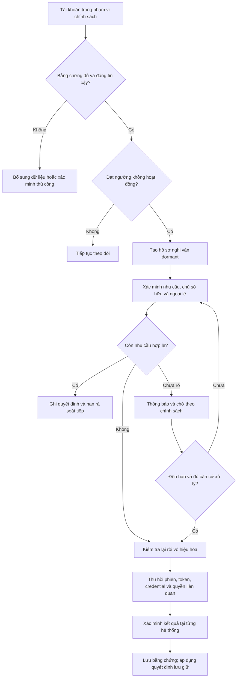

# Dormant account: quản lý tài khoản không hoạt động

## Mục tiêu bài học

Sau bài học này, bạn có thể:

- Phân biệt tài khoản không hoạt động với tài khoản bị khóa, tài khoản mồ côi và tài khoản đã hết nhu cầu sử dụng.
- Chọn tín hiệu hoạt động và điều kiện phát hiện phù hợp cho tài khoản người dùng, tài khoản đặc quyền và danh tính workload.
- Thiết kế quy trình phát hiện, xác minh, cảnh báo, vô hiệu hóa, thu hồi quyền truy cập và khôi phục tài khoản.
- Giải thích vì sao vô hiệu hóa ở hệ thống danh tính chưa đủ để chấm dứt phiên, token và quyền truy cập tại mọi ứng dụng.

Bài học thuộc chương **Account lifecycle** của nền tảng IAM. Dormancy là một phần của quản lý vòng đời tài khoản và quyền: danh tính vẫn tồn tại trong hệ thống, nhưng tổ chức cần xác định liệu quyền truy cập của danh tính đó còn cần thiết hay không.

## 1. Dormant account là gì?

**Dormant account** là tài khoản không có hoạt động được chính sách công nhận trong một khoảng thời gian xác định. Khi phát hiện một tài khoản dormant, tổ chức cần xem xét nhu cầu giữ tài khoản, quyền hiện có và biện pháp xử lý phù hợp.

Ví dụ, một doanh nghiệp quy định tài khoản nhân viên không có hoạt động hợp lệ trong 60 ngày sẽ được đưa vào danh sách rà soát. Một nhân viên có tài khoản vẫn được bật, còn thuộc nhóm truy cập kho mã nguồn, nhưng không có hoạt động hợp lệ trong 75 ngày. Tài khoản này là ứng viên dormant theo chính sách đó.

Con số 60 ngày ở đây chỉ là giả định minh họa. Thời hạn thực tế phụ thuộc loại tài khoản, chu kỳ công việc, mức rủi ro, chất lượng dữ liệu và chính sách của tổ chức.

Dormancy không tự trả lời được các câu hỏi sau:

- Chủ tài khoản còn làm việc hoặc còn hợp đồng không?
- Họ đang nghỉ dài hạn hay chỉ sử dụng hệ thống theo mùa?
- Tài khoản có đang được một chương trình sử dụng bằng API key không?
- Có phiên ứng dụng còn sống mà hệ thống đăng nhập trung tâm không quan sát được không?
- Quyền quản trị của tài khoản có còn cần thiết, dù tài khoản vẫn có hoạt động?

Vì vậy, cần phân biệt **tín hiệu không hoạt động**, **kết luận về nhu cầu nghiệp vụ** và **quyết định xử lý quyền truy cập**.

### Những khái niệm dễ nhầm

| Khái niệm | Ý nghĩa | Quan hệ với dormant account |
|---|---|---|
| Dormant account | Không có hoạt động hợp lệ trong thời gian theo chính sách | Là kết quả đánh giá hoạt động, chưa phải kết luận phải xóa |
| Disabled account | Tài khoản đã bị chặn theo cơ chế của một hệ thống | Là trạng thái thực thi; tài khoản bị vô hiệu hóa có thể vẫn còn bản ghi và quyền ở nơi khác |
| Locked account | Tài khoản bị khóa, thường do một điều kiện bảo vệ như nhiều lần xác thực thất bại | Có thể chỉ là khóa tạm thời; không chứng minh tài khoản dormant |
| Orphaned account | Không còn gắn được với chủ thể hoặc đơn vị chịu trách nhiệm hợp lệ | Có thể vẫn phát sinh hoạt động, ví dụ một job tiếp tục dùng credential của nhân viên đã nghỉ |
| Never-used account | Đã được cấp nhưng chưa có bằng chứng sử dụng | Cần chính sách riêng cho thời gian chờ kích hoạt và chất lượng dữ liệu |
| Expired account | Đã đến ngày hết hạn được ấn định | Cần xử lý theo hạn sử dụng, kể cả khi vẫn đang có hoạt động |

Một tài khoản có thể đồng thời thuộc nhiều nhóm. Tài khoản nhà thầu đã hết hợp đồng, không có người bảo trợ và không đăng nhập nhiều tháng vừa có thể expired, orphaned, vừa dormant.

**Sự kiện nghỉ việc hoặc kết thúc hợp đồng đã được xác nhận phải đi theo quy trình thu hồi tương ứng, không chờ đủ ngưỡng dormant.** Dormancy bổ sung một lớp kiểm soát cho những tài khoản bị bỏ sót hoặc không còn nhu cầu sử dụng rõ ràng.

## 2. Vì sao tài khoản không hoạt động vẫn tạo rủi ro?

Một tài khoản không dùng tới vẫn có thể giữ mật khẩu, phương thức khôi phục, khóa API, nhóm truy cập, vai trò và phiên ứng dụng. Nếu tài khoản còn khả năng xác thực hoặc còn credential hiệu lực, nó vẫn là một đường truy cập.

Ví dụ, tài khoản của một cộng tác viên đã lâu không sử dụng còn thuộc nhóm đọc dữ liệu khách hàng. Nếu credential bị lộ, kẻ tấn công có thể sử dụng quyền đó. Việc chủ tài khoản không đăng nhập trong nhiều tháng không làm quyền truy cập tự biến mất.

Các rủi ro thường gặp gồm:

- **Quyền tồn dư:** quyền của dự án cũ hoặc vai trò cũ tiếp tục tồn tại dù nhu cầu đã kết thúc.
- **Credential ít được giám sát:** chủ tài khoản không thường xuyên kiểm tra cảnh báo hoặc phát hiện hoạt động bất thường.
- **Đường truy cập bị bỏ quên:** tài khoản SSO đã bị chặn nhưng tài khoản cục bộ, phiên SaaS hoặc personal access token vẫn dùng được.
- **Khó xác định trách nhiệm:** tài khoản không có người sở hữu rõ ràng làm chậm xác minh và xử lý sự cố.
- **Đặc quyền vượt nhu cầu:** tài khoản thỉnh thoảng dùng để đọc tài liệu vẫn giữ vai trò quản trị không còn cần thiết.

MFA làm giảm một số nguy cơ chiếm đoạt tài khoản, nhưng không trả lời câu hỏi tài khoản có nên tiếp tục được cấp quyền hay không. Một tài khoản dormant có MFA vẫn cần được rà soát.

Nguyên tắc ít quyền nhất áp dụng cả về **phạm vi quyền** lẫn **thời gian giữ quyền**. Không nên giữ một quyền vô thời hạn chỉ vì nó từng được cấp hợp lệ.

## 3. Định nghĩa hoạt động trước khi đặt ngưỡng

Sai lầm phổ biến là lấy một cột mang tên `last_login` rồi coi đó là toàn bộ sự thật. Trước hết phải hiểu cột này ghi nhận điều gì, ở hệ thống nào và với độ trễ bao lâu.

### 3.1. Hoạt động nào có ý nghĩa?

| Tín hiệu | Có thể cho biết | Điều chưa thể kết luận |
|---|---|---|
| Đăng nhập tương tác thành công | Có một lần xác thực người dùng thành công | Người đó còn nhu cầu nghiệp vụ, hoặc mọi quyền hiện tại đều cần thiết |
| Đăng nhập thất bại | Có ai đó hoặc một client đang thử xác thực | Chủ tài khoản đang sử dụng hợp lệ |
| Yêu cầu nghiệp vụ thành công trong ứng dụng | Có việc sử dụng tài nguyên dưới danh tính đó | Hoạt động chắc chắn do chủ tài khoản thực hiện, thay vì tự động hóa hoặc kẻ tấn công |
| Làm mới token tự động | Một client còn duy trì khả năng truy cập | Người dùng còn chủ động làm việc với ứng dụng |
| Lần dùng API key hoặc credential workload | Credential đang được dùng cho một yêu cầu | Người sở hữu còn làm việc hoặc mọi credential khác của cùng danh tính đều cần giữ |
| Quản trị viên sửa hồ sơ hoặc đặt lại mật khẩu | Có thao tác quản trị trên đối tượng tài khoản | Chủ tài khoản đã quay lại sử dụng |
| Hồ sơ nhân sự hoặc hợp đồng | Tình trạng quan hệ với tổ chức và thời hạn liên quan | Hoạt động truy cập thực tế tại từng ứng dụng |

**Đăng nhập thất bại không được tự động đặt lại bộ đếm hoạt động hợp lệ.** Nếu làm như vậy, một luồng thử mật khẩu từ bên ngoài có thể giữ tài khoản dormant ở trạng thái “đang hoạt động”.

Đăng nhập thành công cũng không đồng nghĩa hoạt động hợp pháp. Khi có tín hiệu chiếm đoạt, việc xử lý phải chuyển sang quy trình ứng phó sự cố; không tự động đưa tài khoản về trạng thái bình thường chỉ vì có sự kiện mới.

Một ví dụ về ý nghĩa trường dữ liệu: Microsoft Graph mô tả `lastSignInDateTime` là lần thử đăng nhập tương tác gần nhất, có thể thành công hoặc thất bại; `lastSuccessfulSignInDateTime` ghi nhận đăng nhập thành công, gồm tương tác và không tương tác. Không được suy luận loại hoạt động chỉ từ tên trường. Xem [tài liệu signInActivity của Microsoft Graph](https://learn.microsoft.com/en-us/graph/api/resources/signinactivity?view=graph-rest-1.0).

### 3.2. Tách hoạt động của người dùng và hoạt động nền

Giả sử ứng dụng thư điện tử tự làm mới token mỗi ngày, nhưng nhân viên không mở ứng dụng trong ba tháng. Nếu chính sách lấy mọi lần làm mới token làm bằng chứng người dùng còn hoạt động, tài khoản có thể không bao giờ vào diện rà soát.

Ở chiều ngược lại, người dùng có phiên SSO dài và vẫn thao tác hợp lệ trong ứng dụng. Nếu chỉ nhìn lần nhập mật khẩu gần nhất, hệ thống có thể nhận diện nhầm họ là dormant.

Một mô hình dữ liệu tốt nên phân biệt:

- `last_interactive_success_at`: lần xác thực tương tác thành công gần nhất.
- `last_noninteractive_success_at`: hoạt động xác thực thành công không tương tác gần nhất.
- `last_business_activity_at`: thao tác nghiệp vụ được chấp nhận theo chính sách.
- `last_failed_auth_at`: lần xác thực thất bại, dùng cho điều tra và phát hiện tấn công.
- `last_credential_use_at`: hoạt động của một credential cụ thể, nếu nguồn dữ liệu hỗ trợ.

Chính sách chọn các tín hiệu phù hợp cho từng nhóm tài khoản. Không nên gộp chúng vào một timestamp rồi làm mất nguồn gốc của sự kiện.

### 3.3. Thiếu dữ liệu khác với không có hoạt động

Một giá trị `null` có thể có nhiều nghĩa: tài khoản chưa từng dùng, hệ thống chưa thu thập loại sự kiện đó, dữ liệu lịch sử không được nhập lại, hoặc kết nối thu thập đang lỗi.

Trước khi kết luận không hoạt động trong 60 ngày, cần biết dữ liệu có bao phủ đủ khoảng 60 ngày đó không. Nếu mới kết nối ứng dụng được 10 ngày và không có lịch sử đáng tin cậy, không thể suy ra người dùng đã vắng mặt trong 60 ngày.

Có thể phân loại chất lượng bằng chứng như sau:

| Chất lượng | Ví dụ | Hướng xử lý |
|---|---|---|
| Đủ để đánh giá | Có dữ liệu từ nguồn cần thiết, đủ cửa sổ quan sát, độ trễ trong giới hạn | Áp dụng quy tắc phát hiện |
| Chưa đủ lịch sử | Tài khoản được nhập từ hệ thống cũ, timestamp không rõ nghĩa | Xác minh hoặc bổ sung lịch sử |
| Nguồn đang gián đoạn | Connector ngừng nhận sự kiện | Hoãn kết luận tự động về dormancy và cảnh báo vận hành |
| Không có chủ sở hữu | Không tìm được người chịu trách nhiệm | Đưa vào luồng xác minh tài khoản mồ côi, không miễn trừ mặc định |

Không nên dùng `created_at` thay cho lần hoạt động cuối của mọi tài khoản có timestamp rỗng. Mốc tạo tài khoản chỉ hữu ích cho chính sách “chưa từng kích hoạt” khi có đủ bằng chứng rằng hệ thống đã quan sát tài khoản từ khi cấp phát.

## 4. Xây dựng chính sách theo nhóm danh tính

Một chính sách có thể thực thi được phải trả lời ít nhất:

1. Áp dụng cho loại tài khoản và phạm vi hệ thống nào?
2. Tín hiệu nào được tính là hoạt động hợp lệ?
3. Bao lâu không hoạt động thì bắt đầu rà soát?
4. Cần bằng chứng và độ tươi dữ liệu ở mức nào?
5. Ai xác minh nhu cầu, nhận thông báo và chịu trách nhiệm xử lý?
6. Khi nào hạn chế quyền, vô hiệu hóa, thu hồi credential hoặc xóa?
7. Ngoại lệ có hiệu lực đến khi nào và được rà soát ra sao?
8. Điều kiện khôi phục là gì?

### Ví dụ chính sách nội bộ giả định

Giả sử một tổ chức chọn chính sách sau cho **tài khoản nhân viên thông thường**:

- Sau 60 ngày không có hoạt động hợp lệ, tạo hồ sơ rà soát.
- Chỉ tự động phát hiện khi các nguồn bắt buộc đủ lịch sử và còn hoạt động.
- Gửi thông báo tới người dùng và người quản lý qua kênh đã xác minh.
- Cho 14 ngày để xác minh nhu cầu; trước khi hành động phải kiểm tra lại dữ liệu.
- Nếu không có căn cứ tiếp tục cấp quyền và không có ngoại lệ hợp lệ, vô hiệu hóa rồi thực hiện kế hoạch thu hồi truy cập.
- Việc xóa tài khoản hoặc dữ liệu chỉ xảy ra sau một quyết định lưu giữ và xử lý riêng.

Như vậy, trong ví dụ này, mốc phát hiện và mốc vô hiệu hóa là hai mốc khác nhau. Không được diễn giải “60 ngày” thành “ngày thứ 60 xóa tài khoản”.

Các số 60 và 14 chỉ dùng để minh họa thiết kế, không phải ngưỡng bắt buộc hoặc phù hợp với mọi tổ chức.

### Các nhóm cần quy tắc khác

| Nhóm danh tính | Điều cần xem xét |
|---|---|
| Nhân viên thông thường | Nhu cầu công việc, hoạt động ứng dụng, nghỉ dài hạn |
| Nhà thầu hoặc tài khoản khách | Người bảo trợ, ngày kết thúc hợp đồng, thời hạn truy cập dự án |
| Tài khoản quản trị | Nhu cầu giữ đặc quyền, lịch trực, hoạt động quản trị và cách cấp quyền tạm thời |
| Danh tính workload | Lần dùng credential, lịch chạy tác vụ, phụ thuộc hệ thống, người sở hữu dịch vụ |
| Tài khoản khẩn cấp | Thiết kế dự phòng, kiểm tra có kiểm soát, giám sát sử dụng và quy trình ngoại lệ |
| Tài khoản mới chưa kích hoạt | Ngày cấp phát, ngày bắt đầu công việc, thời hạn chờ kích hoạt và tình trạng bàn giao |

Tài khoản cho job chạy cuối quý có thể không có hoạt động trong nhiều tuần mà vẫn cần thiết. Tài khoản khẩn cấp được dự kiến ít sử dụng. Cả hai trường hợp đều cần cơ chế quản lý riêng, có người chịu trách nhiệm và bằng chứng rà soát; không phải ngoại lệ vô thời hạn chỉ dựa vào tên tài khoản.

Một ngoại lệ nên lưu lý do, người phê duyệt, ngày hết hạn, biện pháp kiểm soát bổ sung và lần rà soát tiếp theo. Việc nhân viên nghỉ dài hạn có thể là căn cứ giữ đối tượng tài khoản, nhưng không tự động là căn cứ giữ mọi đặc quyền.

## 5. Quy trình xử lý từ phát hiện đến chấm dứt truy cập

Nên coi xử lý tài khoản dormant là một workflow có trạng thái, bằng chứng và người chịu trách nhiệm.



### Bước 1: Phát hiện và tạo hồ sơ

Tạo danh sách ứng viên cùng lý do: chính sách nào áp dụng, lần hoạt động hợp lệ gần nhất, cửa sổ quan sát, độ tươi nguồn dữ liệu, các hệ thống và quyền liên quan.

Phát hiện chỉ tạo một **ứng viên cần xử lý**. Không nên vừa thấy vượt ngưỡng đã xóa ngay đối tượng tài khoản.

### Bước 2: Đối chiếu chủ sở hữu và nhu cầu

Đối chiếu với hệ thống nhân sự, hồ sơ hợp đồng, chủ ứng dụng hoặc người bảo trợ phù hợp. Với workload, cần biết dịch vụ nào phụ thuộc vào danh tính đó và ai chịu trách nhiệm vận hành.

Nếu phát hiện chủ tài khoản đã nghỉ việc, chuyển sang quy trình offboarding theo chính sách. Nếu có dấu hiệu bị chiếm đoạt, chuyển sang xử lý sự cố. Hai tình huống này không cần chờ hết thời gian nhắc dormant.

### Bước 3: Thông báo và ghi nhận ngoại lệ

Thông báo cần nêu tài khoản nào bị ảnh hưởng, lý do rà soát, hạn phản hồi, hành động dự kiến và cách xác minh nhu cầu qua kênh hợp lệ.

Không gửi mật khẩu, token hoặc liên kết tự động mở lại tài khoản chỉ cần một cú nhấp. Phản hồi từ một hộp thư chưa được xác minh cũng không đủ để cấp lại đặc quyền.

Nếu người dùng còn nhu cầu, lưu bằng chứng và điều chỉnh quyền theo công việc hiện tại. Một câu trả lời “vẫn cần” không thay thế việc xác minh khi tài khoản có rủi ro cao.

### Bước 4: Kiểm tra lại trước khi thực thi

Danh sách rà soát có thể đã cũ. Trong thời gian chờ, người dùng có thể quay lại, người quản lý có thể phê duyệt ngoại lệ hoặc một sự cố thu thập log có thể được phát hiện.

Trước khi vô hiệu hóa, cần kiểm tra lại:

- Trạng thái hiện tại và định danh bất biến của tài khoản.
- Hoạt động mới đã được tiếp nhận, cùng độ trễ của nguồn dữ liệu.
- Thời hạn thông báo và ngoại lệ còn hiệu lực.
- Tình trạng quan hệ với tổ chức.
- Các điều kiện dừng của chính sách và phạm vi được phép tác động.

Nếu có xung đột chưa giải quyết được, ghi nhận và đưa sang xác minh. Với sự kiện rủi ro đã được xác nhận như nghỉ việc hoặc bị chiếm đoạt, áp dụng luồng xử lý tương ứng.

### Bước 5: Vô hiệu hóa và thu hồi quyền truy cập

Chặn khả năng đăng nhập mới, sau đó thực hiện các hành động cần thiết đối với phiên, credential và ứng dụng liên quan. Mỗi hành động phải có kết quả riêng.

Một hệ thống đích trả lỗi không được làm hồ sơ trông như đã hoàn tất. Tài khoản có thể đang bị chặn ở IdP nhưng còn truy cập được ở một SaaS; đây là trạng thái thu hồi chưa đầy đủ.

### Bước 6: Xác minh và quyết định lưu giữ

Xác minh trạng thái thực tế ở các hệ thống có liên quan, thay vì chỉ ghi nhận đã gửi lệnh. Lưu bằng chứng để giải thích tài khoản bị xử lý vì lý do gì và truy cập đã được thu hồi đến đâu.

Quyết định xóa cần xem xét chủ sở hữu dữ liệu, tài nguyên đang thuộc tài khoản, quy trình chuyển giao và yêu cầu lưu giữ của tổ chức. Không suy ra “được xóa dữ liệu” chỉ từ trạng thái dormant.

## 6. Vô hiệu hóa tài khoản chưa đủ để chấm dứt mọi truy cập

IAM phân tán thường có nhiều lớp: nguồn danh tính, IdP, ứng dụng, hệ thống phân quyền và credential riêng. Biện pháp ở một lớp không tự động có cùng tác dụng ở mọi lớp còn lại.

| Lớp truy cập | Cần kiểm tra hoặc xử lý | Điểm dễ bỏ sót |
|---|---|---|
| Xác thực tại IdP | Chặn đăng nhập mới theo chính sách | Ứng dụng có thể còn phiên riêng |
| Phiên của ứng dụng | Kết thúc hoặc vô hiệu hóa phiên khi ứng dụng hỗ trợ | Cookie ứng dụng có thể không phụ thuộc lại vào IdP ở mỗi yêu cầu |
| OAuth refresh token | Thu hồi hoặc ngăn tiếp tục cấp token theo khả năng hệ thống | Việc thu hồi không nhất thiết làm mọi access token đã phát hành mất hiệu lực ngay |
| Access token | Cơ chế kiểm tra trạng thái, thu hồi hoặc giới hạn thời gian hiệu lực phù hợp | Token tự chứa được kiểm tra ngoại tuyến có thể còn được chấp nhận đến khi hết hạn |
| API key, PAT, SSH key hoặc credential khác | Kiểm kê, thu hồi và xác minh ở nơi thực thi | Chúng có thể độc lập với mật khẩu và phiên SSO |
| Tài khoản tại ứng dụng đích | Vô hiệu hóa hoặc gỡ quyền theo kế hoạch | Provisioning có thể trễ, lỗi hoặc không bao phủ toàn bộ ứng dụng |
| RBAC/ABAC | Loại bỏ quyền không còn cần và bảo đảm trạng thái tài khoản được thực thi | Một vai trò còn lưu hoặc thuộc tính bị cache có thể tiếp tục cho phép truy cập |

**SSO** tập trung trải nghiệm đăng nhập nhưng không đồng nghĩa mọi phiên ứng dụng kết thúc ngay khi tài khoản IdP bị tắt.

**OIDC ID token** mang thông tin xác thực danh tính cho client; nó không nên bị coi là công cụ thu hồi mọi quyền truy cập API. Trong hệ thống dùng OAuth, cần xử lý credential và token theo cơ chế của authorization server và resource server.

Với **JWT tự chứa**, resource server có thể chỉ kiểm tra chữ ký, đối tượng nhận và thời hạn. Nếu không có cách nhận biết tài khoản đã bị vô hiệu hóa, một token chưa hết hạn vẫn có thể được chấp nhận. Cần biết rõ cơ chế thực thi và khoảng thời gian truy cập còn lại, thay vì tuyên bố thu hồi tức thời.

**SCIM hoặc connector provisioning** có thể chuyển thay đổi trạng thái sang ứng dụng, nhưng việc gửi yêu cầu thành công không chứng minh mọi phiên và token đã bị thu hồi. Phải xác minh chức năng mà từng ứng dụng thực sự hỗ trợ.

Trong hệ thống dùng **ABAC**, trạng thái tài khoản có thể là một thuộc tính được kiểm tra khi ra quyết định cho phép. Cơ chế này chỉ có tác dụng nếu điểm thực thi thực sự kiểm tra nó và cập nhật trạng thái đủ nhanh.

### Tài khoản vẫn hoạt động nhưng một quyền đã không còn cần

Một người dùng đăng nhập hệ thống hằng ngày để đọc tài liệu, nhưng không thực hiện công việc quản trị trong nhiều tháng. Chính sách dormancy ở cấp tài khoản có thể không phát hiện vấn đề này.

Cần phân biệt ba phạm vi:

- **Tài khoản không hoạt động:** xem xét toàn bộ khả năng truy cập của danh tính.
- **Quyền ít hoặc không sử dụng:** xem xét một vai trò, nhóm hoặc entitlement cụ thể.
- **Credential không sử dụng:** xem xét một khóa hoặc token cụ thể trong khi danh tính vẫn có credential khác đang dùng.

Một tài khoản đang hoạt động không phải lý do giữ tất cả đặc quyền. Rà soát quyền và cấp đặc quyền có thời hạn giúp xử lý phần rủi ro mà kiểm soát dormant account không bao phủ.

## 7. Dữ liệu tối thiểu để tự động hóa có kiểm soát

Một hồ sơ xử lý nên kết nối được danh tính, chính sách, bằng chứng và kết quả thực thi.

| Nhóm dữ liệu | Ví dụ |
|---|---|
| Định danh | ID bất biến, tenant hoặc miền, loại danh tính, ID tương ứng tại ứng dụng |
| Chủ sở hữu | Nhân viên, người quản lý, người bảo trợ hoặc chủ dịch vụ |
| Trạng thái | Quan hệ với tổ chức, tài khoản được bật hay tắt, ngày hết hạn |
| Hoạt động | Loại sự kiện, thời điểm xảy ra, nguồn, kết quả, mức tin cậy |
| Chất lượng dữ liệu | Khoảng lịch sử được bao phủ, lần nhận dữ liệu cuối, độ trễ ước tính |
| Chính sách | Mã và phiên bản chính sách, ngưỡng áp dụng, phạm vi ứng dụng |
| Xác minh | Người quyết định, lý do, ngoại lệ và thời hạn |
| Thực thi | ID hành động, hệ thống đích, trạng thái từng bước, lỗi và lần thử lại |
| Kiểm toán | Thời điểm, tác nhân thực hiện, bằng chứng trước và sau thay đổi |

Nên dùng ID bất biến để nối tài khoản giữa các hệ thống. Địa chỉ email và tên đăng nhập có thể thay đổi hoặc được tái sử dụng; dùng chúng làm khóa duy nhất có thể khiến workflow tác động nhầm người.

Thời điểm sự kiện xảy ra và thời điểm hệ thống nhận được sự kiện là hai giá trị khác nhau. Chuẩn hóa timestamp về một hệ quy chiếu như UTC để tính ngưỡng, đồng thời giữ thông tin nguồn và độ trễ.

Không ghi mật khẩu, khóa bí mật hoặc token vào hồ sơ rà soát. Nhật ký cần đủ để truy vết quyết định mà không trở thành một kho credential mới.

### Không gộp trạng thái tài khoản với trạng thái thu hồi

Ví dụ một hồ sơ có thể biểu diễn:

```text
account_id: user-742
account_access: DISABLED
review_decision: CONFIRMED_NO_CURRENT_NEED

revocation:
  idp_new_sign_in: VERIFIED_BLOCKED
  idp_refresh_tokens: COMPLETED
  payroll_app_sessions: VERIFIED_TERMINATED
  source_code_pat: RETRY_REQUIRED

workflow_result: PARTIAL_REVOCATION
```

Ở đây, tài khoản đã bị vô hiệu hóa nhưng workflow chưa hoàn tất vì PAT ở hệ thống mã nguồn chưa được thu hồi. Không nên đổi kết quả thành “hoàn tất” chỉ vì bước đầu tiên thành công.

## 8. Pseudocode cho hai pha phát hiện và thực thi

Đoạn dưới là mã giả mô tả thiết kế, không phải API có thể chạy trực tiếp. Các hàm đại diện cho kiểm tra và hành động cần được hiện thực trong hệ thống IAM cụ thể.

### Pha phát hiện

```text
function evaluateDormancy(accountId, evaluationTime):
    account = loadAccountByImmutableId(accountId)
    policy = policyFor(account.kind, account.scope)

    if account.hasConfirmedTermination:
        routeToOffboarding(account)
        return

    if account.hasCompromiseSignal:
        routeToIncidentResponse(account)
        return

    if not policy.appliesTo(account):
        return OUT_OF_SCOPE

    evidence = collectActivityAndOwnershipEvidence(account)

    if not evidence.hasRequiredCoverage(policy):
        return NEEDS_INVESTIGATION("insufficient evidence")

    if not evidence.sourcesAreFreshEnough(policy):
        return NEEDS_INVESTIGATION("stale evidence")

    if evidence.hasUnresolvedSuspiciousActivity:
        routeToSecurityReview(account)
        return

    if account.hasValidException(evaluationTime):
        scheduleExceptionReview(account)
        return EXEMPT_UNTIL_REVIEW

    activity = selectQualifyingActivity(evidence, policy)

    if activity.isUnknown:
        routeToNeverUsedOrUnknownHistoryReview(account)
        return

    if evaluationTime - activity.occurredAt < policy.inactivityWindow:
        return BELOW_THRESHOLD

    upsertReviewCase(
        accountId = account.id,
        policyVersion = policy.version,
        evidence = evidence,
        observedAccountVersion = account.version
    )

    return CANDIDATE_FOR_REVIEW
```

Tài khoản chưa từng dùng được đánh giá theo nhánh riêng. Không thay `activity.isUnknown` bằng một ngày rất xa trong quá khứ để ép mọi trường hợp thiếu dữ liệu thành dormant.

### Pha thực thi

```text
function executeApprovedDormancyAction(caseId, executionTime):
    review = loadReviewCase(caseId)

    if not review.isEligibleForExecution(executionTime):
        return WAIT_OR_REVIEW

    snapshot = reloadAccountEvidenceAndExceptions(review.accountId)

    if not stillMatchesApprovedDecision(review, snapshot):
        reopenReview(review)
        return REEVALUATE

    if not snapshot.evidenceIsSufficientAndFresh:
        return HOLD_FOR_INVESTIGATION

    if snapshot.hasNewCompromiseOrTerminationSignal:
        routeToRequiredSecurityOrOffboardingFlow(snapshot)
        return

    actionId = getOrCreateIdempotentActionId(review)

    result = conditionallyDisableAtAuthority(
        accountId = snapshot.accountId,
        expectedAccountVersion = snapshot.accountVersion,
        expectedReviewVersion = review.version,
        actionId = actionId
    )

    if result.isConflict:
        reopenReview(review)
        return REEVALUATE

    if not result.disabled:
        recordFailure(actionId, result)
        return DISABLE_FAILED

    for target in review.requiredRevocationTargets:
        applyOrRetryRevocation(target, actionId)
        recordTargetVerification(target, actionId)

    if allRequiredTargetsVerified(actionId):
        return REVOCATION_VERIFIED
    else:
        alertUnfinishedRevocation(actionId)
        return PARTIAL_REVOCATION
```

Thiết kế trên cần thêm các nguyên tắc vận hành:

- **Chạy thử:** tạo danh sách và hành động dự kiến để kiểm tra phạm vi trước khi bật thực thi.
- **Idempotency:** chạy lại cùng một hành động không tạo quyết định mới hoặc tự khôi phục tài khoản.
- **Kiểm soát xung đột:** đọc lại và dùng điều kiện phiên bản ở nơi hỗ trợ để tránh xử lý dựa trên trạng thái cũ.
- **Xử lý độ trễ:** phiên bản dữ liệu cục bộ không bảo đảm sự kiện từ hệ thống ngoài đã đến hết; vẫn cần kiểm tra độ tươi và giới hạn của nguồn.
- **Giới hạn tác động:** đặt giới hạn số tài khoản trong một lần chạy và dừng khi số lượng lệch bất thường so với dự kiến.
- **Quyền tối thiểu cho automation:** chỉ cấp khả năng đọc và thay đổi trong phạm vi cần thiết, tách quyền xóa dữ liệu khỏi quyền vô hiệu hóa nếu thiết kế cho phép.
- **Thử lại có theo dõi:** lỗi ở một ứng dụng phải được ghi nhận, cảnh báo và xử lý tiếp; không tự mở lại tài khoản chỉ để đồng nhất trạng thái.
- **Bảo vệ dữ liệu quan sát:** tài khoản bị đánh giá không được tự sửa timestamp hoặc ngoại lệ để tránh chính sách.

Mục tiêu của kiểm soát xung đột là giảm quyết định sai khi có thay đổi đồng thời. Nó không biến workflow liên hệ thống thành một giao dịch nguyên tử và không loại bỏ nhu cầu xác minh sau thực thi.

## 9. Ba ví dụ áp dụng

### Ví dụ 1: Nhân viên nghỉ dài hạn

Lan không có hoạt động trong 75 ngày. Tài khoản còn được bật và có quyền truy cập nhiều ứng dụng. Hệ thống nhân sự xác nhận Lan đang nghỉ dài hạn, người quản lý xác nhận dự kiến quay lại.

Kết luận “không hoạt động” có thể đúng, nhưng chưa đủ để xóa danh tính. Tổ chức cần quyết định quyền nào nên tạm dừng, quyền nào được giữ theo chính sách, và ngày rà soát tiếp theo. Nếu có ngoại lệ, phải ghi người phê duyệt và ngày hết hạn.

Khi Lan quay lại, việc khôi phục phải dựa trên vai trò hiện tại. Không tự động cấp lại một quyền quản trị của dự án cũ chỉ vì quyền đó từng tồn tại.

### Ví dụ 2: Workload chỉ chạy cuối quý

Một danh tính chạy tác vụ tổng hợp cuối quý không phát sinh đăng nhập tương tác và đã 80 ngày chưa gọi API. Nếu áp chính sách nhân viên 60 ngày, automation có thể làm hỏng kỳ xử lý tiếp theo.

Cần kiểm tra lịch chạy, chủ dịch vụ, phụ thuộc và lần dùng từng credential. Nếu workload còn cần thiết, nó thuộc chính sách riêng có lịch rà soát phù hợp. Nếu không còn chủ sở hữu hoặc tác vụ đã bị thay thế, việc “đã từng chạy cuối quý” không đủ để giữ credential mãi mãi.

Nếu job đang dùng tài khoản cá nhân của người đã nghỉ việc, hoạt động của job không làm tài khoản cá nhân trở nên hợp lệ. Cần chuyển sang danh tính workload có người chịu trách nhiệm và xử lý tài khoản cũ theo quy trình tương ứng.

### Ví dụ 3: Tài khoản quản trị dự phòng

Một kỹ sư có tài khoản làm việc hằng ngày và một tài khoản quản trị riêng. Tài khoản quản trị không được dùng trong nhiều tháng.

Việc tài khoản hằng ngày còn hoạt động không chứng minh cần giữ đặc quyền của tài khoản quản trị. Cần xác nhận nhiệm vụ hiện tại, lịch trực và mô hình cấp quyền. Có thể thu hồi vai trò thường trực, chuyển sang cấp đặc quyền tạm thời hoặc vô hiệu hóa tài khoản theo chính sách.

Nếu đó là tài khoản khẩn cấp được thiết kế riêng, cần rà soát theo quy trình khẩn cấp: có người sở hữu, kiểm tra có kiểm soát và giám sát mọi lần sử dụng. Không yêu cầu đăng nhập tùy tiện chỉ để “làm mới ngày hoạt động”.

Ba ví dụ cho thấy cùng một khoảng thời gian im lặng có thể dẫn đến các quyết định khác nhau. Sự khác biệt nằm ở loại danh tính, bằng chứng và nhu cầu được xác minh.

## 10. Khôi phục tài khoản dormant

**Reactivation** là quyết định cấp lại khả năng truy cập. Quy trình này cần kiểm tra danh tính và nhu cầu hiện tại, đặc biệt khi tài khoản đã lâu không được chủ sở hữu sử dụng.

Một quy trình khôi phục có thể gồm:

1. **Xác minh người yêu cầu:** sử dụng quy trình phù hợp với mức rủi ro, không chỉ dựa vào thông tin hồ sơ dễ biết hoặc một email chưa xác minh.
2. **Xác nhận quan hệ và nhu cầu:** kiểm tra tình trạng nhân sự, hợp đồng, người bảo trợ hoặc chủ dịch vụ.
3. **Rà soát nguyên nhân bị chặn:** phân biệt dormant, nghỉ việc, sự cố bảo mật và vi phạm chính sách. Không cho luồng dormant tự gỡ chặn của luồng khác.
4. **Rà soát credential và MFA:** xác minh phương thức xác thực, phương thức khôi phục; thay hoặc thu hồi credential khi có căn cứ rủi ro và theo chính sách.
5. **Cấp lại quyền cần thiết:** đánh giá RBAC, thuộc tính ABAC, nhóm truy cập và đặc quyền theo công việc hiện tại.
6. **Tạo phiên mới có kiểm soát:** phiên và token đã thu hồi không được coi là tự sống lại khi bật tài khoản.
7. **Ghi quyết định và theo dõi:** lưu người phê duyệt, phạm vi khôi phục, thời điểm và hoạt động ban đầu nếu chính sách yêu cầu.

Không nên lưu một bản sao quyền cũ rồi tự động phục hồi toàn bộ. Trong thời gian tài khoản bị tắt, người dùng có thể đã chuyển bộ phận, dự án đã kết thúc hoặc mô hình phân quyền đã thay đổi.

Nếu tài khoản đã bị xóa, việc tạo đối tượng mới cùng email không nhất thiết khôi phục cùng danh tính. Cần đối chiếu ID, ánh xạ ứng dụng, quyền sở hữu tài nguyên và dữ liệu liên quan trước khi nối lại truy cập.

Đối với workload, việc khôi phục còn cần chủ dịch vụ xác nhận, đánh giá phụ thuộc và cấp credential phù hợp. Tránh bật lại khóa cũ một cách tự động chỉ để tác vụ chạy trở lại.

## 11. Kiểm toán và đo hiệu quả

Một hồ sơ kiểm toán hữu ích phải trả lời được:

- Tài khoản nào bị xử lý và được định danh như thế nào?
- Chính sách và phiên bản nào áp dụng?
- Bằng chứng không hoạt động đến từ đâu, bao phủ thời gian nào?
- Ai xác nhận nhu cầu hoặc phê duyệt ngoại lệ?
- Thông báo đã gửi đến đâu và thời hạn xử lý là gì?
- Những hành động nào đã thực hiện, kết quả tại từng hệ thống ra sao?
- Khi nào khả năng truy cập thực tế được chặn đến mức chính sách yêu cầu?
- Nếu khôi phục, ai phê duyệt và những quyền nào được cấp lại?

Không cần sao chép toàn bộ nhật ký người dùng vào hồ sơ. Có thể giữ tham chiếu đến bằng chứng trong hệ thống được bảo vệ, cùng thông tin cần thiết để truy vết và áp dụng thời hạn lưu giữ phù hợp.

### Những chỉ số có ích

| Chỉ số | Điều cần quan sát |
|---|---|
| Số tài khoản nghi vấn dormant theo nhóm | Quy mô tồn đọng và vị trí cần ưu tiên |
| Tỷ lệ tài khoản có dữ liệu đủ để đánh giá | Mức bao phủ của quan sát, tránh báo cáo đẹp do bỏ sót nguồn |
| Thời gian từ xác nhận đến vô hiệu hóa | Tốc độ xử lý khi đã đủ căn cứ |
| Số hồ sơ thu hồi chưa hoàn tất | Truy cập còn sót ở ứng dụng, phiên hoặc credential |
| Số ngoại lệ quá hạn | Ngoại lệ có trở thành cách bỏ qua chính sách hay không |
| Số trường hợp nhận diện nhầm đã xác minh | Chất lượng quy tắc và ảnh hưởng tới công việc |
| Tài khoản dormant còn đặc quyền | Mức tồn dư có tác động cao |
| Tỷ lệ lần chạy automation lỗi hoặc bị dừng | Độ tin cậy vận hành của chính kiểm soát |

Khi báo cáo tỷ lệ, phải nêu rõ mẫu số và thời điểm. Ví dụ, “24 trên 600 tài khoản nhân viên đang bật thuộc phạm vi đánh giá tại thời điểm chốt” có nghĩa khác với “24 trên toàn bộ danh tính”, vì tổng sau có thể gồm workload và tài khoản đã vô hiệu hóa.

Số trường hợp được mở lại không tự động là số nhận diện nhầm. Có người thực sự đã ngừng sử dụng rồi phát sinh nhu cầu mới. Cần điều tra nguyên nhân trước khi dùng số đó để đánh giá chất lượng phát hiện.

Không nên lấy số tài khoản đã xóa làm thước đo duy nhất. Việc xóa nhiều nhưng còn PAT hoạt động, thiếu dữ liệu hoặc làm gián đoạn workload không cho thấy kiểm soát hiệu quả.

## 12. Các lỗi thiết kế thường gặp

| Lỗi | Hậu quả | Cách xử lý phù hợp |
|---|---|---|
| Dùng cùng ngưỡng cho mọi danh tính | Khóa nhầm workload hoặc giữ đặc quyền quá lâu | Phân nhóm theo mục đích, lịch sử dụng và rủi ro |
| Tính mọi lần thử đăng nhập là hoạt động | Tấn công thất bại giữ tài khoản ngoài diện dormant | Phân biệt thành công, thất bại và loại hoạt động |
| Coi timestamp rỗng là chưa từng dùng | Xử lý nhầm tài khoản bị thiếu lịch sử | Kiểm tra phạm vi dữ liệu và chính sách never-used |
| Chỉ nhìn IdP | Bỏ sót hoạt động hoặc truy cập cục bộ tại ứng dụng | Đối chiếu nguồn cần thiết và kiểm kê đường truy cập |
| Coi refresh tự động là bằng chứng người còn làm việc | Tài khoản bị bỏ quên luôn có vẻ hoạt động | Tách hoạt động nền và bằng chứng nhu cầu nghiệp vụ |
| Chỉ gửi lệnh disable rồi đóng hồ sơ | Phiên, token hoặc credential vẫn dùng được | Xác minh kết quả theo từng hệ thống |
| Cho ngoại lệ không hết hạn | Quyền tồn tại vô thời hạn ngoài kiểm soát | Gắn chủ sở hữu, hạn hiệu lực và lịch rà soát |
| Xử lý danh sách cũ mà không kiểm tra lại | Vô hiệu hóa người vừa hoạt động hoặc vừa được phê duyệt | Đọc lại trạng thái, bằng chứng và kiểm soát xung đột |
| Tự động phục hồi mọi quyền cũ | Mang trở lại quyền vượt nhu cầu hiện tại | Xét cấp quyền theo vai trò và nhu cầu hiện tại |
| Chờ đủ ngưỡng dormant sau khi biết người đã nghỉ | Kéo dài quyền không còn hợp lệ | Thực hiện quy trình offboarding tương ứng |
| Gửi nhắc nhở “đăng nhập để giữ tài khoản” mà không xác minh nhu cầu | Tạo hoạt động đối phó thay vì loại bỏ quyền dư thừa | Yêu cầu xác nhận nhu cầu và rà soát quyền khi cần |
| Xóa ngay sau phát hiện | Có thể mất ánh xạ hoặc ảnh hưởng tài nguyên còn cần | Tách phát hiện, chặn truy cập và quyết định xóa |

## 13. Những điểm cần ghi nhớ

Dormant account là một tín hiệu cần quản lý trong vòng đời IAM. Để xử lý đúng, phải biết **tài khoản thuộc loại nào, hoạt động nào được tính, dữ liệu có đủ không và nhu cầu hiện tại đã được xác minh ra sao**.

Quy trình đầy đủ nối được phát hiện với quyết định nghiệp vụ, thực thi quyền truy cập và bằng chứng kiểm toán. Vô hiệu hóa tại một nơi chỉ là một phần của công việc; phiên, token, credential và tài khoản ở các hệ thống khác cũng cần được xử lý theo cơ chế thực tế.

Khôi phục tài khoản là thời điểm đánh giá lại quyền theo nguyên tắc ít quyền nhất. Một danh tính quay lại sử dụng không có nghĩa mọi quyền từng được cấp đều nên quay lại cùng nó.
