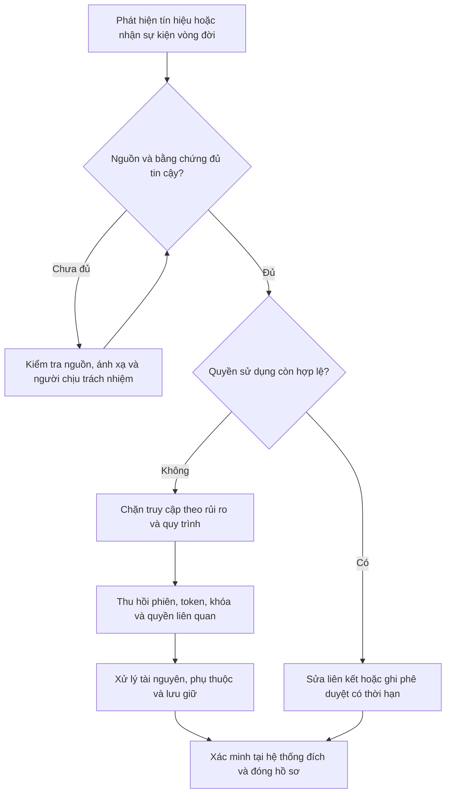

# Orphan account: tài khoản mồ côi trong vòng đời IAM

## Mục tiêu bài học

Trong quản lý danh tính và quyền truy cập (IAM), cấp tài khoản đúng lúc mới chỉ giải quyết đầu vào. Tổ chức còn phải biết tài khoản thuộc về ai, ai chịu trách nhiệm cho nó, vì sao nó được phép tồn tại và khi nào quyền truy cập phải kết thúc.

Sau bài học này, bạn có thể:

- Nhận biết orphan account và phân biệt với tài khoản không hoạt động, tài khoản chưa liên kết danh tính và tài khoản có quyền thừa.
- Đối soát tài khoản ứng dụng với nguồn danh tính và thông tin chủ sở hữu.
- Xử lý tài khoản nghi mồ côi theo mức rủi ro, có bằng chứng và khả năng phục hồi phù hợp.
- Ngăn tái diễn bằng quy trình joiner–mover–leaver, kiểm tra cấp phát và quản lý danh tính workload.

Các nguyên tắc áp dụng cho tài khoản nhân viên, nhà thầu, quản trị viên, đối tác và tài khoản phục vụ hệ thống. Cách xác định chủ thể hợp lệ khác nhau giữa từng loại.

## 1. Orphan account là gì?

**Orphan account**, hay **tài khoản mồ côi**, là tài khoản còn tồn tại trong một hệ thống nhưng không còn liên kết hợp lệ với chủ thể hoặc trách nhiệm quản lý cần thiết để duy trì nó theo chính sách vòng đời danh tính.

Hai tình huống thường gặp là:

1. Tài khoản của một người vẫn tồn tại sau khi quan hệ làm việc hoặc quyền sử dụng hệ thống đã kết thúc.
2. Tài khoản dùng cho dịch vụ, tự động hóa hoặc mục đích đặc biệt không còn có cá nhân hoặc nhóm chịu trách nhiệm hợp lệ.

Ví dụ, một nhà thầu đã kết thúc hợp đồng nhưng tài khoản cục bộ trong ứng dụng hỗ trợ khách hàng vẫn đăng nhập được. Một ví dụ khác là tài khoản triển khai do kỹ sư cũ tạo ra vẫn được pipeline sử dụng, nhưng không còn nhóm nào quản lý thông tin xác thực và quyền của tài khoản đó.

Không thể kết luận tài khoản mồ côi chỉ từ việc thiếu một trường dữ liệu. Thiếu `owner_id` có thể là lỗi đồng bộ; không có bản ghi nhân sự có thể là điều bình thường với tài khoản đối tác hoặc workload. Cần xác định loại tài khoản, nguồn dữ liệu có thẩm quyền và cơ sở cho phép tài khoản tiếp tục tồn tại.

> Tài khoản mồ côi không nhất thiết còn bật, và tài khoản đang hoạt động không nhất thiết có chủ sở hữu hợp lệ. Trạng thái đăng nhập và tính hợp lệ của vòng đời là hai thuộc tính cần kiểm tra riêng.

### Danh tính, tài khoản và quyền truy cập

| Khái niệm | Ý nghĩa | Ví dụ |
|---|---|---|
| Danh tính | Chủ thể mà tổ chức nhận diện và quản lý | Một nhân viên hoặc một workload |
| Tài khoản | Bản ghi đại diện cho chủ thể trong một hệ thống | Tài khoản IdP, tài khoản CRM, database user |
| Quyền truy cập | Những hành động chủ thể được phép thực hiện | Xem hồ sơ, xuất dữ liệu, triển khai ứng dụng |
| Chủ sở hữu chịu trách nhiệm | Người hoặc nhóm quản lý tính hợp lệ, mục đích và việc rà soát tài khoản | Quản lý nhân sự, nhóm vận hành dịch vụ |
| Nguồn có thẩm quyền | Nguồn được chỉ định để quyết định một thuộc tính vòng đời | Hệ thống nhân sự cho nhân viên; danh mục dịch vụ cho workload |

Một người có thể có nhiều tài khoản. Khóa tài khoản chính ở IdP không chứng minh rằng mọi tài khoản ứng dụng của người đó đã được xử lý.

Với tài khoản cá nhân, người sử dụng và người phê duyệt thường là hai vai trò khác nhau. Với tài khoản dịch vụ, nên phân biệt chủ thể kỹ thuật đang chạy với nhóm chịu trách nhiệm về vòng đời của nó.

## 2. Phân biệt với các trạng thái dễ nhầm

| Trạng thái | Dấu hiệu chính | Có chắc là orphan account không? | Hướng kiểm tra |
|---|---|---|---|
| Inactive account | Không có hoạt động trong khoảng thời gian quy định | Không; có thể là tài khoản dự phòng hợp lệ | Kiểm tra nhu cầu, lịch sử và chính sách không hoạt động |
| Stale account | Dấu hiệu sử dụng hoặc quản lý đã lâu không được cập nhật | Không; đây là tín hiệu cần rà soát | Kiểm tra xác thực, hoạt động API, chủ sở hữu và lần rà soát gần nhất |
| Uncorrelated account | Chưa ánh xạ được tài khoản với danh tính trong hệ thống quản trị | Chưa đủ bằng chứng | Tìm lỗi ánh xạ, nguồn ngoài nhân sự hoặc tài khoản cục bộ hợp lệ |
| Orphan account | Quan hệ với chủ thể hoặc trách nhiệm quản lý cần thiết không còn hợp lệ | Có khi đã xác minh theo chính sách | Thu hồi hoặc khôi phục quản lý hợp lệ |
| Excessive privilege | Chủ thể vẫn hợp lệ nhưng có nhiều quyền hơn nhu cầu | Không nhất thiết | Rà soát vai trò, thuộc tính và quyền hiệu lực |
| Disabled account | Bị chặn một số hoặc toàn bộ cách sử dụng theo cơ chế hệ thống | Không thể suy ra chỉ từ trạng thái này | Xác minh phiên, token, khóa và tài nguyên liên quan |

Một tài khoản không đăng nhập bằng giao diện trong 90 ngày vẫn có thể gọi API mỗi giờ. Ngược lại, tài khoản có hoạt động hôm qua vẫn có thể thuộc về người đã nghỉ việc từ tuần trước.

MFA giúp tăng độ tin cậy của việc xác thực, nhưng không chứng minh người đó còn được phép sử dụng tài khoản. Tương tự, RBAC và ABAC chỉ hiệu quả khi đầu vào vòng đời, tư cách thành viên nhóm và thuộc tính chủ thể được cập nhật đúng.

## 3. Vì sao tài khoản trở thành mồ côi?

### 3.1. Luồng nghỉ việc không đến được mọi hệ thống

Quy trình leaver khóa tài khoản IdP nhưng bỏ sót ứng dụng cũ, cơ sở dữ liệu, máy chủ hoặc dịch vụ SaaS do phòng ban tự mua.

SSO tập trung một phần đường đăng nhập. Ứng dụng vẫn có thể duy trì mật khẩu cục bộ, phiên riêng hoặc token được cấp trước đó. Mức độ thu hồi thực tế phụ thuộc từng hệ thống.

### 3.2. Kết nối cấp phát gặp lỗi

Yêu cầu vô hiệu hóa được gửi nhưng connector hết quyền, dịch vụ đích lỗi hoặc thông điệp nằm trong hàng đợi lỗi. Hệ thống nguồn ghi nhận đã hoàn tất bước gửi, trong khi tài khoản đích chưa thay đổi.

Vì vậy, cần phân biệt **đã yêu cầu thu hồi** với **đã quan sát và xác minh trạng thái thu hồi tại đích**.

### 3.3. Tài khoản ngoài quy trình chuẩn

Quản trị viên tạo tài khoản trực tiếp, nhóm dự án mở tài khoản dùng chung hoặc nhà cung cấp tạo quyền hỗ trợ tạm thời. Những tài khoản này không đi qua quy trình cấp phát nên không được hệ thống vòng đời theo dõi đầy đủ.

### 3.4. Định danh đối chiếu không ổn định

Đối chiếu bằng email có thể sai khi người dùng đổi tên, đổi miền email hoặc địa chỉ cũ được cấp lại. Một người tái gia nhập cũng có thể có quan hệ làm việc mới cần phê duyệt quyền lại.

Nên lưu mã định danh bất biến trong phạm vi nguồn, kèm định danh nguồn và quan hệ cấp phát. Không tự ghép tài khoản vào người mới chỉ vì hai bản ghi có cùng địa chỉ email.

### 3.5. Danh tính phi con người mất người chịu trách nhiệm

Tài khoản dịch vụ có thể còn phục vụ nghiệp vụ sau khi người tạo rời tổ chức. Nếu chủ sở hữu duy nhất là cá nhân đó, việc rà soát quyền, xoay khóa và xử lý sự cố dễ bị bỏ trống.

Trong trường hợp này, không nên chỉ dựa vào trạng thái nhân sự để ngắt tài khoản đang phục vụ sản xuất. Cần xác định workload, phụ thuộc, nhóm chịu trách nhiệm thay thế và cách giảm rủi ro trong lúc chuyển giao.

### 3.6. Thay đổi tổ chức làm mất quan hệ quản lý

Sáp nhập, tách nhóm, chuyển ứng dụng, kết thúc dự án và thay nhà cung cấp có thể để lại tài khoản chưa có bên tiếp nhận. Luồng mover vì vậy cũng cần rà soát trách nhiệm quản lý, không chỉ thay chức danh hoặc nhóm quyền.

## 4. Rủi ro của tài khoản mồ côi

Rủi ro phụ thuộc quyền, khả năng truy cập, tài nguyên và thời gian tài khoản tồn tại ngoài sự quản lý hợp lệ.

- **Truy cập trái phép kéo dài:** người đã rời tổ chức hoặc người nắm thông tin xác thực vẫn có thể sử dụng tài khoản.
- **Quyền quản trị bị bỏ quên:** tài khoản cũ còn thuộc nhóm quản trị, còn quyền đặc biệt hoặc có thể nhận vai trò khác.
- **Mất trách nhiệm giải trình:** khó xác định ai phải giải thích một thay đổi, phê duyệt quyền hay xử lý cảnh báo.
- **Lộ dữ liệu qua kênh phụ:** API key, SSH key, personal access token hoặc phiên ứng dụng vẫn hoạt động sau khi đường đăng nhập chính bị chặn.
- **Gián đoạn khi dọn dẹp:** xóa tài khoản chưa kiểm tra có thể làm hỏng job, thay đổi quyền sở hữu tài liệu hoặc mất khả năng truy xuất bằng chứng.

Một tài khoản đã bị khóa nhưng còn sở hữu kho mã nguồn hoặc tài liệu quan trọng vẫn cần xử lý vòng đời tài nguyên. Tuy nhiên, không nên đánh đồng rủi ro đó với tài khoản quản trị đang đăng nhập được.

## 5. Chuẩn bị dữ liệu để phát hiện

### 5.1. Xác định nguồn có thẩm quyền theo loại chủ thể

Không tồn tại một nguồn duy nhất phù hợp với mọi tài khoản.

| Loại tài khoản | Nguồn hoặc bằng chứng chính | Thông tin cần theo dõi |
|---|---|---|
| Nhân viên | Nguồn nhân sự được tổ chức chỉ định | Mã nhân sự, quan hệ làm việc, thời điểm hiệu lực |
| Nhà thầu, đối tác | Danh mục đối tác hoặc hợp đồng và người bảo trợ | Thời hạn, mục đích, người bảo trợ còn hợp lệ |
| Tài khoản quản trị cá nhân | Danh tính cá nhân kết hợp phê duyệt đặc quyền | Người sử dụng, vai trò quản trị, thời hạn được cấp |
| Tài khoản dịch vụ | Danh mục dịch vụ hoặc workload | Mục đích kỹ thuật, nhóm sở hữu, phụ thuộc, lịch rà soát |
| Tài khoản khẩn cấp | Hồ sơ quản lý truy cập khẩn cấp | Người hoặc nhóm giữ trách nhiệm, cơ chế kiểm soát, lần kiểm tra |
| Tài khoản hỗ trợ nhà cung cấp | Phê duyệt hỗ trợ và hồ sơ nhà cung cấp | Phạm vi, thời gian cho phép, người bảo trợ |

Tài khoản khẩn cấp có thể cố ý độc lập với một phần hạ tầng SSO. Nó vẫn cần chủ sở hữu, kiểm soát sử dụng và rà soát; mục đích đặc biệt không phải lý do miễn quản lý vòng đời.

### 5.2. Lập inventory tài khoản tại hệ thống đích

Tối thiểu cần thu thập:

- Định danh hệ thống và định danh tài khoản tại đích.
- Loại tài khoản, trạng thái và các phương thức truy cập được phép.
- Định danh nguồn, mã chủ thể và mã quan hệ làm việc nếu có.
- Chủ sở hữu hoặc người bảo trợ; mục đích và thời hạn phê duyệt.
- Nhóm, vai trò và quyền hiệu lực quan trọng.
- Dấu thời gian thu thập, trạng thái đầy đủ và nguồn của dữ liệu.
- Hoạt động gần nhất có thể quan sát, cùng giới hạn của phép đo đó.

Thông tin về khóa, token và ứng dụng được ủy quyền nên được kiểm kê ở mức metadata cần thiết. Không đưa giá trị bí mật của mật khẩu, khóa hay token vào báo cáo đối soát.

Một mô hình bản ghi minh họa:

```json
{
  "system_id": "crm-prod",
  "account_id": "u-1842",
  "account_type": "contractor",
  "identity_source": "partner-registry",
  "subject_id": "p-731",
  "engagement_id": "eng-204",
  "sponsor_group_id": "customer-operations",
  "account_state": "enabled",
  "approval_state": "expired",
  "privilege_level": "customer-data-export",
  "snapshot_id": "crm-snapshot-042",
  "collection_state": "complete"
}
```

Các giá trị trên là dữ liệu giả. Khóa tài khoản nên bao gồm ít nhất `system_id` và `account_id`; không giả định tên đăng nhập duy nhất trên mọi hệ thống.

### 5.3. Kiểm tra chất lượng dữ liệu trước khi kết luận

Một bản xuất nhân sự rỗng do lỗi phân trang không có nghĩa toàn bộ nhân viên đã rời tổ chức. Tương tự, thiếu bản ghi chủ sở hữu trong một lần đồng bộ có thể là dữ liệu đến chậm.

Trước khi đối soát, cần kiểm tra:

- Đã đọc hết phân trang, đúng phạm vi và đủ quyền truy vấn chưa?
- Nguồn có báo hoàn tất lần đồng bộ không?
- Dữ liệu mới đến mức nào so với ngưỡng mà tổ chức chấp nhận?
- Có mức giảm số lượng bất thường hoặc lỗi ánh xạ diện rộng không?
- Thời gian có cùng quy ước múi giờ và thời điểm hiệu lực không?
- Nguồn đang gửi toàn bộ snapshot hay chỉ gửi thay đổi tăng dần?

Việc một tài khoản không xuất hiện trong một lô thay đổi tăng dần không chứng minh tài khoản đó đã bị xóa. Khi dữ liệu không đạt điều kiện chất lượng, dừng kết luận tự động dựa trên sự vắng mặt và phát cảnh báo lỗi nguồn.

## 6. Đối soát để tìm tài khoản nghi mồ côi

### 6.1. Quy tắc tạo ứng viên

Có thể dùng các tín hiệu sau để tạo danh sách cần điều tra:

| Tín hiệu | Vì sao cần kiểm tra | Điều cần xác minh thêm |
|---|---|---|
| Không tìm thấy chủ thể tương ứng | Có thể là tài khoản ngoài quy trình hoặc liên kết bị mất | Chất lượng snapshot, nguồn danh tính khác, lịch sử cấp phát |
| Quan hệ làm việc đã kết thúc | Quyền sử dụng có thể đã hết | Thời điểm hiệu lực, các quan hệ còn hợp lệ, phê duyệt riêng |
| Người bảo trợ không còn hợp lệ | Tài khoản đối tác có thể không còn bên chịu trách nhiệm | Người bảo trợ mới và nhu cầu truy cập còn được phê duyệt |
| Chủ sở hữu workload không còn tồn tại | Mất trách nhiệm quản lý tài khoản dịch vụ | Dịch vụ có còn chạy và nhóm nào tiếp nhận |
| Yêu cầu thu hồi quá hạn | Thu hồi tại đích có thể thất bại | Trạng thái đích, hàng đợi, lỗi connector và lịch sử thử lại |
| Tài khoản không có trong sổ cấp phát | Có thể được tạo trực tiếp | Phê duyệt thủ công, tài khoản hệ thống tích hợp sẵn |

Nên biểu diễn rõ các trạng thái như `CANDIDATE`, `CONFIRMED_ORPHAN`, `LEGITIMATE_EXCEPTION` và `DATA_QUALITY_ISSUE`. Đây là các trạng thái minh họa cho hồ sơ xử lý, không phải trạng thái tiêu chuẩn chung của mọi nền tảng IAM.

### 6.2. Ví dụ truy vấn đối soát

Giả sử dữ liệu đã được chuẩn hóa thành:

- `account_inventory`: inventory tài khoản của một snapshot tại hệ thống đích.
- `identity_relationships`: các quan hệ làm việc đã chuẩn hóa, có thời điểm hiệu lực.
- `validated_accounts`: tập tài khoản được xác nhận có phê duyệt riêng còn hiệu lực và đúng phạm vi.
- `reconciliation_inputs`: mốc dữ liệu của lượt đối soát đã qua kiểm tra độ đầy đủ và độ mới.

Truy vấn SQL dưới đây chỉ tạo **ứng viên** cho tài khoản nhân viên và nhà thầu còn bật. Các tham số do lượt đối soát cung cấp; không ghép giá trị đầu vào trực tiếp vào chuỗi SQL.

```sql
SELECT
    a.system_id,
    a.account_id,
    a.account_type,
    a.identity_source,
    a.subject_id,
    a.privilege_level
FROM account_inventory AS a
WHERE a.snapshot_id = :target_snapshot_id
  AND a.account_state = 'enabled'
  AND a.account_type IN ('employee', 'contractor')
  AND EXISTS (
      SELECT 1
      FROM reconciliation_inputs AS i
      WHERE i.run_id = :run_id
        AND i.identity_source = a.identity_source
        AND i.target_snapshot_id = a.snapshot_id
        AND i.input_state = 'ready'
  )
  AND NOT EXISTS (
      SELECT 1
      FROM identity_relationships AS r
      WHERE r.source_snapshot_id = :identity_snapshot_id
        AND r.identity_source = a.identity_source
        AND r.subject_id = a.subject_id
        AND r.lifecycle_state = 'active'
        AND r.valid_from <= :as_of
        AND (r.valid_until IS NULL OR :as_of < r.valid_until)
  )
  AND NOT EXISTS (
      SELECT 1
      FROM validated_accounts AS v
      WHERE v.run_id = :run_id
        AND v.system_id = a.system_id
        AND v.account_id = a.account_id
        AND v.approval_state = 'approved'
        AND v.valid_from <= :as_of
        AND :as_of < v.valid_until
  );
```

Trong mô hình minh họa, `ready` chỉ được thiết lập sau khi xác minh snapshot nguồn và snapshot đích tương ứng với lượt chạy. Nó không đơn thuần có nghĩa là truy vấn đã thực thi thành công.

Truy vấn kiểm tra sự tồn tại của một quan hệ còn hợp lệ để tránh kết luận từ một bản ghi hợp đồng cũ đã kết thúc. Tuy nhiên, khi tài khoản được cấp riêng cho một hợp đồng hoặc nhiệm vụ, phải đối chiếu thêm `engagement_id` và phạm vi quyền. Một hợp đồng mới không tự động hợp thức hóa quyền từ hợp đồng cũ.

Các giới hạn khác cần giữ rõ:

- Không có liên kết chủ thể sẽ tạo tín hiệu điều tra, không đủ để tự động xóa tài khoản.
- Tài khoản dịch vụ và tài khoản khẩn cấp phải đi qua quy tắc riêng.
- Truy vấn không tìm hết tài khoản đã khóa nhưng còn tài nguyên, phiên hoặc thông tin xác thực cần xử lý.
- Có quan hệ làm việc hợp lệ chỉ xác nhận một phần vòng đời; không chứng minh mọi quyền hiện tại đều cần thiết.

### 6.3. Kết hợp sự kiện với đối soát định kỳ

Sự kiện nghỉ việc hỗ trợ thu hồi nhanh. Đối soát định kỳ giúp tìm phần bị bỏ sót, bao gồm ứng dụng không có connector, tài khoản tạo trực tiếp và tác vụ thu hồi thất bại.

Cần xử lý sự kiện gửi lặp và đến sai thứ tự. Ví dụ, sự kiện cập nhật hồ sơ cũ không được vô tình bật lại tài khoản đã bị chặn bởi một quyết định nghỉ việc mới hơn. Thiết kế nên dùng phiên bản hoặc thời điểm hiệu lực của sự kiện, cùng kiểm tra trạng thái hiện tại.

## 7. Phân loại rủi ro và chọn hành động

Không nên áp dụng một quy tắc “không tìm thấy owner thì xóa” cho mọi tài khoản.

| Tình huống | Ưu tiên xử lý | Hành động ban đầu phù hợp |
|---|---|---|
| Người đã nghỉ việc, tài khoản quản trị còn dùng được | Rất cao | Chặn truy cập ngay theo quy trình leaver; thu hồi đặc quyền và xác minh tại đích |
| Tài khoản có hoạt động bất thường sau thời điểm chấm dứt quyền | Rất cao | Cô lập truy cập và phối hợp quy trình ứng phó sự cố |
| Nhà thầu hết hạn, tài khoản dữ liệu còn bật | Cao | Xác minh thời điểm hiệu lực và phê duyệt; chặn khi đã xác nhận hết quyền |
| Tài khoản dịch vụ thiếu nhóm sở hữu, đang chạy job sản xuất | Cao, đồng thời có rủi ro gián đoạn | Xác định phụ thuộc, chỉ định người chịu trách nhiệm tạm thời và giảm quyền khả thi |
| Tài khoản cũ đã khóa, còn sở hữu tài liệu | Theo mức nhạy cảm của tài nguyên | Giữ trạng thái chặn, chuyển giao tài nguyên và hoàn tất lưu giữ |
| Nhiều tài khoản đồng thời mất liên kết sau lỗi đồng bộ | Ưu tiên kiểm tra nguồn | Dừng quyết định hàng loạt dựa trên dữ liệu thiếu và sửa nguyên nhân thu thập |

Mức ưu tiên còn phụ thuộc dữ liệu truy cập được, khả năng đăng nhập từ bên ngoài, quyền cấp quyền cho người khác và dấu hiệu thông tin xác thực bị lộ.

Với sự kiện chấm dứt quyền đã được xác nhận, không chờ hết một “thời gian ân hạn” chỉ để xem tài khoản có hoạt động hay không. Khoảng chờ điều tra phù hợp hơn với trường hợp chưa rõ danh tính hoặc lỗi dữ liệu, và cần có biện pháp kiểm soát tương ứng.

## 8. Quy trình xử lý có kiểm chứng



Khi có bằng chứng đủ mạnh về truy cập trái phép, cô lập theo quy trình sự cố có thể diễn ra song song với điều tra nguồn. Việc chưa hoàn tất đối soát không phải lý do trì hoãn hành động ứng phó đã có căn cứ.

### Bước 1: Lập hồ sơ bằng chứng

Ghi nhận tài khoản, hệ thống, loại chủ thể, nguồn dữ liệu, thời điểm phát hiện, quyền quan trọng, tín hiệu và người xử lý.

Không chỉ ghi “không có owner”. Nên ghi cụ thể: “Nhóm sở hữu đã giải thể; không có nhóm kế nhiệm trong danh mục dịch vụ; lần rà soát trước đã quá hạn”.

### Bước 2: Xác minh tính hợp lệ

Kiểm tra vòng đời chủ thể và quyền sử dụng của tài khoản:

- Chủ thể còn quan hệ hợp lệ nào áp dụng cho tài khoản này không?
- Có thay đổi mã định danh, chuyển tổ chức hoặc tái gia nhập không?
- Tài khoản có phải là tài khoản kỹ thuật, khẩn cấp hoặc tài khoản do hệ thống tạo sẵn không?
- Nguồn có đang thiếu dữ liệu, chậm cập nhật hoặc sai ánh xạ không?
- Nếu có ngoại lệ, ai phê duyệt, đến khi nào và phạm vi nào được phép?

Việc một người nhận trách nhiệm trên danh nghĩa chưa đủ để giữ nguyên mọi quyền. Cần xác nhận nhu cầu nghiệp vụ và quyền tối thiểu cần duy trì.

### Bước 3: Chặn các đường truy cập

Tùy hệ thống, việc thu hồi có thể bao gồm:

- Vô hiệu hóa tài khoản tại IdP và tại ứng dụng có tài khoản cục bộ.
- Gỡ nhóm, vai trò và quyền trực tiếp còn hiệu lực.
- Kết thúc phiên ứng dụng, phiên quản trị và phiên truy cập từ xa.
- Thu hồi refresh token, API key, personal access token và SSH key liên quan.
- Xử lý quyền ủy quyền hoặc thông tin xác thực khác do tài khoản kiểm soát.
- Thu hồi hoặc xoay bí mật dùng chung nếu chủ thể cũ từng biết chúng, theo phạm vi phụ thuộc.

Không mặc định rằng một thao tác bao phủ toàn bộ danh sách. Access token có thể tiếp tục được chấp nhận đến khi hết hạn nếu bên nhận chỉ xác minh token cục bộ và không có cơ chế kiểm tra trạng thái thu hồi phù hợp. Ngược lại, một số hệ thống có thể vô hiệu hóa phiên hoặc kiểm tra lại trạng thái chủ thể sớm hơn. Phải xác minh theo đường truy cập thực tế.

Đối với liên kết danh tính qua SSO, đăng xuất khỏi IdP cũng không bảo đảm mọi phiên ứng dụng đã chấm dứt. Tương tự, gửi yêu cầu vô hiệu hóa qua cơ chế cấp phát không chứng minh mọi khóa đã được thu hồi.

### Bước 4: Chuyển giao tài nguyên và xử lý phụ thuộc

Tài khoản có thể sở hữu tài liệu, repository, dashboard, lịch chạy, đối tượng cơ sở dữ liệu hoặc cấu hình tích hợp.

Cần xác định tài nguyên nào phải bàn giao, lưu giữ hoặc loại bỏ. Với workload, kiểm tra job theo lịch, chu kỳ xử lý cuối tháng và các kết nối ít sử dụng; chỉ quan sát một khoảng ngắn không đủ để kết luận không có phụ thuộc.

Nếu chuyển sang danh tính kỹ thuật mới, cấp đúng quyền cần thiết, kiểm tra hoạt động rồi thu hồi danh tính cũ. Tránh sao chép toàn bộ quyền cũ mà không đánh giá.

### Bước 5: Lưu giữ rồi xóa theo chính sách

Vô hiệu hóa là biện pháp kiểm soát truy cập; xóa là hành động kết thúc vòng đời bản ghi. Thời điểm thực hiện hai việc này có thể khác nhau.

Chỉ xóa sau khi đã xử lý tài nguyên, phụ thuộc, yêu cầu lưu giữ và nhu cầu bảo toàn bằng chứng. Các yêu cầu này do chính sách áp dụng quy định; không có một số ngày chờ chung cho mọi tổ chức.

Không cấp lại ngay tên đăng nhập, địa chỉ email hoặc định danh ngoài nếu việc tái sử dụng có thể khiến quyền cũ hoặc liên kết tài nguyên gắn nhầm sang người mới.

### Bước 6: Xác minh tại đích

Hồ sơ chỉ được đóng khi đạt tiêu chí xác minh tương ứng:

- Tài khoản hoặc đường truy cập cần chặn đã bị chặn tại hệ thống đích.
- Các nhóm quyền, phiên và thông tin xác thực liên quan đã được xử lý trong phạm vi được xác định.
- Tài nguyên và phụ thuộc có người tiếp nhận hoặc quyết định xử lý.
- Kết quả, giới hạn xác minh và người chịu trách nhiệm được lưu lại.

Dùng API trạng thái, inventory mới, nhật ký thu hồi và kiểm tra truy cập được ủy quyền khi phù hợp. Nếu có token chưa thể vô hiệu hóa ngay, cần ghi nhận thời điểm hết hiệu lực và biện pháp hạn chế cho giai đoạn còn lại; không đánh dấu đã thu hồi hoàn toàn khi còn đường truy cập chưa được kiểm soát.

## 9. Ví dụ xuyên suốt

Giả sử hợp đồng của nhà thầu Lan kết thúc tại thời điểm T0. Lan có ba tài khoản:

| Hệ thống | Trạng thái tại T0 | Vấn đề |
|---|---|---|
| IdP | Đã vô hiệu hóa | Chỉ xác nhận tài khoản nguồn đã bị chặn |
| CRM | Tài khoản cục bộ vẫn bật và còn token API | Luồng thu hồi tại ứng dụng thất bại |
| Kho mã nguồn | Tài khoản bị chặn, còn sở hữu một tích hợp | Cần xử lý tài nguyên và trách nhiệm quản lý |

Bộ đối soát phát hiện tài khoản CRM vẫn bật trong khi quan hệ hợp đồng đã hết hiệu lực. Sau khi xác nhận dữ liệu hợp đồng và snapshot CRM đầy đủ, nhóm IAM thực hiện:

1. Vô hiệu hóa tài khoản CRM, xử lý token và phiên theo cơ chế của ứng dụng.
2. Xác minh trạng thái tại CRM; kiểm tra hoạt động sau T0 để xác định có cần quy trình sự cố hay không.
3. Sửa lỗi connector, thực hiện lại yêu cầu thu hồi theo cách không gây tác dụng phụ khi chạy lặp.
4. Chuyển tích hợp ở kho mã nguồn sang danh tính workload do nhóm vận hành sở hữu.
5. Kiểm tra tích hợp với quyền tối thiểu, thu hồi thông tin xác thực cũ và lưu bằng chứng.
6. Giữ hoặc xóa các bản ghi tài khoản theo chính sách sau khi hoàn tất chuyển giao.

Nếu chỉ nhìn IdP, quy trình có vẻ đã hoàn thành. Đối soát tại ứng dụng cho thấy vẫn còn tài khoản chưa được thu hồi đúng vòng đời.

Nếu Lan quay lại với hợp đồng mới, việc cấp quyền phải dựa vào quan hệ mới và phê duyệt hiện tại. Không khôi phục toàn bộ quyền lịch sử chỉ vì tên người dùng không thay đổi.

## 10. Ngăn tái diễn từ thiết kế vòng đời

### Cấp phát phải tạo được mối liên kết có thể truy vết

Mỗi tài khoản cần có loại, nguồn, định danh chủ thể và căn cứ cấp phát. Với workload, cần thêm dịch vụ, nhóm chịu trách nhiệm và phạm vi sử dụng.

Nhóm sở hữu cũng có vòng đời. Cần có người kế nhiệm hoặc quy trình chuyển giao khi nhóm giải thể; chuyển từ một cá nhân sang một tên nhóm không có thành viên không giải quyết được vấn đề.

### Joiner–mover–leaver phải theo dõi đến kết quả tại đích

- **Joiner:** cấp quyền từ phê duyệt, lưu liên kết tài khoản và thời hạn cần thiết.
- **Mover:** rà soát lại quyền cũ, thay đổi người bảo trợ hoặc trách nhiệm quản lý.
- **Leaver:** phát sự kiện theo thời điểm hiệu lực, thu hồi tại các hệ thống và xác minh hoàn tất.

Tác vụ cần có retry, xử lý lỗi, khả năng chạy lặp an toàn và cảnh báo quá hạn. Một thông điệp đã được gửi không thay thế được bằng chứng trạng thái cuối cùng.

### Giảm ngoại lệ dài hạn

Tài khoản đối tác và hỗ trợ nên có ngày kết thúc. Quyền quản trị nên được giới hạn theo nhu cầu và thời gian khi nền tảng hỗ trợ.

Ngoại lệ hợp lệ cần có lý do, bên phê duyệt, người chịu trách nhiệm, phạm vi và ngày rà soát hoặc hết hạn. Danh sách miễn kiểm tra vĩnh viễn dễ trở thành nơi tích tụ tài khoản mồ côi.

### Quản lý workload như một chủ thể riêng

Khi phù hợp, sử dụng danh tính workload do nền tảng quản lý và thông tin xác thực có thời hạn ngắn để giảm phụ thuộc vào tài khoản cá nhân và bí mật lâu dài.

Dù không có mật khẩu lâu dài, workload vẫn cần người chịu trách nhiệm, quyền tối thiểu và cơ chế kết thúc vòng đời. Công nghệ xác thực không thay thế trách nhiệm quản lý.

### Kiểm kê cả hệ thống ngoài luồng SSO

Danh sách ứng dụng SSO không phải inventory đầy đủ. Cần biết các hệ thống có tài khoản cục bộ, dịch vụ đám mây, cơ sở dữ liệu và tích hợp do phòng ban tự quản lý.

Rà soát quyền định kỳ nên hiển thị đủ ngữ cảnh để người duyệt xác nhận nhu cầu. Một danh sách chỉ gồm tên đăng nhập và nút “giữ lại” khó giúp phát hiện mất trách nhiệm quản lý.

## 11. Đo lường hiệu quả

Chỉ đếm số tài khoản đã xóa có thể tạo động cơ xử lý vội. Cần đo cả chất lượng phát hiện, mức bao phủ và kết quả kiểm soát.

| Chỉ số | Cách hiểu |
|---|---|
| Độ bao phủ kiểm kê | Số hệ thống trong phạm vi có inventory đạt yêu cầu chia cho tổng số hệ thống đã biết trong phạm vi |
| Số ứng viên chưa xác minh | Khối lượng tín hiệu còn cần điều tra, tách khỏi số đã xác nhận |
| Số tài khoản mồ côi đã xác nhận | Đếm theo cặp hệ thống–tài khoản, có mốc thời gian và phạm vi rõ ràng |
| Thời gian chặn truy cập sau khi hết quyền | Từ thời điểm quyết định hết quyền có hiệu lực đến khi xác minh các đường truy cập trong phạm vi đã bị chặn |
| Tỷ lệ thu hồi quá hạn | Tác vụ thu hồi chưa hoàn tất đúng hạn chia cho số tác vụ đến hạn trong kỳ |
| Tỷ lệ ứng viên do lỗi dữ liệu | Phản ánh vấn đề thu thập, ánh xạ và chất lượng quy tắc |
| Tỷ lệ tái diễn | Tài khoản hoặc nguyên nhân đã xử lý nhưng tiếp tục xuất hiện trở lại |

Nếu tính tỷ lệ tài khoản mồ côi tại một thời điểm:

```text
Tỷ lệ tài khoản mồ côi đã xác nhận
  = Số tài khoản mồ côi đã xác nhận còn tồn tại trong phạm vi
    / Tổng số tài khoản đã kiểm kê trong cùng phạm vi
```

Cần công bố rõ có tính tài khoản đã khóa hay không, nguồn nào chưa đủ dữ liệu và kỳ quan sát. Inventory thiếu có thể khiến tỷ lệ trông thấp hơn thực tế.

Nên tách tài khoản đặc quyền và tài khoản truy cập dữ liệu nhạy cảm. Một tài khoản quản trị còn dùng được có thể cần ưu tiên hơn nhiều tài khoản đã bị khóa.

## 12. Những sai lầm cần tránh

- **Xóa hàng loạt sau một phép đối chiếu không tìm thấy bản ghi:** có thể biến lỗi đồng bộ thành sự cố diện rộng.
- **Dùng lần đăng nhập cuối làm tiêu chí duy nhất:** bỏ sót hoạt động API, job nền và phiên còn hiệu lực.
- **Cho rằng khóa IdP đã chấm dứt mọi truy cập:** cần xác minh ứng dụng, phiên và thông tin xác thực phụ thuộc.
- **Chỉ xử lý tài khoản người dùng:** tài khoản dịch vụ và tài khoản hỗ trợ cũng có thể mất chủ sở hữu.
- **Gán owner mới rồi đóng hồ sơ ngay:** chưa giải quyết quyền thừa, bí mật cũ và tính hợp lệ của mục đích.
- **Bật lại tài khoản để thử một phụ thuộc chưa rõ:** có thể phục hồi cả quyền truy cập trái phép; ưu tiên điều tra cấu hình và phương án chuyển giao có kiểm soát.
- **Đồng nhất xóa với hoàn tất:** tài nguyên, bằng chứng hoặc thông tin xác thực ngoài tài khoản có thể còn phải xử lý.
- **Chỉ dọn danh sách hiện tại:** nếu không sửa nguồn gây ra lỗi, tài khoản mồ côi sẽ tiếp tục phát sinh.

## 13. Checklist áp dụng

### Khi phát hiện một tài khoản nghi mồ côi

- [ ] Biết loại tài khoản và nguồn có thẩm quyền tương ứng.
- [ ] Xác nhận dữ liệu đủ mới, đủ phạm vi và đã thu thập hoàn tất.
- [ ] Đối chiếu bằng định danh ổn định, có kiểm tra thời điểm hiệu lực.
- [ ] Kiểm tra các quan hệ, phê duyệt và ngoại lệ áp dụng cho chính tài khoản đó.
- [ ] Đánh giá quyền hiệu lực, đường truy cập và tài nguyên liên quan.
- [ ] Phân biệt lỗi dữ liệu, ứng viên điều tra và tài khoản mồ côi đã xác nhận.

### Khi đóng hồ sơ

- [ ] Hành động phù hợp với tính hợp lệ của chủ thể và mức rủi ro.
- [ ] Đã xác minh kết quả thu hồi tại đích, bao gồm các đường truy cập liên quan.
- [ ] Tài nguyên và workload có phương án chuyển giao hoặc kết thúc.
- [ ] Ngoại lệ còn lại có chủ sở hữu, giới hạn và thời hạn rõ ràng.
- [ ] Bằng chứng xử lý và các giới hạn chưa giải quyết được được ghi nhận.
- [ ] Nguyên nhân gốc có người phụ trách và được theo dõi để ngăn tái diễn.

Quản lý tài khoản mồ côi là việc duy trì mối liên kết có thể kiểm chứng giữa tài khoản, chủ thể, trách nhiệm quản lý và quyền truy cập trong suốt vòng đời. Kết quả cần đạt là mỗi tài khoản có lý do tồn tại hợp lệ, và khi lý do đó kết thúc, quyền truy cập được thu hồi thực sự.