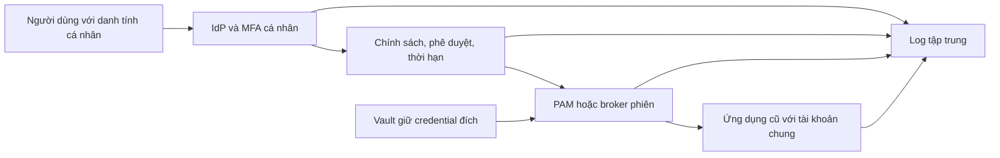

# Shared account — Tài khoản dùng chung trong vòng đời IAM

## 1. Mục tiêu bài học

Trong quản lý danh tính và quyền truy cập (Identity and Access Management — IAM), tài khoản không chỉ là tên đăng nhập và mật khẩu. Nó còn đại diện cho một chủ thể, tập quyền, các phương thức xác thực, phiên đang hoạt động và lịch sử hành động. Khi nhiều người sử dụng cùng một tài khoản, những thành phần này dễ bị gộp lại và làm mất mối liên hệ giữa hành động với người thực hiện.

Bài học thuộc chương **Account lifecycle**, tập trung vào cách quản lý tài khoản dùng chung từ lúc đề xuất, cấp quyền sử dụng, vận hành, thay đổi thành viên đến thu hồi và ngừng sử dụng. Sau bài học, người học có thể:

- Nhận diện tài khoản dùng chung và phân biệt với tài nguyên dùng chung, vai trò và danh tính workload.
- Giải thích các rủi ro về xác thực, ít quyền nhất, kiểm toán và thu hồi quyền.
- Chọn phương án thay thế hoặc thiết kế kiểm soát bù trừ cho hệ thống chưa hỗ trợ tài khoản cá nhân.
- Xây dựng quy trình joiner, mover, leaver và kiểm tra hiệu lực thu hồi trên các đường truy cập.
- Đánh giá mức độ quy trách nhiệm của log thay vì chỉ kiểm tra xem hệ thống có ghi log hay không.

Các cấu hình, thời hạn và bản ghi trong bài là ví dụ thiết kế cho một tổ chức giả định, không phải chính sách bắt buộc của mọi hệ thống.

## 2. Shared account là gì?

**Shared account**, hay tài khoản dùng chung, là một tài khoản mà nhiều người có thể dùng để truy cập hệ thống dưới cùng một danh tính tại hệ thống đích.

Ví dụ, ba nhân viên vận hành cùng đăng nhập vào ứng dụng cũ bằng tài khoản `legacy-operator`. Dù ba người sử dụng ba máy khác nhau, ứng dụng có thể chỉ ghi:

```text
time=2026-11-26T02:15:00Z
actor=legacy-operator
action=change_shipping_address
resource=order-481
result=success
```

Bản ghi cho biết tài khoản nào thực hiện hành động, nhưng chưa xác định người nào đã điều khiển tài khoản ở thời điểm đó. Địa chỉ IP hoặc tên máy có thể hỗ trợ điều tra; chúng không tự thay thế danh tính cá nhân, nhất là khi có NAT, VPN hoặc máy trạm dùng chung.

Tài khoản dùng chung có thể tồn tại trong nhiều hình thức:

| Hình thức | Ví dụ | Vấn đề cần nhận diện |
| --- | --- | --- |
| Tài khoản nghiệp vụ dùng chung | `sales-team` đăng nhập cổng nhà cung cấp | Các nhân viên xuất hiện dưới cùng một danh tính |
| Tài khoản quản trị dùng chung | Nhiều quản trị viên dùng một tài khoản admin cục bộ | Quyền lớn và khó quy trách nhiệm khi có thay đổi |
| Tài khoản mặc định được dùng tập thể | Nhiều người sử dụng tài khoản quản trị có sẵn của thiết bị | Credential dễ lan truyền; có thể có đường truy cập ngoài quản lý tập trung |
| Tài khoản khẩn cấp có nhiều người được phép kích hoạt | Tài khoản phục hồi ứng dụng khi hệ thống đăng nhập chính gặp sự cố | Cần quản lý người kích hoạt, phương tiện xác thực và hậu kiểm |
| Tài khoản của người đã nghỉ được cả nhóm tiếp tục dùng | Nhân viên mới đăng nhập tài khoản cũ để tiếp tục công việc | Sai liên kết giữa danh tính, chủ sở hữu và người sử dụng thực tế |

Tên gọi không quyết định bản chất. Tài khoản tên `nguyen.van.a` vẫn trở thành tài khoản dùng chung nếu người khác được phép dùng nó. Ngược lại, một nhóm tên `operations` không phải tài khoản dùng chung nếu từng thành viên vẫn đăng nhập bằng danh tính riêng.

## 3. Phân biệt các khái niệm dễ nhầm

### 3.1. Tài nguyên dùng chung và tài khoản dùng chung

Nhiều người cùng làm việc trên một tài nguyên không đòi hỏi họ phải dùng cùng thông tin đăng nhập.

Ví dụ, hộp thư `support@example.com` có thể được phân quyền cho Lan và Minh. Lan đăng nhập bằng tài khoản của Lan, Minh đăng nhập bằng tài khoản của Minh; cả hai được phép làm việc với hộp thư hỗ trợ.

Trong Microsoft 365, tài khoản gắn với shared mailbox không được thiết kế để đăng nhập trực tiếp; tài liệu của Microsoft yêu cầu chặn đăng nhập tài khoản đó. Đây là ví dụ về chia sẻ tài nguyên thông qua phân quyền thay vì phát mật khẩu của tài khoản hộp thư. [Nguồn: Microsoft Learn — About shared mailboxes](https://learn.microsoft.com/en-us/microsoft-365/admin/email/about-shared-mailboxes?view=o365-worldwide).

### 3.2. Shared account và RBAC

**RBAC**, phân quyền theo vai trò, cho phép nhiều người nhận cùng một vai trò nhưng vẫn giữ danh tính riêng:

```text
lan  -> vai trò InvoiceReviewer
minh -> vai trò InvoiceReviewer
```

Tại hệ thống đích, log vẫn có thể ghi `lan` và `minh`. Trong mô hình dùng chung:

```text
lan  -> tài khoản invoice-admin
minh -> tài khoản invoice-admin
```

Nếu ứng dụng chỉ nhìn thấy `invoice-admin`, việc gắn nhóm ở bên ngoài không tự tạo ra khả năng phân biệt hai người bên trong ứng dụng.

### 3.3. Shared account và danh tính workload

Workload identity là danh tính dành cho tiến trình, dịch vụ hoặc tác vụ tự động. Ví dụ, dịch vụ xuất báo cáo dùng danh tính riêng để đọc dữ liệu.

Việc một nền tảng triển khai cùng một dịch vụ trên nhiều instance không tự biến danh tính dịch vụ thành tài khoản dùng chung cho con người. Tuy nhiên, nếu nhân viên lấy credential của dịch vụ để đăng nhập quản trị hoặc chạy thao tác thủ công, ranh giới giữa người và workload đã bị phá vỡ.

Nên tách:

- Danh tính cá nhân cho thao tác của con người.
- Danh tính workload được giới hạn theo dịch vụ, môi trường và mục đích.
- Cơ chế khẩn cấp được kiểm soát riêng cho nhu cầu phục hồi.

Không dùng một tài khoản vừa cho job định kỳ, vừa cho cả nhóm đăng nhập tương tác. Cách dùng này làm việc xoay credential và thu hồi quyền cá nhân dễ gây gián đoạn job.

### 3.4. Shared account và thiết bị dùng chung

Một máy tính ở quầy giao dịch có thể được nhiều người sử dụng nhưng vẫn yêu cầu từng người đăng nhập hoặc xác thực lại cho giao dịch. Đây là thiết bị dùng chung với danh tính cá nhân.

Nếu máy luôn mở bằng một tài khoản chung và mọi thao tác nghiệp vụ đều mang danh tính đó, tổ chức phải giải quyết vấn đề quy trách nhiệm ở lớp ứng dụng hoặc thiết kế lại luồng làm việc. Chỉ có sổ bàn giao ca không đủ để chứng minh ai đã thực hiện từng hành động.

## 4. Vì sao tài khoản dùng chung gây khó cho IAM?

### 4.1. Mất khả năng gắn hành động với cá nhân

Trong IAM, **xác thực** trả lời ai đang truy cập, còn **phân quyền** quyết định chủ thể đó được làm gì. Với shared account, câu trả lời ở hệ thống đích có thể chỉ là tên tài khoản chung.

Khi xảy ra sự cố, tổ chức cần lần theo chuỗi:

```text
Người thực hiện
  -> lần xác thực cá nhân
  -> yêu cầu và phê duyệt truy cập
  -> phiên sử dụng tài khoản đích
  -> hành động trên tài nguyên
```

Nếu thiếu liên kết giữa phiên cá nhân và phiên đích, log ứng dụng chỉ chứng minh rằng tài khoản chung đã hoạt động. Nó không đủ để kết luận một thành viên cụ thể đã gây ra sự cố.

### 4.2. Quyền thường bị cộng dồn

Giả sử Lan chỉ cần xem đơn hàng, Minh cần sửa địa chỉ giao hàng, còn Huy cần hủy đơn. Khi cả ba dùng chung một tài khoản, người quản trị dễ cấp cho tài khoản đó hợp của tất cả quyền:

```text
view_order + update_address + cancel_order
```

Kết quả là Lan cũng có thể hủy đơn. Việc một cổng trung gian chỉ cho Lan mở ứng dụng không có nghĩa ứng dụng sẽ giới hạn Lan ở quyền xem. Muốn phân quyền chi tiết qua trung gian, lớp đó phải thực sự kiểm soát được hành động và chặn được đường đi vòng.

### 4.3. Thu hồi quyền không còn là xóa một tài khoản cá nhân

Nếu Minh đã biết mật khẩu tài khoản chung, xóa Minh khỏi nhóm nhân sự không làm Minh quên mật khẩu. Minh còn có thể giữ cookie phiên, token, khóa API hoặc phương thức khôi phục.

Vì vậy, offboarding cần xử lý cả quyền truy cập mới và những phương tiện đã được cấp trước đó.

### 4.4. MFA dễ bị biến thành yếu tố dùng chung

MFA là xác thực đa yếu tố. Nếu cả nhóm dùng một mật khẩu và cùng sao chép một TOTP seed, việc nhập mã OTP không giúp xác định ai trong nhóm đang đăng nhập.

Các cách làm như đăng mã OTP lên nhóm chat hoặc yêu cầu một người bấm chấp thuận cho cả ca trực làm giảm khả năng kiểm soát và quy trách nhiệm. Một thiết bị MFA đặt tại văn phòng cũng cần quản lý người nhận, thời gian sử dụng và khôi phục; bản thân vị trí thiết bị không chứng minh danh tính người thực hiện.

### 4.5. Tăng phạm vi ảnh hưởng và phụ thuộc cá nhân

Một người có thể biết mật khẩu, một người khác giữ điện thoại MFA, còn email khôi phục thuộc nhân viên đã nghỉ. Tổ chức vừa chịu rủi ro truy cập trái phép, vừa có nguy cơ mất quyền truy cập hợp lệ.

Cần phân biệt ba trách nhiệm:

| Trách nhiệm | Ý nghĩa |
| --- | --- |
| Chủ sở hữu nghiệp vụ | Xác nhận lý do tồn tại, tập quyền và danh sách người cần dùng |
| Đơn vị quản trị kỹ thuật | Quản lý credential, tích hợp, phiên và cơ chế khôi phục |
| Người được phép sử dụng | Cá nhân được cấp quyền theo phạm vi và thời hạn cụ thể |

Người biết mật khẩu không mặc nhiên là người có quyền phê duyệt thêm thành viên.

## 5. Chọn giải pháp theo thứ tự ưu tiên

Trước khi xây cơ chế chia sẻ credential, hãy xác định nhu cầu thực tế: chia sẻ công việc, tài nguyên hay buộc phải sử dụng một danh tính đích duy nhất?

| Nhu cầu | Phương án nên xem xét trước | Điểm cần kiểm tra |
| --- | --- | --- |
| Nhiều người làm cùng nghiệp vụ | Tài khoản cá nhân và RBAC/ABAC | Ứng dụng ghi được người thực hiện và giới hạn đúng quyền |
| Cùng sử dụng hộp thư hoặc lịch | Phân quyền ủy quyền cho tài nguyên | Người dùng đăng nhập bằng danh tính riêng |
| Ứng dụng hỗ trợ liên kết danh tính | SSO bằng danh tính cá nhân | Ánh xạ mỗi người sang đúng tài khoản hoặc chủ thể tại ứng dụng |
| Quản trị máy chủ, thiết bị | Danh tính quản trị riêng; cơ chế nâng quyền có ghi nhận người gốc | Phân biệt người đăng nhập ban đầu với tài khoản hiệu lực |
| Tác vụ tự động | Workload identity hoặc service account chuyên biệt | Không chia sẻ credential cho người dùng tương tác |
| Ứng dụng cũ chỉ hỗ trợ một tài khoản | Vault, PAM hoặc broker cùng kiểm soát bù trừ | Hạn chế lộ secret, quản lý phiên và chặn đường đi vòng |
| Khôi phục khi có sự cố danh tính | Thiết kế truy cập khẩn cấp có giám sát | Khả dụng khi thành phần chính hỏng và có quy trình hậu kiểm |

**SSO không tự bảo đảm danh tính cá nhân ở hệ thống đích.** SSO có thể ánh xạ mỗi người sang tài khoản riêng, hoặc có thể đưa nhiều người vào cùng một tài khoản cũ. Phải kiểm tra luồng tích hợp cụ thể.

Tương tự, ABAC — phân quyền dựa trên thuộc tính — có thể hạn chế ai được mở phiên theo thiết bị, thời gian hoặc mức rủi ro ở cổng truy cập. Nó không tự làm ứng dụng cũ hiểu các thuộc tính đó nếu ứng dụng chỉ nhận một tài khoản chung.

## 6. Khi nào có thể chấp nhận ngoại lệ dùng chung?

Một ứng dụng cũ không hỗ trợ danh tính riêng, hoặc một thiết bị cần tài khoản phục hồi có sẵn, có thể tạo ra nhu cầu ngoại lệ. Ngoại lệ cần được đánh giá theo mức rủi ro và khả năng kiểm soát, thay vì được coi là cách cấp quyền mặc định.

Hồ sơ ngoại lệ nên trả lời được:

1. Tài khoản dùng cho hệ thống và mục đích nào?
2. Vì sao chưa thể chuyển sang danh tính cá nhân hoặc ủy quyền?
3. Ai là chủ sở hữu và ai được sử dụng?
4. Tài khoản có quyền gì, trên dữ liệu và môi trường nào?
5. Người sử dụng được xác thực và phê duyệt như thế nào?
6. Credential, MFA và phương tiện khôi phục được bảo vệ ở đâu?
7. Làm sao gắn phiên đích với cá nhân và phát hiện truy cập ngoài luồng?
8. Làm sao thu hồi quyền, xử lý credential đã lộ và kết thúc phiên?
9. Khi nào rà soát lại, ai chấp nhận rủi ro còn lại và kế hoạch thay thế là gì?

Nếu tài khoản có thể thực hiện giao dịch nhạy cảm nhưng không thể xác định cá nhân thực hiện hoặc kiểm soát đường truy cập, cần giới hạn chức năng, bổ sung bước phê duyệt tại hệ thống phù hợp hoặc dừng cách dùng đó. Việc lưu mật khẩu trong vault không tự giải quyết rủi ro nghiệp vụ này.

## 7. Mô hình kiểm soát khi chưa thể bỏ shared account

**Vault** lưu và kiểm soát truy cập bí mật. **PAM** là quản lý truy cập đặc quyền; tùy sản phẩm, nó có thể bổ sung phê duyệt, cấp quyền có thời hạn, môi giới phiên và ghi nhận hoạt động. **Broker** là thành phần trung gian thực hiện hoặc điều phối truy cập đến hệ thống đích.

Một thiết kế tham khảo:



Thiết kế này có các điểm kiểm soát riêng:

- **Danh tính đầu vào:** mỗi người đăng nhập bằng tài khoản riêng, không đăng nhập vault bằng một tài khoản dùng chung khác.
- **Quyết định cấp quyền:** kiểm tra vai trò, thuộc tính, mục đích, phê duyệt và thời hạn cho từng yêu cầu.
- **Credential đích:** ưu tiên không đưa secret cho người sử dụng; broker sử dụng secret để mở phiên nếu tích hợp cho phép.
- **Phiên đích:** gắn mã phiên với người yêu cầu và áp dụng giới hạn kỹ thuật có thể thực thi.
- **Đường truy cập:** hạn chế đăng nhập trực tiếp ngoài broker bằng các biện pháp mà ứng dụng, mạng hoặc thiết bị hỗ trợ.
- **Kiểm toán:** liên kết sự kiện từ IdP, phê duyệt, broker và ứng dụng; cảnh báo khi xuất hiện đăng nhập không có phiên tương ứng.

Ví dụ sản phẩm: Microsoft Entra hỗ trợ password-based SSO cho các ứng dụng tương thích, trong đó người dùng đăng nhập bằng tài khoản tổ chức và hệ thống trung gian điền credential chung. Đây là môi giới đăng nhập bằng mật khẩu, không đồng nghĩa ứng dụng đã triển khai liên kết danh tính OIDC. [Nguồn: Microsoft Learn — Share accounts with Microsoft Entra ID](https://learn.microsoft.com/en-us/entra/identity/users/users-sharing-accounts).

### 7.1. Không hiển thị mật khẩu có ý nghĩa gì?

Không hiển thị mật khẩu giúp giảm việc sao chép và phát tán secret. Tuy nhiên, điều đó không chứng minh người dùng không thể thu được cookie, token hoặc dữ liệu nhạy cảm từ phiên trên thiết bị họ kiểm soát.

Cần xác định mô hình đe dọa và khả năng của giải pháp. Một broker tạo phiên trên môi trường được quản lý có mức kiểm soát khác với một tiện ích tự điền mật khẩu trên trình duyệt cá nhân.

### 7.2. Giới hạn thời gian phải gắn với cơ chế kết thúc phiên

Quyền mở phiên có thể hết hạn sau 30 phút, nhưng phiên ứng dụng có thể còn sống nhiều giờ. Để thực thi truy cập có thời hạn, cần có cơ chế kết thúc phiên đích hoặc hạn chế phiên ở môi trường trung gian.

Nếu ứng dụng không hỗ trợ thu hồi phiên, tổ chức phải ghi nhận giới hạn này và thiết kế biện pháp bù trừ phù hợp. Không được coi việc hết hạn yêu cầu trong vault là bằng chứng phiên đích đã chấm dứt.

### 7.3. Truy cập đồng thời cần giữ được liên kết cá nhân

Nếu nhiều người cùng sử dụng tài khoản đích mà log không phân biệt được các phiên, khả năng quy trách nhiệm sẽ yếu đi.

Có thể áp dụng checkout độc quyền theo từng khoảng thời gian khi phù hợp, nhưng checkout độc quyền chỉ có giá trị nếu không còn phiên cũ và không có đường đăng nhập ngoài luồng. Với truy cập đồng thời, cần mã phiên hoặc bằng chứng tương đương đủ để liên kết từng hoạt động với người sử dụng; chỉ ghi giờ nhận mật khẩu là chưa đủ.

## 8. Quản lý tài khoản và quyền sử dụng theo hai vòng đời

Tài khoản dùng chung có hai đối tượng cần quản lý:

1. **Tài khoản đích:** lý do tồn tại, tập quyền, credential, phương thức khôi phục, trạng thái và kế hoạch ngừng sử dụng.
2. **Quyền của từng người:** ai được sử dụng, phạm vi, thời hạn, phê duyệt và trạng thái các phiên liên quan.

Lan nghỉ việc không nhất thiết dẫn đến xóa tài khoản đích nếu cả nhóm vẫn cần nó. Ngược lại, tài khoản đích bị ngừng sử dụng thì mọi quyền và phiên liên quan đều phải được xử lý.

### 8.1. Đề xuất và tạo tài khoản

Trước khi tạo hoặc đưa tài khoản hiện có vào quản lý:

- Kiểm tra khả năng dùng danh tính cá nhân, phân quyền ủy quyền hoặc workload identity.
- Chỉ định chủ sở hữu nghiệp vụ và đơn vị vận hành kỹ thuật.
- Ghi rõ lý do ngoại lệ, tập quyền cần thiết, môi trường và ngày rà soát.
- Tách tài khoản theo mục đích và mức rủi ro; tránh một tài khoản cho cả thử nghiệm và sản xuất.
- Thiết lập quản lý secret, MFA, khôi phục và log trước khi cấp quyền sử dụng.
- Loại bỏ hoặc thay credential mặc định có thể thay đổi; kiểm tra các phương thức truy cập được cấu hình sẵn.
- Xác định phụ thuộc trước khi xoay credential hoặc vô hiệu hóa tài khoản đang được sử dụng.

Mỗi tài khoản cần có chủ sở hữu chịu trách nhiệm; không dùng tên nhóm mơ hồ như “IT” nếu không xác định được đầu mối phê duyệt và rà soát.

### 8.2. Joiner — thêm người sử dụng

Người mới gia nhập cần một quyết định cấp quyền riêng:

1. Xác thực danh tính và trạng thái làm việc của người đó.
2. Chủ sở hữu phê duyệt mục đích, phạm vi và thời hạn.
3. Cấp quyền qua nhóm hoặc chính sách được quản lý, ưu tiên quyền có hạn.
4. Yêu cầu MFA cá nhân và điều kiện thiết bị nếu phù hợp.
5. Kiểm tra đường truy cập và lưu bằng chứng cấp quyền.

Không gửi mật khẩu qua email hoặc chat như thủ tục onboarding mặc định. Nếu giải pháp bắt buộc tiết lộ secret, phải quản lý việc tiết lộ và có khả năng thay secret khi cần thu hồi. Không cần mặc nhiên xoay mật khẩu chỉ vì thêm một thành viên nếu mô hình không tiết lộ secret và chính sách không yêu cầu; quyết định phụ thuộc rủi ro và cách tích hợp.

### 8.3. Mover — thay đổi vị trí hoặc trách nhiệm

Khi một người chuyển nhóm, cần đánh giá lại nhu cầu sử dụng thay vì giữ nguyên mọi quyền cũ.

Ví dụ, Minh chuyển từ vận hành sang phân tích dữ liệu. Minh không còn cần quyền mở phiên `legacy-operator`. Quy trình phải thu hồi nhóm được cấp trước đó, xử lý phiên đang mở và kiểm tra các quyền tạm thời hoặc phê duyệt đã được cấp.

Nếu Minh trước đây biết secret, cần xử lý secret đó theo cùng nguyên tắc với một người bị loại khỏi tập người được phép dùng. Chuyển phòng ban vẫn có thể là sự kiện thu hồi quyền đối với tài khoản này.

### 8.4. Leaver — chấm dứt quyền sử dụng

Thu hồi phải đi qua tất cả đường có khả năng cung cấp quyền:

| Lớp cần xử lý | Hành động điển hình | Bằng chứng cần có |
| --- | --- | --- |
| Danh tính cá nhân | Vô hiệu hóa hoặc hạn chế tài khoản theo sự kiện nhân sự | Sự kiện thay đổi trạng thái tại nguồn danh tính |
| Quyền qua nhóm/chính sách | Xóa tư cách thành viên và quyền tạm thời | Quyết định truy cập mới bị từ chối |
| Yêu cầu truy cập | Hủy yêu cầu chờ, phê duyệt chưa dùng và lịch mở phiên | Không còn yêu cầu có thể kích hoạt sau khi thu hồi |
| Vault/PAM/broker | Thu hồi quyền đọc secret, checkout và mở phiên | Không lấy được secret hoặc mở phiên mới |
| Phiên đang hoạt động | Kết thúc phiên trung gian và phiên đích khi hỗ trợ | Bằng chứng phiên không còn thực hiện được hành động |
| Secret có thể đã biết | Thay mật khẩu hoặc credential liên quan | Credential cũ không còn được chấp nhận |
| Token và khóa | Thu hồi token/khóa đã cấp hoặc do người đó tạo | Token/khóa cũ bị từ chối theo cơ chế hệ thống |
| Khôi phục và MFA | Gỡ thiết bị, kênh khôi phục và mã dự phòng không còn hợp lệ | Người cũ không thể đặt lại mật khẩu hoặc tái đăng ký |
| Quyền ngoài luồng | Xử lý tài khoản phụ, ủy quyền và đường truy cập trực tiếp | Không có đường truy cập tương đương còn sót |

Không phải mọi hệ thống đều hỗ trợ thu hồi từng phiên hoặc từng token. Khi không hỗ trợ, phải xác định thời gian tồn tại còn lại, khả năng chặn tại ứng dụng/mạng và tác động đến người dùng hợp lệ. Không đánh dấu thu hồi hoàn tất khi chưa hiểu khoảng trống này.

### 8.5. Rà soát định kỳ

Chủ sở hữu cần xác nhận:

- Tài khoản còn cần thiết và chưa có phương án thay thế tốt hơn.
- Mỗi người được cấp quyền vẫn cần quyền đó.
- Tập quyền và môi trường sử dụng còn phù hợp.
- Secret, MFA và khôi phục vẫn được kiểm soát.
- Đường đi qua broker và khả năng quy trách nhiệm còn hiệu lực.
- Ngoại lệ chưa hết hạn hoặc đã được quyết định lại đúng thẩm quyền.

“Không có ai phàn nàn” và “tài khoản vẫn có đăng nhập” không chứng minh danh sách người dùng là đúng.

### 8.6. Ngừng sử dụng

Khi hệ thống được thay thế hoặc không còn nhu cầu:

1. Kiểm kê phụ thuộc và hoàn tất chuyển giao công việc, dữ liệu, tích hợp.
2. Thu hồi toàn bộ quyền sử dụng và ngăn cấp quyền mới.
3. Kết thúc phiên, vô hiệu hóa credential và xử lý token/khóa liên quan.
4. Vô hiệu hóa rồi xóa tài khoản theo chính sách của tổ chức và khả năng hệ thống.
5. Lưu bằng chứng phê duyệt, thời điểm ngừng và log theo thời hạn được quy định.

Lưu hồ sơ tài khoản để kiểm toán không có nghĩa giữ credential còn sử dụng được.

## 9. MFA, khôi phục và truy cập khẩn cấp

### 9.1. Ưu tiên MFA gắn với từng người

Mỗi người nên xác thực riêng trước khi được phép sử dụng tài khoản chung. Quyết định mở phiên cần gắn với lần xác thực cá nhân và mức đảm bảo phù hợp.

Nếu hệ thống đích có MFA riêng, vẫn phải thiết kế cách đáp ứng và quản lý yếu tố đó. MFA ở IdP không tự thay thế MFA ở hệ thống đích, cũng không được mặc nhiên trở thành lý do tắt MFA đích.

Tránh lấy việc sao chép TOTP seed cho nhiều người làm giải pháp quản trị lâu dài. Seed bị sao chép có thể tiếp tục tạo mã cho đến khi yếu tố đó được thay; gỡ một người khỏi nhóm chat không thu hồi được bản sao.

### 9.2. Khôi phục là một đường truy cập

Email đặt lại mật khẩu, số điện thoại, mã dự phòng và quyền đăng ký lại MFA có thể cho phép chiếm lại tài khoản ngay cả khi mật khẩu chính đã đổi.

Cần xác định ai kiểm soát từng kênh khôi phục, cách phê duyệt thay đổi và log tương ứng. Các bí mật khôi phục phải được bảo vệ như credential có giá trị cao, không đính kèm trong ticket hoặc tài liệu mở cho cả nhóm.

### 9.3. Tài khoản khẩn cấp có vòng đời riêng

Truy cập khẩn cấp cần phục vụ khả năng phục hồi mà vẫn có trách nhiệm rõ ràng. Khi nền tảng cho phép, nên sử dụng các danh tính khẩn cấp riêng biệt để cải thiện quy trách nhiệm.

Nếu buộc phải có tài khoản khẩn cấp dùng chung, cần xác định người được kích hoạt, người giữ phương tiện xác thực, cơ chế giám sát và cách kiểm tra sau sử dụng. Việc kiểm tra khả dụng phải được lập kế hoạch để không tạo ra hoạt động quản trị không kiểm soát.

Không thiết kế cơ chế khẩn cấp phụ thuộc hoàn toàn vào đúng thành phần mà nó cần thay thế khi có sự cố. Sau mỗi lần sử dụng, rà soát hành động, kết thúc phiên và xử lý các secret hoặc yếu tố đã bị tiết lộ theo chính sách.

## 10. Xoay credential và thu hồi phiên là hai việc khác nhau

**Xoay credential** là thay bí mật hoặc phương tiện xác thực. **Thu hồi phiên** là làm mất khả năng tiếp tục sử dụng trạng thái đã được cấp sau xác thực.

Đổi mật khẩu có thể ngăn đăng nhập mới bằng mật khẩu cũ nhưng không nhất thiết vô hiệu hóa:

- Cookie phiên hiện có.
- Access token hoặc refresh token.
- Khóa API hoặc khóa SSH riêng.
- Phiên ở ứng dụng tích hợp khác.
- Credential mới mà người sử dụng đã tạo trước khi bị thu hồi.

Tác động chính xác phụ thuộc hệ thống. Cần kiểm chứng cơ chế thực tế, không suy từ thông báo “đổi mật khẩu thành công”.

Một quy trình xoay credential vận hành được nên bao gồm:

1. Xác định tài khoản đích, các consumer và các đường xác thực khác.
2. Ngăn việc cấp thêm quyền hoặc mở thêm phiên nếu tình huống yêu cầu.
3. Thay credential bằng cơ chế được hệ thống hỗ trợ.
4. Cập nhật vault và consumer hợp lệ qua kênh an toàn.
5. Xác nhận truy cập hợp lệ hoạt động và credential cũ bị từ chối.
6. Thu hồi các phiên, token và phương tiện khác theo phạm vi sự kiện.
7. Ghi nhận kết quả, thất bại và biện pháp khắc phục.

Nếu hệ thống và vault không còn đồng bộ sau khi đổi mật khẩu, phải xử lý trạng thái đó trước khi mở lại truy cập. Không khôi phục một secret đã bị lộ chỉ để làm cho kiểm tra đăng nhập thành công.

Trong sự cố nghi bị chiếm tài khoản, có thể cần khóa hoặc cô lập ngay theo quy trình ứng cứu, đồng thời bảo toàn bằng chứng. Nhịp xử lý của một sự cố không nhất thiết giống thay đổi bảo trì thông thường.

## 11. Ví dụ hồ sơ quản lý và chuỗi log

Các ví dụ sau minh họa dữ liệu cần quản lý; đây không phải schema hay cấu hình của một sản phẩm cụ thể.

### 11.1. Hồ sơ tài khoản

```json
{
  "accountId": "legacy-operator",
  "targetSystem": "legacy-order-console",
  "environment": "production",
  "accountType": "shared-human-access",
  "businessOwner": "order-operations-owner",
  "technicalCustodian": "iam-operations",
  "purpose": "Handle approved delivery-address corrections",
  "credentialRef": "vault://legacy-order/legacy-operator",
  "accessPath": "managed-session-broker",
  "eligibleGroup": "legacy-order-operators",
  "approvalRequired": true,
  "requestValidityMinutes": 30,
  "targetSessionTermination": "broker-enforced-and-verified",
  "exceptionReviewDue": "2026-12-15",
  "replacementPlan": "Migrate to individual application identities"
}
```

`credentialRef` là tham chiếu giả định tới vault, không phải secret. Hồ sơ cần được bổ sung tập quyền thực tế, khả năng thu hồi từng loại token và những giới hạn của tích hợp.

Thời hạn 30 phút trong hồ sơ chỉ có ý nghĩa khi có cơ chế thực thi. Nếu broker không thể kết thúc phiên đích như mô tả, phải sửa thiết kế hoặc ghi nhận giới hạn; không giữ một nhãn “đã cưỡng chế” chỉ để hoàn thiện biểu mẫu.

### 11.2. Bản ghi liên kết người dùng và phiên

```json
{
  "eventType": "shared_account_session_started",
  "eventTime": "2026-11-26T02:00:00Z",
  "requestId": "req-481",
  "actorId": "employee-lan",
  "targetAccount": "legacy-operator",
  "targetSystem": "legacy-order-console",
  "brokerSessionId": "broker-session-173",
  "targetSessionRef": "target-correlation-628",
  "approvalRef": "approval-204",
  "authenticationRef": "auth-event-910",
  "expiresAt": "2026-11-26T02:30:00Z",
  "result": "success"
}
```

`targetSessionRef` phải là mã tương quan không có khả năng dùng để xác thực. Không đưa cookie phiên, bearer token, mật khẩu, TOTP seed hoặc mã khôi phục vào log.

### 11.3. Đánh giá sức mạnh của bằng chứng

Một chuỗi sự kiện có thể có dạng:

```text
02:00:00Z  employee-lan vượt qua MFA cá nhân
02:00:05Z  req-481 được phê duyệt cho mục đích sửa địa chỉ
02:00:08Z  broker-session-173 mở phiên target-correlation-628
02:15:00Z  ứng dụng ghi sửa order-481 trong target-correlation-628
02:25:00Z  phiên kết thúc; ứng dụng xác nhận phiên không còn hiệu lực
```

Chuỗi này hỗ trợ liên kết hành động với Lan nếu các mã phiên được ánh xạ đáng tin cậy và đường truy cập đã được kiểm soát. Nếu ứng dụng không ghi mã phiên và nhiều người cùng hoạt động, chỉ trùng thời gian là chưa đủ để kết luận.

Log cần được bảo vệ khỏi sửa/xóa trái phép, đồng bộ thời gian và giới hạn người đọc. Việc ghi hình hoặc ghi chi tiết phiên còn cần giới hạn dữ liệu thu thập, quyền truy cập và thời hạn lưu phù hợp; không ghi bí mật xác thực để đổi lấy khả năng quan sát.

## 12. Tình huống: một người rời nhóm vận hành

Nhóm vận hành có Lan, Minh và Huy. Ứng dụng giao nhận cũ chỉ hỗ trợ một tài khoản `legacy-operator`. Ban đầu, cả nhóm biết mật khẩu, OTP gửi vào điện thoại của Minh và log ứng dụng chỉ ghi tên tài khoản chung.

Minh chuyển bộ phận. Nếu chỉ xóa Minh khỏi nhóm trên IdP:

- Minh có thể đăng nhập trực tiếp bằng mật khẩu đã biết.
- Điện thoại của Minh vẫn có thể nhận OTP hoặc thực hiện khôi phục.
- Cookie phiên cũ có thể tiếp tục hoạt động.
- Các khóa do Minh tạo trong ứng dụng có thể vẫn còn hiệu lực.

Một cách xử lý phù hợp với tình huống này:

| Việc cần làm | Mục đích |
| --- | --- |
| Thu hồi quyền của Minh trên IdP, vault và broker | Chặn cấp quyền mới qua luồng được quản lý |
| Hủy yêu cầu chờ và kết thúc các phiên liên quan | Ngăn việc dùng lại phê duyệt hoặc tiếp tục phiên cũ |
| Thay mật khẩu chung vì Minh đã biết mật khẩu | Làm mất hiệu lực secret đã tiết lộ |
| Thay yếu tố MFA và kênh khôi phục do Minh kiểm soát | Ngăn xác thực hoặc chiếm lại tài khoản qua đường khác |
| Kiểm kê và thu hồi token/khóa liên quan | Xử lý credential độc lập với mật khẩu |
| Cấu hình đường truy cập qua broker nếu khả thi | Giảm khả năng tiếp tục phát tán secret và đăng nhập ngoài luồng |
| Kiểm tra lại với Lan và Huy | Xác nhận người còn quyền vẫn làm việc được |
| Lưu bằng chứng thu hồi và giới hạn còn lại | Cho phép đánh giá kết quả theo khả năng thực tế |

Nếu hệ thống không thể phân biệt phiên của Minh với hai người còn lại, có thể phải kết thúc toàn bộ phiên của tài khoản chung rồi cho người hợp lệ mở lại phiên. Cần điều phối tác động vận hành; không giả định luôn thu hồi riêng được một người.

Sau thay đổi, Lan và Huy dùng danh tính cá nhân để mở phiên qua broker. Ứng dụng vẫn chỉ có tài khoản chung, nên đây là kiểm soát bù trừ. Kế hoạch chuyển sang tài khoản cá nhân tại ứng dụng vẫn cần được theo dõi.

## 13. Kiểm tra kết quả quản lý bằng hành vi thực tế

Hoàn tất một ticket không đủ để chứng minh tài khoản đã được quản lý đúng. Khi triển khai hoặc diễn tập quy trình, nên xác nhận các kết quả có thể quan sát được:

| Tình huống | Kết quả mong đợi |
| --- | --- |
| Người chưa được cấp quyền yêu cầu mở phiên | Bị từ chối và có sự kiện kiểm toán |
| Người hợp lệ nhưng chưa đáp ứng MFA hoặc điều kiện thiết bị | Không được mở phiên theo chính sách đã thiết kế |
| Người bị thu hồi thử mở phiên mới | Bị từ chối trên mọi đường còn được cung cấp |
| Phiên có quyền sử dụng đã hết hạn | Không tiếp tục thao tác vượt thời hạn đã cam kết |
| Sử dụng mật khẩu cũ sau sự kiện bắt buộc xoay | Bị hệ thống đích từ chối |
| Dùng token cũ sau khi đã xử lý thu hồi | Bị từ chối theo cơ chế và thời gian hiệu lực đã xác định |
| Có truy cập trực tiếp ngoài broker | Bị chặn, hoặc được phát hiện và xử lý theo giới hạn đã chấp nhận |
| Cần truy vết một thay đổi nhạy cảm | Liên kết được người, yêu cầu, phiên và hành động với mức chắc chắn đã công bố |

Việc kiểm tra credential cũ phải được thực hiện trong phạm vi được phép, qua quy trình an toàn, tránh gây khóa tài khoản hoặc gián đoạn ngoài dự kiến. Nếu chưa thể kiểm tra một kết quả, cần lưu rõ trạng thái và cách xác nhận thay thế.

Các số đo hữu ích gồm số tài khoản dùng chung có chủ sở hữu, số ngoại lệ quá hạn, tỷ lệ phiên liên kết được với cá nhân, số đăng nhập ngoài luồng và thời gian từ sự kiện thu hồi đến lúc mọi đường truy cập liên quan mất hiệu lực.

Không dùng số lượng tài khoản giảm như thước đo duy nhất. Gộp nhiều tài khoản ít quyền vào một tài khoản dùng chung quyền lớn có thể làm số lượng giảm trong khi rủi ro tăng.

## 14. Những cách làm sai thường gặp

| Cách làm | Vì sao chưa giải quyết được vấn đề | Hướng xử lý |
| --- | --- | --- |
| Để mật khẩu trong tài liệu nội bộ | Khó kiểm soát bản sao và người đã đọc | Quản lý secret có kiểm soát truy cập; ưu tiên môi giới phiên |
| Bật MFA nhưng cả nhóm dùng cùng seed | Không nhận diện được từng người; bản sao khó thu hồi | MFA cá nhân ở đầu vào và quản lý yếu tố đích riêng |
| Xóa người khỏi nhóm rồi coi như hoàn tất | Secret, phiên và token đã cấp có thể còn hoạt động | Thu hồi trên toàn bộ đường truy cập liên quan |
| Đổi mật khẩu rồi coi mọi phiên đã kết thúc | Trạng thái phiên có thể độc lập với mật khẩu | Xác minh và thực hiện thu hồi phiên/token |
| Dùng tài khoản một người làm tài khoản chung | Sai chủ sở hữu; phụ thuộc cá nhân và khó offboarding | Chuyển sang danh tính cá nhân hoặc ngoại lệ được quản lý |
| Cho cả người và batch job dùng một tài khoản | Khó xoay secret mà không ảnh hưởng workload | Tách danh tính và tập quyền |
| Cho rằng vault giải quyết mọi vấn đề kiểm toán | Vault có thể chỉ ghi ai lấy secret | Bổ sung liên kết phiên/hành động và chặn đường đi vòng |
| Chỉ dựa vào IP để quy trách nhiệm | Nhiều người có thể dùng chung nguồn mạng | Sử dụng danh tính cá nhân và tương quan phiên đáng tin cậy |
| Giữ ngoại lệ vĩnh viễn vì hệ thống vẫn chạy | Không có động lực khắc phục giới hạn | Đặt chủ sở hữu, mốc rà soát và phương án thay thế |

## 15. Nguyên tắc cần ghi nhớ

Shared account là một quyết định về mô hình danh tính và trách nhiệm, không chỉ là cách lưu một mật khẩu cho cả nhóm.

Ưu tiên để mỗi người sử dụng danh tính riêng và được cấp quyền lên cùng tài nguyên. Khi hệ thống buộc phải dùng một tài khoản đích chung, hãy quản lý riêng vòng đời tài khoản và vòng đời quyền của từng người; bảo vệ credential, MFA và khôi phục; kiểm soát phiên; và lưu bằng chứng đủ để hiểu ai đã làm gì.

Mọi tuyên bố như “đã thu hồi”, “đã hết hạn” hoặc “có thể truy vết” phải tương ứng với khả năng thực thi của hệ thống. Giới hạn chưa khắc phục được cần có người chịu trách nhiệm, thời hạn rà soát và hướng thay thế.
