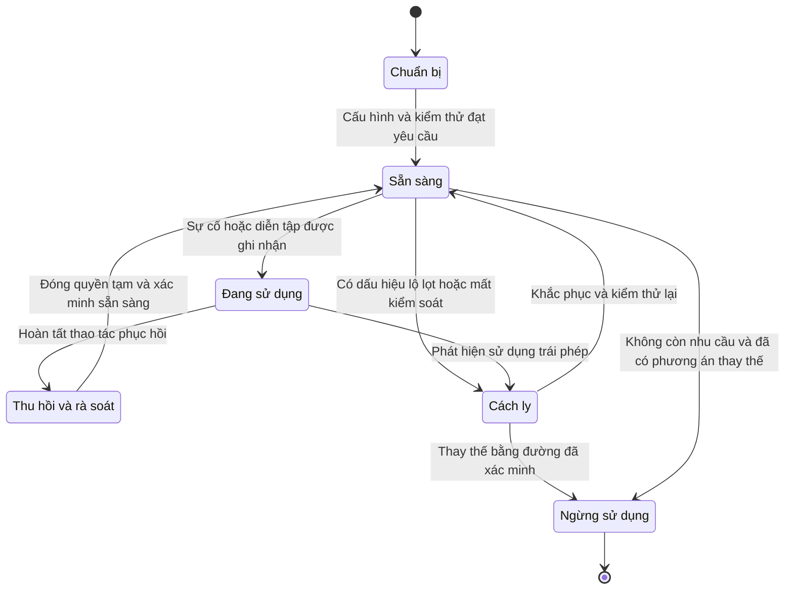

# Break-glass account

## 1. Vì sao IAM cần một đường truy cập khẩn cấp?

Một hệ thống quản lý danh tính và quyền truy cập (IAM) có thể được bảo vệ bằng đăng nhập một lần (SSO), xác thực đa yếu tố (MFA), cấp quyền vừa đúng lúc và chính sách kiểm tra thiết bị. Những kiểm soát đó giúp giảm rủi ro trong vận hành thường ngày. Tuy nhiên, nếu chính dịch vụ xác thực hoặc quy trình cấp quyền bị lỗi, quản trị viên có thể mất khả năng sửa hệ thống đang bảo vệ mình.

Ví dụ, doanh nghiệp liên kết danh tính với một nhà cung cấp định danh (Identity Provider — IdP). Sau một thay đổi cấu hình, mọi đăng nhập quản trị đều bị chuyển hướng đến IdP không hoạt động. Nhóm vận hành biết cấu hình nào cần sửa nhưng không thể đăng nhập vào trang quản trị để sửa nó. Đây là tình huống khóa quyền quản trị, hay administrative lockout.

**Break-glass account** là tài khoản được chuẩn bị riêng cho việc khôi phục quyền quản trị trong những tình huống khẩn cấp đã xác định. Tên gọi gợi đến việc phá kính để lấy thiết bị cứu hộ: chỉ sử dụng khi cần, có dấu vết rõ ràng và phải khôi phục trạng thái sẵn sàng sau đó.

Tài khoản này là một phần của cơ chế **emergency access**, bao gồm cả danh tính, thông tin xác thực, quyền, người được phép sử dụng, phương tiện truy cập, giám sát và quy trình vận hành. Chỉ tạo một tài khoản có quyền cao rồi cất mật khẩu chưa tạo thành một cơ chế khôi phục đáng tin cậy.

Sau bài học, người học cần có khả năng:

- Nhận diện tình huống cần truy cập khẩn cấp và xác định phạm vi phục hồi.
- Phân tích các phụ thuộc có thể làm cả đường quản trị chính lẫn đường dự phòng cùng thất bại.
- Thiết kế việc quản lý tài khoản, MFA, quyền và người giữ phương tiện xác thực.
- Thực hiện quy trình sử dụng có giới hạn và liên kết hành động với người thao tác.
- Kết thúc quyền truy cập, thu hồi các phương tiện đã cấp và đưa tài khoản về trạng thái sẵn sàng.

## 2. Phân biệt tài khoản với quyền truy cập khẩn cấp

### 2.1. Ba lớp cần xem xét riêng

Một lần sử dụng break-glass có ít nhất ba lớp:

| Lớp | Câu hỏi cần trả lời | Ví dụ |
| --- | --- | --- |
| Xác thực | Ai đang chứng minh quyền sử dụng danh tính này? | Người được ủy quyền dùng khóa bảo mật đã đăng ký cho tài khoản khẩn cấp |
| Phân quyền | Danh tính đó được phép sửa những gì? | Khôi phục cấu hình liên kết danh tính hoặc chính sách đăng nhập |
| Phiên và thông tin xác thực phát sinh | Quyền truy cập tồn tại đến khi nào, ở đâu? | Phiên quản trị, access token, refresh token hoặc khóa mới tạo trong sự cố |

Đăng nhập thành công không đồng nghĩa đã có quyền phục hồi cần thiết. Ngược lại, một tài khoản được gán quyền quản trị vẫn có thể vô dụng nếu không thể hoàn tất MFA hoặc không tới được endpoint quản trị.

Break-glass cũng không tự động vượt qua mọi lệnh từ chối trong RBAC, ABAC, chính sách tổ chức hay lớp mạng. Nếu đường dự phòng bị một chính sách chặn, phải có cơ chế ngoại lệ hoặc phục hồi được nền tảng hỗ trợ và được thiết kế từ trước.

### 2.2. Quan hệ với các loại danh tính khác

| Khái niệm | Mục đích chính | Điểm cần phân biệt |
| --- | --- | --- |
| Tài khoản quản trị thông thường | Vận hành hệ thống hằng ngày | Sử dụng quy trình cấp quyền và xác thực bình thường |
| Quyền vừa đúng lúc, JIT | Cấp quyền cao trong một khoảng thời gian cần thiết | Có thể phụ thuộc dịch vụ PAM, người phê duyệt hoặc IdP |
| Break-glass account | Khôi phục quyền truy cập khi đường quản trị thông thường không đáp ứng tình huống khẩn cấp | Cần kiểm tra tính độc lập với thành phần đang hỏng |
| Tài khoản root hoặc chủ sở hữu nền tảng | Thực hiện các tác vụ đặc biệt do nền tảng quy định | Chỉ đóng vai trò đường khẩn cấp nếu được đưa vào thiết kế và quản trị tương ứng |
| Danh tính workload | Cho ứng dụng, tiến trình hoặc pipeline truy cập tài nguyên | Không nên dùng tài khoản khẩn cấp của con người làm thông tin xác thực chạy thường xuyên |

Một quy trình JIT có thể đáp ứng sự cố cần xử lý nhanh khi hệ thống IAM vẫn khỏe. Tuy nhiên, nếu JIT cần IdP và IdP đã ngừng hoạt động, quy trình đó không đáp ứng được kịch bản khôi phục IdP. Tổ chức có thể cần nhiều đường phục hồi cho các nhóm lỗi khác nhau.

## 3. Khi nào được sử dụng?

Điều kiện sử dụng phải gắn với tác động và khả năng khôi phục, thay vì chỉ dựa vào cảm giác khẩn cấp của người yêu cầu.

| Tình huống | Đánh giá | Hướng xử lý |
| --- | --- | --- |
| IdP liên kết bị gián đoạn, toàn bộ quản trị viên không đăng nhập được | Có thể đáp ứng điều kiện break-glass | Xác nhận tài khoản khẩn cấp xác thực trực tiếp trên hệ thống đích và còn quyền phục hồi |
| Thay đổi chính sách truy cập khóa tất cả đường quản trị thường dùng | Có thể đáp ứng điều kiện break-glass | Khôi phục đúng thay đổi gây khóa bằng đường dự phòng đã kiểm thử |
| Quy trình PAM không cấp được quyền trong sự cố nghiêm trọng | Có thể đáp ứng điều kiện break-glass | Dùng đường phục hồi không cần chính dịch vụ PAM đang lỗi |
| Một quản trị viên mất điện thoại, đồng nghiệp vẫn có thể hỗ trợ qua quy trình chuẩn | Chưa đủ căn cứ | Dùng quy trình khôi phục yếu tố xác thực hoặc phân công người có quyền |
| Muốn triển khai nhanh vì chờ phê duyệt mất thời gian | Không đáp ứng điều kiện chỉ vì cần nhanh | Theo quy trình thay đổi hoặc quy trình cấp quyền khẩn đã được phê duyệt |
| Dịch vụ quản trị nền tảng hoàn toàn không phản hồi | Tài khoản khẩn cấp có thể không giúp được | Kích hoạt phương án liên tục kinh doanh, khôi phục hoặc hỗ trợ nhà cung cấp |

Tổ chức nên ghi rõ ai được tuyên bố tình trạng khẩn cấp, ai có quyền nhận phương tiện xác thực và ai theo dõi phiên sử dụng. Với tình huống không thể liên lạc người phê duyệt, cần có nhánh xử lý đã được thống nhất trước, kèm yêu cầu thông báo và rà soát sau sử dụng. Người thao tác không tự tạo ngoại lệ cho mình ngay trong sự cố.

## 4. Thiết kế theo kịch bản lỗi và chuỗi phụ thuộc

### 4.1. Tài khoản khác tên chưa chắc là đường dự phòng độc lập

Giả sử đường quản trị bình thường là:

```text
Máy quản trị → VPN → SSO/IdP → MFA → PAM → Vai trò quản trị → Hệ thống đích
```

Một tài khoản thứ hai vẫn sử dụng cùng VPN, IdP, điện thoại nhận MFA và kho bí mật chỉ tăng số lượng tài khoản. Khi một mắt xích chung ngừng hoạt động, cả hai tài khoản có thể cùng mất tác dụng.

Cần kiểm tra cả phụ thuộc trực tiếp và gián tiếp. Chẳng hạn, tài khoản khẩn cấp không dùng SSO nhưng mật khẩu của nó nằm trong kho bí mật chỉ mở bằng SSO. Khi SSO lỗi, người vận hành vẫn không lấy được mật khẩu.

### 4.2. Lập ma trận phụ thuộc

Bảng dưới đây là ví dụ phân tích thiết kế, cần điều chỉnh theo hệ thống thực tế:

| Thành phần có thể lỗi | Ảnh hưởng tới đường thông thường | Câu hỏi cho đường khẩn cấp |
| --- | --- | --- |
| IdP hoặc liên kết danh tính | Không phát hành được thông tin đăng nhập | Có danh tính gốc được xác thực trực tiếp tại hệ thống đích không? |
| Đồng bộ danh tính | Tài khoản bị vô hiệu hóa hoặc mất thuộc tính | Tài khoản khẩn cấp có bị đồng bộ thay đổi từ cùng nguồn không? |
| Dịch vụ PAM/JIT | Không kích hoạt được vai trò | Quyền phục hồi có sẵn hay vẫn cần PAM cấp? |
| Kho bí mật | Không lấy được mật khẩu hoặc phương tiện phục hồi | Có phương án lưu giữ thay thế được bảo vệ và kiểm thử không? |
| Dịch vụ MFA hoặc thiết bị xác thực | Không hoàn tất được thử thách xác thực | Có phương thức xác thực mạnh phù hợp với kịch bản lỗi không? |
| VPN, DNS hoặc đường mạng | Không tới được trang quản trị | Có đường kết nối quản trị thay thế được cho phép không? |
| Chính sách tuân thủ thiết bị | Thiết bị quản trị bị chặn | Máy phục hồi được chuẩn bị thế nào, có phụ thuộc dịch vụ đang lỗi không? |
| Kênh thông báo nội bộ | Không gọi được người phê duyệt hoặc người giám sát | Có danh bạ và kênh liên lạc dự phòng không? |
| Nền tảng ghi log tập trung | Không quan sát được hoạt động tức thời | Hệ thống đích còn ghi audit log không, và thu thập bổ sung thế nào? |

Không nhất thiết phải loại bỏ mọi phụ thuộc. Mục tiêu là xác định một tập kịch bản lỗi mà đường dự phòng chịu được, cùng giới hạn mà nó không xử lý được.

Một tài khoản cloud-native có thể tránh phụ thuộc IdP bên ngoài nhưng vẫn phụ thuộc dịch vụ xác thực và mặt phẳng quản trị của nhà cung cấp cloud. Nếu chính các dịch vụ đó ngừng hoạt động, cần phương án khác ngoài thay đổi tài khoản đăng nhập.

### 4.3. Tránh tạo một điểm thất bại duy nhất mới

Các đường khẩn cấp có thể cần dự phòng về người trực, phương tiện xác thực, địa điểm lưu giữ hoặc kết nối mạng. Số lượng tài khoản phải dựa trên mức độ rủi ro và đặc tính nền tảng; nhiều tài khoản hơn cũng làm tăng khối lượng bảo vệ và kiểm kê.

Ví dụ dành riêng cho Microsoft Entra ID: Microsoft hướng dẫn duy trì ít nhất hai tài khoản khẩn cấp cloud-only, không phụ thuộc liên kết danh tính, có phương thức xác thực chống phishing và được kiểm thử ít nhất mỗi 90 ngày. Đây là hướng dẫn của sản phẩm cụ thể, cần đối chiếu với cấu hình thực tế trước khi áp dụng. [Nguồn: Microsoft Learn — Manage emergency access accounts](https://learn.microsoft.com/en-us/entra/identity/role-based-access-control/security-emergency-access).

## 5. Danh tính, thông tin xác thực và MFA

### 5.1. Có chủ sở hữu nhưng tránh phụ thuộc một cá nhân

Tài khoản khẩn cấp phải có chủ sở hữu chịu trách nhiệm về cấu hình và vòng đời. Chủ sở hữu có thể là một nhóm IAM được phân công rõ người chịu trách nhiệm, thay vì một địa chỉ nhóm không ai quản lý.

Cần phân biệt các trách nhiệm:

- **Chủ sở hữu tài khoản:** chịu trách nhiệm quyền, phạm vi, kiểm thử và quyết định thay thế tài khoản.
- **Người giữ phương tiện xác thực:** quản lý khóa bảo mật, tài liệu phục hồi hoặc vật mang bí mật.
- **Người được phép thao tác:** sử dụng tài khoản trong sự cố theo điều kiện đã quy định.
- **Người giám sát hoặc rà soát:** kiểm tra cảnh báo, phạm vi hành động và bằng chứng sau sử dụng.

Một cá nhân có thể đảm nhiệm nhiều trách nhiệm ở tổ chức nhỏ, nhưng mức độ tập trung quyền đó cần được nhìn thấy và quản lý. Nếu chỉ một người biết vị trí khóa và người đó không có mặt, tài khoản có thể không đáp ứng mục tiêu sẵn sàng.

Có hai cách gắn danh tính với người thao tác:

1. Tài khoản khẩn cấp riêng cho từng người được chỉ định: thuận lợi cho truy vết, nhưng phải quản lý đầy đủ việc thay đổi nhân sự và tính độc lập với tài khoản làm việc thường ngày.
2. Tài khoản khẩn cấp dùng chung có kiểm soát: cần ghi nhận việc bàn giao, thời gian sử dụng, người nhận, người chứng kiến và phiên tương ứng. Nếu nền tảng chỉ ghi tên tài khoản dùng chung, audit log đó chưa đủ để tự xác định con người đã thao tác.

Không dùng chung thông tin xác thực giữa tài khoản quản trị thông thường, tài khoản khẩn cấp và danh tính workload.

### 5.2. Giữ xác thực mạnh và giảm phụ thuộc lỗi chung

Đường khẩn cấp phải cân bằng giữa khả năng sử dụng khi gặp sự cố và nguy cơ bị chiếm dụng. Có thể lựa chọn khóa bảo mật phần cứng hoặc phương thức khác được nền tảng hỗ trợ, tùy thuộc kịch bản lỗi và cơ chế phục hồi.

Cần kiểm tra cụ thể:

- Phương thức có cần điện thoại cá nhân, sóng di động hay dịch vụ xác nhận từ xa không?
- Khóa hoặc thiết bị có được lưu tại nơi người có trách nhiệm tiếp cận được không?
- Có PIN, trình điều khiển, chứng thư hoặc ngày hết hạn nào chưa được tính đến không?
- Phương án dự phòng có phụ thuộc cùng tài khoản đồng bộ hoặc cùng thiết bị với phương án chính không?
- Nếu mất một phương tiện xác thực, còn đường quản trị đã được kiểm chứng nào để thay thế nó không?

**Không mặc định rằng break-glass phải tắt MFA.** Ngoại lệ cho một chính sách kiểm tra ngữ cảnh và việc bỏ xác thực mạnh là hai quyết định khác nhau. Các yêu cầu xác thực bắt buộc của nền tảng vẫn có thể áp dụng cho tài khoản khẩn cấp.

Thông tin bí mật không xuất hiện trong runbook, ticket, log hoặc ví dụ minh họa. Tài liệu hướng dẫn có thể nêu mã vị trí lưu giữ và người liên hệ; quyền mở vị trí đó phải được quản lý riêng. Nếu sử dụng bản lưu ngoại tuyến, cần kiểm soát người tiếp cận, tính toàn vẹn, phiên bản và khả năng khôi phục thực tế.

## 6. Quyền phục hồi và ngoại lệ chính sách

### 6.1. Áp dụng ít quyền nhất theo nhiệm vụ phục hồi

Nguyên tắc ít quyền nhất vẫn áp dụng cho tài khoản khẩn cấp: cấp quyền đủ để khôi phục các khả năng đã xác định và giới hạn phạm vi khi nền tảng cho phép.

Ví dụ, nếu nhiệm vụ là sửa cấu hình SSO của một ứng dụng, cần đánh giá liệu quyền quản trị cấu hình ứng dụng đã đủ hay cần quyền ở cấp tổ chức. Không tự động mở quyền đọc dữ liệu nghiệp vụ hoặc quản trị mọi hệ thống chỉ vì tài khoản mang nhãn khẩn cấp.

Tuy nhiên, một số nhiệm vụ phục hồi đòi hỏi vai trò rất cao. Khi đó, thiết kế phải ghi rõ:

- Vì sao vai trò hẹp hơn không đáp ứng nhiệm vụ.
- Tài nguyên và môi trường nào chịu ảnh hưởng nếu tài khoản bị chiếm dụng.
- Biện pháp bảo vệ thông tin xác thực và giám sát tương ứng.
- Các thay đổi được phép thực hiện trong một lần sử dụng.
- Cách phát hiện quyền, khóa hoặc danh tính phụ được tạo thêm.

Một tài khoản có thể cần quyền rộng về kỹ thuật nhưng vẫn phải có phạm vi hành động được phê duyệt hẹp trong sự cố. Hai phạm vi này không giống nhau: quy trình không tự biến quyền kỹ thuật rộng thành quyền kỹ thuật hẹp.

### 6.2. Quyền thường trực hay kích hoạt khi cần?

JIT giúp giảm thời gian tồn tại quyền cao, nhưng việc kích hoạt không được phụ thuộc chính thành phần mà tài khoản dùng để phục hồi. Nếu cần PAM để nhận quyền sửa PAM, thiết kế đã có vòng phụ thuộc.

Có thể lựa chọn các đường khác nhau:

| Thiết kế | Phù hợp khi | Vấn đề phải giải quyết |
| --- | --- | --- |
| Quyền khẩn cấp được cấp tạm thời qua JIT | Hệ thống cấp quyền vẫn hoạt động trong kịch bản cần xử lý | Thời gian cấp quyền, hết hạn và khả năng liên lạc người phê duyệt |
| Quyền phục hồi đã có sẵn | Phải xử lý lỗi làm đường cấp quyền thông thường mất tác dụng | Bảo vệ danh tính có quyền thường trực và phát hiện mọi lần sử dụng |
| Nhiều lớp phục hồi | Có cả sự cố ứng dụng và sự cố hạ tầng IAM | Chọn đúng đường cho từng lỗi, kiểm soát số lượng tài khoản và phụ thuộc |

Một tài khoản thường trực có thể được duy trì khả năng đăng nhập trong trạng thái chờ; thời gian sử dụng của con người và phiên quản trị vẫn phải bị giới hạn. Không đồng nhất thời hạn xử lý sự cố với ngày hết hạn của tài khoản dự phòng.

### 6.3. Ngoại lệ có phạm vi và có hồ sơ

Nếu cần ngoại lệ với chính sách đăng nhập, phải ghi chính sách nào, tài khoản nào, lỗi nào cần tránh và biện pháp kiểm soát bù trừ. Ngoại lệ được triển khai bằng chức năng được nền tảng hỗ trợ; tên tài khoản hoặc một thuộc tính `emergency` không tự mang ý nghĩa vượt qua cơ chế phân quyền.

Cần bảo vệ cả quyền sửa danh sách tài khoản được miễn trừ. Nếu bất kỳ quản trị viên nào cũng thêm mình vào danh sách này mà không có cảnh báo, danh sách có thể trở thành cách mở rộng đặc quyền ngoài ý muốn.

## 7. Vòng đời của một tài khoản break-glass

### 7.1. Hai vòng đời liên quan nhưng khác nhau

Trong chương Account lifecycle, cần phân biệt:

- **Vòng đời danh tính dự phòng:** tạo, gán chủ sở hữu, cấu hình, kiểm thử, duy trì, thay thế và ngừng sử dụng.
- **Vòng đời một lần sử dụng:** khai báo sự cố, cho phép truy cập, nhận phương tiện xác thực, thao tác, kết thúc phiên và rà soát.

Tài khoản có thể tồn tại nhiều năm, trong khi mỗi lần sử dụng chỉ phục vụ một sự cố hoặc một buổi diễn tập xác định. Hoàn tất một sự cố không nhất thiết dẫn tới xóa tài khoản.

### 7.2. Mô hình trạng thái vận hành

Sơ đồ dưới đây mô tả trạng thái quản lý. Các trạng thái không mặc nhiên tương ứng với cờ bật hoặc tắt tài khoản trên nền tảng.



### 7.3. Tạo và đưa vào sử dụng

Trước khi chuyển sang trạng thái sẵn sàng, cần có:

1. Danh tính đúng hệ thống, đúng môi trường và đúng nhiệm vụ phục hồi.
2. Chủ sở hữu cùng danh sách người được phép sử dụng.
3. Quyền phục hồi đã được kiểm tra, không chỉ có tên vai trò trong hồ sơ.
4. Phương tiện xác thực và phương án lưu giữ đáp ứng kịch bản lỗi.
5. Runbook truy cập được khi đường xác thực thường dùng gặp sự cố.
6. Cảnh báo cho việc đăng nhập, thay đổi quyền và thay đổi thông tin xác thực.
7. Bằng chứng kiểm thử đường truy cập và một tác vụ quản trị an toàn.

### 7.4. Duy trì và thay đổi nhân sự

Tài khoản ít được sử dụng cần được phân biệt với tài khoản bỏ quên. Quy trình dọn tài khoản không hoạt động có thể vô hiệu hóa nhầm đường cứu hộ nếu không nhận diện ngoại lệ đã được quản lý.

Ngoại lệ với việc dọn tài khoản không có nghĩa là miễn kiểm kê. Cần rà soát người sở hữu, người giữ khóa, quyền, các phương tiện khôi phục và ngày kiểm thử gần nhất.

Khi người được phép sử dụng nghỉ việc hoặc đổi vai trò:

- Thu hồi quyền mở kho lưu giữ và lấy lại phương tiện đã bàn giao.
- Loại bỏ phương thức xác thực hoặc thông tin liên hệ không còn hợp lệ.
- Thay đổi bí mật mà người đó đã biết theo đánh giá rủi ro.
- Cập nhật danh sách người trực và người thay thế.
- Kiểm thử lại đường khôi phục sau thay đổi.

Nếu tài khoản dùng chung thuộc tổ chức, không xử lý nó như tài khoản nhân viên rồi xóa tự động theo hồ sơ nhân sự. Nếu là tài khoản khẩn cấp cá nhân, phải xử lý đúng vòng đời cá nhân và kiểm tra hệ thống còn đủ đường dự phòng.

### 7.5. Ngừng sử dụng

Chỉ ngừng sử dụng sau khi đã xác định nhu cầu không còn hoặc đường thay thế hoạt động. Trình tự cần bao gồm kiểm tra phụ thuộc, thu hồi phiên và quyền, vô hiệu hóa thông tin xác thực, cập nhật kho lưu giữ và lưu bằng chứng theo chính sách tổ chức.

Nếu nghi tài khoản đã bị chiếm dụng, cần thực hiện ứng phó sự cố phù hợp, đồng thời bảo đảm nhóm xử lý còn một đường quản trị đáng tin cậy. Không trì hoãn việc ngăn truy cập trái phép chỉ để giữ nguyên thiết kế cũ; dùng đường dự phòng khác hoặc cơ chế phục hồi của nhà cung cấp khi cần.

## 8. Runbook sử dụng trong sự cố

Runbook phải đủ cụ thể để người trực làm theo dưới áp lực. Các địa chỉ, đầu mối và mã tài khoản được quản lý trong tài liệu vận hành có kiểm soát; không chèn bí mật vào hướng dẫn.

### Bước 1 — Xác nhận tình huống và lập hồ sơ

Ghi nhận hệ thống bị ảnh hưởng, đường truy cập nào đã thất bại, tác động và lý do cần emergency access. Dùng mã sự cố để liên kết các bằng chứng. Nếu hệ thống ticket không khả dụng, ghi nhận qua phương tiện dự phòng đã quy định rồi đồng bộ lại sau.

### Bước 2 — Xác nhận quyền sử dụng và người giám sát

Xác định người thao tác, người cho phép sử dụng theo quy trình và người theo dõi. Kiểm tra danh tính người nhận phương tiện xác thực bằng cách đã thống nhất; tránh chỉ dựa vào một tin nhắn tự nhận là quản trị viên.

Khi quy trình có yêu cầu hai người kiểm soát việc mở kho, cần kiểm thử khả năng đáp ứng ngoài giờ và có người thay thế. Quy trình chỉ tồn tại trên giấy có thể làm mất khả năng khôi phục đúng lúc.

### Bước 3 — Nhận phương tiện và vào đúng môi trường

Ghi mã tài khoản, mã vật mang thông tin xác thực, thời điểm bàn giao và người nhận. Dùng máy quản trị đã chuẩn bị, kiểm tra địa chỉ quản trị, tenant hoặc tổ chức đích và môi trường production hay thử nghiệm.

Thông báo cho nhóm giám sát rằng một lần sử dụng có thẩm quyền đang bắt đầu. Thông báo giúp họ phân loại cảnh báo; hoạt động vẫn phải được ghi log và theo dõi.

### Bước 4 — Đăng nhập và kiểm tra quyền cần thiết

Hoàn tất xác thực bằng phương thức đã chuẩn bị. Xác nhận đang thao tác bằng đúng tài khoản và có quyền phục hồi cần thiết. Nếu quyền hoặc đường truy cập không hoạt động như runbook, chuyển sang nhánh xử lý đã định trước thay vì mở rộng quyền tùy ý.

### Bước 5 — Thực hiện thay đổi nhỏ nhất để phục hồi

Lưu bằng chứng cấu hình hiện tại, xác định đúng thay đổi gây lỗi và chuẩn bị cách hoàn tác khi có thể. Ưu tiên sửa thành phần lỗi hoặc quay về cấu hình đã biết hoạt động, thay vì tắt hàng loạt kiểm soát bảo vệ.

Ghi các thao tác quan trọng và kết quả. Nếu ghi hình hoặc ghi phiên, phải bảo vệ dữ liệu nhạy cảm có thể xuất hiện trong bản ghi; bản ghi phiên không thay thế audit log của hệ thống đích.

### Bước 6 — Xác minh đường quản trị bình thường đã hoạt động

Dùng một lần đăng nhập mới qua đường quản trị thông thường để kiểm tra. Kiểm thử cả xác thực và quyền thực hiện tác vụ cần thiết. Một phiên cũ còn mở có thể dùng thông tin xác thực đã cấp trước sự cố và chưa chứng minh cấu hình mới hoạt động.

Trong quá trình khôi phục, giữ một đường quản trị đang hoạt động cho đến khi đường khác đã được xác minh. Không vô tình tự khóa lại hệ thống khi đóng phiên duy nhất còn truy cập được.

### Bước 7 — Kết thúc quyền sử dụng và làm sạch

Thu hồi quyền tạm, kết thúc hoặc vô hiệu hóa các phiên theo khả năng nền tảng, xử lý token và bí mật phát sinh, bàn giao lại phương tiện xác thực và xác minh cảnh báo đã được nhận.

### Bước 8 — Rà soát và tái lập trạng thái sẵn sàng

Đối chiếu người thao tác, thời gian, phạm vi được cho phép với log thực tế. Xác nhận không có quyền hoặc danh tính phát sinh ngoài mục tiêu. Sau khi xử lý bí mật cần thay đổi và kiểm thử lại, cập nhật trạng thái sẵn sàng cùng các vấn đề phải khắc phục.

## 9. Thu hồi sau sử dụng: phải kiểm tra nhiều lớp

Đổi mật khẩu chỉ xử lý một loại thông tin xác thực. Tùy nền tảng, các phiên hoặc token đã cấp có thể tiếp tục tồn tại. Vì vậy, đóng sự cố cần kiểm tra từng lớp:

| Đối tượng | Việc cần kiểm tra | Điều dễ bỏ sót |
| --- | --- | --- |
| Quyền tạm thời | Gỡ vai trò, membership hoặc ngoại lệ được cấp thêm | Quyền còn sót ở một nhóm trung gian hoặc môi trường khác |
| Phiên ứng dụng | Kết thúc phiên quản trị và phiên ứng dụng đích nếu có cơ chế hỗ trợ | Đăng xuất IdP chưa chắc kết thúc mọi phiên tại ứng dụng |
| Refresh token | Thu hồi hoặc vô hiệu hóa theo cơ chế nền tảng | Chỉ đóng cửa sổ trình duyệt vẫn để lại khả năng xin token mới |
| Access token | Xác định thời hạn và khả năng thu hồi có hiệu lực tại tài nguyên đích | Token được kiểm tra cục bộ có thể còn được chấp nhận đến khi hết hạn hoặc khi cơ chế thu hồi có hiệu lực |
| Mật khẩu và bí mật được tiết lộ | Thay đổi nếu đã được mở, sao chép, chia sẻ hoặc nghi lộ theo chính sách | Bản sao vẫn nằm trong clipboard, tệp tạm hoặc nơi bàn giao |
| Khóa bảo mật hoặc chứng thư | Kiểm kê, xác nhận người giữ và hủy đăng ký khi mất kiểm soát | Còn phương thức xác thực mới được đăng ký trong phiên khẩn cấp |
| API key, khóa SSH, danh tính và quyền mới | Kiểm kê, xác minh mục đích và thu hồi phần không còn cần | Phiên khẩn cấp tạo một đường truy cập tồn tại lâu hơn chính phiên đó |
| Phiên của workload liên quan | Đánh giá riêng nếu đã sửa thông tin xác thực của ứng dụng | Giữ nguyên token hoặc khóa cũ sau khi đổi cấu hình tài khoản con người |

Không mặc định mọi token bị vô hiệu ngay khi tắt tài khoản hoặc đổi mật khẩu. Phải hiểu cơ chế của dịch vụ cấp token và dịch vụ sử dụng token, xác minh mức trễ và chọn biện pháp ứng phó phù hợp.

Việc sử dụng khóa phần cứng không xuất khóa riêng không mặc nhiên làm lộ khóa sau mỗi lần đăng nhập. Quyết định thay khóa cần dựa trên việc mất kiểm soát, dấu hiệu xâm phạm và chính sách của tổ chức. Với bí mật có thể sao chép, việc mở hoặc tiết lộ bí mật cần được đánh giá riêng.

Đối với tài khoản được thiết kế có quyền phục hồi thường trực, đóng sự cố không có nghĩa phải gỡ quyền phục hồi đó. Phải thu hồi quyền được cấp thêm và quyền sử dụng của người thao tác, đồng thời đưa thiết kế dự phòng về đúng trạng thái đã được phê duyệt.

## 10. Giám sát và bằng chứng kiểm toán

### 10.1. Những sự kiện cần quan sát

Hoạt động của danh tính khẩn cấp phải có khả năng được nhận diện riêng trong hệ thống giám sát. Nên quan sát ít nhất:

- Đăng nhập thành công, thất bại và những lần bị chính sách chặn.
- Thay đổi mật khẩu, phương thức MFA hoặc thông tin khôi phục.
- Thay đổi vai trò, membership và danh sách ngoại lệ liên quan.
- Việc nhận hoặc trả phương tiện xác thực, khi hệ thống lưu giữ có nhật ký.
- Thay đổi chính sách IAM, tạo danh tính, phát hành khóa hoặc cấp quyền trong phiên.
- Thay đổi cấu hình ghi log và cảnh báo ảnh hưởng đến việc theo dõi tài khoản.

Dùng mã định danh ổn định của tài khoản để đối chiếu khi có thể. Tên hiển thị có thể thay đổi hoặc bị trùng, làm quy tắc giám sát bỏ sót hoạt động.

### 10.2. Liên kết tài khoản với người sử dụng

Một hồ sơ minh họa không chứa bí mật có thể như sau:

```json
{
  "incident_id": "INC-IAM-042",
  "target_environment": "production",
  "emergency_principal_id": "emergency-admin-a",
  "operator_record_id": "operator-017",
  "approval_record_id": "approval-063",
  "custody_record_id": "custody-108",
  "purpose": "Restore the approved federation configuration",
  "started_at": "2026-11-26T02:15:00Z",
  "ended_at": "2026-11-26T02:38:00Z",
  "audit_reference": "audit-record-set-241",
  "cleanup_verified": true
}
```

Các trường trên là mô hình hồ sơ minh họa, không phải API của một nhà cung cấp. `operator_record_id` phải được xác minh từ quy trình bàn giao hoặc hệ thống quản lý phiên; không thể suy ra chắc chắn chỉ từ địa chỉ IP hay tên tài khoản dùng chung.

Tương tự, `cleanup_verified: true` chỉ là kết quả ghi nhận sau kiểm tra. Giá trị đó không tự thu hồi phiên hay bảo đảm bằng chứng đầy đủ. Hồ sơ cần dẫn tới kết quả kiểm tra và log tương ứng.

### 10.3. Giữ khả năng quan sát khi hệ thống phụ trợ lỗi

Kênh nhận cảnh báo nên được đánh giá về mức độ phụ thuộc vào IdP và công cụ cộng tác chính. Nếu người trực phải đăng nhập qua IdP đang hỏng mới đọc được cảnh báo, thời gian phát hiện sẽ bị ảnh hưởng.

Nếu việc truyền log tập trung bị gián đoạn, cần xác định log nguồn nào còn được ghi và có thể lấy lại. Quy trình xử lý khi mất khả năng giám sát phải có điều kiện được phê duyệt, cách ghi nhận thay thế và yêu cầu đối chiếu sau đó; không coi mất log là trạng thái bình thường của emergency access.

## 11. Kiểm thử khả năng sẵn sàng

Một tài khoản tồn tại trong danh sách người dùng chưa chứng minh đường khẩn cấp dùng được. Việc kiểm thử cần bao phủ cả con người, kỹ thuật và quy trình.

| Hạng mục | Cách kiểm tra phù hợp | Bằng chứng cần giữ |
| --- | --- | --- |
| Danh tính và quyền | Đối chiếu chủ sở hữu, vai trò, phạm vi và trạng thái | Hồ sơ kiểm kê và kết quả rà soát quyền |
| Phương tiện xác thực | Người được chỉ định tiếp cận và hoàn tất xác thực | Nhật ký kiểm thử, tình trạng thiết bị và nơi lưu giữ |
| Tác vụ phục hồi | Thực hiện một tác vụ an toàn hoặc diễn tập trong môi trường phù hợp | Kết quả chứng minh có đủ quyền cần thiết |
| Độc lập với lỗi mục tiêu | Mô phỏng việc không sử dụng được phụ thuộc liên quan trong môi trường kiểm soát | Kịch bản, phụ thuộc bị loại khỏi đường thử và kết quả |
| Cảnh báo | Kiểm tra sự kiện tới được người trực và được phản hồi | Mốc thời gian từ phát sinh đến tiếp nhận |
| Kết thúc sử dụng | Thử quy trình đóng phiên, gỡ quyền tạm và trả phương tiện | Kết quả xác minh sau đóng phiên |
| Khả năng thay người | Cho người trực khác làm theo runbook | Điểm vướng, thời gian thực hiện và phần tài liệu phải cập nhật |

Không kiểm thử tính độc lập bằng cách tùy tiện tắt IdP production hoặc tự tạo chính sách chặn toàn bộ quản trị viên. Có thể bắt đầu bằng rà soát kiến trúc, diễn tập trên giấy, thử trong môi trường tương đương và mở rộng theo kế hoạch thay đổi được kiểm soát.

Chu kỳ kiểm thử phải phù hợp rủi ro và hướng dẫn nền tảng. Ngoài lịch định kỳ, nên kiểm thử sau thay đổi đáng kể về SSO, MFA, PAM, mạng quản trị, chính sách thiết bị, quyền hoặc nhân sự giữ phương tiện xác thực.

Những chỉ số hữu ích gồm thời gian từ khai báo sự cố đến truy cập được, thời gian phục hồi đường quản trị bình thường, tỷ lệ đường khẩn cấp kiểm thử thành công và số quyền phát sinh chưa được thu hồi. Không tối ưu thời gian bằng cách bỏ qua việc xác minh người sử dụng hoặc bằng chứng cần thiết.

## 12. Ví dụ xuyên suốt: khôi phục cấu hình liên kết danh tính

Doanh nghiệp có một trang quản trị dùng SSO. Sau khi thay đổi cấu hình federation, mọi đăng nhập quản trị mới đều thất bại. Dịch vụ quản trị đích vẫn hoạt động, nhưng luồng chuyển hướng tới IdP không hoàn tất.

Trước sự cố, nhóm IAM đã chuẩn bị:

- Tài khoản khẩn cấp được xác thực trực tiếp tại hệ thống đích, có quyền sửa cấu hình federation theo khả năng nền tảng.
- Phương tiện xác thực và máy quản trị không cần hoàn tất luồng federation đang gặp lỗi.
- Bản cấu hình đã biết hoạt động, runbook và nơi lưu bằng chứng có thể tiếp cận theo đường dự phòng.
- Danh sách người được sử dụng, cơ chế bàn giao và cảnh báo theo mã định danh tài khoản.

Diễn biến xử lý:

1. Người trực xác nhận đây là lỗi đăng nhập diện rộng, lập sự cố và thông báo theo runbook.
2. Người có thẩm quyền cho phép sử dụng đường khẩn cấp; việc bàn giao phương tiện được ghi nhận.
3. Người thao tác đăng nhập đúng tổ chức đích, lưu cấu hình đang lỗi và khôi phục phần federation về bản đã biết hoạt động.
4. Một quản trị viên khác mở lần đăng nhập mới qua SSO và kiểm tra quyền quản trị thông thường.
5. Nhóm vận hành đóng lần sử dụng khẩn cấp, xử lý phiên và token theo cơ chế hệ thống, trả phương tiện xác thực và đối chiếu log.
6. Nhóm IAM xác minh không có vai trò, khóa hoặc phương thức xác thực dư thừa; kiểm thử lại trạng thái sẵn sàng của đường dự phòng.

Nếu mật khẩu của tài khoản khẩn cấp chỉ được lưu trong kho mở bằng cùng SSO, bước 2 hoặc 3 sẽ thất bại. Nếu quyền sửa federation chỉ được PAM cấp sau khi đăng nhập cùng IdP, tài khoản có thể đăng nhập nhưng vẫn không thực hiện được nhiệm vụ. Hai lỗi này cho thấy phải kiểm thử toàn bộ đường phục hồi.

Giới hạn của ví dụ cũng cần rõ: nếu dịch vụ quản trị đích không nhận yêu cầu, thay sang tài khoản khẩn cấp không làm dịch vụ hoạt động trở lại. Tình huống đó cần phương án phục hồi hoặc hỗ trợ khác.

## 13. Những sai lầm thường gặp

| Sai lầm | Hệ quả | Cách thiết kế lại |
| --- | --- | --- |
| Dùng tài khoản khẩn cấp để quản trị hằng ngày | Tăng tiếp xúc với nguy cơ và làm khó nhận diện sử dụng bất thường | Tách luồng vận hành thường ngày và điều kiện kích hoạt |
| Đặt toàn bộ đường dự phòng sau cùng IdP hoặc PAM | Không xử lý được lỗi chung | Vẽ và kiểm thử chuỗi phụ thuộc cho từng kịch bản |
| Cho rằng một vai trò quản trị sẽ vượt qua mọi chính sách chặn | Đăng nhập hoặc thao tác vẫn bị từ chối | Kiểm chứng cách nền tảng áp dụng chính sách và ngoại lệ |
| Cất khóa hoặc bí mật ở nơi chỉ một người tiếp cận được | Không sẵn sàng khi người đó vắng mặt | Có người thay thế và cơ chế lưu giữ dự phòng phù hợp |
| Miễn mọi kiểm soát chỉ vì tài khoản mang tên break-glass | Tạo bề mặt đặc quyền khó bảo vệ | Giải thích từng ngoại lệ và áp dụng kiểm soát bù trừ |
| Không cảnh báo cho đăng nhập thất bại hoặc thay đổi MFA | Chậm phát hiện dò tài khoản hoặc chiếm dụng | Giám sát cả hoạt động sử dụng và thay đổi danh tính |
| Đổi mật khẩu rồi coi như đã kết thúc truy cập | Bỏ sót token, phiên hoặc khóa được tạo thêm | Kiểm tra từng lớp quyền và thông tin xác thực |
| Tự động vô hiệu hóa tài khoản vì lâu không đăng nhập | Đường dự phòng mất tác dụng khi cần | Quản lý ngoại lệ vòng đời có kiểm kê và kiểm thử |
| Gỡ mọi quyền sau sự cố dù thiết kế cần quyền phục hồi sẵn có | Làm hỏng đường khẩn cấp cho lần sau | Thu hồi phần phát sinh và khôi phục đúng trạng thái đã thiết kế |
| Không xử lý lại cấu hình sau khi sửa trực tiếp | Công cụ tự động có thể áp lại cấu hình lỗi | Đối chiếu thay đổi vận hành với cấu hình nguồn được quản lý |

Đường khẩn cấp cũng có thể cần cho việc sửa hạ tầng tự động hóa. Google Cloud mô tả việc chuẩn bị break-glass cho trường hợp pipeline nền tảng gặp lỗi, với phạm vi phục hồi gắn với thành phần cần sửa. Ví dụ này cho thấy cần xem cả công cụ triển khai và kho cấu hình trong chuỗi phụ thuộc. [Nguồn: Google Cloud — Operations best practices](https://docs.cloud.google.com/architecture/blueprints/security-foundations/operation-best-practices#plan_for_breakglass_accounts).

## 14. Tiêu chí hoàn thành thiết kế

Một thiết kế break-glass có thể được đánh giá bằng các câu hỏi vận hành sau:

- Đã nêu rõ hệ thống nào cần phục hồi và tình huống nào cho phép sử dụng chưa?
- Người trực có lấy được phương tiện xác thực và runbook khi các phụ thuộc mục tiêu bị lỗi không?
- Tài khoản có đủ quyền thực hiện nhiệm vụ, và phạm vi quyền rộng đã được giải thích chưa?
- Các chính sách đăng nhập, xác thực mạnh và cơ chế ngoại lệ có hoạt động đúng trên hệ thống đích không?
- Có thể xác định ai nhận phương tiện, ai thao tác, lúc nào và vì mục đích gì không?
- Có phát hiện được việc sử dụng ngoài kế hoạch, sửa quyền hoặc thay phương thức xác thực không?
- Sau khi phục hồi, đã kiểm tra một lần đăng nhập mới qua đường thông thường chưa?
- Có quy trình xử lý phiên, token, quyền tạm và thông tin xác thực phát sinh không?
- Việc đổi nhân sự, dọn tài khoản ít hoạt động và thay cấu hình có được tính trong vòng đời không?
- Đường khẩn cấp đã được kiểm thử, có giới hạn được ghi nhận và có người chịu trách nhiệm duy trì chưa?

Break-glass account giúp IAM duy trì khả năng tự phục hồi khi luồng quản trị thông thường gặp sự cố. Giá trị của nó nằm ở một đường truy cập đã được chuẩn bị, có quyền phù hợp, có người chịu trách nhiệm và có bằng chứng từ lúc kích hoạt đến khi trở lại trạng thái sẵn sàng.
