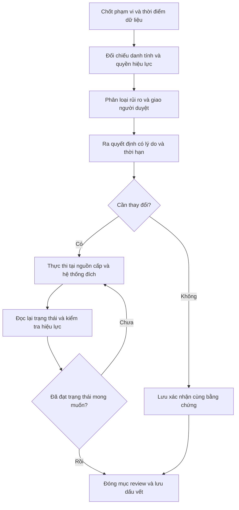

# Account review: Rà soát tài khoản trong vòng đời danh tính

Một tài khoản được tạo đúng quy trình vẫn có thể trở thành rủi ro sau vài tháng: nhân viên đổi vị trí nhưng giữ quyền cũ, nhà thầu đã hết hợp đồng, tài khoản quản trị không còn người chịu trách nhiệm, hoặc danh tính chạy tác vụ vẫn sử dụng quyền cao hơn nhu cầu hiện tại. Account review là hoạt động kiểm tra lại sự phù hợp của tài khoản và các quyền gắn với nó tại một thời điểm cụ thể.

Trong quản lý danh tính và quyền truy cập (IAM), hoạt động này nối các bước cấp phát, thay đổi và thu hồi thành một vòng đời có kiểm chứng. Mục tiêu không phải chỉ làm danh sách tài khoản ngắn hơn, mà là xác nhận rằng mỗi danh tính vẫn có lý do tồn tại, có người chịu trách nhiệm và chỉ giữ mức truy cập cần thiết.

## 1. Kết quả cần đạt sau bài học

Sau bài học, bạn có thể:

- Phân biệt rà soát sự tồn tại của tài khoản với rà soát quyền truy cập hiệu lực.
- Xác định nguồn dữ liệu, phạm vi và người có thẩm quyền duyệt.
- Nhận diện tài khoản mồ côi, tài khoản không còn nhu cầu và quyền tích lũy sau thay đổi công việc.
- Thiết kế quyết định giữ, giảm quyền, đình chỉ hoặc thu hồi kèm bằng chứng và thời hạn.
- Xử lý riêng danh tính con người, tài khoản đặc quyền và danh tính workload.
- Xác minh thay đổi đã có hiệu lực tại hệ thống đích, đồng thời lưu được dấu vết phục vụ kiểm toán.

## 2. Account review trả lời những câu hỏi nào?

Một đợt rà soát tốt trả lời ít nhất năm câu hỏi cho từng tài khoản trong phạm vi:

1. **Tài khoản thuộc về ai hoặc workload nào?** Có ánh xạ đáng tin cậy tới nhân sự, nhà thầu, ứng dụng hay dịch vụ không?
2. **Tài khoản còn cần tồn tại không?** Quan hệ làm việc, hợp đồng hoặc dịch vụ liên quan còn hiệu lực không?
3. **Ai chịu trách nhiệm?** Có người sở hữu nghiệp vụ và người có thể triển khai xử lý không?
4. **Quyền hiện tại có phù hợp không?** Những quyền nào còn cần, quyền nào dư thừa, có quyền xung đột hay đặc quyền không cần thiết không?
5. **Quyết định đã được thực thi chưa?** Hệ thống đích, phiên, token và thông tin xác thực liên quan đã được xử lý phù hợp chưa?

Không nên gộp tất cả thành một ô “Approve”. Có thể cần giữ tài khoản để nhân viên tiếp tục làm việc, nhưng đồng thời gỡ vai trò quản trị hoặc thu hẹp phạm vi dữ liệu mà tài khoản được phép truy cập.

### 2.1. Rà soát tài khoản và rà soát quyền

| Khía cạnh | Rà soát tài khoản | Rà soát quyền truy cập |
| --- | --- | --- |
| Đối tượng chính | Bản ghi tài khoản và quan hệ với chủ thể | Vai trò, nhóm, thuộc tính, chính sách và quyền hiệu lực |
| Câu hỏi điển hình | Tài khoản của người đã nghỉ còn hoạt động không? | Người chuyển bộ phận có còn quyền xuất dữ liệu cũ không? |
| Quyết định có thể có | Giữ, cập nhật chủ sở hữu, đình chỉ, thu hồi tài khoản | Giữ quyền, giảm quyền, bỏ nhóm, đổi vai trò, giới hạn thời gian |
| Bằng chứng trọng tâm | Trạng thái nhân sự, hợp đồng, chủ sở hữu, mục đích | Nhiệm vụ hiện tại, tài nguyên được phép truy cập, đường cấp quyền |

Trong thực tế, hai hoạt động nên liên kết với nhau. Xác nhận “nhân viên còn làm việc” chưa đủ để xác nhận tất cả quyền của nhân viên đó đều hợp lý.

## 3. Xác định phạm vi trước khi yêu cầu phê duyệt

Phạm vi phải mô tả được hệ thống, loại danh tính, mốc chốt dữ liệu và loại quyền cần xem xét. Ví dụ:

> Rà soát tài khoản và quyền truy cập hệ thống hỗ trợ khách hàng cùng kho dữ liệu vận hành tại thời điểm 09:00 ngày 12/10/2026; bao gồm nhân viên, nhà thầu, tài khoản quản trị riêng và danh tính dịch vụ có thể đọc dữ liệu khách hàng.

Cần nêu cả phần chưa bao phủ. Nếu đợt này chỉ kiểm tra nhóm trong nhà cung cấp danh tính (IdP), chưa có dữ liệu quyền cấp trực tiếp trong ứng dụng, kết quả không được mô tả là đã rà soát toàn bộ quyền hiệu lực của ứng dụng.

### 3.1. Những loại danh tính dễ bị bỏ sót

- **Tài khoản nhân viên và nhà thầu:** kiểm tra tình trạng làm việc, vai trò hiện tại, ngày kết thúc và đơn vị bảo trợ.
- **Tài khoản quản trị riêng:** liên kết với danh tính cá nhân chịu trách nhiệm, kiểm tra nhu cầu đặc quyền và cơ chế quản lý đặc quyền nếu có.
- **Tài khoản dịch vụ:** xác định ứng dụng sử dụng, chủ sở hữu và phụ thuộc vận hành trước khi thay đổi.
- **Danh tính workload liên kết:** kiểm tra workload nào được phép nhận token, đối tượng tin cậy, điều kiện liên kết và phạm vi quyền; có thể không tồn tại tài khoản người dùng truyền thống để liệt kê.
- **Tài khoản khẩn cấp:** kiểm tra người giám hộ, cách kiểm soát sử dụng, việc kiểm thử và dấu vết truy cập theo quy trình khẩn cấp.
- **Tài khoản dùng chung còn tồn tại:** cần chủ sở hữu, lý do và cơ chế truy vết; thiếu khả năng quy trách nhiệm là một phát hiện cần xử lý.
- **Tài khoản cục bộ tại ứng dụng:** có thể tồn tại độc lập với SSO và không xuất hiện đầy đủ trong danh sách người dùng của IdP.

Một người có nhiều tài khoản không đương nhiên là sai. Tài khoản làm việc thường ngày và tài khoản quản trị có thể được tách để hạn chế sử dụng đặc quyền. Điều cần kiểm tra là mục đích và mối liên kết giữa chúng.

### 3.2. Tần suất dựa trên rủi ro

Có thể kết hợp rà soát định kỳ với rà soát theo sự kiện. Ví dụ nội bộ: tài khoản đặc quyền được rà soát hằng tháng, quyền thông thường hằng quý, còn tài khoản nhà thầu được kiểm tra khi gia hạn hợp đồng. Đây là lựa chọn minh họa, không phải chu kỳ bắt buộc áp dụng cho mọi tổ chức.

Các sự kiện nên kích hoạt kiểm tra sớm gồm chuyển bộ phận, thay người quản lý, kết thúc hợp đồng, thay chủ sở hữu dịch vụ, ngừng một ứng dụng hoặc phát hiện truy cập bất thường. Việc thu hồi khi nghỉ việc phải đi theo quy trình xử lý sự kiện kịp thời; không chờ đến đợt review kế tiếp.

## 4. Thu thập dữ liệu đủ để ra quyết định

Mỗi nguồn phản ánh một phần sự thật. Hệ thống nhân sự cho biết quan hệ làm việc; IdP cho biết trạng thái danh tính và xác thực; ứng dụng đích cho biết tài khoản cục bộ cùng quyền thực tế. Dữ liệu phải được đối chiếu thay vì giả định một nguồn có đầy đủ mọi thông tin.

| Nhóm dữ liệu | Nội dung nên có | Dùng để kiểm tra |
| --- | --- | --- |
| Danh tính | Mã chủ thể ổn định, loại danh tính, mã tài khoản, hệ thống | Ghép đúng tài khoản với người hoặc workload |
| Vòng đời | Ngày bắt đầu, ngày kết thúc, trạng thái, đơn vị, người quản lý | Quan hệ làm việc và nhu cầu còn hiệu lực |
| Chủ sở hữu | Người bảo trợ, chủ ứng dụng, chủ workload | Trách nhiệm quyết định và xử lý |
| Quyền | Vai trò, nhóm trực tiếp và lồng nhau, quyền trực tiếp, thuộc tính liên quan | Quyền hiệu lực và nguồn cấp quyền |
| Hoạt động | Lần xác thực, sử dụng API hoặc thực hiện tác vụ gần nhất, phạm vi bao phủ log | Tín hiệu sử dụng và mức tin cậy của tín hiệu |
| Kiểm soát | Phương thức xác thực phù hợp, trạng thái MFA theo chính sách, đặc quyền, thời hạn quyền | Mức phù hợp với yêu cầu bảo vệ tài khoản |
| Kết quả trước | Ngoại lệ, ngày hết hạn, quyết định và bằng chứng thực thi | Quyền đã hết hạn hoặc vấn đề tái diễn |

Nên lưu thời điểm lấy dữ liệu và nguồn cho từng nhóm thông tin. Một bản xuất quyền từ tuần trước và một bản xuất nhân sự hôm nay có thể tạo ra sai lệch do thời gian, chưa chắc là lỗi cấp phát.

### 4.1. Liên kết danh tính bằng mã ổn định

Tên hiển thị và email có thể đổi hoặc được tái sử dụng. Ưu tiên liên kết bằng mã nhân sự, mã nhà thầu hoặc mã chủ thể bất biến mà các hệ thống đã thống nhất. Nếu không ghép được, ghi nhận trạng thái “chưa xác định chủ thể” để điều tra, thay vì tự gán cho người có tên gần giống.

Không ghép được tài khoản với nhân sự cũng chưa đủ để kết luận phải xóa: đó có thể là tài khoản dịch vụ. Tuy nhiên, tài khoản không có chủ thể hoặc chủ sở hữu xác nhận phải được đưa vào luồng xử lý có thời hạn.

### 4.2. Đọc tín hiệu không hoạt động đúng cách

“Không đăng nhập 90 ngày” là một tín hiệu cần kiểm tra, không phải bằng chứng duy nhất rằng tài khoản không còn cần thiết:

- Công việc có thể diễn ra theo quý, theo mùa hoặc khi có sự cố.
- Tài khoản dịch vụ có thể dùng API mà không có đăng nhập tương tác.
- Một nguồn log có thể không bao phủ mọi vùng, ứng dụng hoặc phương thức xác thực.
- Phiên hoặc token còn hiệu lực có thể tiếp tục được dùng mà không tạo sự kiện đăng nhập mới theo cách bạn đang thống kê.

Ngược lại, đăng nhập gần đây chỉ chứng minh có hoạt động được ghi nhận; nó không chứng minh hoạt động được phép hoặc quyền hiện tại là cần thiết. Tài khoản của người đã nghỉ vẫn cần được xử lý ngay cả khi vừa có đăng nhập.

## 5. Phân công đúng người duyệt

Người duyệt phải hiểu nhu cầu mà mình xác nhận. Bộ phận IAM có thể vận hành chiến dịch, nhưng không tự biết mọi nhu cầu nghiệp vụ của tất cả tài khoản.

| Vai trò | Trách nhiệm chính |
| --- | --- |
| Người quản lý hoặc đơn vị bảo trợ | Xác nhận người dùng còn quan hệ làm việc và nhu cầu công việc |
| Chủ ứng dụng hoặc chủ dữ liệu | Xác nhận phạm vi quyền phù hợp với chức năng và dữ liệu |
| Chủ workload | Xác nhận mục đích, phụ thuộc và nhu cầu truy cập của dịch vụ |
| Nhóm IAM hoặc quản trị hệ thống | Thu thập dữ liệu, tổ chức review, triển khai và đối chiếu thay đổi |
| Nhóm an ninh hoặc kiểm soát độc lập | Xử lý ngoại lệ rủi ro cao, xung đột quyền và kiểm tra bằng chứng khi cần |

Các nguyên tắc thực hành:

- Người dùng có thể cung cấp giải trình nhưng không tự phê duyệt đặc quyền của mình.
- Tài khoản nhạy cảm có thể cần cả người quản lý và chủ tài nguyên xác nhận.
- Người duyệt vắng mặt phải có cơ chế ủy quyền rõ ràng; không chuyển sang một người bất kỳ chỉ để hoàn tất tỷ lệ.
- Không phản hồi là một trạng thái quá hạn cần nhắc và chuyển cấp, không mặc nhiên có nghĩa là đồng ý.
- Nếu tổ chức có chính sách đình chỉ khi quá hạn, việc thực hiện phải đi theo chính sách đã công bố cùng quy trình bảo đảm vận hành liên quan.

Để giảm việc duyệt hàng loạt theo thói quen, màn hình hoặc biểu mẫu review nên thể hiện quyền thực tế bằng ngôn ngữ nghiệp vụ. “Có thể xuất toàn bộ hồ sơ khách hàng” giúp đánh giá tốt hơn một mã nhóm như `grp_ops_27` không có mô tả.

## 6. Quy trình rà soát từ dữ liệu đến bằng chứng hoàn tất



### Bước 1: Chốt phạm vi và ảnh chụp dữ liệu

Ghi mã chiến dịch, hệ thống, loại tài khoản, mốc chốt dữ liệu, thời hạn phản hồi, người phụ trách và tiêu chí chuyển cấp. Đánh dấu nguồn nào thiếu hoặc chưa đủ độ tin cậy.

Ảnh chụp dữ liệu giúp người duyệt và người kiểm toán hiểu quyết định dựa trên trạng thái nào. Tuy vậy, nếu xuất hiện sự kiện mới như nghỉ việc trong lúc review, quy trình vòng đời phải xử lý sự kiện đó ngay và cập nhật bằng chứng liên quan.

### Bước 2: Đối chiếu tài khoản, chủ thể và quyền

Liên kết tài khoản ở ứng dụng với danh tính gốc; tìm tài khoản không có chủ sở hữu, quan hệ làm việc hết hạn hoặc trạng thái lệch giữa các hệ thống. Xác định đầy đủ các đường cấp quyền quan trọng trước khi yêu cầu duyệt.

Với tài khoản có nhiều ứng dụng, có thể dùng một hồ sơ danh tính tổng hợp nhưng vẫn cần quyết định và bằng chứng theo từng hệ thống. Thu hồi thành công ở một ứng dụng không chứng minh các ứng dụng còn lại đã được xử lý.

### Bước 3: Phân loại và ưu tiên

Ưu tiên các trường hợp như người đã nghỉ còn tài khoản hoạt động, tài khoản không rõ chủ sở hữu có đặc quyền, ngoại lệ đã hết hạn, tài khoản có thể truy cập dữ liệu nhạy cảm hoặc quyền có xung đột nhiệm vụ.

Lỗi dữ liệu phải được phân biệt với kết luận nghiệp vụ. Nếu thiếu dữ liệu HR hoặc log chưa đầy đủ, quyết định phù hợp có thể là “cần điều tra”, kèm người xử lý và hạn cuối. Không dùng việc thiếu dữ liệu làm lý do xác nhận giữ quyền vô thời hạn.

### Bước 4: Ghi quyết định có thể thực thi

Một quyết định phải chỉ ra đối tượng, hành động, lý do, người chịu trách nhiệm và thời hạn. Những trạng thái hữu ích gồm:

| Quyết định | Khi áp dụng | Nội dung cần ghi |
| --- | --- | --- |
| Giữ | Chủ thể hợp lệ, nhu cầu được xác nhận, quyền phù hợp | Người xác nhận, lý do, mốc review tiếp theo |
| Giảm hoặc thay đổi quyền | Tài khoản vẫn cần nhưng quyền đang dư hoặc sai | Quyền cần gỡ, quyền cần giữ, nguồn cấp quyền |
| Đình chỉ | Cần ngăn truy cập trong lúc xác minh hoặc chờ bước thu hồi | Phạm vi đình chỉ, tác động, điều kiện mở lại |
| Thu hồi tài khoản | Nhu cầu chấm dứt và đã xác định cách xử lý | Hệ thống, phiên, thông tin xác thực và tài sản liên quan |
| Ngoại lệ có hạn | Có nhu cầu tạm thời được người có thẩm quyền chấp thuận | Hạn cuối, kiểm soát bù đắp, người chấp nhận rủi ro |
| Cần điều tra | Chưa đủ bằng chứng để kết luận | Dữ liệu thiếu, người bổ sung, hạn phản hồi, bước chuyển cấp |

“Giữ vì vẫn đang dùng” thường chưa đủ. Người duyệt cần giải thích nhu cầu công việc hoặc phụ thuộc dịch vụ, đặc biệt đối với quyền nhạy cảm.

### Bước 5: Thực thi thay đổi

Cần xác định nguồn quản lý quyền để tránh thay đổi bị cấp lại. Nếu nhóm ở IdP là nguồn đồng bộ xuống ứng dụng, việc gỡ quyền cục bộ nhưng giữ nguyên thành viên nhóm có thể dẫn đến cấp lại ở lần đồng bộ tiếp theo.

Tùy hệ thống và quyết định, xử lý có thể bao gồm:

- Gỡ vai trò, nhóm, quyền trực tiếp hoặc điều chỉnh thuộc tính dùng cho ABAC.
- Vô hiệu hóa hoặc thu hồi tài khoản ở đúng nguồn quản lý và các hệ thống đích liên quan.
- Thu hồi phiên, refresh token, API key, mật khẩu ứng dụng hoặc phương thức truy cập độc lập khi thuộc phạm vi cần chặn.
- Xử lý consent hoặc grant của ứng dụng OAuth nếu đó là đường truy cập dư thừa hoặc không còn được phép.
- Chuyển chủ sở hữu tài nguyên, lịch tác vụ và dữ liệu công việc theo quy trình trước khi xóa tài khoản.
- Cập nhật chính sách cấp quyền để thay đổi có thể duy trì sau lần đồng bộ hoặc cấp phát tiếp theo.

Đình chỉ không đồng nghĩa với xóa. Việc xóa tài khoản, chuyển giao tài sản và lưu giữ bằng chứng cần tuân theo quy trình vòng đời dữ liệu của tổ chức; không xóa hàng loạt chỉ để đạt chỉ số hoàn thành review.

### Bước 6: Xác minh và đóng mục review

Lệnh thay đổi được gửi thành công hoặc ticket được đánh dấu hoàn tất chưa chứng minh quyền đã mất hiệu lực. Cần đọc lại trạng thái từ hệ thống đích, xem kết quả đồng bộ, kiểm tra đường cấp quyền còn lại và kiểm thử truy cập theo cách được phép khi cần.

Nếu hệ thống có độ trễ đồng bộ hoặc cache quyền, ghi lại thời điểm thay đổi và thời điểm xác minh. Trong khoảng chờ, quyết định vẫn ở trạng thái đang thực thi hoặc chờ xác minh. Nếu cần chặn khẩn cấp, dùng biện pháp chặn thích hợp với hệ thống thay vì giả định đồng bộ sẽ hoàn tất ngay.

## 7. Rà soát quyền hiệu lực thay vì chỉ nhìn danh sách role

Một quyền có thể đến từ nhiều nguồn. Việc gỡ một đường cấp không chắc loại bỏ khả năng truy cập nếu còn đường khác.

### 7.1. RBAC và nhóm lồng nhau

Giả sử tài khoản `u-1042` đọc được báo cáo qua hai đường:

```text
u-1042 -> nhóm support-tier2 -> vai trò report-reader
u-1042 -> nhóm incident-response -> nhóm report-operators -> vai trò report-reader
```

Gỡ `support-tier2` vẫn có thể để lại quyền đọc báo cáo qua `incident-response`. Bản review cần cho biết vai trò hiệu lực và các đường dẫn cấp quyền quan trọng, không chỉ nhóm được gán trực tiếp.

Đồng thời cần cân nhắc tác động: gỡ một nhóm dùng chung có thể làm mất các quyền hợp lệ khác. Quyết định nên chỉ rõ khả năng nào cần thu hồi và người triển khai phải chọn thay đổi phù hợp.

### 7.2. ABAC và thuộc tính quyết định quyền

Với ABAC, quyền có thể phụ thuộc bộ phận, dự án, trạng thái nhân sự, phân loại dữ liệu hoặc ngữ cảnh truy cập. Chỉ rà soát role có thể bỏ sót thuộc tính cũ vẫn cho phép truy cập.

Ví dụ, người chuyển khỏi dự án A vẫn mang thuộc tính `project=A`, khiến chính sách tiếp tục cho đọc tài liệu dự án. Cần kiểm tra nguồn cập nhật thuộc tính và quyết định truy cập hiệu lực, không chỉ xác nhận tài khoản còn hoạt động.

### 7.3. SSO, OAuth/OIDC và phiên ứng dụng

IdP có thể kiểm soát lần xác thực tiếp theo qua SSO, nhưng ứng dụng còn phiên riêng, tài khoản cục bộ hoặc thông tin xác thực độc lập. Khóa người dùng ở IdP không phải bằng chứng rằng mọi đường truy cập đã bị thu hồi.

Với OAuth/OIDC, cần phân biệt tài khoản người dùng, phiên đăng nhập, grant, access token và refresh token. OIDC bổ sung lớp nhận diện danh tính trên OAuth; ID token không thay cho việc kiểm tra quyền ở tài nguyên. Thu hồi refresh token có thể ngăn cấp access token mới theo cơ chế hỗ trợ, trong khi access token đã phát hành có thể còn được chấp nhận đến khi hết hạn nếu tài nguyên không kiểm tra trạng thái thu hồi phù hợp.

Trong bài toán account review, điều cần chứng minh là quyết định truy cập đã có hiệu lực ở tài nguyên. Cách đạt được phụ thuộc vào cơ chế phiên, token, thu hồi và chính sách của từng hệ thống.

## 8. Xử lý riêng tài khoản dịch vụ và đặc quyền

### 8.1. Danh tính workload cần bằng chứng vận hành

Không dùng trường “last interactive login” để kết luận một tài khoản dịch vụ không hoạt động. Bằng chứng phù hợp có thể là log gọi API, lần chạy tác vụ, lần nhận token hoặc xác nhận của chủ workload.

Trước khi thu hồi, cần biết:

- Ứng dụng, tác vụ hoặc môi trường nào đang phụ thuộc danh tính đó.
- Tài nguyên nào được truy cập và quyền tối thiểu để thực hiện nhiệm vụ.
- Chủ sở hữu hiện tại và người tiếp nhận khi chủ sở hữu rời tổ chức.
- Thông tin xác thực được quản lý ở đâu; không đưa giá trị bí mật vào hồ sơ review.
- Cách chuyển sang danh tính khác, thu hẹp quyền hoặc ngừng dịch vụ mà vẫn kiểm soát được tác động.

Nếu workload dùng liên kết danh tính để nhận thông tin xác thực ngắn hạn, cần rà soát điều kiện tin cậy và quyền được nhận. Không nên bỏ qua chỉ vì không có mật khẩu dài hạn.

### 8.2. Đặc quyền thường trực và quyền đủ điều kiện kích hoạt

Nếu dùng cơ chế cấp đặc quyền tạm thời, review phải xem cả quyền đang hoạt động lẫn quyền đủ điều kiện kích hoạt. Một người hiện không có phiên quản trị vẫn có thể tự kích hoạt vai trò có tác động lớn nếu quyền đủ điều kiện còn tồn tại.

Cần kiểm tra người phê duyệt kích hoạt, thời hạn, điều kiện xác thực và dấu vết sử dụng theo chính sách của tổ chức. Với tài khoản khẩn cấp, không thu hồi chỉ vì ít sử dụng; cần đánh giá mục đích dự phòng, người chịu trách nhiệm, cách bảo vệ và kết quả kiểm thử có kiểm soát.

## 9. Ví dụ: Một đợt review có bốn tình huống khác nhau

Công ty Minh An chốt dữ liệu review ngày 12/10/2026 cho hệ thống hỗ trợ khách hàng và kho báo cáo. Các tên, tài khoản và mốc thời gian dưới đây là giả định.

| Tài khoản | Bằng chứng | Quyết định | Cách xác minh |
| --- | --- | --- | --- |
| `lan.work` | Lan đã chuyển từ hỗ trợ sang đào tạo; vẫn cần tài liệu nhưng còn quyền xuất toàn bộ khách hàng | Giữ tài khoản, gỡ khả năng xuất dữ liệu không còn cần | Đối chiếu nhóm, quyền trực tiếp và thử thao tác xuất bằng quy trình kiểm thử được phép |
| `vendor.07` | Hợp đồng kết thúc ngày 30/09; ứng dụng vẫn bật tài khoản cục bộ và có phiên còn hạn | Thu hồi các đường truy cập theo quy trình kết thúc hợp đồng | Kiểm tra IdP, tài khoản đích, phiên và thông tin xác thực độc lập liên quan |
| `svc-monthly-report` | Không có đăng nhập tương tác; log cho thấy tác vụ chạy ngày 01/10; có chủ sở hữu | Giữ danh tính, giảm từ quyền sửa sang chỉ đọc nếu nhiệm vụ chỉ cần đọc | Xác nhận truy vấn hợp lệ chạy được và khả năng ghi đã bị chặn |
| `admin-legacy` | Không ghép được chủ thể; chủ hệ thống chưa xác định nhu cầu; có quyền quản trị | Ưu tiên điều tra, áp dụng biện pháp hạn chế theo quy trình rủi ro và phụ thuộc thực tế | Xác định chủ sở hữu, kiểm tra tác vụ phụ thuộc và ghi bằng chứng hiệu lực của biện pháp đã chọn |

Điểm quan trọng là cùng một tín hiệu có thể dẫn đến hành động khác nhau. Ít hoạt động ở tài khoản khẩn cấp có thể phù hợp; hoạt động gần đây ở tài khoản đã hết hợp đồng lại là dấu hiệu cần xử lý sớm.

### 9.1. Ví dụ một hồ sơ quyết định

Bản ghi minh họa dưới đây mô tả việc giảm quyền của `lan.work`. Đây là cấu trúc dữ liệu tham khảo, không phải cấu hình cho một sản phẩm cụ thể.

```json
{
  "reviewId": "AR-2026-10-0042",
  "snapshotAt": "2026-10-12T09:00:00+07:00",
  "subjectId": "EMP-1042",
  "accountId": "lan.work",
  "system": "customer-support",
  "accountDecision": "KEEP",
  "accessDecision": "REDUCE",
  "removeCapabilities": ["customer.bulk-export"],
  "keepCapabilities": ["training.read"],
  "reason": "Chuyen sang bo phan dao tao; khong con nhiem vu xuat du lieu",
  "reviewers": ["manager-training", "owner-customer-data"],
  "remediationOwner": "iam-operations",
  "dueAt": "2026-10-14T17:00:00+07:00",
  "executionState": "PENDING",
  "evidenceRefs": ["hr-change-1042", "access-snapshot-20261012"]
}
```

Quyết định đã được duyệt nhưng `executionState` vẫn là `PENDING`, nên mục này chưa hoàn tất. Sau khi xử lý cần bổ sung thời điểm thực thi, thay đổi cụ thể, người xác minh, trạng thái thực tế và tham chiếu bằng chứng. Tránh đưa mật khẩu, token hoặc dữ liệu khách hàng vào hồ sơ chỉ để chứng minh quyền.

## 10. Dùng tự động hóa để hỗ trợ, có ranh giới rõ ràng

Tự động hóa phù hợp với việc tổng hợp dữ liệu, tìm ứng viên cần kiểm tra, nhắc quá hạn và đối chiếu trạng thái sau thay đổi. Quy tắc phát hiện cần trả về cả lý do và dữ liệu còn thiếu để người duyệt hiểu vì sao tài khoản được đưa vào danh sách.

```text
Với mỗi tài khoản trong ảnh chụp:
    nếu tài khoản đang bật và quan hệ làm việc được xác nhận đã kết thúc:
        tạo phát hiện ưu tiên cao cho quy trình thu hồi

    nếu chưa xác định được chủ thể hoặc chủ sở hữu:
        tạo yêu cầu xác minh chủ sở hữu, kèm hạn xử lý

    nếu ngoại lệ đã hết hạn:
        yêu cầu thu hồi hoặc phê duyệt mới trước khi tiếp tục ngoại lệ

    nếu có quyền nhạy cảm và nhiệm vụ hiện tại chưa giải thích được nhu cầu:
        yêu cầu chủ tài nguyên đánh giá quyền

    nếu không ghi nhận hoạt động:
        kiểm tra loại tài khoản và độ bao phủ của log
        chỉ ghi nhận ứng viên cần kiểm tra, chưa kết luận phải xóa
```

Đây là logic tạo phát hiện cho review. Các hành động tự động như đình chỉ hoặc thu hồi cần tiêu chí đủ tin cậy, chính sách được xác định, xử lý lỗi và kiểm chứng kết quả. Không nên biến sự vắng mặt của dữ liệu thành kết luận chắc chắn về việc tài khoản không còn được dùng.

## 11. Đo hiệu quả mà không nhầm phê duyệt với hoàn tất

Một đợt review có thể đạt 100% phản hồi nhưng vẫn còn nhiều quyền chưa được gỡ. Nên tách các chỉ số theo trạng thái và mức rủi ro.

| Chỉ số | Cách hiểu |
| --- | --- |
| Bao phủ dữ liệu | Bao nhiêu hệ thống, loại tài khoản và nguồn quyền trong phạm vi đã có dữ liệu đủ dùng |
| Tỷ lệ có quyết định | Số mục có quyết định cuối cùng hợp lệ chia cho tổng mục trong phạm vi |
| Tỷ lệ xác minh xử lý | Số mục cần thay đổi đã được xác minh thành công chia cho tổng mục cần thay đổi |
| Thời gian thu hồi | Khoảng thời gian từ mốc kích hoạt xử lý được quy định đến khi thu hồi được xác minh |
| Ngoại lệ quá hạn | Số ngoại lệ còn quyền nhưng đã qua hạn được phê duyệt |
| Tái xuất hiện quyền | Số quyền đã thu hồi nhưng được cấp lại ngoài chủ đích sau đó |
| Phát hiện thiếu chủ sở hữu | Số tài khoản hoặc workload chưa có người chịu trách nhiệm xác nhận |

Ví dụ: chiến dịch có 100 mục và cả 100 mục đã được quyết định; 20 mục cần giảm quyền, mới 12 mục xác minh xong. Tỷ lệ có quyết định là 100%, còn tỷ lệ xác minh xử lý là 60%. Tám mục còn lại vẫn cần tiếp tục theo dõi và không nên được che khuất bằng tỷ lệ phản hồi.

Nếu mẫu số bằng không, hiển thị “không áp dụng” cùng số lượng thay vì mặc nhiên ghi 100%. Cũng cần nêu rõ các hệ thống bị loại khỏi phạm vi và khoảng trống dữ liệu để người đọc không hiểu sai mức bao phủ.

## 12. Những lỗi thường gặp và cách sửa

| Lỗi | Hệ quả | Cách sửa |
| --- | --- | --- |
| Duyệt toàn bộ theo danh sách tên | Không biết người duyệt đã xem quyền nào | Hiển thị khả năng truy cập, nguồn cấp và lý do nghiệp vụ |
| Chỉ xác nhận nhân viên còn làm việc | Bỏ sót quyền cũ sau chuyển vị trí | Đối chiếu nhiệm vụ hiện tại với quyền hiệu lực |
| Chỉ rà soát tài khoản tại IdP | Bỏ sót tài khoản cục bộ và đường truy cập độc lập | Đối chiếu dữ liệu hệ thống đích và cơ chế xác thực thực tế |
| Gỡ một nhóm rồi đóng ticket | Quyền vẫn tồn tại qua nhóm khác hoặc quyền trực tiếp | Kiểm tra các đường cấp quyền và kết quả tại tài nguyên |
| Dùng một ngưỡng không hoạt động cho mọi tài khoản | Gián đoạn tác vụ định kỳ hoặc bỏ sót truy cập API | Chọn bằng chứng theo loại danh tính và đặc điểm vận hành |
| Không có chủ sở hữu thì giữ nguyên vô thời hạn | Tích lũy danh tính không ai chịu trách nhiệm | Đặt hạn xác minh, chuyển cấp và quyết định xử lý |
| Ngoại lệ không có ngày kết thúc | Quyền tạm thời trở thành thường trực | Ghi hạn, người chịu trách nhiệm và điều kiện thu hồi |
| Đóng review ngay sau khi gửi lệnh | Không phát hiện lỗi đồng bộ hoặc cache quyền | Đọc lại trạng thái, kiểm tra hiệu lực và lưu bằng chứng |

## 13. Bằng chứng tối thiểu để bàn giao kết quả

Mỗi chiến dịch cần có phạm vi, mốc dữ liệu, nguồn đã sử dụng, giới hạn bao phủ và người chịu trách nhiệm. Với từng mục review, nên lưu được:

- Tài khoản, chủ thể, hệ thống và quyền tại thời điểm xem xét.
- Người duyệt, thẩm quyền duyệt, quyết định, lý do và thời điểm quyết định.
- Ngoại lệ được chấp thuận cùng thời hạn và kiểm soát bù đắp nếu có.
- Hành động phải làm, người thực thi, hạn xử lý và kết quả thay đổi.
- Bằng chứng xác minh ở hệ thống đích, thời điểm xác minh và vấn đề còn mở.

Hồ sơ review chứa thông tin về nhân sự và khả năng truy cập nên cần giới hạn người xem, bảo vệ khỏi sửa đổi trái phép và lưu theo chính sách của tổ chức. Không biến báo cáo review thành nơi tập trung bí mật xác thực.

Một kết quả có thể bàn giao là kết quả chỉ rõ điều gì đã được xác nhận, điều gì đã thay đổi và điều gì còn phải xử lý. Từ đó, account review trở thành cơ chế duy trì quyền phù hợp trong suốt vòng đời danh tính, thay vì một lần ký xác nhận danh sách tài khoản.