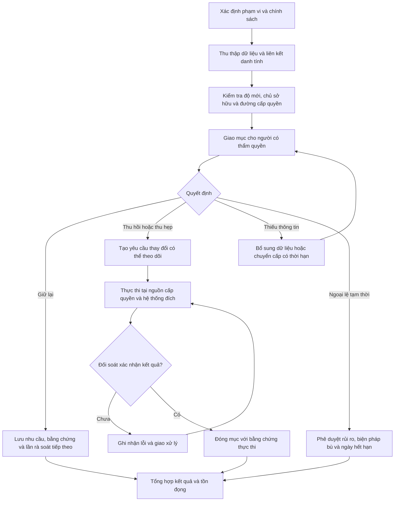

# Tái xác nhận tài khoản và quyền truy cập (Account recertification)

## 1. Mục tiêu và vị trí trong vòng đời tài khoản

Một tài khoản được cấp đúng quyền ngày đầu tiên chưa chắc còn phù hợp sau sáu tháng. Nhân viên có thể đổi nhóm, nhà thầu kết thúc một phần công việc, chủ sở hữu ứng dụng nghỉ việc hoặc một tài khoản kỹ thuật tiếp tục giữ quyền phục vụ dự án đã đóng. Nếu chỉ có quy trình tạo và khóa tài khoản, tổ chức vẫn có thể tích lũy những tài khoản không còn cần thiết và những quyền vượt quá nhu cầu hiện tại.

**Account recertification** là quá trình tái xác nhận có bằng chứng rằng tài khoản vẫn cần tồn tại, có người chịu trách nhiệm và có trạng thái phù hợp. Trong thực tế, quá trình này thường đi cùng **access recertification**: tái xác nhận từng quyền hoặc nhóm quyền mà tài khoản đang có. Bài học sử dụng cả hai góc nhìn, nhưng phân biệt rõ quyết định về tài khoản với quyết định về quyền.

Trong phạm vi IAM nền tảng, hoạt động này nối quản lý vòng đời tài khoản với RBAC, ABAC, SSO, danh tính workload, quản lý đặc quyền và kiểm toán. Mục tiêu là duy trì nguyên tắc ít quyền nhất theo thời gian, thay vì chỉ kiểm tra quyền tại thời điểm cấp phát.

Sau bài học, người học có thể:

- Phân biệt tái xác nhận tài khoản, tái xác nhận quyền và xác thực người dùng.
- Xác định ai có thẩm quyền xác nhận nhu cầu kinh doanh, ai hiểu tác động kỹ thuật và ai thực hiện thay đổi.
- Thiết kế một đợt rà soát với phạm vi, thời hạn, bằng chứng và cách xử lý ngoại lệ rõ ràng.
- Theo dõi từ quyết định thu hồi đến việc quyền thực sự mất hiệu lực ở hệ thống đích.
- Nhận diện các dấu hiệu cho thấy đợt rà soát chỉ hoàn thành trên giấy.

## 2. Tái xác nhận điều gì?

### 2.1. Ba câu hỏi khác nhau

| Câu hỏi | Đối tượng cần kiểm tra | Ví dụ quyết định |
| --- | --- | --- |
| Tài khoản này có còn cần thiết và có chủ sở hữu hợp lệ không? | Tài khoản, người bảo trợ, trạng thái làm việc hoặc hợp đồng | Giữ tài khoản của nhân viên đang làm việc; vô hiệu hóa tài khoản nhà thầu đã kết thúc hợp đồng |
| Từng quyền hiện có còn cần cho công việc hiện tại không? | Vai trò, nhóm, quyền trực tiếp, quyền trên tài nguyên, điều kiện cấp quyền | Giữ quyền đọc báo cáo; thu hồi quyền xuất toàn bộ dữ liệu khách hàng |
| Người hoặc workload đang truy cập có chứng minh được danh tính không? | Thông tin xác thực, MFA, chứng thư, token, phiên | Yêu cầu MFA khi đăng nhập hoặc kiểm tra danh tính workload khi lấy token |

Câu hỏi cuối thuộc xác thực và kiểm soát phiên. Nó hỗ trợ bảo vệ truy cập nhưng không thay thế hai câu hỏi đầu. Một tài khoản dùng MFA tốt vẫn có thể không còn lý do kinh doanh để tồn tại. Ngược lại, một tài khoản được xác nhận là cần thiết vẫn phải tuân thủ chính sách xác thực.

### 2.2. Quyết định ở cấp tài khoản không tự duyệt toàn bộ quyền

Giả sử Lan chuyển từ bộ phận thu hồi công nợ sang bộ phận phân tích. Người quản lý xác nhận Lan vẫn làm việc tại công ty, nên tài khoản cần được giữ lại. Tuy nhiên, quyền thay đổi thông tin thanh toán của khách hàng có thể không còn phù hợp.

Vì vậy, cần lưu hai kết luận riêng:

```text
Tài khoản Lan: giữ lại, có nhu cầu kinh doanh hợp lệ.
Quyền đọc dữ liệu phân tích: giữ lại theo nhiệm vụ hiện tại.
Quyền sửa thông tin thanh toán: thu hồi do đã chuyển nhiệm vụ.
```

Nếu giao diện chỉ có nút “Duyệt tài khoản”, người rà soát có thể vô tình duyệt luôn mọi quyền tích lũy từ trước. Một thiết kế tốt phải cho phép xem và quyết định ở mức đủ chi tiết, nhất là với quyền nhạy cảm.

### 2.3. Quan hệ với các cơ chế IAM khác

- **Joiner–Mover–Leaver:** tạo, điều chỉnh và thu hồi theo sự kiện vòng đời. Tái xác nhận giúp phát hiện sự kiện bị bỏ sót hoặc thay đổi công việc chưa được phản ánh đầy đủ.
- **RBAC:** kiểm tra cả việc một người được gán đúng vai trò lẫn việc các quyền bên trong vai trò còn phù hợp. Duyệt việc gán vai trò không đồng nghĩa đã rà soát thiết kế của vai trò đó.
- **ABAC:** kiểm tra nguồn thuộc tính, độ chính xác của thuộc tính và chính sách sử dụng chúng. Chỉ xem danh sách nhóm sẽ bỏ sót quyền được cấp dựa trên phòng ban, dự án, phân loại dữ liệu hoặc quan hệ với tài nguyên.
- **SSO và liên kết danh tính:** kiểm tra khả năng đăng nhập qua nhà cung cấp danh tính và tài khoản/quyền tại từng ứng dụng. Một tài khoản cục bộ có thể vẫn cho phép truy cập ngoài luồng SSO.
- **Quản lý đặc quyền:** xác nhận cả quyền quản trị đang hoạt động và tư cách được kích hoạt quyền khi cần. Không có phiên quản trị hiện tại chưa có nghĩa là không còn khả năng lấy quyền quản trị.

Tái xác nhận là một biện pháp quản trị theo chu kỳ hoặc theo sự kiện. Nó không thay thế việc xử lý ngay tài khoản nghỉ việc, truy cập bị xâm phạm hay một quyền đã biết là sai.

## 3. Phạm vi và đơn vị rà soát

### 3.1. Chọn đơn vị đủ nhỏ để ra quyết định

Đơn vị rà soát thường là một trong các quan hệ sau:

```text
Danh tính → tài khoản trên ứng dụng
Tài khoản → vai trò hoặc nhóm
Tài khoản → quyền trực tiếp trên tài nguyên
Danh tính workload → quyền truy cập dịch vụ hoặc dữ liệu
Danh tính → tư cách kích hoạt quyền đặc quyền
```

Với quyền nhạy cảm, nên hiển thị cả **đường cấp quyền** và **khả năng thực tế**. Tên nhóm `FIN-OPS-L2` ít giá trị nếu người quản lý không biết nhóm này cho phép xuất dữ liệu tài chính hoặc sửa thông tin nhà cung cấp.

Một tài khoản có thể có nhiều đường dẫn đến cùng một quyền. Nếu quyền đọc kho dữ liệu đến từ cả nhóm A lẫn quyền trực tiếp, xóa khỏi nhóm A chưa đủ để thu hồi khả năng đọc. Đợt rà soát cần làm rõ đang quyết định về một phép gán cụ thể hay về toàn bộ quyền hiệu lực.

### 3.2. Lập phạm vi dựa trên rủi ro

| Nhóm đối tượng | Điểm cần chú ý | Tín hiệu có thể kích hoạt rà soát bổ sung |
| --- | --- | --- |
| Nhân viên | Nhiệm vụ hiện tại, quản lý trực tiếp, thay đổi bộ phận | Chuyển nhóm, đổi vị trí, hoàn thành dự án |
| Nhà thầu và đối tác | Người bảo trợ, hợp đồng, ngày hết hạn | Gia hạn hợp đồng, đổi phạm vi công việc, mất người bảo trợ |
| Khách bên ngoài | Quan hệ hợp tác và tài nguyên thực sự cần chia sẻ | Dự án kết thúc, chủ tài nguyên thay đổi |
| Tài khoản quản trị | Phạm vi đặc quyền, tách tài khoản thường và quản trị, khả năng kích hoạt | Thay đổi trách nhiệm vận hành, thay đổi mức nhạy cảm của hệ thống |
| Tài khoản dịch vụ và workload | Chủ sở hữu, ứng dụng phụ thuộc, môi trường, quyền và thông tin xác thực | Workload ngừng hoạt động, ứng dụng thay kiến trúc, đội vận hành giải thể |
| Tài khoản dùng chung hoặc khẩn cấp | Lý do tồn tại, người chịu trách nhiệm, khả năng truy vết và kiểm thử | Thay đổi người được phép sử dụng hoặc thay đổi quy trình ứng cứu |

Chu kỳ phải được tổ chức xác định dựa trên độ nhạy cảm, tác động khi bị lạm dụng và yêu cầu áp dụng. Ví dụ, một tổ chức có thể rà soát quyền quản trị hằng tháng và quyền đọc thông thường mỗi quý. Đây là lựa chọn minh họa, không phải lịch bắt buộc cho mọi hệ thống.

Rà soát theo sự kiện giúp rút ngắn khoảng thời gian quyền không phù hợp tồn tại giữa hai đợt định kỳ. Một lần chuyển bộ phận có thể kích hoạt kiểm tra ngay các quyền thuộc bộ phận cũ, thay vì chờ đến cuối quý.

## 4. Dữ liệu đầu vào và bằng chứng

### 4.1. Hồ sơ tối thiểu của một mục rà soát

Một mục cần đủ thông tin để người được giao có thể đưa ra quyết định cụ thể:

| Nhóm dữ liệu | Ví dụ cần lưu |
| --- | --- |
| Liên kết danh tính | Mã nhân sự hoặc mã đối tác ổn định, ID tài khoản tại ứng dụng, loại danh tính |
| Trách nhiệm | Người quản lý, chủ ứng dụng, chủ dữ liệu, chủ sở hữu workload hoặc người bảo trợ |
| Trạng thái vòng đời | Đang làm việc, tạm nghỉ, đã kết thúc hợp đồng, ngày hết hạn |
| Quyền hiện tại | Vai trò, nhóm, quyền trực tiếp, tài nguyên, phạm vi và đường cấp quyền |
| Ngữ cảnh kinh doanh | Nhiệm vụ, dự án, lý do cấp ban đầu, thời hạn của nhu cầu |
| Rủi ro | Quyền quản trị, dữ liệu nhạy cảm, khả năng xung đột nhiệm vụ |
| Tín hiệu sử dụng | Lần dùng gần nhất và nguồn ghi nhận, hoạt động API, sự kiện kích hoạt quyền |
| Nguồn và độ mới | Hệ thống cung cấp, thời điểm lấy dữ liệu, thời điểm đối soát gần nhất |
| Lịch sử quyết định | Ai quyết định, quyết định gì, lý do, thời điểm, ngoại lệ và kết quả thực thi |

Nên liên kết bằng ID ổn định thay vì chỉ dùng tên hiển thị hoặc email. Email có thể được đổi, tái sử dụng hoặc xuất hiện ở nhiều hệ thống dưới các dạng khác nhau. Liên kết nhầm danh tính sẽ làm sai cả người duyệt lẫn đối tượng bị thu hồi.

### 4.2. Dữ liệu sử dụng chỉ là một tín hiệu

“Không đăng nhập trong 90 ngày” có thể gợi ý tài khoản không còn cần thiết, nhưng chưa đủ để kết luận. Một tài khoản dự phòng có thể chỉ được dùng khi phục hồi thảm họa. Workload có thể truy cập bằng API mà không tạo sự kiện đăng nhập tương tác. Một quyền dành cho công việc cuối năm cũng có thể ít được sử dụng trong phần lớn thời gian.

Chiều ngược lại cũng quan trọng: tài khoản vừa được dùng không chứng minh việc dùng đó còn được phép. Quyền cũ vẫn có thể được sử dụng sau khi người dùng chuyển vai trò.

Do đó, quyết định giữ lại cần gắn với nhu cầu hiện tại, người chịu trách nhiệm và thời hạn thích hợp. Không nên chỉ dựa vào thời điểm sử dụng cuối cùng.

### 4.3. Thiếu dữ liệu phải hiện rõ

Các trường hợp như không tìm thấy người quản lý, dữ liệu nhân sự quá cũ, connector ngừng đồng bộ hoặc quyền không có mô tả phải được đánh dấu là vấn đề cần xử lý. Không biến “không biết” thành “được duyệt”.

Nếu chưa thể xác định người có thẩm quyền, mục rà soát cần được chuyển tới đầu mối quản trị đã quy định, có thời hạn xử lý và người chịu trách nhiệm. Trong thời gian đó, trạng thái vẫn là chưa có kết luận hoặc ngoại lệ được phê duyệt; không được ghi nhận như một quyết định giữ quyền thông thường.

## 5. Ai có trách nhiệm xác nhận?

Người quản lý hiểu nhu cầu công việc, nhưng có thể không hiểu quyền kỹ thuật. Chủ ứng dụng hiểu chức năng, nhưng có thể không biết nhân viên còn được phân công nhiệm vụ đó hay không. Hai góc nhìn này bổ sung cho nhau.

| Vai trò | Trách nhiệm chính |
| --- | --- |
| Người quản lý hoặc người bảo trợ | Xác nhận quan hệ làm việc, nhiệm vụ và nhu cầu truy cập hiện tại |
| Chủ ứng dụng hoặc chủ dữ liệu | Xác nhận mức quyền, phạm vi dữ liệu và tác động của việc giữ hoặc thu hồi |
| Chủ sở hữu workload | Giải thích workload phục vụ việc gì, còn hoạt động không và cần quyền nào |
| Nhóm IAM hoặc quản trị chiến dịch | Chuẩn bị dữ liệu, phân công, theo dõi thời hạn, lưu quyết định và điều phối thực thi |
| Nhóm vận hành hệ thống đích | Áp dụng thay đổi, kiểm tra kết quả, xử lý lỗi và đối soát |
| Nhóm an ninh hoặc quản trị rủi ro | Đánh giá trường hợp rủi ro cao, xung đột nhiệm vụ và ngoại lệ theo thẩm quyền |
| Kiểm toán hoặc bên kiểm tra độc lập | Kiểm tra khả năng chứng minh quy trình và kết quả theo phạm vi được giao |

Với quyền nhạy cảm, chính sách có thể yêu cầu cả quản lý nghiệp vụ và chủ dữ liệu xác nhận. Sự đồng ý của người sử dụng không thể tự thay thế người có thẩm quyền phê duyệt. Nếu người rà soát cũng là chủ thể nhận quyền, cần chuyển cho người đủ thẩm quyền khác để tránh tự duyệt.

Ủy quyền rà soát phải ghi lại người giao, người nhận, phạm vi và thời hạn. Đổi người phụ trách không được làm mất dấu vết ai thực sự ra quyết định.

## 6. Thiết kế một đợt tái xác nhận

### 6.1. Xác định chính sách trước khi gửi yêu cầu duyệt

Trước khi bắt đầu, cần chốt:

1. Hệ thống, loại tài khoản và loại quyền nằm trong phạm vi.
2. Thời điểm chụp dữ liệu và cách xử lý thay đổi phát sinh trong đợt rà soát.
3. Người có thẩm quyền quyết định và người nhận chuyển cấp.
4. Các lựa chọn quyết định, bằng chứng và lý do bắt buộc.
5. Hạn phản hồi, hạn thực thi và cách xử lý khi không phản hồi.
6. Điều kiện ngoại lệ, người được phê duyệt và thời hạn hết hiệu lực.
7. Cách xác minh kết quả tại hệ thống đích và tiêu chí đóng đợt rà soát.

Chính sách không phản hồi cần có từ trước. Có thể áp dụng thu hồi mặc định sau thời hạn đối với một số nhóm quyền; các quyền vận hành quan trọng có thể cần chuyển cấp hoặc kế hoạch thay đổi cụ thể. Dù chọn cách nào, không phản hồi không được tự động tính là đã xác nhận hợp lệ.

### 6.2. Luồng xử lý từ đầu đến cuối



Đợt rà soát cần phân biệt **đã có quyết định** với **đã khắc phục xong**. Một quyền bị đánh dấu “thu hồi” vẫn là quyền còn tồn tại cho tới khi thay đổi đã được áp dụng và xác minh.

### 6.3. Dữ liệu chụp tại một thời điểm và dữ liệu đang thay đổi

Giả sử danh sách quyền được chụp vào thứ Hai. Đến thứ Tư, người dùng đổi nhóm hoặc được cấp thêm quyền. Kết luận dựa trên bản chụp thứ Hai không tự bao phủ trạng thái thứ Tư.

Một đợt rà soát nên:

- Lưu phiên bản hoặc thời điểm dữ liệu dùng để ra quyết định.
- Phát hiện thay đổi đáng kể trước khi thực thi quyết định thu hồi.
- Đưa quyền mới hoặc thay đổi ngoài phạm vi bản chụp vào luồng kiểm soát riêng.
- Đối soát cuối đợt để ghi nhận các mục cần mở lại hoặc rà soát bổ sung.

Mục đích là tránh áp dụng quyết định cho sai trạng thái, đồng thời không bỏ qua quyền phát sinh trong thời gian chiến dịch đang chạy.

## 7. Quyết định và trạng thái cần tách riêng

### 7.1. Những kết luận thường dùng

| Kết luận | Ý nghĩa | Bằng chứng hoặc hành động đi kèm |
| --- | --- | --- |
| Giữ tài khoản hoặc giữ quyền | Nhu cầu hiện tại được xác nhận | Người xác nhận, lý do, phạm vi và mốc rà soát tiếp theo |
| Thu hồi quyền | Một phép gán hoặc khả năng truy cập không còn hợp lệ | Xác định chính xác quyền cần bỏ, nguồn cấp và hạn hoàn thành |
| Thu hẹp quyền | Vẫn cần truy cập nhưng ở phạm vi nhỏ hơn | Quyền đích cần có và cách xác nhận quyền cũ không còn hiệu lực |
| Vô hiệu hóa tài khoản | Tài khoản không còn cần hoạt động hoặc không còn chủ thể hợp lệ | Kế hoạch xử lý phiên, phụ thuộc, dữ liệu và đối soát trạng thái |
| Cần thêm thông tin | Chưa đủ cơ sở để kết luận | Nội dung thiếu, người bổ sung và hạn xử lý |
| Ngoại lệ có thời hạn | Tạm giữ truy cập dù chưa đáp ứng đầy đủ chính sách | Người chấp thuận rủi ro, lý do, biện pháp bù, ngày hết hạn và cách xử lý khi hết hạn |

Xóa tài khoản thường có tác động đến dữ liệu, lịch sử kiểm toán và liên kết ứng dụng. Quyết định “không còn cần truy cập” thường dẫn tới vô hiệu hóa hoặc thu hồi trước; việc xóa cần tuân theo quy trình lưu giữ và quản lý dữ liệu riêng. Không mặc định rằng kết quả rà soát luôn cho phép xóa ngay.

### 7.2. Theo dõi hai trục trạng thái

Ví dụ dưới đây là mô hình minh họa, không phải các tên trạng thái bắt buộc:

```text
Trạng thái rà soát:
PENDING_REVIEW → RETAIN / REVOKE / REDUCE / NEEDS_INFO / EXCEPTION

Trạng thái khắc phục, áp dụng cho quyết định cần thay đổi:
NOT_STARTED → IN_PROGRESS → VERIFIED
                         ↘ FAILED → IN_PROGRESS
```

Một mục có `decision = REVOKE` và `remediation = FAILED` phải xuất hiện trong danh sách tồn đọng. Nếu hệ thống chỉ có trạng thái “Done”, người vận hành có thể nhầm việc bấm duyệt với việc quyền đã được gỡ.

Ngoại lệ cũng cần được theo dõi riêng. Đến ngày hết hạn, phải có hành động theo chính sách: thu hồi, mở lại để rà soát hoặc gia hạn bằng một quyết định mới đủ thẩm quyền. Không tự nối dài ngoại lệ chỉ vì chưa có ai xử lý.

## 8. Từ quyết định đến quyền thực sự bị thu hồi

### 8.1. Thay đổi đúng nguồn cấp quyền

Đường cấp quyền quyết định nơi phải thực thi:

| Cách có quyền | Nơi cần xử lý | Rủi ro nếu chỉ sửa một điểm |
| --- | --- | --- |
| Thành viên nhóm tại hệ thống danh tính | Nhóm nguồn và cơ chế đồng bộ tới ứng dụng | Sửa ở ứng dụng có thể bị đồng bộ cấp lại |
| Vai trò hoặc quyền gán trực tiếp tại ứng dụng | Cấu hình phân quyền của ứng dụng | Bỏ nhóm SSO vẫn để lại quyền trực tiếp |
| Nhóm lồng nhau hoặc nhiều vai trò | Các đường gán tạo ra quyền hiệu lực | Bỏ một nhóm vẫn còn truy cập qua nhóm khác |
| Chính sách dựa trên thuộc tính | Nguồn thuộc tính và/hoặc chính sách theo đúng thực tế nghiệp vụ | Sửa sai thuộc tính để né quyền có thể làm sai cả dữ liệu danh tính |
| Quyền đặc quyền theo yêu cầu | Tư cách kích hoạt, phép gán đang hoạt động và phiên liên quan | Hết phiên hiện tại nhưng vẫn có thể kích hoạt lại |

Nếu mọi thành viên đều nhận một quyền không phù hợp từ cùng một vai trò, vấn đề có thể nằm ở thiết kế vai trò. Khi đó cần ghi nhận việc sửa mô hình quyền, thay vì chỉ xử lý lặp lại từng người trong mỗi kỳ rà soát.

### 8.2. Xử lý phiên, token và truy cập liên kết

Khóa tài khoản tại nhà cung cấp danh tính thường ảnh hưởng đến khả năng đăng nhập mới qua luồng đó, nhưng không bảo đảm mọi phiên ở ứng dụng đã kết thúc. Một ứng dụng có thể còn cookie phiên riêng. Access token đã phát hành có thể vẫn được chấp nhận đến khi hết hạn nếu hệ thống không có cơ chế kiểm tra hoặc thu hồi tương ứng.

Tùy kiến trúc và khả năng của hệ thống, việc khắc phục có thể cần:

- Gỡ vai trò hoặc quyền tại ứng dụng đích.
- Thu hồi phiên và refresh token theo cơ chế được hỗ trợ.
- Xử lý API key, chứng thư hoặc thông tin xác thực của workload liên quan.
- Kiểm tra tài khoản cục bộ, phương thức đăng nhập dự phòng và đường truy cập bỏ qua SSO.
- Xác định thời gian còn có thể sử dụng quyền do bộ nhớ đệm hoặc thời hạn token.

Không suy ra rằng thông báo đồng bộ thành công đồng nghĩa mọi khả năng truy cập đã mất. Ví dụ, connector cấp phát dùng SCIM có thể đã cập nhật trạng thái tài khoản, trong khi cơ chế kết thúc phiên và thu hồi token thuộc luồng khác của ứng dụng.

Với quyền đặc quyền cần thu hồi khẩn cấp, thời gian chờ token hết hạn có thể không phù hợp với yêu cầu xử lý. Khi đó phải sử dụng cơ chế chặn hoặc thu hồi mà kiến trúc hỗ trợ, đồng thời ghi rõ giới hạn nếu chưa có khả năng cắt truy cập ngay.

### 8.3. Xác minh bằng đối soát

Bằng chứng hoàn thành có thể bao gồm:

1. Yêu cầu thay đổi đã được hệ thống đích tiếp nhận.
2. Lần đọc lại cho thấy tài khoản hoặc phép gán đã ở trạng thái mong muốn.
3. Các đường cấp quyền khác liên quan đã được đánh giá.
4. Yêu cầu về phiên và thông tin xác thực đã được xử lý trong phạm vi áp dụng.
5. Không phát hiện quyền bị tự động cấp lại trong lần đồng bộ tiếp theo cần kiểm tra.

Nếu thử quyền thực tế là cần thiết, dùng phương thức kiểm tra được phê duyệt và giới hạn vào khả năng cần xác minh. Không yêu cầu người rà soát đăng nhập bằng thông tin xác thực của người khác hoặc thực hiện thao tác có tác động lên dữ liệu thật chỉ để “thử xem còn quyền hay không”.

## 9. Ví dụ xuyên suốt: nhà thầu còn tài khoản sau khi đổi phạm vi dự án

### 9.1. Dữ liệu tại đầu đợt rà soát

Công ty Minh An có nhà thầu Huy đang hỗ trợ dự án báo cáo bán hàng. Hợp đồng còn một tháng nhưng phần việc đối soát thanh toán đã kết thúc.

| Thành phần | Trạng thái phát hiện |
| --- | --- |
| Tài khoản tại hệ thống danh tính | Đang hoạt động, người bảo trợ là trưởng dự án |
| Nhóm `sales-report-reader` | Cần cho công việc hiện tại |
| Nhóm `payment-ops` | Được cấp từ giai đoạn trước, cho phép sửa thông tin thanh toán |
| Quyền xuất dữ liệu trực tiếp tại ứng dụng | Không còn yêu cầu trong phạm vi công việc hiện tại |
| Tài khoản cục bộ tại ứng dụng | Vẫn tồn tại từ thời điểm trước khi tích hợp SSO |
| Thời hạn truy cập | Chưa được liên kết với ngày hết hạn hợp đồng |

Nếu chỉ hỏi “Huy có còn làm việc với công ty không?”, câu trả lời là có và toàn bộ quyền cũ có thể tiếp tục tồn tại. Câu hỏi cần đi đến từng quyền và đường truy cập.

### 9.2. Quyết định có căn cứ

- Người bảo trợ xác nhận Huy tiếp tục cần tài khoản trong tháng còn lại.
- Chủ dữ liệu xác nhận chỉ cần quyền đọc báo cáo; quyền sửa thanh toán và xuất dữ liệu không còn phù hợp.
- Chủ ứng dụng xác nhận tài khoản cục bộ không còn cần làm đường đăng nhập riêng sau khi kiểm tra phụ thuộc.
- Nhóm IAM thiết lập mốc kết thúc truy cập gắn với hợp đồng và xác định người xử lý nếu hợp đồng được gia hạn.

Một mục quyết định có thể được lưu như sau:

```json
{
  "campaignId": "RECERT-EXAMPLE-01",
  "identityId": "contractor-042",
  "targetAccountId": "billing-account-781",
  "reviewItemId": "item-118",
  "scope": "membership:payment-ops",
  "snapshotVersion": "snapshot-01",
  "decision": "REVOKE",
  "reason": "Phần việc đối soát thanh toán đã kết thúc",
  "reviewerId": "data-owner-009",
  "decidedAt": "2026-11-20T03:00:00Z",
  "remediationDueAt": "2026-11-21T03:00:00Z",
  "remediationStatus": "NOT_STARTED"
}
```

Đây chỉ là một mục về tư cách thành viên nhóm. Quyền xuất dữ liệu trực tiếp và đường đăng nhập cục bộ cần các mục hoặc hành động liên kết riêng, để không bị bỏ sót dưới kết luận chung “thu hồi quyền thanh toán”.

### 9.3. Thực thi và đóng mục

Nhóm vận hành gỡ Huy khỏi nhóm nguồn, thu hồi quyền trực tiếp và xử lý đường đăng nhập cục bộ theo thiết kế của ứng dụng. Sau đó họ kiểm tra lại quyền hiệu lực và các phiên còn tồn tại theo yêu cầu. Quyền đọc báo cáo được giữ để Huy tiếp tục công việc đã được xác nhận.

Chỉ sau khi đối soát đạt yêu cầu, các mục thu hồi mới chuyển sang `VERIFIED`. Nếu connector báo lỗi khi gỡ nhóm, mục vẫn là tồn đọng cần khắc phục dù người bảo trợ và chủ dữ liệu đều đã hoàn thành phần rà soát.

Đến ngày hợp đồng hết hạn, quy trình kết thúc hợp đồng phải xử lý tài khoản theo sự kiện. Không đợi đợt tái xác nhận kế tiếp để quyết định có nên ngừng truy cập hay không.

## 10. Các trường hợp cần cách xem xét riêng

### 10.1. Danh tính workload và tài khoản dịch vụ

Không thể hỏi một tài khoản dịch vụ “còn làm việc không” theo mô hình nhân sự. Cần xác nhận workload hoặc quy trình phụ thuộc còn tồn tại, chủ sở hữu hiện tại là ai và phạm vi quyền có còn phù hợp.

Hồ sơ nên liên kết tài khoản với ứng dụng, môi trường, đội chịu trách nhiệm và mục đích sử dụng. Nếu chủ sở hữu nghỉ việc, cần chuyển trách nhiệm sang người hoặc nhóm hợp lệ và vẫn giữ khả năng quy trách nhiệm cụ thể; đổi tên người sở hữu đơn thuần không chứng minh workload còn cần toàn bộ quyền.

Không dùng riêng tín hiệu “không có lần đăng nhập” để tự khóa tài khoản dịch vụ. Cần kiểm tra hoạt động máy, lịch chạy, phụ thuộc và tác động vận hành. Nếu phải thu hồi, kế hoạch cần xử lý cả quyền lẫn thông tin xác thực liên quan, với kiểm chứng sau thay đổi.

### 10.2. Tài khoản khẩn cấp

Tài khoản khẩn cấp có thể được cố ý giữ ở trạng thái sẵn sàng nhưng ít sử dụng. Việc tái xác nhận cần kiểm tra lý do tồn tại, người có thể sử dụng, cơ chế bảo vệ thông tin xác thực, ghi log và khả năng sử dụng trong tình huống dự kiến.

Quyết định giữ lại phải viện dẫn chính sách ứng cứu và bằng chứng kiểm tra phù hợp. “Không dùng gần đây” không đủ để xóa; “đây là tài khoản khẩn cấp” cũng không đủ để miễn rà soát vô thời hạn.

### 10.3. Tài khoản dùng chung và tài khoản mồ côi

Tài khoản dùng chung làm khó việc xác định ai chịu trách nhiệm và ai thực sự đã dùng quyền. Nếu còn cần tồn tại theo chính sách, phải có chủ sở hữu, danh sách người được phép sử dụng và khả năng truy vết tương ứng.

Tài khoản mồ côi là tài khoản không còn liên kết đáng tin cậy với chủ thể hoặc chủ sở hữu hợp lệ. Đây là vấn đề dữ liệu và quản trị cần xử lý, nhưng mức khẩn cấp phụ thuộc vào quyền và mức phơi lộ. Cần điều tra, chuyển cấp và quyết định trạng thái theo rủi ro; không tự gán cho một người bất kỳ chỉ để hoàn thành biểu mẫu.

### 10.4. Xung đột nhiệm vụ

Hai quyền có thể đều hợp lý khi nhìn riêng, nhưng không phù hợp khi cùng thuộc một người. Ví dụ, một người vừa tạo nhà cung cấp vừa phê duyệt thanh toán cho chính nhà cung cấp đó có thể vi phạm chính sách tách nhiệm vụ của tổ chức.

Đợt tái xác nhận nên phát hiện các tổ hợp quyền cần xem xét, xác định người có thẩm quyền xử lý và lưu kết luận. Nếu tổ chức chấp nhận ngoại lệ, cần chỉ rõ phạm vi, thời hạn và biện pháp kiểm soát bù, chẳng hạn bước phê duyệt độc lập cho giao dịch liên quan.

## 11. Tự động hóa phần nào, giữ trách nhiệm ở đâu?

Tự động hóa hữu ích cho việc thu thập dữ liệu, gợi ý người rà soát, đánh dấu quyền rủi ro, nhắc hạn, tạo yêu cầu thay đổi và đối soát kết quả. Những tác vụ này giảm thao tác lặp lại và giúp đưa các mục bất thường đến đúng người.

Không nên tự động biến các tín hiệu như “có đăng nhập gần đây”, “đã được duyệt ở kỳ trước” hoặc “quản lý chưa phản hồi” thành bằng chứng nhu cầu hiện tại. Nếu chính sách cho phép tự động xác nhận một nhóm quyền rủi ro thấp, phải có điều kiện rõ ràng, dữ liệu còn hiệu lực và khả năng giải thích vì sao từng mục thỏa điều kiện.

Luồng giả mã cho một quyết định thu hồi có thể như sau:

```text
handle_revoke(review_item):
    verify_decision_authority(review_item)
    verify_target_identity_mapping(review_item)

    current_state = read_current_target_state(review_item.target)
    if material_change_since_snapshot(review_item, current_state):
        route_for_reassessment_with_deadline(review_item)
        return

    change = create_or_get_change(review_item.id, review_item.scope)
    apply_revocation_at_authoritative_source(change)

    result = reconcile_expected_and_observed_access(change)
    if result.satisfies_revocation_criteria:
        record_verified_evidence(review_item, result)
    else:
        record_open_remediation(review_item, result)
        escalate_by_policy(review_item)
```

Giả mã thể hiện ba yêu cầu: xác định đúng đối tượng, tránh áp dụng quyết định trên trạng thái đã thay đổi đáng kể và đóng mục dựa trên đối soát. Việc phát hiện thay đổi không được trở thành lý do treo mục vô thời hạn; cần có hạn xử lý và đường chuyển cấp.

`create_or_get_change` minh họa cách gắn yêu cầu thay đổi với ID ổn định của mục rà soát. Khi phải chạy lại sau lỗi, hệ thống cần tránh tạo tác vụ trùng hoặc tác động nhầm tài khoản. Cách thực hiện cụ thể phụ thuộc khả năng của connector và hệ thống đích.

## 12. Chỉ số và hồ sơ kiểm toán

### 12.1. Đo cả quyết định lẫn kết quả

| Chỉ số | Cách hiểu | Điều cần tránh |
| --- | --- | --- |
| Tỷ lệ bao phủ | Số tài khoản hoặc quyền đã đưa vào rà soát trên tổng số thuộc phạm vi đã đối soát | Báo cáo 100% trên một danh sách đầu vào thiếu hệ thống |
| Tỷ lệ có kết luận đúng hạn | Số mục có kết luận hợp lệ trong hạn trên tổng số mục phải kết luận | Tính `NEEDS_INFO` hoặc không phản hồi là đã hoàn tất |
| Tỷ lệ thu hồi đã xác minh | Số mục cần thu hồi đã được xác minh trên tổng số mục có quyết định thu hồi | Lấy số tác vụ gửi thành công làm số quyền đã mất hiệu lực |
| Thời gian khắc phục | Khoảng thời gian từ quyết định đến xác minh hoàn thành | Chỉ lấy trung bình các mục đã xong và che đi mục đang treo lâu |
| Tồn đọng quá hạn | Số lượng, tuổi và mức rủi ro của mục chưa xử lý | Gộp quyền quản trị với quyền đọc thông thường mà không phân biệt |
| Tỷ lệ không xác định được chủ sở hữu | Số mục chưa có chủ sở hữu hợp lệ trên tổng số mục trong phạm vi | Tự gán người phụ trách để giảm tỷ lệ trên báo cáo |
| Ngoại lệ còn hiệu lực và quá hạn | Quy mô, phạm vi và tuổi của ngoại lệ | Chuyển mọi vấn đề khó thành ngoại lệ không có ngày kết thúc |

Ví dụ, một đợt có 200 mục, trong đó 30 mục cần thu hồi. Nếu cả 30 mục đã có quyết định nhưng chỉ 24 mục được xác minh khắc phục, tỷ lệ khắc phục thu hồi là `24 / 30 = 80%`. Sáu mục còn lại phải tiếp tục hiển thị như tồn đọng. Không thể dùng tỷ lệ ra quyết định cao để kết luận đã loại bỏ toàn bộ quyền không còn phù hợp.

### 12.2. Bằng chứng cần trả lời được những gì?

Hồ sơ của một mục phải giúp trả lời:

- Tài khoản hoặc quyền nào được xem xét, tại hệ thống nào và dựa trên dữ liệu thời điểm nào?
- Ai có thẩm quyền, ai thực sự ra quyết định và căn cứ là gì?
- Nếu cần thay đổi, tác vụ nào đã được thực hiện và kết quả tại hệ thống đích ra sao?
- Có ngoại lệ, lỗi đồng bộ, đường truy cập thay thế hoặc giới hạn chưa xử lý nào không?
- Khi nào phải xem xét lại và ai chịu trách nhiệm theo dõi?

Nhật ký và bằng chứng cần được bảo vệ khỏi chỉnh sửa trái phép, giới hạn người được xem và lưu theo chính sách của tổ chức. Hồ sơ rà soát có thể chứa dữ liệu nhân sự và mô tả quyền nhạy cảm; không đưa mật khẩu, token hoặc bí mật truy cập vào lý do phê duyệt.

## 13. Các lỗi thường gặp và cách cải thiện

| Lỗi | Hệ quả | Cách cải thiện |
| --- | --- | --- |
| Duyệt hàng loạt mà không thấy ý nghĩa quyền | Người rà soát không biết mình vừa giữ lại khả năng gì | Hiển thị mô tả quyền, rủi ro và thay đổi so với kỳ trước; yêu cầu lý do ở các mục cần thiết |
| Chỉ xác nhận người dùng còn làm việc | Quyền của vai trò cũ tiếp tục tồn tại | Tách quyết định tài khoản khỏi quyết định từng quyền hoặc nhóm quyền có ý nghĩa |
| Chỉ kiểm tra quyền tại hệ thống SSO | Bỏ sót tài khoản cục bộ và quyền trực tiếp | Đối soát tài khoản và quyền ở ứng dụng đích, kể cả đường truy cập thay thế |
| Giữ quyền vì đã từng được duyệt | Sai sót được lặp lại qua nhiều kỳ | Yêu cầu căn cứ nhiệm vụ hiện tại và chú ý thay đổi vòng đời |
| Dùng hoạt động gần đây làm bằng chứng duy nhất | Hợp thức hóa việc sử dụng quyền không còn được phép | Kết hợp nhu cầu công việc, thẩm quyền và tín hiệu sử dụng |
| Đóng mục ngay khi tạo ticket thu hồi | Báo cáo hoàn thành dù quyền vẫn còn | Chỉ đóng phần khắc phục sau khi có bằng chứng đối soát |
| Chỉ gỡ một đường cấp quyền | Quyền vẫn còn qua nhóm lồng nhau hoặc phép gán khác | Kiểm tra quyền hiệu lực và các đường cấp liên quan |
| Không phản hồi được tính là giữ quyền | Người không rà soát vẫn tạo ra kết quả “đã duyệt” | Áp dụng thời hạn, chuyển cấp và kết quả mặc định đã quy định |
| Ngoại lệ không có thời hạn | Quyền không phù hợp trở thành trạng thái lâu dài | Gắn ngày hết hiệu lực, người chịu trách nhiệm và hành động khi hết hạn |
| Không kiểm tra dữ liệu đầu vào | Quyết định đúng quy trình nhưng sai đối tượng hoặc sai trạng thái | Kiểm tra liên kết danh tính, độ mới của dữ liệu và trạng thái connector |

## 14. Thực hành thiết kế một đợt rà soát nhỏ

Chọn một ứng dụng giả định có nhân viên, nhà thầu, một tài khoản quản trị và một tài khoản dịch vụ. Tạo danh sách khoảng mười mục quyền để luyện thiết kế quy trình, không cần kết nối với hệ thống thật.

1. Ghi rõ tài khoản, chủ sở hữu, lý do tồn tại và các đường cấp quyền.
2. Đặt một tình huống chuyển bộ phận, một hợp đồng sắp hết hạn và một quyền được cấp từ nhiều nguồn.
3. Phân công người xác nhận nhu cầu và người xác nhận mức quyền.
4. Ghi quyết định riêng cho tài khoản và các quyền cần thay đổi.
5. Xác định bằng chứng cần có để xác minh từng thay đổi đã hoàn tất.
6. Mô phỏng một lỗi thu hồi và một mục thiếu chủ sở hữu; xác định trạng thái, thời hạn và đường chuyển cấp.
7. Tính riêng tỷ lệ có kết luận và tỷ lệ khắc phục đã xác minh.

Sản phẩm cần có là một danh sách quyết định có thể truy vết và một danh sách khắc phục còn mở. Người đọc hồ sơ phải thấy được quyền nào vẫn còn tồn tại, ai chịu trách nhiệm và khi nào phải xử lý tiếp.

## 15. Những nguyên tắc cần ghi nhớ

Tái xác nhận có giá trị khi nó nối được **nhu cầu hiện tại**, **người có thẩm quyền**, **quyết định rõ ràng** và **trạng thái thực tế của hệ thống**. Giữ tài khoản không đồng nghĩa giữ mọi quyền; xác thực mạnh không chứng minh quyền còn cần thiết; quyết định thu hồi cũng chưa chứng minh quyền đã mất hiệu lực.

Một quy trình tốt dùng dữ liệu đủ mới, kiểm tra cả danh tính con người và workload, xử lý các đường cấp quyền khác nhau và theo dõi ngoại lệ đến hết thời hạn. Kết quả không chỉ là một danh sách đã bấm duyệt, mà là bằng chứng rằng tài khoản và quyền vẫn phục vụ đúng công việc, với các thay đổi đã được xác minh hoặc các tồn đọng được giao xử lý rõ ràng.
