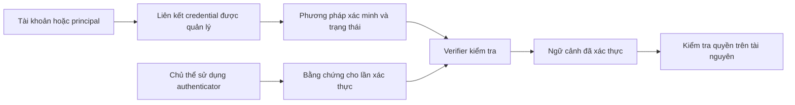

# Credential là gì

Khi đăng nhập một ứng dụng, người dùng có thể nhập mật khẩu, sử dụng passkey hoặc chứng minh quyền kiểm soát một khóa riêng. Khi gọi API, một dịch vụ có thể trình access token hoặc dùng chứng thư số trong quá trình xác thực. Những cơ chế này thường được mô tả bằng từ **credential**, nhưng chúng không có cùng cấu trúc, cách xác minh hay cách bảo vệ.

Trong IAM, hiểu credential giúp phân biệt dữ liệu dùng để nhận diện một tài khoản với bằng chứng được hệ thống chấp nhận để thiết lập niềm tin. Phân biệt này ảnh hưởng trực tiếp đến đăng nhập, MFA, quản lý phiên, cấp phát tài khoản và quyền truy cập của workload.

## 1. Hai cách dùng phổ biến của từ credential

Trong giao tiếp kỹ thuật hằng ngày, **credential** thường được hiểu rộng là thông tin hoặc phương tiện dùng để chứng thực khi tương tác với một hệ thống. Vì vậy, ta gặp những cách nói như “database credentials”, “API credentials” hoặc “username/password credentials”.

Trong mô hình danh tính số của NIST, thuật ngữ có nghĩa cụ thể hơn: credential là đối tượng hoặc cấu trúc dữ liệu tạo ra liên kết có thẩm quyền giữa một danh tính, thông qua định danh, với ít nhất một authenticator mà người đăng ký sở hữu và kiểm soát; liên kết có thể bao gồm thêm thuộc tính. Đây là cách hiểu được trình bày trong phần thuật ngữ của [NIST SP 800-63B-4](https://pages.nist.gov/800-63-4/sp800-63b.html#def-credential).

Hai cách dùng khác nhau về phạm vi. Khi tài liệu triển khai gọi mật khẩu là credential, tài liệu có thể đang nói đến dữ liệu dùng để đăng nhập. Khi mô tả kiến trúc, cần làm rõ cả việc dữ liệu đó được gắn với tài khoản nào và bên nào chịu trách nhiệm cho liên kết ấy.

Ví dụ:

```text
Cách nói trong vận hành:
    "Đổi credential của tài khoản database."

Câu hỏi cần làm rõ:
    Đổi mật khẩu nào?
    Của principal nào?
    Trong hệ thống database nào?
    Ứng dụng nào đang dùng?
    Khi nào giá trị cũ hết hiệu lực?
```

Một điểm quan trọng khác: credential không chỉ xuất hiện trong xác thực người dùng. [RFC 6749, mục 1.4 và 1.5](https://www.rfc-editor.org/rfc/rfc6749.html#section-1.4) gọi access token là credential để truy cập tài nguyên được bảo vệ, còn refresh token là credential dùng để lấy access token. Vì vậy, không nên định nghĩa credential thành “mật khẩu của người dùng” hoặc “thứ luôn chứng minh một người đã đăng nhập”.

Trong bài này, “thông tin chứng thực” được dùng như cách diễn đạt tiếng Việt của credential. Khi cần phân biệt chính xác, bài sẽ gọi riêng bí mật, authenticator, bản ghi liên kết và token.

## 2. Phân biệt các khái niệm gần nhau

| Khái niệm | Trả lời câu hỏi | Ví dụ | Điều không nên suy ra |
| --- | --- | --- | --- |
| Identity | Chủ thể đang được hệ thống mô hình hóa là ai hoặc là gì? | Nhân viên, dịch vụ xử lý đơn hàng | Có hồ sơ danh tính không có nghĩa đã được xác thực |
| Identifier | Hệ thống chọn hoặc tham chiếu chủ thể nào? | User ID, username, client ID | Biết định danh không chứng minh quyền kiểm soát tài khoản |
| Authenticator | Chủ thể dùng phương tiện gì trong quá trình xác thực? | Mật khẩu, thiết bị chứa khóa xác thực | Có thiết bị không đồng nghĩa đã vượt mọi điều kiện của giao thức |
| Authentication secret | Giá trị bí mật nào cần bảo vệ? | Mật khẩu, khóa riêng, seed OTP | Không phải mọi thành phần của credential đều bí mật |
| Authenticator output | Giá trị nào được tạo hoặc cung cấp cho lần xác thực? | OTP hiện tại, chữ ký cho challenge | Output không nhất thiết là bí mật gốc |
| Credential | Liên kết hoặc thông tin chứng thực nào được chấp nhận trong ngữ cảnh này? | Bản ghi gắn khóa với tài khoản; token trong ngữ cảnh truy cập | Tên gọi credential chưa nói được cách kiểm tra nó |
| Authorization | Chủ thể được phép làm gì trên tài nguyên nào? | Xem hóa đơn của tenant Alpha | Xác thực thành công không tự tạo mọi quyền |

Email `linh@example.test` thường là định danh hoặc thông tin liên hệ. Nó có thể giúp hệ thống tìm tài khoản của Linh, nhưng người biết địa chỉ đó chưa chứng minh được mình kiểm soát tài khoản.

Tương tự, `client_id=report-service` thường không phải bí mật. Nó cho biết client đang tự nhận là ai; phương pháp xác thực client mới xác định bằng chứng cần có.

Một trường có tên `credentialId` cũng thường là mã tham chiếu. Nếu ứng dụng nhận mã này rồi cho đăng nhập ngay, ứng dụng đã nhầm định danh của credential với bằng chứng xác thực.

## 3. Credential gắn niềm tin với một ngữ cảnh

Một credential có giá trị vì có một cơ chế kiểm chứng và một quan hệ tin cậy, không phải vì dữ liệu của nó trông phức tạp.

Khi mô tả credential, cần trả lời tối thiểu:

1. **Chủ thể:** credential gắn với người dùng, thiết bị, client hay workload nào?
2. **Nguồn cấp hoặc quản lý liên kết:** bên nào xác nhận credential thuộc chủ thể đó?
3. **Phương pháp xác minh:** kiểm tra bí mật, chữ ký, challenge hay tra cứu trạng thái?
4. **Phạm vi sử dụng:** dùng với dịch vụ, relying party hoặc mục đích nào?
5. **Tính hiệu lực:** có đang hoạt động, còn hạn và chưa bị thu hồi không?
6. **Bằng chứng cần trình:** chỉ cần giữ giá trị bearer hay phải chứng minh quyền kiểm soát khóa?

Ví dụ, một public key không tự nói được tài khoản nào được phép dùng nó. Máy chủ cần một liên kết đã được thiết lập đúng quy trình giữa public key đó và tài khoản tương ứng.

Một chứng thư có chữ ký hợp lệ của một CA cũng chưa đương nhiên được chấp nhận ở mọi ứng dụng. Ứng dụng phải có chính sách tin cậy CA ấy, chấp nhận loại chứng thư và kiểm tra mục đích cùng các điều kiện liên quan.

Có thể hình dung các trách nhiệm qua sơ đồ sau:



Bằng chứng được chấp nhận cho một hệ thống không nhất thiết có giá trị ở hệ thống khác. “Credential hợp lệ” luôn cần đi cùng câu hỏi “hợp lệ đối với bên kiểm tra nào và cho mục đích gì?”.

## 4. Những dạng credential thường gặp

### 4.1. Username và password

Trong ứng dụng dùng mật khẩu, username giúp tìm tài khoản; mật khẩu là bí mật được dùng trong xác thực. Máy chủ giữ dữ liệu xác minh gắn với tài khoản, thay vì phải giữ mật khẩu gốc ở dạng đọc được.

Ví dụ khái niệm:

```text
Tài khoản:
    subjectId = user-1042

Dữ liệu phục vụ xác minh:
    loại = PASSWORD
    bộ kiểm tra mật khẩu = dữ liệu dẫn xuất được bảo vệ
    trạng thái = ACTIVE

Lần đăng nhập:
    tìm tài khoản
    kiểm tra mật khẩu bằng cơ chế phù hợp
    kiểm tra trạng thái tài khoản và các yêu cầu bổ sung
```

Không nên đặt dấu bằng giữa credential và cặp chuỗi username/password. Cách đó khiến thiết kế khó mở rộng sang nhiều authenticator, passkey hoặc workload không đăng nhập bằng mật khẩu.

### 4.2. OTP và bí mật tạo OTP

Với TOTP, ứng dụng xác thực tạo mã theo thời gian từ một bí mật dùng chung. Cần phân biệt:

- **Seed:** bí mật dài hạn phục vụ tạo mã.
- **Mã OTP hiện tại:** đầu ra ngắn hạn dùng trong một lần xác thực.
- **Bản ghi liên kết:** dữ liệu cho biết seed hoặc authenticator nào gắn với tài khoản nào.

Ảnh QR dùng để đăng ký TOTP thường chứa thông tin đủ để thiết lập bộ tạo mã. Vì vậy, làm lộ ảnh đăng ký có thể làm lộ khả năng tạo mã về sau, không chỉ làm lộ một OTP đang có.

Hai mã liên tiếp sinh từ cùng seed không phải hai yếu tố xác thực độc lập. Chúng là hai đầu ra của cùng một cơ chế.

### 4.3. Khóa công khai, khóa riêng và chứng thư số

Với mật mã bất đối xứng, chủ thể giữ khóa riêng để tạo bằng chứng; bên xác minh dùng khóa công khai tương ứng để kiểm tra.

Chứng thư X.509 chứa thông tin về chủ thể và khóa công khai, được bên cấp chứng thư ký. Cấu trúc và việc xác minh chuỗi chứng thư được mô tả trong [RFC 5280](https://www.rfc-editor.org/rfc/rfc5280.html).

Cần tách hai việc:

```text
Kiểm tra chứng thư:
    Khóa công khai được một bên tin cậy gắn với chủ thể nào?
    Chứng thư có đáp ứng chính sách chấp nhận không?

Kiểm tra bằng chứng:
    Bên đang giao tiếp có kiểm soát khóa riêng tương ứng không?
    Bằng chứng có gắn với đúng lần giao tiếp này không?
```

Bản sao chứng thư công khai không đủ để chứng minh quyền kiểm soát khóa riêng. Nếu ứng dụng chỉ nhận một file certificate rồi cho đăng nhập, nó có thể bỏ qua phần chứng minh quan trọng nhất.

Khóa riêng không được gửi cho verifier như một mật khẩu. Giao thức sử dụng khóa để tạo bằng chứng, chẳng hạn chữ ký gắn với một challenge hoặc transcript phù hợp.

### 4.4. Passkey và public-key credential

Trong WebAuthn, một public-key credential có cặp khóa gắn với relying party. Máy chủ dùng thông tin đăng ký và public key để kiểm tra bằng chứng trong lần xác thực. `Credential ID` giúp tham chiếu credential, không thay thế chữ ký hoặc những kiểm tra của giao thức. Các khái niệm này được định nghĩa trong [đặc tả WebAuthn](https://www.w3.org/TR/webauthn-3/).

Ví dụ, máy chủ không kết luận “đã xác thực” chỉ vì client gửi lại đúng `credentialId`. Nó còn phải xác minh phản hồi bằng thư viện và quy trình giao thức đúng, bao gồm challenge và ngữ cảnh relying party.

Việc mở khóa bằng sinh trắc học hoặc PIN có thể diễn ra cục bộ trên thiết bị. Ứng dụng không nên suy luận rằng mình đã nhận được mẫu vân tay của người dùng chỉ vì lần đăng nhập sử dụng passkey.

Cũng không nên mặc định mọi passkey chỉ có trên một thiết bị vật lý duy nhất. Cơ chế quản lý hoặc đồng bộ credential phụ thuộc loại authenticator và môi trường triển khai.

### 4.5. API key và client secret

API key hoặc client secret có thể là bí mật dài hạn của một client hay workload. Cách gọi “key” chưa xác định nó chỉ dùng nhận diện, dùng xác thực hay trực tiếp cho phép truy cập.

Một nhà cung cấp có thể công khai mã key để chọn bản ghi và giữ riêng phần secret. Nhà cung cấp khác có thể phát một chuỗi bearer duy nhất. Phải đọc contract của hệ thống, không suy ra độ bí mật từ tên trường.

Khi một credential được nhiều ứng dụng dùng chung, hệ thống khó xác định ai đã thực hiện hành động và khó thu hồi riêng một ứng dụng. Vì vậy, việc gắn credential với đúng workload là một phần của mô hình danh tính, không chỉ là cách đặt tên secret.

### 4.6. Access token, refresh token và session token

Access token phục vụ truy cập tài nguyên trong phạm vi và thời hạn được cấp. Refresh token dùng với authorization server để lấy access token; không phải thứ gửi đến mọi API thay cho access token. Đây là sự phân biệt trong [RFC 6749](https://www.rfc-editor.org/rfc/rfc6749.html#section-1.5).

Session token duy trì liên hệ giữa các request với một phiên đã được thiết lập. Trong thiết kế dùng bearer session token, người nắm giá trị hợp lệ có thể sử dụng phiên trong các điều kiện mà máy chủ chấp nhận.

Các loại token này có thể là credential theo nghĩa vận hành, nhưng không có cùng mục đích. Không dùng access token của một API làm bằng chứng đăng nhập cho ứng dụng khác nếu không có một giao thức và chính sách xác minh được thiết kế cho việc đó.

Tên “JWT” chỉ cho biết một dạng biểu diễn token. Nó không tự cho biết token dùng để đăng nhập, truy cập tài nguyên hay duy trì phiên. Dữ liệu có chữ ký cũng không vì thế mà tự được mã hóa để giữ bí mật.

## 5. Credential không nhất thiết là một bí mật

Trong một cơ chế chứng thực, các thành phần có thể có yêu cầu bảo vệ khác nhau:

| Thành phần | Có cần giữ bí mật? | Yêu cầu quan trọng khác |
| --- | --- | --- |
| Username hoặc credential ID dạng tham chiếu | Thường không được thiết kế làm bí mật xác thực | Bảo vệ quyền riêng tư và tránh ánh xạ sai tài khoản |
| Mật khẩu | Có | Hạn chế đoán, lộ lọt và tái sử dụng |
| Seed OTP | Có | Bảo vệ quyền tạo mã về sau |
| Khóa riêng | Có | Bảo vệ khả năng ký hoặc sử dụng khóa |
| Public key hoặc certificate | Thường không | Bảo vệ tính toàn vẹn, liên kết và nguồn tin cậy |
| Bearer access token hoặc session token | Có trong mô hình sử dụng bearer | Giới hạn phạm vi, thời hạn và nơi trình |
| Bộ kiểm tra mật khẩu ở máy chủ | Phải bảo vệ | Có thể bị dùng cho tấn công đoán ngoại tuyến nếu bị lộ |

“Không bí mật” không có nghĩa “không cần bảo vệ”. Kẻ tấn công thay public key trong bản ghi của Linh bằng public key của mình có thể khiến ứng dụng chấp nhận bằng chứng do chính kẻ tấn công tạo.

Ngược lại, “đã hash” không có nghĩa dữ liệu có thể đưa vào log công khai. Bộ kiểm tra mật khẩu vẫn cần được bảo vệ vì có thể tạo điều kiện thử mật khẩu ngoại tuyến.

Cũng cần phân biệt bí mật gốc với quyền sử dụng bí mật. Một ứng dụng có thể không đọc được khóa riêng trong HSM nhưng vẫn có quyền yêu cầu HSM ký. Nếu quyền gọi thao tác ký bị chiếm, kẻ tấn công có thể tạo bằng chứng dù chưa xuất được khóa.

## 6. Quá trình đăng ký và sử dụng credential

### 6.1. Thiết lập liên kết

Giả sử Linh có tài khoản `user-1042` và muốn thêm một credential mới. Máy chủ cần xác định yêu cầu thêm credential có được Linh hoặc một quy trình quản trị được phép khởi tạo hay không.

Một luồng khái niệm:

1. Xác minh chủ thể đang thực hiện thao tác thêm credential.
2. Kiểm tra chính sách cho phép đăng ký loại credential đó.
3. Thực hiện thủ tục đăng ký của loại credential.
4. Xác minh bằng chứng hoặc dữ liệu đăng ký cần thiết.
5. Ghi liên kết với đúng tài khoản, phạm vi và trạng thái.
6. Ghi nhận sự kiện và thông báo theo chính sách.

Nếu bước đầu bị bỏ qua, một người biết user ID có thể đăng ký khóa của mình vào tài khoản của người khác. Các lần xác thực sau vẫn có chữ ký đúng, nhưng liên kết ban đầu đã sai.

Đăng ký thêm credential là thao tác nhạy cảm. Chỉ có một phiên còn tồn tại không phải lúc nào cũng đủ để cho phép thêm phương tiện đăng nhập dài hạn; ứng dụng cần mức xác minh phù hợp với chính sách của mình.

### 6.2. Xác minh khi sử dụng

Khi credential được dùng, ứng dụng cần xác minh đúng loại bằng chứng và kiểm tra các điều kiện áp dụng. Luồng dưới đây chỉ là mã giả kiến trúc:

```text
authenticate(request):

    candidate = identifyCredentialUsingProtocol(request)
    if candidate is absent:
        rejectWithoutDisclosingUnnecessaryAccountDetails()

    if accountIsDisabled(candidate.subjectId):
        reject()

    if credentialIsInactiveOrExpired(candidate):
        reject()

    if requestContextIsNotAccepted(candidate, request):
        reject()

    result = verifierFor(candidate.type).verify(request, candidate)
    if result is not valid:
        recordFailedAttemptWithoutSecrets()
        reject()

    enforceRequiredAuthenticationPolicy(result)
    return authenticatedContext(candidate.subjectId, result)
```

`identifyCredentialUsingProtocol` không có nghĩa mọi giao thức đều nhận một credential ID từ client. Mật khẩu, chứng thư, token và passkey có các cách chọn dữ liệu xác minh khác nhau.

Đoạn mã cũng không phải hướng dẫn tự viết thuật toán mật mã. Phần xác minh cần sử dụng triển khai giao thức và thư viện phù hợp.

### 6.3. Quyết định quyền sau xác thực

Giả sử Linh xác thực thành công rồi yêu cầu xem bảng lương của người khác. Hệ thống vẫn phải kiểm tra quyền của Linh đối với tài nguyên đó.

```text
Credential được chấp nhận
    → thiết lập principal và ngữ cảnh xác thực
    → kiểm tra membership, role hoặc thuộc tính quyền
    → kiểm tra tài nguyên và hành động
    → cho phép hoặc từ chối
```

Khi Linh chuyển từ tenant Alpha sang Beta, danh tính đăng nhập có thể không đổi nhưng quyền phải được đánh giá trong tenant mới. Không dùng credential hợp lệ như một lý do bỏ qua ranh giới tenant.

## 7. Quản lý vòng đời credential

Credential có vòng đời riêng với tài khoản và phiên. Một tài khoản có thể có nhiều credential, một credential có thể bị thu hồi trong khi những credential khác vẫn được phép dùng.

Một mô hình trạng thái minh họa:

```text
PENDING → ACTIVE → SUSPENDED
              ↘ REVOKED
              ↘ EXPIRED

SUSPENDED → ACTIVE chỉ qua quy trình được phép.
REVOKED không tự trở lại ACTIVE.
```

Đây là mô hình của ứng dụng minh họa, không phải tập trạng thái bắt buộc cho mọi tiêu chuẩn.

Các sự kiện thường phải xử lý gồm đăng ký, kích hoạt, hết hạn, tạm ngưng, nghi ngờ lộ bí mật, mất thiết bị, thay thế và thu hồi. Credential mới cần có liên kết và dấu vết riêng; không chỉ ghi đè giá trị cũ rồi làm mất lịch sử.

Ví dụ khi Linh mất một khóa bảo mật:

- Đánh dấu credential của khóa đó không còn được chấp nhận.
- Xác minh Linh qua phương thức phục hồi phù hợp.
- Đăng ký credential thay thế.
- Xem xét phiên và token đã được cấp từ lần xác thực trước.
- Ghi nhận sự kiện để điều tra nếu có dấu hiệu sử dụng trái phép.

Thu hồi credential không tự bảo đảm mọi session hoặc token đã cấp đều mất hiệu lực tức thì. Ứng dụng phải thiết kế riêng việc kết thúc phiên, thời hạn token, cơ chế kiểm tra trạng thái và cửa sổ chấp nhận thông tin cũ.

Tương tự, xóa một credential khỏi giao diện quản trị chưa đủ nếu verifier vẫn chấp nhận một bản ghi cũ trong cache.

## 8. Lưu trữ theo cách sử dụng, không áp dụng một công thức cho mọi loại

### 8.1. Mật khẩu

Máy chủ thường không cần lấy lại mật khẩu gốc để đăng nhập người dùng. Vì vậy, mật khẩu cần được xử lý bằng cơ chế dẫn xuất hoặc hash mật khẩu chuyên dụng với salt và tham số chi phí phù hợp, thay vì lưu plaintext hoặc chỉ dùng một lượt hash nhanh.

[OWASP Password Storage Cheat Sheet](https://cheatsheetseries.owasp.org/cheatsheets/Password_Storage_Cheat_Sheet.html) giải thích cách bảo vệ dữ liệu xác minh mật khẩu và sự khác biệt với mã hóa có thể đảo ngược. Khi triển khai, cần chọn cấu hình phù hợp với môi trường, không sao chép một giá trị chi phí bất biến cho mọi hệ thống.

### 8.2. Seed OTP và bí mật mà hệ thống phải sử dụng lại

Verifier của cơ chế OTP dùng chung bí mật cần có khả năng sử dụng seed để kiểm tra mã. Nếu chỉ lưu một hash một chiều rồi xóa seed mà không có thiết kế thay thế, cơ chế xác minh có thể không hoạt động.

Loại bí mật cần dùng lại thường phải được bảo vệ bằng mã hóa hoặc dịch vụ quản lý khóa/bí mật với quyền truy cập hạn chế. Khóa bảo vệ cũng cần có chính sách riêng; để khóa giải mã bên cạnh dữ liệu mà mọi thành phần đều đọc được sẽ làm giảm ý nghĩa của việc mã hóa.

### 8.3. Khóa riêng và credential của workload

Khóa riêng có thể được giữ trong kho khóa, HSM hoặc môi trường bảo vệ tương ứng. Cần kiểm soát cả quyền đọc/xuất khóa và quyền yêu cầu thao tác sử dụng khóa.

Bí mật của ứng dụng không nên nằm trong source code, log, ảnh chụp cấu hình hoặc tệp chia sẻ cho nhiều người. Việc cấp, sử dụng, thay thế và thu hồi bí mật cần gắn với chủ sở hữu rõ ràng; đây là phạm vi được thảo luận trong [OWASP Secrets Management Cheat Sheet](https://cheatsheetseries.owasp.org/cheatsheets/Secrets_Management_Cheat_Sheet.html).

Nếu thiết kế dùng workload identity để nhận credential ngắn hạn, vẫn phải bảo vệ cách workload chứng minh danh tính ban đầu và phạm vi được cấp. Thời hạn ngắn làm thay đổi cửa sổ rủi ro, không xóa mọi yêu cầu bảo vệ.

### 8.4. Public key, certificate và metadata

Public key có thể không cần mã hóa để giữ bí mật, nhưng bản ghi liên kết phải được bảo vệ khỏi sửa trái phép. Certificate cần được kiểm tra trong ngữ cảnh chính sách tin cậy, không chỉ kiểm tra rằng file đọc được.

Metadata như chủ sở hữu, trạng thái và thời điểm thu hồi cũng có ảnh hưởng bảo mật. Kẻ tấn công sửa `REVOKED` thành `ACTIVE` có thể khiến một credential đã bị thu hồi được dùng trở lại.

## 9. Mô hình bản ghi để quản lý credential

Một bản ghi quản lý credential có thể tách metadata khỏi vật liệu xác minh. Ví dụ sau là schema minh họa của ứng dụng, không phải định dạng chuẩn:

```json
{
  "credentialId": "cred-demo-203",
  "subjectId": "user-1042",
  "type": "PUBLIC_KEY",
  "state": "ACTIVE",
  "boundAt": "2026-01-15T09:00:00Z",
  "expiresAt": null,
  "verifierMaterialRef": "public-key-record-demo-203",
  "boundBy": "registration-flow",
  "version": 3
}
```

Trong ví dụ:

- `credentialId` là mã quản lý bản ghi, không phải bí mật để đăng nhập.
- `subjectId` là principal được liên kết.
- `type` quyết định cơ chế xác minh phù hợp.
- `verifierMaterialRef` tham chiếu dữ liệu máy chủ cần, chẳng hạn public key; không phải yêu cầu cất khóa riêng ở máy chủ.
- `expiresAt: null` chỉ phù hợp nếu loại credential và chính sách ứng dụng cho phép không có thời điểm hết hạn cố định.
- `version` hỗ trợ quản lý thay đổi, nhưng không tự tạo cơ chế thu hồi tức thì.

Không đặt một trường `value` chung rồi lưu mọi thứ, từ mật khẩu đến public key và refresh token, theo cùng một cách. Các loại dữ liệu có yêu cầu bảo vệ, thời hạn và phương pháp kiểm tra khác nhau.

Nếu ứng dụng hỗ trợ nhiều issuer hoặc nhiều miền danh tính, cách định danh subject và credential cần tránh trùng giữa các miền. Một chuỗi có giá trị `user-1042` ở hai nguồn độc lập không tự chứng minh đó là cùng một người.

## 10. Credential của người dùng và credential của workload

Một nhân viên và một dịch vụ chạy nền đều có thể là principal, nhưng cách cấp và sử dụng credential thường khác nhau.

| Khía cạnh | Người dùng | Workload |
| --- | --- | --- |
| Chủ thể | Cá nhân trong ngữ cảnh ứng dụng | Dịch vụ, job, agent hoặc ứng dụng |
| Cách sử dụng | Có thể có tương tác xác nhận | Thường phải tự động |
| Ví dụ | Mật khẩu, passkey, khóa bảo mật | Client secret, chứng thư, credential ngắn hạn |
| Phục hồi | Xác minh chủ tài khoản | Xác minh workload và quyền cấp lại |
| Truy vết | Ai đã đăng nhập và thao tác? | Workload nào, môi trường nào, phiên bản triển khai nào? |

Không nên cho job xuất báo cáo dùng mật khẩu tài khoản cá nhân của người vận hành. Khi người đó nghỉ việc hoặc đổi mật khẩu, job có thể hỏng; nếu job bị xâm nhập, khó phân biệt hành động của job với hành động của người.

Thay vào đó, thiết kế principal riêng cho workload, cấp credential và quyền theo nhu cầu. Khi workload thực hiện công việc thay mặt người dùng, cần giữ rõ danh tính workload và ngữ cảnh ủy quyền của người dùng; không gộp hai khái niệm thành một tài khoản dùng chung.

Quyền quản lý credential cũng cần phân biệt với quyền sử dụng credential. Một dịch vụ được phép gọi API không vì thế phải được phép phát hành thêm credential cho chính mình.

## 11. Những nhầm lẫn dễ dẫn đến sai thiết kế

### “Có username là có thể chứng minh danh tính”

Username giúp chọn tài khoản. Bằng chứng xác thực đến từ cơ chế được hệ thống chấp nhận. Không biến user ID, email hay client ID thành bí mật chỉ bằng cách không hiển thị chúng trên màn hình.

### “Credential nào cũng phải là một chuỗi bí mật”

Chứng thư và public key cho thấy phần công khai có vai trò quan trọng. Cần giữ bí mật đúng phần, đồng thời bảo vệ tính toàn vẹn và liên kết của phần còn lại.

### “Credential hợp lệ nghĩa là đúng người ngoài đời thực”

Xác thực thường chứng minh quyền kiểm soát phương tiện gắn với tài khoản, trong những giả định của giao thức. Mức độ biết tài khoản đó thuộc người nào còn phụ thuộc quy trình xác minh danh tính và quản lý tài khoản. Kẻ đánh cắp credential cũng có thể tạo ra một lần sử dụng mà hệ thống chấp nhận.

### “Hai credential là MFA”

MFA phụ thuộc loại yếu tố và cách chúng được sử dụng, không chỉ số lượng bản ghi. Mật khẩu và PIN đều thuộc nhóm kiến thức; certificate cùng khóa riêng là các phần của một cơ chế, không mặc nhiên là hai yếu tố độc lập.

### “Thay mật khẩu là mọi phiên đều bị đăng xuất”

Điều này phụ thuộc thiết kế quản lý phiên và token. Thay bí mật dài hạn và vô hiệu hóa các quyền truy cập đã được cấp là các thao tác liên quan nhưng không đồng nhất.

### “Dữ liệu đã ký thì an toàn để công khai”

Chữ ký giúp kiểm tra tính toàn vẹn và nguồn gốc theo quan hệ tin cậy. Nó không tự bảo đảm dữ liệu đã được mã hóa, không nhạy cảm hoặc không bị dùng lại sai mục đích.

### “Phục hồi credential chỉ là một chức năng tiện ích”

Một quy trình phục hồi cho phép kẻ tấn công gắn credential mới vào tài khoản sẽ làm suy yếu cả cơ chế đăng nhập mạnh. Phục hồi, thêm phương thức xác thực và quản trị liên kết phải nằm trong phạm vi thiết kế bảo mật.

## 12. Ví dụ xuyên suốt trong hệ thống IAM

Giả sử hệ thống có ba đối tượng:

```text
Nhân viên Linh:
    principal = user-1042
    credential A = mật khẩu
    credential B = public-key credential dùng đăng nhập
    membership = nhân viên tenant Alpha

Dịch vụ xuất báo cáo:
    principal = workload-report-7
    credential = chứng thư/khóa phục vụ xác thực dịch vụ
    quyền = xuất báo cáo đã được cấp trong phạm vi cụ thể

Phiên trình duyệt của Linh:
    session = session-demo-9
    được tạo sau một lần xác thực thành công
```

Khi Linh đăng nhập bằng public-key credential, ứng dụng xác minh bằng chứng và thiết lập ngữ cảnh của `user-1042`. Khi Linh xem báo cáo Alpha, ứng dụng kiểm tra membership và quyền đối với báo cáo đó.

Khi dịch vụ xuất báo cáo gọi API, API xác minh principal của workload và kiểm tra quyền của workload. Nếu thao tác thay mặt Linh, cần thêm ngữ cảnh ủy quyền được xác minh; không tự nhận mọi quyền của Linh chỉ vì tên Linh xuất hiện trong payload.

Khi Linh mất thiết bị, quản trị viên thu hồi credential B. Tài khoản, credential A và session hiện có không nhất thiết có cùng trạng thái. Mỗi loại cần được xử lý theo chính sách: có thể thu hồi một credential, khóa tài khoản, kết thúc một số phiên hoặc yêu cầu xác thực lại.

Thiết kế IAM rõ ràng sẽ luôn trả lời được: **credential thuộc principal nào, liên kết được thiết lập ra sao, bằng chứng nào phải được kiểm tra, phạm vi nào được chấp nhận và khi nào credential ngừng được tin cậy**. Các câu trả lời đó nối khái niệm credential với toàn bộ vòng đời danh tính và quyền truy cập.
