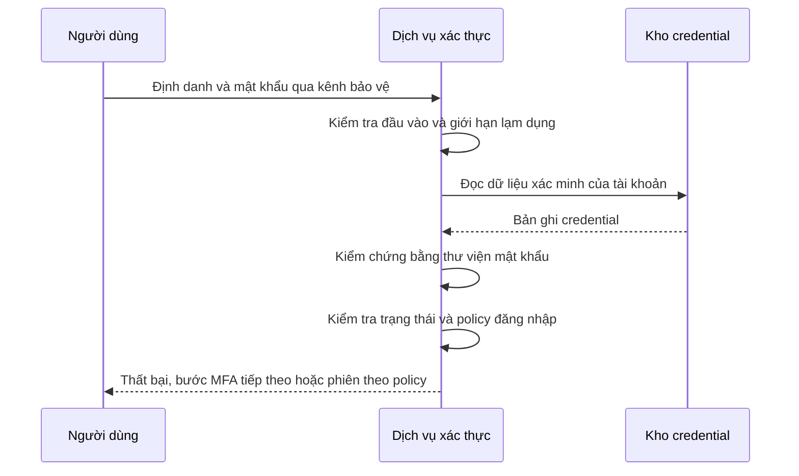

# Knowledge factor

## 1. Knowledge factor là gì?

**Knowledge factor**, hay yếu tố kiến thức, là loại yếu tố xác thực dựa trên một bí mật mà người dùng biết. Mật khẩu và passphrase là những ví dụ quen thuộc. Khi đăng nhập, người dùng chứng minh mình có bí mật đã được gắn với tài khoản, thay vì chỉ khai tên hoặc địa chỉ email.

Từ “kiến thức” ở đây không có nghĩa là trình độ học vấn hay hiểu biết về một chủ đề. Một câu trả lời đúng trong bài kiểm tra không trở thành yếu tố xác thực, trừ khi hệ thống đã thiết lập một bí mật thích hợp để kiểm chứng quyền kiểm soát tài khoản. Dữ liệu công khai như ngày sinh cũng không tự trở thành bí mật chỉ vì được đặt trong một ô hỏi đáp.

Ví dụ, trong cổng nhân sự Harbor:

- `linh.nguyen` giúp hệ thống tìm tài khoản mà người dùng đang khai.
- Mật khẩu giúp kiểm chứng quyền kiểm soát một bí mật gắn với tài khoản đó.
- Vai trò `payroll-admin` quyết định một phần quyền truy cập sau xác thực.
- Mã nhân viên và ngày sinh là thông tin hồ sơ, không tự chứng minh người nhập là chủ tài khoản.

Knowledge factor không chứng minh danh tính pháp lý của người đang ngồi trước máy. Nếu hai người cùng biết một mật khẩu, bộ kiểm tra mật khẩu có thể không phân biệt được họ. Đây là giới hạn cần hiểu khi thiết kế IAM và truy vết hành động.

## 2. Phân biệt factor, authenticator và credential

Ba khái niệm này liên quan nhưng không đồng nghĩa:

| Khái niệm | Câu hỏi nó trả lời | Ví dụ trong đăng nhập bằng mật khẩu |
|---|---|---|
| Factor | Bằng chứng thuộc loại nào? | Thứ người dùng biết |
| Authenticator | Cơ chế hoặc bí mật nào được dùng để xác thực? | Mật khẩu đã được thiết lập |
| Credential và dữ liệu liên kết | Bí mật hoặc authenticator được gắn với danh tính nào? | Quan hệ giữa tài khoản và dữ liệu xác minh mật khẩu |
| Verifier | Thành phần nào kiểm tra bằng chứng? | Dịch vụ xác thực kiểm chứng mật khẩu |
| Authorization policy | Sau xác thực được làm gì? | Quyền đọc bảng lương |

Cách dùng từ “credential” có thể rộng hơn trong sản phẩm cụ thể, chẳng hạn một bộ username/password. Khi trao đổi thiết kế, nên nói rõ đang chỉ tên đăng nhập, bí mật, dữ liệu xác minh lưu ở server hay cả mối liên kết với tài khoản.

Một tài khoản có thể gắn nhiều authenticator. Số lượng authenticator không quyết định trực tiếp số loại factor. Hai mật khẩu khác nhau vẫn cùng thuộc nhóm kiến thức.

## 3. Những biểu hiện thường gặp

### 3.1. Mật khẩu

Mật khẩu là một bí mật dạng chuỗi dùng trong quy trình xác thực. Nó có thể do người dùng tự chọn hoặc được sinh ngẫu nhiên rồi quản lý bằng công cụ phù hợp.

Một mật khẩu được lưu trong password manager vẫn là mật khẩu trong giao thức xác thực. Hệ thống không được tự tính thêm possession factor chỉ vì người dùng mở ứng dụng quản lý mật khẩu để điền form.

Nếu dịch vụ chỉ nhận và kiểm chứng mật khẩu, bằng chứng mà dịch vụ nhận vẫn thuộc cơ chế dựa trên bí mật đó. Việc password manager yêu cầu vân tay ở thiết bị của người dùng không tự làm dịch vụ từ xa biết rằng một bước MFA đã được thực hiện theo hợp đồng của dịch vụ.

### 3.2. Passphrase

Passphrase là bí mật thường dài hơn, có thể gồm nhiều từ và dấu cách. Nó không phải một loại factor mới: vẫn là knowledge factor.

Một câu nổi tiếng hoặc câu trích trong hồ sơ cá nhân có thể dễ đoán dù dài. Ngược lại, một chuỗi từ được chọn độc lập bằng nguồn ngẫu nhiên có thể tạo không gian tìm kiếm lớn hơn. Điều quyết định không chỉ là nhìn thấy nhiều ký tự, mà còn là cách bí mật được tạo và khả năng attacker dự đoán nó.

Không nên dùng một câu ví dụ trong tài liệu làm mật khẩu thật. Các ví dụ công khai đã nằm trong tập dữ liệu mà attacker có thể thử.

### 3.3. PIN

PIN thường là một bí mật ngắn, hay được biểu diễn bằng chữ số. Muốn đánh giá nó, cần hỏi **PIN được kiểm tra ở đâu và nó mở quyền gì**.

| Trường hợp | Điều cần phân tích |
|---|---|
| PIN gửi tới server như bí mật đăng nhập chính | Nguy cơ đoán từ xa, giới hạn thử và cách lưu dữ liệu xác minh |
| PIN mở khóa một authenticator trên thiết bị | Cơ chế bảo vệ khóa và giới hạn thử tại nơi kích hoạt |
| Mật khẩu rồi PIN cố định, cả hai cùng gửi tới server | Có thể vẫn là hai bí mật thuộc cùng knowledge factor |
| Mã ngắn vừa được hệ thống gửi qua kênh khác | Không được phân loại chỉ từ việc người dùng gõ các chữ số |

NIST gọi bí mật dùng cục bộ để kích hoạt một multi-factor authenticator là **activation secret**; nó được giữ trong authenticator và endpoint liên quan, thay vì đóng vai mật khẩu gửi tới verifier từ xa. [NIST SP 800-63B-4, mục 3.2.10](https://pages.nist.gov/800-63-4/sp800-63b.html#activation).

Trong một luồng dùng khóa mật mã với PIN cục bộ, server kiểm tra bằng chứng mật mã và các thuộc tính được giao thức cung cấp. Thiết kế không được chỉ đếm “có ô PIN” rồi kết luận đã có MFA. Nó cần xác định authenticator có thực sự yêu cầu và thực thi yếu tố kích hoạt phù hợp hay không.

### 3.4. Câu hỏi bảo mật

Những câu hỏi như “trường tiểu học của bạn là gì?” từng được dùng để kiểm tra thông tin người dùng nhớ. Vấn đề là câu trả lời có thể được người thân biết, xuất hiện trên mạng xã hội hoặc được suy ra từ dữ liệu rò rỉ.

Thông tin đúng về một người không đồng nghĩa với bí mật chỉ người đó kiểm soát. Đổi cách viết hoa tên trường cũng không tạo một cơ chế khôi phục đáng tin cậy.

OWASP khuyến cáo không dùng câu hỏi bảo mật làm cơ chế duy nhất để đặt lại mật khẩu vì câu trả lời thường dễ đoán hoặc thu thập. [OWASP Forgot Password Cheat Sheet — Security Questions](https://cheatsheetseries.owasp.org/cheatsheets/Forgot_Password_Cheat_Sheet.html#security-questions).

## 4. Những thứ không được tự tính là knowledge factor

Phân loại theo cách chứng minh quyền kiểm soát, không theo động tác trên giao diện:

| Tình huống | Cách hiểu phù hợp |
|---|---|
| Nhập username hoặc email | Khai định danh, chưa chứng minh bí mật |
| Nhập mật khẩu đã thiết lập | Sử dụng knowledge factor |
| Nhập mật khẩu lần hai để xác nhận | Xác nhận thao tác; không thêm một loại factor |
| Gõ mã TOTP từ authenticator | Bằng chứng liên quan tới quyền kiểm soát authenticator tạo mã; không biến thành knowledge factor chỉ vì được gõ |
| Gõ mã nhận qua một kênh bên ngoài | Cần đánh giá quyền kiểm soát kênh và cơ chế cụ thể |
| Giải CAPTCHA | Kiểm soát tự động hóa, không chứng minh chủ tài khoản |
| Nhập câu trả lời lấy từ hồ sơ công khai | Thông tin nhận biết, không mặc nhiên là bí mật |
| Nhớ một recovery code | Phải đánh giá theo thiết kế recovery; việc nhớ mã không tự tạo thêm factor |

Một mã dùng một lần có thể đi qua trí nhớ trong vài giây. Điều đó không làm nó trở thành cùng cơ chế với mật khẩu dài hạn. Hệ thống quan tâm mã được cấp, tạo, kiểm chứng và tiêu thụ như thế nào.

## 5. Vì sao hai bí mật chưa tạo thành MFA?

MFA cần các yếu tố thuộc những loại khác nhau theo cơ chế xác thực được sử dụng. Thêm một màn hình hoặc yêu cầu một bí mật nữa không tự đáp ứng điều đó.

Xét ba phương án của Harbor:

| Phương án | Phân tích |
|---|---|
| Mật khẩu rồi câu hỏi bảo mật | Hai bước đều dựa vào thông tin người dùng biết; câu hỏi còn có thể yếu hơn mật khẩu |
| Mật khẩu rồi PIN cố định gửi tới server | Có thêm bí mật nhưng chưa có bằng chứng về một loại yếu tố khác |
| Mật khẩu và bằng chứng từ authenticator sở hữu | Có thể kết hợp knowledge với possession nếu từng cơ chế được kiểm chứng đúng |

Độc lập cũng là vấn đề thực tế. Nếu attacker lấy được mật khẩu rồi dùng chính mật khẩu đó để xem yếu tố thứ hai trong cùng một hệ thống không được bảo vệ thêm, khả năng chống chiếm tài khoản của toàn bộ thiết kế bị giảm.

Hai factor không tự bảo đảm chống phishing. Một trang giả có thể thu mật khẩu và chuyển tiếp mã dùng một lần trong thời gian thực. Khi yêu cầu chống phishing, cần chọn cơ chế có đặc tính tương ứng thay vì chỉ đếm số bước.

Với multi-factor authenticator dùng khóa mật mã và activation secret, một authenticator có thể kết hợp các yếu tố trong cùng cơ chế. Ngược lại, nhiều màn hình nhập liệu có thể vẫn chỉ dựa vào một loại factor. Đơn vị cần đánh giá là bằng chứng và cách thực thi, không phải số thiết bị hay số form.

## 6. Độ dài, khả năng đoán và không gian tìm kiếm

### 6.1. Bí mật ngẫu nhiên khác bí mật do người tự nghĩ

Nếu một bí mật được chọn đều trong tập có `N` khả năng, lượng thông tin lý tưởng là:

```text
H = log2(N)
```

Nếu từng vị trí được chọn độc lập, đồng đều từ bảng có `A` ký hiệu và chuỗi dài `L`:

```text
N = A^L
H = L × log2(A)
```

Ví dụ toán học:

| Cách tạo | Không gian khả năng | Lượng thông tin lý tưởng |
|---|---:|---:|
| 4 chữ số chọn đều | 10^4 | Khoảng 13,3 bit |
| 6 chữ số chọn đều | 10^6 | Khoảng 19,9 bit |
| 6 từ chọn độc lập từ danh sách 2.048 từ | 2048^6 | 66 bit |

Các con số trên không phải điểm bảo mật tự động của mọi PIN hoặc passphrase có cùng độ dài. Chúng chỉ đúng theo giả định về cách chọn.

Nếu người dùng chọn năm sinh, số điện thoại hoặc một câu quen thuộc, các khả năng không còn đồng đều. Attacker thường thử các mẫu có xác suất cao trước, chứ không duyệt mọi chuỗi theo thứ tự từ điển đầy đủ.

### 6.2. Đoán online và offline là hai bài toán khác nhau

**Đoán online** đi qua dịch vụ xác thực. Server có thể áp dụng giới hạn thử, trì hoãn, phát hiện lạm dụng và yêu cầu cơ chế bổ sung.

**Đoán offline** xảy ra khi attacker có dữ liệu xác minh bị lấy cắp và có thể tự thử nhiều ứng viên. Khi đó, bộ đếm sai của form đăng nhập không giới hạn số lần thử trên máy attacker. Cách băm mật khẩu và chi phí tính toán trở nên quan trọng.

Vì vậy, không thể biện luận “mật khẩu ngắn vẫn an toàn vì mỗi phút chỉ cho thử vài lần” mà bỏ qua rủi ro lộ cơ sở dữ liệu. Cũng không thể chỉ tăng chi phí băm rồi bỏ mọi kiểm soát lạm dụng trên endpoint online.

## 7. Mô hình đe dọa của knowledge factor

| Đe dọa | Điều attacker có | Vì sao knowledge factor bị ảnh hưởng |
|---|---|---|
| Phishing | Trang hoặc luồng giả mạo | Người dùng có thể tự cung cấp bí mật cho bên sai |
| Credential stuffing | Cặp tài khoản và mật khẩu rò rỉ từ nơi khác | Mật khẩu dùng lại có thể đúng ở dịch vụ mới |
| Password spraying | Một tập mật khẩu phổ biến | Attacker thử ít ứng viên trên nhiều tài khoản |
| Đoán có mục tiêu | Dữ liệu về một người hoặc tổ chức | Bí mật dựa trên thông tin cá nhân dễ bị suy ra |
| Malware hoặc keylogger | Quyền quan sát endpoint | Bí mật có thể bị lấy trước khi đi qua kênh được mã hóa |
| Rò rỉ dữ liệu xác minh | Hash, salt và metadata liên quan | Attacker có thể thử đoán offline |
| Lộ log hoặc ticket | Dữ liệu do hệ thống hoặc hỗ trợ viên ghi lại | Bí mật có thể bị sao chép sang hệ thống ngoài luồng xác thực |

TLS bảo vệ đường truyền, nhưng không làm một website giả trở thành website thật. Băm mật khẩu bảo vệ dữ liệu lưu, nhưng không ngăn keylogger đọc nội dung lúc người dùng nhập. Mỗi biện pháp xử lý một phần mô hình đe dọa.

Một password manager giúp tạo và sử dụng các mật khẩu khác nhau cho từng dịch vụ, giảm nhu cầu ghi nhớ tất cả. Nó không loại bỏ mọi rủi ro ở endpoint, kho quản lý mật khẩu hay quy trình khôi phục.

## 8. Hệ thống nên kiểm chứng mật khẩu như thế nào?

### 8.1. Không cần lưu lại mật khẩu rõ

Để kiểm chứng lần đăng nhập sau, dịch vụ thông thường lưu dữ liệu xác minh được tạo bằng hàm băm mật khẩu thích hợp, cùng salt và tham số cần thiết. Nó không cần khả năng lấy lại mật khẩu gốc.

OWASP khuyến nghị các hàm băm mật khẩu chậm, thích ứng như Argon2id; một hash nhanh đơn thuần như SHA-256 không phù hợp cho lưu mật khẩu. Salt riêng và cấu hình chi phí là những thành phần quan trọng. [OWASP Password Storage Cheat Sheet](https://cheatsheetseries.owasp.org/cheatsheets/Password_Storage_Cheat_Sheet.html).

Một mô hình dữ liệu khái niệm có thể gồm:

```text
PasswordRecord
  account_id
  encoded_password_hash
  credential_version
  changed_at
```

`encoded_password_hash` có thể chứa định dạng, salt và tham số theo thư viện sử dụng. Không tự ghép chuỗi hoặc tự thiết kế thuật toán mật mã nếu thư viện đã có định dạng được kiểm chứng.

Salt không phải mật khẩu thứ hai và thường không cần được giữ bí mật như password. Salt khác nhau khiến cùng một mật khẩu không tạo cùng dữ liệu hash giữa các bản ghi theo cơ chế đó. Nó không ngăn attacker đoán từng ứng viên và kiểm tra chúng.

Nếu sử dụng pepper, đó là bí mật do hệ thống quản lý thêm, không phải một factor của người dùng. Cần xác định nơi giữ, quyền truy cập và khả năng thay đổi pepper; không mặc định nó thay thế hàm băm mật khẩu.

### 8.2. Luồng kiểm tra



Trong sơ đồ, kết quả “mật khẩu đúng” chưa bắt buộc dẫn tới phiên có toàn quyền. Nếu policy yêu cầu MFA, hệ thống chỉ ghi nhận bước knowledge factor đã đạt và chờ bằng chứng còn lại.

Với tài khoản không tồn tại, dịch vụ cần thiết kế phản hồi và đường xử lý để hạn chế tiết lộ tài khoản. Không đưa ra lời hứa mọi request có thời gian tuyệt đối bằng nhau; cần đánh giá các khác biệt quan sát được và chi phí chống lạm dụng.

Không cho request tự chọn thuật toán băm hoặc chi phí xác minh. Những giá trị này đến từ bản ghi đã được quản lý và cấu hình tin cậy.

## 9. Chính sách mật khẩu cần hỗ trợ người dùng

NIST SP 800-63B-4 yêu cầu tối thiểu 15 ký tự khi mật khẩu là cơ chế một yếu tố; cho phép tối thiểu 8 khi mật khẩu chỉ là một phần của MFA. Tài liệu khuyến nghị cho phép độ dài tối đa ít nhất 64 ký tự và không áp đặt quy tắc phối hợp loại ký tự. Các yêu cầu này có phạm vi cụ thể, không phải cách tự chứng nhận mọi hệ thống đạt một AAL. [NIST SP 800-63B-4, mục 3.1.1](https://pages.nist.gov/800-63-4/sp800-63b.html#password).

Ở mức thiết kế ứng dụng, cần giải quyết rõ:

- Cho phép bí mật dài mà không âm thầm cắt bớt.
- Hỗ trợ password manager, paste và autofill.
- Chặn những lựa chọn phổ biến hoặc đã biết bị lộ bằng cơ chế phù hợp.
- Định nghĩa cách xử lý Unicode nhất quán giữa thiết lập, đổi và kiểm chứng.
- Không tự xóa dấu cách hoặc đổi chữ hoa, chữ thường ngoài hợp đồng đã công bố.
- Yêu cầu thay bí mật khi có căn cứ bị lộ hoặc sự kiện phù hợp với policy.

Không nên coi một dấu chấm than ở cuối là bằng chứng mật khẩu khó đoán. Nếu người dùng luôn phải đáp ứng một mẫu cố định, attacker có thể thử mẫu ấy sớm.

Hỗ trợ password manager là một phần thiết kế form đăng nhập, không phải một ngoại lệ chỉ dành cho người dùng thành thạo. OWASP đưa ra hướng dẫn để form hoạt động thuận lợi với công cụ quản lý mật khẩu. [OWASP Authentication Cheat Sheet — Password Managers](https://cheatsheetseries.owasp.org/cheatsheets/Authentication_Cheat_Sheet.html#password-managers).

Độ dài tối đa cũng cần có giới hạn hữu hạn và cách đo nhất quán để bảo vệ tài nguyên xử lý. Đừng dùng một giới hạn nhỏ tới mức cắt bí mật hợp lệ, hoặc một giới hạn cực lớn mà không đánh giá chi phí.

## 10. Vòng đời của knowledge factor

Một thiết kế hoàn chỉnh bao gồm cả lúc tạo, sử dụng, thay đổi và mất bí mật:

| Giai đoạn | Câu hỏi thiết kế |
|---|---|
| Thiết lập ban đầu | Ai được gắn mật khẩu với đúng tài khoản? |
| Đăng nhập | Bằng chứng nào được kiểm tra và có cần MFA tiếp không? |
| Đổi khi còn đăng nhập | Phiên hiện tại có đủ để đổi, hay cần xác thực lại? |
| Quên mật khẩu | Bằng chứng recovery nào được chấp nhận? |
| Nghi ngờ lộ | Làm gì với mật khẩu, phiên và token đang tồn tại? |
| Vô hiệu tài khoản | Đường kiểm tra nào ngăn bí mật cũ tạo phiên mới? |

### 10.1. Đổi mật khẩu và đặt lại mật khẩu

Đổi mật khẩu khi còn kiểm soát tài khoản khác với recovery khi người dùng mất bí mật. Không dùng việc “biết username” làm điều kiện đặt bí mật mới.

Khôi phục thường cấp một quyền hạn chế để thiết lập mật khẩu mới sau khi kiểm chứng bằng chứng phù hợp. Đường khôi phục không được thành một đường bỏ qua mọi kiểm soát khác của tài khoản.

Một dịch vụ lưu mật khẩu đúng cách không gửi lại “mật khẩu hiện tại” cho người dùng. Nó cho phép thiết lập bí mật mới. Hỗ trợ viên không cần yêu cầu người dùng đọc mật khẩu hoặc PIN cục bộ để xử lý ticket.

### 10.2. Tác động tới phiên và token

Thay hash mật khẩu trong cơ sở dữ liệu không tự xóa mọi cookie hoặc JWT đã cấp. Nếu policy yêu cầu kết thúc phiên sau sự cố, cần có cơ chế thực thi trên các loại phiên và token liên quan.

Tương tự, một tài khoản bị vô hiệu hóa không được tạo phiên mới chỉ vì mật khẩu còn đúng. Kết quả kiểm chứng bí mật phải được kết hợp với trạng thái vòng đời tài khoản.

## 11. Tình huống tổng hợp: thêm PIN cho Harbor

Nhóm sản phẩm đề xuất: “Sau mật khẩu, hỏi thêm một PIN sáu chữ số để gọi đó là MFA.”

Trước khi triển khai, nhóm IAM đặt các câu hỏi:

1. PIN được thiết lập và khôi phục bằng cách nào?
2. PIN được kiểm tra tại server hay dùng cục bộ để kích hoạt một authenticator?
3. Nếu server nhận cả mật khẩu và PIN, có bằng chứng nào thuộc loại yếu tố khác không?
4. Attacker có thể lấy cả hai bằng cùng một trang giả không?
5. Luồng recovery có thể thay cả hai chỉ bằng một thông tin yếu hơn không?

Nếu PIN là bí mật tĩnh lưu và kiểm chứng tại server, thiết kế mới vẫn dựa trên knowledge factor. Nhóm phải mô tả lợi ích thực tế của bí mật thứ hai, thay vì gắn nhãn MFA.

Nếu PIN dùng cục bộ để kích hoạt khóa mật mã, nhóm cần đánh giá authenticator, giới hạn thử và bằng chứng mà giao thức truyền cho server. Đây là một kiến trúc khác với việc thêm một cột `pin_hash` vào bảng người dùng.

Với người dùng bảng lương, Harbor có thể yêu cầu mật khẩu cộng một authenticator thuộc loại khác đã được đăng ký. Với yêu cầu chống phishing mạnh hơn, nhóm tiếp tục chọn cơ chế có đặc tính phù hợp. Việc lựa chọn dựa trên rủi ro và bằng chứng kiểm chứng được, không dựa vào số hộp nhập liệu.

## 12. Tự kiểm tra cách hiểu

### Câu 1: Hai mật khẩu khác nhau có tạo hai factor không?

Không. Có hai bí mật nhưng chúng vẫn thuộc cùng nhóm kiến thức. Muốn kết luận MFA phải xem các loại yếu tố và cách chúng được thực thi.

### Câu 2: Một PIN sáu chữ số có luôn yếu hơn mọi mật khẩu dài không?

Không thể kết luận chỉ bằng độ dài. Cần xét phân bố lựa chọn, nơi kiểm tra, giới hạn thử và khả năng attacker đoán offline. Một PIN cục bộ có cơ chế bảo vệ khác với PIN dùng làm mật khẩu từ xa.

### Câu 3: Password manager mở bằng vân tay có tự khiến website nhận MFA không?

Không. Nếu website chỉ nhận mật khẩu, nó chưa có bằng chứng giao thức rằng bước mở kho được thực hiện theo policy của website. Không tự cộng các thao tác ở phía người dùng thành factor của dịch vụ.

### Câu 4: Hash mật khẩu bị lộ có vô hại vì không thể giải mã không?

Không. Attacker có thể thử các mật khẩu ứng viên và kiểm tra kết quả. Băm mật khẩu thích hợp làm việc đó tốn chi phí hơn, không biến bí mật yếu thành thứ không thể đoán.

### Câu 5: Username, mật khẩu và CAPTCHA có phải ba factor không?

Không. Username là định danh; CAPTCHA là kiểm soát tự động hóa. Trong tổ hợp này, cơ chế kiểm chứng bí mật vẫn là knowledge factor.

### Câu 6: Nhập đúng mật khẩu có luôn được phép đọc bảng lương không?

Không. Còn phải xét trạng thái tài khoản, policy MFA, phiên và quyền trên tài nguyên. Authentication tạo bằng chứng cho quyết định truy cập; nó không thay thế authorization.

Knowledge factor giúp kiểm chứng quyền kiểm soát một bí mật đã được gắn với tài khoản. Giá trị của nó phụ thuộc cả cách tạo bí mật, cách xác minh, khả năng chống lạm dụng và đường khôi phục. Khi bổ sung yếu tố khác, hãy đánh giá bằng chứng thực sự độc lập thay vì chỉ thêm một câu hỏi mà người dùng phải nhớ.
