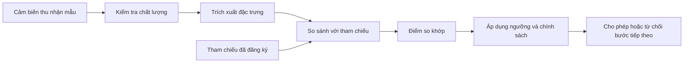

# Inherence factor

## 1. Inherence factor là gì?

**Inherence factor** là nhóm yếu tố xác thực dựa trên đặc điểm vốn có của con người, thường được diễn đạt là **“something you are” — bạn là ai về mặt đặc trưng sinh học hoặc hành vi**. Những ví dụ quen thuộc gồm vân tay, khuôn mặt và mống mắt.

Trong hệ thống IAM, đặc điểm đó thường được xử lý bằng một cơ chế sinh trắc học: thu nhận mẫu, trích xuất đặc trưng và so sánh với dữ liệu tham chiếu đã đăng ký. Kết quả giúp một thành phần xác thực quyết định có cho phép sử dụng authenticator hoặc tiếp tục giao dịch hay không.

Cần phân biệt ba câu hỏi:

| Câu hỏi | Sinh trắc học có thể tham gia như thế nào? | Điều chưa được tự động chứng minh |
|---|---|---|
| Đây có phải người đã đăng ký đặc điểm này không? | So sánh mẫu mới với tham chiếu | Danh tính pháp lý của người đó |
| Người này có kiểm soát authenticator đã gắn với tài khoản không? | Cho phép sử dụng khóa hoặc thiết bị sau kiểm tra cục bộ | Mọi thao tác trên tài khoản đều hợp lệ |
| Người này được phép làm gì? | Cung cấp bằng chứng cho chính sách xác thực | Quyền trên tenant, vai trò hoặc tài nguyên |

Vì vậy, “nhận diện khuôn mặt thành công” không đồng nghĩa “được quyền quản trị”. Quyết định cấp quyền vẫn thuộc cơ chế authorization, chẳng hạn RBAC hoặc ABAC.

Sinh trắc học cũng không mặc nhiên là quy trình xác minh danh tính ban đầu. Nếu ai đó đăng ký dấu vân tay của mình vào một thiết bị đang giữ credential của người khác, việc so khớp về sau chỉ có ý nghĩa trong ranh giới đăng ký đó. Chất lượng liên kết tài khoản, thiết bị và người dùng là một phần thiết yếu của thiết kế.

## 2. Vị trí trong các nhóm yếu tố xác thực

Ba nhóm thường gặp là:

| Nhóm yếu tố | Ý nghĩa | Ví dụ |
|---|---|---|
| Knowledge | Điều người dùng biết | Mật khẩu, PIN dùng để kích hoạt authenticator |
| Possession | Điều người dùng kiểm soát | Khóa bảo mật, thiết bị giữ khóa xác thực |
| Inherence | Đặc điểm của người dùng | Vân tay, khuôn mặt, mống mắt |

Số bước tương tác không phải số nhóm yếu tố. Quét vân tay rồi quét khuôn mặt vẫn sử dụng hai phương thức thuộc nhóm inherence; không vì có hai lần quét mà tự trở thành hai nhóm yếu tố độc lập.

Một authenticator vật lý có thể kết hợp nhiều yếu tố. Ví dụ, thiết bị giữ khóa riêng và yêu cầu so khớp vân tay trước khi dùng khóa. Người dùng chỉ thực hiện một thao tác thuận tiện, nhưng thiết kế có thể kết hợp quyền kiểm soát authenticator và việc kích hoạt bằng đặc điểm sinh trắc học.

Ngược lại, gửi một ảnh khuôn mặt tới một API không tự chứng minh possession. Cần xem bằng chứng nào ràng buộc thiết bị, mẫu thu nhận và giao dịch, thay vì đếm chiếc điện thoại xuất hiện trong trải nghiệm người dùng như một yếu tố thứ hai.

Trong phạm vi xác thực số của NIST SP 800-63B-4, sinh trắc học được dùng cùng authenticator vật lý trong MFA, phải có lựa chọn xác thực không dùng sinh trắc học và phải bảo vệ dữ liệu sinh trắc như dữ liệu cá nhân nhạy cảm. Tài liệu này cũng không cho phép so sánh sinh trắc dựa trên giọng nói trong phạm vi đó. Đây là yêu cầu của khuôn khổ cụ thể, không phải tuyên bố rằng mọi hệ thống nhận dạng giọng nói có cùng mục đích. [NIST SP 800-63B-4, Use of Biometrics](https://pages.nist.gov/800-63-4/sp800-63b.html#biometrics).

## 3. Các dạng đặc điểm và giới hạn sử dụng

### 3.1. Đặc điểm sinh học

Các phương thức có thể dựa trên đường vân tay, cấu trúc khuôn mặt, mống mắt hoặc những đặc trưng cơ thể khác. Chúng khác nhau về cảm biến, điều kiện thu nhận, chi phí và khả năng sử dụng.

Ví dụ:

- Vân tay có thể khó thu nhận khi ngón tay ướt, bị thương hoặc người dùng phải đeo găng.
- Khuôn mặt phụ thuộc vào khả năng cảm biến, tư thế và điều kiện môi trường.
- Mống mắt cần quy trình thu nhận và thiết bị phù hợp; không thể suy từ một ảnh mắt thông thường rằng hệ thống đã có phép so sánh đáng tin cậy.

Đây là những tình huống cần kiểm thử theo sản phẩm, không phải kết luận rằng một phương thức luôn tốt hơn phương thức khác.

### 3.2. Đặc điểm hành vi

Nhịp gõ phím, cách di chuyển chuột hoặc dáng đi có thể được dùng làm tín hiệu hành vi. Trong nhiều thiết kế, chúng hỗ trợ đánh giá rủi ro hoặc phát hiện thay đổi so với lịch sử.

Không nên tự coi một điểm số hành vi là yếu tố xác thực mạnh tương đương mọi cơ chế sinh trắc khác. Cần biết phương thức đã được đánh giá cho mục đích gì, người dùng có thể hiện ý định xác thực không và hệ thống chống giả mạo ra sao.

Ví dụ, “người dùng gõ khác thường” có thể khiến hệ thống yêu cầu xác thực bổ sung. Nó không đủ để kết luận tài khoản đã bị chiếm đoạt, vì người dùng có thể đang dùng bàn phím mới hoặc bị chấn thương.

## 4. Từ mẫu sinh trắc tới quyết định so khớp

Một pipeline đơn giản có thể được mô tả như sau:



Các thành phần không nhất thiết chạy ở cùng một nơi. Điều quan trọng là biết ranh giới nào được tin cậy và dữ liệu gì vượt qua ranh giới đó.

### Mẫu, template và credential không phải một thứ

| Khái niệm | Vai trò |
|---|---|
| Biometric sample | Dữ liệu thu nhận của một lần đo, chẳng hạn ảnh từ cảm biến |
| Feature hoặc template | Biểu diễn đặc trưng phục vụ phép so sánh |
| Matcher | Thành phần thực hiện so khớp |
| Authenticator | Thành phần hoặc thiết bị tham gia xác thực theo giao thức |
| Credential | Dữ liệu gắn danh tính tài khoản với bằng chứng xác thực, ví dụ public key được đăng ký |

Trong một thiết kế dùng khóa công khai, template vân tay không phải public-key credential của dịch vụ. Template có thể chỉ nằm trong ranh giới bảo vệ cục bộ, còn dịch vụ giữ credential ID và public key.

Template cũng không nên được xem là “ảnh đã xóa thông tin nhạy cảm”. Nó vẫn biểu diễn đặc điểm người dùng và cần được bảo vệ theo rủi ro của hệ thống cụ thể. Chỉ đổi định dạng lưu không loại bỏ trách nhiệm bảo vệ dữ liệu.

### Vì sao không đơn giản hash một mẫu rồi so sánh?

Hai lần thu nhận cùng ngón tay thường không cho ra cùng chuỗi byte. Độ xoay, áp lực, nhiễu hoặc phần hình ảnh thu được có thể khác nhau.

Một phép hash thông thường thay đổi mạnh khi đầu vào thay đổi; nó không cung cấp phép so sánh gần đúng cần cho sinh trắc học. Các phương án bảo vệ template cần cơ chế chuyên dụng và đánh giá tương ứng, không thể thay bằng một lệnh hash rồi coi như đã giải quyết bài toán.

## 5. Enrollment: đăng ký tham chiếu và liên kết tài khoản

Enrollment là giai đoạn tạo tham chiếu để so sánh về sau. Quy trình này quan trọng vì hệ thống có thể so khớp rất chính xác với một tham chiếu đã bị đăng ký sai người.

Một quy trình thiết kế cần làm rõ:

1. Ai được phép đăng ký hoặc thay đổi đặc điểm sinh trắc học?
2. Tài khoản hoặc thiết bị đã được xác thực như thế nào trước khi đăng ký?
3. Mẫu có đạt chất lượng tối thiểu không?
4. Tham chiếu được lưu và bảo vệ ở đâu?
5. Việc thêm một người hoặc đặc điểm mới có ảnh hưởng tới credential đang tồn tại không?
6. Người dùng và bộ phận có trách nhiệm nhận được thông báo gì?
7. Phương án thay thế và khôi phục đã sẵn sàng chưa?

### Một thiết bị có thể chấp nhận nhiều người

Thiết bị cá nhân có thể cho phép đăng ký nhiều vân tay hoặc nhiều người biết cùng PIN. Vì vậy, từ góc nhìn dịch vụ từ xa, việc thiết bị báo đã xác minh người dùng chưa chắc xác định được ngón tay nào hoặc cá nhân tự nhiên nào đã thực hiện.

Ví dụ, Lan và Minh cùng có khả năng mở khóa một máy tính bảng. Nếu cả hai có thể kích hoạt credential của tài khoản Lan, dịch vụ không nên tuyên bố đã xác minh riêng danh tính Lan bằng khuôn mặt chỉ từ kết quả thành công.

Trong môi trường quản trị đặc quyền, cần đánh giá thiết bị dùng chung, tài khoản hệ điều hành dùng chung và quyền thêm sinh trắc học. Không thể giải quyết bài toán đó chỉ bằng một checkbox “bật vân tay”.

### Đăng ký sinh trắc trên thiết bị khác đăng ký credential ở dịch vụ

Hai luồng có thể tách biệt:

```text
Đăng ký sinh trắc cục bộ:
    Cảm biến -> tạo tham chiếu -> lưu trong ranh giới thiết bị

Đăng ký credential của dịch vụ:
    Giao dịch được phép -> tạo hoặc liên kết khóa
    -> dịch vụ lưu public key và quan hệ với tài khoản
```

Đăng ký vân tay mới không tự sinh một tài khoản mới ở mọi dịch vụ. Ngược lại, thêm credential mới vào tài khoản cần được bảo vệ, vì đó là thao tác mở thêm một đường truy cập tài khoản.

## 6. So khớp cục bộ và so khớp tập trung

| Đặc điểm thiết kế | So khớp cục bộ | So khớp tập trung |
|---|---|---|
| Nơi thực hiện phép so sánh | Trong thiết bị hoặc ranh giới authenticator | Ở dịch vụ hoặc hệ thống backend |
| Dữ liệu dịch vụ ứng dụng cần nhận | Có thể chỉ là bằng chứng giao thức | Có thể gồm mẫu, đặc trưng hoặc kết quả từ dịch vụ sinh trắc |
| Vấn đề cần đánh giá | Bảo vệ thiết bị, matcher, khóa và cơ chế kích hoạt | Đường thu nhận, truyền dữ liệu, kho template, quyền xử lý |
| Phạm vi ảnh hưởng khi lộ dữ liệu | Phụ thuộc dữ liệu và ranh giới bị xâm phạm | Có thể tập trung nhiều hồ sơ trong một kho |
| Ràng buộc vận hành | Khả năng nền tảng và phương án thay thế | Tính sẵn sàng dịch vụ, chất lượng và vòng đời dữ liệu |

Không nên kết luận “cục bộ luôn an toàn” hoặc “tập trung luôn sai”. Cần đánh giá mục đích, khả năng chống giả mạo, quyền riêng tư, mức rủi ro và cách triển khai.

Tuy nhiên, nếu mục đích đăng nhập dịch vụ có thể đạt được bằng credential mật mã được kích hoạt cục bộ, việc thu thập thêm ảnh hoặc template ở backend tạo ra một nghĩa vụ bảo vệ dữ liệu khác. Nhóm thiết kế phải giải thích vì sao cần thu thập, ai được truy cập và khi nào dữ liệu được xóa.

### Một luồng đăng nhập dùng khóa công khai và xác minh cục bộ

```text
1. Dịch vụ phát challenge gắn với giao dịch đăng nhập.
2. Client chuyển yêu cầu tới authenticator phù hợp.
3. Authenticator thực hiện kiểm tra người dùng theo khả năng và policy.
4. Nếu được phép, authenticator dùng credential để tạo bằng chứng.
5. Dịch vụ kiểm tra bằng chứng giao thức và quan hệ với tài khoản.
6. Dịch vụ áp dụng trạng thái tài khoản, phiên và chính sách truy cập.
```

Trong WebAuthn, nhận dạng sinh trắc được thực hiện cục bộ; dữ liệu sinh trắc không được gửi cho relying party. User verification có thể dùng sinh trắc hoặc PIN; cờ UV không tự chỉ ra phương thức cụ thể. User presence cũng khác user verification. [W3C WebAuthn, User Verification và Biometric Privacy](https://www.w3.org/TR/webauthn-3/#sctn-biometric-privacy).

Điều này có một hệ quả quan trọng cho IAM: dịch vụ có thể xác minh credential và kết quả giao thức mà không biết ảnh khuôn mặt hoặc mẫu vân tay của người dùng. Không cần tạo API “upload vân tay để đăng nhập” chỉ vì giao diện thiết bị hiển thị thao tác quét vân tay.

## 7. So khớp gần đúng và các loại sai số

Sinh trắc học thường đưa ra một điểm so khớp thay vì phép bằng tuyệt đối như so sánh hai chuỗi ký tự. Hệ thống dùng ngưỡng để quyết định chấp nhận hay từ chối.

Giả sử matcher tạo điểm tương đồng, điểm càng cao nghĩa là càng giống:

```text
chấp nhận so khớp nếu similarity_score >= threshold
```

Đây là mô hình minh họa. Một sản phẩm có thể dùng điểm khoảng cách với chiều so sánh ngược lại, hoặc dùng các quyết định nội bộ không công bố điểm.

### 7.1. False Match Rate — FMR

FMR mô tả tỷ lệ các phép so sánh giữa những mẫu không cùng người nhưng matcher vẫn chấp nhận là khớp:

```text
FMR = số phép so sánh khác người bị chấp nhận nhầm
      / tổng phép so sánh khác người được đánh giá
```

Ví dụ giả lập: trong 100.000 phép so sánh khác người, có 4 phép được chấp nhận nhầm. FMR của tập thử đó là 0,004%.

Con số này không có nghĩa xác suất một tài khoản bất kỳ bị chiếm đoạt là 0,004%. Một cuộc tấn công thực tế còn liên quan tới việc chọn mẫu, số lần thử, giả mạo cảm biến, cơ chế bảo vệ thiết bị và toàn bộ giao thức.

### 7.2. False Non-Match Rate — FNMR

FNMR mô tả tỷ lệ những phép so sánh đúng người nhưng bị kết luận không khớp:

```text
FNMR = số phép so sánh cùng người bị từ chối nhầm
       / tổng phép so sánh cùng người được đánh giá
```

Ví dụ giả lập: 600 trong 20.000 phép so sánh cùng người bị từ chối. FNMR của tập thử đó là 3%.

Người dùng thật bị từ chối có thể phải thử lại hoặc chuyển phương thức. Nếu nhiều người gặp tình trạng này, chi phí hỗ trợ và áp lực sử dụng đường khôi phục sẽ tăng.

### 7.3. Không gộp mọi lỗi thành lỗi matcher

Cần tách:

| Loại sự cố | Ví dụ | Ý nghĩa vận hành |
|---|---|---|
| Không đăng ký được | Không thu được tham chiếu đạt yêu cầu | Người dùng cần phương án khác ngay từ đầu |
| Không thu được mẫu | Cảm biến không đọc được ngón tay | Chưa chắc đã có phép so sánh |
| So khớp sai | Matcher từ chối mẫu cùng người | Liên quan FNMR trong điều kiện đánh giá |
| Chặn do bảo vệ | Đã quá số lần thử hoặc bị khóa tạm thời | Quyết định của chính sách hoặc authenticator |
| Lỗi giao thức | Challenge hết hạn, chữ ký không hợp lệ | Không phải sai số sinh trắc |
| Lỗi quyền truy cập | Tài khoản bị khóa hoặc mất membership | Không được giải quyết bằng quét lại |

Các tên như false acceptance rate và false rejection rate có thể được dùng cho phạm vi toàn hệ thống hoặc giao dịch trong tài liệu đánh giá. Không tự coi chúng luôn đồng nghĩa FMR/FNMR của từng phép so sánh; phải kiểm tra định nghĩa và mẫu số của báo cáo cụ thể.

### 7.4. Ngưỡng là một lựa chọn có đánh đổi

Với cùng matcher, dữ liệu và cách chấm điểm tương đồng, nâng ngưỡng thường làm phép chấp nhận nghiêm hơn: có thể giảm chấp nhận nhầm nhưng tăng từ chối nhầm. Cần đánh giá trên điều kiện sử dụng thực tế, không chỉ một tập demo thuận lợi.

Một báo cáo chất lượng hữu ích cần nói rõ:

- Phương thức và thiết bị thu nhận.
- Điều kiện môi trường và chất lượng mẫu.
- Định nghĩa phép thử, mẫu số và số lượng mẫu.
- Ngưỡng hoặc cấu hình được đánh giá.
- Những nhóm người dùng và tình huống sử dụng được bao phủ.
- Giới hạn độ chắc chắn của kết quả.

Nếu không quan sát thấy lỗi trong một tập thử nhỏ, không thể suy ra hệ thống có xác suất lỗi bằng 0. Cũng không so trực tiếp điểm tương đồng của hai sản phẩm nếu chúng không dùng cùng thang đo và phương pháp đánh giá.

### 7.5. Verification 1:1 khác identification 1:N

Trong verification, hệ thống so mẫu mới với tham chiếu của một danh tính đã được chỉ định. Trong identification, hệ thống tìm trong nhiều tham chiếu để đưa ra ứng viên phù hợp.

Bài toán đăng nhập vào một tài khoản cụ thể thường gần với verification, còn tìm người trong một kho hình là một bài toán khác. Không lấy kết quả kiểm thử 1:1 rồi tuyên bố hiệu năng 1:N tương đương; quy mô kho, số phép so sánh và quy tắc quyết định đều cần được xem xét.

## 8. Đặc điểm sinh trắc không phải bí mật có thể giữ kín tuyệt đối

Khuôn mặt có thể được nhìn thấy trong đời sống, ảnh có thể được chia sẻ và dấu vân tay có thể để lại trên bề mặt. Điều đó không có nghĩa mọi quan sát đều đủ để đánh bại một hệ thống cụ thể, nhưng cho thấy không nên thiết kế sinh trắc học như một mật khẩu mà chỉ người dùng biết.

Một mật khẩu bị lộ có thể được thay bằng chuỗi mới. Người dùng không thể thay khuôn mặt hoặc bộ vân tay theo cách tương tự.

Vì thế, việc xử lý sự cố cần phân biệt:

- Thu hồi credential hoặc khóa xác thực của dịch vụ.
- Gỡ một authenticator đã gắn với tài khoản.
- Xóa hoặc đăng ký lại tham chiếu trong hệ thống sinh trắc.
- Đánh giá ảnh hưởng của dữ liệu sinh trắc đã bị lộ.

Đăng ký lại có thể thay đổi template hoặc quan hệ liên kết, nhưng không làm những ảnh hoặc đặc điểm đã lộ biến mất. Nếu dùng công nghệ biến đổi hoặc bảo vệ template có khả năng thu hồi, cần đánh giá chính cơ chế đó; không mặc định mọi template đều có thể “rotate” như API key.

## 9. Chống giả mạo cần bảo vệ cả đường thu nhận

### Presentation attack và PAD

Presentation attack là việc đưa một vật hoặc dữ liệu giả mạo tới giao diện thu nhận để bị nhận như một người hợp lệ. Presentation Attack Detection — PAD — là nhóm biện pháp phát hiện kiểu trình diễn đó.

PAD có thể là một lớp bảo vệ cần thiết, nhưng nhãn “có liveness” không đủ để đánh giá toàn hệ thống. Cần biết khả năng đã được thử với phương thức nào, điều kiện nào và giới hạn ra sao.

Một số điều cần kiểm tra:

- Nguồn mẫu có thật sự đến từ cảm biến được tin cậy không?
- Kết quả PAD có bị client không tin cậy sửa được không?
- Mẫu hoặc kết quả cũ có bị phát lại trong một giao dịch mới không?
- Matcher và thành phần giữ khóa có ràng buộc đúng với nhau không?
- Cơ chế thử lại và khóa tạm thời có được thực thi ở nơi phù hợp không?

### Injection khác với trình diễn trước cảm biến

Nếu kẻ tấn công chèn dữ liệu vào sau cảm biến hoặc sửa trực tiếp kết quả xử lý, việc chỉ kiểm tra thứ được trình bày trước camera chưa đủ. Thiết kế phải bảo vệ cả đường dữ liệu và ranh giới thành phần.

Tương tự, một client gửi JSON như sau không tạo ra bằng chứng đáng tin cậy:

```json
{
  "accountId": "user-123",
  "biometricPassed": true
}
```

Server không thể coi boolean do client tự gửi là kết quả xác thực chỉ vì màn hình vừa có hiệu ứng quét mặt. Cần bằng chứng giao thức từ thành phần được tin cậy, ràng buộc với giao dịch và tài khoản.

### Deepfake không phải tên gọi thay cho mô hình đe dọa

Hình ảnh hoặc âm thanh tổng hợp là một nguồn rủi ro, nhưng yêu cầu bảo vệ cần cụ thể hơn câu “chống deepfake”. Phải xác định đầu vào, thành phần xác minh, loại bằng chứng và phạm vi tấn công được đánh giá.

Không dùng thành công của một demo giả mạo để suy ra mọi thiết bị đều dễ bị vượt qua; cũng không dùng một demo chống giả mạo thành công để tuyên bố hệ thống không thể bị tấn công.

## 10. Inherence factor không tự tạo khả năng chống phishing

Người dùng có thể bị dụ thực hiện thao tác sinh trắc trên một luồng không phù hợp. Mức bảo vệ còn phụ thuộc giao thức và việc bằng chứng được ràng buộc với dịch vụ nào.

Ví dụ:

- Một trang giả yêu cầu gửi ảnh mặt không có cùng tính chất với việc dùng credential được giới hạn cho một relying party.
- Một ứng dụng đã bị xâm phạm có thể cố dùng phiên hợp lệ sau khi người dùng mở khóa.
- Một thao tác quét thành công không tự chứng minh người dùng đã hiểu hoặc phê duyệt giao dịch chuyển tiền cụ thể.

Cần tách **xác minh người dùng**, **ý định xác thực** và **phê duyệt hành động**. Một camera nhìn thấy khuôn mặt trong lúc người dùng đang đọc màn hình chưa đủ cho thấy họ chủ động muốn đăng nhập hay thay đổi quyền.

Nếu hệ thống yêu cầu xác thực mới cho một thao tác nhạy cảm, server phải khởi tạo và kiểm tra giao dịch phù hợp. Không chỉ dựa vào một biến frontend `recentFaceCheck=true` hoặc một phiên được tạo từ nhiều giờ trước.

## 11. Quyền riêng tư và vòng đời dữ liệu

Một thiết kế sử dụng sinh trắc học cần trả lời rõ:

1. Có cần thu nhận hoặc lưu dữ liệu sinh trắc ở dịch vụ không?
2. Mẫu thô, template và metadata được giữ ở những đâu?
3. Ai có quyền đọc, dùng, xuất hoặc xóa dữ liệu?
4. Dữ liệu được dùng cho xác thực hay còn có mục đích khác?
5. Khi người dùng rời tổ chức hoặc xóa tài khoản, các bản sao được xử lý ra sao?
6. Phương án dành cho người không thể hoặc không muốn dùng phương thức này là gì?

Những quyết định đó phụ thuộc mục đích và yêu cầu áp dụng cho tổ chức. Không nên khẳng định một cơ chế tuân thủ pháp luật chỉ vì dữ liệu đã mã hóa hoặc người dùng đã bấm đồng ý.

### Tối thiểu hóa dữ liệu trong IAM

Nếu dịch vụ chỉ cần xác minh bằng chứng mật mã, không đưa mẫu sinh trắc vào log đăng nhập, analytics hoặc ticket hỗ trợ.

Một event có thể chỉ cần:

```text
principalId
credentialReference
authenticationTransactionId
authenticatorCategory
userVerificationResult
authenticationTime
policyDecision
reasonCode
```

Ngay cả những trường này cũng cần quyền truy cập và thời hạn lưu phù hợp. `userVerificationResult` chỉ được ghi theo bằng chứng đã kiểm tra; không tự đổi nó thành `fingerprintVerified` khi dịch vụ không biết phương thức thực sự.

Credential, public key và tham chiếu thiết bị có ý nghĩa khác mẫu sinh trắc. Phân loại đúng dữ liệu giúp tránh cả hai lỗi: thu thập quá mức và tưởng rằng dữ liệu tham chiếu không có giá trị nhạy cảm nào.

## 12. Fallback và khôi phục là một phần của mức bảo vệ

Một phương thức sinh trắc có thể không dùng được vì thay đổi cơ thể, lỗi cảm biến, thiết bị mất hoặc điều kiện môi trường. Đường thay thế cần được thiết kế trước.

Fallback trong xác thực thường là dùng một cách đã được đăng ký và được chính sách chấp nhận. Account recovery là quá trình khôi phục quyền truy cập khi các cách thông thường không còn khả dụng. Hai luồng này không nên bị gộp thành “bỏ qua sinh trắc”.

| Tình huống | Hướng xử lý cần thiết kế | Điều cần tránh |
|---|---|---|
| Không đọc được vân tay | Phương thức thay thế được chấp nhận | Hạ ngưỡng cho mọi người dùng |
| Thiết bị bị mất | Thu hồi credential liên quan, dùng authenticator dự phòng hoặc recovery | Coi dữ liệu khuôn mặt là cách thay khóa |
| Người dùng bị chấn thương | Cơ chế tiếp cận phù hợp, giữ yêu cầu bảo đảm | Ép thử vô hạn hoặc khóa vĩnh viễn |
| Nghi bị thêm sinh trắc trái phép | Kiểm tra thiết bị, credential và hoạt động tài khoản | Chỉ yêu cầu quét lại |
| Credential bị thu hồi | Chặn ở hệ thống xác thực | Cho đăng nhập vì matcher vẫn báo khớp |

Một đường recovery quá dễ có thể làm giảm mức bảo vệ của toàn tài khoản. Ví dụ, yêu cầu authenticator mạnh khi đăng nhập nhưng cho reset chỉ bằng dữ liệu cá nhân dễ tìm sẽ tạo một đường truy cập yếu hơn.

Không giải quyết false non-match bằng cách cho đội hỗ trợ tự đánh dấu “đã nhận mặt đúng” rồi tạo phiên quản trị. Cần một quy trình có thẩm quyền, bằng chứng, giới hạn và khả năng kiểm toán.

## 13. Áp dụng trong ứng dụng IAM

Giả sử một cổng quản trị dùng credential khóa công khai được kích hoạt trên thiết bị. Cổng không thu thập ảnh hoặc template. Chính sách yêu cầu user verification và bằng chứng đăng nhập đủ mới cho việc thay đổi vai trò.

Đoạn mã sau chỉ minh họa phân tách trách nhiệm; các tên API là mã giả, không phải thư viện Java có thể sử dụng trực tiếp:

```java
ValidatedAssertion proof =
        webAuthnVerifier.verifyAndConsumeTransaction(
                response, expectedTransaction);

if (!proof.userVerificationSatisfied()) {
    return deny("USER_VERIFICATION_REQUIRED");
}

Account account = accounts.findByCredential(proof.credentialId());

if (account == null || !account.isActive()) {
    return deny("ACCOUNT_NOT_ACTIVE");
}

if (!authenticationPolicy.accepts(proof, account, requestedAction)) {
    return deny("AUTHENTICATION_POLICY_NOT_MET");
}

return authorization.decide(
        account.id(), requestedAction, targetResource);
```

`verifyAndConsumeTransaction` ở đây đại diện cho việc kiểm tra đầy đủ giao thức bằng thành phần được duy trì, gồm ràng buộc challenge, origin/RP, credential và bằng chứng tương ứng. Nó không phải một phép kiểm tra chữ ký đơn lẻ.

`userVerificationSatisfied` là kết luận theo policy và quan hệ tin cậy đã thiết lập, không chỉ đọc một cờ bất kỳ do client tự khai. Nếu dịch vụ cần yêu cầu cụ thể về authenticator hoặc phương thức, cần bằng chứng và hỗ trợ phù hợp; không suy ra “đã dùng vân tay” từ kết quả UV.

Những việc vẫn phải thực hiện sau xác thực:

- Kiểm tra trạng thái tài khoản và credential.
- Kiểm tra membership của tenant.
- Áp dụng vai trò, thuộc tính và quyền trên tài nguyên.
- Quản lý phiên, thời hạn và yêu cầu xác thực tăng cường.
- Thu hồi quyền và credential theo vòng đời.
- Ghi audit với mức chi tiết phù hợp.

Inherence factor giải quyết một phần của bằng chứng xác thực, không thay thế các thành phần IAM còn lại.

## 14. Những ngộ nhận thường gặp

| Ngộ nhận | Cách hiểu chính xác hơn |
|---|---|
| “Vân tay là mật khẩu không thể bị lộ” | Đặc điểm sinh trắc không phải bí mật có thể đổi như mật khẩu |
| “Quét mặt hai lần là MFA” | Số lần quét không tạo hai nhóm yếu tố |
| “Có UV nghĩa là dùng khuôn mặt” | UV có thể được đáp ứng bằng phương thức khác |
| “Chạm vào khóa luôn là xác minh người dùng” | Chạm có thể chỉ chứng minh sự hiện diện |
| “Backend phải giữ vân tay để hỗ trợ đăng nhập bằng vân tay” | Một thiết kế cục bộ có thể chỉ gửi bằng chứng giao thức |
| “Template đã hash nên không còn nhạy cảm” | Bảo vệ template không được suy từ một nhãn hash |
| “Tỷ lệ so khớp sai là xác suất bị hack” | Sai số matcher chỉ là một phần của mô hình đe dọa |
| “Sinh trắc đạt thì cấp lại quyền đã thu hồi” | Quyền phụ thuộc trạng thái tài khoản và policy hiện hành |
| “Mở khóa điện thoại nghĩa là đã đăng nhập mọi ứng dụng” | Mỗi ứng dụng còn có credential, phiên và chính sách riêng |
| “Thấy khuôn mặt nghĩa là người dùng đồng ý hành động” | Cần xác định ý định và phê duyệt theo giao dịch |

## 15. Tự kiểm tra bằng tình huống

**Tình huống 1 — Thêm vân tay trên thiết bị dùng chung.** Một máy cho phép cả hai nhân viên mở khóa, nhưng credential ứng dụng gắn với một tài khoản. Hãy xác định ai có thể kích hoạt credential và server thực sự biết gì. Không bắt đầu từ giả định rằng một credential luôn tương ứng duy nhất với một người có thể mở thiết bị.

**Tình huống 2 — Mất membership nhưng sinh trắc vẫn hoạt động.** Người dùng đã rời tenant Alpha, còn thiết bị vẫn so khớp vân tay thành công. Kết quả đúng là thiết bị có thể hoàn tất kiểm tra cục bộ, nhưng dịch vụ phải từ chối quyền Alpha theo trạng thái có thẩm quyền.

**Tình huống 3 — Matcher báo không khớp khi bị thương.** Xác định đây là lỗi thu mẫu, lỗi so khớp hay khóa do số lần thử. Sau đó dùng phương thức thay thế phù hợp. Không sửa policy toàn hệ thống chỉ để giải quyết một trường hợp.

**Tình huống 4 — Dịch vụ nhận cờ UV.** Có thể kết luận gì về phương thức, độ mới và người thực hiện? Cần phân biệt bằng chứng giao thức, chính sách authenticator và dữ liệu mà dịch vụ không được cung cấp.

**Tình huống 5 — Lộ kho template.** Lập danh sách việc cần thu hồi, dữ liệu cần đánh giá và các hệ thống có liên quan. Không coi việc cấp lại public-key credential là đã xóa tác động của dữ liệu sinh trắc bị lộ.

Một cách đánh giá thiết kế là luôn hỏi: đặc điểm nào được dùng, so khớp ở đâu, ai bảo vệ tham chiếu, kết quả được ràng buộc với giao dịch ra sao và người dùng còn đường truy cập hợp lệ nào khi phương thức này không dùng được. Trả lời rõ các câu đó giúp sử dụng inherence factor với mức tin cậy và phạm vi phù hợp.
