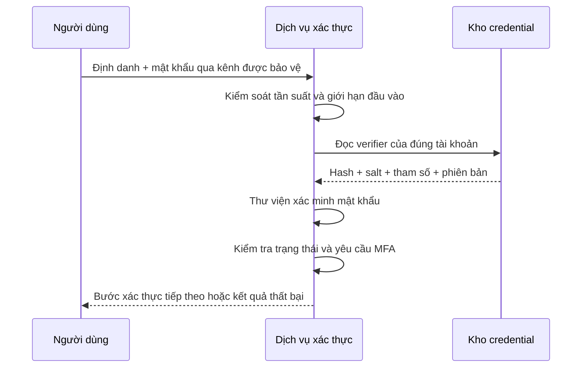

# Password

## 1. Password trong hệ thống IAM

Password, hay mật khẩu, là một bí mật mà người dùng cung cấp để chứng minh khả năng kiểm soát một tài khoản. Nó thuộc nhóm yếu tố “điều bạn biết”. Mật khẩu có thể là một chuỗi ngẫu nhiên do trình quản lý mật khẩu tạo hoặc một passphrase gồm nhiều từ.

Cần tách ba khái niệm:

| Khái niệm | Ví dụ | Vai trò |
|---|---|---|
| Định danh tài khoản | Username, mã nhân viên, email đăng nhập | Giúp hệ thống xác định tài khoản cần kiểm tra |
| Mật khẩu | Bí mật người dùng nhập | Là bằng chứng xác thực theo cơ chế đã thiết kế |
| Quyền truy cập | Role, permission, tenant membership | Quyết định người đã xác thực được làm gì |

Biết username không đồng nghĩa biết mật khẩu. Biết đúng mật khẩu cũng không đồng nghĩa tài khoản còn hoạt động, đã hoàn tất MFA hoặc có quyền quản trị. IAM phải đánh giá các điều kiện đó ở đúng giai đoạn.

Ví dụ, Lan có mật khẩu đúng của tài khoản `lan-work`. Nếu tài khoản đã bị vô hiệu hóa do kết thúc hợp đồng, hệ thống vẫn phải từ chối. Nếu tài khoản còn hoạt động nhưng yêu cầu MFA, xác minh mật khẩu chỉ hoàn tất một phần luồng đăng nhập.

Mật khẩu và PIN không phải hai yếu tố độc lập khi cả hai đều là bí mật cần nhớ. PIN dùng cục bộ để mở khóa một authenticator cũng có vai trò khác mật khẩu được gửi tới máy chủ. Không suy luận số lượng yếu tố chỉ bằng cách đếm số ô người dùng phải nhập.

## 2. Mật khẩu được kiểm tra như thế nào?

Trong một hệ thống xác thực bằng mật khẩu thông thường, máy chủ không cần lưu lại mật khẩu gốc. Nó lưu một biểu diễn phục vụ việc kiểm tra, thường gọi là password verifier hoặc password hash đã mã hóa kèm metadata.

Luồng khái niệm:



“Hash mật khẩu” không có nghĩa là dùng bất kỳ hàm băm nào. Một hàm băm nhanh phục vụ kiểm tra toàn vẹn dữ liệu có mục tiêu khác với một hàm được thiết kế để làm mỗi lần đoán mật khẩu trở nên tốn tài nguyên.

Nếu toàn bộ luồng xác thực đã hoàn tất, dịch vụ có thể tạo phiên theo chính sách của nó. Request nghiệp vụ sau đó dùng phiên hoặc token phù hợp, không gửi lại mật khẩu trong mọi request.

Máy chủ cần bảo vệ cả chặng truyền và các nơi có thể ghi lại đầu vào: reverse proxy, tracing, APM, log lỗi, hàng đợi và công cụ hỗ trợ. Trường nhập hiển thị dấu chấm trên màn hình chỉ giảm việc nhìn trộm; nó không thay thế TLS hoặc cơ chế lưu trữ an toàn.

## 3. Các kiểu tấn công cần phân biệt

| Kiểu tấn công | Cách xảy ra | Điểm kiểm soát liên quan |
|---|---|---|
| Đoán mật khẩu trực tuyến | Thử nhiều ứng viên với một tài khoản | Rate limiting, phát hiện bất thường, yếu tố bổ sung |
| Password spraying | Thử một vài mật khẩu phổ biến trên nhiều tài khoản | Phát hiện mẫu trên nhiều tài khoản, chặn giá trị dễ đoán |
| Credential stuffing | Dùng cặp username/password lộ từ dịch vụ khác | Mật khẩu riêng từng dịch vụ, MFA, kiểm soát bot |
| Đoán ngoại tuyến | Có verifier bị đánh cắp rồi tự thử ứng viên | Password hashing phù hợp, salt và mật khẩu khó đoán |
| Phishing | Dụ người dùng nhập bí mật vào nơi giả mạo | Authenticator có khả năng kháng phishing và bảo vệ luồng đăng nhập |
| Chiếm luồng recovery | Lấy quyền đặt mật khẩu mới qua kênh yếu hơn | Bảo vệ reset token, kênh khôi phục và thay đổi recovery |

Ba kiểu tấn công trực tuyến đầu tiên có mẫu khác nhau. Chặn một IP sau nhiều lần sai không bao phủ mạng bot phân tán hoặc spraying với ít lần thử trên từng tài khoản. [OWASP Credential Stuffing Prevention](https://cheatsheetseries.owasp.org/cheatsheets/Credential_Stuffing_Prevention_Cheat_Sheet.html)

Rate limiting của ứng dụng không làm chậm một kẻ đã có cơ sở dữ liệu hash và đang đoán ngoại tuyến trên hạ tầng riêng. Ngược lại, hash đắt hơn không tự ngăn được người dùng đưa mật khẩu đúng cho một trang phishing.

Vì vậy, “mật khẩu mạnh” chỉ là một phần của thiết kế. Cần kết hợp lựa chọn bí mật, bảo vệ verifier, kiểm soát thử sai, recovery và các yếu tố xác thực thích hợp.

## 4. Độ dài, độ khó đoán và việc tái sử dụng

### 4.1. Dài chưa chắc khó đoán

Một chuỗi dài lấy từ thông tin cá nhân hoặc một câu nổi tiếng có thể dễ đoán hơn chuỗi ngắn hơn được sinh ngẫu nhiên. Độ dài có ích, nhưng cách tạo mật khẩu ảnh hưởng lớn đến tập ứng viên mà kẻ tấn công sẽ thử trước.

Không áp dụng công thức số tổ hợp của chuỗi ngẫu nhiên đồng đều để tuyên bố độ mạnh chính xác của mật khẩu do con người tự chọn. Việc thay chữ `a` bằng `@` hay thêm năm hiện tại là mẫu mà công cụ đoán có thể dự đoán.

Passphrase hỗ trợ tạo bí mật dài và dễ sử dụng hơn, nhưng vẫn cần tránh mẫu phổ biến. Phụ lục về độ mạnh mật khẩu của NIST giải thích giới hạn của quy tắc thành phần ký tự và việc ước lượng độ mạnh cho bí mật do con người chọn. [NIST — Strength of Passwords](https://pages.nist.gov/800-63-4/sp800-63b/passwords/)

Các chuỗi minh họa được công khai trong tài liệu học không nên được dùng làm mật khẩu thật, dù chúng trông dài hoặc phức tạp.

### 4.2. Mỗi dịch vụ cần một mật khẩu riêng

Giả sử Minh dùng cùng một mật khẩu cho diễn đàn và tài khoản công việc. Khi diễn đàn bị lộ dữ liệu, kẻ tấn công có thể thử cặp định danh/bí mật đó ở hệ thống công việc. Mật khẩu không cần bị bẻ lần thứ hai nếu giá trị đã được biết từ nơi khác.

Trình quản lý mật khẩu giúp tạo và lưu bí mật khác nhau cho từng dịch vụ. Ứng dụng nên hỗ trợ autofill, cho phép dán và dùng trường nhập có ngữ nghĩa phù hợp. Không cấm paste chỉ để buộc người dùng tự gõ; cách đó có thể khiến họ chọn mật khẩu dễ nhớ và tái sử dụng hơn.

Một giao diện đơn giản có thể phân biệt rõ:

```html
<!-- Đăng nhập -->
<input type="password" name="password" autocomplete="current-password">

<!-- Tạo hoặc đặt mật khẩu mới -->
<input type="password" name="newPassword" autocomplete="new-password">
```

Các thuộc tính HTML hỗ trợ trải nghiệm; toàn bộ chính sách bắt buộc vẫn phải được kiểm tra phía máy chủ.

## 5. Xây dựng chính sách mật khẩu

### 5.1. Hiểu đúng hướng dẫn NIST hiện hành

NIST SP 800-63B-4 đặt tối thiểu 15 ký tự khi mật khẩu dùng một mình; khi chỉ dùng trong quy trình MFA, có thể cho phép ngắn hơn nhưng tối thiểu 8. Hướng dẫn khuyến nghị hỗ trợ độ dài tối đa ít nhất 64 ký tự và yêu cầu kiểm tra toàn bộ đầu vào. Đây là yêu cầu trong phạm vi hướng dẫn NIST, cần được ánh xạ đúng vào mô hình xác thực của sản phẩm. [NIST SP 800-63B-4, Password Verifiers](https://pages.nist.gov/800-63-4/sp800-63b.html#passwordver)

Nếu một đường đăng nhập cho phép dùng riêng mật khẩu, không được viện dẫn “tài khoản có đăng ký MFA” để áp dụng điều kiện dành cho luồng luôn thực thi MFA. Có đăng ký yếu tố thứ hai và thực sự bắt buộc yếu tố đó là hai trạng thái khác nhau.

NIST cũng bỏ yêu cầu đổi định kỳ và quy tắc bắt buộc trộn loại ký tự; khi có bằng chứng mật khẩu bị lộ thì cần buộc thay đổi. [NIST Implementation Resources — FAQ về mật khẩu](https://pages.nist.gov/800-63-4-Implementation-Resources/faqs/index.html)

### 5.2. Một chính sách mẫu của sản phẩm

Ứng dụng giả lập chọn chính sách thống nhất sau, kể cả khi người dùng có MFA:

| Nội dung | Lựa chọn của ứng dụng mẫu |
|---|---|
| Độ dài | Từ 15 đến 128 Unicode code point sau bước chuẩn hóa đã công bố |
| Giá trị bị từ chối | Nằm trong blocklist giá trị phổ biến, dự kiến dễ đoán hoặc đã lộ |
| Thành phần ký tự | Không bắt buộc có đủ chữ hoa, chữ thường, số và ký hiệu |
| Khoảng trắng | Được hỗ trợ theo hợp đồng đầu vào, không tự động trim |
| Dán và autofill | Được hỗ trợ |
| Đổi định kỳ | Không dùng chu kỳ tùy tiện để thay thế phát hiện lộ credential |
| Giới hạn request | Có giới hạn kích thước trước xử lý và không cắt ngắn mật khẩu |
| Tài khoản đặc quyền | Có yêu cầu xác thực bổ sung theo chính sách riêng |

Mốc 128 là quyết định của ví dụ, không phải một giới hạn chuẩn bắt buộc. Nhóm phải chọn giới hạn phù hợp thư viện, giao thức và tài nguyên, đồng thời thông báo lỗi rõ ràng nếu vượt giới hạn.

Blocklist được áp dụng khi thiết lập hoặc thay mật khẩu. NIST yêu cầu so sánh toàn bộ giá trị dự kiến, không cấm mọi chuỗi chỉ vì chứa một từ con có trong danh sách. [NIST SP 800-63B-4, Password Verifiers](https://pages.nist.gov/800-63-4/sp800-63b.html#passwordver)

Không gửi mật khẩu nguyên văn tới một dịch vụ kiểm tra bên ngoài. Nếu tích hợp dữ liệu mật khẩu đã lộ, thiết kế cơ chế bảo vệ đầu vào và ranh giới tin cậy cụ thể. Việc một trường có tên `password` không khiến nó tự được che khỏi HTTP tracing hoặc hệ thống quan sát.

### 5.3. Tránh thay đổi ngầm giá trị người dùng nhập

Đừng tự chuyển mật khẩu thành chữ thường, xóa khoảng trắng đầu/cuối hoặc lấy một đoạn đầu để vừa cột cơ sở dữ liệu. Những biến đổi đó làm nhiều bí mật khác nhau trở thành cùng một giá trị mà người dùng không biết.

Nếu hỗ trợ Unicode, chọn chính sách chuẩn hóa rõ ràng và thực hiện nhất quán khi tạo, đăng nhập, đổi và reset. NIST khuyến nghị NFC trước khi hashing; độ dài được tính theo Unicode code point. [NIST SP 800-63B-4, Password Verifiers](https://pages.nist.gov/800-63-4/sp800-63b.html#passwordver)

Trong Java, `String.length()` đếm UTF-16 code unit, không phải mọi ký tự Unicode theo cùng cách đếm trên. Một số ký tự được biểu diễn bằng hai code unit; các tổ hợp dấu cũng tạo thêm khác biệt giữa biểu diễn và hình thức hiển thị. Kiểm thử thực tế bằng ký tự ngoài BMP, chữ có dấu và các biểu diễn Unicode tương đương.

Khi thay chính sách của hệ thống đã có người dùng, cần quản lý phiên bản. Chuẩn hóa mới có thể làm thay đổi byte dùng để kiểm tra verifier cũ; không áp dụng âm thầm rồi coi người dùng đăng nhập sai.

## 6. Lưu trữ mật khẩu: salt, hash và tham số

### 6.1. Lưu verifier thay vì mật khẩu đọc được

Không lưu mật khẩu nguyên văn, Base64 của mật khẩu hoặc bản mã có thể giải mã bằng một khóa chung chỉ để phục vụ đăng nhập. Base64 là biểu diễn dữ liệu, không phải bảo vệ bí mật.

Password hashing dùng một thuật toán phù hợp với chi phí được điều chỉnh. OWASP ưu tiên Argon2id cho hệ thống mới; cấu hình tối thiểu được nêu gồm 19 MiB bộ nhớ, 2 lượt và độ song song 1. Cần benchmark và điều chỉnh trên môi trường đích. SHA-256 nhanh đơn thuần không phải lựa chọn tương đương. [OWASP Password Storage](https://cheatsheetseries.owasp.org/cheatsheets/Password_Storage_Cheat_Sheet.html)

Dạng lưu khái niệm:

```text
credentialId
accountId
schemeVersion
encodedVerifier = algorithm + parameters + salt + derived value
createdAt
updatedAt
credentialVersion
```

`encodedVerifier` là dữ liệu nhạy cảm, dù không phải mật khẩu gốc. Không đưa nó ra API hồ sơ, log hoặc dashboard hỗ trợ.

### 6.2. Salt giải quyết điều gì?

Salt là đầu vào ngẫu nhiên riêng cho mỗi lần tạo verifier. Hai tài khoản có cùng mật khẩu có thể có verifier khác nhau nhờ salt khác nhau. Điều này làm giảm khả năng dùng bảng tra tính sẵn và chia sẻ trực tiếp công việc đoán giữa các bản ghi.

Salt được lưu cùng verifier; nó không cần là một bí mật dùng chung của hệ thống. Salt không làm một mật khẩu dễ đoán trở nên khó đoán, cũng không ngăn việc thử ứng viên khi kẻ tấn công đã có cả salt lẫn verifier.

Pepper, nếu dùng, là bí mật bổ sung được giữ ngoài kho verifier. Nó không thay thế salt hoặc thuật toán phù hợp. Mất pepper có thể ảnh hưởng toàn bộ tập credential liên quan; việc quản lý và thay pepper phải có thiết kế riêng. [OWASP Password Storage, Salting và Peppering](https://cheatsheetseries.owasp.org/cheatsheets/Password_Storage_Cheat_Sheet.html)

### 6.3. Chi phí hashing phải đi cùng quản lý tải

Một verifier tốn nhiều bộ nhớ và CPU làm đoán mật khẩu đắt hơn, nhưng cũng làm login hợp lệ tốn tài nguyên. Ví dụ, 200 phép kiểm tra đồng thời với 19 MiB mỗi phép đã cần khoảng 3,7 GiB bộ nhớ riêng cho phần tính toán đó, chưa kể ứng dụng và hạ tầng.

Vì thế, đặt giới hạn đồng thời, hàng đợi và kiểm soát tần suất trước phần tính hash đắt. Đo độ trễ với tải thực, không chỉ một request trên máy phát triển. Không tự giảm chi phí xuống mức yếu chỉ vì thiếu một cơ chế chống lạm dụng ở cửa vào.

Các hệ thống cũ còn có thể dùng bcrypt hoặc PBKDF2 theo ràng buộc của chúng. Phải hiểu giới hạn đầu vào và cấu hình cụ thể; đặc biệt, không đồng nhất giới hạn byte của một implementation với giới hạn ký tự của sản phẩm. Đừng tự thiết kế một chuỗi pre-hash hoặc thuật toán mới để vá khác biệt đó mà chưa có thiết kế được kiểm chứng.

## 7. Tổ chức mã xác minh trong ứng dụng

Một lớp trừu tượng có thể để thư viện chuyên dụng sở hữu phần mật mã:

```java
interface PasswordHasher {
    String hash(char[] password);
    boolean verify(char[] candidate, String encodedVerifier);
    boolean needsRehash(String encodedVerifier);
}
```

Đây là interface minh họa, không phải yêu cầu về API của một thư viện cụ thể. Việc sinh salt, mã hóa tham số, xác minh và so sánh kết quả cần giao cho implementation phù hợp. Không triển khai `verify` bằng cách tự ghép chuỗi và dùng `==`.

Luồng đăng nhập khái niệm:

```text
1. Áp dụng giới hạn request và chống lạm dụng.
2. Xác định đúng tài khoản trong miền đăng nhập.
3. Đọc verifier cùng phiên bản credential.
4. Xác minh toàn bộ mật khẩu theo scheme tương ứng.
5. Nếu sai hoặc tài khoản không được phép: trả lỗi bên ngoài phù hợp.
6. Nếu verifier cần nâng cấp: chỉ tạo verifier mới sau khi xác minh thành công.
7. Hoàn tất các điều kiện đăng nhập khác, bao gồm MFA nếu bắt buộc.
8. Tạo phiên mới theo chính sách; không suy ra quyền nghiệp vụ từ mật khẩu.
```

Đối với tài khoản không tồn tại, một verifier giả được tạo sẵn theo cấu hình phù hợp có thể giúp giảm khác biệt thời gian của đường xử lý. Nó không bảo đảm mọi đường phản hồi hoàn toàn giống nhau; vẫn phải xét truy vấn, trạng thái tài khoản, throttling và tải hệ thống.

Khi nâng cấp hash sau một lần xác minh thành công, dùng cập nhật có điều kiện theo phiên bản đã đọc. Nếu một reset đồng thời đã đổi mật khẩu, không để tác vụ rehash ghi đè verifier mới bằng mật khẩu cũ.

Không thể “nâng cấp” hash cũ thành hash của mật khẩu gốc chỉ bằng cách chạy thuật toán mới trên chuỗi hash cũ. Hệ thống cần biết mật khẩu khi xác minh thành công hoặc yêu cầu người dùng đặt lại theo luồng phù hợp. Nếu nghi ngờ credential đã lộ, không coi một lần rehash là đã giải quyết việc người khác biết mật khẩu.

Sử dụng `char[]` có thể hỗ trợ xóa vùng nhớ do ứng dụng sở hữu sau xử lý, nhưng không bảo đảm bí mật chưa từng được sao chép ở framework hoặc runtime. Cần giảm thời gian tồn tại và tránh sao chép không cần thiết; không đưa ra cam kết “mật khẩu không bao giờ nằm trong bộ nhớ”.

## 8. Bảo vệ đăng nhập trực tuyến

### 8.1. Giới hạn thử sai theo nhiều chiều

Theo dõi thử sai gắn với tài khoản, kết hợp nguồn truy cập và tín hiệu lạm dụng. Ngưỡng cần được chọn theo rủi ro và hành vi người dùng, không sao chép một con số chung mà không đo tác động.

Ví dụ, một tài khoản bị thử từ hàng trăm IP cần được nhận diện theo tài khoản. Một nguồn thử cùng một mật khẩu trên hàng trăm tài khoản cần được nhận diện theo mẫu tổng thể. Chỉ nhìn từng cặp `IP + account` có thể bỏ sót cả hai.

Khóa vĩnh viễn tài khoản sau vài lần sai có thể bị lợi dụng để gây từ chối dịch vụ cho người dùng thật. Cần cân bằng tăng thời gian chờ, tạm chặn, yêu cầu xác thực bổ sung và cơ chế khôi phục phù hợp. OWASP phân tích throttling, account lockout và thông báo xác thực trong hướng dẫn xác thực. [OWASP Authentication](https://cheatsheetseries.owasp.org/cheatsheets/Authentication_Cheat_Sheet.html)

### 8.2. Thông báo bên ngoài và bằng chứng nội bộ

Thông báo đăng nhập nên tránh tiết lộ tài khoản tồn tại hay không thông qua các câu như “email chưa đăng ký” và “mật khẩu sai”. Đồng thời kiểm tra HTTP status, URL chuyển hướng và thời gian phản hồi; chỉ sửa câu chữ không che được mọi kênh phân biệt.

Bên trong hệ thống vẫn cần phân loại sự kiện để vận hành, chẳng hạn sai verifier, tài khoản bị vô hiệu hóa, giới hạn tần suất hoặc MFA chưa hoàn tất. Log chỉ giữ thông tin cần thiết như account ID đã xác định, thời gian, kết quả, correlation ID và tín hiệu phù hợp; không ghi mật khẩu hay verifier.

Không tạo session xác thực đầy đủ chỉ vì bước mật khẩu thành công trong luồng còn yêu cầu MFA. Trạng thái xác thực một phần phải có thời hạn, phạm vi và cách tiếp tục rõ ràng.

## 9. Vòng đời mật khẩu

### 9.1. Đăng ký hoặc thiết lập ban đầu

Chỉ gắn verifier với đúng tài khoản sau khi đã hoàn tất điều kiện thiết lập danh tính và quyền kiểm soát kênh cần thiết. Tránh gửi mật khẩu cố định qua email như một bí mật lâu dài. Nếu cần lời mời, dùng cơ chế thiết lập có thời hạn và phạm vi rõ ràng.

Kiểm tra chính sách phía máy chủ, tạo salt/verifier bằng thư viện, lưu phiên bản và không lưu lại bản rõ trong request log. Cơ chế xác nhận email, nếu có, không tự chứng minh mật khẩu được lưu an toàn hoặc người đó có mọi quyền trên tenant.

### 9.2. Đổi mật khẩu khi còn truy cập được

Đổi mật khẩu là thao tác nhạy cảm. Cần yêu cầu xác minh lại phù hợp với ngữ cảnh, bảo vệ request khỏi giả mạo và không chỉ tin một cookie phiên cũ mà không xét rủi ro.

Sau khi đổi thành công, xác nhận mật khẩu cũ không còn dùng được để đăng nhập mới. Quyết định về phiên cũ, refresh grant và yếu tố xác thực khác cần được quy định riêng và thực thi tại nơi tương ứng.

Thay verifier không tự khiến mọi access token đã phát hành mất hiệu lực. Nếu mục tiêu là xử lý tài khoản bị chiếm, cần phối hợp thu hồi phiên/grant, kiểm tra recovery và các credential khác, thay vì chỉ đổi một trường trong database.

### 9.3. Reset khi quên mật khẩu

Recovery là đường cấp quyền đặt một bí mật mới. Người không biết mật khẩu cũ có thể sử dụng nó, nên chất lượng bảo vệ đường này ảnh hưởng trực tiếp tới an toàn tài khoản.

Token reset cần khó đoán, có thời hạn, dùng một lần và được lưu an toàn. Phản hồi yêu cầu reset cần tránh tiết lộ tài khoản tồn tại. Chỉ khi bằng chứng reset hợp lệ được trình bày mới thay đổi credential; việc có người yêu cầu gửi email không phải lý do khóa tài khoản. [OWASP Forgot Password](https://cheatsheetseries.owasp.org/cheatsheets/Forgot_Password_Cheat_Sheet.html)

Một thiết kế mẫu dùng token ngẫu nhiên đủ mạnh, lưu digest để đối chiếu và ràng buộc với account, mục đích, hạn dùng cùng trạng thái đã tiêu thụ. Việc tiêu thụ token và thay verifier cần chống thực hiện đồng thời để một token không đổi được mật khẩu nhiều lần.

Không log token trong URL hoặc để nó bị chuyển tới hệ thống phân tích không cần thiết. Sau reset, thông báo cho người dùng qua kênh phù hợp; việc tự động tạo phiên mới và xử lý phiên cũ phải theo một chính sách đã được xác định.

Reset mật khẩu không được tự bỏ qua MFA, thay email khôi phục hoặc mở khóa một danh tính đã bị vô hiệu hóa do offboarding. Các thao tác đó có ý nghĩa và thẩm quyền khác nhau.

## 10. Mật khẩu trong SSO, MFA và danh tính workload

Trong mô hình liên kết danh tính, ứng dụng có thể không sở hữu mật khẩu người dùng. IdP xác thực, còn ứng dụng kiểm tra thông tin liên kết theo giao thức đã chọn. Không tự tạo thêm một mật khẩu cục bộ làm đường fallback nếu đường đó phá vỡ chính sách MFA hoặc offboarding của tổ chức.

Nếu ứng dụng có cả tài khoản cục bộ và tài khoản liên kết, cần mô hình rõ tài khoản nào hỗ trợ mật khẩu, ai quản lý vòng đời và cách liên kết danh tính. Không tự hợp nhất hai tài khoản chỉ vì email giống nhau rồi cho phép reset ở nhánh yếu hơn.

Mật khẩu thông thường không có khả năng kháng phishing. Mật khẩu dài và riêng cho từng dịch vụ vẫn cần được đặt trong thiết kế xác thực phù hợp với mức rủi ro. Có MFA cũng cần biết loại yếu tố bổ sung và những đường recovery còn lại.

Đối với workload, tránh dùng mật khẩu người dùng hoặc credential cá nhân để duy trì tác vụ máy. Danh tính workload cần owner, scope, thời hạn, khả năng thu hồi và cơ chế cấp credential riêng. Việc một integration gọi secret của nó là “password” không có nghĩa có thể áp dụng nguyên quy trình mật khẩu tương tác của con người.

## 11. Tình huống minh họa và các phép kiểm tra

Ứng dụng nội bộ có một triệu tài khoản, hỗ trợ đăng nhập mật khẩu rồi MFA. Nhóm phát triển phát hiện ba vấn đề: frontend cấm paste; backend dùng SHA-256 nhanh với một salt chung; reset mật khẩu không làm gì với phiên đã bị đánh cắp.

Ba vấn đề thuộc ba lớp khác nhau. Mở paste giúp người dùng sử dụng bí mật riêng và dài. Thay cơ chế lưu trữ cần chiến lược migration verifier. Xử lý phiên bị chiếm cần cơ chế phiên và incident recovery. Không có một thay đổi duy nhất tự sửa cả ba.

Bảng kiểm tra dùng để thiết kế kiểm thử của sản phẩm:

| Ca kiểm tra | Kết quả cần chứng minh |
|---|---|
| Mật khẩu dài hợp lệ được dán từ password manager | Được chấp nhận theo cùng chính sách như khi gõ |
| Đầu vào vượt giới hạn tối đa | Bị từ chối rõ ràng; không cắt ngắn rồi xác minh |
| Hai mật khẩu chỉ khác phần sau vị trí giới hạn cũ | Không bị âm thầm xem là một do truncation |
| Hai tài khoản chọn cùng mật khẩu trong fixture | Verifier có salt riêng; không trùng toàn bộ chỉ vì cùng mật khẩu |
| Chuỗi có chữ có dấu, ký tự ngoài BMP và biểu diễn tương đương | Đếm độ dài và chuẩn hóa nhất quán theo phiên bản chính sách |
| Tài khoản không tồn tại và tài khoản sai mật khẩu | Không lộ khác biệt đơn giản trong phản hồi; có đánh giá kênh thời gian |
| Thử sai phân tán hoặc spraying | Kiểm soát tổng thể nhận diện được mẫu liên quan |
| Mật khẩu đúng nhưng tài khoản đã khóa | Không tạo phiên hoạt động |
| Mật khẩu đúng nhưng chưa hoàn tất MFA | Không có quyền như phiên xác thực đầy đủ |
| Rehash đồng thời với reset | Verifier từ mật khẩu cũ không ghi đè credential mới |
| Reset token được gửi đồng thời hai lần | Chỉ một lần thay credential hợp lệ |
| Mật khẩu mới đã có hiệu lực | Mật khẩu cũ không dùng cho đăng nhập mới; phiên/grant được xử lý theo chính sách |
| Request đăng nhập đi qua logging và APM | Không thu thập mật khẩu, verifier hoặc reset token |

Bảng này mô tả bằng chứng cần thu thập khi xây dựng hệ thống; việc ghi một bài Knowledge không đồng nghĩa các kiểm thử sản phẩm đã được thực hiện.

## 12. Bài tập vận dụng

Hãy thiết kế credential record và ba luồng riêng cho một ứng dụng: đăng ký mật khẩu, đăng nhập và quên mật khẩu. Chỉ rõ thành phần nào xử lý chính sách, thành phần nào sở hữu password hashing, thành phần nào quản lý phiên và ai có quyền vô hiệu hóa tài khoản.

Giả sử hệ thống cũ đã lưu verifier bằng một cơ chế yếu hơn. Đề xuất cách chuyển dần sau xác minh thành công và cách xử lý người dùng không đăng nhập lại. Bổ sung tình huống reset diễn ra đồng thời với rehash, cùng yêu cầu không cấp phiên khi tài khoản đã bị offboard.

Thiết kế đạt yêu cầu khi giải thích được mật khẩu chứng minh điều gì, dữ liệu nào được lưu, các đường tấn công được kiểm soát ở đâu và vòng đời credential phối hợp với MFA, phiên, recovery và quyền truy cập như thế nào. Không coi một chuỗi phức tạp hoặc một cột mang tên `password_hash` là bằng chứng đầy đủ về an toàn xác thực.
