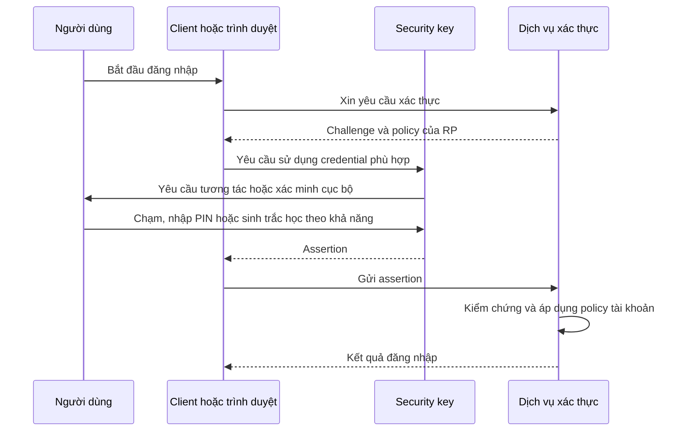

# Security key

## 1. Security key trong hệ thống IAM

**Security key**, hay khóa bảo mật, thường là một thiết bị xác thực bên ngoài mà người dùng mang theo và kết nối với máy tính hoặc điện thoại để đăng nhập. Trong bài này, trọng tâm là khóa hỗ trợ FIDO/WebAuthn, dùng credential khóa công khai để chứng minh quyền kiểm soát authenticator.

Người dùng có thể cắm khóa qua USB hoặc tương tác qua NFC, tùy thiết bị và nền tảng. Đường kết nối chỉ là phương tiện giao tiếp; điều tạo ra bằng chứng xác thực là giao thức và credential được sử dụng.

Ví dụ, cổng quản trị Harbor yêu cầu người dùng sử dụng khóa đã đăng ký khi đăng nhập. Việc cắm một thiết bị USB bất kỳ không đủ: Harbor phải kiểm chứng một phản hồi mật mã bằng public key đã gắn với đúng tài khoản.

Khóa bảo mật không phải ổ đĩa chứa một file “mật khẩu chung”. Trong luồng FIDO được thiết kế đúng, private key dùng để tạo bằng chứng xác thực được quản lý bởi authenticator; dịch vụ lưu public key và dữ liệu liên kết cần thiết để kiểm chứng.

## 2. Thiết bị, credential và tài khoản là các đối tượng khác nhau

| Đối tượng | Ý nghĩa trong ví dụ Harbor |
|---|---|
| Security key vật lý | Thiết bị mà người dùng kết nối hoặc chạm để sử dụng |
| Authenticator | Thành phần thực hiện thao tác xác thực và quản lý khóa |
| Credential của một dịch vụ | Dữ liệu khóa và định danh được thiết lập cho phạm vi dịch vụ đó |
| Credential ID | Định danh để dịch vụ tìm bản ghi credential phù hợp |
| Public key | Dữ liệu để server kiểm tra chữ ký |
| Private key | Dữ liệu bí mật mà authenticator sử dụng để tạo bằng chứng |
| Tài khoản | Danh tính nội bộ mà credential đã được liên kết |
| Relying Party, viết tắt RP | Dịch vụ dựa vào kết quả xác thực |

Một security key có thể phục vụ nhiều tài khoản hoặc nhiều dịch vụ theo khả năng của nó. Điều đó không có nghĩa mọi website nhận cùng một public key hoặc cùng một định danh người dùng toàn cầu.

Ngược lại, một tài khoản nên có khả năng đăng ký nhiều credential được phép, chẳng hạn từ khóa chính và khóa dự phòng. Khóa dự phòng cần được đăng ký với tài khoản; không phải cứ cùng hãng hoặc cùng hình dáng là thay được khóa đã mất.

Credential ID không phải bằng chứng sở hữu. Biết một ID chỉ giúp định vị bản ghi; người đăng nhập vẫn cần tạo phản hồi mật mã hợp lệ cho yêu cầu hiện tại.

## 3. FIDO, WebAuthn, passkey và những chế độ khác

### 3.1. Vai trò của WebAuthn và giao tiếp với khóa

Ở mức khái niệm, website sử dụng WebAuthn thông qua client như trình duyệt; client phối hợp với authenticator để tạo hoặc sử dụng public-key credential. Với khóa bên ngoài, giao tiếp client–authenticator có thể sử dụng các giao thức FIDO như CTAP.

Không nên viết ứng dụng web bằng cách trực tiếp đọc private key từ thiết bị. Tích hợp đúng nằm ở API và thư viện của giao thức, cùng phần kiểm chứng phía server.

Một thiết bị bán dưới tên “security key” có thể hỗ trợ nhiều chế độ. Cần xem cơ chế mà ứng dụng thực sự dùng:

| Chế độ | Bằng chứng cần được đánh giá |
|---|---|
| FIDO/WebAuthn | Public-key credential và phản hồi của ceremony WebAuthn |
| Thiết bị xuất một chuỗi OTP | Mã dùng một lần theo giao thức OTP tương ứng |
| Smart card hoặc PIV | Chứng thư, khóa và giao thức được triển khai |
| Khóa dùng cho SSH | Bằng chứng theo giao thức SSH và policy của máy chủ |

Một sản phẩm có hỗ trợ FIDO không làm mọi chế độ của nó tự có đặc tính FIDO. Đặc biệt, một chuỗi OTP được thiết bị gõ ra không tự được ràng buộc với website theo cách của WebAuthn.

### 3.2. Security key có phải passkey không?

Passkey là credential FIDO cho đăng nhập không dùng mật khẩu. Passkey có thể được đồng bộ giữa thiết bị hoặc gắn với một thiết bị; security key là một nơi có thể quản lý passkey gắn với thiết bị. [FIDO Alliance — Passkeys](https://fidoalliance.org/passkeys/).

Vì vậy, cần phân biệt thiết bị vật lý với credential nằm trên thiết bị. Không phải mọi authenticator đều là khóa USB, và không phải mọi cách đăng nhập bằng security key đều được cấu hình như một luồng passkey không cần username.

Khi chọn phương án cho hệ thống, hãy mô tả rõ yêu cầu về khả năng đồng bộ, khôi phục và bảo vệ khóa. Chỉ dùng từ “passkey” hoặc “hardware” chưa đủ để diễn đạt các yêu cầu đó.

## 4. Cơ chế đăng ký và sử dụng

### 4.1. Đăng ký là gắn một credential vào đúng tài khoản

Trước khi dùng khóa để đăng nhập, Harbor phải thiết lập mối liên kết tin cậy giữa tài khoản và credential mới. Đây là một thao tác nhạy cảm: nếu attacker thêm được khóa của họ vào tài khoản nạn nhân, những lần xác minh chữ ký sau vẫn có thể thành công.

Luồng khái niệm:

1. Người dùng đi qua điều kiện cho phép thêm authenticator của Harbor.
2. Server tạo yêu cầu đăng ký, có challenge và context phù hợp.
3. Client mời người dùng sử dụng security key.
4. Authenticator tạo credential cho phạm vi RP theo yêu cầu được hỗ trợ.
5. Server kiểm chứng kết quả bằng thư viện WebAuthn và policy đã chọn.
6. Server lưu public key cùng quan hệ sở hữu sau khi toàn bộ điều kiện đạt.

Challenge giúp liên kết kết quả với một yêu cầu do server tạo. Trong Harbor, challenge được sinh ngẫu nhiên, có hạn dùng và gắn với tài khoản, tenant, phiên thao tác cùng mục đích đăng ký.

Server không nhận một `accountId` tùy ý từ client rồi gắn credential mới vào tài khoản đó. Đối tượng được thay đổi phải đến từ context đã được cấp quyền.

### 4.2. Đăng nhập là trả lời một yêu cầu mới



Trong đăng nhập, server kiểm chứng assertion bằng public key đã đăng ký, thay vì hỏi người dùng gửi một bí mật cố định để server so sánh.

WebAuthn quy định kiểm tra challenge, origin, RP ID, các cờ cần thiết và chữ ký trong quá trình xác minh. Sử dụng thư viện thực hiện đầy đủ ceremony, không chỉ gọi một hàm kiểm tra chữ ký trên dữ liệu tự ghép. [W3C WebAuthn Level 2 — Verifying an Authentication Assertion](https://www.w3.org/TR/webauthn-2/#sctn-verifying-assertion).

Một assertion được chụp lại không phải credential dùng chung cho các lần đăng nhập. Harbor chỉ chấp nhận nó trong context challenge đang còn hiệu lực và chưa được tiêu thụ.

## 5. Chạm khóa khác với xác minh người dùng

Hai khái niệm quan trọng là:

- **User presence, UP:** có tương tác thể hiện người dùng hiện diện, chẳng hạn chạm khóa.
- **User verification, UV:** authenticator kiểm tra yếu tố cục bộ, chẳng hạn PIN hoặc sinh trắc học.

Chạm đơn thuần không chứng minh đã kiểm tra PIN hoặc vân tay. RP cần kiểm tra cờ UV khi policy yêu cầu; đặt `userVerification: "preferred"` không tương đương bắt buộc UV. [W3C WebAuthn Level 2 — User Verification](https://www.w3.org/TR/webauthn-2/#user-verification).

Xét các cấu hình:

| Cấu hình | Điều cần kết luận |
|---|---|
| Mật khẩu và khóa chỉ yêu cầu chạm | Có thể kết hợp knowledge với possession nếu hai cơ chế được kiểm chứng đúng |
| Chỉ có khóa và thao tác chạm | Không tự có thêm một yếu tố từ việc chạm |
| Khóa sử dụng PIN cục bộ và server bắt buộc UV | Có thể dùng multi-factor authenticator theo khả năng và hợp đồng đã xác minh |
| Khóa chỉ hỗ trợ chạm nhưng route yêu cầu UV | Phải từ chối hoặc hướng dẫn dùng authenticator đáp ứng policy |

PIN cục bộ được dùng để kích hoạt authenticator, không phải mật khẩu mà ứng dụng Harbor cần thu thập vào một form riêng. Giao diện hướng dẫn phải giúp người dùng phân biệt lời nhắc của nền tảng với yêu cầu nhập bí mật vào một website giả.

Sinh trắc học cục bộ không có nghĩa website đã nhận ảnh vân tay. Nó cũng không tự chứng minh danh tính pháp lý. Nếu nhiều người cùng biết PIN hoặc cùng được phép mở authenticator, việc quy hành động cho một con người riêng biệt còn phụ thuộc cách quản lý thiết bị.

Một lần UV thành công cũng không mặc nhiên chứng minh người dùng đã đọc và đồng ý từng chi tiết của một giao dịch tài chính. Xác thực đăng nhập và phê duyệt nội dung giao dịch cần được thiết kế theo yêu cầu riêng.

## 6. Vì sao có thể chống phishing tốt hơn OTP?

### 6.1. Bằng chứng gắn với bên nhận

Với mật khẩu hoặc OTP nhập trên trang giả, attacker có thể thu và chuyển tiếp dữ liệu sang trang thật. Một credential WebAuthn được sử dụng trong phạm vi RP và client kiểm soát tương tác với origin tương ứng.

NIST mô tả WebAuthn là ví dụ của cơ chế chống phishing bằng **verifier name binding**: bằng chứng xác thực được ràng buộc mật mã với định danh bên kiểm chứng. [NIST SP 800-63B-4 — Phishing Resistance](https://pages.nist.gov/800-63-4/sp800-63b.html#phishing).

Trong ví dụ Harbor, người dùng truy cập `login.harbor.example`. Một website nhìn giống nhưng nằm ở `harbor-login.attacker.example` không trở thành cùng RP chỉ vì sao chép logo và màu sắc.

Thiết kế phải giữ đúng quan hệ giữa domain, RP ID và origin. Một danh sách origin được mở rộng tùy tiện sẽ làm ranh giới tin cậy rộng hơn ý định ban đầu.

### 6.2. Những rủi ro vẫn còn

Security key không giải quyết mọi đường chiếm tài khoản:

| Rủi ro | Vì sao vẫn cần kiểm soát riêng |
|---|---|
| Mất khóa vật lý | Người khác có thể tiếp cận authenticator; mức bảo vệ phụ thuộc policy và khả năng khóa |
| Endpoint bị kiểm soát | Attacker có thể thao tác qua môi trường hợp lệ hoặc lấy phiên sau đăng nhập |
| Lỗ hổng tại origin hợp lệ | Mã độc trong ứng dụng có thể tác động tới luồng của chính ứng dụng |
| Cookie phiên bị lấy cắp | Một phiên đã được cấp có thể bị dùng lại theo khả năng bảo vệ phiên |
| Thêm khóa trái phép | Credential attacker có thể được gắn đúng về mặt kỹ thuật nhưng sai về quyền sở hữu |
| Recovery yếu | Đường dự phòng có thể bỏ qua lợi ích của security key |
| Phân quyền sai | Người dùng xác thực đúng vẫn có thể truy cập tài nguyên ngoài quyền |

Khả năng chống phishing của một luồng FIDO không được suy rộng sang toàn bộ hệ thống nếu hệ thống cho phép chuyển sang một đường đăng nhập yếu hơn mà không có kiểm soát phù hợp.

## 7. Attestation và mức tin cậy vào phần cứng

### 7.1. Cần biết điều gì về thiết bị?

Có hai câu hỏi khác nhau:

1. Credential hiện tại có tạo được bằng chứng xác thực hợp lệ không?
2. Credential có được tạo và bảo vệ bởi loại authenticator đáp ứng yêu cầu tổ chức không?

Một public key đăng ký thành công không tự trả lời toàn bộ câu hỏi thứ hai. Nếu doanh nghiệp yêu cầu thiết bị thuộc tập mẫu đã phê duyệt hoặc một mức bảo vệ phần cứng cụ thể, cần policy và bằng chứng thích hợp.

Attestation có thể phục vụ việc đánh giá nguồn gốc hoặc loại authenticator khi được hỗ trợ và kiểm chứng đúng. Không coi chuỗi mô tả thiết bị do client gửi là chứng nhận phần cứng.

Harbor có thể chọn policy không yêu cầu attestation cho người dùng thông thường, nhưng dùng một policy khác cho nhóm quản trị rủi ro cao. Nếu không có bằng chứng cần thiết, hệ thống không được tự gắn nhãn “khóa đã được chứng nhận” chỉ vì trình duyệt hiển thị biểu tượng USB.

### 7.2. Không nhầm các định danh

Credential ID dùng để định vị credential. AAGUID có thể giúp nhận biết loại authenticator, nhưng không phải định danh người dùng hay một số serial duy nhất của mọi khóa.

Tên do người dùng đặt như “Khóa ở nhà” chỉ là nhãn quản lý. Nó không có giá trị chứng minh thiết bị đang được dùng là khóa dự phòng, khóa được công ty cấp hay một mẫu phần cứng cụ thể.

Nếu dựa vào metadata hoặc attestation, người vận hành phải xác định nguồn tin cậy, cách cập nhật và cách xử lý khi một loại authenticator bị cảnh báo. Đây là một phần của policy vòng đời, không phải một lần kiểm tra rồi bỏ mặc.

## 8. Credential discoverable và trải nghiệm đăng nhập

Một số luồng yêu cầu người dùng khai username trước để server chọn credential được phép. Các luồng khác cho phép authenticator hỗ trợ tìm credential thích hợp trong quá trình đăng nhập, thường được gọi là sử dụng discoverable credential.

Khả năng tìm credential không thay thế quyền sở hữu tài khoản phía server. Harbor vẫn phải ánh xạ kết quả tới đúng bản ghi tài khoản và kiểm tra trạng thái của tài khoản đó.

Cũng không nên suy ra khóa hỗ trợ mọi loại đăng nhập chỉ từ việc nó hoạt động như yếu tố thứ hai ở một website. Khả năng discoverable credential, UV, số credential lưu được và giao tiếp với nền tảng là các đặc tính cần đánh giá riêng.

Một lỗi UX có thể làm người dùng tưởng khóa hỏng trong khi thực tế họ đang chọn sai phương thức, dùng một nền tảng không đáp ứng luồng hiện tại hoặc đã hết thời gian thao tác. Thông báo nên hướng dẫn bước tiếp theo mà không tự nới policy.

## 9. Thiết kế minh họa cho Harbor

### 9.1. Phạm vi và cấu hình

Harbor dùng một dịch vụ danh tính chung:

```yaml
relyingParty:
  id: "login.harbor.example"
  allowedOrigins:
    - "https://login.harbor.example"
adminAuthentication:
  requireUserVerification: true
  challengeLifetimeSeconds: 300
  allowPasswordOnlyFallback: false
```

Đây là cấu hình khái niệm do bài học chọn, không phải schema của một thư viện hoặc một yêu cầu thời hạn chung của WebAuthn.

Các tenant dùng chung dịch vụ danh tính nên không thể dựa riêng vào RP ID để tách tenant. Server phải giữ quan hệ tenant, tài khoản và credential trong dữ liệu và context của yêu cầu.

Bản ghi tối thiểu của Harbor có thể gồm:

```text
RegisteredCredential
  credential_id
  account_id
  tenant_id
  public_key
  algorithm
  state
  created_at
  last_used_at
  metadata_required_by_validation_library
```

Server không lấy `account_id` hoặc `tenant_id` từ response client làm kết luận sở hữu. Nó đối chiếu với bản ghi đã được thiết lập.

### 9.2. Đăng ký khóa mới

Harbor chỉ cho thêm khóa khi có context cho phép thao tác quản lý authenticator. Đối với tài khoản đã có MFA, một cookie phiên đang mở không tự đủ để đăng ký thêm khóa của bất kỳ ai.

Quy trình có thể là xác thực lại bằng phương thức hiện có theo policy, hoặc dùng quy trình onboarding hay recovery đã được phê duyệt. Việc cấp quyền đăng ký khóa đầu tiên phải được mô tả riêng; không giả vờ rằng tài khoản chưa có authenticator đã đi qua kiểm tra bằng authenticator đó.

Sau khi kiểm chứng đăng ký, Harbor lưu credential và phát thông báo về thay đổi. Nếu policy cần kiểm tra sử dụng ngay, hệ thống có thể yêu cầu một lần xác thực riêng bằng credential mới trước khi hoàn tất quy trình của ứng dụng.

Các bước cuối phải kiểm tra lại trạng thái tài khoản và context. Nếu tài khoản vừa bị vô hiệu hóa, một response đăng ký còn đúng về mặt mật mã không được dùng để kích hoạt quyền truy cập.

### 9.3. Kiểm chứng đăng nhập

Pseudocode sau thể hiện ranh giới trách nhiệm, không phải API triển khai sẵn:

```text
authenticate(assertion, flowReference):
    flow = loadServerManagedAuthenticationFlow(flowReference)
    require flow is active and not expired

    credential = findCredentialInAllowedAccountAndTenantContext(
        assertion.credentialId,
        flow
    )
    require credential is ACTIVE

    result = webauthnLibrary.verifyAuthentication(
        assertion,
        credential.publicKey,
        flow.expectedChallenge,
        configuredRpId,
        configuredAllowedOrigins,
        flow.validationPolicy
    )

    require result satisfies required user verification and other policy
    require account and credential remain enabled at completion

    atomically consume flow and persist authentication outcome
    create session with the assurance context actually established
```

Trong triển khai thực tế, thư viện còn cần các metadata và kiểm tra đầy đủ của profile sử dụng. Không hiểu chữ ký đúng là điều kiện thay thế các bước còn lại.

Nếu có dữ liệu counter, hãy xử lý theo đặc tính authenticator và thư viện. Không giả định mọi credential đều có counter luôn tăng, hoặc một giá trị counter đơn lẻ đủ chứng minh khóa đã bị sao chép. Các request đồng thời và policy xử lý bất thường cũng cần được xét.

Phiên được cấp phải phản ánh bằng chứng đã thiết lập. Một principal có session hợp lệ vẫn cần được kiểm tra vai trò, tenant và quyền đối với từng tài nguyên.

## 10. Vòng đời: dự phòng, mất khóa và thu hồi

### 10.1. Chuẩn bị trước khi mất quyền truy cập

Khóa dự phòng hữu ích khi đã được đăng ký và được bảo quản theo cách giảm khả năng mất cùng khóa chính. Để hai khóa trên cùng một móc rồi làm mất cả móc không giải quyết tốt rủi ro mất thiết bị.

Mỗi khóa tạo credential phù hợp của nó; không cần sao chép private key của khóa chính sang khóa dự phòng. Hệ thống cần giao diện để người dùng nhận biết những credential đang được phép và thời điểm sử dụng gần đây ở mức phù hợp.

### 10.2. Khi một khóa bị mất

Quy trình mẫu của Harbor:

1. Xác định những credential liên quan tới khóa bị báo mất trong phạm vi dịch vụ.
2. Xác thực người yêu cầu bằng phương thức còn hợp lệ hoặc recovery đúng policy.
3. Vô hiệu credential của khóa bị mất.
4. Đăng ký phương thức thay thế nếu được phép.
5. Xử lý các phiên, token và dấu hiệu sự cố theo policy riêng.
6. Thông báo và lưu dấu vết thay đổi.

Khóa được dùng tại nhiều dịch vụ có thể cần được xử lý riêng ở từng nơi. Vô hiệu credential ở Harbor không tự xóa credential ở một dịch vụ khác.

Server không cần sở hữu private key để thu hồi quyền sử dụng credential. Nó chặn credential trong quá trình kiểm chứng. Nếu có cache trạng thái, cần công bố và kiểm soát độ trễ áp dụng lệnh vô hiệu trên mọi node.

### 10.3. Khi không còn authenticator nào

Recovery phải được thiết kế trước. OWASP nhấn mạnh việc mất yếu tố và thay đổi MFA là các tình huống quan trọng cần xử lý có kiểm soát. [OWASP Multifactor Authentication Cheat Sheet — Resetting MFA](https://cheatsheetseries.owasp.org/cheatsheets/Multifactor_Authentication_Cheat_Sheet.html#resetting-mfa).

Không biến ticket hỗ trợ thành nút “bỏ MFA” chỉ dựa vào tên hoặc email do người yêu cầu đọc. Một tài khoản có yêu cầu bảo vệ cao cần đường recovery tương ứng.

Nếu khóa bị reset hoặc dữ liệu credential trên khóa bị xóa, public key lưu ở server không tạo lại private key đã mất. Khả năng reset, xóa hoặc quản lý credential phụ thuộc thiết bị và công cụ; không có một thao tác phục hồi giống nhau cho mọi security key.

Thu hồi credential cũng không tự kết thúc mọi phiên đã tạo trước đó. Hai tác động này cần được liên kết bằng policy và cơ chế thực thi rõ ràng.

## 11. Kiểm tra một tích hợp security key

Ma trận dưới đây là gợi ý thiết kế kiểm thử cho Harbor:

| Tình huống | Điều cần chứng minh |
|---|---|
| Khóa đã đăng ký, response hợp lệ và đúng policy | Tạo phiên cho đúng tài khoản |
| Credential ID đúng nhưng phản hồi không có chữ ký hợp lệ | Không tạo phiên |
| Assertion từ challenge cũ hoặc đã dùng | Không vượt kiểm tra context |
| Challenge đúng nhưng của một luồng hoặc tài khoản khác | Không chuyển kết quả xác thực giữa các context |
| Origin không nằm trong danh sách cho phép | Bị từ chối |
| RP ID không phù hợp | Bị từ chối |
| Có UP nhưng không có UV ở route yêu cầu UV | Không hạ yêu cầu để đăng nhập |
| Credential đã bị vô hiệu trên một node khác | Bị chặn theo giới hạn lan truyền đã công bố |
| Tài khoản bị khóa giữa lúc tạo challenge và hoàn tất | Không tạo phiên mới |
| Khóa không đáp ứng khả năng mà luồng yêu cầu | Hướng dẫn phương thức phù hợp, giữ nguyên policy |
| Recovery không có đủ bằng chứng | Không tự cho phép đăng ký khóa thay thế |
| Phiên có sẵn sau khi thu hồi credential | Hành vi khớp chính sách thu hồi phiên riêng |

Dùng trường hợp thành công làm đối chứng. Nếu mọi response đều thất bại vì cấu hình RP ID sai, chưa thể kết luận các kiểm tra tấn công đã hoạt động đúng.

Các kiểm thử logic có thể dùng authenticator thử nghiệm. Khả năng hoạt động với USB, NFC, PIN, trình duyệt và thiết bị thật cần một đợt kiểm tra tích hợp phù hợp với môi trường triển khai.

Dữ liệu log nên ghi mã tương quan, kết quả và phiên bản policy cần cho điều tra. Không ghi PIN, toàn bộ response nhạy cảm hoặc dữ liệu cá nhân không cần thiết để thuận tiện gỡ lỗi.

## 12. Những hiểu lầm cần tránh

**“Cứ cắm khóa vào là chứng minh được chủ tài khoản.”** Không. Server phải kiểm chứng bằng chứng từ credential đã liên kết đúng; policy có thể yêu cầu thêm UV.

**“Chạm khóa nghĩa là đã xác minh vân tay.”** Không. Chạm có thể chỉ thể hiện user presence.

**“Khóa bảo mật luôn làm mọi đường đăng nhập chống phishing.”** Không. Cần xem giao thức đang dùng, cấu hình bên kiểm chứng và các đường fallback, recovery.

**“Public key bị lộ thì attacker đăng nhập được.”** Public key được dùng để kiểm chứng, không thay thế private key. Tuy vậy, cơ sở dữ liệu bị sửa để gắn public key của attacker là một rủi ro khác cần bảo vệ.

**“Khóa vật lý bị mất thì không còn cách thu hồi.”** Server có thể vô hiệu credential mà không cần cầm lại thiết bị.

**“Đã dùng security key thì bỏ kiểm tra quyền.”** Xác thực mạnh hơn không thay authorization. Người dùng vẫn chỉ được thực hiện hành động trong phạm vi được cấp.

Security key có giá trị khi toàn bộ vòng đời credential được quản lý đúng: gắn khóa với đúng tài khoản, kiểm chứng đúng ceremony, thực thi yêu cầu của từng luồng và xử lý mất khóa bằng một đường recovery có kiểm soát.
