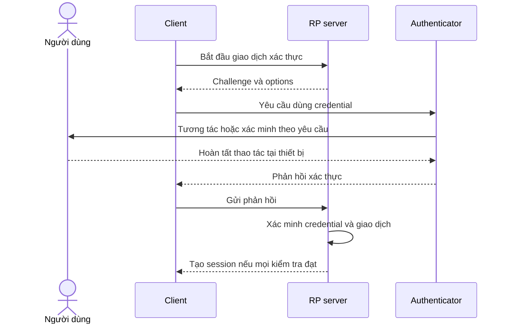

# Passkey

Passkey là credential FIDO dùng cặp khóa mật mã để đăng nhập không cần mật khẩu. Credential có thể gắn thiết bị hoặc được đồng bộ. [FIDO Alliance: Passkeys](https://fidoalliance.org/passkeys/).

Đối với IAM, giá trị của passkey không chỉ nằm ở trải nghiệm đăng nhập. Nó thay đổi dữ liệu mà dịch vụ phải giữ, cách credential được liên kết với tài khoản và cách quản lý đăng ký, thu hồi, dự phòng, khôi phục. Một nút “Đăng nhập bằng passkey” chỉ là phần giao diện của cả vòng đời đó.

## 1. Passkey không phải mật khẩu dài hơn

Với mật khẩu, người dùng cung cấp một bí mật để dịch vụ xác minh. Nếu bí mật bị lấy qua trang giả hoặc bị dùng lại giữa nhiều dịch vụ, tài khoản có thể gặp rủi ro. OTP bổ sung một bằng chứng khác, nhưng mã nhập thủ công vẫn có thể bị chuyển tiếp khi còn hiệu lực.

Với passkey, thao tác đăng nhập không yêu cầu người dùng tiết lộ khóa riêng cho dịch vụ. Một thử thách mới được dùng trong mỗi giao dịch; authenticator tạo phản hồi để dịch vụ kiểm tra bằng khóa công khai đã liên kết với tài khoản. Cách xác minh phía server được mô tả trong [hướng dẫn xác thực passkey của Google](https://developers.google.com/identity/passkeys/developer-guides/server-authentication).

Điều cần thay đổi trong tư duy thiết kế là: dịch vụ không hỏi “người dùng vừa nhập đúng bí mật chưa?”, mà hỏi “phản hồi này có hợp lệ cho credential, dịch vụ và giao dịch mà mình đang xác minh không?”. Credential ID chỉ giúp tìm hồ sơ; có đúng ID không đồng nghĩa đã chứng minh được quyền sử dụng credential.

Passkey cũng không phải API key hoặc bearer token. Một session được tạo sau xác thực có thể sử dụng cookie hay token, nhưng đó là lớp khác. Không dùng tên “passkey” để chỉ mọi chuỗi bí mật giúp gọi API.

## 2. Các thành phần trong luồng passkey

Trong ứng dụng web, các vai trò thường được nhìn nhận như sau:

| Thành phần | Trách nhiệm trong kiến trúc |
|---|---|
| Người dùng | Chọn tài khoản và thực hiện tương tác xác thực được yêu cầu |
| Ứng dụng phía client | Nhận options từ server, gọi API của nền tảng và gửi phản hồi về server |
| Trình duyệt hoặc nền tảng | Điều phối thao tác với authenticator |
| Authenticator hoặc passkey provider | Tạo, giữ và sử dụng credential theo khả năng của cơ chế |
| Relying Party, gọi tắt là RP | Dịch vụ đăng ký credential và xác minh lần đăng nhập |
| Kho tài khoản và credential | Lưu liên kết với chủ thể cùng dữ liệu xác minh và trạng thái quản lý |

Trên web, WebAuthn cung cấp API cho việc tạo và sử dụng credential khóa công khai; phía client dùng `navigator.credentials.create()` khi đăng ký và `navigator.credentials.get()` khi xác thực. Cả hai thao tác vẫn cần phía server xử lý kết quả. [Google: tạo passkey](https://web.dev/articles/passkey-registration).

Đối với người xây hệ thống, bảng trên là cách phân công trách nhiệm. Frontend không được tự kết luận đăng nhập thành công chỉ vì một hộp thoại đã đóng. Kho credential không được tự coi một khóa công khai mới gửi lên là đã thuộc về đúng tài khoản. Mỗi lớp phải trả kết quả cho bước xác minh có thẩm quyền.

## 3. Khóa, credential ID và user handle

Một hồ sơ passkey ở phía dịch vụ cần liên kết được credential với tài khoản. Hướng dẫn đăng ký phía server nêu việc lưu credential ID, khóa công khai và dữ liệu liên quan sau khi xác minh; đồng thời kiểm tra credential ID chưa bị đăng ký cho người dùng khác. [Google: đăng ký passkey phía server](https://developers.google.com/identity/passkeys/developer-guides/server-registration).

Mô hình dữ liệu khái niệm cho ứng dụng IAM:

```text
PasskeyRecord
  internalId
  rpId
  credentialId
  accountId
  userHandle
  publicKey
  algorithm
  status
  createdAt
  lastUsedAt
  revokedAt
  userProvidedLabel
  verificationMetadata
```

Đây là mô hình thiết kế, không phải schema đầy đủ của giao thức. Thư viện xác minh có thể cần thêm dữ liệu, và cách mã hóa khóa công khai phải nhất quán với thư viện được sử dụng.

`accountId` là định danh tài khoản trong hệ thống. `userHandle` dùng cho liên kết tài khoản trong luồng xác thực; nên được thiết kế như định danh ổn định, không phụ thuộc việc người dùng đổi email. `credentialId` xác định credential. `userProvidedLabel`, chẳng hạn “Khóa dự phòng”, chỉ phục vụ hiển thị, không có giá trị chứng minh loại phần cứng hay độ tin cậy.

Trong thiết kế của bài học, đặt ràng buộc duy nhất phù hợp với RP và credential ID tại tầng dữ liệu, tránh hai request đồng thời liên kết cùng một credential với các tài khoản khác nhau. Không dùng một kiểm tra ở frontend để thay thế ràng buộc nhất quán phía server.

Không lưu khóa riêng của người dùng trong cơ sở dữ liệu credential của RP. Nếu một luồng yêu cầu người dùng gửi khóa riêng để “kích hoạt passkey”, cần xem lại mô hình: đó không phải trách nhiệm thông thường của RP trong kiến trúc này.

## 4. Đăng ký passkey là một thao tác bảo mật

Đăng ký tạo ra một phương thức có thể đăng nhập vào tài khoản. Vì vậy, người đang có một phiên bị chiếm đoạt không được dễ dàng gắn credential của họ rồi duy trì quyền truy cập lâu dài.

Với một tài khoản đã tồn tại, thiết kế nên yêu cầu mức xác thực phù hợp trước khi cho thêm passkey, liên kết giao dịch đăng ký với đúng phiên và tài khoản, rồi thông báo thay đổi sau khi hoàn tất. Những biện pháp này bảo vệ quá trình gắn credential với chủ thể, ngoài phần xác minh mật mã.

Luồng đăng ký ở mức khái niệm:

1. Server xác định tài khoản và tạo giao dịch đăng ký có thời hạn.
2. Server tạo challenge cùng các lựa chọn phù hợp với chính sách.
3. Client yêu cầu nền tảng tạo credential.
4. Client gửi kết quả về đúng giao dịch đang chờ.
5. Server xác minh phản hồi theo giao thức và chính sách đã chọn.
6. Server lưu credential vào đúng tài khoản, tiêu thụ giao dịch và ghi sự kiện quản lý.

Hướng dẫn đăng ký của Google tách rõ việc tạo credential ở client và việc server xác minh trước khi lưu. Việc promise phía client trả về thành công chưa thay thế bước xác minh tại RP. [Google: luồng tạo passkey](https://web.dev/articles/passkey-registration).

Trong một thiết kế nhiều tenant, cần phân biệt tài khoản toàn ứng dụng với tư cách thành viên tenant. Nếu cùng một tài khoản tham gia A và B, thêm passkey cho tài khoản không tự cấp role tại B. Nếu hệ thống dùng các tài khoản độc lập theo tenant, giao dịch đăng ký phải mang đủ ngữ cảnh để không gắn nhầm credential sang tài khoản cùng email ở nơi khác.

Với người dùng mới, cần giải quyết riêng cách tạo và xác minh tài khoản ban đầu. Passkey giúp chứng minh khả năng sử dụng credential sau khi đã liên kết; nó không tự chứng minh danh tính pháp lý hoặc quyền sở hữu một địa chỉ email.

## 5. Xác thực bằng passkey

Một luồng đăng nhập có thể bắt đầu từ username hoặc cho người dùng chọn credential sẵn có. Với credential có thể được khám phá bởi nền tảng, người dùng có thể chọn tài khoản mà không cần gõ username trước; server vẫn phải xác minh quan hệ giữa credential và tài khoản được nhận diện. [Google: xác thực passkey phía server](https://developers.google.com/identity/passkeys/developer-guides/server-authentication).

Luồng tổng quát:



Tại server, những kiểm tra cốt lõi gồm loại thao tác, challenge, origin, RP ID hash, cờ hiện diện hoặc xác minh người dùng theo yêu cầu, quan hệ tài khoản–credential và chữ ký. Đây là các bước trong [WebAuthn, phần xác minh assertion](https://www.w3.org/TR/webauthn-3/#sctn-verifying-assertion).

Ngoài kiểm tra giao thức, ứng dụng cần chặn credential đã thu hồi, tài khoản đã khóa và giao dịch hết hạn. Trạng thái challenge phải chống sử dụng thành công lặp lại, kể cả hai request chạy đồng thời. Đó là trách nhiệm quản lý trạng thái của hệ thống, không được suy ra chỉ từ việc chữ ký hợp lệ.

Khi một tài khoản đã được chọn trước, phản hồi của tài khoản khác không được dùng để nâng mức xác thực cho phiên hiện tại. Ví dụ đang xác thực lại cho phiên của An thì passkey hợp lệ của Bình phải bị từ chối trong giao dịch đó, thay vì được coi là “có ai đó xác thực thành công”.

## 6. Ràng buộc dịch vụ và khả năng chống phishing

Passkey được thiết kế cho xác thực chống phishing thông qua cơ chế ràng buộc với RP. Một trang giả không thể đơn giản yêu cầu người dùng đọc rồi gửi một mã có thể dùng lại tại dịch vụ thật như cách dụ nhập OTP. [FIDO Alliance: Passkeys](https://fidoalliance.org/passkeys/).

RP ID và origin có vai trò khác nhau trong việc xác minh; WebAuthn yêu cầu đối chiếu chúng với giá trị RP mong đợi. [WebAuthn: xác minh assertion](https://www.w3.org/TR/webauthn-3/#sctn-verifying-assertion).

Trong ví dụ thiết kế, hệ thống đăng nhập đặt tại `https://iam.example.com`. Nhóm phát triển lưu cấu hình RP và origin được chấp nhận ở server. Khi nhận request, server không lấy một origin tùy ý từ body rồi dùng chính nó làm giá trị kỳ vọng. Cũng không cho phép mọi hostname chỉ vì chúng có chữ “example” trong chuỗi.

Điểm quan trọng là không đánh tráo khả năng chống phishing với khả năng chống mọi kiểu chiếm tài khoản. Nếu kẻ tấn công kiểm soát thiết bị, chiếm session sau đăng nhập, thêm credential qua luồng khôi phục yếu hoặc khai thác ứng dụng, họ có thể đi theo đường khác. Thiết kế cần nêu rõ passkey bảo vệ bước xác thực nào và các bước còn lại dựa vào kiểm soát gì.

Không tự viết một giao thức “ký challenge bằng khóa riêng” rồi mặc nhiên gọi nó là passkey với đầy đủ đặc tính WebAuthn. Chữ ký là một thành phần; cách ràng buộc và xác minh ngữ cảnh mới làm nên kết quả bảo mật của toàn luồng.

## 7. User presence, user verification và MFA

User presence và user verification là hai khái niệm riêng. Một tương tác hiện diện không tự chứng minh authenticator đã kiểm tra PIN hoặc sinh trắc. Với chính sách yêu cầu xác minh người dùng, RP cần yêu cầu và kiểm tra kết quả tương ứng; chỉ đặt nhãn “passkey” trên màn hình không đủ. [passkeys.dev: user verification](https://passkeys.dev/docs/use-cases/bootstrapping/#a-note-about-user-verification).

Trong thiết kế quản trị của bài học, chọn chính sách yêu cầu user verification cho đăng nhập và xác thực lại trước hành động nhạy cảm. Đây là lựa chọn của hệ thống minh họa. Cấu hình client cần phù hợp, nhưng quyết định cuối cùng vẫn nằm ở server: không chấp nhận client tự gửi `verified: true` như bằng chứng.

PIN hoặc sinh trắc tại thiết bị không phải mật khẩu của website. Người xây giao diện không được tạo một form trong website để yêu cầu nhập PIN mở khóa thiết bị rồi chuyển nó tới backend. Người dùng cần được hướng dẫn tương tác với giao diện do nền tảng cung cấp.

Tương tự, không nên đếm số màn hình để kết luận MFA. Một trải nghiệm chỉ có một hộp thoại có thể bao gồm sử dụng credential và xác minh tại authenticator; nhiều hộp thoại cũng có thể chỉ kiểm tra lặp lại cùng một loại bí mật. Khi đánh giá chính sách, hãy hỏi những điều kiện nào được thực thi và bằng chứng nào RP thực sự kiểm tra.

## 8. Passkey đồng bộ và passkey gắn thiết bị

FIDO phân biệt passkey được đồng bộ qua dịch vụ quản lý với passkey gắn thiết bị. Hai loại có chung cách sử dụng credential để đăng nhập nhưng khác mô hình lưu giữ và tính sẵn có khi người dùng đổi thiết bị. [FIDO Alliance: các loại passkey](https://fidoalliance.org/passkeys/).

Để xây chính sách IAM, có thể so sánh các câu hỏi vận hành:

| Câu hỏi | Passkey có thể đồng bộ | Passkey gắn thiết bị |
|---|---|---|
| Khi đổi máy, cần xác minh điều gì? | Quy trình khôi phục và đưa credential tới máy mới của provider | Người dùng còn authenticator cũ hoặc phương thức dự phòng không |
| Khi mất một máy, cần xử lý gì? | Xem cả máy bị mất, tài khoản provider và các phiên dịch vụ | Xem credential trên authenticator bị mất và khả năng dùng dự phòng |
| Có thể coi lần đăng nhập là từ đúng một máy vật lý không? | Không nên suy như vậy chỉ từ credential | Cần bằng chứng phù hợp trước khi đưa ra kết luận về thiết bị |
| Thu hồi ở RP cần nhắm tới gì? | Credential mà RP chấp nhận, kể cả khi có nhiều bản sao | Credential tương ứng với thiết bị cần thu hồi |

Bảng này là khung câu hỏi thiết kế, không phải cam kết về mọi sản phẩm. Không suy từ tên hệ điều hành hoặc nhãn “điện thoại” rằng khóa chắc chắn không thể đồng bộ. Cũng không suy rằng một credential không có dấu hiệu đã backup là bằng chứng đủ về phần cứng không xuất khóa.

Nếu tổ chức cần bảo đảm về loại authenticator, cần chính sách attestation và đánh giá bằng chứng phù hợp. WebAuthn tách việc xác minh credential khỏi quyết định tin cậy vào thuộc tính authenticator. [WebAuthn: đăng ký credential](https://www.w3.org/TR/webauthn-3/#sctn-registering-a-new-credential).

Về kiến trúc, điều này dẫn đến hai công việc riêng: kiểm tra một phản hồi xác thực có hợp lệ không, và đánh giá authenticator đó có đáp ứng yêu cầu của môi trường không. Không để một chuỗi mô tả do người dùng nhập thay thế công việc thứ hai.

## 9. Đăng nhập chéo thiết bị không đồng nghĩa sao chép passkey

Người dùng có thể dùng authenticator ở thiết bị khác để đăng nhập tại máy đang mở dịch vụ. Trong luồng cross-device authentication, credential ở một thiết bị được dùng cho giao dịch xác thực trên thiết bị còn lại. Điều đó khác với việc đồng bộ credential vào kho lưu trữ của máy mới. [FIDO Alliance: cross-device authentication](https://fidoalliance.org/passkeys/).

Ví dụ, An mở dịch vụ trên laptop và dùng điện thoại để hoàn tất xác thực. Từ góc nhìn quản lý tài khoản, không nên tự tạo một hồ sơ “passkey mới trên laptop” chỉ vì laptop vừa có session. Nếu muốn đăng ký thêm passkey trên laptop, đó phải là một giao dịch đăng ký riêng với thông tin cho người dùng.

Thiết kế cũng cần cảnh báo phù hợp với máy dùng chung. Đăng nhập xong trên một máy mượn không có nghĩa nên lưu thêm credential trên máy đó. Giao diện đăng ký nên nêu rõ hành động nào đang được thực hiện và cho phép người dùng bỏ qua.

Không coi mọi mã QR có chữ “passkey” là đáng tin cậy. Người dùng vẫn cần đi từ dịch vụ đúng, và ứng dụng phải sử dụng luồng nền tảng phù hợp. Tự xây một luồng quét QR rồi gửi cookie phiên sang nơi khác không tự có đặc tính bảo mật của cơ chế cross-device chuẩn.

## 10. Mô hình quản lý vòng đời trong IAM

Một tài khoản nên có danh sách credential quản lý được, thay vì một cờ duy nhất `hasPasskey`. Cờ đó không cho biết credential nào đã bị mất, credential nào được thêm trái phép hoặc credential nào đang cần thu hồi.

Các thao tác quản lý quan trọng:

- Liệt kê credential với nhãn, thời điểm tạo, lần dùng gần nhất và trạng thái phù hợp.
- Thêm credential sau khi thỏa điều kiện xác thực và chính sách tài khoản.
- Đổi nhãn hiển thị mà không đổi liên kết tài khoản–credential.
- Thu hồi một credential cụ thể tại RP.
- Ghi lại sự kiện thêm, thu hồi và các trường hợp xác thực thất bại cần theo dõi.
- Cung cấp quy trình dự phòng và khôi phục có trách nhiệm rõ ràng.

Trước khi cho xóa credential cuối cùng, hệ thống cần giải quyết khả năng tiếp tục truy cập. Có thể yêu cầu người dùng thiết lập một phương thức thay thế phù hợp hoặc đi qua luồng quản lý tài khoản đã định nghĩa. Không để một thao tác vô tình biến việc khôi phục thành cuộc trao đổi không có tiêu chí với nhân viên hỗ trợ.

Thu hồi ở RP và xóa khỏi passkey provider là hai việc khác nhau về quyền quản lý. Trong thiết kế của bài học, RP đặt credential sang trạng thái không được chấp nhận và lưu bằng chứng. Nó không tuyên bố đã xóa mọi bản sao trong các kho mà RP không kiểm soát.

Việc bảo vệ tài khoản provider, máy dùng chung và các authenticator dự phòng cần được đưa vào hướng dẫn người dùng. Một dự phòng bị bỏ quên hoặc được người khác kiểm soát vẫn có thể là đường truy cập vào tài khoản.

## 11. Khôi phục và di chuyển phương thức đăng nhập

Passkey không làm biến mất nhu cầu khôi phục. Người dùng có thể mất authenticator, mất quyền truy cập provider hoặc không còn thiết bị tương thích. Tổ chức cần chọn cách xác minh người yêu cầu trước khi cho tạo credential mới.

Các câu hỏi cần trả lời trong chính sách:

1. Người dùng có thể đăng ký credential dự phòng độc lập không?
2. Khi không còn credential dùng được, bằng chứng khôi phục nào được chấp nhận?
3. Ai được duyệt hỗ trợ và làm sao ngăn tự ý bỏ qua điều kiện?
4. Có cần thời gian chờ, thông báo hoặc hạn chế hành động sau khôi phục không?
5. Credential cũ và session hiện hành được xử lý thế nào?

Trong giai đoạn chuyển từ mật khẩu, có thể còn nhiều đường đăng nhập. Nếu đường mật khẩu hoặc khôi phục vẫn cho phép chiếm tài khoản với điều kiện yếu hơn, chỉ thêm passkey chưa giải quyết đường đó. Cần đánh giá toàn bộ các cách lấy một session hợp lệ, không chỉ cách được quảng bá là mặc định.

Về trải nghiệm, một giao diện có thể kết hợp lựa chọn passkey và mật khẩu trong quá trình chuyển đổi. Conditional UI là một cách đưa passkey vào gợi ý đăng nhập của trình duyệt. [Google: đăng nhập bằng passkey qua autofill](https://web.dev/articles/passkey-form-autofill).

Người thiết kế cần tránh vừa quảng bá “không cần mật khẩu” vừa yêu cầu người dùng phải nhớ một mật khẩu cũ để thực hiện mọi bước dự phòng mà không giải thích. Lựa chọn đường khôi phục là quyết định riêng về khả năng sử dụng và rủi ro, cần được mô tả rõ.

## 12. Phiên, xác thực lại và quyền truy cập

Sau khi passkey được xác minh, hệ thống thường tạo session. Từ thời điểm đó, cơ chế bảo vệ cookie hoặc token, thời hạn, đăng xuất và thu hồi quyết định khả năng tiếp tục truy cập.

Nếu một kẻ tấn công chiếm được bearer token đang được chấp nhận, họ có thể không cần thực hiện lại passkey cho từng request. Vì vậy không được coi mọi yêu cầu trong một session là có một chữ ký passkey mới.

Passkey có thể được dùng để xác thực lại trước hành động nhạy cảm. Luồng đó phải gắn với tài khoản đang thao tác, thay vì cho phép xác thực thành công bằng bất kỳ tài khoản nào. [passkeys.dev: reauthentication](https://passkeys.dev/docs/use-cases/reauth/).

Trong ví dụ quản trị tenant, server có thể yêu cầu một lần xác thực gần đây trước khi đổi role, rồi kiểm tra permission hiện tại trên đúng tenant. Một lần passkey thành công không cấp thêm role, không bỏ qua trạng thái đình chỉ và không chứng minh người dùng được phép tác động tài khoản khác.

Khi credential được báo mất hoặc bị thu hồi, chính sách cần xác định có chấm dứt các session liên quan hay không và thực hiện qua cơ chế tương ứng. Đổi trạng thái credential không tự làm một token đã phát hành mất hiệu lực ở mọi hệ thống.

## 13. Các lỗi triển khai cần nhận diện

| Lỗi | Hệ quả trong mô hình xác thực |
|---|---|
| Tin kết quả thành công của client | Bỏ mất bước xác minh có thẩm quyền |
| Chấp nhận credential ID như một bí mật | Người biết ID có thể giả mạo nếu không cần bằng chứng mật mã |
| Gắn credential theo email tùy ý trong body | Có nguy cơ liên kết sang tài khoản không được phép |
| Dùng challenge cố định hoặc không quản lý trạng thái | Không bảo vệ đúng từng giao dịch xác thực |
| Lấy RP hoặc origin kỳ vọng từ request không tin cậy | Tự làm yếu kiểm tra ràng buộc dịch vụ |
| Bỏ yêu cầu xác minh người dùng ở server | Không thực thi chính sách đã công bố |
| Chỉ lưu một cờ tài khoản có passkey | Khó quản lý thêm, mất, thu hồi và điều tra từng credential |
| Thu hồi credential nhưng bỏ qua session | Có thể để đường truy cập đã được thiết lập tiếp tục hoạt động |
| Cho khôi phục dễ hơn nhiều so với đăng nhập | Tạo đường vòng để thay credential |
| Coi passkey là bằng chứng quyền quản trị | Trộn xác thực với phân quyền |

Một lưu ý kỹ thuật khác là bộ đếm chữ ký: WebAuthn xem bất thường bộ đếm là tín hiệu có thể cần đánh giá, không phải bằng chứng duy nhất về sao chép authenticator. [WebAuthn: kiểm tra bộ đếm trong assertion](https://www.w3.org/TR/webauthn-3/#sctn-verifying-assertion).

Khi triển khai thực tế, dùng thư viện xác minh phù hợp và cấu hình theo chính sách; ứng dụng vẫn chịu trách nhiệm về liên kết tài khoản, giao dịch, trạng thái thu hồi và session. Đoạn mã gọi một hàm verify không thay thế việc hiểu các đầu vào tin cậy mà hàm đó cần.

## 14. Bài tập áp dụng

Thiết kế đăng nhập cho một cổng quản trị có tài khoản tham gia nhiều tenant. Một tài khoản được đăng ký nhiều passkey, có thể thu hồi riêng từng credential và phải xác thực lại trước khi thay đổi quyền.

Các đầu ra cần tạo:

1. Luồng đăng ký, chỉ rõ cách xác định tài khoản và bảo vệ việc thêm credential.
2. Luồng đăng nhập từ username và từ lựa chọn credential, chỉ rõ bước xác định chủ thể.
3. Mô hình credential với trạng thái quản lý và ràng buộc dữ liệu.
4. Chính sách user verification, session, thu hồi và khôi phục.
5. Bộ kiểm thử với trạng thái dữ liệu và kết quả mong đợi.

Các ca kiểm thử tối thiểu:

| Tình huống | Kết quả cần chứng minh |
|---|---|
| Đăng ký hợp lệ cho tài khoản đang được xác thực | Credential gắn đúng tài khoản và chỉ kích hoạt sau xác minh |
| Gửi cùng credential để gắn vào tài khoản khác | Bị chặn bởi kiểm tra liên kết và ràng buộc dữ liệu |
| Đăng nhập với phản hồi hợp lệ | Tạo session cho đúng chủ thể |
| Gửi lại phản hồi đã dùng thành công | Không tạo thêm phiên xác thực từ giao dịch đã tiêu thụ |
| Hai request đồng thời dùng cùng giao dịch | Chỉ một kết quả được chấp nhận theo trạng thái giao dịch |
| Origin hoặc RP không khớp cấu hình | Bị từ chối |
| Không đáp ứng user verification bắt buộc | Bị từ chối theo chính sách |
| Xác thực lại cho An bằng credential của Bình | Không nâng mức tin cậy cho session của An |
| Credential đã thu hồi hoặc tài khoản đã khóa | Không đăng nhập mới được |
| Người dùng chỉ có role ở tenant A | Không được thao tác tenant B dù đăng nhập mạnh |
| Credential bị mất nhưng session cũ còn | Hành vi phù hợp với chính sách thu hồi phiên đã chọn |
| Không còn credential sử dụng được | Chỉ khôi phục qua quy trình đã định nghĩa, có dấu vết |

Nghiệm thu khi người học giải thích được ba liên kết: credential với chủ thể, phản hồi với đúng giao dịch và kết quả xác thực với session. Sau đó phải chứng minh phân quyền vẫn được kiểm tra riêng cho từng tài nguyên và tenant.

Passkey giúp thay đổi cách chứng minh quyền truy cập tài khoản bằng credential mật mã. Kết quả vận hành phụ thuộc cả việc xác minh giao thức lẫn cách hệ thống quản lý đăng ký, dự phòng, thu hồi, khôi phục và phiên đã tạo.
