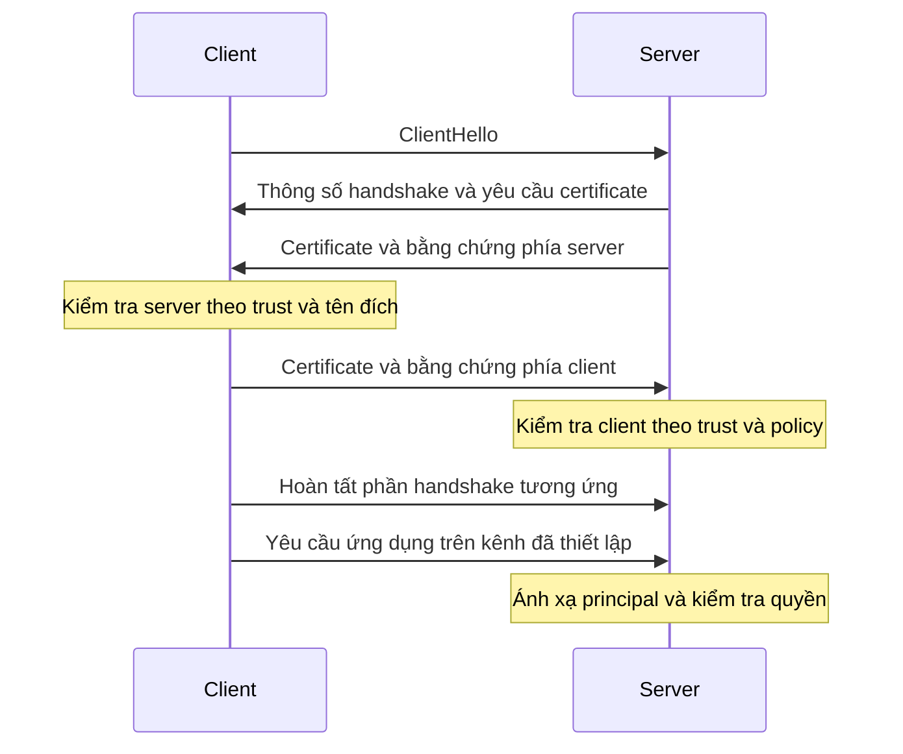

# Client certificate

## 1. Client certificate giải quyết vấn đề gì?

**Client certificate** là chứng chỉ số được client trình bày để tham gia xác thực với một bên nhận. Trong bối cảnh TLS, nó thường là chứng chỉ X.509 chứa public key cùng thông tin mà bên cấp chứng chỉ đã ký xác nhận.

Điểm quan trọng không phải việc client gửi được một file chứng chỉ. Chứng chỉ có thể được sao chép vì nội dung public key không phải bí mật. Client còn phải chứng minh khả năng sử dụng **private key tương ứng** theo giao thức.

Ví dụ, một dịch vụ xử lý thanh toán gọi Orders API:

```text
payments-worker
    giữ private key
    có certificate do CA được chấp nhận cấp
           |
           | TLS có xác thực client
           v
Orders API
    kiểm tra bằng chứng
    ánh xạ thành workload principal
    kiểm tra quyền trên yêu cầu
```

Client certificate giúp giải quyết câu hỏi “đầu kết nối này kiểm soát credential nào?”. Để trở thành một thiết kế IAM hoàn chỉnh, hệ thống còn phải xác định credential đó thuộc principal nào, có đang hoạt động không và được phép thực hiện hành động gì.

Client có thể là ứng dụng, workload, thiết bị hoặc phần mềm sử dụng credential của một người. Từ “client” ở đây mô tả vai trò trong giao tiếp, không đồng nghĩa một khách hàng doanh nghiệp hoặc một cá nhân cụ thể.

## 2. Phân biệt certificate, private key và principal

| Thành phần | Vai trò | Yêu cầu bảo vệ chính |
|---|---|---|
| Private key | Tạo bằng chứng mật mã theo giao thức | Không tiết lộ hoặc cho bên không được phép sử dụng |
| Public key | Dùng để kiểm tra bằng chứng tương ứng | Giữ đúng quan hệ tin cậy với principal |
| Certificate | Gắn public key với thông tin được bên cấp ký | Kiểm tra nguồn cấp, thời hạn, mục đích và policy |
| Certificate chain | Hỗ trợ xây dựng đường tin cậy tới trust anchor | Kiểm tra đường chứng nhận theo chính sách |
| Principal | Danh tính nội bộ của người, workload hoặc thiết bị | Quản lý trạng thái, owner và quyền |
| Trust anchor | Điểm bắt đầu tin cậy được bên nhận cấu hình | Chỉ thêm hoặc đổi qua quy trình có thẩm quyền |

Chứng chỉ không chứa private key như một phần của cấu trúc X.509. Một file đóng gói như PKCS#12 có thể chứa cả private key lẫn chuỗi chứng chỉ; vì vậy, không được suy rằng một file `.p12` “chỉ là certificate nên có thể chia sẻ”.

Một file PEM cũng chỉ là cách mã hóa hoặc đóng gói văn bản. Nó có thể chứa certificate, private key hoặc nhiều phần. Phải kiểm tra nội dung và loại đối tượng, không phân loại độ nhạy cảm chỉ theo phần mở rộng.

### Đây thường là yếu tố possession

Khi client chứng minh kiểm soát private key, cơ chế thường thể hiện yếu tố “something you have”. Nếu key nằm trong file có thể sao chép, bên có bản sao và quyền dùng key có thể hành động như cùng credential đó.

Lưu private key trong phần cứng có thể hạn chế xuất khóa, nhưng vẫn cần bảo vệ quyền sử dụng khóa và môi trường gọi nó. “Không xuất được khóa” không có nghĩa phần mềm bị xâm phạm không thể yêu cầu dùng khóa khi có đủ quyền.

Client certificate cũng không tự tạo MFA. Nếu cần PIN hoặc sinh trắc để kích hoạt một authenticator, phải đánh giá cách kết hợp, ranh giới bảo vệ và bằng chứng mà hệ thống thực sự kiểm tra. Mật khẩu bảo vệ một file và certificate cùng được một tiến trình tự động sử dụng không nên được đếm thành MFA chỉ vì có hai cấu hình.

## 3. Những trường cần hiểu trong chứng chỉ X.509

Một chứng chỉ client có thể chứa:

| Trường hoặc extension | Ý nghĩa trong thiết kế |
|---|---|
| Subject | Tên hoặc thuộc tính chủ thể theo profile của CA |
| Subject Alternative Name — SAN | Tên thay thế, có thể dùng để biểu diễn định danh theo profile |
| Issuer | Thông tin bên cấp |
| Serial number | Định danh chứng chỉ trong phạm vi issuer |
| Subject public key | Public key của chủ thể |
| Not Before, Not After | Khoảng thời gian hiệu lực |
| Key Usage — KU | Những cách sử dụng key được cho phép |
| Extended Key Usage — EKU | Các mục đích sử dụng mở rộng |
| Basic Constraints | Có phải chứng chỉ CA và giới hạn liên quan hay không |
| Chữ ký của issuer | Bảo vệ nội dung chứng chỉ và liên kết với bên cấp |

EKU `clientAuth` biểu diễn mục đích TLS client authentication. Nếu chứng chỉ có cả KU và EKU thì mục đích sử dụng phải phù hợp với cả hai, không chỉ kiểm tra riêng một extension. [RFC 5280, Extended Key Usage](https://www.rfc-editor.org/rfc/rfc5280.html#section-4.2.1.12).

Việc dùng SAN URI, SAN DNS hoặc một trường khác để ánh xạ client principal phải được profile của hệ thống quy định. Đừng giả định mọi TLS stack tự biết URI nào đại diện cho tài khoản nội bộ của ứng dụng.

Ví dụ thông tin minh họa:

```text
Issuer: Example Production Workload CA
Serial: 41A7
SAN URI: urn:example:workload:orders-importer
Extended Key Usage: TLS Web Client Authentication
Validity: một khoảng thời gian do chính sách cấp phát quy định
```

Nội dung trên chỉ mô tả chủ đích của một profile, không phải chứng chỉ thật.

### CN, fingerprint và serial có vai trò khác nhau

- Common Name không phải một khóa danh tính phổ quát; có thể trùng hoặc thay đổi theo quy trình cấp.
- Fingerprint nhận diện nội dung của một chứng chỉ cụ thể; thường thay đổi khi cấp chứng chỉ mới.
- Serial cần được hiểu trong phạm vi issuer.
- Principal nội bộ có thể giữ ổn định trong khi các certificate và key của nó được thay đổi.

Nếu một dịch vụ dùng fingerprint để pin một certificate cụ thể, việc đổi certificate cần cập nhật quan hệ đó theo quy trình. Không được lặng lẽ đổi sang “tin mọi certificate cùng CA” chỉ để tránh thao tác cập nhật.

## 4. Luồng mTLS ở mức khái niệm

Trong HTTPS thông thường, client kiểm tra danh tính server theo cơ chế TLS và policy của client. Với **mutual TLS — mTLS**, server cũng yêu cầu và kiểm tra xác thực phía client.

Luồng minh họa cho một handshake TLS 1.3 có xác thực bằng chứng chỉ hai phía:



Đây là sơ đồ khái niệm, đã gộp nhiều message và không mô tả đầy đủ thứ tự, mã hóa hoặc các biến thể của giao thức.

Trong TLS 1.3, `CertificateVerify` cung cấp bằng chứng rằng endpoint kiểm soát private key tương ứng với chứng chỉ, đồng thời bảo vệ nội dung handshake liên quan. Gửi certificate mà thiếu bằng chứng hợp lệ không hoàn tất xác thực bằng certificate. [RFC 8446, Certificate Verify](https://www.rfc-editor.org/rfc/rfc8446.html#section-4.4.3).

Ứng dụng không nên tự tạo một cơ chế “gửi certificate qua JSON rồi coi là đã xác thực”. Khi nhận certificate trong request body, server mới chỉ nhận dữ liệu công khai; chưa có bằng chứng phù hợp về việc bên gửi đang kiểm soát key.

### mTLS không bỏ nhu cầu xác minh server

Client vẫn cần kiểm tra server, bao gồm trust và tên endpoint theo cơ chế phù hợp. Việc client có certificate không phải lý do để tắt hostname verification hoặc chấp nhận mọi server certificate.

Chứng chỉ client cũng không phải khóa dùng trực tiếp để mã hóa mọi byte dữ liệu ứng dụng. TLS kết hợp các cơ chế của giao thức để thiết lập và bảo vệ kênh; không nên hình dung rằng server cứ lấy public key của client rồi mã hóa toàn bộ HTTP response bằng nó.

## 5. Certificate hợp lệ chưa đồng nghĩa client được phép truy cập

Có thể tách quyết định thành ba lớp:

```text
Lớp 1: Xác thực giao thức
    Bằng chứng key và handshake có hợp lệ không?

Lớp 2: Tin cậy credential và ánh xạ danh tính
    Certificate có được chấp nhận theo policy không?
    Nó ánh xạ tới principal nào?

Lớp 3: Authorization
    Principal có được thực hiện hành động này,
    trên tài nguyên này, trong tenant này không?
```

Một certificate có chuỗi tin cậy hợp lệ từ CA nội bộ có thể thuộc một workload khác hoặc một môi trường khác. Nếu server cấp mọi quyền chỉ vì chain hợp lệ, phạm vi quyền sẽ rộng hơn phạm vi được thiết kế.

Ví dụ, CA cấp certificate cho cả `report-generator` và `orders-importer`. Orders API cần cho importer quyền nhập đơn hàng nhưng không cho report generator quyền đó. “Cùng CA” không đồng nghĩa “cùng principal” hoặc “cùng quyền”.

### Những kiểm tra cần có trong chính sách chấp nhận

Thiết kế cần phân công rõ thành phần chịu trách nhiệm cho:

- Xây dựng và kiểm tra certification path tới trust anchor được phép.
- Kiểm tra hiệu lực theo thời gian và các ràng buộc liên quan.
- Kiểm tra mục đích sử dụng, thuật toán và profile được chấp nhận.
- Xử lý trạng thái thu hồi theo chính sách.
- Kiểm tra định danh client hoặc registration dự kiến.
- Ánh xạ tới principal đang hoạt động.
- Áp dụng quyền trên request và tài nguyên.

Không chỉ kiểm tra chữ ký của leaf certificate rồi kết luận chain hợp lệ. Cũng không coi việc gọi một API kiểm tra ngày hết hạn là đã hoàn tất certificate validation.

## 6. Mô hình ánh xạ tới danh tính IAM

Một phương án quản lý quan hệ:

```text
Certificate đã được xác thực
      |
      v
Đọc định danh theo certificate profile được phép
      |
      v
Credential registration / identity mapping
      |
      v
Principal nội bộ
      |
      v
Trạng thái + môi trường + tenant + quyền
```

Ví dụ dữ liệu mô tả:

```yaml
principal:
  id: workload-orders-importer
  type: workload
  owner: team-orders
  environment: production

certificateProfile:
  acceptedIssuerGroup: production-workload-ca
  identityField: san-uri
  expectedIdentity: urn:example:workload:orders-importer

authorization:
  tenantScope: assigned-tenants
  permissions:
    - orders.import
```

Đây là schema minh họa, không phải cấu hình có thể nạp nguyên vào mọi sản phẩm.

Định danh certificate cần được so sánh theo quy tắc rõ ràng. Nếu lấy Subject DN, không nên tự tách chuỗi bằng dấu phẩy hoặc dùng phép tìm chuỗi con như `contains("admin")`. Cách biểu diễn tên, thứ tự thuộc tính hoặc ký tự đặc biệt có thể làm phép kiểm tra đó sai.

Trong một nền tảng nhiều tenant, mapping phải tránh để người có certificate của tenant Alpha trở thành principal Beta. Trust đối với CA và quyền phát hành định danh tenant cần có ràng buộc; không chỉ tin một trường `tenantId` bất kỳ do request gửi lên.

### Thiết bị và con người cần tách bối cảnh

Một certificate được cấp cho laptop có thể chứng minh danh tính thiết bị, chưa phải danh tính người đang dùng laptop. Một certificate thuộc workload thường chứng minh danh tính workload, chưa đại diện cho người dùng cuối mà nó đang phục vụ.

Nếu một yêu cầu cần cả danh tính dịch vụ lẫn quyền được người dùng ủy quyền, thiết kế phải giữ hai bối cảnh đó. Không thay danh tính end-user bằng danh tính máy rồi bỏ qua quyền của người dùng trên dữ liệu.

## 7. Cấp phát và bảo vệ private key

Vòng đời bắt đầu trước khi server nhìn thấy certificate:

1. Xác định principal, owner, môi trường và mục đích sử dụng.
2. Tạo key pair tại nơi được chính sách chấp nhận.
3. Tạo yêu cầu cấp chứng chỉ và bằng chứng cần thiết.
4. Bên cấp xác minh quyền yêu cầu định danh.
5. Cấp certificate đúng profile và thời hạn.
6. Đăng ký mapping, triển khai credential và xác minh hoạt động.
7. Theo dõi, đổi mới, thu hồi và gỡ bỏ khi kết thúc vòng đời.

Một Certificate Signing Request — CSR — không tự chứng minh người yêu cầu được quyền dùng mọi tên ghi trong đó. Bên cấp phải kiểm tra quyền đối với định danh được yêu cầu; nếu không, một client có thể xin certificate mang danh tính đặc quyền không thuộc về mình.

Cần phân biệt bằng chứng kiểm soát key trong quy trình cấp với việc chứng minh một workload hoặc người dùng được phép nhận identity đó.

### Nơi lưu key là một quyết định bảo mật

Có thể lưu key trong keystore được quản lý, phần cứng, môi trường thực thi có bảo vệ hoặc thành phần credential chuyên dụng. Mỗi cách có giả định tin cậy và khả năng vận hành riêng.

Những việc cần làm rõ:

- Process hoặc người nào được phép sử dụng key.
- Key có thể được xuất, sao chép hoặc backup không.
- Credential được đưa vào workload bằng cách nào.
- Log, core dump và hệ thống hỗ trợ có thể làm lộ key không.
- Khi workload bị xóa, credential còn tồn tại ở những nơi nào.
- Khi cần khẩn cấp, ai có thể vô hiệu hóa nó.

Không đưa private key hoặc file chứa key vào repository, image dùng chung, tài liệu hướng dẫn hay ticket hỗ trợ. Mật khẩu của keystore cũng cần được quản lý như secret; lưu ngay cạnh file dưới cùng phạm vi đọc có thể không tạo được ranh giới bảo vệ mong muốn.

### Không chia sẻ một key cho mọi instance một cách vô thức

Một credential dùng chung làm việc xác định instance gây sự cố và thu hồi có chọn lọc khó hơn. Cấp credential theo workload hoặc instance tùy kiến trúc giúp xác định phạm vi ảnh hưởng, nhưng cũng đòi hỏi cơ chế cấp phát và đổi mới phù hợp.

Quan trọng là quyết định có chủ đích, có inventory và biết điều gì xảy ra khi một bản sao key bị lộ.

## 8. Keystore và truststore trong Java

Trong JSSE, hai vai trò cần được phân biệt:

- **Key material** của client gồm private key và chuỗi chứng chỉ tương ứng, được key manager sử dụng.
- **Trust material** của client giúp quyết định chấp nhận phía server, được trust manager sử dụng.

Keystore và truststore là tên mô tả vai trò; chúng không bắt buộc là hai định dạng file khác nhau. Cả hai có thể dùng định dạng PKCS#12.

Ở phía server mTLS, server cũng có key material của chính mình và trust material để kiểm tra client. Truststore trên client không thay cho truststore chấp nhận client của server. [Oracle JSSE Reference Guide](https://docs.oracle.com/en/java/javase/25/security/java-secure-socket-extension-jsse-reference-guide.html).

### Ví dụ tạo HTTP client với SSLContext

Đoạn mã sau minh họa nạp hai kho PKCS#12 đã được cấp sẵn. Các tham số mật khẩu do cơ chế quản lý secret của ứng dụng cung cấp; ví dụ không chứa certificate hoặc secret thật.

```java
import java.io.IOException;
import java.io.InputStream;
import java.net.http.HttpClient;
import java.nio.file.Files;
import java.nio.file.Path;
import java.security.GeneralSecurityException;
import java.security.KeyStore;
import javax.net.ssl.KeyManagerFactory;
import javax.net.ssl.SSLContext;
import javax.net.ssl.SSLParameters;
import javax.net.ssl.TrustManagerFactory;

final class MutualTlsClientFactory {

    static HttpClient create(
            Path clientStore,
            char[] storePassword,
            char[] keyPassword,
            Path serverTrustStore,
            char[] trustStorePassword)
            throws IOException, GeneralSecurityException {

        KeyStore keys = KeyStore.getInstance("PKCS12");
        try (InputStream in = Files.newInputStream(clientStore)) {
            keys.load(in, storePassword);
        }

        KeyStore trust = KeyStore.getInstance("PKCS12");
        try (InputStream in = Files.newInputStream(serverTrustStore)) {
            trust.load(in, trustStorePassword);
        }

        KeyManagerFactory kmf = KeyManagerFactory.getInstance(
                KeyManagerFactory.getDefaultAlgorithm());
        kmf.init(keys, keyPassword);

        TrustManagerFactory tmf = TrustManagerFactory.getInstance(
                TrustManagerFactory.getDefaultAlgorithm());
        tmf.init(trust);

        SSLContext context = SSLContext.getInstance("TLS");
        context.init(kmf.getKeyManagers(), tmf.getTrustManagers(), null);

        SSLParameters parameters = new SSLParameters();
        parameters.setEndpointIdentificationAlgorithm("HTTPS");

        return HttpClient.newBuilder()
                .sslContext(context)
                .sslParameters(parameters)
                .build();
    }
}
```

Đây là minh họa tích hợp, chưa phải một cấu hình production hoàn chỉnh và chưa được chạy trong môi trường của bài học. Nó không triển khai cấp phát key, tự động reload, lựa chọn alias phức tạp, kiểm tra quyền ứng dụng hoặc cấu hình đầy đủ chính sách revocation.

Một số điểm cần kiểm tra khi dùng ý tưởng này:

- Kho client có private key entry và certificate chain phù hợp.
- Truststore chứa trust anchor đúng cho server đích.
- TLS provider, thuật toán và phiên bản giao thức tuân theo policy của môi trường.
- Hostname verification không bị tắt ở nơi khác.
- Nếu có nhiều key, cơ chế chọn credential phù hợp với yêu cầu của server.
- Quyền đọc file và vòng đời các mảng mật khẩu được quản lý.
- Có cách cập nhật credential cho client, connection pool và TLS session khi đổi khóa.

Không sửa lỗi certificate bằng một trust manager chấp nhận tất cả chứng chỉ. Cách đó bỏ quan hệ tin cậy mà mTLS đang cần bảo vệ.

## 9. Khi TLS kết thúc ở reverse proxy hoặc gateway

Có hai kiến trúc khác nhau:

```text
A. Client -------- mTLS -------- Backend
   Backend trực tiếp kiểm tra xác thực client.

B. Client -- mTLS -- Gateway -- kênh nội bộ -- Backend
   Gateway kiểm tra client; Backend nhận kết quả qua hợp đồng tin cậy.
```

Ở phương án B, backend không trực tiếp thấy cùng phiên TLS của client. Nó cần biết thông tin danh tính được gateway chuyển tiếp là đáng tin ở mức nào và những đường truy cập nào có thể bỏ qua gateway.

Nếu truyền một header như `X-Client-Identity` hoặc thông tin certificate, thiết kế cần:

1. Loại bỏ hoặc ghi đè header tương ứng từ request bên ngoài.
2. Chỉ cho bên được tin cậy tạo thông tin chuyển tiếp.
3. Bảo vệ và xác thực kênh gateway tới backend.
4. Chặn đường gọi backend trực tiếp không đi qua điểm xác thực.
5. Giữ được thông tin kiểm tra và phạm vi policy mà backend cần.
6. Ghi rõ backend đang tin danh tính client gốc hay chỉ danh tính gateway.

Gửi PEM trong header không tự làm header trở thành bằng chứng mTLS. Nó vẫn có thể chỉ là dữ liệu do bên gọi tự cung cấp nếu không có hợp đồng chuyển tiếp được bảo vệ.

Nếu gateway gọi nhiều backend bằng certificate riêng của gateway, các backend mặc nhiên nhận diện gateway ở tầng TLS, không phải từng client bên ngoài. Muốn giữ danh tính gốc hoặc ủy quyền người dùng, cần một cơ chế bổ sung rõ ràng.

## 10. Client certificate và OAuth không phải cùng một cơ chế

Có thể dùng mTLS trực tiếp giữa hai dịch vụ mà không có OAuth. Cũng có thể dùng mTLS trong một kiến trúc OAuth.

RFC 8705 phân biệt hai cơ chế:

- OAuth client dùng mTLS để xác thực với authorization server.
- Access token được ràng buộc với certificate để resource server kiểm tra bên sử dụng token.

Hai cơ chế có thể phối hợp nhưng không tự động luôn đi cùng nhau. Token lấy qua một kết nối mTLS không mặc nhiên trở thành certificate-bound token. [RFC 8705, Introduction](https://www.rfc-editor.org/rfc/rfc8705.html#section-1).

Ví dụ:

```text
OAuth client
    -- mTLS --> Authorization server
    <-- access token --

OAuth client
    -- token + bằng chứng theo cơ chế được yêu cầu --> Resource server
```

Nếu triển khai certificate-bound token, resource server cần kiểm tra ràng buộc token với certificate theo giao thức. Chỉ kiểm tra chữ ký và hạn dùng token là chưa đủ cho điều kiện ràng buộc đó.

Dù có token binding, vẫn cần audience, scope hoặc permission và quyền trên tài nguyên. mTLS không tự cấp quyền đọc mọi dữ liệu mà API cung cấp.

### Self-signed certificate cần ngữ cảnh tin cậy

Self-signed không tự được mọi server tin cậy. Nhưng cũng không có nghĩa mọi cách sử dụng nó đều không hợp lệ. Chẳng hạn RFC 8705 có phương thức dùng certificate tự ký được đăng ký theo cơ chế tương ứng.

Điểm quyết định là quan hệ tin cậy hoặc đăng ký nào đã được thiết lập và bằng chứng nào được kiểm tra. “Tự ký” không phải lý do để chấp nhận mọi key do client gửi tới.

## 11. Đổi mới, hết hạn và thu hồi

Ba thao tác có mục đích khác nhau:

| Thao tác | Mục đích |
|---|---|
| Renewal | Cấp certificate mới để duy trì khả năng sử dụng |
| Key rotation | Thay key pair và credential liên quan |
| Revocation hoặc vô hiệu hóa | Ngăn tiếp tục chấp nhận một credential hoặc principal |

Renewal có thể dùng key mới hoặc theo cơ chế được policy cho phép; không nên giả định mọi lần cấp certificate mới đều đã thay private key.

### Một quy trình đổi mới có kiểm soát

Ví dụ triển khai:

1. Cấp key và certificate mới theo policy.
2. Xác minh identity mapping và quyền không bị mở rộng.
3. Triển khai credential mới tới client được phép.
4. Kiểm tra server chấp nhận credential mới.
5. Chuyển lưu lượng và theo dõi lỗi.
6. Kết thúc cửa sổ chấp nhận credential cũ theo kế hoạch.
7. Gỡ key, certificate và registration cũ ở đúng nơi liên quan.

Nếu cần cửa sổ chồng lấn, phải có giới hạn và inventory. “Tạm giữ credential cũ” mà không có điều kiện kết thúc sẽ làm tăng số credential còn hiệu lực ngoài dự kiến.

### Hết hạn không phải thu hồi khẩn cấp

Chứng chỉ ngắn hạn giúp giảm khoảng thời gian có thể tiếp tục dùng credential trong một số mô hình, nhưng không thay thế mọi nhu cầu vô hiệu hóa trước hạn. Khi key bị lộ, chờ tới `Not After` có thể vượt mục tiêu xử lý sự cố.

Thiết kế cần quyết định có kiểm tra CRL, OCSP hoặc trạng thái credential khác hay không, kiểm tra ở đâu, độ mới bao nhiêu và hành vi khi không lấy được trạng thái. Không mặc định mọi thư viện hoặc TLS stack đã bật kiểm tra thu hồi theo yêu cầu của tổ chức.

Tương tự, “khóa tài khoản nội bộ” và “thu hồi certificate tại CA” là hai lớp có thể phối hợp. Nếu backend kiểm tra principal đang hoạt động trên request, nó có thể từ chối ở tầng ứng dụng theo policy, nhưng điều đó không chứng minh mọi hệ thống khác đã ngừng tin certificate.

## 12. Kết nối đang mở và TLS session cần được tính vào vòng đời

Không nên hình dung rằng mỗi HTTP request luôn thực hiện lại toàn bộ handshake và certificate validation.

Một kết nối TLS có thể phục vụ nhiều request. Connection pool có thể giữ kết nối lâu; cơ chế session resumption cũng có chính sách và trạng thái riêng.

Do đó, certificate vừa bị thu hồi hoặc principal vừa bị vô hiệu hóa không tự làm mọi kết nối đang mở biến mất ngay lập tức. Mục tiêu thu hồi phải xét:

- Điểm kiểm tra trạng thái principal hoặc quyền trên từng request.
- Thời gian giữ kết nối và cách đóng kết nối liên quan.
- Chính sách session resumption và vòng đời session ticket.
- Cache mapping, trạng thái thu hồi và cấu hình trust.
- Kết nối qua proxy, mesh hoặc gateway.
- Khả năng cập nhật credential trên các instance còn hoạt động.

Ví dụ, tổ chức yêu cầu workload bị khóa phải mất quyền gọi API trong tối đa 60 giây. Một thiết kế chỉ kiểm tra certificate lúc handshake rồi giữ kết nối nhiều giờ chưa chứng minh được yêu cầu đó.

Con số 60 giây ở đây là mục tiêu giả lập để minh họa cách đặt yêu cầu. Cơ chế thực thi phải được chọn và đo theo hệ thống thực tế.

## 13. Audit và vận hành

Một bản ghi audit nên đủ để đối chiếu:

```text
eventTime
connectionOrRequestReference
authenticatedPeerReference
certificateIssuerReference
certificateSerialOrFingerprint
mappedPrincipalId
environment
targetTenant
action
authorizationDecision
reasonCode
policyVersion
```

Không ghi private key, keystore password hoặc nội dung secret vào log. Certificate có thể chứa dữ liệu định danh hoặc metadata nhạy cảm; không vì nó không phải private key mà xuất toàn bộ cho mọi người dùng dashboard.

Những chỉ số vận hành hữu ích gồm:

- Credential sắp hết hạn theo owner và môi trường.
- Lỗi handshake theo loại nguyên nhân.
- Lỗi ánh xạ principal sau khi TLS thành công.
- Credential cũ vẫn còn được dùng sau thời điểm chuyển đổi.
- Số nguồn cấu hình chưa nhận trust hoặc revocation update.
- Độ trễ từ quyết định vô hiệu hóa tới lần từ chối có xác nhận.

Lỗi TLS có thể xảy ra trước khi HTTP request tới ứng dụng. Nếu chỉ nhìn application log, nhóm vận hành có thể bỏ sót lỗi ở load balancer hoặc TLS endpoint.

Nên phân biệt lỗi giao thức, lỗi trust, lỗi certificate profile, lỗi identity mapping và lỗi authorization. Nếu mọi lỗi đều hiển thị “invalid certificate”, việc điều tra sẽ khó và dễ dẫn tới giải pháp mở rộng trust quá mức.

## 14. Những lỗi thiết kế thường gặp

| Lỗi | Hệ quả | Hướng xử lý |
|---|---|---|
| Gửi certificate qua JSON rồi coi là đăng nhập | Chưa chứng minh kiểm soát private key | Dùng giao thức xác thực phù hợp |
| Tin mọi certificate cùng CA với cùng quyền | Trộn trust của credential với authorization | Mapping principal và policy riêng |
| Dùng Subject chứa chữ “admin” làm điều kiện quyền | Dễ ánh xạ sai hoặc mở rộng quyền | Dùng profile và định danh được kiểm soát |
| Copy một key cho mọi môi trường | Khó cô lập development và production | Phân tách credential, trust và owner |
| Tắt kiểm tra server khi client có certificate | Mất bảo vệ danh tính server | Giữ xác minh server và tên endpoint |
| Chấp nhận header certificate từ mọi request | Cho bên ngoài tự khai danh tính | Hợp đồng gateway và backend được bảo vệ |
| Chỉ dựa vào expiry để xử lý lộ key | Credential có thể còn dùng được quá lâu | Thiết kế vô hiệu hóa và đo hiệu lực |
| Đổi certificate nhưng không cập nhật pinning | Client hoặc server từ chối credential mới | Rotation có kiểm thử và kế hoạch mapping |
| Đồng nhất mTLS với MFA của con người | Tuyên bố mức bảo đảm vượt bằng chứng | Đánh giá yếu tố và authenticator thực tế |
| Xem mTLS là bảo vệ toàn bộ nghiệp vụ | Bỏ sót tenant, quyền và dữ liệu đầu vào | Authorization và kiểm soát ứng dụng tiếp tục thực thi |

## 15. Tự kiểm tra bằng tình huống

**Tình huống 1 — Chỉ có file certificate.** Một người lấy được public certificate của workload nhưng không có quyền sử dụng private key. Giải thích vì sao bản sao certificate chưa đủ để hoàn tất chứng minh kiểm soát key trong TLS.

**Tình huống 2 — Cùng CA nhưng khác principal.** Reporting service có certificate hợp lệ từ cùng CA với Orders importer. Nó gọi chức năng nhập đơn hàng. TLS có thể thành công, nhưng authorization phải từ chối nếu principal không có quyền.

**Tình huống 3 — Certificate được thay mới.** Principal không đổi, certificate và fingerprint đổi. Hãy xác định identity mapping nào nên giữ ổn định, registration nào cần cập nhật và credential cũ còn hiệu lực tới lúc nào.

**Tình huống 4 — mTLS dừng ở gateway.** Backend nhận `X-Client-Identity`. Liệt kê bằng chứng và kiểm soát cần có trước khi tin header đó. Xác định điều gì xảy ra nếu có đường truy cập bỏ qua gateway.

**Tình huống 5 — Key bị lộ khi connection pool đang mở.** Xác định các điểm thu hồi, cache, kết nối và session cần xử lý. Không dừng kế hoạch ở việc đánh dấu certificate revoked tại một nơi.

**Tình huống 6 — Lấy OAuth token qua mTLS.** Resource server có được mặc nhiên xem token đó là certificate-bound không? Cần kiểm tra cơ chế phát hành, dữ liệu ràng buộc và chính sách sử dụng token.

Client certificate phát huy giá trị khi chứng chỉ, bằng chứng key, quan hệ tin cậy, identity mapping và quyền truy cập được thiết kế cùng nhau. Khi xem xét một hệ thống, hãy luôn xác định certificate đang đại diện cho ai, private key được bảo vệ ở đâu, bên nào kiểm tra nó và điều kiện nào khiến credential không còn được chấp nhận.
