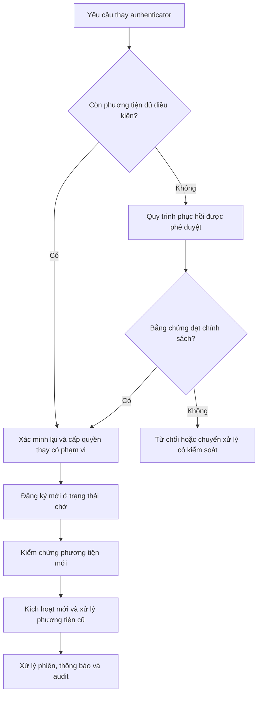

# Authenticator replacement

**Authenticator replacement** là quá trình thay phương tiện xác thực đang gắn với một tài khoản bằng phương tiện khác, đồng thời quản lý trạng thái và mức độ tin cậy của phương tiện cũ. Ví dụ: đổi điện thoại dùng ứng dụng OTP, thay khóa bảo mật bị hỏng hoặc đăng ký khóa mới sau khi nghi ngờ khóa cũ bị lộ.

Đây là một thao tác nhạy cảm trong IAM. Người có thể gắn authenticator của mình vào tài khoản người khác có thể chiếm quyền đăng nhập lâu dài, dù cơ chế xác thực thông thường của ứng dụng rất mạnh.

Một quy trình thay thế đúng phải giải quyết cả quyền thực hiện thay đổi, việc kiểm chứng authenticator mới, cách ngừng tin cậy authenticator cũ và tác động đến phiên hoặc token đã được cấp.

## 1. Thay authenticator không đồng nghĩa đổi thiết bị

Cần phân biệt thiết bị vật lý với liên kết xác thực mà máy chủ quản lý.

Một điện thoại có thể chứa nhiều authenticator hoặc credential cho nhiều tài khoản. Một credential có thể có bản sao hoặc được đồng bộ qua một cơ chế quản lý khác. Vì vậy, “xóa điện thoại cũ” và “thu hồi credential cũ tại máy chủ” có thể là hai việc khác nhau.

Các thuật ngữ thường gặp:

| Thao tác | Nội dung chính | Câu hỏi cần trả lời |
| --- | --- | --- |
| Thêm authenticator | Gắn thêm phương tiện vào tài khoản | Có giữ nguyên các phương tiện cũ không? |
| Thay authenticator | Đưa phương tiện mới vào và xử lý phương tiện cũ | Khi nào phương tiện cũ ngừng được chấp nhận? |
| Gia hạn | Tiếp tục sử dụng thông qua quy trình gia hạn phù hợp | Có thay khóa hay chỉ thay thời hạn/chứng thư? |
| Đổi khóa hoặc seed | Tạo vật liệu bí mật mới | Những bản sao cũ còn tạo bằng chứng hợp lệ không? |
| Phục hồi tài khoản | Khôi phục khả năng truy cập khi không còn đủ phương tiện xác thực | Dựa vào bằng chứng nào để cấp quyền gắn authenticator mới? |
| Mở khóa tạm ngưng | Khôi phục trạng thái của một phương tiện cũ | Có cơ sở nào để tin phương tiện đó vẫn an toàn? |

Trong mô hình của [NIST SP 800-63B-4](https://pages.nist.gov/800-63-4/sp800-63b.html), quản lý authenticator bao gồm liên kết, gia hạn, phục hồi và xử lý mất hoặc xâm phạm. Bài này dùng một thiết kế ứng dụng minh họa; tên trạng thái, loại grant và cách tổ chức giao dịch bên dưới không phải schema bắt buộc của NIST.

## 2. Phân loại lý do trước khi chọn quy trình

Không phải mọi yêu cầu thay thế đều có cùng rủi ro.

### 2.1. Thay có kế hoạch

Linh vẫn giữ điện thoại cũ, authenticator vẫn hoạt động và chưa có dấu hiệu bị xâm phạm. Linh muốn chuyển sang phương tiện mới.

Trong tình huống này, có thể xác minh Linh bằng phương tiện đã đăng ký, thiết lập phương tiện mới rồi chuyển đổi theo chính sách. Nếu đăng ký mới thất bại, phương tiện cũ vẫn có thể được giữ hoạt động, miễn là nó chưa bị nghi ngờ.

### 2.2. Mất, bị đánh cắp hoặc nghi ngờ lộ bí mật

Nếu điện thoại bị mất hoặc seed OTP bị sao chép, việc tiếp tục cho phương tiện cũ hoạt động tạo ra rủi ro. Không nên áp dụng máy móc quy tắc “chờ thay xong mới thu hồi” của tình huống có kế hoạch.

Cần có luồng báo sự cố và cơ chế tạm ngưng hoặc vô hiệu hóa phù hợp. Việc khôi phục khả năng đăng nhập sau đó đi qua authenticator dự phòng hoặc quy trình phục hồi.

Báo mất và được quyền đăng ký authenticator mới là hai quyết định riêng. Một kênh báo sự cố có thể hỗ trợ hạn chế thiệt hại, nhưng không tự là bằng chứng đủ để gắn khóa mới của người báo vào tài khoản.

### 2.3. Thiết bị hỏng hoặc hết hạn

Thiết bị hỏng có thể làm người dùng mất khả năng xác thực, nhưng cũng cần xem xét liệu bí mật có thể bị trích xuất hay không. Thiết bị hết hạn có thể được thay theo kế hoạch trước khi thời hạn kết thúc.

Không tự kết luận “hỏng thì chắc chắn không ai dùng được”. Trạng thái trên giao diện và tình trạng vật lý do người dùng mô tả không thay thế đánh giá rủi ro.

### 2.4. Không còn phương tiện phù hợp

Nếu Linh không còn đủ phương tiện để đáp ứng chính sách xác thực cho thao tác thay đổi, ứng dụng phải chuyển sang nhánh phục hồi được thiết kế trước.

Không nên biến nhánh này thành một endpoint bỏ qua MFA. Phục hồi là một cách thiết lập lại niềm tin có điều kiện, không phải dấu hiệu cho phép giảm mọi yêu cầu bảo mật.

## 3. Xác minh ai có quyền thực hiện thay thế

Một phiên đăng nhập đang tồn tại có thể đã bị chiếm. Vì vậy, quyền thay authenticator không nên được quyết định chỉ từ việc request có session cookie hợp lệ.

Ứng dụng cần xác định:

- Principal đang yêu cầu thay đổi là ai.
- Tài khoản nào là đối tượng của thay đổi.
- Người dùng có còn authenticator đủ điều kiện để xác minh lại không.
- Kết quả xác minh còn đủ mới và phù hợp với hành động này không.
- Loại authenticator mới có đáp ứng chính sách cho tài khoản không.
- Có dấu hiệu rủi ro hoặc yêu cầu phê duyệt bổ sung không.

[OWASP Multifactor Authentication Cheat Sheet](https://cheatsheetseries.owasp.org/cheatsheets/Multifactor_Authentication_Cheat_Sheet.html#changing-mfa-factors) xem thay yếu tố MFA là thao tác có rủi ro cao, khuyến nghị xác minh lại bằng yếu tố đã đăng ký và không chỉ dựa vào phiên đang hoạt động.

Ví dụ, một kết quả xác minh dùng để xem hồ sơ không mặc nhiên cho phép thay authenticator. Có thể cấp một quyền thao tác ngắn hạn, dùng một lần, chỉ phục vụ quy trình thay thế cụ thể.

Không để client tự gửi:

```json
{
  "reauthenticated": true,
  "allowMfaReplacement": true
}
```

rồi coi đó là bằng chứng. Những trạng thái này phải được máy chủ thiết lập từ kết quả xác minh thực tế.

Đối với quản trị viên hoặc bộ phận hỗ trợ, quyền xem thông tin tài khoản không đồng nghĩa quyền thay phương tiện đăng nhập. Quyền hỗ trợ phục hồi cần được cấp riêng, giới hạn phạm vi và ghi nhận actor thực hiện.

## 4. Tách ba loại bằng chứng

Một thiết kế rõ ràng phân biệt ba câu hỏi:

| Loại bằng chứng | Câu hỏi được giải quyết | Điều chưa được chứng minh |
| --- | --- | --- |
| Xác minh chủ thể hoặc phục hồi được phê duyệt | Ai được phép khởi tạo thay đổi cho tài khoản này? | Phương tiện mới có hoạt động không? |
| Kiểm chứng authenticator mới | Chủ thể kiểm soát được phương tiện mới và phản hồi đăng ký hợp lệ không? | Người đó có quyền thay phương tiện của tài khoản đích không? |
| Quyết định chuyển đổi | Các điều kiện hiện tại có cho phép kích hoạt mới và xử lý cũ không? | Mọi phiên hay token trước đó đã bị vô hiệu hóa chưa? |

Một kẻ tấn công có thể chứng minh rất tốt rằng mình sở hữu một khóa mới. Nếu không kiểm tra quyền đối với tài khoản đích, máy chủ vẫn có thể gắn đúng khóa của sai người.

Ngược lại, chủ tài khoản hợp lệ có thể nhập sai thông tin hoặc chưa thiết lập được ứng dụng mới. Chỉ xác minh chủ tài khoản rồi kích hoạt ngay một bản ghi chưa được kiểm chứng sẽ tạo rủi ro mất khả năng đăng nhập.

Đối với WebAuthn, việc xác minh ceremony đăng ký cần tuân theo giao thức và chính sách của relying party. [Đặc tả WebAuthn](https://www.w3.org/TR/webauthn-3/) mô tả public-key credential gắn với relying party; ứng dụng vẫn phải tự quản lý quyền gắn credential vào đúng tài khoản.

## 5. Quy trình thay có kế hoạch

Giả sử Linh có authenticator cũ `auth-old-17` và muốn thay bằng `auth-new-31`. Thiết kế minh họa dùng các bước sau:

### Bước 1: Tạo yêu cầu có phạm vi

Máy chủ tạo một operation gắn với tài khoản, authenticator cũ, loại phương tiện mới và mục đích thay thế.

User ID trong URL không được dùng như bằng chứng quyền sở hữu. Với tài khoản có nhiều authenticator, máy chủ cần xác định rõ cái nào sẽ được thay và cái nào vẫn được giữ.

### Bước 2: Xác minh lại

Người dùng chứng minh quyền thực hiện thay đổi bằng phương tiện đủ điều kiện theo chính sách. Máy chủ ghi nhận kết quả xác minh và cấp quyền thao tác giới hạn.

Nếu authenticator cũ đang bị nghi ngờ xâm phạm, không dùng nó làm cơ sở tin cậy duy nhất chỉ vì nó vẫn tạo được mã hoặc chữ ký hợp lệ.

### Bước 3: Đăng ký mới ở trạng thái chờ

Phương tiện mới được thiết lập ở trạng thái `PENDING`. Trạng thái này chỉ cho phép hoàn tất đăng ký hoặc kiểm tra trong operation tương ứng; nó chưa được dùng để đăng nhập thông thường.

Dữ liệu mới phải gắn với đúng subject và miền xác thực. Không lấy thông tin tài khoản đích từ payload chưa được đối chiếu với operation.

### Bước 4: Kiểm chứng phương tiện mới

Ứng dụng xác minh phản hồi đăng ký hoặc thực hiện một bước thử có giới hạn theo loại authenticator. Ví dụ, TOTP cần kiểm tra khả năng tạo mã tương ứng với seed mới; khóa công khai cần được xử lý theo ceremony đăng ký phù hợp.

Kiểm chứng ở đây không có nghĩa cho một credential chờ đăng ký quyền truy cập đầy đủ vào tài khoản.

### Bước 5: Chuyển đổi theo chính sách

Sau khi các điều kiện đều đạt, ứng dụng kích hoạt phương tiện mới và vô hiệu hóa phương tiện cũ theo kế hoạch chuyển đổi.

Thiết kế có thể chọn chuyển đổi ngay hoặc cho phép khoảng chồng lấp có giới hạn khi phương tiện cũ vẫn được tin cậy. Nếu có chồng lấp, cần thời điểm kết thúc, chủ sở hữu theo dõi và cơ chế tự đóng; không để cả hai hoạt động vô thời hạn vì quên xử lý.

### Bước 6: Kiểm tra kết quả và thông báo

Người dùng được hướng dẫn xác nhận khả năng sử dụng phương tiện mới. Ứng dụng thông báo thay đổi qua kênh độc lập phù hợp, ghi dấu vết và cung cấp cách báo cáo thay đổi không do người dùng thực hiện.

Nếu phương tiện cũ đã bị thu hồi vì xâm phạm, lỗi ở bước mới không được tự động làm phương tiện cũ hoạt động trở lại. Khi đó cần tiếp tục qua nhánh phục hồi.

## 6. Nhánh mất phương tiện và phục hồi

Luồng khi không còn phương tiện hợp lệ có thể khác hẳn luồng thay có kế hoạch:



Tùy mô hình tài khoản, phục hồi có thể dựa trên mã phục hồi đã cấp, phương thức dự phòng, liên hệ phục hồi hoặc thực hiện lại các bước xác minh danh tính phù hợp. Không phải tài khoản nào cũng từng được xác minh danh tính ngoài đời để có thể dùng cùng một quy trình tái xác minh.

Một phương thức phục hồi phải được ràng buộc với tài khoản và có giới hạn sử dụng. Mã dùng một lần phải được tiêu thụ nguyên tử. Liên kết hoặc mã phục hồi không được trở thành quyền vô thời hạn để đăng ký nhiều authenticator tùy ý.

Nếu cần thời gian chờ hoặc phê duyệt bổ sung, đó là biện pháp của chính sách với mục đích rõ ràng. Không coi thời gian chờ là bằng chứng sở hữu tài khoản; kẻ tấn công cũng có thể chờ.

Cần đặc biệt thận trọng với việc đổi kênh liên hệ ngay trước khi phục hồi. Nếu kẻ tấn công vừa thay email rồi mọi thông báo và mã phục hồi chỉ được gửi đến email mới đó, các lớp bảo vệ có thể cùng mất tác dụng.

Bộ phận hỗ trợ không nên yêu cầu người dùng gửi mật khẩu, seed OTP, khóa riêng hoặc toàn bộ mã phục hồi qua kênh trao đổi thông thường. Bằng chứng và quy trình hỗ trợ phải được xác định trước, thay vì ứng biến theo mức độ khẩn cấp của người gọi.

## 7. Mô hình dữ liệu cho thao tác thay thế

Một operation cần được quản lý riêng với authenticator. Ví dụ sau chỉ là schema minh họa:

```json
{
  "operationId": "replace-demo-901",
  "subjectId": "user-demo-42",
  "oldAuthenticatorId": "auth-old-17",
  "candidateAuthenticatorId": "auth-new-31",
  "reason": "PLANNED_REPLACEMENT",
  "state": "NEW_AUTHENTICATOR_PENDING",
  "authorizationEvidenceRef": "evidence-demo-52",
  "subjectSecurityVersion": 18,
  "expiresAt": "2026-01-15T09:10:00Z",
  "version": 4
}
```

Các điểm quan trọng:

- `subjectId` được máy chủ ràng buộc với yêu cầu được phép.
- `oldAuthenticatorId` không phải một ID tùy ý mà người gọi được quyền thu hồi.
- `authorizationEvidenceRef` tham chiếu kết quả xác minh đã được kiểm tra, không phải nội dung client tự khai.
- `subjectSecurityVersion` giúp phát hiện ngữ cảnh tài khoản thay đổi trong lúc operation còn mở.
- `expiresAt` cần được kiểm tra khi sử dụng; việc bản ghi chưa được dọn không chứng minh còn hiệu lực.
- `version` hỗ trợ xử lý request đồng thời.

Một vòng đời operation có thể là:

```text
REQUESTED
    → AUTHORIZED
    → NEW_AUTHENTICATOR_PENDING
    → READY_TO_COMMIT
    → COMPLETED

Các nhánh kết thúc khác:
    EXPIRED, CANCELLED, REJECTED
```

Authenticator có vòng đời khác, chẳng hạn `PENDING → ACTIVE → REVOKED`. Không dùng một trường `mfaEnabled` duy nhất để thay cho toàn bộ danh sách phương tiện, trạng thái và lịch sử thay đổi.

Quyền thao tác được cấp sau xác minh cần ngắn hạn, dùng một lần và giới hạn theo operation. Nếu được truyền dưới dạng bearer secret, bản thân secret cũng phải được bảo vệ và không được đưa vào log hoặc URL dễ bị lưu lại.

## 8. Chuyển đổi an toàn khi có request đồng thời

Một lỗi thường gặp:

```text
Request A đọc: operation chưa hoàn tất.
Request B đọc: operation chưa hoàn tất.

A kích hoạt khóa mới thứ nhất.
B kích hoạt khóa mới thứ hai.

Cả hai cùng cho rằng mình là thay thế duy nhất.
```

Kết quả có thể là một tài khoản có nhiều phương tiện ngoài dự kiến hoặc phương tiện được giữ lại sai.

Thiết kế cần bảo đảm nhất quán giữa việc kích hoạt phương tiện mới, thu hồi cũ, tiêu thụ quyền thao tác và đánh dấu operation hoàn tất. Mã giả dưới đây chọn một kho dữ liệu hỗ trợ giao dịch cho các trạng thái cốt lõi:

```text
completeReplacement(operationId, protocolResponse, clientContext):

    snapshot = loadOperationForVerification(operationId)

    verifiedCandidate = verifyEnrollmentProtocol(
        snapshot,
        protocolResponse,
        clientContext
    )

    begin transaction:

        operation = lockOperation(operationId)
        account = lockAccount(operation.subjectId)
        old = lockAuthenticator(operation.oldAuthenticatorId)
        candidate = lockAuthenticator(operation.candidateAuthenticatorId)
        grant = lockReplacementGrant(operation.id)

        require operation.version == snapshot.version
        require operation.state == READY_TO_COMMIT
        require operation.expiresAt > trustedServerNow()
        require account.state == ACTIVE
        require account.securityVersion == operation.subjectSecurityVersion

        require old.subjectId == account.id
        require candidate.subjectId == account.id
        require candidate.state == PENDING
        require verifiedCandidate matches candidate and operation
        require grant is valid, unconsumed, and scoped to operation
        require currentReplacementPolicyAllows(operation, account)

        activate(candidate)
        applyOldAuthenticatorDisposition(old, operation.policy)
        consume(grant)
        markOperationCompleted(operation)
        advanceSecurityVersion(account)
        appendAuditRecordAndOutboxEvents(operation)

    commit

    return replacementResult(operation.id)
```

Đây là mã giả kiến trúc, không phải một triển khai giao thức mật mã. Bản ghi chuyển sang `READY_TO_COMMIT` chỉ sau khi bước kiểm chứng cần thiết được ghi nhận. Phản hồi được xác minh phải gắn với đúng challenge, candidate và operation; không dùng một kết quả “proof valid” chung cho tài khoản bất kỳ.

Các kiểm tra tại thời điểm commit giúp tránh dùng snapshot đã cũ. Ví dụ, tài khoản có thể bị khóa hoặc operation bị hủy giữa lúc bắt đầu xác minh và lúc chuyển đổi.

Một request gửi lại sau khi đã thành công có thể trả kết quả đã lưu của cùng operation nếu người gọi vẫn được phép xem kết quả. Nó không được tạo thêm authenticator hoặc tiêu thụ lại quyền thao tác.

### Khi trạng thái nằm ở nhiều dịch vụ

Nếu việc thu hồi phương tiện cũ diễn ra ở IdP bên ngoài, một giao dịch database nội bộ chưa đủ để bảo đảm thu hồi ở IdP đã hoàn tất.

Cần một quy trình điều phối với trạng thái trung gian, thử lại có giới hạn, tính lặp và bằng chứng từ hệ thống có thẩm quyền. Không báo “đã thu hồi” chỉ vì đã phát một message yêu cầu thu hồi.

Outbox có thể giúp tránh mất sự kiện sau commit, nhưng không tự làm mọi consumer xử lý tức thời. Ứng dụng cần xác định trạng thái nào được coi là hoàn tất và hành vi khi các bước bên ngoài chưa xác nhận.

## 9. Những khác biệt theo loại authenticator

### 9.1. Ứng dụng HOTP/TOTP

Khôi phục cùng seed lên điện thoại mới có thể tạo thêm bản sao của cùng cơ chế xác thực. Điện thoại cũ có thể tiếp tục tạo mã tương ứng nếu vẫn giữ seed.

Nếu mục tiêu là loại bỏ khả năng sử dụng của bản sao cũ, cần cấp seed mới và ngừng chấp nhận credential cũ. Máy chủ thường không phân biệt được hai bản sao đang tạo mã từ cùng một seed chỉ dựa vào mã OTP.

Không gửi seed cũ qua email để “chuyển máy nhanh”. Thông tin đăng ký seed mới cũng cần được bảo vệ và liên kết đúng operation.

### 9.2. Khóa bảo mật và passkey

Với khóa công khai, thay thế thường tạo một credential mới có public key và liên kết quản lý riêng. Xóa credential trên một thiết bị không đồng nghĩa relying party đã thu hồi bản ghi tương ứng.

Ngược lại, vô hiệu hóa bản ghi ở relying party không bảo đảm dữ liệu đã bị xóa vật lý khỏi mọi thiết bị. Nó có nghĩa relying party đó không còn chấp nhận credential theo chính sách của mình.

Một passkey được đồng bộ có thể không tương ứng một-một với điện thoại vật lý. Nếu nhiều bản sao dùng cùng credential, thu hồi bản ghi máy chủ có thể ảnh hưởng tất cả bản sao đó. Giao diện quản lý cần tránh hứa rằng “xóa riêng điện thoại A” nếu hệ thống không có cơ sở để phân biệt nó.

### 9.3. Chứng thư và khóa riêng

Gia hạn một chứng thư và thay cặp khóa là hai quyết định khác nhau. Nếu nghi ngờ khóa riêng đã lộ, chỉ cấp chứng thư mới dùng lại khóa cũ không loại bỏ khả năng kiểm soát khóa của kẻ tấn công.

Quy trình cần xử lý cặp khóa mới, quan hệ tin cậy và việc ngừng chấp nhận credential cũ tại các bên xác minh liên quan.

### 9.4. PIN hoặc sinh trắc học mở khóa cục bộ

Đổi PIN cục bộ hoặc cập nhật dữ liệu sinh trắc học không phải lúc nào cũng thay credential mà máy chủ nhìn thấy. Một số thao tác chỉ thay cách kích hoạt authenticator; các thao tác khác có thể làm mất hoặc tạo lại khóa.

Ứng dụng cần hiểu hành vi của nền tảng thay vì suy luận từ tên nút “reset”. Không yêu cầu thu thập mẫu sinh trắc học tại máy chủ chỉ để thay một phương tiện vốn xác minh cục bộ.

### 9.5. Danh tính liên kết và workload

Trong SSO, authenticator có thể thuộc phạm vi quản lý của IdP. RP không nên tạo một đường đặt lại MFA cục bộ có thể bỏ qua chính sách của IdP. Cần xác định hệ thống có thẩm quyền và luồng phục hồi thực sự nằm ở đâu.

Với workload, việc thay credential thường liên quan cấp khóa hoặc chứng thư mới, cập nhật triển khai và kiểm tra các instance còn dùng credential cũ. Workload không xác minh lại như một người dùng gõ OTP; quyền yêu cầu cấp lại phải dựa trên danh tính và cơ chế cấp phát của workload.

## 10. Xử lý phiên, token và quyền sau thay thế

Authenticator là một phần của quá trình xác thực. Phiên và token là các kết quả hoặc cơ chế truy cập có thể tồn tại sau đó.

Vì vậy:

```text
Thu hồi authenticator cũ
    không tự bảo đảm
Mọi session và token đã được cấp đều bị thu hồi.
```

Ứng dụng cần có chính sách dựa trên lý do thay thế:

| Tình huống | Hướng xử lý cần xem xét |
| --- | --- |
| Đổi có kế hoạch, không có dấu hiệu xâm phạm | Kiểm tra lại phiên nhạy cảm, ghi nhận thời điểm và phương thức mới |
| Mất hoặc lộ phương tiện | Đánh giá thu hồi các phiên/token có liên quan và yêu cầu xác thực lại |
| Khôi phục qua luồng hạn chế | Chỉ cấp khả năng hoàn tất phục hồi, chưa tự nâng mọi phiên lên mức bảo đảm cao |
| Tài khoản đặc quyền | Áp dụng chính sách phiên và phê duyệt tương ứng với quyền quản trị |

Một cơ chế `securityVersion` có thể giúp các request phát hiện thay đổi nếu chúng thực sự kiểm tra phiên bản hiện hành. Chỉ thêm trường này vào database không tạo ra thu hồi tức thì cho token đang được chấp nhận ngoại tuyến.

Cần biết hệ thống nào kiểm tra trạng thái, dữ liệu được cache bao lâu và token tự chứa còn được chấp nhận đến thời điểm nào. Cửa sổ truy cập còn lại cần được mô tả đúng, đặc biệt trong xử lý xâm phạm.

Thay authenticator cũng không tự thay role, membership hoặc tenant. Người phục hồi được khả năng xác thực vẫn chỉ có các quyền hiện hành của tài khoản. Không tự cấp quyền quản trị để “giúp đăng nhập lại”.

## 11. Thông báo, audit và chống lạm dụng hỗ trợ

Thông báo giúp phát hiện thay đổi không do chủ tài khoản thực hiện. Kênh thông báo nên độc lập phù hợp với thao tác thay đổi; không chỉ hiển thị một thông báo trong chính phiên có thể đã bị chiếm.

Thông báo cần giúp người nhận hiểu điều gì thay đổi và cách báo sự cố. Nó không nên chứa seed, khóa riêng, mã phục hồi hoặc liên kết bí mật có quyền quá rộng.

Ví dụ audit event do bài học định nghĩa:

```json
{
  "eventType": "authenticator.replacement.completed",
  "operationId": "replace-demo-901",
  "subjectId": "user-demo-42",
  "actorId": "user-demo-42",
  "authorizationMethod": "EXISTING_AUTHENTICATOR",
  "oldAuthenticatorId": "auth-old-17",
  "newAuthenticatorId": "auth-new-31",
  "oldDisposition": "REVOKED",
  "policyVersion": "replacement-policy-demo-3",
  "sessionAction": "REAUTHENTICATION_REQUIRED",
  "result": "COMPLETED"
}
```

Nếu tác nhân là nhân viên hỗ trợ, `actorId` phải thể hiện đúng người thực hiện, cùng mã yêu cầu hoặc quyết định phê duyệt liên quan. Không giả mạo audit như thể chủ tài khoản đã tự thao tác.

Các tín hiệu cần theo dõi có thể gồm nhiều yêu cầu thay liên tiếp, đăng ký từ môi trường lạ, thay kênh liên hệ rồi phục hồi ngay, hoặc cố thay phương tiện của nhiều tài khoản.

Giới hạn tốc độ cần áp dụng cả cho tạo operation, xác minh, gửi thông báo và xử lý phục hồi. Nếu mỗi operation mới làm mới toàn bộ số lần thử, kẻ tấn công có thể bỏ qua giới hạn ở cấp operation.

Cũng cần tránh để người ngoài gây khóa tài khoản hàng loạt bằng các báo mất không được kiểm soát. Mức quyền để báo sự cố, để tạm ngưng và để đăng ký mới nên được thiết kế riêng theo tác động.

## 12. Ví dụ và tiêu chí kiểm chứng

Linh vẫn giữ khóa cũ và muốn thay bằng khóa mới. Một kết quả đúng trong thiết kế minh họa là:

```text
Trước:
    auth-old-17 = ACTIVE
    auth-new-31 = chưa được liên kết

Trong quá trình:
    operation = được cho phép, có thời hạn
    auth-new-31 = PENDING
    tài khoản chưa chấp nhận khóa mới để đăng nhập thông thường

Sau khi kiểm chứng và commit:
    auth-new-31 = ACTIVE
    auth-old-17 = REVOKED theo chính sách chuyển đổi ngay
    operation = COMPLETED
    grant = CONSUMED
    sự kiện và tác vụ thông báo đã được ghi nhận
```

Nếu Linh báo khóa cũ đã bị đánh cắp, thiết kế phải xử lý phương tiện nghi ngờ ngay theo chính sách, thay vì giữ nguyên trạng thái trước đó chỉ để hoàn tất cùng một luồng thuận tiện.

Các tình huống cần chứng minh trong kiểm thử:

| Tình huống | Kết quả kỳ vọng |
| --- | --- |
| Chỉ có session cũ, thiếu xác minh bổ sung mà chính sách yêu cầu | Không được thay |
| Có proof của khóa mới nhưng không có quyền với tài khoản đích | Không được liên kết |
| Sửa subject hoặc authenticator cũ trong payload | Bị từ chối do không khớp operation |
| Phương tiện mới chưa được kiểm chứng | Chưa được dùng đăng nhập thông thường |
| Operation hoặc quyền thao tác đã hết hạn | Không kích hoạt mới |
| Hai request hoàn tất cùng operation | Tối đa một lần chuyển đổi có hiệu lực |
| Gửi lại request đã thành công | Không tạo thêm authenticator |
| Tài khoản bị khóa trong lúc đăng ký mới | Không hoàn tất từ ngữ cảnh đã cũ |
| Thu hồi bên IdP chưa có xác nhận | Không báo như đã thu hồi thành công toàn bộ |
| Đăng ký mới thất bại trong thay có kế hoạch | Giữ hoặc xử lý cũ theo trạng thái tin cậy thực tế |
| Đăng ký mới thất bại sau khi cũ bị nghi lộ | Không tự khôi phục cũ |
| Khôi phục cùng seed OTP trên điện thoại mới | Nhận diện rằng bản sao cũ có thể vẫn tạo mã |
| Xóa passkey cục bộ | Không suy ra máy chủ đã thu hồi |
| Thu hồi authenticator nhưng token vẫn còn hạn | Hành vi đúng với chính sách và cửa sổ thu hồi đã công bố |
| Phục hồi thành công ở tenant Alpha | Không tăng quyền hay mở rộng phạm vi sang tenant khác |
| Nhân viên hỗ trợ thực hiện thay | Audit thể hiện đúng actor và quyền được sử dụng |

Một quy trình thay thế đáng tin cần giữ được hai mục tiêu cùng lúc: chủ tài khoản hợp lệ có thể tiếp tục sử dụng hệ thống, và việc chuyển phương tiện xác thực không trở thành đường chiếm quyền. Điều đó đòi hỏi kiểm soát toàn bộ liên kết mới, trạng thái cũ và các quyền truy cập đã phát sinh từ trước.
