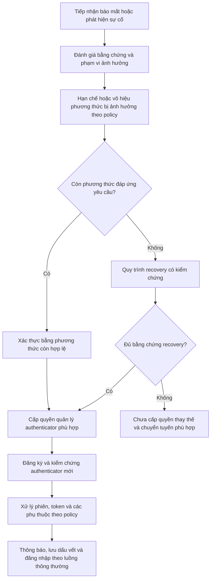

# Authenticator loss

## 1. Mất authenticator là một sự kiện bảo mật và khả dụng

**Authenticator loss** là tình huống người dùng không còn kiểm soát hoặc không thể sử dụng authenticator đã gắn với tài khoản. Ví dụ gồm mất điện thoại có ứng dụng OTP, thất lạc security key, hỏng thiết bị giữ private key hoặc xóa ứng dụng mà không còn credential cần thiết.

Sự kiện này tạo ra hai vấn đề đồng thời:

- Người dùng hợp lệ có thể không đăng nhập được.
- Người khác có thể có cơ hội sử dụng thiết bị, bí mật hoặc phiên còn tồn tại.

Không nên chờ chứng minh đã có đăng nhập trái phép rồi mới xử lý một authenticator bị mất. Cũng không nên coi mọi tình huống không đăng nhập được là cùng một loại sự cố và áp dụng một nút “tắt MFA” cho tất cả.

NIST xem mất, bị đánh cắp, hư hỏng và bị sao chép trái phép là các sự kiện cần quản lý trong vòng đời authenticator; tài liệu yêu cầu xử lý kịp thời authenticator bị xâm phạm. [NIST SP 800-63B-4, mục 4.3](https://pages.nist.gov/800-63-4/sp800-63b.html#loss).

Trong một hệ thống IAM, mục tiêu không chỉ là giúp người dùng vào lại tài khoản. Hệ thống cần loại bỏ đường truy cập không còn đáng tin, giữ nguyên ranh giới quyền và đưa người dùng trở lại mức xác thực mà policy yêu cầu.

## 2. “Mất thiết bị” khác với “mất mọi phương thức xác thực”

Một thiết bị có thể chứa nhiều thành phần của một chuỗi truy cập. Ngược lại, một credential có thể vẫn sử dụng được trên thiết bị khác tùy cơ chế.

| Tình huống | Điều cần xác định trước khi xử lý |
|---|---|
| Mất security key chính nhưng còn khóa dự phòng đã đăng ký | Khóa dự phòng có đáp ứng policy hiện tại không? |
| Mất điện thoại chứa TOTP | Những seed và tài khoản nào nằm trên thiết bị đó? |
| Điện thoại bị mất khi còn mở khóa | Có phiên email, password manager hoặc ứng dụng nghiệp vụ đang hoạt động không? |
| Xóa ứng dụng OTP | Có bản sao hợp lệ còn dùng được, và secret cũ có cần thay không? |
| Mất một thiết bị có passkey đồng bộ | Credential có còn trên thiết bị khác, và tài khoản đồng bộ có bị ảnh hưởng không? |
| Mất thiết bị có credential gắn riêng với thiết bị | Có thể sử dụng phương thức khác mà không cần tái tạo private key đã mất không? |
| Quên PIN hoặc bị khóa khả năng kích hoạt authenticator | Đây là mất khả năng sử dụng; cách khắc phục phụ thuộc authenticator |
| Quên mật khẩu nhưng còn authenticator khác | Luồng đổi hoặc khôi phục có phù hợp với bằng chứng còn lại không? |

Một người vẫn có thể đăng nhập không có nghĩa sự cố đã kết thúc. Họ có thể còn khóa dự phòng, trong khi khóa bị mất vẫn được hệ thống chấp nhận.

Tương tự, không truy cập được một ứng dụng OTP không chứng minh secret đã biến mất ở mọi nơi. Nếu secret từng được sao chép, các bản sao có thể tiếp tục tạo mã.

## 3. Bốn công việc phải phân biệt

Khi xử lý mất authenticator, cần tách rõ mục đích và quyền của từng thao tác:

| Công việc | Mục đích | Không được tự suy ra |
|---|---|---|
| Báo mất | Tiếp nhận sự kiện và thông tin ban đầu | Người báo đã có quyền đăng nhập |
| Hạn chế hoặc vô hiệu authenticator | Ngăn sử dụng phương thức không còn tin cậy | Người yêu cầu được đăng ký bất kỳ phương thức thay thế nào |
| Khôi phục hoặc gắn authenticator mới | Thiết lập lại khả năng xác thực có kiểm chứng | Được cấp thêm vai trò hoặc mở lại tài khoản đã bị vô hiệu |
| Xử lý phiên và token | Chặn đường truy cập đã được cấp trước đó khi policy yêu cầu | Xóa credential tự làm mọi phiên hết hiệu lực |

Quyền **báo mất để giảm rủi ro** có thể khác quyền **khôi phục toàn bộ truy cập**. Không bắt người đã mất một yếu tố phải hoàn thành chính yếu tố đó chỉ để gửi báo cáo.

NIST mô tả các cách xác thực thay thế khi báo mất và việc đánh giá tính xác thực của yêu cầu vô hiệu dựa trên rủi ro. Điều này không đồng nghĩa mọi báo cáo công khai đều được phép thay authenticator hoặc cấp phiên. [NIST SP 800-63B-4, mục 4.3 và 4.5](https://pages.nist.gov/800-63-4/sp800-63b.html#invalidation).

Trong hệ thống minh họa Harbor, một báo cáo chưa xác minh có thể tạo case và hướng dẫn bước tiếp theo. Thay đổi bảo mật được thực hiện theo policy phù hợp với mức bằng chứng và tín hiệu sự cố. Không tự vô hiệu hàng loạt tài khoản chỉ từ một username do người lạ nhập.

## 4. Nhận diện phạm vi ảnh hưởng

### 4.1. Lập bản đồ thiết bị, credential và tài khoản

Câu hỏi “mất điện thoại nào?” chưa đủ để quyết định dữ liệu cần thu hồi. Cần xác định những quan hệ liên quan:

```text
Thiết bị bị mất
  ├─ Authenticator TOTP cho cổng quản trị
  ├─ Passkey hoặc private key của một số dịch vụ
  ├─ Phiên đăng nhập email
  ├─ Phiên ứng dụng nghiệp vụ
  └─ Kênh nhận thông báo hoặc hỗ trợ recovery
```

Danh sách trên là một ví dụ về phụ thuộc, không phải khẳng định mọi điện thoại đều chứa các thành phần đó.

Trong hồ sơ IAM, mỗi credential nên có định danh nội bộ, chủ sở hữu, loại, trạng thái và những metadata quản lý cần thiết. Người dùng có thể đặt nhãn “điện thoại công việc” hoặc “khóa dự phòng”, nhưng nhãn tự khai không phải bằng chứng phần cứng.

Không hiển thị secret TOTP hoặc private key để hỗ trợ viên “đối chiếu thiết bị”. Hoạt động kiểm kê cần dựa vào metadata và quan hệ sở hữu, không yêu cầu đọc bí mật.

### 4.2. Các phương thức dự phòng có thực sự độc lập?

Nếu OTP, email recovery và password manager đều chỉ truy cập được từ cùng điện thoại, chúng có thể cùng mất khi điện thoại mất.

Hai ứng dụng tạo TOTP từ cùng seed không phải hai secret độc lập. Thay hoặc vô hiệu seed cũ tác động tới mọi bản sao dùng seed đó.

Với credential đồng bộ, vô hiệu credential tại RP có thể làm các bản sao của credential ấy cùng mất quyền ở dịch vụ. Không mặc định rằng một Credential ID tương ứng với đúng một thiết bị vật lý.

Bài toán dự phòng vì vậy không chỉ là đếm có bao nhiêu nút đăng nhập. Cần xem các phương thức có chung thiết bị, tài khoản đồng bộ, bí mật hoặc đường khôi phục hay không.

## 5. Quy trình xử lý ở mức khái niệm



Sơ đồ không có nghĩa mọi tác động phải đợi đến cuối luồng. Nếu thiết bị có phiên bị lộ, việc chặn phiên có thể cần thực hiện ngay khi có đủ căn cứ. Thứ tự cụ thể phụ thuộc mức độ sự cố và thẩm quyền của từng thành phần.

Cũng không có cạnh “đợi đủ lâu rồi tự coi bằng chứng là hợp lệ”. Thời gian chờ có thể là một kiểm soát bổ sung của policy, không thay việc xác minh quyền với tài khoản.

### 5.1. Còn phương thức thay thế đủ mạnh

Người dùng có khóa dự phòng đã đăng ký có thể dùng khóa đó để xác thực theo yêu cầu hiện tại, rồi quản lý credential bị mất.

Cần kiểm tra yêu cầu thực tế. Chỉ còn mật khẩu không có nghĩa người dùng đã đáp ứng một luồng vốn yêu cầu MFA. Tuy vậy, mật khẩu còn hợp lệ có thể được policy dùng cho một quyền hạn chế như báo mất và yêu cầu chặn authenticator.

Không ép mọi người dùng đi qua helpdesk nếu họ đã có đường tự phục vụ đáp ứng policy.

### 5.2. Không còn đủ phương thức

Trường hợp này cần recovery. Bằng chứng chấp nhận được phải được xác định từ trước theo loại tài khoản, lịch sử thiết lập và mức rủi ro.

Có thể có recovery code đã cấp trước, phương thức dự phòng khác hoặc quy trình hỗ trợ có kiểm chứng. Không tự thay chúng bằng câu hỏi có đáp án lấy từ hồ sơ công khai.

Nếu chưa đủ bằng chứng, kết quả có thể là chưa thể cấp lại quyền truy cập. Áp lực giải quyết ticket không làm một phương thức yếu tự trở thành bằng chứng đủ.

## 6. Trạng thái credential và yêu cầu recovery

### 6.1. “Báo mất” là sự kiện, không phải mọi trạng thái của hệ thống

Harbor dùng mô hình minh họa:

| Trạng thái credential | Ý nghĩa |
|---|---|
| `PENDING` | Credential mới đang được thiết lập, chưa được dùng để đăng nhập bình thường |
| `ACTIVE` | Được phép sử dụng theo policy |
| `SUSPENDED` | Tạm ngừng chấp nhận trong khi xử lý sự cố hoặc xem xét |
| `REVOKED` | Quan hệ sử dụng đã bị vô hiệu theo policy của Harbor |

Trong Harbor, `REVOKED` là trạng thái kết thúc của bản ghi credential. Nếu cần thiết lập lại phương thức, hệ thống đi qua quy trình binding mới thích hợp; không tự chuyển lại `ACTIVE` vì người dùng báo đã tìm thấy thiết bị.

Nếu hỗ trợ tạm đình chỉ, việc mở lại `SUSPENDED` phải là một thao tác có kiểm chứng riêng. Không để một request từ credential đang bị đình chỉ tự mở lại chính nó.

Đây là mô hình của ví dụ; hệ thống khác có thể dùng tên trạng thái khác. Điều bắt buộc trong thiết kế là server thực sự thực thi việc không chấp nhận credential theo trạng thái tương ứng.

### 6.2. Recovery có vòng đời riêng

Một case recovery có thể đã được xác minh bằng chứng nhưng authenticator mới chưa được kích hoạt. Hoặc credential bị mất đã bị chặn trong khi người dùng chưa đủ điều kiện nhận phương thức thay thế.

Không dùng một cờ `recovered=true` để đại diện cho mọi tác động đó. Cần biết rõ:

- Bằng chứng nào đã được kiểm chứng.
- Credential nào đã bị chặn.
- Quyền nào đã được cấp cho context recovery.
- Credential mới đã được kiểm chứng sử dụng hay chưa.
- Những tác động lên phiên, token hoặc IdP còn đang chờ.

Khi một bước hạ tầng chưa thành công, ghi trạng thái chờ và xử lý retry phù hợp. Không báo “đã thu hồi mọi truy cập” chỉ vì đã đóng case trong công cụ hỗ trợ.

### 6.3. Kiểm tra đồng thời

Giả sử một challenge đăng nhập đã được tạo trước khi khóa bị báo mất. Sau đó, credential bị thu hồi, nhưng assertion hợp lệ mới tới server.

Harbor kiểm tra lại trạng thái credential và tài khoản tại bước hoàn tất. Challenge cũ không phải giấy phép bỏ qua một thay đổi bảo mật vừa có hiệu lực.

Nếu có cache, hàng đợi hoặc nhiều node, phải xác định cửa sổ trạng thái cũ còn được chấp nhận và cơ chế giảm cửa sổ đó. Việc ghi đúng vào một bảng chưa chứng minh mọi đường đăng nhập đã dùng trạng thái mới.

## 7. Thay authenticator theo từng loại

| Loại bị mất hoặc không còn tin cậy | Hướng xử lý cần thiết kế |
|---|---|
| TOTP | Tạo secret mới, kiểm chứng đăng ký và chặn secret cũ; không chỉ đổi tên thiết bị |
| Security key/WebAuthn | Đăng ký credential thay thế và vô hiệu credential cũ đúng phạm vi |
| Mật khẩu bị quên hoặc nghi lộ | Thiết lập mật khẩu mới qua luồng phù hợp, không gửi lại mật khẩu cũ |
| Chứng thư và private key trên thiết bị | Xử lý credential và trạng thái thu hồi tại nơi có thẩm quyền, cùng cách verifier kiểm tra |
| Kênh SMS hoặc số điện thoại | Đánh giá quyền kiểm soát số và quá trình thay đổi; giữ nguyên số không tự chứng minh thiết bị cũ an toàn |
| Credential đồng bộ | Xét cả bản sao và tài khoản đồng bộ; không giả định đã chặn riêng một thiết bị chỉ bằng thao tác tại RP |

Với TOTP, giữ lại seed cũ rồi quét lại vào điện thoại mới là di chuyển hoặc sao chép khả năng tạo mã, không loại bỏ bản sao mà attacker có thể đã có. Khi mục tiêu là loại bỏ secret nghi lộ, phải thay secret và thực thi việc từ chối secret cũ.

Với WebAuthn, public key trên server không cho phép tạo lại private key đã mất. Phương thức thay thế được gắn với tài khoản thông qua một quy trình đăng ký được phép.

Việc khóa hoặc xóa thiết bị từ xa có thể là một biện pháp bổ sung nếu có hạ tầng hỗ trợ. Không dựa duy nhất vào nó để vô hiệu credential tại server: thiết bị có thể đang offline hoặc lệnh chưa được thực thi.

## 8. Mất authenticator không đồng nghĩa mọi phiên đã hết hiệu lực

### 8.1. Credential và phiên có vòng đời khác nhau

Một authenticator thường được dùng để thiết lập hoặc nâng mức xác thực của phiên. Sau đó, ứng dụng có thể chấp nhận cookie hoặc token mà không yêu cầu authenticator cho từng request.

Vì vậy, vô hiệu khóa bị mất có thể ngăn đăng nhập mới, nhưng một cookie trên điện thoại bị mất vẫn còn dùng được nếu chưa bị xử lý.

OWASP xem recovery và những sự kiện rủi ro cao là tình huống cần xem xét xác thực lại, cùng các kiểm soát vòng đời phiên. [OWASP Session Management Cheat Sheet — Reauthentication After Risk Events](https://cheatsheetseries.owasp.org/cheatsheets/Session_Management_Cheat_Sheet.html#reauthentication-after-risk-events).

Trong Harbor, mỗi loại đường truy cập có tác động riêng:

| Đối tượng | Tác động cần xác nhận |
|---|---|
| Credential bị mất | Không được dùng để đăng nhập hoặc step-up mới |
| Phiên web trên thiết bị bị ảnh hưởng | Bị chặn theo policy sự cố |
| Refresh grant liên quan | Không tiếp tục cấp access token khi đã bị thu hồi |
| Access token đang lưu hành | Bị chặn theo cơ chế kiểm tra trạng thái hoặc hết hiệu lực theo hợp đồng thời gian |
| Phiên tại ứng dụng dùng SSO | Được xử lý theo ranh giới giữa IdP và từng ứng dụng |

Nếu không xác định tin cậy được phiên nào thuộc thiết bị mất, policy có thể chọn phạm vi rộng hơn, chẳng hạn thu hồi mọi phiên của tài khoản. Đây là quyết định đánh đổi về rủi ro và gián đoạn, không phải thao tác ngẫu nhiên.

### 8.2. Thu hồi phải có đường thực thi

Một JWT được verifier kiểm tra hoàn toàn cục bộ có thể còn được chấp nhận tới hạn nếu verifier không kiểm tra trạng thái thu hồi. Đổi mật khẩu hoặc xóa authenticator không tự đổi chữ ký của JWT đó.

Nếu dùng phiên bản bảo mật của tài khoản, danh sách thu hồi hoặc introspection, cần chỉ rõ thành phần nào kiểm tra chúng và cache có độ trễ bao nhiêu. Không chỉ thêm một field vào cơ sở dữ liệu rồi tuyên bố đã có thu hồi tức thì.

RFC 7009 mô tả cơ chế thu hồi token OAuth và lưu ý có thể có độ trễ lan truyền; phạm vi tác động tới token liên quan phụ thuộc policy và khả năng của authorization server. [RFC 7009, mục 2.1](https://www.rfc-editor.org/rfc/rfc7009.html#section-2.1).

### 8.3. Khi sử dụng IdP bên ngoài

Ứng dụng không nên tạo một mật khẩu cục bộ để né MFA tại IdP chỉ vì người dùng mất thiết bị. Authenticator phải được quản lý tại nơi có thẩm quyền theo hợp đồng liên kết danh tính.

Chặn đăng nhập tại IdP cũng không tự bảo đảm phiên cục bộ của mọi ứng dụng đã kết thúc. Thiết kế SSO cần nêu rõ ứng dụng nào nhận sự kiện, ứng dụng nào kiểm tra lại trạng thái và thời gian tối đa chấp nhận phiên cũ.

## 9. Recovery không được trở thành một đường chiếm tài khoản

OWASP lưu ý việc thay đổi MFA là hành động rủi ro cao và không nên chỉ dựa vào phiên đang mở; có thể cần xác thực lại và thông báo độc lập. [OWASP Multifactor Authentication Cheat Sheet — Changing MFA Factors](https://cheatsheetseries.owasp.org/cheatsheets/Multifactor_Authentication_Cheat_Sheet.html#changing-mfa-factors).

Trong Harbor, quyền recovery có phạm vi hẹp:

```text
Được phép:
  - xem trạng thái cần thiết của luồng recovery
  - đăng ký authenticator thay thế khi đủ điều kiện
  - kiểm chứng authenticator mới
  - hoàn tất các bước bảo mật đã được policy cho phép

Không tự được phép:
  - đọc dữ liệu nghiệp vụ
  - cấp thêm vai trò
  - chuyển tài khoản sang tenant khác
  - đổi chủ sở hữu tài khoản
  - mở lại tài khoản bị vô hiệu do vòng đời nhân sự
```

Nếu sử dụng recovery code một lần, server phải tiêu thụ nguyên tử và xử lý cạnh tranh. Hai request không được cùng dùng một mã để tạo hai quyền thay thế độc lập.

Không ghi recovery code, seed OTP, mật khẩu hoặc cookie vào ticket. Hỗ trợ viên không cần biết bí mật mà người dùng dùng để chứng minh quyền kiểm soát.

Với tài khoản đặc quyền, Harbor có thể yêu cầu thêm một người phê duyệt độc lập cho nhánh hỗ trợ thủ công. Đây là lựa chọn kiểm soát của hệ thống mẫu, không phải khẳng định rằng mọi tài khoản đều phải có cùng quy trình.

## 10. Tình huống tổng hợp: Lan mất điện thoại công việc

Lan có tài khoản quản trị tại Harbor. Điện thoại chứa TOTP, email công việc đang đăng nhập và một phiên của cổng quản trị. Lan còn một security key dự phòng đã đăng ký, được giữ ở nơi khác.

Một cách xử lý phù hợp với policy minh họa:

1. Lan dùng một endpoint đáng tin cậy và đường chính thức để báo sự cố.
2. Hệ thống xác định phạm vi gồm TOTP, các phiên liên quan và kênh email có thể bị ảnh hưởng.
3. Lan xác thực bằng security key dự phòng theo yêu cầu của Harbor.
4. TOTP cũ bị vô hiệu; Lan đăng ký secret mới và hoàn thành kiểm chứng.
5. Các phiên và refresh grant trong phạm vi sự cố được xử lý theo policy.
6. Hệ thống xác nhận hiệu lực trên các node và phát thông báo qua những kênh phù hợp còn đáng tin.
7. Lan đăng nhập lại bằng phương thức đạt yêu cầu; case chỉ đóng khi các tác động bắt buộc đã có kết quả rõ ràng.

Đổi tên TOTP cũ thành “điện thoại mới” không giải quyết sự cố. Xóa riêng cookie trên trình duyệt Lan đang dùng cũng không chặn cookie còn trên điện thoại mất.

Nếu email chỉ truy cập được từ điện thoại đó, không nên coi đường email như một phương án dự phòng hoàn toàn độc lập. Nhóm xử lý cần đánh giá thêm tài khoản email và khả năng nhận thông báo.

Nếu Lan không còn security key hoặc bằng chứng thay thế đủ điều kiện, hệ thống chuyển sang recovery. Nó không tự cho phép chỉ nhập mật khẩu để trở lại quyền quản trị vì người dùng đang cần xử lý gấp.

## 11. Vận hành, thông báo và bằng chứng

### 11.1. Hướng dẫn người dùng

Thông điệp cần giúp người dùng biết:

- Đường chính thức để báo mất.
- Thông tin nào cần cung cấp mà không tiết lộ bí mật.
- Những phương thức còn có thể sử dụng.
- Tác động dự kiến như đăng xuất khỏi các thiết bị.
- Cách nhận biết hoặc báo lại hoạt động không do mình thực hiện.

Không yêu cầu người dùng nhấp một link bất kỳ trong tin nhắn hỗ trợ rồi đọc OTP cho người gọi. Quy trình hướng dẫn phải nhất quán với mục tiêu chống chiếm tài khoản.

### 11.2. Dấu vết cần ghi

Báo cáo sự cố có thể cần mã case, tài khoản và tenant liên quan, credential bị ảnh hưởng, bằng chứng đã kiểm chứng ở mức tham chiếu, người ra quyết định, thay đổi trạng thái và thời điểm áp dụng.

Không cần lưu bản rõ của bí mật để chứng minh “đã kiểm tra đúng”. Hạn chế dữ liệu cá nhân trong ticket và chỉ cho người có vai trò phù hợp truy cập.

Thông báo phải mô tả sự kiện đủ để chủ tài khoản nhận ra sai lệch, nhưng không gửi bí mật thay thế mới qua cùng payload thông báo.

### 11.3. Hoàn tất dựa trên tác động, không chỉ trạng thái ticket

Một tác vụ vô hiệu credential có thể thành công trong khi dịch vụ thu hồi phiên đang lỗi. Harbor ghi rõ phần đã hoàn tất, phần đang chờ và cách retry.

Với thay đổi trạng thái cục bộ, có thể dùng giao dịch phù hợp và sự kiện bền vững cho các tác động sau commit. Với IdP hay ứng dụng ngoài, cần xác nhận kết quả theo cơ chế của hệ thống đó; không giả định có một transaction bao trùm mọi dịch vụ.

Nếu một bước bắt buộc chưa đạt, giao diện phải nói đúng mức bảo vệ hiện có. Không biến thông báo “đã nhận báo mất” thành cam kết “mọi truy cập trái phép đã bị chặn”.

## 12. Những ca cần kiểm chứng trong thiết kế

| Ca kiểm tra | Kết quả mong đợi |
|---|---|
| Báo mất không có đủ bằng chứng | Tiếp nhận phù hợp nhưng không tự cấp quyền thay authenticator |
| Dùng phương thức dự phòng đáp ứng policy | Được đi vào quyền quản lý đã xác định |
| Chỉ còn mật khẩu trong tài khoản yêu cầu MFA | Không tự nhận phiên nghiệp vụ đủ assurance |
| Credential đã bị thu hồi trả lời challenge cũ | Không tạo đăng nhập mới ngoài hợp đồng hiệu lực đã công bố |
| Đăng ký credential mới nhưng chưa kiểm chứng | Chưa đánh dấu hoàn tất thay thế |
| Mã recovery được gửi đồng thời ở hai request | Không cấp hai quyền độc lập từ một lần sử dụng |
| Secret TOTP cũ vẫn tồn tại trên một bản sao | Mã từ secret cũ bị từ chối sau khi thay thế có hiệu lực |
| Credential đồng bộ bị vô hiệu | Tác động đúng phạm vi credential, không tuyên bố sai rằng chỉ một thiết bị bị chặn |
| Node có cache trạng thái cũ | Độ trễ áp dụng lệnh được đo và khớp hợp đồng |
| Dịch vụ thu hồi phiên bị lỗi | Ghi nhận trạng thái chờ, không báo hoàn tất toàn bộ |
| Tài khoản bị vô hiệu trong khi recovery diễn ra | Không được mở lại bởi recovery |
| Tìm thấy thiết bị sau khi credential đã bị thu hồi | Không tự kích hoạt lại credential |
| Phiên tại RP vẫn còn sau thay đổi ở IdP | Hành vi khớp chính sách liên kết phiên đã thiết kế |
| Log và ticket được kiểm tra | Không có seed, mật khẩu, recovery code hoặc cookie rõ |

Các ca thành công và thất bại phải có đối chứng phù hợp. Khi kiểm tra lệnh thu hồi, ghi thời điểm thay đổi và thời điểm từng verifier thực sự từ chối, thay vì chỉ nhìn một cờ trong trang quản trị.

## 13. Các hiểu lầm thường gặp

**“Mất authenticator chỉ là lỗi hỗ trợ người dùng.”** Đây còn là nguy cơ mất quyền kiểm soát bí mật và phiên. Cần phối hợp xử lý bảo mật với khôi phục khả dụng.

**“Có phương thức dự phòng thì không cần thu hồi cái bị mất.”** Phương thức dự phòng giúp người dùng hợp lệ tiếp tục xác thực; nó không vô hiệu phương thức mà người khác có thể đang giữ.

**“Chỉ cần đổi mật khẩu là mọi truy cập cũ dừng lại.”** Phải xét credential khác, phiên và token; mỗi loại có cách thực thi thu hồi riêng.

**“Tìm lại được điện thoại thì credential cũ tự an toàn.”** Thiết bị có thể đã bị truy cập hoặc secret đã bị sao chép. Việc dùng lại cần quyết định theo policy và trạng thái hiện tại, không chỉ dựa vào việc tìm thấy.

**“Recovery thành công được phép nâng quyền để người dùng làm việc tiếp.”** Recovery khôi phục khả năng xác thực phù hợp. Nó không cấp thêm quyền, đổi tenant hoặc bỏ qua vòng đời tài khoản.

Quản lý authenticator loss tốt nghĩa là biết phương thức nào không còn đáng tin, ngăn sử dụng nó đúng phạm vi, xử lý các đường truy cập liên quan và thiết lập lại khả năng xác thực bằng bằng chứng phù hợp.
