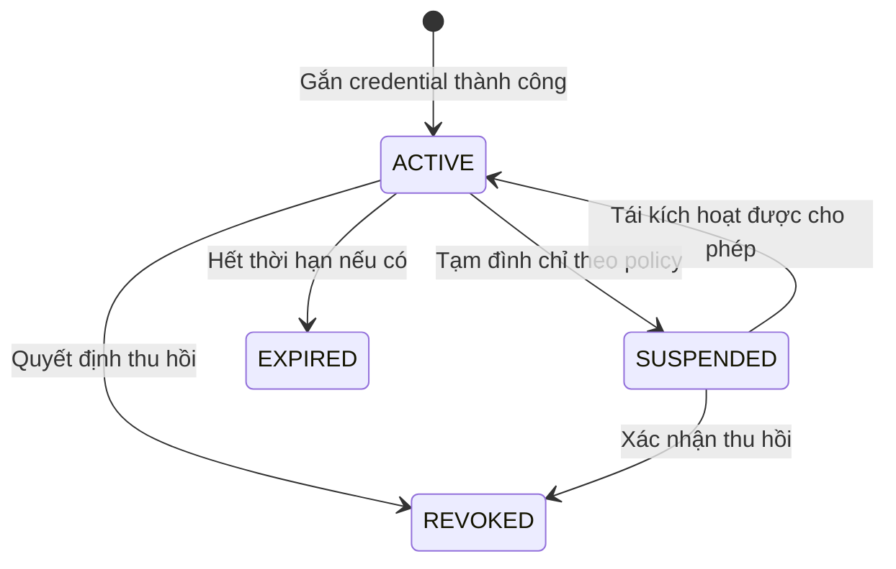
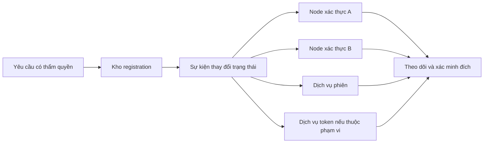

# Authenticator revocation

## 1. Thu hồi authenticator có nghĩa là gì?

**Authenticator revocation** là việc chấm dứt khả năng dùng một authenticator hoặc credential đã đăng ký để xác thực trong phạm vi được quản lý. Đối tượng vẫn có thể tồn tại về mặt vật lý, nhưng hệ thống không còn chấp nhận quan hệ xác thực tương ứng.

Ví dụ, một người làm mất khóa bảo mật. Khóa vẫn có thể tạo chữ ký hợp lệ bằng private key bên trong, nhưng dịch vụ phải từ chối credential đã bị thu hồi. **Bằng chứng mật mã hợp lệ không có nghĩa credential vẫn được phép sử dụng.**

Trong NIST SP 800-63B-4, invalidation được mô tả là loại bỏ liên kết giữa authenticator và tài khoản thuê bao. Những trường hợp như bị xâm phạm, người dùng yêu cầu hoặc không còn đủ điều kiện sử dụng là lý do cần xử lý vòng đời này. [NIST SP 800-63B-4, Invalidation](https://pages.nist.gov/800-63-4/sp800-63b.html#invalidation).

Trong thiết kế IAM thực tế, từ “thu hồi” có thể được dùng cho nhiều đối tượng: authenticator, certificate, session, token hoặc quyền. Bài này tập trung vào authenticator, đồng thời chỉ ra những đối tượng liên quan cần xử lý riêng để tránh để lại đường truy cập.

## 2. Phân biệt những hành động thường bị gọi chung là “revoke”

| Hành động | Đối tượng chính | Điều không tự được bảo đảm |
|---|---|---|
| Thu hồi một authenticator | Quan hệ authenticator/credential với tài khoản | Mọi phiên đã tạo đều kết thúc |
| Thu hồi certificate | Trạng thái chứng chỉ trong cơ chế tin cậy PKI | Mọi bên kiểm tra đã nhận trạng thái mới |
| Thu hồi refresh token | Credential xin token mới | Mọi access token đã phát hành lập tức mất hiệu lực |
| Kết thúc session | Trạng thái phiên tại hệ thống tương ứng | Authenticator không còn đăng nhập lại được |
| Thu hồi membership hoặc vai trò | Quyền của principal trong phạm vi tài nguyên | Người dùng không đăng nhập được vào các phạm vi khác |
| Khóa tài khoản | Khả năng sử dụng tài khoản theo policy | Credential tại hệ thống bên ngoài đã bị xóa |
| Xóa ứng dụng trên thiết bị | Bản cài đặt hoặc dữ liệu cục bộ | Bản sao credential hoặc registration ở server đã mất |

Ví dụ, xóa ứng dụng OTP trên điện thoại không chứng minh verifier đã ngừng chấp nhận seed cũ. Nếu seed từng được sao chép, bản sao khác vẫn có thể tạo mã cho tới khi quan hệ đó bị vô hiệu hóa tại nơi xác thực.

Ngược lại, vô hiệu hóa credential ở server không nhất thiết xóa dữ liệu trên thiết bị bị mất. Mục tiêu trước mắt là ngăn credential đó tiếp tục được chấp nhận; xóa dữ liệu hoặc xử lý thiết bị là một phần việc khác.

### Expiration khác revocation

Expiration xảy ra theo thời hạn đã định. Revocation là quyết định chấm dứt chấp nhận trước hoặc độc lập với thời hạn đó.

Một certificate còn hạn có thể đã bị thu hồi. Một authenticator không có ngày hết hạn vẫn cần khả năng thu hồi. Vì vậy, không dùng kiểm tra ngày hết hạn thay cho trạng thái hiện hành.

## 3. Xác định đúng phạm vi: một credential hay toàn bộ tài khoản?

Một tài khoản có thể có nhiều phương thức xác thực:

```text
Tài khoản U-204
    + Credential C-11: khóa bảo mật mang theo
    + Credential C-12: passkey đã đăng ký
    + Credential C-13: ứng dụng OTP
    + Phương thức dự phòng theo policy
    + Nhiều session và grant đã phát hành
```

Nếu người dùng chỉ làm mất khóa C-11, hệ thống có thể thu hồi riêng C-11, giữ các phương thức còn lại nếu không có bằng chứng ảnh hưởng rộng hơn. Nếu tài khoản bị chiếm đoạt và kẻ tấn công đã thêm credential mới, chỉ thu hồi khóa bị mất có thể chưa đủ.

Phạm vi xử lý phải dựa trên sự kiện:

| Sự kiện | Phạm vi cần xem xét |
|---|---|
| Mất một khóa đã nhận diện rõ | Credential của khóa đó và hoạt động liên quan |
| Lộ seed OTP | Registration dùng seed đó và các phiên có nguy cơ |
| Lộ private key client certificate | Chứng chỉ, registration, principal và kết nối liên quan |
| Tài khoản bị chiếm đoạt | Tất cả credential, phiên, grant, thay đổi recovery và quyền |
| Người dùng nghỉ việc | Tài khoản tổ chức, authenticator, membership và hệ thống liên quan |
| Thay thiết bị theo kế hoạch | Credential cũ cần ngừng chấp nhận, credential mới đã được gắn an toàn |

Không mở rộng phạm vi một cách tùy tiện, nhưng cũng không thu hẹp chỉ vì giao diện quản lý authenticator có một nút “Remove”.

### Một thiết bị không luôn tương ứng một credential

Một khóa phần cứng có thể giữ credential cho nhiều dịch vụ; thu hồi ở dịch vụ A không tự thu hồi ở B. Một thiết bị cũng có thể có nhiều credential thuộc cùng hoặc khác tài khoản.

Với credential được đồng bộ, nhiều thiết bị có thể sử dụng cùng một credential theo cơ chế của nền tảng. Nếu server thu hồi registration của credential đó, mục tiêu là từ chối mọi assertion của registration tương ứng, không chỉ một chiếc điện thoại có tên hiển thị trong giao diện.

Nếu các thiết bị có credential riêng, cần thu hồi từng registration nằm trong phạm vi sự cố. Muốn “thu hồi thiết bị”, hệ thống phải có mô hình liên kết thiết bị với credential; tên do người dùng tự đặt chưa đủ làm bằng chứng chắc chắn.

## 4. Khi nào cần thu hồi hoặc tạm đình chỉ?

Các lý do thường gặp gồm:

- Người dùng báo mất, bị đánh cắp hoặc không còn kiểm soát authenticator.
- Có bằng chứng hoặc nghi ngờ đáng kể về việc lộ key, seed hay credential.
- Credential được gắn sai tài khoản hoặc được thêm trái phép.
- Tài khoản không còn đủ điều kiện sử dụng theo vòng đời tổ chức.
- Authenticator được thay thế hoặc ngừng sử dụng.
- Chính sách không còn chấp nhận loại authenticator hoặc thuộc tính bảo vệ của nó.

Một hệ thống có thể hỗ trợ **suspension**, tức tạm đình chỉ trong lúc xác minh. Suspension và revocation cần có ngữ nghĩa riêng; không nên chỉ đổi tên cùng một trạng thái trên giao diện.

Ví dụ mô hình do ứng dụng tự định nghĩa:



Đây là state machine minh họa, không phải bộ trạng thái bắt buộc của mọi tiêu chuẩn hoặc sản phẩm.

Trong thiết kế này, `REVOKED` là trạng thái kết thúc của registration cũ. Nếu cần cung cấp lại khả năng truy cập, tạo một quan hệ đăng ký mới qua quy trình được phép. Không “undo revoke” một credential đã xác nhận bị xâm phạm chỉ để làm luồng hỗ trợ nhanh hơn.

Nếu suspension cho phép khôi phục, cần điều kiện, người có thẩm quyền và bằng chứng phù hợp. Chính credential đang bị đình chỉ không nên là bằng chứng duy nhất để tự tái kích hoạt nó.

## 5. Ai được yêu cầu thu hồi?

Một thao tác thu hồi có thể gây mất khả năng truy cập của người dùng thật. Vì vậy, endpoint thu hồi cần được bảo vệ như một thao tác thay đổi trạng thái an ninh, không phải một tiện ích không cần quyền.

Những chủ thể có thể được policy cho phép:

| Chủ thể | Ví dụ quyền được cấp |
|---|---|
| Người dùng | Thu hồi authenticator của chính mình sau xác thực phù hợp |
| Bộ phận hỗ trợ | Xử lý báo mất trong phạm vi quy trình được ủy quyền |
| Quản trị IAM | Thu hồi credential của đối tượng thuộc phạm vi quản lý |
| Nhóm ứng phó sự cố | Vô hiệu hóa khẩn cấp theo điều kiện được phê duyệt |
| Hệ thống vòng đời | Thu hồi theo quyết định nghỉ việc hoặc hết điều kiện |

Không chỉ kiểm tra rằng actor đã đăng nhập. Phải kiểm tra actor có quyền tác động đến **đúng tài khoản, credential, tenant và môi trường** hay không.

### Không buộc người dùng chứng minh bằng thứ đã mất

Nếu người dùng báo mất khóa C-11, quy trình không thể luôn yêu cầu họ dùng chính C-11 để xác nhận. Có thể dùng một authenticator hợp lệ khác hoặc quy trình recovery được thiết kế.

Mức xác minh cần cân bằng rủi ro khóa nhầm với rủi ro tiếp tục chấp nhận một credential bị xâm phạm. Không có một câu trả lời cố định như “mọi lần revoke đều phải dùng MFA hiện tại” cho tất cả tình huống.

Trong tình huống khẩn cấp, chính sách có thể cho phép tạm chặn trước rồi xác minh thêm. Điều đó cần được thiết kế sẵn, có phạm vi, audit và đường xử lý tiếp, thay vì là ngoại lệ tùy hứng của nhân viên hỗ trợ.

### Authenticator cuối cùng cần xử lý riêng

Gỡ authenticator cuối cùng có thể khiến tài khoản không còn đường đăng nhập. Giao diện cần cho biết hậu quả và đường recovery hợp lệ.

Tuy nhiên, không giữ một authenticator đã bị xâm phạm hoạt động chỉ vì đó là phương thức cuối. Thiết kế có thể khóa truy cập và chuyển sang recovery an toàn, tùy sự kiện và policy.

Không tự bỏ yêu cầu MFA hoặc bật một phương thức yếu hơn chỉ để người dùng còn đăng nhập được ngay sau thu hồi.

## 6. Dữ liệu quản lý registration và yêu cầu thu hồi

Một mô hình tối thiểu có thể gồm:

```yaml
authenticatorRegistration:
  id: authn-reg-011
  principalId: user-204
  tenantScope: organization-alpha
  type: public-key-authenticator
  credentialReference: cred-internal-011
  state: REVOKED
  stateVersion: 18
  boundAt: "2026-11-01T08:00:00Z"
  revokedAt: "2026-11-20T03:10:00Z"
  revocationReason: REPORTED_LOST
  revocationRequestId: revoke-803
  revokedBy: user-204
```

Đây là dữ liệu giả lập phục vụ giải thích. `credentialReference` không phải private key, seed hoặc raw token. Những loại credential khác nhau có thể cần namespace hoặc phạm vi bổ sung, chẳng hạn relying party hoặc issuer.

Một yêu cầu phân tán còn cần theo dõi từng đích:

```text
revoke-803
    + credential store: đã áp dụng version 18
    + authentication node A: đã nhận version 18
    + authentication node B: chờ xác nhận
    + session service: hoàn tất phạm vi được yêu cầu
    + token service: không thuộc phạm vi hoặc trạng thái riêng
```

Trạng thái “không thuộc phạm vi” khác “chưa rõ”. Nếu token service được loại khỏi yêu cầu, phải nêu lý do dựa trên hợp đồng, không chỉ bỏ qua vì chưa có tích hợp.

### Giữ dấu vết mà không giữ secret không cần thiết

Hệ thống có thể xóa registration khỏi tập credential được phép hoặc giữ một bản ghi đã vô hiệu hóa để audit. Cách lưu phải đáp ứng chính sách dữ liệu và ngăn việc vô tình tái kích hoạt.

Không cần giữ seed OTP hoạt động hoặc private key chỉ để chứng minh đã thu hồi. Có thể giữ metadata, mã yêu cầu, thời điểm và bằng chứng xử lý phù hợp.

## 7. Quy trình thu hồi từ yêu cầu tới xác nhận hiệu lực

Một quy trình có thể được tổ chức thành các bước sau:

1. Nhận yêu cầu và xác định actor, tài khoản, registration, lý do.
2. Xác minh thẩm quyền và quyết định phạm vi cần tác động.
3. Ghi quyết định thu hồi vào nguồn trạng thái có thẩm quyền.
4. Ngăn các quyết định xác thực mới tiếp tục sử dụng registration đó.
5. Phát tán thay đổi tới cache, node hoặc dịch vụ liên quan.
6. Xử lý session, token và grant theo phạm vi đã quyết định.
7. Thông báo qua kênh phù hợp và giữ dấu vết audit.
8. Xác minh hiệu lực tại các điểm thực thi bắt buộc.
9. Chỉ đóng yêu cầu khi đạt điều kiện hoàn tất.

Cần phân biệt **request đã được nhận**, **trạng thái trung tâm đã đổi** và **các đích đã thực thi**. Một HTTP response thành công không tự có cùng ý nghĩa với cả ba.

Ví dụ hợp đồng phản hồi nội bộ:

```json
{
  "requestId": "revoke-803",
  "registrationId": "authn-reg-011",
  "authoritativeState": "REVOKED",
  "stateVersion": 18,
  "enforcementStatus": "PROPAGATING"
}
```

Đây không phải schema của một tiêu chuẩn giao thức. Nó minh họa việc không tuyên bố hoàn tất toàn hệ thống khi còn đích chưa cập nhật.

### Yêu cầu lặp lại phải có hành vi rõ ràng

Client hoặc tác vụ nền có thể retry vì mất response. Thu hồi cùng registration nhiều lần không nên tạo trạng thái mâu thuẫn hoặc vô tình tái kích hoạt credential.

Có thể dùng request ID và xử lý idempotent. Kết quả trả về cần đủ để caller biết yêu cầu đã tồn tại, trạng thái hiện hành và phần nào còn chờ.

Một retry không được làm mất `revokedAt` gốc hoặc viết đè actor đầu tiên theo cách phá dấu vết. Nếu có yêu cầu bổ sung phạm vi, ghi đó là một quyết định được liên kết, không âm thầm sửa lịch sử.

## 8. Thực thi theo từng loại authenticator

| Loại | Điểm thu hồi chính | Điều cần kiểm tra thêm |
|---|---|---|
| Public-key credential | Ngừng chấp nhận registration hoặc public key tương ứng | Cache credential, assertion đang xử lý, credential khác cùng thiết bị |
| OTP dùng seed | Ngừng dùng registration/seed cũ để xác minh | Bản sao seed, các cửa sổ mã đang được chấp nhận |
| Password | Thay hoặc vô hiệu hóa verifier theo sự kiện | Phiên, recovery, credential khác; policy đặt lại mật khẩu |
| Client certificate | Registration nội bộ và cơ chế trạng thái certificate theo mô hình | CRL/OCSP nếu áp dụng, cache, kết nối và TLS session |
| Push authenticator | Vô hiệu hóa liên kết thiết bị hoặc key tương ứng | Yêu cầu push đang chờ và token đăng ký liên quan |
| Recovery code | Vô hiệu hóa mã hoặc bộ mã theo policy | Mã đã được phát nhưng chưa dùng, khả năng phát lại |

Không phải loại nào cũng có cùng endpoint hoặc cơ chế thu hồi. Một ứng dụng quản lý nhiều phương thức cần adapter hoặc hợp đồng thực thi phù hợp, nhưng vẫn có mô hình điều phối và audit nhất quán.

### Public-key credential và WebAuthn

Relying party có thể ngừng chấp nhận credential ở server. Việc chỉ loại credential khỏi một danh sách gợi ý trên client chưa đủ; assertion dùng credential đã bị thu hồi vẫn phải bị server từ chối.

WebAuthn phân biệt việc server deregister credential với việc người dùng xóa credential trên authenticator. Các tình huống này được mô tả riêng trong phần decommissioning. [W3C WebAuthn, Decommissioning](https://www.w3.org/TR/webauthn-3/#sctn-decommissioning).

Một assertion có chữ ký đúng của registration đã bị thu hồi không được phép tạo session mới. Server cần kiểm tra trạng thái hiện hành, thay vì chỉ dựa vào public key đã tải từ trước.

### Certificate và kết nối đang mở

Thu hồi certificate cần đến được bên kiểm tra theo cơ chế được triển khai. Không mặc định mọi TLS endpoint kiểm tra trạng thái thu hồi với độ mới giống nhau.

Kết nối đã thiết lập cũng có thể tiếp tục tồn tại sau thay đổi trạng thái. Nếu yêu cầu bảo vệ đòi chặn nhanh, cần kết hợp kiểm tra principal ở tầng ứng dụng, xử lý kết nối, cache và chính sách TLS session.

### Seed và dữ liệu đã sao chép

Xóa seed trên một thiết bị không xóa được bản sao mà người khác đã có. Điểm kiểm soát hữu hiệu của verifier là ngừng chấp nhận registration cũ và thực hiện quy trình gắn lại authenticator hợp lệ nếu cần.

Tương tự, thu hồi một registration sinh trắc hoặc credential được kích hoạt bằng sinh trắc không “thay đổi cơ thể” của người dùng. Nếu dữ liệu sinh trắc đã lộ, đó còn là vấn đề bảo vệ dữ liệu riêng.

## 9. Tránh cuộc đua giữa xác thực và thu hồi

Giả sử node xác thực đọc registration lúc 10:00:00 và bắt đầu kiểm tra chữ ký. Lúc 10:00:01, registration bị thu hồi. Lúc 10:00:02, node kiểm tra xong rồi tạo session chỉ từ dữ liệu đã đọc.

Chữ ký có thể hoàn toàn đúng, nhưng quyết định tạo session đã dùng trạng thái cũ.

Một thiết kế cần xác định điểm quyết định có hiệu lực. Với một nguồn dữ liệu giao dịch chung, có thể kiểm tra lại trạng thái và phiên bản ngay tại bước tạo session, phối hợp với thao tác thu hồi bằng cơ chế khóa hoặc điều kiện cập nhật phù hợp.

Mã giả minh họa:

```java
Registration candidate = registrations.find(registrationId);
if (candidate == null) {
    return deny("UNKNOWN_REGISTRATION");
}

ValidatedProof proof = protocolVerifier.verify(
        response, expectedTransaction, candidate);

return transactions.run(tx -> {
    Account account = tx.lockAccount(candidate.principalId());
    Registration current = tx.lockRegistration(candidate.id());

    if (!account.isActive()
            || !current.isActive()
            || current.version() != candidate.version()) {
        return deny("AUTHENTICATOR_STATE_CHANGED");
    }

    return tx.createSession(
            account.id(),
            current.id(),
            current.version(),
            proof.authenticationContext());
});
```

Đây là mã giả, không phải thư viện Java hoàn chỉnh. Nó giả định thao tác thu hồi tuân theo cùng quy tắc giao dịch và thứ tự khóa, đồng thời việc tạo session thuộc ranh giới nhất quán được mô tả. Những kiểm tra giao thức khác vẫn do verifier thực hiện đầy đủ.

Nếu session được tạo trước điểm thu hồi có hiệu lực, nó trở thành phiên đã tồn tại và phải được xử lý theo chính sách phiên. Nếu quyết định tạo session xảy ra sau điểm đó trong cùng mô hình nhất quán, credential đã thu hồi phải bị từ chối.

Nếu session store hoặc nguồn credential nằm ở hệ thống khác, không thể chỉ bọc một hàm bằng tên `transaction` rồi coi như có giao dịch toàn cục. Cần hợp đồng version, sự kiện, kiểm tra lại hoặc điểm quyết định tập trung tương ứng.

### Challenge cũ không được làm sống lại credential

Một challenge được cấp khi credential còn hoạt động có thể được trả lời sau khi thu hồi. Verifier không được suy “challenge đã cấp hợp lệ nên credential vẫn được phép dùng”.

Cũng cần xử lý yêu cầu push đang chờ hoặc giao dịch step-up chưa hoàn tất. Kết quả đến muộn không được tự mở lại khả năng xác thực của registration cũ.

## 10. Session, token và federation cần phạm vi riêng

Sau khi xác thực, người dùng thường sử dụng session hoặc token thay vì authenticator trên từng request. Vì vậy, thu hồi authenticator không tự có nghĩa mọi request sau đó đều bị chặn.

Nhóm thiết kế cần trả lời:

| Câu hỏi | Ví dụ quyết định cần có |
|---|---|
| Có kết thúc phiên được tạo bằng credential bị ảnh hưởng không? | Tác động tới các phiên có nguồn gốc xác định được |
| Có kết thúc mọi phiên tài khoản không? | Có thể cần khi sự cố ảnh hưởng toàn tài khoản |
| Có thu hồi refresh token hoặc grant không? | Xác định theo phạm vi và quan hệ nguồn gốc |
| Access token đã phát còn được chấp nhận bao lâu? | Theo cơ chế trạng thái và thời hạn được thực thi |
| Phiên SSO tại IdP có bị tác động không? | Theo năng lực và hợp đồng với IdP |
| Phiên tại từng relying party được xử lý thế nào? | Cơ chế thông báo, kiểm tra trạng thái hoặc đóng phiên |

Nếu hệ thống không lưu đủ quan hệ giữa session và bằng chứng xác thực, không nên tuyên bố có thể kết thúc chính xác “mọi phiên của đúng khóa đó”. Có thể cần phạm vi rộng hơn hoặc phải ghi rõ giới hạn.

Một session cũng có thể được xác thực tăng cường bằng authenticator khác về sau. Vì vậy, nếu policy muốn tác động theo nguồn gốc xác thực, mô hình dữ liệu phải phản ánh bối cảnh đó, thay vì chỉ lưu một trường `lastCredentialId` rồi suy mọi quan hệ.

### OAuth token revocation là một cơ chế riêng

RFC 7009 quy định thu hồi token và nêu rõ chính sách ảnh hưởng tới token hoặc grant liên quan. HTTP 200 cũng có thể được trả về khi token được gửi tới đã không hợp lệ; response không chứng minh token đó từng tồn tại hoặc mọi API đã đồng bộ tức thời. [RFC 7009, Revocation Response](https://www.rfc-editor.org/rfc/rfc7009.html#section-2.2).

Với access token tự chứa được API kiểm tra cục bộ, muốn chặn trước hạn cần cơ chế trạng thái hoặc phối hợp bổ sung phù hợp. Chỉ thu hồi refresh token không tự bảo đảm mọi access token đã cấp ngừng sử dụng ngay.

Không thay việc xử lý authenticator bằng logout trình duyệt. Nếu authenticator vẫn được chấp nhận, người giữ nó có thể đăng nhập lại.

## 11. Phát tán trạng thái trong hệ thống phân tán

Một kiến trúc có nhiều node cần quản lý cả trạng thái có thẩm quyền và trạng thái đã được thực thi:



Nếu dùng sự kiện, cần xử lý:

- Sự kiện được gửi lại nhiều lần.
- Sự kiện đến không đúng thứ tự.
- Consumer gián đoạn rồi hoạt động lại.
- Node restart với cache cũ.
- Lỗi sau khi ghi trạng thái nhưng trước khi gửi sự kiện.
- Một đích báo đã nhận nhưng chưa thực sự áp dụng.
- Dữ liệu không đủ để xác định credential nào cần vô hiệu hóa.

Một phương án có thể dùng outbox được ghi cùng giao dịch với trạng thái trung tâm. Consumer xử lý idempotent theo event ID và state version. Đây là lựa chọn thiết kế, không tự tạo bảo đảm hoàn tất nếu thiếu retry, theo dõi và điểm kiểm tra tại đích.

### Không để sự kiện cũ đảo ngược revoke

Ví dụ node đã áp dụng version 18 là `REVOKED`, sau đó nhận sự kiện version 17 là `ACTIVE`. Nó phải xử lý theo quy tắc version, không chỉ lấy message đến sau cùng làm trạng thái mới.

Nếu có chính sách tái kích hoạt suspension, đó phải là một chuyển trạng thái được phép với version mới. Không dùng sự kiện cũ để mô phỏng việc tái kích hoạt.

### Cache cần giới hạn độ cũ

Event invalidation giúp cập nhật nhanh nhưng có thể bị mất hoặc chậm. TTL hoặc cơ chế đồng bộ bổ sung có thể tạo giới hạn khác, nhưng phải tính cả thời gian hàng đợi, đồng bộ và hành vi khi nguồn trạng thái không truy cập được.

Một node có cache `ACTIVE` không được tiếp tục tin vô hạn chỉ vì nó từng có dữ liệu hợp lệ. Thiết kế cần nói rõ khi nào dữ liệu quá cũ và hành động nào phải bị chặn hoặc yêu cầu kiểm tra lại.

## 12. Đo thời gian có hiệu lực và điều kiện hoàn tất

Có ít nhất ba mốc cần phân biệt:

```text
requested_at: nhận yêu cầu thu hồi
committed_at: ghi quyết định tại nguồn có thẩm quyền
enforced_at(target): đích đã thực thi theo tiêu chí xác nhận
```

Có thể đo độ trễ từ yêu cầu tới mỗi đích:

```text
revocation_latency(target) =
    enforced_at(target) - requested_at
```

Nếu đích chưa xác nhận, kết quả không phải 0 giây; nó là pending, overdue hoặc unknown. Trạng thái toàn yêu cầu chỉ hoàn tất khi mọi đích bắt buộc đạt điều kiện.

Ví dụ yêu cầu giả lập: chặn đăng nhập mới trên mọi node trong 60 giây, còn việc đóng các phiên liên quan được theo dõi với mục tiêu riêng. Hai mục tiêu phải có nhãn và bằng chứng riêng.

Điều kiện xác nhận có thể kết hợp trạng thái áp dụng version, kiểm tra tại điểm quyết định và thử nghiệm âm được phép. Một acknowledgment “đã nhận message” chưa chắc chứng minh matcher, verifier hoặc cache truy cập đang dùng trạng thái mới.

Nếu đo bằng các lần thử cách quãng, thời điểm quan sát từ chối chỉ xác định hiệu lực trong giới hạn của phép đo. Không tuyên bố độ chính xác cao hơn tần suất lấy mẫu và độ tin cậy đồng hồ cho phép.

Không chỉ hiển thị percentile của những yêu cầu đã hoàn tất. Cần số yêu cầu còn mở, đích chưa rõ và tuổi lớn nhất của yêu cầu chưa hoàn tất; nếu không, một yêu cầu bị kẹt lâu có thể biến mất khỏi chỉ số.

## 13. Thông báo và audit

Thông báo giúp người dùng phát hiện việc thu hồi trái ý muốn hoặc một sự cố mà họ chưa biết. Kênh thông báo cần được chọn từ cấu hình có thẩm quyền, không chỉ dùng một địa chỉ mới được gửi trong request thu hồi.

Thông báo nên cho biết:

- Loại thay đổi và credential được mô tả đủ để nhận diện.
- Thời điểm hoặc mã tham chiếu yêu cầu.
- Tác động dự kiến tới truy cập.
- Cách xử lý nếu người dùng không thực hiện hoặc không công nhận thay đổi.

Không gửi seed, private key, raw token hoặc dữ liệu recovery nhạy cảm trong thông báo.

Một event audit có thể ghi:

```text
eventId
requestId
actorPrincipalId
subjectPrincipalId
registrationReference
scope
reasonCode
previousState
newState
stateVersion
requestedAt
committedAt
targetEnforcementResults
policyVersion
```

Actor và subject có thể khác nhau. Nhân viên hỗ trợ thu hồi khóa của người dùng cần được ghi đúng là người thực hiện có thẩm quyền, không mạo nhận thao tác do chính người dùng thực hiện.

Đọc danh sách authenticator, thu hồi, thay đổi recovery và export lịch sử đều cần quyền truy cập phù hợp. Không cho người dùng tenant Alpha suy ra credential của tenant Beta qua endpoint quản lý.

## 14. Kiểm thử thu hồi bằng các tình huống âm

| Tình huống | Kết quả cần xác minh |
|---|---|
| Credential bị thu hồi tạo bằng chứng đúng | Không tạo đăng nhập mới |
| Challenge được cấp trước revoke, trả lời sau | Trạng thái hiện hành vẫn được kiểm tra |
| Chỉ bỏ credential khỏi gợi ý frontend | Gọi trực tiếp vẫn bị server chặn |
| Hai request revoke cùng registration | Kết quả nhất quán, không mất dấu vết gốc |
| Actor sửa registration ID của người khác | Bị từ chối theo thẩm quyền |
| Node có cache cũ | Đạt giới hạn độ cũ và mục tiêu thực thi đã định |
| Sự kiện ACTIVE cũ đến sau REVOKED mới | Không đảo ngược trạng thái |
| Consumer restart | Không tải lại credential bị thu hồi thành hoạt động |
| Seed OTP đã được sao chép | Mã từ mọi bản sao registration cũ bị từ chối |
| Một thiết bị có nhiều credential độc lập | Phạm vi xử lý đúng inventory và sự cố |
| Authenticator cuối cùng bị xâm phạm | Bị vô hiệu hóa, recovery không tự hạ mức bảo vệ |
| Thu hồi credential nhưng còn phiên | Hành vi đúng policy phiên, không suy từ revoke |
| Một đích chưa xác nhận | Yêu cầu tổng không bị đánh dấu hoàn tất sai |
| Thông báo gửi lỗi | Có theo dõi và retry, không làm credential tự sống lại |

Kiểm thử cần dùng tài khoản, credential và môi trường được phép. Không đưa key hoặc token thật vào báo cáo; dùng tham chiếu và bằng chứng đã che dữ liệu.

Ngoài kiểm thử thuận rằng một credential hợp lệ đăng nhập được, cần kiểm thử rằng credential **không còn hợp lệ** thực sự bị từ chối ở đúng điểm. Đó là mục tiêu cốt lõi của revocation.

## 15. Các sai lầm thường gặp

| Sai lầm | Vấn đề |
|---|---|
| Xóa dữ liệu trên thiết bị là đã revoke | Verifier hoặc bản sao khác có thể vẫn hoạt động |
| Chỉ kiểm tra chữ ký | Bỏ qua trạng thái chấp nhận hiện hành |
| Revoke đồng nghĩa logout toàn bộ | Phiên và token là đối tượng có vòng đời riêng |
| Chờ credential hết hạn | Không đáp ứng yêu cầu chặn trước hạn |
| Revoke xong là tắt MFA | Có thể tạo đường truy cập yếu hơn |
| Yêu cầu dùng authenticator đã mất để báo mất | Người dùng không thể hoàn tất quy trình |
| Cache ACTIVE không có giới hạn tuổi | Trạng thái cũ có thể được tin vô hạn |
| Đã gửi sự kiện là hoàn tất | Chưa có bằng chứng đích thực thi |
| Khôi phục credential bị xâm phạm cho tiện | Có thể mở lại đường truy cập đã bị lộ |
| Không giữ metadata xử lý | Khó điều tra ai thu hồi, phạm vi nào, lúc nào |

Khi thiết kế authenticator revocation, hãy luôn xác định **đối tượng bị thu hồi, nguồn quyết định có thẩm quyền, điểm từ chối, trạng thái dẫn xuất cần xử lý và bằng chứng hoàn tất**. Nếu thiếu một trong các phần đó, thao tác có thể mới thay đổi dữ liệu quản lý mà chưa chấm dứt khả năng truy cập theo mục tiêu.
