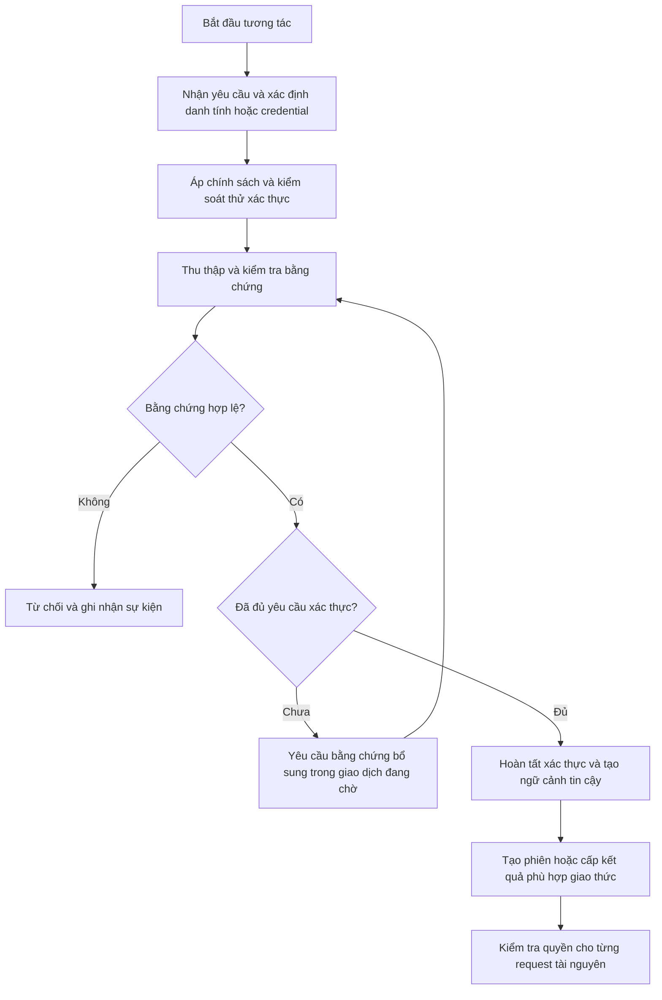

# Authentication process — Quy trình xác thực danh tính

Khi một người nhập tên tài khoản, hệ thống mới biết người đó muốn được nhận diện là ai. Để chấp nhận lời khai này, hệ thống cần kiểm tra bằng chứng gắn với danh tính: mật khẩu, phản hồi từ thiết bị xác thực, chữ ký của khóa riêng hoặc kết quả xác thực từ một bên được tin cậy. Chuỗi xử lý đó tạo thành authentication process, tức quy trình xác thực.

Trong IAM, quy trình xác thực nối danh tính đã được quản lý với một lần tương tác cụ thể. Nó không chỉ là so sánh mật khẩu và cũng không kết thúc ở thông báo “đăng nhập thành công”. Hệ thống phải biết kết quả được ràng buộc với ai, có hiệu lực trong ngữ cảnh nào, được duy trì bằng cách nào và lúc nào phải xác thực lại.

## 1. Xác thực trả lời câu hỏi nào?

Authentication kiểm tra liệu chủ thể đang tương tác có kiểm soát được phương tiện xác thực đã gắn với danh tính được khai báo hay không. NIST mô tả xác thực số theo việc kiểm chứng quyền kiểm soát một hoặc nhiều authenticator liên kết với tài khoản. Xem [NIST Digital Identity Guidelines — Authentication and Authenticator Management](https://pages.nist.gov/800-63-4/sp800-63b.html).

Ví dụ, ứng dụng nhận lời khai “tôi là tài khoản `user-427`”. Nếu bằng chứng được kiểm tra hợp lệ theo chính sách, ứng dụng có thể tạo một ngữ cảnh đã xác thực cho `user-427`. Điều này chưa chứng minh người đang dùng thiết bị có đúng tên pháp lý của chủ tài khoản trong mọi hoàn cảnh, và chưa cho phép họ đọc mọi dữ liệu.

| Hoạt động | Câu hỏi chính | Ví dụ |
| --- | --- | --- |
| Identification — khai báo danh tính | Chủ thể muốn được nhận diện là ai? | Nhập username hoặc chọn tài khoản |
| Identity proofing — kiểm chứng danh tính ban đầu | Tài khoản được gắn với người hoặc tổ chức nào, dựa trên bằng chứng nào? | Quy trình đăng ký và đối chiếu thông tin theo yêu cầu dịch vụ |
| Authentication — xác thực | Chủ thể hiện tại có kiểm soát phương tiện xác thực của tài khoản không? | Kiểm tra mật khẩu và phản hồi của yếu tố bổ sung |
| Authorization — phân quyền | Principal này được thực hiện hành động nào trên tài nguyên nào? | Được xem nhưng không được sửa hóa đơn |
| Session management — quản lý phiên | Kết quả xác thực được duy trì và kết thúc ra sao? | Kiểm tra cookie phiên, thời hạn và thu hồi |

Một người có thể xác thực thành công nhưng bị từ chối sửa hóa đơn do không có quyền. Ngược lại, một request không có danh tính người dùng vẫn có thể được phép xem một tài nguyên công khai. Vì vậy, “đã đăng nhập” và “được phép” là hai điều kiện khác nhau.

## 2. Các thành phần tham gia

### 2.1. Chủ thể và danh tính được khai báo

Chủ thể có thể là người dùng, tiến trình hoặc workload. Tên tài khoản, email hay client ID giúp hệ thống chọn đúng danh tính hoặc cơ chế xác thực. Chúng thường là định danh, không phải bí mật đủ để chứng minh danh tính.

Không nên dựa vào tên hiển thị để liên kết hoạt động bảo mật vì tên có thể đổi hoặc trùng. Ngữ cảnh nội bộ thường dùng một định danh ổn định như subject ID, kèm miền danh tính hoặc issuer nếu cần phân biệt nhiều nguồn.

### 2.2. Authenticator và bằng chứng xác thực

Authenticator là phương tiện chủ thể dùng để xác thực. Bằng chứng là dữ liệu hoặc phản hồi mà giao thức đưa tới bên kiểm tra. Tùy phương thức, bằng chứng có thể là một bí mật được gửi qua kênh bảo vệ hoặc một chữ ký chứng minh quyền kiểm soát khóa riêng.

| Nhóm yếu tố | Ý nghĩa | Ví dụ và giới hạn cần nhớ |
| --- | --- | --- |
| Something you know | Thứ chủ thể biết | Mật khẩu; có thể bị đoán, lộ hoặc tái sử dụng |
| Something you have | Thứ chủ thể kiểm soát hoặc sở hữu | Thiết bị hoặc khóa xác thực; cần kiểm tra bằng chứng sở hữu theo giao thức |
| Something you are | Đặc điểm sinh trắc | Thường dùng trong một cơ chế có thiết bị và bộ kiểm tra tương ứng; không mặc định được gửi trực tiếp tới server |

Hai mật khẩu không tự tạo thành hai nhóm yếu tố độc lập. Một thao tác sinh trắc để mở khóa thiết bị có thể là một phần của phương thức xác thực nhiều yếu tố, nhưng phải xét cơ chế hoàn chỉnh và những gì bên xác minh thực sự kiểm chứng.

### 2.3. Bên xác minh và bên sử dụng kết quả

Verifier kiểm tra bằng chứng. Relying party là dịch vụ dựa vào kết quả xác thực để phục vụ người dùng. Trong ứng dụng đăng nhập trực tiếp, hai vai trò có thể nằm trong cùng hệ thống. Với SSO, IdP thực hiện xác thực và ứng dụng tiếp nhận một kết quả được bảo vệ theo giao thức.

Ngoài ra còn có kho tài khoản, chính sách xác thực, cơ chế giới hạn thử đăng nhập, hệ thống phiên và audit. Chỉ nhìn màn hình login sẽ bỏ sót phần lớn quá trình ở phía server.

## 3. Tiền đề: phương tiện xác thực đã được gắn đúng tài khoản

Trước khi đăng nhập, hệ thống cần có quan hệ giữa tài khoản và phương tiện xác thực. Đây thường là kết quả của đăng ký, cấp phát tài khoản, đăng ký thiết bị hoặc cấu hình federation.

Ví dụ:

- Với mật khẩu, hệ thống có dữ liệu kiểm chứng mật khẩu đã được bảo vệ phù hợp.
- Với khóa công khai, hệ thống có thông tin khóa và liên kết credential với tài khoản.
- Với federation, ứng dụng biết issuer nào được tin và quy tắc liên kết danh tính nào được chấp nhận.
- Với workload, nền tảng có quan hệ tin cậy giữa workload được phê duyệt và danh tính máy.

Nếu kẻ tấn công gắn được authenticator của họ vào tài khoản của người khác, một lần xác thực sau đó có thể hợp lệ về mặt kỹ thuật nhưng quan hệ gắn ban đầu đã sai. Vì vậy, enrollment, thay authenticator và khôi phục tài khoản là các phần quan trọng trong vòng đời xác thực, không phải công việc phụ không liên quan.

Không dùng việc biết email của một tài khoản làm bằng chứng đủ để thay mật khẩu hoặc đăng ký yếu tố mới. Mức kiểm tra cho các thao tác này phải phù hợp với rủi ro chiếm quyền tài khoản.

## 4. Luồng xác thực tổng quát

Một luồng có thể không cần người dùng nhập username trước, chẳng hạn giao thức tìm tài khoản từ credential được chọn. Tuy nhiên, hệ thống vẫn cần xác định đúng danh tính và kiểm tra bằng chứng tương ứng.



### Bước 1 — Nhận yêu cầu trên kênh được bảo vệ

Client phải giao tiếp với đúng dịch vụ dự kiến và sử dụng cơ chế bảo vệ đường truyền phù hợp, thường là TLS. Phía server kiểm tra cấu trúc request, giới hạn kích thước và ngữ cảnh cần thiết. Không đưa mật khẩu hoặc token vào URL vì chúng có thể đi vào lịch sử, log hay thông tin chuyển tiếp.

TLS giúp bảo vệ giao tiếp với endpoint đang được kết nối. Nó không tự bảo đảm người dùng đã tránh một trang phishing có tên miền khác nhưng cũng sử dụng TLS, và không loại bỏ rủi ro bí mật bị lấy từ thiết bị đầu cuối.

### Bước 2 — Xác định tài khoản hoặc credential

Hệ thống tìm tài khoản theo quy tắc định danh đã xác định. Nếu cho phép nhiều tổ chức hoặc nhiều IdP, phải ràng buộc đúng miền danh tính. Cùng một email hiển thị ở hai hệ thống không tự có nghĩa là cùng một tài khoản.

Dữ liệu từ client ở bước này vẫn là đầu vào chưa đáng tin. Client gửi `userId`, `tenantId` hoặc `isAdmin` không làm những giá trị đó trở thành thuộc tính đã xác thực.

### Bước 3 — Xác định chính sách áp dụng

Chính sách có thể yêu cầu một phương thức cụ thể, MFA, xác thực lại hoặc từ chối do tài khoản đã bị vô hiệu hóa. Quyết định cũng có thể phụ thuộc loại thao tác, trạng thái tài khoản và tín hiệu rủi ro đã được đánh giá.

Các tín hiệu như địa chỉ mạng, thiết bị mới hay vị trí bất thường có thể hỗ trợ quyết định, nhưng không tự là bằng chứng đủ để xác định danh tính. Hệ thống cũng cần kiểm soát số lần thử để hạn chế đoán credential và lạm dụng tài nguyên kiểm chứng.

### Bước 4 — Kiểm tra bằng chứng theo phương thức

Với mật khẩu, dùng chức năng kiểm chứng của thư viện hoặc hệ thống danh tính được chọn, dựa trên cơ chế lưu trữ mật khẩu phù hợp. Không lưu plaintext, không ghi password vào log và không tự thay phép kiểm tra mật khẩu bằng so sánh chuỗi hoặc mã băm nhanh tự viết.

Với challenge-response, bên xác minh kiểm tra phản hồi có khớp credential đã gắn và có thuộc đúng giao dịch đang chờ hay không. Một chữ ký hợp lệ trên một thông điệp bất kỳ chưa đủ: giao thức cần ràng buộc thông điệp, đối tượng nhận và ngữ cảnh để ngăn dùng lại hoặc dùng nhầm bằng chứng.

Với mã dùng một lần, cần kiểm tra điều kiện hợp lệ và chống sử dụng lại theo cơ chế đó. Không chấp nhận một mã vô thời hạn chỉ vì nó từng khớp tài khoản.

### Bước 5 — Hoàn thành các yêu cầu bổ sung

Nếu mật khẩu đúng nhưng chính sách còn yêu cầu MFA, trạng thái hiện tại chỉ là một giao dịch đang chờ. Không cấp một phiên đã xác thực đầy đủ rồi dựa vào giao diện để nhắc người dùng nhập yếu tố thứ hai.

Giao dịch đang chờ cần có thời hạn, giới hạn thử và ràng buộc với tài khoản cùng luồng bắt đầu. Request hoàn tất MFA không được tự chọn một tài khoản khác hoặc dùng lại giao dịch đã kết thúc. Việc đánh dấu hoàn tất phải ngăn hai request đồng thời sử dụng cùng bằng chứng khi giao thức không cho phép.

### Bước 6 — Tạo ngữ cảnh đã xác thực

Khi mọi yêu cầu được đáp ứng, server xác định principal, cách xác thực đã dùng, thời điểm xác thực và ngữ cảnh liên quan. Chỉ dữ liệu đã được kiểm chứng hoặc lấy từ nguồn có thẩm quyền mới được đưa vào ngữ cảnh tin cậy.

Ví dụ ngữ cảnh minh họa:

```json
{
  "subject": "user-example-427",
  "identitySource": "corporate-idp-example",
  "authenticatedAt": "<server-generated-time>",
  "authenticationMethod": "<verified-method>",
  "sessionRef": "<internal-reference>"
}
```

Đây là mô tả dữ liệu nội bộ, không phải token mà client có thể tự tạo để đăng nhập. Quyền nghiệp vụ vẫn phải được xác định và kiểm tra theo policy; không suy ra từ một trường client gửi lên.

### Bước 7 — Duy trì kết quả và kiểm tra truy cập

Ứng dụng có thể tạo phiên hoặc sử dụng credential/token theo kiến trúc đã chọn. Request tiếp theo phải trình bày bằng chứng duy trì phiên hoặc credential còn hợp lệ. Sau khi nhận diện principal, server tiếp tục kiểm tra quyền trên hành động và tài nguyên được yêu cầu.

Nếu bước xác minh không thể hoàn tất do lỗi phụ thuộc, hệ thống không được tự coi bằng chứng là hợp lệ. Phân biệt lỗi dịch vụ với credential sai ở phía vận hành, đồng thời bảo đảm phản hồi bên ngoài không tiết lộ thông tin không cần thiết.

## 5. Kết quả xác thực được duy trì bằng cách nào?

### 5.1. Phiên phía server

Một ứng dụng web có thể lưu trạng thái phiên ở phía server và gửi cho trình duyệt một session identifier khó đoán. Trình duyệt gửi định danh đó trong các request tiếp theo; server tra cứu phiên, kiểm tra hiệu lực và gắn principal vào xử lý request.

Sau khi chuyển từ chưa xác thực sang đã xác thực, ứng dụng cần cấp mới hoặc thay định danh phiên theo cơ chế của framework để giảm rủi ro session fixation. OWASP cũng hướng dẫn tái sinh session ID khi thay đổi mức đặc quyền. Xem [OWASP Session Management Cheat Sheet](https://cheatsheetseries.owasp.org/cheatsheets/Session_Management_Cheat_Sheet.html).

Cookie phiên cần cấu hình bảo vệ phù hợp như `Secure`, `HttpOnly`, phạm vi domain/path và `SameSite` theo luồng ứng dụng. Đồng thời kiểm soát CSRF cho thao tác thay đổi trạng thái. Một thuộc tính cookie riêng lẻ không thay thế toàn bộ quản lý phiên hoặc chống XSS.

Phiên cần chính sách thời hạn, kết thúc, thu hồi và xác thực lại. Không đưa password gốc vào session để dùng cho các request sau.

### 5.2. Credential và token

Ở kiến trúc dùng token, hệ thống đích kiểm tra token theo hợp đồng của nó. Với token có chữ ký, việc kiểm tra thường gồm nguồn khóa đáng tin cậy, chữ ký, issuer, audience và thời hạn phù hợp. Với opaque token, có thể cần tra cứu hoặc kiểm tra hiệu lực qua cơ chế được cấu hình.

| Loại dữ liệu | Vai trò thường gặp | Không nên suy diễn |
| --- | --- | --- |
| Session ID | Tham chiếu tới trạng thái phiên | Có chuỗi session ID chưa chứng minh phiên còn hoạt động |
| ID token trong OIDC | Truyền kết quả xác thực tới client dự kiến | Không tự trở thành credential được mọi API chấp nhận |
| Access token | Cho phép client trình bày quyền truy cập tới resource server theo hợp đồng | Chữ ký hợp lệ chưa đủ nếu sai audience, issuer hoặc quyền |
| Refresh token | Cho phép yêu cầu token mới theo chính sách của bên phát | Không dùng như access token để gọi API nghiệp vụ |

JWT là một định dạng, không phải bảo đảm rằng xác thực đã được triển khai đúng. Giải mã payload chỉ đọc được dữ liệu; nó không chứng minh chữ ký, nguồn phát hoặc mục đích sử dụng đã hợp lệ.

Tương tự, token ký hợp lệ không có nghĩa quyền trong token vẫn phù hợp với trạng thái hiện tại. Nếu quyền đã bị gỡ hoặc tài khoản bị khóa, thiết kế phải xác định hệ thống đích nhận thay đổi bằng cách nào và trong bao lâu.

### 5.3. Logout và thu hồi không phải cùng một thao tác

Xóa cookie khỏi một trình duyệt chỉ loại bỏ bản tham chiếu ở nơi đó. Nếu phiên phía server còn hoạt động hoặc token đã bị sao chép, khả năng truy cập có thể vẫn tồn tại. Cần phân biệt kết thúc phiên local, kết thúc phiên ở IdP, thu hồi refresh token và xử lý access token đã phát.

Với access token được kiểm tra cục bộ, chặn phát token mới không tự làm token cũ mất hiệu lực ngay. Cơ chế thu hồi có thể cần kiểm tra trạng thái, danh sách chặn, policy được cập nhật hoặc chờ hết hạn theo mô hình đã công bố. Không khẳng định “khóa tài khoản là dừng mọi truy cập tức thì” nếu chưa kiểm chứng các đường sử dụng credential.

## 6. Ví dụ: mật khẩu, MFA rồi truy cập hóa đơn

Giả sử người dùng Lan có tài khoản `user-427`, role viewer ở tenant A. Chính sách của ứng dụng yêu cầu mật khẩu và yếu tố bổ sung trước khi tạo phiên đầy đủ.

| Thời điểm | Sự kiện | Trạng thái của ứng dụng |
| --- | --- | --- |
| T0 | Lan mở trang đăng nhập | Chưa xác thực |
| T1 | Lan khai báo tài khoản | Đã có lời khai danh tính, chưa có bằng chứng hợp lệ |
| T2 | Mật khẩu được kiểm chứng | Giao dịch đang chờ yếu tố bổ sung |
| T3 | Yếu tố bổ sung hợp lệ trong đúng giao dịch | Đủ yêu cầu để hoàn tất xác thực |
| T4 | Server tạo phiên mới cho `user-427` | Có principal đã xác thực |
| T5 | Lan yêu cầu xem hóa đơn của A | Server phân quyền và cho phép nếu policy khớp |
| T6 | Lan yêu cầu sửa hóa đơn | Server từ chối vì viewer không có quyền sửa |

Tại T2, endpoint nghiệp vụ không được coi Lan đã hoàn tất xác thực. Tại T6, từ chối sửa hóa đơn không phủ nhận rằng Lan đã xác thực đúng; đây là quyết định phân quyền.

Mã giả sau minh họa việc tách hai trạng thái; nó không thay thế một thư viện xác thực hoặc giao thức hoàn chỉnh:

```text
beginAuthentication(request):
    validateRequest(request)
    enforceAttemptPolicy(request)
    account = resolveAccountInTrustedIdentityDomain(request.identifier)

    if account is unavailable or account is not eligible:
        recordInternalFailureWithoutSecrets()
        return genericFailure

    if not passwordVerifier.verify(account, request.password):
        recordFailedAttempt(account)
        return genericFailure

    if authenticationPolicy.requiresAdditionalProof(account):
        transaction = createBoundExpiringTransaction(account)
        return additionalProofRequired(transaction.reference)

    return completeAuthenticationWithNewSession(account)

finishAdditionalProof(request):
    transaction = loadAndCheckPendingTransaction(request.reference)
    enforceTransactionAttemptPolicy(transaction)
    verifyAdditionalProof(transaction, request.proof)
    recheckAccountEligibilityAndRequiredPolicy(transaction.account)
    consumeTransactionAtomically(transaction)
    return completeAuthenticationWithNewSession(transaction.account)
```

Các hàm kiểm tra trong nhánh hoàn tất phải dừng khi điều kiện không hợp lệ, không tiếp tục tạo phiên. Trạng thái “cần thêm bằng chứng” chỉ cấp quyền tiếp tục giao dịch xác thực, không cấp quyền gọi API hóa đơn.

Nhánh lỗi tài khoản không tồn tại và nhánh sai mật khẩu trong mã giả cần được triển khai sao cho không tạo kênh dò tài khoản dễ khai thác qua nội dung, mã phản hồi hoặc khác biệt thời gian rõ rệt. Việc xử lý có thể bao gồm công việc kiểm chứng giả lập phù hợp; phải cân đối với giới hạn tài nguyên và chống lạm dụng, không chỉ thêm một khoảng chờ cố định.

## 7. Khi xác thực được thực hiện qua SSO

Trong đăng nhập liên kết, ứng dụng không nhất thiết nhìn thấy password hoặc authenticator của người dùng. IdP thực hiện bước kiểm chứng và trả kết quả theo giao thức federation.

Luồng khái quát:

1. Ứng dụng tạo giao dịch đăng nhập và chuyển người dùng tới IdP đã cấu hình.
2. IdP xác thực theo chính sách của nó hoặc đánh giá phiên xác thực đang có.
3. Ứng dụng nhận phản hồi và kiểm tra tính hợp lệ, nguồn phát cùng ràng buộc với giao dịch ban đầu.
4. Ứng dụng ánh xạ subject từ nguồn được tin vào tài khoản phù hợp.
5. Ứng dụng tạo ngữ cảnh hoặc phiên local rồi thực thi phân quyền của mình.

Với OIDC hoặc SAML, chi tiết kiểm tra phụ thuộc giao thức, loại client và profile được dùng. Sử dụng thư viện được duy trì và cấu hình theo hợp đồng, thay vì tự chấp nhận một JSON có trường `email` hoặc một assertion chỉ vì nó chứa tên người dùng mong đợi.

SSO không có nghĩa “tin mọi người dùng từ bất kỳ IdP nào”, cũng không tự tạo quyền tenant. Nếu ứng dụng yêu cầu một mức xác thực cụ thể hoặc thời điểm xác thực đủ mới, nó phải kiểm tra kết quả và semantics mà IdP thực sự bảo đảm. Không diễn giải tùy ý tên một claim thành bằng chứng đã dùng MFA.

Liên kết tài khoản cũng phải được quản lý. Chỉ thấy hai email giống nhau không phải cơ sở đủ để gộp tài khoản từ hai issuer. Một lỗi ánh xạ danh tính có thể dẫn tới chiếm tài khoản ngay cả khi xác thực ở từng IdP đều hoạt động đúng.

## 8. Xác thực lại, step-up và vòng đời tài khoản

### 8.1. Vì sao cần xác thực lại?

Kết quả xác thực có một thời điểm và một ngữ cảnh. Người dùng đăng nhập từ nhiều giờ trước không tự chứng minh rằng người đang thao tác hiện tại vẫn kiểm soát authenticator, nhất là khi thiết bị bị bỏ quên hoặc phiên bị đánh cắp.

Ứng dụng có thể yêu cầu xác thực lại trước khi đổi phương tiện xác thực, thay thông tin khôi phục, nâng quyền hoặc thực hiện thao tác nhạy cảm. Yêu cầu phải phù hợp với rủi ro và phương thức đã chọn; không biến mọi request thành một lần nhập mật khẩu mới.

Step-up authentication là bổ sung bằng chứng để đáp ứng yêu cầu cao hơn cho một ngữ cảnh hoặc thao tác. Sau step-up, người dùng vẫn chỉ có quyền mà policy cấp. Một lần MFA thành công không tự biến viewer thành administrator.

### 8.2. Thay đổi và mất authenticator

Khi mất thiết bị, lộ password hoặc nghi ngờ credential bị đánh cắp, hệ thống cần quy trình khôi phục và vô hiệu hóa phù hợp. Đăng ký yếu tố mới phải được kiểm soát vì nó có thể trao quyền truy cập lâu dài cho người đăng ký.

Đổi password, gỡ yếu tố, khóa account và logout có thể tác động khác nhau tới các phiên hiện có. Chính sách phải nói rõ tác động mong đợi, sau đó kiểm thử bằng phiên hoặc token được phát trước thay đổi.

Việc gỡ quyền khi chuyển nhóm hay nghỉ việc cũng cần phối hợp với hệ thống đích. Xác thực là một phần của vòng đời danh tính; nó không tự thay thế provisioning, thu hồi entitlement hoặc rà soát đặc quyền.

## 9. Xác thực người dùng và xác thực workload

Nguyên tắc “kiểm tra bằng chứng gắn với danh tính” áp dụng cho cả con người và máy, nhưng cách thực hiện khác nhau.

| Ngữ cảnh | Ví dụ bằng chứng | Cần xác định |
| --- | --- | --- |
| Người dùng tương tác | Password, thiết bị xác thực hoặc phương thức khóa công khai | Chủ thể, yêu cầu MFA, phiên và khôi phục |
| Ứng dụng gọi API | Client authentication hoặc credential theo giao thức | Client nào, bên nhận nào, thời hạn và phạm vi |
| Workload được nền tảng quản lý | Bằng chứng workload được xác minh, chứng thư hoặc token ngắn hạn | Workload nào được nhận danh tính máy và được gọi tài nguyên nào |

Không buộc job tự động dùng tài khoản cá nhân của một nhân viên rồi tắt MFA cho tài khoản đó. Dùng danh tính máy với owner, quyền tối thiểu và cơ chế cấp/thu hồi credential phù hợp.

API key dạng bí mật dùng chung có thể giúp nhận diện bên gọi theo mô hình của dịch vụ, nhưng khi bị sao chép, bên nhận thường không phân biệt được người giữ hợp lệ và kẻ đã lấy được key. Credential đó không tự chứng minh một người dùng cụ thể đang hiện diện. Cần hiểu rõ loại bằng chứng và giới hạn của nó trước khi dùng kết quả cho quyết định nhạy cảm.

## 10. Xử lý thất bại và ghi nhận sự kiện

### 10.1. Phản hồi bên ngoài và chẩn đoán bên trong

Lỗi đăng nhập nên tránh tiết lộ không cần thiết việc tài khoản có tồn tại, bị khóa hay dùng sai password. Hệ thống vẫn cần nguyên nhân nội bộ đủ rõ để vận hành và điều tra. OWASP khuyến nghị xử lý thông báo và sự khác biệt phản hồi nhằm giảm khả năng dò tài khoản; xem [OWASP Authentication Cheat Sheet](https://cheatsheetseries.owasp.org/cheatsheets/Authentication_Cheat_Sheet.html).

Ví dụ phản hồi chung có thể là “Không thể hoàn tất xác thực bằng thông tin đã cung cấp”. Log nội bộ có thể phân loại credential sai, giao dịch hết hạn, account bị vô hiệu hóa hoặc phụ thuộc không khả dụng. Mức thông tin trả cho người dùng phải cân đối bảo mật và khả năng hỗ trợ, không phát nguyên nhân nội bộ trực tiếp cho mọi caller.

### 10.2. Giới hạn thử và chống lạm dụng

Các cơ chế có thể gồm giới hạn theo tài khoản, nguồn truy cập, thiết bị hoặc hành vi tổng thể. Không chỉ dựa vào IP vì nhiều người có thể dùng chung địa chỉ mạng, trong khi một cuộc tấn công có thể đến từ nhiều nguồn.

Khóa tài khoản quá dễ có thể bị lợi dụng để chặn người dùng hợp lệ. Cần chính sách thử lại, hỗ trợ, cảnh báo và khôi phục phù hợp. Đặc biệt, bước gửi thông báo MFA hoặc mã xác thực cũng phải có kiểm soát để hạn chế lạm dụng và gây phiền nhiễu.

### 10.3. Nội dung audit

Các sự kiện hữu ích gồm bắt đầu và hoàn tất xác thực, thất bại, thử vượt giới hạn, thêm/gỡ authenticator, khôi phục tài khoản và thu hồi phiên. Mỗi sự kiện cần thời điểm, nguồn dịch vụ, định danh tương quan và principal nếu đã xác định tin cậy.

Không ghi password, mã dùng một lần còn hiệu lực, private key, session cookie hoặc bearer token vào log. Thông tin thiết bị và địa chỉ mạng cũng cần kiểm soát truy cập và lưu giữ phù hợp với mục đích sử dụng.

Nếu đăng nhập thành công nhưng bước tạo phiên thất bại, hệ thống không nên báo cho client rằng đã có phiên hoạt động. Nếu cần bảo đảm audit cho một thao tác nhạy cảm, hành vi khi audit không sẵn sàng phải được định nghĩa rõ thay vì bỏ qua âm thầm.

## 11. Những cách hiểu sai thường gặp

**“Biết username là đã xác thực được người dùng.”** Username chỉ giúp chọn danh tính; bằng chứng kiểm soát authenticator mới là phần cần kiểm chứng.

**“Password đúng thì có thể tạo phiên dù MFA chưa xong.”** Với chính sách yêu cầu MFA, đó chỉ là trạng thái xác thực từng phần. API nghiệp vụ phải chờ toàn bộ yêu cầu hoàn tất.

**“Bất kỳ token nào từ IdP đều dùng được ở mọi API.”** Bên nhận phải kiểm tra token đúng nguồn, đối tượng nhận, loại và mục đích theo hợp đồng của nó.

**“Đăng nhập thành công thì không cần kiểm tra quyền nữa.”** Xác thực tạo principal; phân quyền vẫn xét hành động, tài nguyên, tenant và điều kiện liên quan cho từng truy cập.

**“MFA ngăn mọi dạng chiếm tài khoản.”** Hiệu quả phụ thuộc phương thức, đăng ký/khôi phục, ràng buộc giao thức và bảo vệ phiên. Một phiên bị đánh cắp hoặc một đường khôi phục yếu vẫn có thể dẫn tới truy cập trái phép.

**“Xóa cookie là thu hồi toàn bộ truy cập.”** Cần xét phiên phía server, token đã phát, thiết bị khác và phiên tại hệ thống liên kết.

**“Dùng một thư viện tốt là không cần xem luồng.”** Thư viện giúp thực hiện giao thức nhưng cấu hình trust, ánh xạ tài khoản, yêu cầu MFA và vòng đời phiên vẫn thuộc trách nhiệm của hệ thống tích hợp.

## 12. Cách đọc và thiết kế một quy trình xác thực

Khi xem một luồng, hãy lần theo lời khai danh tính, nguồn bằng chứng, nơi kiểm chứng và điểm tạo principal. Xác định điều gì được tin trước và sau mỗi bước. Nếu một giá trị do client tự khai có thể chuyển thẳng thành principal hoặc thuộc tính quyền, ranh giới tin cậy có thể đang bị bỏ qua.

Tiếp theo, tách trạng thái đang chờ khỏi trạng thái đã hoàn tất. Xem giao dịch có ràng buộc đúng tài khoản, có hết hạn và có thể bị dùng lại hay không. Kiểm tra sự cố ở từng bước có làm hệ thống cấp phiên ngoài ý muốn hoặc dùng nhầm bằng chứng của giao dịch khác không.

Cuối cùng, theo kết quả xác thực tới request tài nguyên và tới lúc thu hồi. Một quy trình đầy đủ phải nối được bốn việc: kiểm chứng bằng chứng, tạo ngữ cảnh đáng tin, duy trì kết quả đúng giới hạn và kết thúc khả năng truy cập theo chính sách. Ranh giới giữa xác thực và phân quyền rõ ràng giúp IAM thực hiện từng trách nhiệm mà không suy diễn rằng một lần đăng nhập thành công giải quyết mọi vấn đề truy cập.
