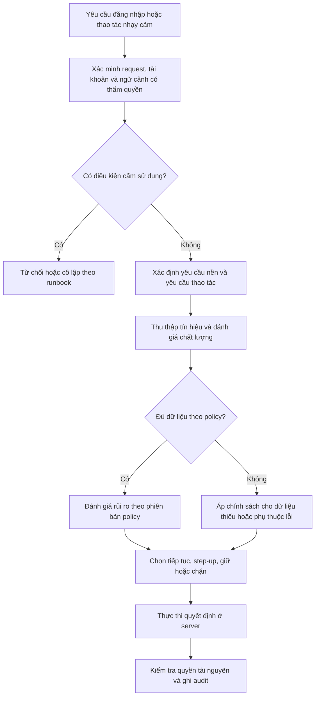

# Risk-based authentication — Xác thực dựa trên rủi ro

Một người dùng mở ứng dụng từ thiết bị thường dùng để xem báo cáo hằng ngày. Vài phút sau, cùng tài khoản đó yêu cầu thay yếu tố xác thực từ một thiết bị mới, trong khi hệ thống đang quan sát nhiều lần thử đăng nhập bất thường. Nếu xử lý hai yêu cầu theo cùng một cách chỉ vì password hoặc cookie còn hợp lệ, ứng dụng bỏ qua những khác biệt quan trọng về ngữ cảnh.

Risk-based authentication, viết tắt là RBA, sử dụng thông tin về phiên, thiết bị, hành vi và ngữ cảnh để điều chỉnh yêu cầu xác thực hoặc cách xử lý truy cập. Mục tiêu là thêm kiểm chứng ở nơi rủi ro cao, đồng thời hạn chế những lần xác thực lại không cần thiết. RBA phải hoạt động trên nền chính sách xác thực và phân quyền rõ ràng, không thay thế chúng bằng một điểm số.

## 1. RBA quyết định điều gì?

Một cơ chế RBA có thể đưa ra yêu cầu như tiếp tục theo chính sách hiện có, xác thực lại, bổ sung một phương thức mạnh hơn, giữ giao dịch để xử lý hoặc chặn phiên có dấu hiệu bị chiếm quyền. OWASP mô tả xác thực thích ứng dựa trên các thuộc tính môi trường và ngữ cảnh, đồng thời lưu ý rằng IP, fingerprint và cookie ghi nhớ thiết bị là tín hiệu rủi ro, không thay thế xác thực. Xem [OWASP Authentication Cheat Sheet — Adaptive or Risk Based Authentication](https://cheatsheetseries.owasp.org/cheatsheets/Authentication_Cheat_Sheet.html#adaptive-or-risk-based-authentication).

Ba câu hỏi cần được tách riêng:

| Câu hỏi | Cơ chế chính | Ví dụ |
| --- | --- | --- |
| Chủ thể có kiểm soát authenticator của tài khoản không? | Authentication | Kiểm tra bằng chứng từ phương thức đã đăng ký |
| Ngữ cảnh hiện tại có cần thêm bằng chứng hoặc phản ứng khác không? | Risk assessment và chính sách thích ứng | Yêu cầu xác thực mới khi thay thiết bị và đổi yếu tố |
| Principal được làm gì trên tài nguyên nào? | Authorization | Viewer không được xóa hóa đơn |

Điểm rủi ro thấp không xác thực một người dùng chưa có bằng chứng hợp lệ. Điểm rủi ro thấp cũng không cấp thêm role, tenant hoặc quyền quản trị. Tương tự, vượt qua một lần MFA không tự hợp thức hóa một giao dịch trái quyền hay một phiên đã bị thu hồi.

Trong một số sản phẩm, thuật ngữ adaptive authentication bao quát nhiều điều chỉnh theo ngữ cảnh, còn risk-based authentication nhấn mạnh đánh giá rủi ro. Khi triển khai, cần đọc semantics của policy và hành động thực tế thay vì dựa hoàn toàn vào tên tính năng.

## 2. Xác định chính sách nền trước khi chấm rủi ro

Chính sách nền quy định các điều kiện không được hạ thấp bởi kết quả chấm điểm. Ví dụ trong tình huống của bài:

- Tài khoản đã vô hiệu hóa không được tạo phiên mới.
- Credential đã xác định bị thu hồi không được tiếp tục sử dụng.
- Quản trị viên phải đáp ứng yêu cầu MFA đã phê duyệt.
- Thay authenticator cần kiểm chứng mới theo phương thức được chấp nhận.
- Mọi thao tác nghiệp vụ vẫn phải được phân quyền phía server.

Các điều kiện trên là lựa chọn thiết kế của ví dụ, không phải một bộ ngưỡng bắt buộc cho mọi hệ thống. Điểm quan trọng là xác định trước điều gì bắt buộc, rồi cho RBA bổ sung yêu cầu trong phạm vi đó.

Có thể biểu diễn quan hệ bằng tập yêu cầu:

```text
Yêu cầu cuối cùng =
    yêu cầu xác thực nền
    kết hợp yêu cầu của loại thao tác
    kết hợp yêu cầu bổ sung từ đánh giá rủi ro
```

“Kết hợp” ở đây nghĩa là thỏa mãn các điều kiện cần thiết, không nhất thiết là cộng điểm hoặc chọn giá trị lớn nhất của một số nguyên. Hai phương thức có thể có những tính chất khác nhau về khả năng chống phishing, độ mới và ràng buộc với thiết bị; không nên tự gán chúng vào một thang điểm rồi coi mọi tổ hợp là tương đương.

Một cookie ghi nhớ thiết bị không được làm chính sách chuyển từ “admin cần MFA” sang “admin chỉ cần tên tài khoản”. Nếu có cơ chế cho phép tái sử dụng kết quả MFA còn hợp lệ, phạm vi và thời hạn tái sử dụng phải do policy xác định.

## 3. Những tín hiệu có thể sử dụng và giới hạn của chúng

### 3.1. Phân loại tín hiệu

| Nhóm | Ví dụ | Câu hỏi phải đặt ra |
| --- | --- | --- |
| Mạng | IP, đặc tính nhà mạng, nguồn từng có hành vi lạm dụng | IP có lấy từ điểm mạng đáng tin? VPN, proxy hoặc NAT có làm sai diễn giải? |
| Thiết bị | Thiết bị mới, trạng thái quản lý, credential gắn với thiết bị | Thuộc tính có được kiểm chứng hay chỉ do trình duyệt khai báo? |
| Phiên | Tuổi phiên, thời điểm xác thực gần nhất, thay đổi đặc tính phiên | Dữ liệu có còn mới và gắn đúng phiên không? |
| Hành vi | Tần suất truy cập, nhiều thất bại, thay đổi mẫu sử dụng | Có đủ lịch sử và có phân biệt được hành vi hợp lệ hiếm gặp? |
| Tài khoản | Khôi phục gần đây, thay authenticator, cảnh báo chiếm quyền | Sự kiện đến từ nguồn nào và độ tin cậy ra sao? |
| Thao tác | Xem thông tin, tải dữ liệu nhạy cảm, thay yếu tố, nâng quyền | Độ nhạy cảm được server xác định hay do client tự khai? |

Không cần thu mọi loại tín hiệu để có một thiết kế hữu ích. Chọn dữ liệu có mục đích cụ thể, đủ chất lượng và có cách xử lý khi không lấy được.

### 3.2. Một tín hiệu không phải kết luận

Thiết bị mới có thể là điện thoại vừa thay. Địa chỉ mạng khác có thể do mạng di động hoặc VPN doanh nghiệp. Một vị trí địa lý suy ra từ IP không phải vị trí vật lý đã được chứng minh của người dùng.

“Impossible travel” mô tả hai lần hoạt động ở những vị trí suy đoán khó phù hợp với việc di chuyển thực tế trong khoảng thời gian đó. Đây là dấu hiệu cần kiểm tra, không phải bằng chứng chắc chắn rằng tài khoản đã bị tấn công. Proxy, dữ liệu geolocation lỗi hoặc hệ thống định tuyến có thể tạo ra tín hiệu tương tự.

Ngược lại, kẻ tấn công có thể sử dụng thiết bị bị chiếm quyền, đường mạng quen thuộc hoặc cookie đã đánh cắp. Không thấy bất thường không chứng minh người dùng hợp lệ đang hiện diện.

### 3.3. Nguồn gốc và độ mới quan trọng hơn số lượng

Nếu hệ thống đứng sau proxy, chỉ tin thông tin client IP được truyền qua chuỗi proxy đã cấu hình tin cậy. Một header do bên gọi Internet tự đặt không tự trở thành địa chỉ nguồn có thẩm quyền.

Với trạng thái thiết bị, cần phân biệt thông tin do agent hoặc nền tảng quản lý xác nhận với chuỗi `User-Agent`. Tên thiết bị và fingerprint dễ thay đổi hoặc bị bắt chước hơn một bằng chứng mật mã được xác minh đúng cách.

Mỗi tín hiệu nên có nguồn phát, thời điểm quan sát, mức tin cậy và trạng thái khả dụng. Dữ liệu hết hạn, không rõ nguồn hoặc không gắn đúng chủ thể không được âm thầm diễn giải là “không có rủi ro”.

## 4. Kiến trúc xử lý RBA



Risk engine có thể là dịch vụ tập trung, một thành phần của IdP hoặc logic trong nền tảng ứng dụng. Dù đặt ở đâu, cần phân biệt nơi tạo quyết định với nơi thực thi quyết định. Một kết quả `STEP_UP` không có tác dụng nếu endpoint nghiệp vụ vẫn thực hiện thao tác trước khi người dùng hoàn tất bằng chứng.

Nếu client nhận thông báo cần step-up, đó chỉ là một phần của trải nghiệm. Server phải giữ trạng thái giao dịch hoặc một cơ chế được bảo vệ tương đương, ràng buộc nó với principal, phiên và yêu cầu đang chờ.

## 5. Mô hình chấm điểm minh họa

### 5.1. Dùng điểm số để giải thích chính sách, không giả làm xác suất

Giả sử hệ thống dùng các trọng số sau trong một mô hình thử nghiệm:

| Tín hiệu đã đủ chất lượng | Điểm cộng giả định |
| --- | ---: |
| Thiết bị chưa được nhận diện trong lịch sử phù hợp | 20 |
| Mạng khác mẫu thường dùng, chưa có dấu hiệu lạm dụng rõ | 10 |
| Nguồn mạng có tín hiệu lạm dụng đáng tin cậy | 30 |
| Hai sự kiện tạo nghi vấn di chuyển bất khả thi sau khi lọc nhiễu | 25 |
| Mẫu thất bại gần đây phù hợp dấu hiệu tấn công | 20 |

Trong ví dụ, hai loại tín hiệu mạng là hai nhánh thay thế nhau cho cùng đánh giá nguồn mạng, không cộng cả hai một cách máy móc. Cần xem tương quan giữa các tín hiệu khác để tránh đếm lặp cùng một hiện tượng.

```text
score = min(100, tổng điểm của các tín hiệu được chấp nhận)
```

Giá trị 60 không có nghĩa “60% khả năng bị chiếm tài khoản”. Đây chỉ là quy ước ra quyết định của ví dụ. Trọng số và ngưỡng phải được kiểm chứng trên dữ liệu, rủi ro và trải nghiệm thực tế trước khi triển khai.

### 5.2. Ánh xạ điểm sang hành động

| Mức minh họa | Khoảng điểm | Hành động dự kiến |
| --- | ---: | --- |
| Thấp | 0–24 | Tiếp tục nếu đã đáp ứng yêu cầu nền và thao tác |
| Tăng | 25–59 | Yêu cầu bằng chứng mới hoặc mạnh hơn theo policy |
| Cao | 60–100 | Giữ hoặc chặn thao tác nhạy cảm và đưa vào luồng kiểm chứng/xử lý phù hợp |
| Chưa xác định | Không đủ dữ liệu | Áp chính sách riêng; không gán thành điểm 0 |

Mức cao ở đây không mặc định là khóa tài khoản vô thời hạn. Hành động có thể khác nhau giữa một lần xem báo cáo và việc thay yếu tố xác thực. Tài khoản đã xác định bị thu hồi cũng không cần chờ điểm đạt 60 mới bị từ chối: đó là điều kiện nền độc lập.

### 5.3. Ví dụ tính và diễn giải

Lan đang có phiên hợp lệ, dùng thiết bị mới và mạng khác mẫu thông thường. Hai tín hiệu có chất lượng đủ để đánh giá, không có cảnh báo lạm dụng mạng:

```text
score = 20 + 10 = 30
tier = tăng
```

Kết quả có thể dẫn tới một lần xác thực mới bằng phương thức được chấp nhận. Nếu Lan thực hiện thao tác vốn bắt buộc xác thực mới, yêu cầu này vẫn tồn tại ngay cả khi điểm chỉ bằng 0.

Trong trường hợp khác, thiết bị mới cộng nguồn mạng có dấu hiệu lạm dụng cộng mẫu thất bại cho điểm `20 + 30 + 20 = 70`. Ứng dụng có thể giữ yêu cầu đổi authenticator và hướng dẫn kiểm chứng an toàn. Không tự động cho phép đổi yếu tố mới chỉ vì người gọi hoàn thành một câu hỏi dễ đoán hoặc nhận được mã qua chính kênh đang nghi bị chiếm quyền.

## 6. Thiết kế step-up để quyết định được thực thi

### 6.1. Yêu cầu bổ sung phải gắn với đúng ngữ cảnh

Một giao dịch step-up cần ràng buộc với principal và phiên đang xử lý. Với thao tác nhạy cảm, cần thêm mục đích hoặc nội dung giao dịch phù hợp để tránh dùng bằng chứng của một việc cho một việc khác.

Ví dụ dữ liệu nội bộ giả lập:

```json
{
  "transactionRef": "stepup-example-92",
  "subject": "user-example-427",
  "sessionRef": "session-reference-only",
  "purpose": "authenticator.replace",
  "targetRef": "pending-change-example-81",
  "requiredMethodPolicy": "approved-strong-method",
  "policyVersion": "rba-policy-example-4",
  "expiresAfterSeconds": 120,
  "state": "PENDING"
}
```

Khoảng 120 giây là giá trị giả định để minh họa, không phải thời hạn chung cho step-up. Các reference trên không phải session cookie hoặc credential thật. Giá trị authoritative được giữ ở server hoặc được bảo vệ theo thiết kế; không nhận nguyên JSON do client sửa rồi coi là bằng chứng hoàn tất.

Server kiểm tra bằng chứng, điều kiện hết hạn và trạng thái giao dịch. Giao dịch cần được tiêu thụ theo cách ngăn dùng lại, kể cả khi có hai request đồng thời. Thao tác đang chờ chỉ được thực hiện sau khi mọi điều kiện cần thiết đã đạt.

Nếu nội dung thao tác thay đổi sau khi step-up, chẳng hạn chuyển từ thay một yếu tố sang thêm một yếu tố khác, không mặc nhiên tái sử dụng kết quả cũ ngoài phạm vi đã ràng buộc. Đồng thời kiểm tra lại quyền và trạng thái tài khoản ở điểm thực thi thích hợp để tránh dùng quyết định quá cũ.

### 6.2. Chọn phương thức đáp ứng đúng yêu cầu

Step-up không chỉ là “gửi thêm một mã”. Cần xác định muốn có bằng chứng mới hơn, thêm một yếu tố độc lập hay phương thức có tính chất mạnh hơn. Phương thức dự phòng phải được xét cùng chính sách, vì một fallback yếu có thể làm mất tác dụng của phương thức chính.

Nếu yêu cầu chống phishing, không suy ra rằng mọi dạng OTP đều đáp ứng. Việc lựa chọn phương thức cần dựa trên đặc tính giao thức, authenticator và cấu hình thực tế. Hướng dẫn về vòng đời yếu tố, thay thế và các rủi ro của từng phương thức có tại [OWASP Multifactor Authentication Cheat Sheet](https://cheatsheetseries.owasp.org/cheatsheets/Multifactor_Authentication_Cheat_Sheet.html).

Một lần xác thực mới tại IdP cũng cần được ứng dụng diễn giải đúng. Chuyển hướng SSO rồi nhận lại một kết quả từ phiên IdP cũ không tự chứng minh người dùng vừa thực hiện một thao tác xác thực mới. Kiểm tra thời điểm và mức bằng chứng theo hợp đồng federation được hỗ trợ.

### 6.3. Giới hạn thử và chống quấy rối MFA

Kẻ tấn công có thể cố ý tạo tín hiệu rủi ro để hệ thống gửi nhiều yêu cầu xác nhận tới người dùng. Vì vậy, giới hạn tạo challenge, gửi thông báo và thử bằng chứng là một phần của luồng RBA.

Không coi người dùng vô tình chấp thuận một thông báo sau nhiều lần bị thúc ép là dấu hiệu đủ để hạ rủi ro cho mọi hoạt động. Cần thông tin ngữ cảnh dễ hiểu, kênh báo “không phải tôi” và phản ứng khi người dùng phủ nhận yêu cầu.

## 7. Ví dụ luồng xử lý phía server

Mã giả sau mô tả một thao tác yêu cầu người dùng đã có phiên hợp lệ. Endpoint đăng nhập mới vẫn phải xác thực theo chính sách nền; không dùng mã giả này để cho phép principal chưa được xác thực truy cập dữ liệu riêng tư.

```text
handleProtectedAction(request):
    session = verifyAuthenticatedSession(request)
    account = loadAuthoritativeAccount(session.subject)
    action = classifyActionAtServer(request)

    if account is disabled or session is revoked:
        return denyAndRecord("IDENTITY_NOT_ELIGIBLE")

    baseline = loadMandatoryAuthenticationRequirements(account, action)
    signals = collectSignalsFromApprovedSources(session, request, action)

    if signals are insufficient or riskEngine is unavailable:
        decision = applyApprovedDegradedPolicy(baseline, action)
    else:
        risk = evaluateWithVersionedPolicy(signals)
        decision = combineBaselineActionAndRisk(baseline, action, risk)

    recordDecisionWithoutSecrets(decision)

    if decision requires hold or deny:
        return holdOrDenyWithoutExecutingAction()

    if verifiedAuthenticationContext does not satisfy decision:
        return createBoundStepUpTransaction(session, action, decision)

    recheckCurrentEligibilityAndRelevantPolicy(session, action)
    authorizeCurrentPrincipalForResource(session.subject, action)
    return executeWithRequiredTransactionControls(action)
```

Các bước kiểm tra phải dừng xử lý khi thất bại. `recordDecisionWithoutSecrets` không làm cho một quyết định chưa được thực thi trở thành an toàn; điểm then chốt vẫn là không đi tới hành động nghiệp vụ khi yêu cầu bổ sung chưa được thỏa mãn.

Ứng dụng không đọc `riskScore=0`, `mfaCompleted=true` hoặc `deviceTrusted=true` từ tham số client rồi dùng trực tiếp. Nếu kết quả đánh giá đến từ dịch vụ khác, phải xác thực bên gửi, kiểm tra toàn vẹn và ràng buộc kết quả với đúng giao dịch, chủ thể và thời hạn.

## 8. Rủi ro có thể thay đổi trong phiên

RBA không nhất thiết chỉ chạy tại màn hình đăng nhập. Một phiên có thể phát sinh dấu hiệu mới: kiểu truy cập thay đổi, số lượng tài nguyên tải xuống tăng mạnh, authenticator vừa được thay hoặc nguồn mạng chuyển sang trạng thái có cảnh báo.

NIST mô tả session monitoring là việc tiếp tục đánh giá đặc tính phiên để phát hiện khả năng gian lận, đồng thời đề cập phản ứng như xác thực lại hoặc kết thúc phiên và những hệ quả về quyền riêng tư. Xem [NIST SP 800-63B — Session Monitoring](https://pages.nist.gov/800-63-4/sp800-63b.html#session-monitoring).

Trong thiết kế ứng dụng, xác định các điểm đánh giá có ý nghĩa:

- Khi đăng nhập mới hoặc làm mới phiên theo chính sách.
- Trước thao tác nhạy cảm như đổi yếu tố hoặc cấp quyền đặc biệt.
- Khi nhận được tín hiệu tài khoản hoặc credential bị xâm phạm.
- Khi đặc tính phiên thay đổi đủ đáng kể theo mô hình đã duyệt.

Không cần bắt mọi request nhập lại MFA để gọi là “liên tục”. Tần suất lấy tín hiệu và độ trễ phản ứng phải phù hợp với rủi ro, tải hệ thống và mức chịu gián đoạn.

Nếu phát hiện nguy cơ phiên bị đánh cắp, chỉ yêu cầu người dùng đăng nhập lần sau là chưa đủ cho phiên hiện tại. Cần xác định có chặn, kết thúc hoặc giới hạn phiên đang hoạt động và token liên quan hay không. Chặn phát token mới không tự thu hồi access token đang được API kiểm tra cục bộ.

## 9. Tín hiệu thiếu, dịch vụ lỗi và quyết định cũ

### 9.1. Không gộp UNKNOWN vào LOW

Risk engine timeout, mất dữ liệu thiết bị hoặc không truy cập được lịch sử có thể làm đánh giá không đủ cơ sở. Kết quả này khác với việc đã kiểm tra đầy đủ và không thấy dấu hiệu bất thường.

Policy suy giảm cần nói rõ từng loại thao tác được xử lý ra sao. Ví dụ giả định:

| Tình huống | Hành vi được cân nhắc trong thiết kế |
| --- | --- |
| Xem dữ liệu thông thường bằng phiên còn hợp lệ, không có lệnh thu hồi đã biết | Có thể duy trì trong cửa sổ giới hạn theo policy đã duyệt |
| Thay authenticator khi không đánh giá được rủi ro | Giữ thao tác hoặc yêu cầu quy trình kiểm chứng đã định trước |
| Tài khoản đã bị khóa theo nguồn có thẩm quyền | Từ chối, không dùng lỗi risk engine để bỏ qua |
| Không xác minh được phiên hoặc bằng chứng bắt buộc | Không coi request là đã xác thực |

Không có một lựa chọn fail-open hoặc fail-closed phù hợp với mọi phụ thuộc và mọi hành động. Tuy nhiên, chế độ suy giảm không được âm thầm bỏ xác minh credential hay hạ yêu cầu xác thực bắt buộc.

### 9.2. Quyết định cũng có thời hạn

Một đánh giá rủi ro gắn với ngữ cảnh tại thời điểm cụ thể. Nếu cache kết quả, khóa cache và TTL cần phản ánh principal, phiên, loại thao tác cùng những ràng buộc liên quan. Không dùng một quyết định “thấp” của phiên A để áp cho phiên B hoặc cho mọi thao tác của cùng tài khoản.

Cần vô hiệu hóa hoặc đánh giá lại khi có sự kiện đủ quan trọng như thu hồi phiên, thay authenticator hoặc cập nhật policy bắt buộc. TTL cache và độ trễ lan truyền tín hiệu là một phần của độ trễ phản ứng thực tế, không phải chi tiết chỉ ảnh hưởng hiệu năng.

## 10. Sai số, hành vi đối kháng và trải nghiệm người dùng

### 10.1. False positive và false negative

False positive là nhận định đáng ngờ đối với hoạt động hợp lệ, gây step-up, giữ hoặc từ chối không cần thiết. False negative là không nhận ra hoạt động tấn công, khiến hệ thống tiếp tục với yêu cầu chưa đủ mạnh.

Ví dụ:

| Quan sát | Khả năng hợp lệ | Khả năng tấn công |
| --- | --- | --- |
| Thiết bị mới | Người dùng thay máy | Credential bị dùng trên máy kẻ tấn công |
| Mạng quen thuộc | Người dùng làm việc bình thường | Thiết bị nội bộ đã bị chiếm quyền |
| Truy cập khác lịch sử | Người dùng đi công tác hoặc đổi ca | Tài khoản bị sử dụng trái phép |
| Thiết bị “đã nhớ” | Người dùng giữ phiên cũ | Cookie hoặc profile trình duyệt bị sao chép |

Không tối ưu chỉ theo tỷ lệ đăng nhập thành công, vì cho phép mọi request cũng có thể tạo một tỷ lệ rất đẹp. Không tối ưu chỉ theo số lần chặn, vì chặn hàng loạt người dùng hợp lệ có thể làm dịch vụ khó sử dụng và tạo áp lực xin ngoại lệ.

### 10.2. Đánh giá dữ liệu và mô hình

Một mô hình rule-based giúp giải thích hành động ban đầu nhưng có thể đơn giản hóa quá mức. Mô hình học máy có thể khai thác nhiều mẫu hơn nhưng vẫn cần dữ liệu, đánh giá sai số, quản lý phiên bản và cách vận hành khi mô hình không khả dụng.

Kết quả MFA không phải nhãn tuyệt đối rằng giao dịch trước đó là hợp lệ: người dùng có thể bị lừa, bị ép chấp thuận hoặc thiết bị đã bị chiếm. Tương tự, người dùng bỏ dở challenge không tự chứng minh đó là một cuộc tấn công. Cần phối hợp kết quả điều tra và phản hồi thay vì huấn luyện mô hình theo các suy diễn quá đơn giản.

Lịch sử cũng có thể bị tác động. Nếu mọi hoạt động vừa quan sát đều được coi là “bình thường mới”, kẻ tấn công có thể dần làm thay đổi baseline. Cần quản lý cách xây dựng lịch sử, mức tin cậy và sự kiện không được dùng để tự tạo uy tín cho chính nó.

### 10.3. Hỗ trợ người bị đánh giá sai

Người dùng cần thông báo đủ rõ để hoàn tất bước tiếp theo hoặc yêu cầu hỗ trợ, nhưng không cần nhận toàn bộ trọng số và điều kiện nội bộ. Một thông báo có thể giải thích rằng thao tác cần thêm xác minh do ngữ cảnh truy cập thay đổi, kèm đường hỗ trợ đã xác thực.

Người hỗ trợ không nên được phép tắt toàn bộ kiểm soát chỉ từ một cuộc gọi tự nhận là chủ tài khoản. Luồng hỗ trợ cần quyền hạn, bằng chứng, thời hạn ngoại lệ và audit tương ứng.

## 11. Bảo vệ dữ liệu và quan sát quyết định

RBA có thể thu thập lịch sử thiết bị, mạng, hành vi hoặc vị trí suy đoán. Chọn dữ liệu tối thiểu cho mục đích cụ thể, hạn chế người truy cập, có thời hạn lưu và đánh giá tác động quyền riêng tư. Không thu mọi đặc tính trình duyệt chỉ vì kỹ thuật cho phép.

Log quyết định nên hỗ trợ giải thích mà không lưu bí mật:

```json
{
  "event": "risk.decision",
  "subjectRef": "user-example-427",
  "sessionRef": "internal-session-reference",
  "action": "authenticator.replace",
  "riskTier": "ELEVATED",
  "signalQuality": "SUFFICIENT",
  "reasonCodes": ["NEW_DEVICE", "NETWORK_CHANGE"],
  "decision": "STEP_UP",
  "policyVersion": "rba-policy-example-4",
  "correlationId": "request-example-18"
}
```

Không ghi bearer token, session cookie, password hay mã xác thực vào log. Reason code và reference cũng cần kiểm soát truy cập vì chúng có thể tiết lộ thông tin bảo mật hoặc hành vi người dùng.

Theo dõi tỷ lệ challenge theo nhóm sử dụng phù hợp, tỷ lệ hoàn tất, số giao dịch bị giữ, độ trễ risk engine và số lần áp chế độ suy giảm. Kết hợp chúng với sự cố chiếm tài khoản đã xác minh và phản hồi hỗ trợ. Cần biết policy version nào dẫn tới quyết định để phân tích thay đổi và rollback khi cần.

## 12. Triển khai và kiểm thử theo phạm vi

### 12.1. Đưa policy vào hoạt động từng bước

Trước hết, xác định luồng cần bảo vệ, yêu cầu xác thực nền và rủi ro muốn giảm. Chọn tín hiệu có nguồn rõ ràng rồi mô tả hành động cho cả dữ liệu hợp lệ, thiếu và lỗi.

Có thể bắt đầu bằng chế độ quan sát: ghi quyết định giả lập để so sánh ảnh hưởng trước khi thực thi. Chế độ này không có nghĩa đã được RBA bảo vệ; các kiểm soát bắt buộc hiện có vẫn phải hoạt động. Khi bật thực thi, dùng phạm vi triển khai có kiểm soát, có owner, giám sát và phương án quay lại policy trước mà không tắt yêu cầu nền.

### 12.2. Các ca thử cần có

| Ca thử | Kết quả cần xác minh |
| --- | --- |
| Điểm thấp nhưng chưa có phiên hoặc credential hợp lệ | Không được vào dữ liệu riêng tư |
| Điểm thấp với tài khoản đã vô hiệu hóa | Từ chối theo điều kiện nền |
| Thiết bị mới, mạng thay đổi tạo mức tăng | Thực sự chặn hành động cho tới khi step-up hoàn tất |
| Gửi `riskScore=0` hoặc `mfaCompleted=true` từ client | Không thay đổi kết quả có thẩm quyền |
| Dùng kết quả step-up của principal hoặc phiên khác | Từ chối |
| Dùng lại giao dịch đã hoàn tất hoặc đã hết hạn | Từ chối theo cơ chế chống dùng lại |
| Hai request đồng thời hoàn tất cùng giao dịch một lần | Không thực thi ngoài semantics đã thiết kế |
| Risk engine timeout hoặc tín hiệu thiếu | Áp policy suy giảm; không tự coi là điểm 0 |
| Đổi authenticator sau khi quyết định cũ được cache | Đánh giá lại hoặc vô hiệu hóa quyết định theo policy |
| Giả header IP hoặc chuỗi thiết bị | Không vượt ranh giới nguồn tín hiệu tin cậy |
| Người dùng hợp lệ đi qua VPN hoặc thay thiết bị | Có đường kiểm chứng và hỗ trợ phù hợp |
| Hoàn tất step-up nhưng không có quyền tài nguyên | Authorization vẫn từ chối |

Đây là danh sách thiết kế kiểm thử, không phải kết quả đã chạy trên một hệ thống thực. Khi thực hiện, ghi policy version, dữ liệu tín hiệu giả lập, hành động mong đợi và hành động server đã thực sự áp dụng.

## 13. Những giới hạn cần giữ rõ

RBA không bảo đảm phát hiện mọi cuộc chiếm tài khoản. Nó phụ thuộc chất lượng tín hiệu, độ mới, cách thực thi và khả năng phản ứng. Một kẻ tấn công trông giống hành vi bình thường vẫn có thể đi qua lớp đánh giá; một người dùng hợp lệ vẫn có thể bị yêu cầu thêm bằng chứng.

RBA cũng không thay thế phân quyền, quản lý vòng đời danh tính, bảo vệ phiên hoặc thiết kế khôi phục. Trong IAM, vai trò của nó là điều chỉnh yêu cầu và phản ứng theo ngữ cảnh trong khi vẫn giữ các ràng buộc bắt buộc.

Một thiết kế tốt giải thích được tín hiệu đến từ đâu, điều gì còn chưa biết, quyết định được ràng buộc với yêu cầu nào và server thực thi nó ở đâu. Khi các câu trả lời đó rõ ràng, xác thực dựa trên rủi ro trở thành một lớp kiểm soát có thể kiểm chứng thay vì một điểm số khó hiểu được dùng để quyết định mọi truy cập.
