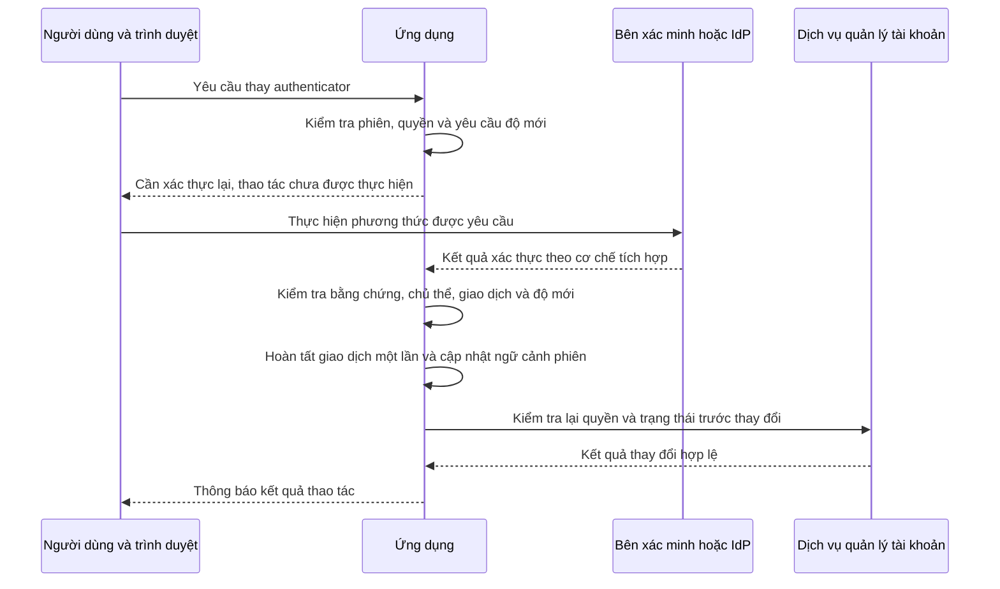

# Reauthentication — Xác thực lại

Một người dùng đăng nhập vào đầu ngày, để máy mở rồi quay lại vài giờ sau. Ứng dụng vẫn nhận được cookie phiên hợp lệ. Khi có yêu cầu thay phương tiện xác thực hoặc cấp quyền quản trị, cookie đó có đủ để kết luận người đang thao tác vẫn kiểm soát authenticator của chủ tài khoản hay không?

Reauthentication là việc yêu cầu và kiểm chứng bằng chứng xác thực một lần nữa trong một ngữ cảnh đã từng được xác thực. Nó giúp ứng dụng không phụ thuộc vô thời hạn vào một lần đăng nhập cũ, đồng thời tạo cơ sở cho các quyết định đòi hỏi bằng chứng mới hơn. Cơ chế này phải được thực thi tại server và gắn với chính sách phiên, phương thức xác thực cùng thao tác đang được bảo vệ.

## 1. Xác thực lại giải quyết vấn đề nào?

Kết quả đăng nhập có một thời điểm. Sau đó, thiết bị có thể bị bỏ quên, cookie có thể bị đánh cắp hoặc ngữ cảnh truy cập có thể thay đổi. Một phiên đang hoạt động chứng minh rằng bên gọi đang trình bày credential của phiên; nó không tự chứng minh người dùng vừa kiểm soát lại authenticator.

Xác thực lại yêu cầu bằng chứng phù hợp để thiết lập lại độ tin cậy theo policy. Tuy nhiên, nó không loại bỏ mọi nguy cơ: malware trên thiết bị, phương thức bị phishing hoặc quy trình khôi phục yếu vẫn có thể làm tài khoản bị chiếm quyền.

Trong hướng dẫn quản lý phiên, NIST phân biệt yêu cầu xác thực lại với việc duy trì phiên và quy định theo ngữ cảnh bảo đảm xác thực. Không nên lấy một thời hạn tùy ý rồi khẳng định mọi hệ thống đã đạt cùng mức bảo đảm. Xem [NIST Authentication and Authenticator Management](https://pages.nist.gov/800-63-4/sp800-63b.html).

### Phân biệt các khái niệm gần nhau

| Cơ chế | Điều gì thay đổi? | Điều không được tự suy ra |
| --- | --- | --- |
| Reauthentication | Có thêm một sự kiện kiểm chứng bằng chứng theo policy | Người dùng có thêm quyền nghiệp vụ |
| Step-up authentication | Bằng chứng đáp ứng yêu cầu cao hơn hoặc bổ sung | Mọi lần reauthentication đều là step-up |
| Refresh token | Client nhận token mới theo cơ chế cấp token | Người dùng vừa nhập hoặc sử dụng authenticator |
| Gia hạn hoạt động phiên | Mốc hoạt động hoặc thời hạn được cập nhật theo chính sách | Thời điểm xác thực chủ động đã mới hơn |
| Xác nhận giao dịch | Người dùng xác nhận ý định đối với nội dung thao tác | Đã xác thực lại nếu chỉ bấm một nút |
| Authorization | Quyết định principal được làm gì trên tài nguyên | Có thể bỏ qua yêu cầu xác thực mới |

Ví dụ, kiểm tra lại một phương thức tương đương sau khi phiên bị idle timeout có thể là reauthentication. Yêu cầu phương thức mạnh hơn cho một chức năng nhạy cảm có thể đồng thời là reauthentication và step-up. Chỉ gửi lại cookie hiện có không nên bị gọi là một lần chứng minh mới nếu policy đòi sử dụng authenticator.

## 2. Khi nào cần xác thực lại?

### 2.1. Theo thời hạn phiên

Hệ thống thường phân biệt các giới hạn thời gian:

- Thời hạn không hoạt động: khoảng thời gian không có hoạt động được tính theo policy.
- Thời hạn tổng thể của phiên hoặc chu kỳ xác thực: giới hạn không bị kéo dài mãi chỉ bằng các request thông thường.
- Độ mới cho thao tác: khoảng thời gian tối đa kể từ sự kiện xác thực đáp ứng yêu cầu của một chức năng.

Các giới hạn này trả lời những câu hỏi khác nhau. Một phiên vừa có request cách đây vài giây vẫn có thể được tạo từ một lần đăng nhập nhiều giờ trước.

Ví dụ thiết kế giả định: phiên có giới hạn tổng thể 8 giờ, giới hạn không hoạt động 20 phút, còn thay authenticator yêu cầu bằng chứng được chấp nhận trong vòng 5 phút. Đây là các con số minh họa; tổ chức cần chọn giá trị theo rủi ro, trải nghiệm, kiến trúc và yêu cầu áp dụng.

Nếu xác thực lại thành công, việc reset giới hạn nào phải theo policy. Không mặc định reset mọi bộ đếm và biến phiên thành vô hạn; cũng không giả định mọi loại timeout đều được xử lý bằng cùng một bằng chứng.

### 2.2. Trước thao tác nhạy cảm

Các trường hợp điển hình cần xem xét gồm đổi mật khẩu, thêm hoặc xóa authenticator, thay thông tin khôi phục, cấp quyền đặc biệt hoặc xuất dữ liệu có phạm vi lớn. OWASP khuyến nghị yêu cầu xác thực lại cho chức năng nhạy cảm và sau sự kiện rủi ro phù hợp. Xem [OWASP Authentication Cheat Sheet](https://cheatsheetseries.owasp.org/cheatsheets/Authentication_Cheat_Sheet.html).

Yêu cầu phụ thuộc mục đích. Thay một thông tin hiển thị công khai có thể khác với thay địa chỉ nhận thông báo khôi phục. Không gom mọi hành động dưới nhãn “sửa hồ sơ” rồi áp chung một policy chỉ vì chúng nằm trên cùng màn hình.

### 2.3. Khi xuất hiện rủi ro hoặc thay đổi trạng thái

Một lần khôi phục tài khoản, thay thiết bị, phát hiện hành vi bất thường hoặc nghi ngờ lộ credential có thể dẫn tới yêu cầu xác thực mới. Tín hiệu phải được đánh giá theo độ tin cậy; một thay đổi IP đơn lẻ không tự chứng minh tài khoản bị chiếm quyền.

Nếu đã biết tài khoản hoặc phiên bị thu hồi, không dùng một lần reauthentication để bỏ qua lệnh thu hồi. Cần xử lý trạng thái tài khoản, credential và sự cố theo quy trình có thẩm quyền trước khi cho phép truy cập trở lại.

## 3. Quản lý thời điểm xác thực đúng nghĩa

### 3.1. Không dùng nhầm mốc thời gian

| Mốc dữ liệu | Ý nghĩa | Có thể thay cho thời điểm xác thực mới? |
| --- | --- | --- |
| `lastActivityAt` | Request hoặc hoạt động gần nhất được server ghi nhận | Không |
| `sessionCreatedAt` | Thời điểm tạo phiên local | Không nhất thiết; phiên có thể tạo từ một kết quả SSO cũ |
| `tokenIssuedAt` | Thời điểm token được phát | Không nhất thiết; có thể phát mới mà không xác thực chủ động |
| `verifiedAuthenticationAt` | Thời điểm sự kiện xác thực đã được kiểm chứng | Có thể, nếu phương thức và ngữ cảnh đáp ứng policy |
| `credentialChangedAt` | Thời điểm một credential được thay | Không tự chứng minh chủ thể hiện tại đã xác thực lại |

Tên trường trên là minh họa cho mô hình ứng dụng. Phải xác định nguồn và semantics trước khi sử dụng, không chỉ chọn một timestamp trông có vẻ mới.

### 3.2. Độ mới luôn đi cùng phương thức và phạm vi

Một điều kiện đơn giản có thể được mô tả:

```text
Đáp ứng yêu cầu khi đồng thời:
  principal và phiên còn đủ điều kiện
  AND có sự kiện xác thực được kiểm chứng cho đúng principal
  AND phương thức đáp ứng policy của thao tác
  AND sự kiện nằm trong cửa sổ thời gian được chấp nhận
  AND kết quả được dùng trong đúng phạm vi cho phép
```

Một password vừa được kiểm tra không đáp ứng mọi yêu cầu chỉ vì nó mới. Nếu policy yêu cầu phương thức có đặc tính khác hoặc có thêm yếu tố, phải kiểm tra các điều kiện đó.

Thời gian có thẩm quyền đến từ server hoặc một kết quả được xác minh từ bên phát tin cậy. Không dùng giờ do client gửi để quyết định độ mới. Với hệ thống phân tán, cần xử lý sai lệch đồng hồ có giới hạn, timestamp bất hợp lý và dữ liệu quá cũ; không mở cửa sổ vô hạn để tránh lỗi.

## 4. Luồng xác thực lại cho một thao tác nhạy cảm

Giả sử người dùng đã có phiên hợp lệ và yêu cầu thay authenticator. Ứng dụng quyết định bằng chứng hiện tại không đủ mới cho thao tác đó.



### Bước 1 — Chặn ở điểm thực thi

Backend xác định yêu cầu cần bằng chứng mới dựa trên loại hành động và policy. Không chỉ mở một hộp thoại ở giao diện rồi để endpoint thay authenticator nhận request trực tiếp mà không kiểm tra.

Ứng dụng có thể giữ ý định thao tác dưới dạng dữ liệu tạm, nhưng chưa được thay đổi tài nguyên nhạy cảm trước khi yêu cầu xác thực lại được đáp ứng. Phân biệt rõ “lưu bản nháp chờ xác minh” và “đã thực hiện thay đổi”.

### Bước 2 — Tạo giao dịch đang chờ

Giao dịch nên có định danh khó đoán, thời hạn, giới hạn thử, principal, liên kết phiên và mục đích. Với thao tác cần ràng buộc nội dung, lưu thêm tham chiếu hoặc biểu diễn đã chuẩn hóa của thay đổi dự kiến.

Ví dụ nội bộ giả lập:

```yaml
transactionRef: reauth-example-71
subject: user-example-427
sessionGeneration: session-generation-example-3
purpose: authenticator.replace
pendingChangeRef: change-example-19
requiredMethodPolicy: approved-account-change-method
maxAuthenticationAgeSeconds: 300
transactionLifetimeSeconds: 120
state: PENDING
```

Các thời hạn là lựa chọn minh họa của ví dụ, không phải cấu hình dùng chung. Reference không phải session cookie. Dữ liệu có thẩm quyền được giữ ở server hoặc bảo vệ theo cơ chế phù hợp; client không được tự đổi `subject`, `purpose` hay `state`.

### Bước 3 — Kiểm chứng bằng chứng và chủ thể

Chọn phương thức đã được gắn hợp lệ với tài khoản và được policy chấp nhận. Nếu xác thực qua IdP, kết quả phải được kiểm tra theo giao thức; nếu kiểm chứng trực tiếp, dùng chức năng của thành phần xác thực được lựa chọn.

Điểm quan trọng là principal được xác thực lại phải khớp tài khoản của giao dịch. Nếu trình duyệt có nhiều tài khoản SSO và người dùng chọn tài khoản khác, không được dùng kết quả đó để phê chuẩn thay đổi cho tài khoản ban đầu.

Mỗi challenge cần được ràng buộc theo giao thức, không dùng lại và có giới hạn thử phù hợp. Thông báo “đã xác thực lại” từ JavaScript hoặc một trường `reauthenticated=true` không phải bằng chứng.

### Bước 4 — Cập nhật phiên có kiểm soát

Ghi nhận sự kiện xác thực đã được kiểm chứng cùng phương thức, thời điểm và phạm vi sử dụng. Khi thay định danh phiên theo cơ chế quản lý phiên, xử lý cả việc vô hiệu hóa định danh cũ và liên kết lại giao dịch đang chờ ở server, tránh để cookie cũ được hưởng kết quả mới ngoài ý muốn.

Không đơn giản đặt một boolean vĩnh viễn như `hasReauthenticated=true`. Điều kiện đáp ứng có thể hết hạn, bị thu hồi hoặc không phù hợp với thao tác tiếp theo.

### Bước 5 — Kiểm tra lại trước khi thực hiện

Trong lúc người dùng thực hiện challenge, tài khoản có thể bị khóa, role bị gỡ hoặc nội dung giao dịch bị thay đổi. Vì vậy, trước khi commit hành động, kiểm tra lại những điều kiện có thể thay đổi và thực thi authorization.

Giao dịch một lần phải có cơ chế chống dùng lại và điều khiển đồng thời phù hợp. Nếu thao tác có yêu cầu nguyên tử hoặc idempotency, cần xử lý ở lớp nghiệp vụ; hoàn tất xác thực không tự giải quyết việc một request bị gửi hai lần.
