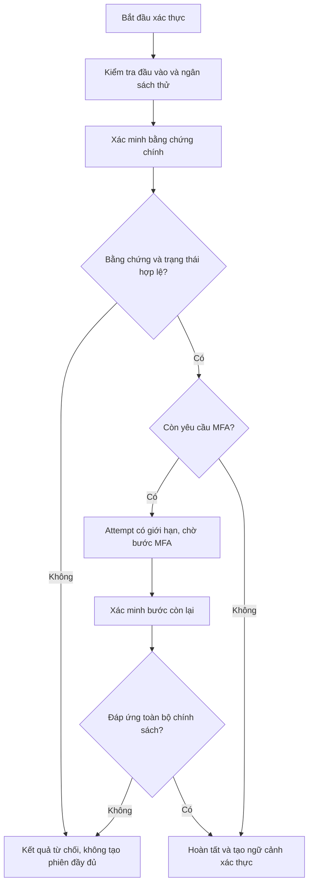

# Authentication failure

**Authentication failure** là tình huống hệ thống không chấp nhận một yêu cầu như đã đáp ứng điều kiện xác thực cần thiết. Nguyên nhân có thể là sai mật khẩu, mã OTP không hợp lệ, credential đã bị thu hồi, token không dành cho ứng dụng hoặc một bằng chứng không còn khớp với lần xác thực hiện tại.

Xử lý thất bại không chỉ là trả về dòng chữ “Đăng nhập không thành công”. Ứng dụng cần giữ đúng trạng thái bảo mật, tránh tiết lộ thông tin tài khoản, hạn chế hành vi đoán credential và cung cấp đủ dữ liệu nội bộ để phân biệt lỗi người dùng, tấn công và sự cố hạ tầng.

Trong IAM, một thiết kế tốt phải trả lời được: yêu cầu đã thất bại ở bước nào, máy chủ thực sự biết điều gì và sau thất bại người gọi còn được phép làm gì.

## 1. Phân biệt xác thực thất bại với các kết quả khác

Một yêu cầu bị từ chối không phải lúc nào cũng do credential sai.

| Tình huống | Bản chất | Hành vi phù hợp |
| --- | --- | --- |
| Mật khẩu không khớp | Bằng chứng xác thực không được chấp nhận | Không tạo ngữ cảnh đăng nhập đầy đủ |
| Token hết hạn hoặc chữ ký không hợp lệ | Credential trình cho request không được chấp nhận | Không dùng claim chưa được xác minh |
| Đúng mật khẩu nhưng còn thiếu MFA | Xác thực chưa hoàn tất | Chỉ cho phép tiếp tục bước còn thiếu |
| Đã xác thực nhưng thiếu quyền xem tài nguyên | Thất bại phân quyền | Không yêu cầu người dùng đoán lại mật khẩu |
| Quá ngân sách thử | Bị giới hạn trước hoặc trong xác thực | Thực thi chính sách giới hạn và phản hồi phù hợp |
| Kho credential hoặc IdP không phản hồi | Không thể hoàn thành kiểm tra do sự cố | Không coi mặc định là mật khẩu sai hoặc xác thực thành công |
| Request thiếu trường hoặc sai định dạng | Lỗi yêu cầu | Xử lý theo contract đầu vào |
| Người dùng đóng hộp thoại xác thực | Luồng bị hủy hoặc bỏ dở | Không mặc định ghi nhận như một lần nhập sai bí mật |

Ví dụ, Linh đã đăng nhập nhưng không có quyền xem bảng lương của người khác. Đây là quyết định phân quyền. Bắt Linh nhập lại đúng mật khẩu sẽ không tự tạo quyền xem bảng lương.

Ngược lại, nếu chỉ hoàn tất bước mật khẩu trong một luồng bắt buộc MFA, ứng dụng chưa được tạo phiên có đầy đủ quyền rồi trông chờ giao diện sẽ chặn người dùng ở bước OTP.

Cũng cần tách kết quả của từng bước với kết quả cuối cùng. “Mật khẩu đúng” có thể là một sự kiện xác minh thành công, nhưng chưa đồng nghĩa “đăng nhập thành công”.

## 2. Những nguyên nhân thường gặp

### 2.1. Bằng chứng không hợp lệ

Các ví dụ gồm mật khẩu không khớp, OTP không thuộc cửa sổ chấp nhận, chữ ký không xác minh được hoặc certificate không được chấp nhận theo chính sách.

Thông tin người dùng trình chỉ được coi là bằng chứng sau khi được kiểm tra bằng cơ chế phù hợp. Một JWT đọc được phần payload không có nghĩa chữ ký đã hợp lệ; một file certificate phân tích được không chứng minh người trình đang kiểm soát khóa riêng.

### 2.2. Bằng chứng hết hiệu lực hoặc đã được sử dụng

Một mã đúng về mặt tính toán vẫn có thể bị từ chối vì đã dùng, challenge hết hạn hoặc credential đã bị thu hồi.

Đối với OTP, kiểm tra thời hạn và kiểm tra chống phát lại là hai việc khác nhau. Mã vẫn còn trong cửa sổ thời gian không được tự động sử dụng lại sau khi đã được chấp nhận cho cùng phạm vi.

### 2.3. Sai ngữ cảnh

Token có thể được cấp hợp lệ nhưng dành cho dịch vụ khác. Phản hồi challenge có thể có chữ ký đúng nhưng thuộc một lần xác thực khác.

Máy chủ cần kiểm tra đúng issuer, audience, relying party, challenge, loại token và các điều kiện được giao thức yêu cầu. Không bỏ qua một điều kiện chỉ vì phần xác minh mật mã đã thành công.

### 2.4. Trạng thái tài khoản hoặc credential không cho phép

Tài khoản bị vô hiệu hóa, credential chưa được kích hoạt hoặc phương tiện đã bị thu hồi đều có thể làm yêu cầu không được chấp nhận, kể cả khi bí mật được cung cấp là giá trị đúng trước đây.

Một giá trị được biết đúng không tạo quyền bỏ qua trạng thái hiện hành.

### 2.5. Lỗi vận hành

Mất kết nối kho dữ liệu, không lấy được thông tin cần thiết từ IdP hoặc lỗi đồng bộ thời gian có thể khiến một lần xác thực không hoàn tất.

Các trường hợp này cần được nhận diện riêng trong hệ thống nội bộ. Nếu mọi exception đều được chuyển thành “sai mật khẩu”, đội vận hành có thể không nhận ra toàn bộ người dùng đang bị ảnh hưởng bởi một sự cố.

## 3. Tách lý do nội bộ khỏi phản hồi công khai

Máy chủ có thể cần biết chi tiết để kiểm thử và điều tra, nhưng người gọi chưa xác thực không nên nhận toàn bộ thông tin ấy.

Ví dụ các lý do nội bộ:

```text
INVALID_PASSWORD
UNKNOWN_IDENTIFIER
CREDENTIAL_REVOKED
ACCOUNT_DISABLED
OTP_REPLAYED
CHALLENGE_EXPIRED
TOKEN_AUDIENCE_MISMATCH
RATE_LIMITED
DEPENDENCY_UNAVAILABLE
```

Các tên trên là lựa chọn minh họa của ứng dụng, không phải mã lỗi chuẩn chung.

Trong một endpoint đăng nhập công khai, nhiều lý do liên quan tài khoản có thể được ánh xạ sang cùng thông báo:

```json
{
  "code": "AUTHENTICATION_FAILED",
  "message": "Không thể đăng nhập bằng thông tin đã cung cấp.",
  "requestId": "req-demo-108"
}
```

Không nên trả lần lượt “email không tồn tại”, “mật khẩu sai” và “tài khoản này đã bị khóa” nếu điều đó cho phép người ngoài phân biệt tài khoản có thật hay trạng thái của nó.

[OWASP Authentication Cheat Sheet](https://cheatsheetseries.owasp.org/cheatsheets/Authentication_Cheat_Sheet.html) thảo luận việc dùng phản hồi chung để hạn chế dò tài khoản, đồng thời lưu ý các khác biệt về mã phản hồi và thời gian xử lý cũng có thể làm lộ thông tin.

Một dòng chữ chung chưa đủ nếu:

- Tài khoản không tồn tại trả ngay, còn tài khoản có thật luôn chạy một phép kiểm tra tốn thời gian.
- Hai trường hợp dùng HTTP status hoặc redirect khác nhau.
- Response header, cookie hoặc kích thước dữ liệu tạo ra dấu hiệu ổn định.
- Endpoint phục hồi vẫn tiết lộ toàn bộ thông tin mà endpoint đăng nhập đang che.

Ứng dụng cần hạn chế các khác biệt không cần thiết và kiểm tra hành vi thực tế. Không nên tuyên bố toàn bộ request “constant time” chỉ vì một phép so sánh bên trong được thiết kế an toàn.

Với mật khẩu, một cách giảm đường thoát quá nhanh là thực hiện phép xác minh giả với dữ liệu kiểm tra phù hợp khi không tìm thấy tài khoản. Cách này cần được đặt sau các biện pháp giới hạn tài nguyên, vì phép kiểm tra mật khẩu vốn có chi phí.

## 4. Ánh xạ HTTP theo đúng ngữ cảnh

HTTP status phục vụ contract của giao thức. Nó không thay thế mô hình trạng thái xác thực của ứng dụng.

Theo [RFC 9110](https://www.rfc-editor.org/rfc/rfc9110.html#section-15.5.2), phản hồi 401 cho biết request thiếu credential xác thực hợp lệ cho tài nguyên đích và phải kèm challenge thích hợp trong `WWW-Authenticate`. Phản hồi 403 diễn tả việc máy chủ từ chối thực hiện request; không nên diễn giải rằng mọi 403 đều có thể sửa bằng cách đăng nhập lại.

Một số trường hợp thường gặp:

| Ngữ cảnh | Phản hồi cần cân nhắc |
| --- | --- |
| Request tới tài nguyên bảo vệ không có credential hợp lệ | 401 với challenge phù hợp |
| Bearer token được trình nhưng hết hạn hoặc không hợp lệ | Theo lỗi `invalid_token` của Bearer |
| Bearer token hợp lệ nhưng thiếu scope cần thiết | Theo lỗi `insufficient_scope`, thường là 403 |
| Vượt giới hạn request | 429 theo chính sách |
| Dịch vụ tạm không hoàn thành được kiểm tra | Lỗi khả dụng phù hợp, chẳng hạn 503 khi đúng ngữ nghĩa |
| Form đăng nhập hoặc API riêng | Tuân thủ contract được thiết kế cho endpoint đó |

[RFC 6750, mục 3](https://www.rfc-editor.org/rfc/rfc6750.html#section-3) quy định phản hồi cho tài nguyên bảo vệ bằng Bearer token. Không lấy nguyên các lỗi của resource server rồi áp dụng tùy ý cho token endpoint, form mật khẩu hoặc mọi API.

Ví dụ khi request đã trình một Bearer token không được chấp nhận:

```http
HTTP/1.1 401 Unauthorized
WWW-Authenticate: Bearer realm="reports", error="invalid_token"
Cache-Control: no-store
Content-Type: application/json

{
  "code": "AUTHENTICATION_REQUIRED",
  "requestId": "req-demo-109"
}
```

Nếu request chưa trình thông tin xác thực, phản hồi Bearer không nên tự suy ra một lỗi chi tiết như “token hết hạn”.

Mã 429 và khả năng gửi `Retry-After` được mô tả trong [RFC 6585, mục 4](https://www.rfc-editor.org/rfc/rfc6585.html#section-4). Việc giới hạn theo tài khoản cũng cần được thiết kế để không vô tình trở thành một kênh dò tài khoản.

Một trang HTML hiển thị lỗi đăng nhập có thể được trả về thành công ở tầng truyền tải, nhưng ứng dụng vẫn phải giữ kết quả xác thực là thất bại. Ngược lại, API không nên dùng 200 cho mọi lỗi chỉ để giao diện dễ xử lý, làm client và giám sát hiểu sai contract.

## 5. Hạn chế đoán credential mà không tạo đường khóa người dùng

Ba dạng hành vi cần phân biệt:

- **Brute force:** thử nhiều giá trị bí mật cho một hoặc một số mục tiêu.
- **Password spraying:** thử một số mật khẩu phổ biến trên nhiều tài khoản.
- **Credential stuffing:** thử các cặp định danh và mật khẩu đã bị lộ ở nơi khác.

Giới hạn theo một IP duy nhất không đủ trước nhiều nguồn tấn công. Giới hạn chỉ theo tài khoản cũng có thể bị lợi dụng để gây gián đoạn cho người dùng có thật.

Một thiết kế có thể kết hợp nhiều chiều:

```text
ngân sách theo tài khoản hoặc định danh đang được thử
+ ngân sách theo credential hoặc bước MFA
+ ngân sách theo nguồn và nhóm nguồn
+ giới hạn tài nguyên toàn dịch vụ
+ tín hiệu rủi ro của luồng
```

Không tin một header IP do client tự gửi. Nếu có reverse proxy, ứng dụng phải xác định proxy nào được tin và cách lấy địa chỉ nguồn theo cấu hình triển khai.

### Khoảng chờ và khóa tạm

Ứng dụng có thể dùng thời gian chờ tăng dần, giới hạn thử trong một cửa sổ hoặc khóa tạm theo chính sách. Ngưỡng, khoảng quan sát và cách khôi phục cần rõ ràng.

Khóa vĩnh viễn một tài khoản chỉ sau vài request sai từ bên ngoài có thể tạo đường gây từ chối dịch vụ. Một luồng mở khóa dễ dãi lại có thể tạo đường bỏ qua cơ chế chống đoán.

Không có một con số “5 lần là an toàn” áp dụng cho mọi phương thức. OTP ngắn, mật khẩu, khóa công khai và endpoint phục hồi có đặc điểm khác nhau.

### Trạng thái giới hạn phải nhất quán

Nếu hai instance cùng đọc số lần sai là 4 rồi cùng ghi thành 5, hệ thống có thể cho thử nhiều hơn dự kiến. Bộ đếm, đặt trước ngân sách hoặc cập nhật trạng thái cần có tính nguyên tử phù hợp.

Nếu request bị rollback vì mật khẩu sai, số lần thử không được vô tình rollback theo. Có thể tách kế toán request và kết quả xác minh theo thiết kế, nhưng phải bảo đảm những lần thất bại thực sự được tính.

Một lần đúng mật khẩu không được tự động xóa lịch sử sai OTP nếu MFA vẫn chưa hoàn tất. Tương tự, tạo attempt mới hoặc bấm gửi lại mã không được luôn làm mới toàn bộ ngân sách thử.

CAPTCHA có thể hỗ trợ hạn chế tự động hóa trong một số luồng, nhưng không thay cho xác thực, bảo vệ credential hoặc kiểm soát trạng thái.

## 6. Giữ đúng trạng thái khi thất bại ở nhiều bước

Một luồng có thể được mô hình hóa như sau:



Trạng thái chờ MFA chỉ nên có khả năng tiếp tục đúng luồng đó. Nó không được truy cập API vốn yêu cầu phiên đã xác thực đầy đủ.

Ví dụ dữ liệu do ứng dụng minh họa quản lý:

```json
{
  "attemptId": "attempt-demo-205",
  "subjectId": "user-demo-42",
  "state": "MFA_PENDING",
  "primaryProofVerified": true,
  "requiredNextStep": "TOTP",
  "expiresAt": "2026-01-15T09:05:00Z"
}
```

Các trường này do máy chủ tạo và bảo vệ. Client không được tự đổi `state` thành `AUTHENTICATED` hoặc gửi `mfaVerified=true` để bỏ qua bước xác minh.

Khi OTP sai, chỉ cập nhật trạng thái và ngân sách theo chính sách. Không tạo session đầy đủ rồi gắn thêm cờ “chưa MFA” mà các API khác có thể quên kiểm tra.

Khi challenge hết hạn, hủy hoặc kết thúc attempt theo contract. Không cho một bằng chứng của attempt cũ hoàn tất attempt mới chỉ vì cùng user ID.

Đối với người đã đăng nhập nhưng xác minh lại cho thao tác nhạy cảm thất bại, cần từ chối thao tác đó. Có kết thúc phiên hiện tại hay không là quyết định dựa trên chính sách và tín hiệu rủi ro; không mặc định mỗi lần gõ sai đều phải thu hồi toàn bộ phiên của tài khoản.

## 7. Lỗi hạ tầng phải dừng việc cấp quyền mới khi chưa đủ bằng chứng

Giả sử password verifier đã kiểm tra xong, nhưng hệ thống MFA không truy cập được. Ứng dụng không được tự coi yêu cầu MFA là tùy chọn chỉ vì đang có sự cố.

Nguyên tắc là không cấp một ngữ cảnh xác thực mới vượt quá bằng chứng đã xác minh. Tuy nhiên, điều đó không có nghĩa phải hủy mọi phiên đang tồn tại khi một dịch vụ phụ trợ bị lỗi. Phiên hiện có phải tiếp tục được đánh giá theo chính sách hiệu lực và phụ thuộc thực tế của nó.

Các trường hợp cần tách biệt:

| Sự cố | Không nên làm | Cách xử lý cần thiết kế |
| --- | --- | --- |
| Kho credential timeout | Ghi nhận người dùng nhập sai mật khẩu | Phân loại lỗi phụ thuộc và không hoàn tất xác thực |
| MFA provider không phản hồi | Bỏ MFA tự động | Thông báo lỗi phù hợp hoặc dùng phương án thay thế đã được phê duyệt |
| Không ghi được trạng thái chống phát lại | Chấp nhận OTP mà không ghi tiêu thụ | Không hoàn tất bằng chứng cần tính một lần |
| Không tạo được session | Trả cookie đăng nhập thành công giả | Phản ánh lỗi tạo phiên, không đánh đồng với credential sai |
| Không lấy được dữ liệu thu hồi bắt buộc | Mặc định credential chưa bị thu hồi | Tuân thủ chính sách kiểm tra trạng thái đã xác định |

Các phương án dùng cache phải có điều kiện tin cậy và thời hạn rõ ràng. “Mạng đang lỗi” không phải một lý do chung để tin mọi dữ liệu đã có từ trước.

Circuit breaker hoặc retry có thể bảo vệ dịch vụ, nhưng retry phải có giới hạn và phù hợp với tính lặp. Không lặp vô hạn một thao tác tiêu thụ OTP hoặc tạo phiên mà không kiểm soát kết quả trước đó.

Lỗi phụ thuộc có thể vẫn tiêu tốn ngân sách request để bảo vệ hệ thống. Nó không nên tự bị ghi thành một lần “mật khẩu chắc chắn sai” khi verifier chưa đưa ra kết luận đó.

## 8. Luồng xử lý minh họa cho xác thực mật khẩu

Đoạn dưới là mã giả điều phối, không phải triển khai hash mật khẩu hoặc một giao thức đăng nhập đầy đủ:

```text
authenticatePassword(request):

    validateBoundedInput(request)
    identifier = normalizeIdentifierByAccountRules(request.identifier)
    password = preservePasswordAccordingToPasswordPolicy(request.password)

    admission = atomicallyReserveRequestBudget(
        identifier,
        trustedRequestSource(request)
    )

    if admission is denied:
        recordOutcome(THROTTLED)
        return protocolAppropriateThrottleResponse()

    try:
        record = findAccountAndPasswordVerifier(identifier)

        verifier = record exists
            ? record.passwordVerifier
            : configuredDummyPasswordVerifier

        proofValid = safePasswordVerify(password, verifier)

    catch dependencyOrVerifierFailure:
        recordOutcome(UNAVAILABLE)
        return protocolAppropriateUnavailableResponse()

    if record is absent:
        recordDefinitiveCredentialFailureForAttemptedIdentifier()
        return genericAuthenticationFailure()

    if not proofValid or not record.accountAllowsAuthentication:
        recordDefinitiveRejectionWithInternalReason()
        return genericAuthenticationFailure()

    if requiredAuthenticationPolicyNeedsMoreEvidence(record):
        attempt = createRestrictedPendingAttemptAfterStateRecheck(record)
        return nextStepResponse(attempt)

    result = finalizeAuthenticationAfterStateRecheck(record)

    if result is unavailable:
        recordOutcome(UNAVAILABLE)
        return protocolAppropriateUnavailableResponse()

    recordOutcome(AUTHENTICATED)
    return protocolAppropriateSuccessResponse(result)
```

Một số chi tiết quan trọng:

- Chuẩn hóa định danh theo quy tắc tài khoản không có nghĩa tự trim hoặc biến đổi mật khẩu.
- Kiểm tra đầu vào cần giới hạn tài nguyên nhưng vẫn phù hợp với chính sách mật khẩu đã công bố.
- Dummy verifier giúp giảm khác biệt xử lý khi tài khoản không tồn tại; không tạo một tài khoản giả có thể đăng nhập.
- Lý do nội bộ có thể chi tiết hơn phản hồi công khai.
- Cần kiểm tra lại trạng thái cần thiết trước khi phát hành kết quả, vì tài khoản hoặc credential có thể bị vô hiệu hóa sau lần đọc ban đầu.
- Session chỉ được phát hành sau khi đáp ứng toàn bộ chính sách của luồng.

Nếu ứng dụng dùng nhiều phương thức đăng nhập, không ép mọi exception về một cờ boolean `passwordCorrect`. Nên giữ các kết quả như từ chối bằng chứng, cần bước tiếp theo, bị giới hạn và lỗi khả dụng đủ lâu để xử lý đúng.

## 9. Log đủ để điều tra, không biến log thành kho credential

Ví dụ sự kiện nội bộ do bài học định nghĩa:

```json
{
  "eventType": "authentication.attempt",
  "requestId": "req-demo-108",
  "attemptId": "attempt-demo-205",
  "targetSubjectId": "user-demo-42",
  "authenticatedActorId": null,
  "verifiedTenantId": null,
  "stage": "PASSWORD_PROOF",
  "outcome": "REJECTED",
  "reasonCode": "INVALID_PASSWORD",
  "method": "PASSWORD",
  "sourceCorrelationRef": "source-demo-83",
  "policyVersion": "auth-policy-demo-4"
}
```

`TargetSubjectId` là tài khoản được tìm thấy để kiểm tra; nó không chứng minh người gửi request là chủ tài khoản đó. Vì vậy, `authenticatedActorId` vẫn có thể rỗng khi đăng nhập thất bại.

Nếu chưa xác minh được tenant của chủ thể, không ghi tenant do client tự khai vào trường có ý nghĩa “đã được xác minh”. Có thể ghi ngữ cảnh được yêu cầu trong một trường riêng, kèm mức độ tin cậy rõ ràng.

Không cần ghi mật khẩu, OTP, seed, private key, refresh token hoặc giá trị `Authorization` và cookie để phân tích tỷ lệ thất bại. [OWASP Logging Cheat Sheet](https://cheatsheetseries.owasp.org/cheatsheets/Logging_Cheat_Sheet.html#data-to-exclude) liệt kê các dữ liệu xác thực và bí mật cần loại khỏi việc ghi log trực tiếp.

Cần kiểm tra cả access log, trace, error report và công cụ phân tích request. Xóa mật khẩu khỏi application log không đủ nếu một tầng proxy vẫn ghi nguyên request body.

Nếu cần liên kết các lần thử trên một định danh chưa xác thực, có thể dùng mã tham chiếu được thiết kế cho mục đích đó. Hash thông thường của email không tự bảo đảm ẩn danh, vì email có thể được đoán và đối chiếu.

Log phải có quyền truy cập, thời hạn lưu và biện pháp chống sửa phù hợp. Dữ liệu người gọi cung cấp cần được xử lý để không chèn dòng hoặc nội dung gây hiểu nhầm vào log.

## 10. Theo dõi mẫu thất bại thay vì chỉ đếm tổng

Một biểu đồ “đăng nhập lỗi tăng” chưa đủ để xác định nguyên nhân. Cần phân tách theo giai đoạn và nhóm kết quả.

Ví dụ nhóm chỉ số:

```text
authentication attempts:
    authenticated
    rejected
    challenged
    throttled
    unavailable
    cancelled

stages:
    password
    otp
    public_key
    token_validation
    session_creation
```

Không dùng user ID, email hoặc token làm nhãn metrics có số lượng giá trị không giới hạn. Chi tiết điều tra thuộc kho log hoặc hệ thống sự kiện với quyền truy cập phù hợp.

Các mẫu có thể gợi ý vấn đề khác nhau:

| Mẫu quan sát | Khả năng cần điều tra |
| --- | --- |
| Một tài khoản có nhiều lần sai từ nhiều nguồn | Đoán credential phân tán hoặc cấu hình client sai |
| Một nguồn thử nhiều định danh | Dò tài khoản, spraying hoặc stuffing |
| Lỗi OTP tăng sau triển khai | Sai cấu hình, lệch thời gian hoặc lỗi trạng thái |
| Lỗi phụ thuộc tăng đồng loạt ở mọi người dùng | Sự cố khả dụng |
| Nhiều lần từ chối rồi thành công từ môi trường khác lạ | Có thể cần đánh giá nguy cơ chiếm tài khoản |
| Nhiều request dùng token cũ sau thay credential | Client chưa cập nhật hoặc dấu hiệu credential bị dùng tiếp |

Các mẫu này là tín hiệu, không phải kết luận tự động. Một người dùng nhập sai vài lần rồi thành công là hành vi bình thường trong nhiều tình huống.

Cảnh báo nên có ngữ cảnh và tránh gửi một email cho từng request sai. Nếu không, cơ chế cảnh báo có thể trở thành công cụ gây nhiễu hoặc làm người dùng bỏ qua thông báo quan trọng.

## 11. Hỗ trợ người dùng mà không tạo đường bỏ qua

Phản hồi chung vẫn có thể đưa hướng dẫn hữu ích: kiểm tra thông tin, thử phương thức đã đăng ký khác hoặc bắt đầu phục hồi theo luồng được cung cấp.

Trong bước OTP đã được ràng buộc với một attempt hợp lệ, giao diện có thể hướng dẫn kiểm tra giờ thiết bị hoặc nhập mã mới. Điều đó khác với endpoint công khai tiết lộ rằng một email cụ thể đã có TOTP.

Không sửa lỗi đăng nhập bằng các cách sau:

- Tắt kiểm tra chứng thư hoặc chữ ký để “thử lại cho nhanh”.
- Bỏ kiểm tra audience vì token có chữ ký đúng.
- Cho người dùng đặt lại MFA chỉ bằng việc biết email.
- Ghi nguyên credential vào ticket hỗ trợ.
- Mở một tài khoản quản trị dùng chung để người dùng đi qua sự cố.
- Coi lỗi tải dữ liệu quyền là được phép truy cập.

Nhân viên hỗ trợ có thể dùng request ID để tra cứu lý do trong hệ thống được phép truy cập. Người dùng không cần cung cấp mật khẩu hoặc mã đang dùng để nhân viên tái hiện thay họ.

Khi nguyên nhân là lỗi hạ tầng, thông báo nên phản ánh khả năng thử lại mà không đổ lỗi cho người dùng. Khi nguyên nhân là thiếu quyền, chuyển đến quy trình cấp quyền phù hợp; không hướng dẫn đổi mật khẩu như thể đó là cách giải quyết.

## 12. Các tình huống cần kiểm chứng

| Tình huống | Kết quả cần có |
| --- | --- |
| Định danh không tồn tại | Phản hồi công khai không tiết lộ sự tồn tại tài khoản |
| Mật khẩu sai của tài khoản có thật | Không tạo session, ghi đúng nhóm từ chối |
| Mật khẩu đúng nhưng tài khoản bị vô hiệu hóa | Không hoàn tất xác thực |
| Đúng mật khẩu, sai OTP | Không truy cập được API yêu cầu xác thực đầy đủ |
| OTP đã được dùng | Không chấp nhận phát lại |
| Phản hồi của challenge cũ | Không hoàn tất attempt mới |
| Token có chữ ký đúng nhưng sai audience | Không tin token cho tài nguyên hiện tại |
| Token không hợp lệ trên tài nguyên Bearer | Phản hồi đúng contract và challenge của Bearer |
| Đã xác thực nhưng thiếu quyền | Không đánh đồng thành mật khẩu sai |
| Nhiều IP cùng thử một tài khoản | Giới hạn không chỉ phụ thuộc từng IP |
| Tạo attempt mới sau mỗi lần sai OTP | Không làm mới toàn bộ ngân sách thử |
| Hai request cùng cập nhật bộ đếm lỗi | Không mất cập nhật làm vượt ngưỡng |
| Kho credential timeout | Phân loại lỗi khả dụng, không cấp quyền mới |
| MFA provider lỗi | Không tự bỏ MFA |
| Tạo session thất bại sau khi proof hợp lệ | Không trả kết quả đăng nhập thành công giả |
| Request có dữ liệu bí mật | Log và trace không ghi lại giá trị bí mật |
| Đổi tenant trong request chưa xác thực | Không tạo tenant đã xác minh từ đầu vào tự khai |
| Người đã đăng nhập thất bại khi xác minh lại | Từ chối thao tác nhạy cảm theo đúng chính sách |
| Client gửi cờ xác thực thành công | Cờ không thay thế kiểm tra máy chủ |
| Tấn công gây nhiều lỗi đăng nhập | Cảnh báo và giới hạn không tạo khóa hàng loạt thiếu kiểm soát |

Kiểm thử cần bao gồm phản hồi, header, cookie, trạng thái attempt, bộ đếm và dữ liệu được ghi log. Với nguy cơ dò tài khoản qua thời gian, cần đánh giá phân bố hành vi thực tế; một phép đo đơn lẻ không chứng minh không có khác biệt.

Authentication failure là một kết quả bảo mật cần được thiết kế có chủ đích. Ứng dụng phải từ chối đúng lúc, giữ nguyên các ranh giới chưa được xác minh và giúp người vận hành hiểu lý do mà không trao thêm dữ liệu hoặc quyền cho người gọi chưa đáng tin.
