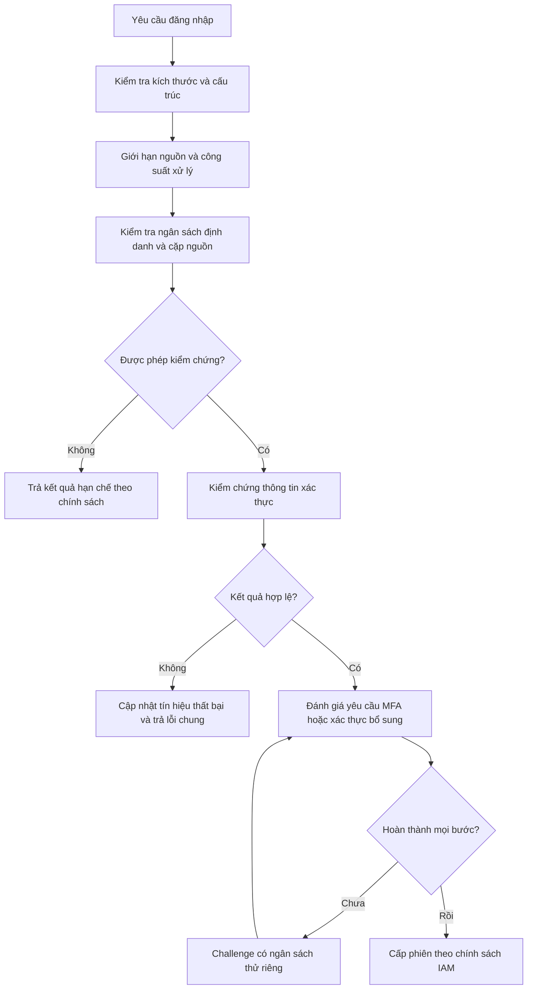

# Brute-force protection

Brute-force protection là tập hợp biện pháp hạn chế việc thử thông tin xác thực lặp đi lặp lại nhằm đoán đúng bí mật hoặc tìm được một thông tin xác thực còn sử dụng được. Trong hệ thống quản lý danh tính và quyền truy cập (IAM), mục tiêu của cơ chế này là giảm cơ hội chiếm đoạt tài khoản, bảo vệ tài nguyên xác thực và duy trì khả năng truy cập của người dùng hợp lệ.

Một bộ đếm “sai năm lần thì khóa tài khoản” chỉ giải quyết được một phần vấn đề. Kẻ tấn công có thể đổi địa chỉ mạng, thử rất ít lần trên nhiều tài khoản hoặc cố tình làm tài khoản của người khác bị khóa. Vì vậy, cần thiết kế đồng thời giới hạn thử, phát hiện bất thường, xác thực bổ sung và đường khôi phục có kiểm soát.

## 1. Những hành vi cần phân biệt

Các dạng lạm dụng sau có thể cùng xuất hiện tại màn hình đăng nhập nhưng tạo ra dấu hiệu khác nhau:

| Hành vi | Cách thử phổ biến | Dấu hiệu đáng chú ý | Hạn chế của việc chỉ đếm sai theo tài khoản |
|---|---|---|---|
| Đoán mật khẩu trực tiếp | Thử nhiều mật khẩu trên một tài khoản | Nhiều lần thất bại tập trung vào một định danh | Có tác dụng nhưng dễ bị lợi dụng để khóa nạn nhân |
| Password spraying | Thử một số mật khẩu thường gặp trên nhiều tài khoản | Nhiều tài khoản bị thử, mỗi tài khoản chỉ có ít thất bại | Có thể không tài khoản nào chạm ngưỡng |
| Credential stuffing | Thử các cặp định danh và mật khẩu đã lộ từ nơi khác | Nhiều cặp thông tin khác nhau; đôi khi thành công ngay lần đầu | Không phát hiện được mọi lần đăng nhập bằng mật khẩu đúng |
| Đoán OTP hoặc mã khôi phục | Thử nhiều giá trị trong không gian mã giới hạn | Nhiều lần kiểm tra mã trong cùng giao dịch hoặc cùng tài khoản | Bộ đếm mật khẩu không bao phủ bước này |
| Làm cạn tài nguyên xác thực | Gửi nhiều yêu cầu kích hoạt xử lý tốn CPU, bộ nhớ hoặc dịch vụ ngoài | Tăng hàng đợi, độ trễ, số lần kiểm tra mật khẩu | Khóa từng tài khoản vẫn có thể không bảo vệ được toàn hệ thống |

Brute-force trực tuyến đi qua điểm xác thực của hệ thống nên có thể bị giới hạn tốc độ. Brute-force ngoại tuyến diễn ra khi kẻ tấn công đã lấy được dữ liệu kiểm chứng, chẳng hạn cơ sở dữ liệu password hash. Bộ giới hạn tại API đăng nhập không ngăn được việc thử ngoại tuyến; bảo vệ dữ liệu mật khẩu, chọn cơ chế băm phù hợp và quản lý bí mật vẫn là các lớp độc lập.

Tương tự, đánh cắp một phiên đã xác thực có thể bỏ qua hoàn toàn bước nhập mật khẩu. Brute-force protection cần phối hợp với bảo vệ phiên, MFA và quản lý vòng đời thông tin xác thực, thay vì được xem là biện pháp bao phủ mọi hình thức chiếm đoạt danh tính.

## 2. Tư duy theo ngân sách thử

Mỗi yêu cầu được đưa vào bộ kiểm chứng tạo ra một cơ hội thử bí mật. Thiết kế bảo vệ cần trả lời ba câu hỏi:

1. Một đối tượng được thử bao nhiêu lần trong khoảng thời gian nào?
2. Giới hạn đó còn giữ được khi yêu cầu đến từ nhiều nguồn và nhiều máy chủ không?
3. Người dùng hợp lệ đi tiếp bằng cách nào khi luồng mật khẩu đang bị hạn chế?

Với một mã ngẫu nhiên phân bố đều trong không gian gồm `N` giá trị, nếu chỉ có một giá trị hợp lệ và kẻ tấn công thử `q` giá trị khác nhau trong thời gian mã còn hiệu lực, xác suất đoán đúng là:

```text
P(thành công) = min(q, N) / N
```

Đây là mô hình đơn giản cho mã ngẫu nhiên. Nếu đồng thời chấp nhận nhiều mã, chẳng hạn nhiều bước thời gian của OTP, cần xét toàn bộ tập giá trị được chấp nhận. Không áp dụng công thức này trực tiếp cho mật khẩu do người dùng chọn vì phân bố mật khẩu không đều. Credential stuffing còn có thể dùng mật khẩu đúng ngay từ đầu.

Một giới hạn “mỗi máy chủ cho phép mười lần” có thể biến thành hàng chục lần nếu có nhiều máy chủ cùng xử lý. Một giới hạn “mỗi lần gửi mã được thử năm lần” có thể trở thành không giới hạn nếu việc gửi lại mã tạo ra ngân sách mới vô điều kiện. Đơn vị đếm và phạm vi ngân sách quyết định hiệu quả thực tế của chính sách.

Ngân sách thử cũng khác với công suất phục vụ. Hệ thống có thể giới hạn số lần thử một tài khoản để giảm nguy cơ đoán đúng, đồng thời giới hạn số phép kiểm tra mật khẩu chạy song song để tránh hết CPU hoặc bộ nhớ.

## 3. Chọn nhiều chiều giới hạn

Một nguồn yêu cầu không đồng nghĩa với một người. Nhiều người dùng có thể chung địa chỉ IP qua NAT; một kẻ tấn công có thể sử dụng rất nhiều địa chỉ IP. Nên kết hợp các chiều quan sát có ý nghĩa khác nhau.

| Chiều giới hạn | Mục đích | Điều cần thận trọng |
|---|---|---|
| Nguồn mạng hoặc nhóm nguồn | Chặn nguồn gửi quá nhiều yêu cầu, bảo vệ tài nguyên | IP dùng chung, proxy và thay đổi địa chỉ có thể gây nhận định sai |
| Định danh đăng nhập trong tenant | Nhận diện nhiều nguồn cùng nhắm một tài khoản | Không để người khác dễ dàng gây khóa tài khoản kéo dài |
| Cặp định danh và nguồn | Hạn chế thử lặp từ một nguồn vào một đích | Không đủ để chống tấn công phân tán |
| Giao dịch xác thực hoặc challenge | Giới hạn thử OTP, mã khôi phục hay bước xác thực bổ sung | Tạo giao dịch mới không được xóa sạch ngân sách cấp tài khoản |
| Tenant hoặc ứng dụng | Giữ công bằng giữa các đơn vị sử dụng | Một tenant bị tấn công không nên chiếm hết công suất của tenant khác |
| Toàn hệ thống và số phép kiểm chứng đồng thời | Bảo vệ dịch vụ trước tải lớn | Cần cơ chế phân bổ để người dùng hợp lệ vẫn có cơ hội truy cập |

Định danh phải được chuẩn hóa theo đúng quy tắc tra cứu của hệ thống. Nếu hệ thống coi hai biểu diễn là cùng một tài khoản, bộ đếm cũng phải phản ánh điều đó. Không tự ý viết thường mọi username hoặc thay đổi quy tắc địa chỉ email vì có thể tạo ra khác biệt với cơ chế định danh thực tế.

Trong môi trường đa tenant, khóa theo tên đăng nhập cần chứa tenant đã được máy chủ xác định hợp lệ. Không để một trường tenant tùy ý trong request tạo ra các không gian ngân sách mới để né giới hạn.

Ví dụ cấu trúc khóa nội bộ:

```text
identifierTag = HMAC(secretKey, encode(tenantId, canonicalLoginName))

source:<trusted-source-key>
identifier:<tenant-id>:<identifier-tag>
pair:<tenant-id>:<identifier-tag>:<trusted-source-key>
challenge:<server-issued-challenge-id>
```

`encode` cần phân tách các trường rõ ràng để hai cặp giá trị khác nhau không tạo cùng chuỗi đầu vào. HMAC giúp tránh lưu trực tiếp định danh trong khóa và hạn chế việc đoán ngược bằng bảng băm công khai khi khóa bí mật được bảo vệ. Giá trị này vẫn là dữ liệu có khả năng liên kết hành vi, cần giới hạn quyền truy cập và thời gian lưu.

Địa chỉ nguồn cũng phải lấy từ chuỗi proxy được tin cậy. Tin trực tiếp một header như `X-Forwarded-For` do client tự gửi có thể cho phép kẻ tấn công đổi “nguồn” trên mỗi yêu cầu.

Không dùng cookie thiết bị do client tự khai báo làm bằng chứng duy nhất để cấp ngân sách mới. Dữ liệu thiết bị có thể bổ sung đánh giá rủi ro; sức nặng của nó phụ thuộc cách phát hành, bảo vệ và ràng buộc với tài khoản.

## 4. Đặt các lớp bảo vệ đúng vị trí

Một luồng xác thực có thể tổ chức như sau:



Giới hạn tại gateway giúp loại tải lớn sớm. Giới hạn tại dịch vụ xác thực hiểu rõ định danh, trạng thái challenge và các quy tắc nghiệp vụ. Hai lớp bổ sung cho nhau; kiểm tra ở gateway không tự thay thế được ngân sách cấp tài khoản.

Phải áp dụng trên mọi đường có khả năng kiểm chứng cùng loại bí mật: giao diện web, ứng dụng di động, API cũ và luồng đăng nhập quản trị. Nếu một endpoint bị quên vẫn nhận số lần thử không giới hạn, kẻ tấn công có thể sử dụng endpoint đó dù giao diện chính đã được bảo vệ.

Không cấp phiên đầy đủ ngay khi mật khẩu đúng nếu chính sách còn yêu cầu MFA. Kết quả “mật khẩu đúng” và kết quả “hoàn thành xác thực” là hai sự kiện riêng.

## 5. Các cơ chế giới hạn và trì hoãn

### 5.1. Fixed window, sliding window và token bucket

| Cơ chế | Cách hoạt động | Ưu điểm | Điểm cần chú ý |
|---|---|---|---|
| Fixed window | Đếm số lần trong từng cửa sổ thời gian cố định | Dễ triển khai, ít trạng thái | Có thể có đợt dồn yêu cầu ở hai phía ranh giới cửa sổ |
| Sliding window | Xét số lần trong khoảng thời gian lùi từ hiện tại | Kiểm soát sát hơn trong một khoảng liên tục | Cần cân nhắc chi phí lưu và cách xấp xỉ |
| Token bucket | Mỗi lần thử tiêu thụ token; token được bổ sung theo tốc độ đã đặt | Kiểm soát được tốc độ dài hạn và một mức burst | Phải chọn cả sức chứa và tốc độ bổ sung |

Fixed window không nhất thiết sai, nhưng phải hiểu hành vi biên. Nếu cho phép năm lần trong mỗi phút cố định, năm lần sát cuối phút và năm lần ngay đầu phút sau có thể tạo mười lần thử trong một khoảng rất ngắn.

Token bucket phân biệt rõ hai tham số. Sức chứa lớn cho phép đợt thử dồn lớn dù tốc độ bổ sung thấp. Việc chỉ ghi “giới hạn một lần mỗi giây” mà bỏ qua sức chứa khiến chính sách không đầy đủ.

### 5.2. Trì hoãn tăng dần

Sau các thất bại liên tiếp, hệ thống có thể tăng thời gian trước khi cho phép lần thử tiếp theo. Một mô hình minh họa là:

```text
delay(n) = min(delayMax, delayBase * 2 ^ max(0, n - threshold))
nextAllowedAt = serverTime + delay(n)
```

`n`, ngưỡng, thời gian giảm mức phạt và giới hạn tối đa phải được định nghĩa trong chính sách. Khi tính toán thực tế cần chặn tràn số và dùng thời gian do hệ thống tin cậy quản lý.

Không giữ một thread hoặc kết nối cơ sở dữ liệu bằng lệnh ngủ dài cho mỗi yêu cầu bị phạt. Lưu thời điểm được thử lại và từ chối sớm những yêu cầu chưa đủ điều kiện giúp tránh biến cơ chế trì hoãn thành điểm làm cạn tài nguyên.

Không mặc định kéo dài thời gian khóa tài khoản sau mọi request đã bị chặn. Nếu chỉ cần gửi thêm request là tiếp tục đẩy `nextAllowedAt` của nạn nhân ra xa, kẻ tấn công có thể giữ tài khoản ở trạng thái không sử dụng được. Có thể tiếp tục phạt nguồn gây lạm dụng, nhưng quy tắc ảnh hưởng đến toàn tài khoản phải có giới hạn và đường phục hồi rõ ràng.

### 5.3. CAPTCHA và xác thực bổ sung

CAPTCHA có thể làm tăng chi phí tự động hóa nhưng có thể bị vượt qua và gây khó khăn về khả năng tiếp cận. Không dùng CAPTCHA làm điều kiện duy nhất để bỏ qua giới hạn thử.

MFA giúp giảm nguy cơ chiếm tài khoản khi mật khẩu bị đoán hoặc đã lộ. Bản thân bước MFA vẫn cần ngân sách thử, thời hạn challenge và chống tái sử dụng phù hợp. Việc liên tục gửi thông báo phê duyệt còn có thể tạo ra lạm dụng gây mệt mỏi cho người dùng.

Nếu cho phép đi qua phương thức thay thế như passkey hoặc một luồng khôi phục, phương thức đó phải kiểm chứng danh tính độc lập theo chính sách. Chỉ biết username, vượt CAPTCHA hoặc có cookie thiết bị không đủ để mở khóa và cấp phiên.

## 6. Tránh biến khóa tài khoản thành công cụ từ chối dịch vụ

Giả sử hệ thống khóa một tài khoản trong một ngày sau năm lần nhập sai. Người tấn công chỉ cần biết tên đăng nhập của nhân viên để ngăn nhân viên đó truy cập, dù không biết mật khẩu.

Thiết kế cần cân bằng khả năng chống đoán và tính sẵn sàng:

- Ưu tiên hạn chế theo nguồn và cặp nguồn–định danh khi tín hiệu cho thấy một nguồn cụ thể gây lạm dụng.
- Dùng tín hiệu cấp tài khoản để nhận diện tấn công phân tán và quyết định hạn chế tạm thời hoặc yêu cầu phương thức xác thực mạnh hơn.
- Giới hạn thời gian ảnh hưởng và quy định rõ điều kiện giảm mức phạt.
- Cung cấp đường khôi phục được xác thực, có ngân sách riêng và có audit.
- Giới hạn số lần gửi email, SMS hoặc thông báo bảo mật để tránh khuếch đại lạm dụng.

Giới hạn chỉ theo nguồn không giải quyết được tấn công phân tán. Ngược lại, đặt mọi phản ứng lên toàn tài khoản làm tăng nguy cơ từ chối dịch vụ. Các lớp phải phối hợp theo tình huống thay vì loại bỏ hoàn toàn một trong hai chiều.

Không tự động thu hồi mọi phiên đang hoạt động chỉ vì có người lạ nhập sai mật khẩu. Thất bại đăng nhập chưa chứng minh tài khoản đã bị chiếm. Nếu có bằng chứng rủi ro khác, IAM có thể yêu cầu xác thực lại hoặc thu hồi phiên theo chính sách xử lý sự cố riêng.

Thao tác hỗ trợ mở khóa cần xác minh người yêu cầu và lưu dấu vết. Nếu bộ phận hỗ trợ chỉ dựa vào thông tin công khai rồi xóa bộ đếm, luồng hỗ trợ trở thành đường vượt cơ chế bảo vệ.

## 7. Định nghĩa chính xác sự kiện được đếm

Nên phân biệt ít nhất ba loại dữ liệu:

1. Ngân sách request và công suất: được kiểm tra trước xử lý tốn tài nguyên.
2. Ngân sách lần thử bí mật: được tiêu thụ khi hệ thống chấp nhận một lần kiểm chứng.
3. Tín hiệu thất bại và rủi ro: được cập nhật từ kết quả kiểm chứng và ngữ cảnh.

Nếu chỉ tăng bộ đếm sau khi mật khẩu được kiểm tra, nhiều request đồng thời có thể cùng nhìn thấy bộ đếm cũ rồi tất cả đi vào bộ kiểm chứng. Việc kiểm tra và giữ ngân sách phải diễn ra nguyên tử trước khi kiểm chứng bí mật.

Ngân sách lần thử có thể tính cả lần đúng và lần sai, vì cả hai đều đã sử dụng một cơ hội kiểm chứng. Bộ đếm thất bại phục vụ mục đích khác nên chỉ cập nhật theo kết quả đã định nghĩa. Request sai cấu trúc có thể tiêu thụ ngân sách nguồn, nhưng không nên tự động được coi là mật khẩu sai của một tài khoản.

Đăng nhập thành công có thể làm giảm một phần trạng thái thất bại liên tiếp. Không xóa toàn bộ lịch sử nguồn, hạn mức request hoặc dấu hiệu chiến dịch tấn công chỉ vì có một lần thành công. Một nguồn gửi nhiều cặp thông tin bị lộ có thể xen kẽ các lần đúng để tận dụng cơ chế reset quá rộng.

Mật khẩu đúng nhưng OTP sai cũng không nên được ghi như mật khẩu sai. Cần biết bước nào thất bại để chọn phản ứng phù hợp và điều tra chính xác. Tuy vậy, nhật ký nội bộ chi tiết không có nghĩa là phải trả toàn bộ lý do đó cho client.

Khi client hủy kết nối sau khi bộ kiểm chứng đã chạy, không hoàn ngân sách một cách vô điều kiện. Nếu việc ngắt kết nối có thể xóa lần thử, một client có chủ đích có thể khai thác đặc điểm đó. Quy tắc hoàn ngân sách cần dựa trên việc kiểm chứng đã được chấp nhận hoặc thực hiện, không chỉ dựa trên việc client nhận được response.

## 8. Bộ đếm trong hệ thống phân tán

### 8.1. Tính nguyên tử

Mẫu sau có lỗi cạnh tranh nếu hai bước không được bảo vệ:

```text
if readCounter(key) < limit:
    incrementCounter(key)
    verifySecret()
```

Nhiều máy chủ có thể cùng đọc một giá trị rồi cùng cho phép. Thay vào đó, cần một phép quyết định nguyên tử trả về việc được phép hay bị từ chối và cập nhật trạng thái liên quan theo hợp đồng đã định nghĩa.

Nếu yêu cầu chịu nhiều chiều giới hạn, phải xác định phép cập nhật có cần nguyên tử trên tất cả chiều hay không. Một thao tác nguyên tử trên một khóa không tự bảo đảm nguyên tử trên nhiều khóa, nhiều phân vùng hoặc nhiều vùng địa lý. Có thể thiết kế ngân sách có thẩm quyền cho tài khoản và dùng các giới hạn nguồn như lớp bổ sung, nhưng phải hiểu rõ sai số của từng lớp.

Một phép quyết định còn có thể cần trả về phiên bản chính sách và thời điểm thử lại. Kết quả này giúp các máy chủ áp dụng nhất quán mà không phải đọc trạng thái rồi tự tính theo các phiên bản cấu hình khác nhau.

### 8.2. Thời gian, TTL và số lượng khóa

Trạng thái ngắn hạn cần TTL phù hợp với cửa sổ quan sát và thời gian hạn chế. Tránh giữ vĩnh viễn khóa cho mọi username do bên ngoài tự gửi. Kẻ tấn công có thể tạo rất nhiều định danh khác nhau để làm đầy kho trạng thái ngay cả khi mỗi định danh chỉ có một request.

Kiểm tra độ dài đầu vào, giới hạn theo nguồn trước khi tạo quá nhiều trạng thái, đặt TTL và kiểm soát dung lượng. Đồng thời theo dõi việc loại bỏ khóa do thiếu bộ nhớ vì mất trạng thái có thể làm giảm hiệu quả giới hạn.

Không lấy timestamp do client cung cấp để quyết định cửa sổ. Trong hệ thống nhiều nút, cần thống nhất nguồn thời gian hoặc chấp nhận và kiểm soát độ lệch. Dữ liệu bị mất sau khi restart cũng không nên vô tình mở ra ngân sách rất lớn mà không có lớp hạn chế khác.

### 8.3. Nhiều vùng địa lý và sự cố phụ thuộc

Nếu mỗi vùng tự cấp toàn bộ ngân sách, tổng số lần thử có thể tăng theo số vùng. Có thể dùng nơi quyết định chung hoặc phân bổ các phần ngân sách có tổng được kiểm soát. Đồng bộ cuối cùng phù hợp cho một số thống kê phát hiện, nhưng không tự bảo đảm một giới hạn thử cứng trên toàn hệ thống.

Khi kho bộ đếm không sẵn sàng, chính sách cần chỉ rõ hành vi theo mức rủi ro. Cho phép toàn bộ có thể mất lớp bảo vệ; từ chối toàn bộ có thể làm gián đoạn đăng nhập. Các lựa chọn có thể gồm giới hạn cục bộ bảo thủ, giảm công suất tiếp nhận, ưu tiên các phương thức đã có bằng chứng mạnh hoặc tạm từ chối một số luồng nhạy cảm.

Cần phát tín hiệu về trạng thái suy giảm để đội vận hành nhận biết hệ thống đang sử dụng chính sách dự phòng. Không âm thầm chuyển sang không giới hạn khi một lời gọi kiểm tra bộ đếm bị timeout.

## 9. Mã giả cho luồng đăng nhập

Ví dụ sau mô tả trách nhiệm của các thành phần, không phải một triển khai sẵn để đưa vào vận hành. `reserveAttemptAtomically` phải được hiện thực theo mô hình lưu trạng thái và mức nhất quán đã chọn.

```text
function authenticate(request):
    validateBoundedInput(request)
    tenant = resolveTrustedTenant(request)
    source = resolveSourceThroughTrustedProxies(request)

    if not sourceLimiter.allow(source, tenant):
        return genericThrottledResponse()

    loginName = canonicalizeUsingIdentityRules(request.loginName)
    identifierTag = keyedIdentifierTag(tenant, loginName)

    decision = attemptGate.reserveAttemptAtomically(
        tenant,
        identifierTag,
        source,
        serverTime()
    )

    if not decision.allowed:
        auditThrottled(identifierTag, source, decision.internalReason)
        return genericThrottledResponse()

    slot = verifierCapacity.tryAcquire()
    if slot is absent:
        auditCapacityRejected(identifierTag)
        return genericTemporarilyUnavailableResponse()

    try:
        account = identityStore.find(tenant, loginName)
        verifier = account.passwordVerifier if account exists
                   else boundedDummyPasswordVerifier

        secretMatches = verifier.check(request.password)

        if account is absent or not secretMatches:
            riskState.recordCredentialFailure(identifierTag, source)
            auditCredentialFailure(identifierTag, source)
            return genericAuthenticationFailure()

        requirements = authenticationPolicy.requirements(account, source)

        if requirements.needAdditionalFactor:
            challenge = issueBoundChallengeWithIndependentLimits(account)
            return additionalAuthenticationRequired(challenge)

        riskState.recordCompletedAuthentication(account, source)
        return issueSessionAfterPolicyChecks(account)
    finally:
        verifierCapacity.release(slot)
```

Một số đặc điểm cần hiểu rõ:

- Bộ giới hạn định danh hoạt động cả với định danh không tồn tại để tránh khác biệt hiển nhiên trong hành vi hạn chế.
- Việc kiểm chứng giả giúp giảm chênh lệch thời gian dễ quan sát giữa tài khoản tồn tại và không tồn tại. Nó phải được bảo vệ bằng giới hạn tải như kiểm chứng thật; không bảo đảm tuyệt đối rằng mọi response có cùng thời gian.
- Trong ví dụ, ngân sách đã giữ vẫn bị tiêu thụ nếu không lấy được slot công suất. Đây là một lựa chọn bảo thủ cần được ghi rõ; triển khai khác có thể có cơ chế hoàn có kiểm soát, nhưng không để hoàn ngân sách tạo đường vượt giới hạn.
- Tài khoản đúng mật khẩu vẫn phải qua các điều kiện như trạng thái tài khoản và yêu cầu MFA trước khi cấp phiên. Các kiểm tra chi tiết đó thuộc chính sách IAM, không được bỏ qua vì bộ giới hạn đã cho phép.
- Bước hoàn tất challenge có luồng kiểm tra riêng; mã giả không có nghĩa rằng chỉ cần nhận được challenge là đã đăng nhập thành công.

## 10. Ví dụ: một tài khoản bị thử từ nhiều nguồn

Giả sử một cổng quản trị có chính sách minh họa: mỗi cặp định danh–nguồn được đưa tối đa năm lần thử vào bộ kiểm chứng trong một sliding window 60 giây. Hệ thống còn có tín hiệu cấp tài khoản, giới hạn nguồn và giới hạn công suất riêng. Con số này chỉ để giải thích luồng quyết định, không phải cấu hình mặc định phù hợp cho mọi ứng dụng.

| Tình huống | Kết quả của giới hạn theo cặp | Vai trò của các lớp khác |
|---|---|---|
| Nguồn A thử năm lần sai vào tài khoản X trong 20 giây | Năm lần được tính vào ngân sách | Tăng tín hiệu thất bại của X và A |
| Nguồn A gửi lần thứ sáu ở giây 25 | Bị hạn chế trước khi kiểm chứng | Không tiếp tục chạy phép kiểm tra mật khẩu tốn tài nguyên |
| Nguồn B chuyển sang thử X | Có ngân sách cặp khác | Tín hiệu cấp tài khoản phải nhận diện việc X bị nhắm từ nhiều nguồn |
| Nguồn A thử rất nhiều tài khoản khác | Mỗi cặp có thể chưa chạm ngưỡng | Giới hạn nguồn và phát hiện spraying bảo vệ chiều nhiều tài khoản |
| Chủ tài khoản X nhập đúng mật khẩu từ A khi cặp vẫn hết ngân sách | Chưa được kiểm chứng qua luồng này | Cần thông báo phù hợp và đường xác thực thay thế nếu chính sách có hỗ trợ |
| Một vùng triển khai khác nhận request vào X | Không được tự tạo ngân sách toàn cục mới | Cơ chế phân tán phải giữ phạm vi giới hạn đã công bố |

Ở sliding window, các lần thử chỉ ra khỏi cửa sổ khi đủ thời gian theo timestamp của từng lần. Không thể giả định rằng chỉ cần đồng hồ sang phút mới là toàn bộ năm lần được xóa.

Nếu phát hiện X bị thử từ nhiều nguồn, hệ thống có thể tạm hạn chế luồng mật khẩu hoặc yêu cầu một phương thức đã đăng ký mạnh hơn. Bất kỳ đường đi thay thế nào cũng cần chống thử lặp; nếu mã khôi phục không bị giới hạn, việc bảo vệ mật khẩu chỉ chuyển điểm yếu sang nơi khác.

## 11. Bao phủ các bước và phương thức xác thực liên quan

### 11.1. OTP và gửi lại mã

Giới hạn số lần nhập sai cho một challenge, đồng thời duy trì ngân sách cấp tài khoản hoặc mục đích xác thực qua nhiều challenge. Gửi lại mã cần giới hạn riêng về tần suất và số lượng thông báo.

Không để thao tác “gửi lại” vô hiệu hóa bộ đếm cấp tài khoản. Challenge cần được ràng buộc với đúng tài khoản, mục đích và giao dịch; mã dùng để khôi phục mật khẩu không mặc nhiên được dùng cho phê duyệt một hành động quản trị.

### 11.2. Khôi phục tài khoản

Luồng quên mật khẩu cần bảo vệ cả việc yêu cầu gửi thông báo lẫn việc kiểm tra mã hoặc token khôi phục. Dùng phản hồi công khai phù hợp để tránh tiết lộ tài khoản có tồn tại hay không. Hạn chế gửi thông báo không được trở thành cơ chế cho phép người lạ xóa hay thay thế các yếu tố xác thực đã đăng ký.

Việc một thông tin xác thực được thay mới không tự động xóa mọi dấu hiệu về một chiến dịch lạm dụng. Cần quyết định riêng việc vô hiệu hóa token khôi phục cũ, thu hồi phiên và điều chỉnh trạng thái rủi ro.

### 11.3. SSO và liên kết danh tính

Ứng dụng sử dụng SSO thường không trực tiếp kiểm chứng mật khẩu của người dùng; IdP chịu trách nhiệm bảo vệ bước đó. Ứng dụng vẫn cần giới hạn các endpoint khởi tạo đăng nhập, callback và xử lý thông điệp để bảo vệ tài nguyên của mình.

Giới hạn tốc độ không thay thế việc kiểm tra chữ ký, issuer, audience, trạng thái giao dịch hoặc chống phát lại theo giao thức. Khi trả lỗi cho OAuth/OIDC hoặc giao thức liên kết khác, cần giữ đúng hợp đồng giao thức; không tùy tiện đổi mọi lỗi thành một kiểu response dành cho màn hình đăng nhập web.

### 11.4. Danh tính workload và service account

Client xác thực bằng secret hoặc khóa cũng có thể bị thử lặp. Áp dụng giới hạn phù hợp với client và nguồn, bảo vệ điểm cấp token và theo dõi các lần xác thực client thất bại.

Không yêu cầu CAPTCHA cho tiến trình không có người tương tác. Cần có cơ chế retry có backoff, quản lý thời hạn thông tin xác thực và xoay vòng bí mật. Một triển khai lỗi làm hàng nghìn instance cùng retry có thể tạo ra tải tương tự tấn công, dù nguyên nhân là sự cố cấu hình.

## 12. Phản hồi cho client và chống dò tài khoản

Một thông báo thất bại công khai có thể là:

```json
{
  "message": "Không thể đăng nhập bằng thông tin đã cung cấp."
}
```

Khi hạn chế tần suất, một thông báo khác có thể hướng dẫn chờ trước khi thử lại mà không xác nhận tài khoản tồn tại. Nếu sử dụng HTTP `429` và thông tin thử lại, hành vi cần nhất quán cho những trường hợp công khai tương đương; không trả chính xác mọi ngưỡng hoặc chi tiết bộ đếm nội bộ.

Chống dò tài khoản cần xem xét cả status code, nội dung, thời gian đáp ứng, chuyển hướng và thông báo gửi ra ngoài. Ví dụ, chỉ tài khoản tồn tại mới xuất hiện lỗi “đã khóa” còn tài khoản không tồn tại luôn trả “sai thông tin” có thể làm lộ sự tồn tại của tài khoản.

Không cần che giấu mọi chi tiết với người đã chứng minh được danh tính qua một kênh tin cậy. Điều quan trọng là phân biệt thông tin công khai trước xác thực với thông tin được phép hiển thị sau khi đã có bằng chứng thích hợp.

Giới hạn input ngay từ đầu và tránh ghi nội dung nhạy cảm trong lỗi. Tuyệt đối không đưa mật khẩu, OTP, token hoặc bí mật client vào response chẩn đoán hay nhật ký.

## 13. Theo dõi và vận hành

Các sự kiện nên phân biệt được request bị chặn trước kiểm chứng, kiểm chứng sai, mật khẩu đúng nhưng chưa hoàn tất MFA và xác thực hoàn tất. Nếu gom mọi trường hợp thành `LOGIN_FAILED`, đội vận hành sẽ khó biết hệ thống đang ngăn tấn công hay đang chặn nhầm người dùng.

Một sự kiện nội bộ có thể chứa:

```text
eventType: AUTH_ATTEMPT_THROTTLED
time: <server timestamp>
tenantId: <tenant identifier>
identifierTag: <pseudonymous identifier>
sourceTag: <approved source representation>
flow: PASSWORD_LOGIN
reason: PAIR_BUDGET_EXHAUSTED
policyVersion: <active policy version>
correlationId: <server-generated request correlation>
```

Không lưu password, OTP, recovery token, session cookie hoặc secret. Dữ liệu nguồn mạng và định danh giả danh vẫn cần được bảo vệ, đặt thời hạn lưu và phân quyền theo mục đích vận hành.

Các chỉ số hữu ích gồm tỷ lệ bị hạn chế theo luồng, tải bộ kiểm chứng, độ trễ kho bộ đếm, số lần dùng chính sách dự phòng và tỷ lệ xác thực hoàn tất. Dùng nhãn metric có số lượng giá trị được kiểm soát; không đưa mọi username hay mọi IP thành nhãn metric không giới hạn.

Khi điều tra, kết hợp nhiều mẫu hành vi: một nguồn nhắm nhiều tài khoản, nhiều nguồn nhắm một tài khoản, tăng lỗi OTP, tăng gửi thông báo và thành công đáng ngờ sau chuỗi thất bại. Một mật khẩu đúng sau nhiều lần sai có thể là người dùng nhớ lại mật khẩu hoặc là chiếm đoạt thành công; cần thêm ngữ cảnh trước khi kết luận.

Theo dõi cả ảnh hưởng lên người dùng hợp lệ, ví dụ thời gian khôi phục truy cập và tỷ lệ chặn trong mạng dùng chung. Nếu chỉ tối ưu số request bị chặn, chính sách có thể trông hiệu quả trong khi làm giảm khả năng truy cập của người dùng thực.

## 14. Các tình huống cần kiểm chứng khi triển khai

Việc kiểm chứng cơ chế nên thực hiện trong môi trường được phép, với tài khoản thử và giới hạn tải rõ ràng. Cần xác nhận hành vi của toàn luồng, không chỉ hàm tăng bộ đếm.

| Tình huống | Hành vi cần xác nhận |
|---|---|
| Một nguồn thử liên tục vào một tài khoản | Đạt ngưỡng thì lần thử tiếp theo bị xử lý đúng chính sách trước bộ kiểm chứng |
| Nhiều nguồn cùng nhắm một tài khoản | Tín hiệu và ngân sách cấp tài khoản vẫn có hiệu lực |
| Một nguồn thử ít lần trên rất nhiều tài khoản | Giới hạn nguồn hoặc phát hiện spraying nhận ra hành vi |
| Nhiều request đồng thời sát ngưỡng | Không vượt ngân sách do đọc rồi cập nhật không nguyên tử |
| Request ở hai phía biên thời gian | Hành vi khớp thuật toán cửa sổ đã chọn |
| Giả header địa chỉ nguồn | Client không tự tạo ra nguồn tin cậy mới |
| Tài khoản tồn tại và không tồn tại | Không có khác biệt công khai dễ dùng để dò tài khoản |
| Đăng nhập thành công xen kẽ thất bại | Không xóa toàn bộ dấu hiệu lạm dụng của nguồn |
| Gửi lại OTP hoặc tạo challenge mới | Không cấp ngân sách thử cấp tài khoản vô hạn |
| Kho bộ đếm mất kết nối hoặc restart | Có chính sách dự phòng và tín hiệu vận hành như thiết kế |
| Endpoint đăng nhập phụ hoặc ứng dụng cũ | Không có đường kiểm chứng bí mật bỏ qua các lớp giới hạn |
| Nhiều người dùng chung mạng | Không chặn diện rộng vượt quá ảnh hưởng đã chấp nhận |
| Một tenant bị tấn công | Không tiêu thụ hết công suất dành cho tenant khác |
| Luồng hỗ trợ mở khóa | Chỉ người có thẩm quyền và có bằng chứng phù hợp mới thực hiện được |

## 15. Những quyết định cần giải thích được

Một thiết kế brute-force protection tốt phải giải thích được vì sao chọn chiều giới hạn, ngân sách, khoảng thời gian và phản ứng tương ứng. Các giá trị cần dựa trên đặc tính luồng xác thực, mức nhạy cảm của tài khoản, công suất bộ kiểm chứng và dữ liệu sử dụng thực tế; không sao chép một con số chung cho mọi hệ thống.

Trước khi xem cơ chế đã đầy đủ, hãy tự trả lời:

- Nếu kẻ tấn công đổi nguồn liên tục, tài khoản đích còn được bảo vệ bằng gì?
- Nếu kẻ tấn công biết tên đăng nhập nhưng không biết mật khẩu, họ có thể khóa nạn nhân trong bao lâu?
- Nếu tạo challenge mới, retry hoặc chuyển vùng triển khai, ngân sách thử có bị cấp lại không?
- Nếu mật khẩu đúng nhưng còn thiếu MFA, hệ thống đã cấp quyền gì?
- Nếu kho trạng thái lỗi, ai biết hệ thống đang chạy theo chính sách dự phòng?
- Người dùng hợp lệ có thể lấy lại quyền truy cập bằng bằng chứng nào và luồng đó được bảo vệ ra sao?

Brute-force protection kết nối trực tiếp tính bảo mật với tính sẵn sàng của IAM. Giới hạn nhiều chiều làm giảm cơ hội thử, bộ đếm nhất quán giữ đúng ngân sách, MFA hạn chế hậu quả khi mật khẩu đã lộ, còn khôi phục có kiểm soát giúp người dùng duy trì quyền truy cập hợp lệ.
