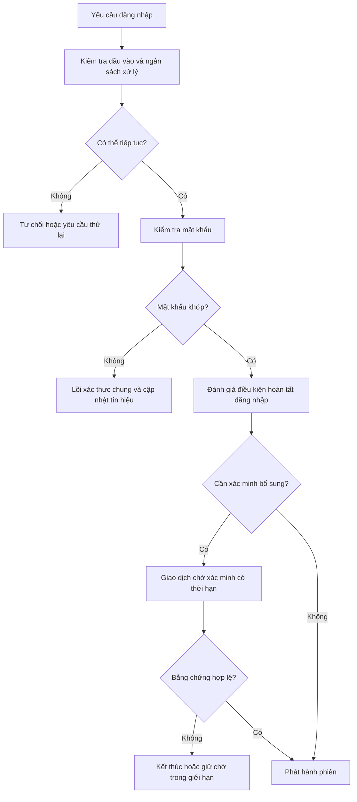

# Credential stuffing defense

## 1. Credential stuffing là gì?

Credential stuffing là việc dùng lại những cặp định danh và mật khẩu đã bị lộ từ một hệ thống khác để thử đăng nhập vào hệ thống đích. Kẻ tấn công tận dụng thói quen dùng chung mật khẩu giữa nhiều dịch vụ. Vì vậy, một lần đăng nhập bằng mật khẩu đúng vẫn có thể do người không sở hữu tài khoản thực hiện.

Cần phân biệt ba kiểu thử thông tin đăng nhập:

| Kiểu tấn công | Dữ liệu được thử | Ví dụ khái quát |
| --- | --- | --- |
| Brute force | Nhiều mật khẩu cho một hoặc vài tài khoản | Liên tục đoán mật khẩu của một tài khoản quản trị |
| Password spraying | Một số ít mật khẩu phổ biến trên nhiều tài khoản | Thử cùng mật khẩu dễ đoán cho nhiều nhân viên |
| Credential stuffing | Các cặp định danh–mật khẩu từ nguồn đã lộ | Dùng lại cặp thông tin của một dịch vụ khác |

Sự phân biệt này ảnh hưởng đến cách phòng vệ: đếm số lần sai trên từng tài khoản chưa đủ khi mỗi tài khoản chỉ bị thử một lần. Định nghĩa và phạm vi các kiểu tấn công trên được trình bày trong [OWASP Credential Stuffing Prevention Cheat Sheet](https://cheatsheetseries.owasp.org/cheatsheets/Credential_Stuffing_Prevention_Cheat_Sheet.html).

Trong IAM, mục tiêu phòng vệ gồm ba phần: giảm cơ hội chấp nhận credential bị lộ, kiểm soát khả năng thử tự động, và hạn chế thiệt hại nếu một bước xác thực đã bị vượt qua. Bài học tập trung vào luồng đăng nhập tương tác của người dùng; danh tính workload cần cơ chế cấp phát và xác thực riêng.

## 2. Tình huống xuyên suốt

Giả sử một cổng học tập có tài khoản học viên, giảng viên và quản trị viên. Cổng có ứng dụng web, ứng dụng di động và một phiên bản API đăng nhập cũ. Người dùng đăng nhập bằng email, sau đó có thể xem hồ sơ, tải tài liệu hoặc thực hiện công việc quản trị.

Trong một đợt bất thường, hệ thống nhận 60.000 yêu cầu đăng nhập trong 20 phút, đến từ nhiều địa chỉ mạng. Phần lớn yêu cầu thử các tài khoản khác nhau. Một số mật khẩu khớp, nhưng chủ tài khoản không thực hiện đăng nhập.

Các con số này là dữ liệu giả định để phân tích thiết kế. Chúng không phải ngưỡng phát hiện chung và cũng không phải kết quả đo của một sản phẩm.

Nếu đội vận hành chỉ nhìn số mật khẩu sai của từng tài khoản, đợt này có thể trông giống nhiều người dùng nhập nhầm riêng lẻ. Nếu chỉ chặn một địa chỉ IP, lưu lượng vẫn tiếp tục từ các địa chỉ khác. Thiết kế cần nhìn được cả từng giao dịch và hình dạng của toàn bộ đợt đăng nhập.

### 2.1. Những tài sản phải bảo vệ

Trong tình huống này, tài sản không chỉ là mật khẩu:

- Phiên đăng nhập và refresh token có thể giữ quyền truy cập sau lần xác thực đầu tiên.
- Kênh email, số điện thoại và authenticator quyết định khả năng khôi phục tài khoản.
- Quyền quản trị có thể cho phép thay đổi tài khoản của người khác.
- Năng lực xử lý đăng nhập cần đủ cho người dùng hợp lệ trong lúc có tấn công.
- Dữ liệu quan sát phải giúp điều tra mà không trở thành một kho credential mới.

Vì vậy, thành công không chỉ được đo bằng số yêu cầu bị chặn. Cần biết bao nhiêu phiên rủi ro đã được ngăn phát hành, bao nhiêu người dùng hợp lệ bị cản và các chức năng nhạy cảm có còn được bảo vệ hay không.

## 3. Xác định đủ bề mặt đăng nhập

Trước khi viết rule, lập danh sách mọi nơi có thể xác minh mật khẩu hoặc đổi một bằng chứng xác thực thành phiên.

Với cổng học tập, danh sách có thể như sau:

| Bề mặt | Điểm phải kiểm tra | Chủ sở hữu trong ví dụ |
| --- | --- | --- |
| Web login | Chính sách trước và sau kiểm tra mật khẩu | Nhóm nền tảng IAM |
| Mobile login API | Có dùng cùng policy và bộ đếm với web không? | Nhóm mobile và IAM |
| API đăng nhập cũ | Có đường bỏ qua MFA hoặc limiter không? | Nhóm dịch vụ |
| Cổng quản trị | Điều kiện xác thực mạnh và phiên quản trị | Nhóm IAM và vận hành |
| Khôi phục tài khoản | Có thể thay thế bước xác thực mạnh bằng kênh yếu không? | Nhóm tài khoản |
| Đăng ký hoặc thay MFA | Có đòi hỏi bằng chứng phù hợp trước khi thay yếu tố không? | Nhóm IAM |

Đây là bảng thiết kế minh họa, không phải danh sách endpoint bắt buộc. Với hệ thống dùng SSO, bổ sung ranh giới giữa ứng dụng và nhà cung cấp danh tính: nơi nào thực sự kiểm tra mật khẩu, nơi nào quyết định phát hành phiên ứng dụng, và bên nào chịu trách nhiệm xử lý sự kiện bất thường.

Một lỗi thiết kế dễ gặp là gia cố giao diện web trong khi API di động gọi trực tiếp vào dịch vụ xác thực có chính sách yếu hơn. Để tránh điều này, nên đặt quyết định xác thực tại thành phần dùng chung và kiểm tra từng đường vào bằng cùng các tình huống.

## 4. Giảm sự phụ thuộc vào mật khẩu dùng lại

### 4.1. MFA tạo thêm một ranh giới

Khi mật khẩu đã đúng, hệ thống vẫn có thể yêu cầu một bằng chứng độc lập trước khi hoàn tất đăng nhập. OWASP xem MFA là một biện pháp quan trọng chống các cuộc tấn công dựa trên mật khẩu; CAPTCHA và chặn IP chỉ nên là những lớp bổ sung. Xem [hướng dẫn phòng credential stuffing của OWASP](https://cheatsheetseries.owasp.org/cheatsheets/Credential_Stuffing_Prevention_Cheat_Sheet.html).

Trong cổng học tập, có thể đặt chính sách riêng cho quản trị viên và người dùng thông thường. Ví dụ, quản trị viên phải đáp ứng điều kiện xác thực mạnh cho mọi phiên quản trị; một giao dịch đăng nhập học viên có tín hiệu bất thường phải vượt qua bước xác minh bổ sung trước khi truy cập hồ sơ.

MFA không có nghĩa là gửi thêm một mật khẩu tĩnh. Hai bí mật cùng loại có thể cùng bị lộ hoặc dùng lại. Đồng thời, thiết kế phải bảo vệ việc đăng ký, thay và khôi phục yếu tố: nếu người có mật khẩu bị lộ tự thêm authenticator mới mà không cần bằng chứng khác, ranh giới vừa dựng đã bị vô hiệu hóa.

Không gửi hàng loạt yêu cầu phê duyệt MFA do những request chưa được kiểm soát tạo ra. Trong thiết kế ví dụ, giao dịch phải qua kiểm soát lưu lượng, có trạng thái chờ hữu hạn và không tự tạo lại thông báo liên tục.

### 4.2. Passkey thay đổi loại bằng chứng

WebAuthn sử dụng credential khóa công khai được gắn với một relying party. Máy chủ xác minh bằng chứng mật mã thay vì yêu cầu người dùng nhập lại cùng một mật khẩu dùng chung. Cơ chế phạm vi credential được mô tả trong [đặc tả WebAuthn của W3C](https://www.w3.org/TR/webauthn-3/).

Từ đó có thể suy ra: một cặp email–mật khẩu bị lộ ở dịch vụ khác không tự tạo được bằng chứng WebAuthn cho cổng học tập. Đây là lý do thiết kế ví dụ ưu tiên đưa người dùng sang passkey.

Tuy nhiên, nếu nút “dùng mật khẩu thay thế” vẫn phát hành đầy đủ phiên chỉ bằng mật khẩu, hệ thống còn giữ bề mặt credential stuffing đó. Việc triển khai phải xem xét cả đường fallback và khôi phục, đồng thời xác định các yêu cầu xác minh người dùng của authenticator. Không mặc định rằng mọi cấu hình passkey đều có cùng mức bảo đảm.

### 4.3. Sàng lọc mật khẩu khi thiết lập hoặc thay đổi

Một biện pháp ở đầu vòng đời credential là kiểm tra mật khẩu mới với danh sách giá trị phổ biến hoặc đã bị lộ. NIST mô tả việc kiểm tra blocklist khi thiết lập hoặc thay mật khẩu, cùng yêu cầu hạn chế các lần xác thực thất bại, trong [Digital Identity Guidelines — Authenticators](https://pages.nist.gov/800-63-4/sp800-63b/authenticators/).

Với ví dụ cổng học tập, quyết định triển khai cần trả lời:

- Danh sách kiểm tra được cập nhật bằng cách nào?
- Nếu dịch vụ kiểm tra không truy cập được, thao tác đổi mật khẩu được xử lý ra sao?
- Dữ liệu nào rời hệ thống và có làm lộ bí mật người dùng không?
- Người dùng nhận được hướng dẫn nào để chọn một mật khẩu riêng cho dịch vụ?

Không gửi mật khẩu nguyên văn cho một dịch vụ phân tích bên ngoài. Cũng không lưu mật khẩu đã nhập vào log để “đối chiếu sau”. Nếu dùng một giao thức truy vấn có cơ chế bảo vệ dữ liệu, cần triển khai và đánh giá đúng giao thức đó.

Sàng lọc không chứng minh rằng mật khẩu chưa từng được dùng ở nơi khác. Trong mô hình này, nó giảm một phần rủi ro đầu vào và phải đi cùng các ranh giới còn lại.

## 5. Tách kiểm tra mật khẩu khỏi việc phát hành phiên

Một bất biến quan trọng của thiết kế là: “mật khẩu khớp” chưa đồng nghĩa “đăng nhập đã hoàn tất”.



Bước đầu tiên bảo vệ năng lực xử lý và áp dụng chính sách với dữ liệu chưa được tin cậy. Bước sau khi mật khẩu khớp có thêm ngữ cảnh tài khoản để quyết định có cần xác minh bổ sung hay không.

Trong giao dịch chờ, nếu trình duyệt cần giữ một mã tham chiếu thì mã đó chỉ cho phép tiếp tục giao dịch xác thực. Nó không được có quyền gọi API hồ sơ, không phải phiên ứng dụng đầy đủ và phải hết hạn.

Một giao dịch chờ trong ví dụ có các thuộc tính:

```text
transaction_id: giá trị ngẫu nhiên do máy chủ tạo
subject_id: tài khoản đang xác minh
state: PENDING_ADDITIONAL_VERIFICATION
created_at: thời điểm bắt đầu
expires_at: thời hạn kết thúc
attempt_budget: giới hạn số lần kiểm tra bằng chứng
policy_version: phiên bản chính sách áp dụng
```

Không để client gửi một cờ như `mfaPassed=true` rồi được cấp phiên. Máy chủ phải kiểm tra trạng thái của giao dịch và bằng chứng tương ứng. Sau khi hoàn tất, giao dịch phải được tiêu thụ theo cách ngăn việc dùng lại để tạo thêm phiên ngoài ý muốn.

## 6. Thiết kế giới hạn theo nhiều chiều

### 6.1. Mỗi chiều trả lời một câu hỏi khác nhau

Trong thiết kế đề xuất cho cổng học tập:

| Chiều quan sát | Câu hỏi cần trả lời | Hạn chế cần tính đến |
| --- | --- | --- |
| Định danh tài khoản | Tài khoản này đang bị thử nhiều không? | Không đủ khi mỗi tài khoản bị thử ít lần |
| Nguồn mạng | Nguồn này đang tạo bao nhiêu request? | Nhiều người hợp lệ có thể dùng chung mạng |
| Tổ hợp nguồn và tài khoản | Một quan hệ cụ thể có bất thường không? | Không bao quát được cả chiến dịch phân tán |
| Giao dịch hoặc client đã nhận diện | Một luồng đang lặp hoặc dùng lại challenge không? | Client có thể xóa cookie hoặc giả metadata |
| Toàn dịch vụ | Năng lực xử lý có đang bị vượt không? | Chặn rộng có thể ảnh hưởng người dùng hợp lệ |
| Loại tác vụ | Login, reset và kiểm tra MFA có bị lạm dụng riêng không? | Chỉ giới hạn login có thể bỏ sót đường khác |

Không dùng “IP mới” hoặc “thiết bị mới” làm kết luận tài khoản đã bị chiếm. Trong ví dụ, đó chỉ là dữ liệu đầu vào cho quyết định; người dùng có thể đổi điện thoại, dùng VPN hoặc chuyển mạng hợp lệ.

### 6.2. Bộ đếm phải tương ứng với phạm vi hệ thống

Giả sử dịch vụ xác thực chạy trên bốn instance. Nếu mỗi instance cho phép một ngân sách riêng mà không chia sẻ trạng thái, request đi qua nhiều instance có thể nhận nhiều ngân sách hơn dự kiến.

Vì vậy, đề xuất cho cổng này dùng một cơ chế giới hạn có thao tác cập nhật nguyên tử cho các khóa cần chia sẻ. Bộ đếm trong bộ nhớ của một instance chỉ là lớp bảo vệ cục bộ, không được mô tả như một giới hạn chính xác cho toàn dịch vụ.

Nếu dùng kho phân tán, thao tác “kiểm tra còn ngân sách rồi tiêu thụ” phải được xử lý nguyên tử theo cơ chế của kho đó. Tách thành hai thao tác đọc và ghi thông thường có thể làm nhiều request cùng thấy còn ngân sách.

Cũng cần quy định:

- Thời hạn sống của khóa và thời điểm loại bỏ dữ liệu.
- Giới hạn số khóa mà request chưa xác thực có thể tạo.
- Cách vận hành qua nhiều vùng hoặc khi kho trạng thái bị phân vùng.
- Mức sai lệch có thể chấp nhận nếu dùng số đếm gần đúng.
- Quyền đọc, ghi và thời hạn lưu dữ liệu của thành phần giới hạn.

Nếu mỗi định danh ngẫu nhiên đều tạo một khóa tồn tại lâu, chính cơ chế phòng vệ có thể làm cạn bộ nhớ. Trong thiết kế ví dụ, số khóa, thời hạn và độ dài đầu vào đều là phần của ngân sách tài nguyên.

### 6.3. Chuẩn hóa định danh đúng với luồng xác thực

Khóa giới hạn cần được tạo từ cách định danh mà hệ thống thực sự dùng để tìm tài khoản. Nếu luồng đăng nhập coi hai dạng nhập là cùng tài khoản nhưng limiter lại coi là hai khóa khác nhau, ngân sách có thể bị tách ngoài ý muốn.

Ngược lại, không tự biến đổi mật khẩu như xóa khoảng trắng hoặc chuyển chữ thường. Quy tắc chuẩn hóa định danh không phải quyền sửa bí mật.

Với dữ liệu quan sát hoặc bộ đếm, ví dụ có thể dùng một khóa HMAC từ định danh đã chuẩn hóa thay cho email nguyên văn. Khóa HMAC phải được bảo vệ và có kế hoạch xoay phù hợp. Đây là cách giảm việc lộ trực tiếp email, không phải tuyên bố dữ liệu đã được ẩn danh tuyệt đối.

### 6.4. Chọn phản ứng theo mức độ và mục tiêu

Trong cổng học tập, có thể minh họa ba mức phản ứng:

1. Tăng nhẹ kiểm soát với một nguồn đang tạo nhiều request.
2. Yêu cầu xác minh bổ sung đối với một giao dịch có mật khẩu khớp nhưng rủi ro cao.
3. Chặn tạm thời một luồng lạm dụng rõ ràng, đồng thời giữ đường hỗ trợ người dùng hợp lệ.

Việc khóa tài khoản theo số lần sai phải cân nhắc khả năng kẻ tấn công cố ý làm người dùng mất quyền truy cập. Phản hồi đăng nhập cũng cần tránh tiết lộ tài khoản có tồn tại hay không. Hai vấn đề này được nêu trong [OWASP Authentication Cheat Sheet](https://cheatsheetseries.owasp.org/cheatsheets/Authentication_Cheat_Sheet.html).

Với ví dụ này, không cho request chưa xác thực tự động khóa vĩnh viễn tài khoản của người khác. Nếu có trạng thái hạn chế tài khoản, phải định nghĩa rõ thời hạn, điều kiện thoát và cách xác minh để khôi phục.

### 6.5. Không biến trì hoãn thành việc giữ cạn tài nguyên

Một thiết kế “chờ thêm vài giây” bằng cách giữ worker thread cho mỗi request có thể làm hàng đợi phình lớn. Trong ví dụ, nên ưu tiên từ chối sớm hoặc điều phối chờ bằng cơ chế phù hợp với kiến trúc, có giới hạn đồng thời và thời gian tối đa.

Đối với API, có thể dùng phản hồi giới hạn tốc độ có quy ước retry rõ ràng. Nhưng phản hồi không nên chỉ xuất hiện cho email có thật, vì như vậy chính limiter tạo thêm tín hiệu dò tài khoản.

## 7. Policy minh họa và giả mã xử lý

Đoạn cấu hình dưới đây là một đề xuất để thảo luận trên hệ thống giả định. Mọi con số phải được thay bằng kết quả đo và yêu cầu vận hành của hệ thống thực tế.

```yaml
illustrative_login_policy:
  source_window_seconds: 60
  source_attempt_budget: 40
  identifier_window_seconds: 900
  identifier_attempt_budget: 12
  pending_transaction_ttl_seconds: 180
  maximum_additional_verification_attempts: 5
  privileged_login:
    strong_authentication_required: true
  state_store_unavailable:
    privileged_login: reject_temporarily
    ordinary_login: bounded_local_protection_and_existing_factor
```

Các ngân sách trong ví dụ chỉ là điều kiện bắt đầu kiểm soát, không phải chứng cứ duy nhất để tuyên bố một tài khoản bị tấn công. Chính sách cũng cần thể hiện rõ retry, quan sát theo nhiều cửa sổ thời gian và điều kiện cho từng loại tài khoản.

Giả mã sau thể hiện thứ tự và ranh giới trách nhiệm. Nó không phải thư viện bảo mật sẵn để đưa vào production.

```text
handleLogin(request):
    rejectMalformedOrOversizedInput(request)

    source = resolveSourceFromTrustedIngress(request)
    identifier = canonicalizeIdentifier(request.identifier)

    admission = admissionPolicy.consumeAttempt(
        source,
        protectedIdentifierKey(identifier),
        operation = LOGIN
    )

    if admission.mustStop:
        return publicRetryOrFailureResponse(admission)

    subject = identityDirectory.find(identifier)
    passwordMatches = verifyUsingRealOrDummyVerifier(
        subject,
        request.password
    )

    if subject is absent or passwordMatches is false:
        recordFailureWithoutSecrets(admission, subject)
        return genericAuthenticationFailure()

    eligibility = accountPolicy.checkLoginEligibility(subject)
    if eligibility.denied:
        recordInternalDenialReason(subject, eligibility)
        return genericAuthenticationFailure()

    completion = completionPolicy.evaluate(
        subject,
        source,
        admission,
        requestContext
    )

    if completion.requiresAdditionalVerification:
        transaction = createBoundedPendingTransaction(subject, completion)
        return pendingVerificationResponse(transaction)

    return issueSessionAfterCompletedAuthentication(subject, completion)
```

Một số điểm cần giải thích:

- Nguồn mạng được xác định tại ingress tin cậy. Không lấy tùy ý giá trị header do client tự gửi để làm nguồn đáng tin.
- Tài khoản không tồn tại vẫn được xử lý theo một đường xác minh giả phù hợp để giảm chênh lệch dễ quan sát. Điều này không bảo đảm toàn bộ request có thời gian hoàn toàn giống nhau.
- Admission control xảy ra trước tác vụ kiểm tra mật khẩu tốn chi phí. Nhánh xác minh giả cũng cần nằm trong ngân sách này.
- Kiểm tra trạng thái tài khoản vẫn tồn tại, nhưng lý do chi tiết được giữ ở phía máy chủ.
- Hàm phát hành phiên chỉ được gọi sau khi chính sách hoàn tất xác thực đã đạt.
- Giao dịch chờ xác minh có endpoint xử lý riêng với ngân sách và điều kiện hoàn tất tương ứng.

Không dùng ví dụ này để bỏ qua những yêu cầu khác của đăng nhập như bảo vệ kênh truyền, xử lý cookie, bảo vệ request theo kiến trúc ứng dụng và quản lý vòng đời token.

## 8. Xử lý khi một thành phần phòng vệ gặp lỗi

Phòng vệ phải có hành vi xác định khi kho bộ đếm, dịch vụ rủi ro hoặc dịch vụ challenge không hoạt động.

Trong ví dụ, nhóm thiết kế chốt trước bảng sau:

| Sự cố | Hành vi đề xuất cho cổng học tập | Tín hiệu vận hành |
| --- | --- | --- |
| Kho giới hạn phân tán lỗi | Bật giới hạn cục bộ hữu hạn; đăng nhập quản trị tạm từ chối | Cảnh báo giảm mức bảo vệ |
| Dịch vụ chấm điểm rủi ro lỗi | Dùng policy bảo thủ đã định trước; không tự coi rủi ro bằng 0 | Ghi chế độ suy giảm và phạm vi ảnh hưởng |
| Dịch vụ challenge lỗi | Không cấp phiên chỉ vì challenge không kiểm tra được | Cảnh báo lỗi phụ thuộc |
| Đường ghi sự kiện bị chậm | Dùng hàng đợi có giới hạn; báo số sự kiện mất nếu có | Theo dõi độ trễ, tồn đọng và mất dữ liệu |

Đây là các lựa chọn thiết kế cho tình huống minh họa. Hệ thống khác có thể chọn cách khác theo yêu cầu sẵn sàng và mức nhạy cảm, nhưng phải quyết định trước và thử nghiệm.

Không thể đồng thời tuyên bố rằng giới hạn toàn cục luôn chính xác và dịch vụ vẫn hoạt động hoàn toàn bình thường khi mất toàn bộ trạng thái cần để tính giới hạn. Cần mô tả trung thực mức bảo vệ còn lại trong chế độ suy giảm.

## 9. Quan sát mà không thu thập credential

Thiết kế sự kiện theo từng giai đoạn giúp phân biệt:

- Request bị từ chối trước khi kiểm tra mật khẩu.
- Mật khẩu không khớp.
- Mật khẩu khớp nhưng còn chờ xác minh.
- Xác minh bổ sung thất bại hoặc hết hạn.
- Đăng nhập hoàn tất và phiên được phát hành.

Với cổng học tập, một sự kiện nội bộ có thể có dạng:

```json
{
  "event_type": "authentication_decision",
  "correlation_id": "example-request-27",
  "account_key": "protected-identifier-key",
  "stage": "POST_PASSWORD",
  "outcome": "ADDITIONAL_VERIFICATION_REQUIRED",
  "reason_code": "UNFAMILIAR_CONTEXT_WITH_CAMPAIGN_SIGNAL",
  "policy_version": "example-policy-3",
  "occurred_at": "2026-01-01T10:00:00Z"
}
```

Giá trị trong ví dụ là dữ liệu giả. Các lý do nội bộ không được trả nguyên văn ra giao diện đăng nhập.

Không ghi password, OTP, recovery code, cookie phiên, access token hoặc refresh token vào sự kiện. Nếu cần liên kết các sự kiện theo phiên, dùng mã tham chiếu được thiết kế cho điều tra thay vì log bearer token.

Thời hạn lưu dữ liệu phải đủ cho nhu cầu vận hành đã xác định và có kiểm soát quyền truy cập. HMAC của email vẫn có thể liên kết hành vi qua thời gian; cần quản lý nó như dữ liệu nhạy cảm theo thiết kế của hệ thống.

### 9.1. Đo cả an toàn và trải nghiệm

Một dashboard minh họa nên có các nhóm chỉ số:

| Nhóm | Câu hỏi đánh giá |
| --- | --- |
| Lưu lượng | Tăng ở web, mobile hay API cũ? Tăng trên một nguồn hay nhiều nguồn? |
| Xác thực | Có bao nhiêu giao dịch đạt bước mật khẩu và bao nhiêu phiên thực sự được cấp? |
| Xác minh bổ sung | Tỷ lệ hoàn tất, hết hạn và bỏ dở thay đổi thế nào? |
| Người dùng hợp lệ | Khiếu nại đăng nhập, khôi phục và độ trễ tăng ở đâu? |
| Năng lực hệ thống | CPU xác minh mật khẩu, hàng đợi, độ trễ kho giới hạn có bất thường không? |
| Hiệu quả policy | Rule nào đang tác động; phiên bản nào tạo nhiều cản trở nhất? |

Ví dụ, có thể tính:

```text
additional_verification_completion_rate
  = completed_additional_verifications / started_additional_verifications

observed_legitimate_login_impact
  = labeled_legitimate_attempts_affected / labeled_legitimate_attempts
```

Cả hai cần cửa sổ thời gian và mẫu số rõ ràng. Chỉ số thứ hai phụ thuộc vào chất lượng gán nhãn; không thể lấy tất cả request bị chặn rồi gọi chúng là tấn công.

Tương tự, “mật khẩu đúng nhưng xác minh thất bại” là tín hiệu điều tra, không tự chứng minh credential stuffing. Người dùng thật có thể mất thiết bị hoặc gặp lỗi mạng. Kết luận cần tương quan sự kiện, bối cảnh và bằng chứng bổ sung.

## 10. Ứng phó khi nghi ngờ đã phát hành phiên cho kẻ tấn công

Nếu một phiên rủi ro đã được cấp, tăng giới hạn request login không thu hồi được phiên đó. Trong cổng học tập, runbook cần chuyển từ kiểm soát thử đăng nhập sang kiểm soát quyền truy cập hiện có.

Quy trình minh họa:

1. Xác định tài khoản, giao dịch và phiên liên quan bằng mã tương quan.
2. Áp dụng hạn chế phù hợp với phiên nghi ngờ hoặc thu hồi phiên khi có căn cứ.
3. Kiểm tra thay đổi email, số điện thoại, MFA, thông tin khôi phục và quyền quản trị.
4. Yêu cầu xác minh qua một đường tin cậy phù hợp trước khi khôi phục đầy đủ truy cập.
5. Xử lý credential bị lộ, đồng thời kiểm tra refresh token và các phiên còn hiệu lực.
6. Thông báo có chọn lọc, qua kênh đã được đánh giá; lưu bằng chứng phục vụ điều tra.
7. Đối chiếu các đường đăng nhập để tìm chính sách thiếu hoặc cấu hình lệch.

Đổi mật khẩu không mặc nhiên thu hồi mọi token trong mọi kiến trúc. Runbook phải biết cơ chế thực tế của hệ thống: token nào có thể thu hồi ngay, token nào còn hiệu lực đến khi hết hạn, và thành phần nào kiểm tra trạng thái thu hồi.

Đối với quản trị viên, kiểm tra cả thay đổi quyền và hành động đã thực hiện trong khoảng thời gian phiên nghi ngờ hoạt động. Việc ngăn đăng nhập tiếp theo không tự đảo ngược thay đổi dữ liệu hoặc quyền đã xảy ra.

## 11. Kiểm thử phòng vệ trong phạm vi được kiểm soát

Chỉ dùng tài khoản thử nghiệm, credential giả và môi trường được phép. Không dùng danh sách tài khoản bị lộ của người thật để kiểm thử thiết kế này.

Một bộ tình huống cho cổng học tập có thể gồm:

| Tình huống | Kết quả mong đợi cần xác minh |
| --- | --- |
| Một nguồn thử nhiều định danh giả | Chính sách nguồn và ngân sách tài nguyên có tác dụng |
| Nhiều nguồn thử cùng tài khoản thử | Bộ đếm tài khoản không bị chia theo instance |
| Nhiều nguồn thử nhiều tài khoản, mỗi tài khoản ít lần | Quan sát chiến dịch có thể nhận ra mẫu tổng thể |
| Mật khẩu đúng nhưng chưa qua bước bổ sung | Không gọi được API yêu cầu phiên hoàn tất |
| Tải giao dịch chờ từ hai request đồng thời | Không phát hành phiên ngoài điều kiện đã định |
| Dùng lại giao dịch đã hoàn tất hoặc hết hạn | Không tạo được lần hoàn tất mới trái phép |
| Gửi header nguồn mạng tự khai | Không thay được nguồn mà ingress tin cậy xác định |
| Kho bộ đếm ngừng hoạt động | Hành vi đúng với policy suy giảm đã công bố |
| Người dùng hợp lệ dùng chung mạng lớn | Đo được mức ảnh hưởng và đường xử lý |
| Gọi API đăng nhập cũ | Không vượt qua chính sách áp dụng cho cùng tài khoản |
| Đọc log sau các trường hợp trên | Không xuất hiện mật khẩu, OTP hoặc token |

Tình huống phân tán phải đi qua nhiều instance nếu hệ thống thực tế có nhiều instance. Một bài thử trên một tiến trình không xác nhận được tính nhất quán của bộ đếm dùng chung.

Với giới hạn tốc độ, cần thử cả request đồng thời gần ranh giới ngân sách và hành vi sau khi cửa sổ hết hạn. Với giao dịch xác minh, cần thử tính hết hạn, số lần thử, liên kết với tài khoản và điều kiện tiêu thụ.

Đây là đề xuất kiểm thử cho người triển khai, không phải tuyên bố rằng các bài thử đã được chạy trên một hệ thống cụ thể.

## 12. Những hiểu nhầm cần tránh

**“Mật khẩu được băm tốt thì credential stuffing không thành công.”** Băm mật khẩu bảo vệ dữ liệu lưu trữ. Khi kẻ tấn công đã có mật khẩu nguyên văn đúng từ nơi khác, hệ thống vẫn có thể xác minh nó thành công.

**“Mật khẩu dài và phức tạp thì có thể dùng chung.”** Một bí mật mạnh nhưng đã lộ vẫn có thể được dùng lại. Độ khó đoán và việc tránh tái sử dụng giải quyết hai rủi ro khác nhau.

**“SSO đã giải quyết toàn bộ.”** SSO chuyển một phần trách nhiệm sang nhà cung cấp danh tính. Ứng dụng vẫn phải hiểu điều kiện xác thực được đáp ứng, bảo vệ phiên của mình và kiểm tra các đường đăng nhập cục bộ còn tồn tại.

**“CAPTCHA chứng minh người đăng nhập là chủ tài khoản.”** Một challenge chống tự động hóa không phải bằng chứng sở hữu danh tính. Trong thiết kế ví dụ, nó không thay thế MFA hoặc điều kiện hoàn tất xác thực.

**“Khóa càng lâu càng an toàn.”** Nếu request chưa xác thực có thể khóa tài khoản bất kỳ, chính sách có thể trở thành công cụ gây gián đoạn. Cần cân bằng khả năng ngăn thử, thời hạn và đường khôi phục đáng tin.

**“Số request bị chặn tăng nghĩa là phòng vệ tốt hơn.”** Đó có thể là do tấn công tăng, rule quá rộng hoặc hành vi client thay đổi. Cần xem số phiên rủi ro, ảnh hưởng người dùng và chất lượng bằng chứng cùng lúc.

## 13. Vận dụng kiến thức

Hãy trở lại tình huống cổng học tập và trả lời bốn câu hỏi:

1. Nếu toàn bộ request tấn công đều có mật khẩu đúng, những ranh giới nào vẫn ngăn việc cấp phiên?
2. Nếu một IP có hàng nghìn học viên hợp lệ, chính sách nào giúp giảm chặn nhầm?
3. Nếu kho bộ đếm lỗi, nhóm vận hành có biết mức bảo vệ đang suy giảm và những loại đăng nhập nào bị hạn chế không?
4. Nếu một phiên đã bị chiếm, hệ thống có thể thu hồi quyền truy cập thực tế và kiểm tra thay đổi MFA hay chỉ chặn các lần login mới?

Một thiết kế có thể giải thích rõ các câu trả lời này sẽ nối được phòng vệ credential stuffing với quản lý vòng đời credential, MFA, phiên, đặc quyền và kiểm toán trong IAM.
