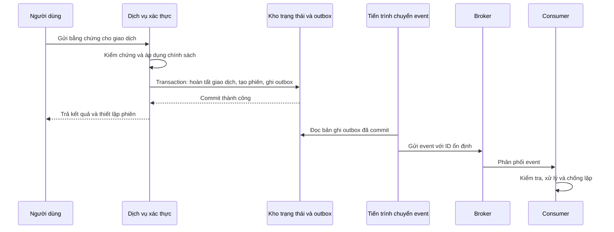

# Authentication event

Một hệ thống IAM không chỉ cần biết người dùng có đăng nhập được hay không. Hệ thống còn cần trả lời: lần xác thực này bắt đầu khi nào, đã dùng phương thức nào, thất bại ở bước nào, có tạo phiên hay không và những thành phần nào cần biết kết quả. Authentication event, hay sự kiện xác thực, là bản ghi có cấu trúc mô tả một sự việc đã xảy ra trong quá trình xác minh danh tính.

Ví dụ, “yêu cầu đăng nhập đã được tiếp nhận”, “đã phát hành một thử thách”, “thử thách đã được kiểm chứng” và “luồng xác thực đã hoàn tất” là những sự việc khác nhau. Nếu gom chúng thành một dòng “login” thì khó phát hiện lỗi MFA, khó điều tra sự cố và dễ hiểu sai một bước thành công thành cả lần đăng nhập thành công.

Bài học này trình bày cách định nghĩa, tạo, phân phối và sử dụng authentication event trong phạm vi IAM. Các nguyên tắc cũng áp dụng cho xác thực danh tính workload, nhưng loại chủ thể, phương thức và vòng đời giao dịch cần được mô hình hóa phù hợp.

## 1. Sự kiện xác thực mô tả điều gì?

Một authentication event cần có ý nghĩa đủ rõ để thành phần khác hiểu được mà không phải đoán từ một thông báo tự do.

Ví dụ:

> Dịch vụ xác thực đã kiểm chứng thành công thử thách của giao dịch `atx_7c91`, nhưng giao dịch chưa hoàn tất vì chính sách còn yêu cầu một bước khác.

Bản ghi này nói về một bước xác thực. Nó không tự khẳng định đã tạo phiên, đã phát hành token hoặc người dùng được phép truy cập tài nguyên.

Cần phân biệt các khái niệm sau:

| Khái niệm | Ý nghĩa | Ví dụ |
| --- | --- | --- |
| Command | Yêu cầu một hành động; có thể chưa được xử lý | `CompleteAuthentication` |
| Authentication event | Sự việc đã xảy ra trong xác thực | `authentication.completed` |
| Authorization event | Sự việc liên quan đến quyết định cấp hoặc từ chối quyền | `authorization.denied` |
| Session event | Sự việc trong vòng đời phiên | `session.created`, `session.revoked` |
| Audit record | Bản ghi phục vụ truy vết, trách nhiệm và kiểm tra | Một bản ghi lưu kết quả xác thực cùng nguồn tạo |
| Metric | Giá trị tổng hợp để quan sát hệ thống | Tỷ lệ xác thực thất bại trong một khoảng thời gian |

Một authentication event có thể được đưa vào kho audit và dùng để tính metric. Tuy nhiên, broker nhận được event không đồng nghĩa event đã được lưu bền vững ở kho audit; metric tổng hợp cũng không thay thế được bản ghi của từng lần xác thực.

Quyền truy cập vẫn phải được quyết định trên request thực tế, danh tính đã được xác thực và chính sách hiện hành. Một event thành công trong lịch sử không phải bằng chứng đủ để cấp quyền cho một request mới.

## 2. Đơn vị quan sát: giao dịch, lần thử và bước

Trước khi đặt tên event, cần xác định hệ thống đang ghi nhận đơn vị nào.

- **Giao dịch xác thực — authentication transaction:** toàn bộ một luồng nhằm đạt yêu cầu xác thực cho một mục đích cụ thể.
- **Lần thử — attempt:** một lần gửi dữ liệu để được kiểm chứng trong giao dịch đó.
- **Bước hoặc thử thách — step/challenge:** một phần của luồng, chẳng hạn xác minh mật khẩu hoặc kiểm chứng một bằng chứng từ thiết bị.
- **Phiên — session:** trạng thái được tạo hoặc cập nhật sau khi hệ thống chấp nhận kết quả xác thực theo thiết kế.
- **Yêu cầu xác thực tăng cường — step-up:** một giao dịch xác thực bổ sung cho hành động cần mức bảo đảm cao hơn.

Một giao dịch có thể chứa nhiều lần thử. Một lần thử sai mã không nhất thiết kết thúc giao dịch. Một thử thách đã được gửi cũng không đồng nghĩa người dùng đã nhận hoặc hoàn tất nó.

Ví dụ:

```text
Giao dịch atx_7c91
  ├─ attempt_1: kiểm chứng mật khẩu thành công
  ├─ attempt_2: kiểm chứng bước bổ sung thất bại
  └─ attempt_3: kiểm chứng bước bổ sung thành công
       → yêu cầu xác thực của giao dịch đã được đáp ứng
       → tạo phiên theo chính sách
```

Không phải luồng nào cũng có hai bước riêng. Một phương thức xác thực có thể đáp ứng nhiều yêu cầu trong một lần tương tác. Vì vậy, “hai event thành công” không phải cách xác định MFA; kết quả phải dựa trên thuộc tính của phương thức, bằng chứng đã kiểm chứng và chính sách mà hệ thống áp dụng.

Việc refresh token diễn ra trong một vòng đời khác và không mặc nhiên có tương tác xác thực mới của người dùng. Nếu hệ thống ghi event cho refresh, cần đặt tên thể hiện đúng hoạt động đó thay vì tăng số lượng “đăng nhập thành công”.

## 3. Xây dựng từ vựng sự kiện nhất quán

Không có một bộ tên duy nhất phù hợp mọi sản phẩm. Điều quan trọng là mỗi tên có ngữ nghĩa cụ thể và được các producer, consumer thống nhất.

Một bộ từ vựng minh họa:

| Event | Thời điểm hợp lệ để phát | Điều không được suy ra |
| --- | --- | --- |
| `authentication.started` | Máy chủ đã chấp nhận và tạo giao dịch xác thực | Chủ thể đã được xác minh |
| `authentication.challenge.issued` | Hệ thống đã tạo hoặc phát hành thử thách | Người dùng đã nhận hay trả lời đúng |
| `authentication.step.succeeded` | Bằng chứng của một bước đã được kiểm chứng | Toàn bộ chính sách xác thực đã đạt |
| `authentication.step.failed` | Một lần kiểm chứng bước không thành công | Giao dịch chắc chắn đã kết thúc |
| `authentication.completed` | Máy chủ đã xác nhận giao dịch đáp ứng chính sách xác thực | Mọi quyền truy cập hoặc mọi token đều hợp lệ |
| `authentication.failed` | Giao dịch kết thúc với kết quả xác thực không thành công | Người dùng chắc chắn có ý đồ xấu |
| `authentication.expired` | Giao dịch hết hiệu lực theo thời hạn | Có credential sai |
| `authentication.cancelled` | Giao dịch đã được đóng do hủy theo luồng được hỗ trợ | Có lỗi hệ thống |
| `authentication.step_up.required` | Hệ thống đã xác định cần tăng cường xác thực | Bước tăng cường đã hoàn tất |
| `authentication.processing_error` | Không xử lý được bước/giao dịch do lỗi kỹ thuật | Bằng chứng do người dùng gửi là sai |

Đây là tên minh họa cho một contract nội bộ, không phải yêu cầu phải đổi tên event có sẵn của nhà cung cấp.

Sự khác biệt giữa `failed`, `expired` và `processing_error` giúp hệ thống phân biệt hành vi thử sai, người dùng bỏ dở và sự cố hạ tầng. Nếu dịch vụ kiểm chứng không truy cập được cơ sở dữ liệu, không nên ghi lý do “mật khẩu sai”.

Hệ thống cũng cần quy định sự kiện nào kết thúc giao dịch. Ví dụ, sau `authentication.completed`, cùng giao dịch không được chuyển ngược về đang chờ thử thách. Một yêu cầu step-up sau đó nên có giao dịch riêng và liên hệ với phiên hiện hữu.

## 4. Ai có quyền khẳng định một sự kiện?

Nguồn của event quan trọng ngang với nội dung.

Trình duyệt có thể gửi thông báo “người dùng bấm nút đăng nhập”, nhưng không có quyền khẳng định `authentication.completed`. Dịch vụ có trách nhiệm kiểm chứng và quyết định kết quả xác thực mới được phát sự kiện hoàn tất.

Trong một luồng liên kết danh tính, thông điệp từ bên ngoài cũng chưa phải kết luận của ứng dụng đích. Thành phần xác thực phải kiểm tra bằng chứng và ràng buộc của giao thức, sau đó ánh xạ danh tính vào phạm vi phù hợp. Chỉ kết quả đã được chấp nhận mới được chuyển thành sự kiện nội bộ có mức tin cậy tương ứng.

Ví dụ với một luồng OIDC:

```text
Nhận phản hồi từ nhà cung cấp danh tính
  → kiểm tra phản hồi theo giao thức và cấu hình tin cậy
  → xác định danh tính và tenant từ thông tin đã được xác minh
  → áp dụng chính sách xác thực cục bộ
  → xác nhận kết quả giao dịch
  → phát event nội bộ
```

Không sao chép một `tenant_id`, `subject_id` hay kết quả do client tự khai vào bản ghi tin cậy mà không kiểm tra nguồn. Tenant có thể được xác định từ ngữ cảnh định tuyến đã được kiểm soát trước khi biết chủ thể; danh tính chỉ được gắn với mức chắc chắn phù hợp sau khi kiểm chứng.

Đối với workload, producer có thể là thành phần kiểm chứng chứng thư hoặc credential của dịch vụ. Cần phân biệt danh tính workload được xác thực với người vận hành đã triển khai workload đó; hai chủ thể này không tự động là một.

## 5. Thiết kế cấu trúc dữ liệu của event

Một event nên gồm phần nhận diện ổn định và phần dữ liệu phục vụ ngữ nghĩa của loại sự kiện.

Ví dụ dưới đây là sự kiện hoàn tất một giao dịch của người dùng:

```json
{
  "schema_version": 1,
  "event_id": "evt_8f9d2c01",
  "event_type": "authentication.completed",
  "producer": "iam-auth-service",
  "occurred_at": "2026-01-15T08:30:15.120Z",
  "recorded_at": "2026-01-15T08:30:15.135Z",
  "tenant_id": "tenant_north",
  "subject": {
    "id": "usr_4b72",
    "type": "human"
  },
  "authentication_transaction_id": "atx_7c91",
  "attempt_id": "attempt_3",
  "correlation_id": "corr_a29e",
  "sequence": 5,
  "outcome": "success",
  "context": {
    "purpose": "interactive_login",
    "client_id": "customer-portal",
    "methods": ["password", "totp"],
    "policy_id": "interactive-login",
    "policy_version": "7",
    "session_created": true,
    "session_audit_ref": "sar_e391"
  }
}
```

Các mã trong ví dụ là định danh minh họa, không phải credential và không được dùng trực tiếp như cookie phiên.

### 5.1. Các trường nhận diện

**`event_id`** nhận diện một sự việc đã được ghi nhận. Khi gửi lại cùng một event do lỗi mạng, producer giữ nguyên ID; nếu mỗi lần retry sinh ID mới thì consumer khó phân biệt bản sao với sự việc mới.

**`authentication_transaction_id`** gom những event cùng một giao dịch. Nó khác `event_id`: một giao dịch có thể có nhiều sự kiện.

**`attempt_id`** phân biệt các lần thử. Trường này chỉ xuất hiện khi event gắn với một lần thử cụ thể; không nên bịa một attempt cho sự kiện hết hạn do tiến trình nền phát hiện.

**`correlation_id`** hỗ trợ nối dấu vết giữa các dịch vụ. Giá trị do client cung cấp cần được kiểm tra hoặc ánh xạ sang định danh nội bộ, tránh tin trực tiếp chuỗi tùy ý, quá dài hoặc chứa ký tự gây nhiễu log.

**`subject.id`** là định danh nội bộ ổn định trong phạm vi được xác định rõ. Nó không nên mặc định là email, tên đăng nhập hoặc số điện thoại.

**`session_audit_ref`** là mã tra cứu phục vụ điều tra, tách khỏi giá trị cookie hoặc token có thể dùng để truy cập. Việc nối sang dữ liệu phiên phải được kiểm soát quyền.

### 5.2. Thời gian và thứ tự

`occurred_at` biểu diễn thời điểm sự việc xảy ra theo đồng hồ producer. `recorded_at` biểu diễn thời điểm producer ghi nhận bền vững theo contract. Thành phần tiếp nhận có thể bổ sung `received_at` để đo độ trễ, nhưng cần giữ nguyên ý nghĩa các mốc gốc.

Timestamp hỗ trợ dựng timeline nhưng không bảo đảm thứ tự tuyệt đối giữa nhiều máy. Đồng hồ có thể lệch và event có thể nằm trong hàng đợi lâu trước khi được nhận.

Nếu dùng `sequence`, phải nêu rõ phạm vi: ví dụ tăng dần trong một giao dịch và được cấp cùng lúc với cập nhật trạng thái giao dịch. Không diễn giải số thứ tự của một producer thành thứ tự toàn hệ thống. Một bước thay đổi trạng thái không nhất thiết tương ứng đúng một event, trừ khi contract quy định như vậy.

### 5.3. Kết quả và ngữ cảnh

`outcome` cần thống nhất với loại event. Một event `authentication.completed` có outcome `failure` là dữ liệu mâu thuẫn.

`methods` phản ánh phương thức thực sự đã được kiểm chứng trong giao dịch, không phải danh sách phương thức tài khoản đã đăng ký.

`policy_version` giúp điều tra hệ thống đã áp dụng chính sách nào. Không nên ghi toàn bộ tài liệu chính sách vào mỗi event, đặc biệt nếu nó chứa thông tin nhạy cảm.

Nếu có trường mô tả mức bảo đảm, phải định nghĩa mô hình đánh giá và nguồn xác nhận. Không tự gán một nhãn bảo đảm chỉ vì có nhiều bước hoặc nhiều dòng log.

## 6. Dữ liệu nào phải được loại khỏi event?

Event thường được sao chép sang broker, kho log, hệ thống cảnh báo và kho lưu trữ. Một secret được ghi một lần có thể lan sang nhiều nơi có vòng đời khác nhau.

Không đưa vào authentication event:

- Mật khẩu, OTP, recovery code hoặc câu trả lời khôi phục tài khoản.
- Access token, refresh token, ID token nguyên bản hoặc authorization code.
- Cookie, session secret, khóa API, private key và credential của workload.
- Header `Authorization`, toàn bộ request body hoặc phản hồi giao thức chứa dữ liệu nhạy cảm.
- URL đầy đủ có query chứa token, mã xác thực hoặc dữ liệu cá nhân không cần thiết.

Không hash mật khẩu hay OTP rồi ghi log với giả định rằng đã an toàn. Các giá trị có không gian nhỏ vẫn có thể bị đoán và so sánh; log không phải nơi lưu thêm bản biểu diễn của secret.

Dữ liệu như địa chỉ IP, user agent và định danh thiết bị có thể hữu ích cho phát hiện bất thường, nhưng cần mục đích rõ, giới hạn độ dài, quyền truy cập và thời hạn lưu thích hợp. Giảm độ chi tiết hoặc dùng định danh giả khi đáp ứng được nhu cầu điều tra.

Định danh giả vẫn có thể liên kết hoạt động của một người qua nhiều event. Nó giúp giảm lộ dữ liệu trực tiếp nhưng không tự biến dữ liệu thành vô danh.

Với tài khoản không tồn tại, không tự động tạo `subject.id` từ chuỗi tên đăng nhập được nhập vào. Tùy thiết kế, có thể bỏ trường chủ thể và chỉ giữ giao dịch cùng lý do nội bộ trong kho hạn chế. Nếu cần nhận diện chiến dịch thử tài khoản, thiết kế cơ chế tương quan riêng có kiểm soát thay vì rải dữ liệu đầu vào ra mọi consumer.

Một biện pháp thực dụng là **allowlist trường**: chỉ chọn những trường đã được duyệt vào schema. Cách này dễ kiểm soát hơn việc serialize toàn bộ đối tượng xác thực rồi cố gắng xóa từng secret về sau.

## 7. Một luồng thành công điển hình

Sơ đồ dưới đây minh họa hệ thống có kho giao dịch/phiên và outbox cùng cơ sở dữ liệu:



Trong thiết kế này, `authentication.completed` được xác nhận cùng transaction đã hoàn tất giao dịch và tạo phiên. Nếu việc tạo phiên là một hệ thống riêng không có cùng transaction, phải định nghĩa ranh giới khác: event xác thực hoàn tất không được ngầm khẳng định rằng phiên đã được tạo.

Một cách xử lý minh họa:

```text
Kiểm chứng bằng chứng bên ngoài transaction dài, nếu cần

BEGIN TRANSACTION
  Khóa/kiểm tra trạng thái giao dịch hiện tại
  Kiểm tra lại hiệu lực, phiên bản và điều kiện chống tái sử dụng
  Xác nhận yêu cầu xác thực đã được đáp ứng
  Cập nhật giao dịch sang COMPLETED
  Tạo phiên hoặc cập nhật trạng thái phiên trong cùng kho
  Ghi event authentication.completed vào outbox
COMMIT

Trả kết quả cho client
```

Kiểm chứng trước transaction không có nghĩa được bỏ qua kiểm tra đồng thời. Một thử thách có thể hết hạn hoặc đã bị sử dụng trong lúc kiểm chứng. Hệ thống phải kiểm tra điều kiện cuối cùng ở thời điểm chấp nhận kết quả và bảo đảm thao tác dùng một lần không bị hai request cùng vượt qua.

Không phát event thành công trước khi trạng thái cần thiết được lưu bền vững. Nếu transaction rollback nhưng event đã phát, các consumer có thể gửi thông báo đăng nhập hoặc tạo hồ sơ rủi ro cho một kết quả chưa từng được chấp nhận.

Ngược lại, phản hồi HTTP có thể bị mất sau khi transaction đã commit. Khi đó, event thành công vẫn có thể đúng dù người dùng thấy lỗi mạng. Retry của client cần được xử lý theo trạng thái giao dịch và chính sách chống lặp, không suy ra rằng phải tạo thêm một phiên hoặc một event hoàn tất khác.

## 8. Ghi bền vững và phân phối đáng tin cậy

### 8.1. Vấn đề ghi vào hai nơi

Giả sử dịch vụ thực hiện hai lệnh độc lập:

```text
1. Lưu phiên vào cơ sở dữ liệu
2. Gửi event vào broker
```

Nếu tiến trình dừng giữa hai lệnh, phiên đã tồn tại nhưng event chưa được phát. Đảo thứ tự lại tạo nguy cơ broker có event thành công trong khi lưu phiên thất bại.

Transactional outbox giải quyết ranh giới này khi trạng thái nghiệp vụ và bản ghi outbox nằm trong cùng transaction. Một tiến trình riêng gửi các bản ghi đã commit tới broker.

Outbox không tự bảo đảm mỗi consumer chỉ xử lý một lần. Tiến trình chuyển event có thể gửi thành công rồi dừng trước khi đánh dấu đã gửi; lần chạy sau sẽ gửi lại cùng event.

### 8.2. Consumer phải chịu được bản sao

Một mô hình phổ biến là phân phối ít nhất một lần và xử lý chống lặp ở consumer.

Khóa chống lặp phải theo contract nhận diện, ví dụ:

```text
(tenant_id, producer, event_id)
```

Nếu `event_id` đã được bảo đảm duy nhất toàn hệ thống, khóa có thể đơn giản hơn. Consumer chỉ được dùng các trường này sau khi xác thực nguồn gửi và kiểm tra schema; một payload tự khai producer không tạo ra nguồn tin cậy.

Đối với hiệu ứng trong cùng cơ sở dữ liệu:

```text
BEGIN TRANSACTION
  Thử ghi khóa event vào inbox có unique constraint
  Nếu khóa đã tồn tại: kết thúc như bản sao hợp lệ
  Nếu là event mới: cập nhật projection hoặc trạng thái xử lý
COMMIT

ACK sau khi transaction thành công
```

Khóa inbox và cập nhật dữ liệu cần gắn với nhau về mặt transaction. Nếu đánh dấu “đã xử lý” rồi mới cập nhật projection bằng một lệnh độc lập, sự cố ở giữa có thể làm mất hiệu ứng mong muốn.

Với tác vụ bên ngoài như gửi email, transaction cơ sở dữ liệu không bao trùm được dịch vụ email. Có thể cần một outbox tiếp theo và khóa idempotency của dịch vụ đích. Nếu đích không hỗ trợ, phải xác định rõ khả năng gửi trùng và cách giảm ảnh hưởng; không gọi toàn bộ chuỗi là “exactly once” chỉ vì broker có một tùy chọn liên quan.

Thời gian giữ khóa chống lặp cũng phải phù hợp với cửa sổ redelivery và replay. Xóa khóa quá sớm khiến event cũ có thể được xử lý như mới.

### 8.3. Sự kiện đến muộn hoặc sai thứ tự

Consumer có thể nhận `authentication.completed` trước một event bước do các đường truyền khác nhau. Cần chọn cách xử lý theo mục đích:

- Hệ thống thống kê có thể dùng cửa sổ thời gian và điều chỉnh kết quả khi dữ liệu đến muộn.
- Projection theo giao dịch có thể so sánh phiên bản hoặc thứ tự trong cùng phạm vi.
- Hệ thống cảnh báo cần phân biệt sự việc mới xảy ra với dữ liệu lịch sử vừa được phát lại.
- Luồng nhạy với thứ tự có thể chọn khóa phân vùng theo tenant và giao dịch, đồng thời xử lý giới hạn của broker và producer.

Không để một event bước đến muộn làm trạng thái đã hoàn tất quay lại “đang chờ”. Cũng không bỏ mọi event đến muộn: event cũ vẫn có thể cần thiết cho timeline điều tra.

### 8.4. Khi không phân phối được

Cần quy định thời gian retry, backoff, giới hạn bộ đệm và xử lý event lỗi. Event không hợp lệ hoặc không xử lý được có thể được đưa vào hàng đợi lỗi với cảnh báo và quy trình xử lý lại.

Hàng đợi lỗi vẫn chứa dữ liệu xác thực, nên cần kiểm soát quyền, thời hạn lưu và nội dung như các kho khác.

Mất kết nối broker không nhất thiết buộc mọi đăng nhập dừng ngay nếu outbox vẫn ghi bền vững được và chính sách cho phép tiếp tục. Tuy nhiên, khi outbox đầy hoặc không lưu được bản ghi audit bắt buộc, hệ thống phải thực hiện chính sách đã xác định cho loại thao tác đó. Thao tác đặc quyền có thể có yêu cầu khác với đăng nhập thông thường.

Không âm thầm bỏ event bắt buộc để “giữ hệ thống chạy”, cũng không mặc định mọi loại telemetry đều phải làm thất bại xác thực. Quyết định này cần được thiết kế trước và có chỉ báo vận hành rõ ràng.

## 9. Dùng authentication event trong IAM

### 9.1. Điều tra và audit

Các event cho phép dựng lại một giao dịch: bắt đầu, thử thách, các lần thử, kết quả cuối và mối liên hệ với phiên.

Để timeline hữu ích, cần giữ thông tin nguồn, thời gian, phiên bản schema và ngữ nghĩa kết quả. Nếu cho phép sửa tùy ý bản ghi lịch sử, khả năng giải trình sẽ yếu đi. Quyền ghi, đọc, sửa và xóa cần được tách phù hợp với mô hình lưu trữ.

TLS bảo vệ dữ liệu khi truyền nhưng không tự chứng minh bản ghi không bị sửa sau khi đã vào kho. Nếu cần bằng chứng chống sửa đổi, phải thiết kế thêm cơ chế lưu trữ và kiểm chứng phù hợp.

### 9.2. Phát hiện bất thường

Một hệ thống phát hiện có thể quan sát:

- Nhiều giao dịch thất bại nhắm vào cùng tài khoản.
- Nhiều tài khoản bị thử từ một nguồn hoặc một cụm nguồn.
- Tần suất yêu cầu thử thách tăng mạnh nhưng ít giao dịch hoàn tất.
- Xác thực thành công sau một chuỗi thất bại bất thường.
- Workload đột ngột dùng phương thức hoặc ngữ cảnh xác thực khác dự kiến.

Đây là tín hiệu để phân tích, không phải kết luận chắc chắn về tấn công. Người dùng quên mật khẩu, thiết bị dùng chung và thay đổi mạng cũng có thể tạo mẫu tương tự.

Nếu consumer đề nghị khóa tài khoản hoặc thu hồi phiên, thao tác đó phải đi qua dịch vụ có thẩm quyền, xác định đúng tenant/chủ thể, kiểm tra điều kiện hiện hành và thực hiện chống lặp. Consumer không nên tự sửa dữ liệu quyền chỉ vì một event chứa dòng lý do có vẻ nghiêm trọng.

### 9.3. Quan sát vận hành

Metric cần phân biệt số giao dịch với số lần thử. Ví dụ:

```text
Tỷ lệ thành công của giao dịch =
  Số giao dịch hoàn tất thành công
  / Số giao dịch có kết quả cuối trong tập quan sát đã định nghĩa
```

Công thức phải nêu cách xử lý giao dịch hết hạn, bị hủy và lỗi kỹ thuật. Nếu so số hoàn tất trong một phút với số bắt đầu của chính phút đó, các giao dịch kéo dài qua ranh giới thời gian có thể làm kết quả sai lệch.

Không dùng `subject_id`, `event_id`, IP hay transaction ID làm nhãn metric tổng quát. Những trường này tạo số lượng chuỗi quá lớn và có thể phát tán định danh; giữ chúng trong kho sự kiện được kiểm soát để tra cứu khi cần.

Ngoài kết quả xác thực, cần theo dõi tuổi bản ghi outbox cũ nhất, độ trễ consumer, tỷ lệ event lỗi và tỷ lệ bản sao. Hệ thống xác thực “đang đăng nhập được” vẫn có thể mất khả năng cảnh báo nếu pipeline sự kiện bị nghẽn.

### 9.4. Thông báo và trải nghiệm người dùng

Event có thể kích hoạt thông báo đăng nhập mới, hiển thị lịch sử hoạt động hoặc đề nghị người dùng kiểm tra phiên.

Consumer cần chống gửi trùng, giảm dữ liệu trong thông báo và không gửi credential. Một thông báo “có đăng nhập mới” không nên chứa cookie, token hoặc toàn bộ địa chỉ kỹ thuật không cần thiết.

Lịch sử hiển thị cho người dùng có thể ít chi tiết hơn kho điều tra nội bộ. Lý do thất bại nội bộ cũng không nhất thiết được trả nguyên văn ra client; cần giữ phản hồi phù hợp để tránh lộ sự tồn tại tài khoản hoặc cấu hình xác thực.

## 10. Bảo vệ đường đi và kho sự kiện

Một pipeline sự kiện là một phần của hệ thống an toàn, không chỉ là hạ tầng tiện ích.

Producer phải dùng danh tính dịch vụ được cấp quyền đúng phạm vi. Broker cần giới hạn producer nào được ghi từng luồng và consumer nào được đọc. Consumer kiểm tra nguồn thông qua cơ chế tin cậy của hạ tầng, không chỉ dựa vào tên producer trong JSON.

Trong hệ thống đa tenant, việc kiểm tra quyền đọc phải gắn với phạm vi tenant. Một event của tenant A không được tự động xuất hiện trong dashboard, cảnh báo hoặc thao tác tài khoản của tenant B.

Các trường đầu vào như user agent hoặc tên client cần giới hạn kích thước và mã hóa đúng khi hiển thị. Structured logging hỗ trợ tách dữ liệu khỏi cú pháp log, nhưng dashboard vẫn phải tránh hiển thị chuỗi không tin cậy dưới dạng HTML có thể thực thi.

Thời hạn lưu nên được xác định theo mục đích và loại dữ liệu. Không mặc định kho broker, log, inbox chống lặp và kho audit có cùng thời hạn. Khi xóa hoặc giảm chi tiết dữ liệu, cần xét cả bản sao, hàng đợi lỗi và quyền truy cập các kho liên quan.

Replay cũng là một hoạt động có quyền hạn. Event lịch sử được phát lại để dựng projection không nên mặc nhiên gửi lại mọi email hoặc kích hoạt hàng loạt thao tác bảo vệ tài khoản. Cần có ngữ cảnh replay và cách cấu hình từng consumer, đồng thời giữ nguyên ID của sự kiện gốc.

## 11. Phát triển schema mà không làm hỏng consumer

Khi schema thay đổi, cần bảo vệ cả dữ liệu hiện có lẫn các consumer chưa được cập nhật.

Ví dụ, thêm một trường ngữ cảnh tùy chọn thường dễ tương thích hơn việc đổi `subject.id` từ chuỗi thành một object. Đổi nghĩa của `authentication.completed` từ “chính sách xác thực đã đạt” sang “mật khẩu đúng” là thay đổi ngữ nghĩa lớn dù JSON vẫn hợp lệ.

Một contract nên quy định:

- Trường bắt buộc, kiểu dữ liệu, kích thước và tập giá trị được chấp nhận.
- Cách biểu diễn trường chưa biết: bỏ trường, `null` hay một giá trị được định nghĩa.
- Phạm vi duy nhất của ID và phạm vi của số thứ tự.
- Cách consumer xử lý trường mới, loại event chưa hỗ trợ và phiên bản chưa hiểu.
- Quy tắc bảo toàn định danh và thời gian khi retry hoặc replay.

Không âm thầm coi event chưa hiểu là xác thực thành công. Một consumer phục vụ thống kê có thể lưu để xử lý sau; consumer phục vụ hành động nhạy cảm cần hành vi an toàn phù hợp với contract.

Schema validation chỉ phát hiện một phần lỗi. Một payload đúng kiểu nhưng khẳng định giao dịch hoàn tất trước khi kiểm chứng chính sách vẫn sai về nghiệp vụ. Tính đúng đắn phải bắt đầu từ nơi quyết định trạng thái xác thực.

## 12. Ví dụ xuyên suốt: đăng nhập cổng quản trị

Giả sử cổng quản trị yêu cầu một giao dịch đáp ứng chính sách xác thực tăng cường trước khi tạo phiên mới.

| Bước | Sự việc | Event minh họa | Trạng thái giao dịch |
| --- | --- | --- | --- |
| 1 | Máy chủ tạo giao dịch | `authentication.started` | Đang xử lý |
| 2 | Bằng chứng đầu tiên được chấp nhận | `authentication.step.succeeded` | Chưa hoàn tất |
| 3 | Hệ thống phát hành thử thách tiếp theo | `authentication.challenge.issued` | Chờ bằng chứng |
| 4 | Một lần trả lời thử thách không hợp lệ | `authentication.step.failed` | Có thể thử tiếp theo chính sách |
| 5 | Bằng chứng hợp lệ và điều kiện cuối cùng đạt | `authentication.step.succeeded` | Sẵn sàng hoàn tất |
| 6 | Hoàn tất giao dịch và lưu phiên/outbox thành công | `authentication.completed` cùng event phiên nếu có | Hoàn tất |

Các event bước 5 và 6 có thể được ghi trong cùng transaction nếu thiết kế yêu cầu. Bảng chỉ tách ngữ nghĩa để tránh coi một bằng chứng đúng là toàn bộ kết quả.

Sau đó, consumer có thể lưu timeline, cập nhật thống kê và gửi thông báo đăng nhập mới. Khi người dùng mở màn hình quản trị, ứng dụng vẫn kiểm tra phiên hiện tại và quyền phù hợp với tài nguyên. Event ở bước 6 không thay thế kiểm tra quyền.

Nếu broker tạm ngừng, outbox giữ event đã commit để chuyển tiếp. Nếu email consumer nhận cùng event hai lần, khóa chống lặp và cơ chế gửi đã thiết kế sẽ giảm hoặc ngăn hiệu ứng trùng. Nếu một event bước đến muộn, timeline có thể bổ sung nó mà không đổi giao dịch hoàn tất thành đang chờ.

Nếu phản hồi cho trình duyệt mất sau bước 6, hệ thống vẫn có một giao dịch đã hoàn tất. Hỗ trợ người dùng và logic retry cần dựa vào trạng thái đó, thay vì giả định thông báo lỗi mạng đồng nghĩa xác thực thất bại.

## 13. Những lỗi thiết kế thường gặp

| Lỗi | Hệ quả | Hướng xử lý |
| --- | --- | --- |
| Client tự phát event đăng nhập thành công | Có thể giả mạo kết quả | Producer tin cậy phát sau quyết định phía máy chủ |
| Mật khẩu đúng được ghi là cả luồng hoàn tất | Bỏ sót yêu cầu bổ sung | Phân biệt event của bước và event kết thúc |
| Gửi event trước khi commit | Consumer thấy kết quả chưa được lưu | Gắn trạng thái với outbox hoặc cơ chế nhất quán phù hợp |
| Mỗi lần retry tạo event ID mới | Khó chống xử lý trùng | Giữ ID của cùng sự việc khi gửi lại |
| Log toàn bộ request hoặc token | Secret lan qua nhiều kho | Allowlist và giảm dữ liệu từ producer |
| Dùng timestamp làm thứ tự tuyệt đối | Timeline hoặc projection sai | Xác định phạm vi thứ tự, phiên bản và quy tắc dữ liệu đến muộn |
| Gộp sai credential và lỗi hạ tầng | Cảnh báo, thống kê sai nguyên nhân | Tách kết quả xác thực khỏi lỗi xử lý |
| Dựa vào event cũ để cấp quyền request mới | Quyền hoặc phiên hiện tại không được kiểm tra | Kiểm tra trạng thái và chính sách ở nơi truy cập |
| Replay kích hoạt lại mọi hiệu ứng | Email trùng, thao tác tài khoản lặp | Thiết kế chế độ replay và chống lặp theo consumer |
| Chỉ theo dõi đăng nhập, bỏ qua pipeline | Mất cảnh báo mà không được phát hiện | Theo dõi outbox, độ trễ và event lỗi |

Authentication event hữu ích khi nó giữ đúng ý nghĩa của một sự việc, được tạo tại nguồn có thẩm quyền và có đường phân phối đủ tin cậy. Một thiết kế tốt cho phép nối các bước thành timeline, bảo vệ credential và dữ liệu cá nhân, đồng thời giúp các consumer xử lý bản sao, độ trễ và thay đổi schema mà không làm sai trạng thái IAM.

