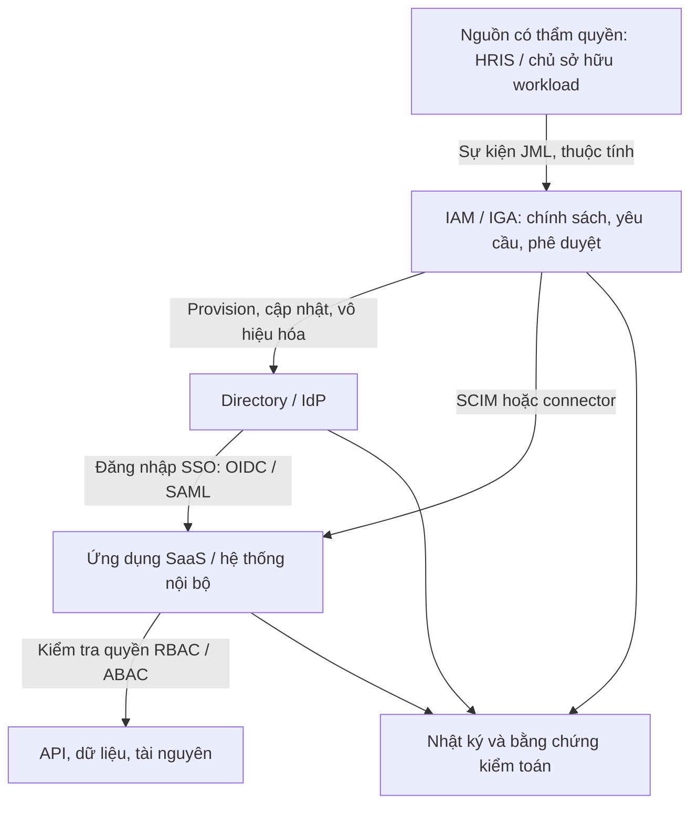
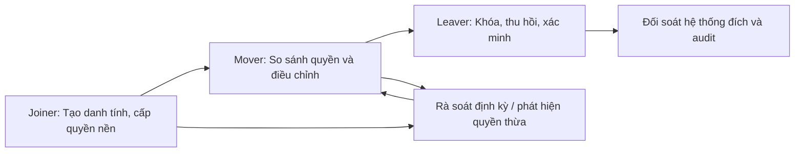

# IAM là gì?

## 1. Bối cảnh: Vì sao cần quản lý danh tính và quyền truy cập?

Hãy hình dung một doanh nghiệp sử dụng hệ thống nhân sự, email, kho mã nguồn, công cụ quản lý khách hàng (CRM), hệ thống kế toán và hạ tầng đám mây. Một nhân viên mới cần được truy cập đúng ứng dụng để làm việc; khi chuyển phòng ban, các quyền cũ cần được điều chỉnh; khi nghỉ việc, quyền truy cập phải được thu hồi kịp thời. Đồng thời, ứng dụng và dịch vụ tự động cũng cần danh tính để gọi API, đọc dữ liệu hoặc triển khai phần mềm.

Nếu mỗi hệ thống tự tạo tài khoản, tự quyết định quyền và tự xử lý nghỉ việc, doanh nghiệp rất dễ gặp những vấn đề sau:

- **Cấp quyền thiếu hoặc chậm:** người mới không thể bắt đầu công việc vì chưa có tài khoản.
- **Cấp quyền thừa:** nhân viên tích lũy quyền từ nhiều vị trí, vượt quá nhu cầu hiện tại.
- **Tài khoản mồ côi:** người dùng đã rời tổ chức nhưng tài khoản ở ứng dụng phụ vẫn hoạt động.
- **Khó truy vết:** không rõ ai phê duyệt quyền, quyền được cấp khi nào hoặc ai đã sử dụng quyền đó.
- **Rủi ro với danh tính máy:** token hoặc khóa của ứng dụng vẫn tồn tại dù hệ thống hay người quản lý liên quan đã thay đổi.

**Identity and Access Management (IAM)** là tập hợp chính sách, quy trình và công nghệ giúp tổ chức trả lời nhất quán các câu hỏi: **Ai hoặc cái gì đang yêu cầu truy cập? Danh tính đó được xác minh thế nào? Được làm gì với tài nguyên nào, trong điều kiện nào, trong bao lâu? Ai chịu trách nhiệm và có thể kiểm tra lại quyết định đó không?**

Trong phạm vi module `SECURITY_IDENTITY_ACCESS_MANAGEMENT_IDENTITY_LIFECYCLE`, IAM được xem xuyên suốt **vòng đời danh tính**: xác minh, tạo danh tính/tài khoản, cấp quyền, thay đổi vai trò, rà soát và thu hồi. Trọng tâm là giảm quyền truy cập tồn dư thông qua mô hình **Joiner–Mover–Leaver (JML)**, kết hợp IdP, SSO, SCIM, RBAC/ABAC, quản lý tài khoản dịch vụ và kiểm toán.

## 2. IAM là gì và quản lý những đối tượng nào?

**IAM (quản lý danh tính và truy cập)** là cách tổ chức kiểm soát vòng đời của các **danh tính số** và quyết định truy cập tới ứng dụng, dữ liệu, API, thiết bị và hạ tầng. IAM vừa là hệ thống kỹ thuật vừa là quy trình vận hành; mua một sản phẩm đăng nhập tập trung chưa đủ để có IAM hoàn chỉnh.

Các loại danh tính điển hình:

| Loại danh tính | Ví dụ | Điểm cần quản lý |
| --- | --- | --- |
| **Nhân sự nội bộ (workforce)** | Nhân viên, thực tập sinh, quản trị viên | Gắn với nguồn dữ liệu nhân sự, đơn vị, người quản lý, trạng thái làm việc và JML |
| **Đối tác/bên thứ ba** | Nhà thầu, nhà cung cấp | Người bảo trợ nội bộ, mục đích, ngày hết hạn và phạm vi tài nguyên được truy cập |
| **Khách hàng (customer identity)** | Người dùng đăng nhập ứng dụng | Đăng ký, xác thực, đồng ý sử dụng dữ liệu, bảo vệ quyền riêng tư và tự phục vụ |
| **Danh tính máy (machine/workload)** | Service account, workload, CI/CD, ứng dụng gọi API | Chủ sở hữu, quyền tối thiểu, vòng đời credential, luân chuyển/thu hồi và khả năng truy vết |

Các khái niệm gần nhau nhưng khác nhau:

- **Identity (danh tính):** bản ghi đại diện cho một người hoặc một workload, có mã định danh và thuộc tính như bộ phận, chức danh, loại hợp đồng hay ứng dụng sở hữu.
- **Account (tài khoản):** đối tượng đăng nhập hoặc đối tượng kỹ thuật được tạo tại một hệ thống cụ thể. **Một danh tính có thể liên kết nhiều tài khoản**: tài khoản IdP, CRM, Git, cơ sở dữ liệu.
- **Principal (chủ thể):** thực thể mà hệ thống đang xác thực và đánh giá quyền trong một yêu cầu cụ thể, ví dụ người dùng, service account hoặc workload.
- **Resource (tài nguyên):** đối tượng được bảo vệ như tài liệu, API, bảng dữ liệu, repository hoặc môi trường triển khai.
- **Entitlement (quyền được cấp):** quyền chi tiết như `invoice:read`, thành viên nhóm `finance-readers` hoặc vai trò quản trị của ứng dụng.
- **Role (vai trò):** nhóm quyền gắn với trách nhiệm công việc, chẳng hạn `SupportAgent`, `FinanceViewer` hoặc `CloudOperator`.

**Phân biệt ba hoạt động cốt lõi:**

| Hoạt động | Câu hỏi | Ví dụ |
| --- | --- | --- |
| **Identification** – nhận diện | Chủ thể khai báo mình là ai? | Nhập tên tài khoản hoặc trình bày định danh workload |
| **Authentication (AuthN)** – xác thực | Có đủ bằng chứng cho danh tính đã khai báo không? | Xác thực bằng passkey, mật khẩu kết hợp MFA hoặc chứng chỉ workload |
| **Authorization (AuthZ)** – phân quyền | Danh tính đã xác thực được làm hành động gì? | Nhân viên hỗ trợ được đọc hồ sơ khách hàng nhưng không được xuất toàn bộ dữ liệu |

Ngoài ba hoạt động này, IAM còn đảm nhiệm **provisioning/deprovisioning** (cấp và thu hồi tài khoản/quyền), **governance** (quy trình đề nghị, phê duyệt, rà soát) và **auditing** (ghi nhận, đối chiếu, điều tra). Người đăng nhập thành công **không đồng nghĩa** với người đó được phép truy cập mọi tài nguyên.

## 3. Các thành phần thường gặp trong kiến trúc IAM

| Thành phần | Vai trò chính | Điều cần nhớ |
| --- | --- | --- |
| **Nguồn danh tính có thẩm quyền (authoritative source)** | Cung cấp sự kiện về người hoặc workload: vào, chuyển, nghỉ, thay người quản lý | Với nhân viên thường là HRIS; không nên suy trạng thái làm việc từ việc người đó đăng nhập gần đây |
| **Directory** | Lưu tài khoản, nhóm, thuộc tính, mối quan hệ tổ chức | Là kho dữ liệu danh tính; không tự động thay thế toàn bộ quy trình IAM |
| **Identity Provider (IdP)** | Xác thực người dùng và phát hành assertion/token theo giao thức liên kết danh tính | Ví dụ dùng OpenID Connect hoặc SAML trong luồng đăng nhập |
| **Single Sign-On (SSO)** | Cho phép dùng một phiên xác thực để truy cập nhiều ứng dụng liên kết | Giảm số lần đăng nhập; bản thân SSO không bảo đảm tài khoản đích đã được tạo hoặc thu hồi |
| **Multi-Factor Authentication (MFA)** | Yêu cầu thêm yếu tố xác thực; tăng khả năng chống chiếm quyền tài khoản | Tùy ngữ cảnh rủi ro, ưu tiên phương thức chống phishing cho tài khoản nhạy cảm |
| **Provisioning / SCIM** | Tạo, cập nhật, vô hiệu hóa tài khoản và đồng bộ nhóm/thuộc tính tới ứng dụng | SCIM là chuẩn API cho quản lý danh tính; khả năng thực tế phụ thuộc từng ứng dụng |
| **Authorization: RBAC/ABAC** | Xác định chủ thể được phép làm gì với tài nguyên | Quyết định quyền cần được kiểm tra ở điểm thực thi như ứng dụng/API |
| **IGA (Identity Governance and Administration)** | Quản trị yêu cầu quyền, phê duyệt, chứng nhận lại quyền và chính sách phân tách nhiệm vụ | Đặt câu hỏi “ai nên có quyền này và ai chấp thuận?” |
| **PAM (Privileged Access Management)** | Kiểm soát tài khoản/quyền đặc quyền, phiên quản trị, thông tin bí mật và truy cập có thời hạn | Là lớp kiểm soát chuyên sâu cho quyền có tác động lớn |
| **Audit / SIEM** | Thu nhận sự kiện xác thực, thay đổi quyền, thao tác nhạy cảm, lỗi và bất thường | Cần liên kết sự kiện với danh tính, tác nhân và tài nguyên để điều tra |

Các thuật ngữ giao thức rất dễ nhầm:

- **SAML 2.0** và **OpenID Connect (OIDC)** thường dùng cho **đăng nhập liên kết/SSO**. OIDC xây trên OAuth 2.0 để cung cấp thông tin xác thực danh tính.
- **OAuth 2.0** chủ yếu là khung **ủy quyền truy cập** cho ứng dụng/client đối với tài nguyên được bảo vệ; không nên coi một access token OAuth là bằng chứng danh tính người dùng nếu thiếu ngữ cảnh/giao thức phù hợp.
- **SCIM 2.0** dùng để **quản lý vòng đời tài khoản và thuộc tính** qua API, ví dụ tạo người dùng, đổi phòng ban hoặc đặt `active=false`. SCIM không phải là giao thức đăng nhập.
- **RBAC/ABAC** là cách xây dựng và đánh giá **quyết định phân quyền**, không phải giao thức đồng bộ tài khoản.

Ví dụ: Một nhân viên đăng nhập vào CRM nhờ **SSO qua IdP**, còn tài khoản CRM của họ có thể đã được **tạo trước bằng SCIM**. Khi nhân viên chuyển vị trí, quy trình IAM có thể cập nhật nhóm qua SCIM và chính sách **RBAC/ABAC** quyết định chức năng CRM nào được sử dụng. Bốn thành phần giải quyết bốn công việc liên quan nhưng riêng biệt.

## 4. IAM vận hành như thế nào từ nguồn danh tính đến ứng dụng?

Trong hệ thống thực tế, việc tạo tài khoản và việc sử dụng tài khoản là hai luồng khác nhau nhưng cần thống nhất chính sách.



Một luồng điển hình:

1. **Nguồn danh tính phát sự kiện:** HRIS ghi nhận nhân viên đã qua bước xác minh và có hiệu lực làm việc; với workload, hệ thống quản lý dịch vụ phát tín hiệu tạo hoặc thay đổi.
2. **IAM tính quyền cần thiết:** dựa trên vai trò, nhóm công việc, thuộc tính và các phê duyệt bắt buộc; hạn chế dùng nhóm “mọi người đều có quyền quản trị”.
3. **Provisioning tới hệ thống đích:** IdP, directory và connector như SCIM tạo/cập nhật tài khoản, nhóm, quyền; cần xử lý lỗi đồng bộ.
4. **Người dùng hoặc workload xác thực:** người dùng qua IdP/SSO và MFA khi cần; workload qua cơ chế phù hợp như danh tính liên kết hoặc credential ngắn hạn.
5. **Ứng dụng thực thi phân quyền:** kiểm tra quyền đối với **từng hành động/tài nguyên** thay vì chỉ kiểm tra người đó đã đăng nhập.
6. **Ghi log, giám sát và rà soát:** lưu lịch sử thay đổi quyền, phê duyệt, sự kiện truy cập và kết quả đối soát để phát hiện sai lệch.

Trong thực tế, có hệ thống không hỗ trợ SCIM hoặc kiểm soát quyền ngay tại ứng dụng. Khi đó cần connector riêng, API quản trị hoặc quy trình có người thực hiện và đối soát kết quả. Không được giả định rằng cấu hình SSO đồng nghĩa đã tự động hóa toàn bộ vòng đời danh tính.

## 5. Vòng đời danh tính: Joiner–Mover–Leaver

Mô hình **Joiner–Mover–Leaver (JML)** mô tả các thay đổi lớn của danh tính nhân sự. Đây là trục chính của **identity lifecycle management**.

| Giai đoạn | Sự kiện kích hoạt | Hoạt động IAM | Bằng chứng/kết quả cần có |
| --- | --- | --- | --- |
| **Joiner – gia nhập** | Nhân viên hoặc nhà thầu được xác minh, có ngày bắt đầu và người quản lý | Tạo danh tính duy nhất; gán tài khoản cơ bản; cấp quyền theo vai trò và phê duyệt; cấu hình MFA | Danh sách tài khoản/quyền đã cấp, người yêu cầu và phê duyệt, thời điểm hiệu lực |
| **Mover – thay đổi** | Chuyển nhóm, chức danh, dự án, người quản lý hoặc loại hợp đồng | **Thu hồi quyền không còn phù hợp**, đánh giá xung đột, cấp quyền mới theo nhu cầu và thời hạn | Chênh lệch trước/sau; lý do giữ hoặc thu hồi quyền; kết quả thực thi tại ứng dụng |
| **Leaver – rời tổ chức** | Nghỉ việc, hết hợp đồng, chấm dứt hợp tác | Khóa đường đăng nhập, vô hiệu hóa tài khoản ở hệ thống đích, thu hồi phiên/token/khóa khi có thể; thu hồi quyền đặc quyền, bàn giao sở hữu | Thời điểm nhận sự kiện và hoàn tất thu hồi; danh sách hệ thống còn lỗi; xác nhận đóng yêu cầu |

### 5.1. Joiner: Xác minh và cấp đúng quyền ban đầu

Một quy trình Joiner an toàn thường tuân theo thứ tự:

1. Kiểm tra nguồn tạo danh tính và các thuộc tính quan trọng: mã nhân sự/đối tác, loại hợp đồng, ngày bắt đầu, phòng ban, cấp quản lý. Tránh dùng email làm khóa định danh duy nhất vì email có thể thay đổi hoặc tái sử dụng.
2. Tạo đối tượng danh tính và liên kết các tài khoản ứng dụng với **một định danh nội bộ ổn định**.
3. Cấp **baseline access** tối thiểu cho vị trí. Quyền nhạy cảm hoặc ngoài vai trò phải có yêu cầu, người phê duyệt và thời hạn.
4. Thiết lập cách xác thực, MFA và cơ chế tự khôi phục an toàn.
5. Kiểm tra kết quả provisioning ở hệ thống đích; ghi nhận lỗi để xử lý chứ không chỉ đánh dấu “đã gửi lệnh”.

**Ví dụ:** Kỹ sư mới được tạo tài khoản IdP, email và quyền đọc tài liệu kỹ thuật. Quyền triển khai môi trường production phải có phê duyệt riêng, có thể cấp trong thời gian ngắn. Việc “là kỹ sư” không đủ để mặc định có quyền cao nhất.

### 5.2. Mover: Quyền phải thay đổi theo công việc thực tế

Mover là nguồn gây ra **privilege accumulation** (tích lũy quyền) nếu hệ thống chỉ thêm quyền mới mà quên xóa quyền cũ.

Giả sử nhân viên **An** chuyển từ nhóm Hỗ trợ khách hàng sang nhóm Tài chính:

- **Trước thay đổi:** An có quyền xem và cập nhật phiếu hỗ trợ khách hàng.
- **Sau thay đổi:** An cần xem báo cáo thanh toán, nhưng không còn cần quyền sửa phiếu hỗ trợ.
- **Xử lý đúng:** IAM so sánh tập quyền cũ và tập quyền mục tiêu, thu hồi quyền sửa phiếu, cấp quyền xem báo cáo sau phê duyệt; rà soát xung đột phân tách nhiệm vụ nếu quyền tài chính có tính nhạy cảm.
- **Xử lý sai:** Giữ nguyên quyền hỗ trợ và cộng thêm mọi quyền của nhóm tài chính, khiến An tiếp tục truy cập dữ liệu ngoài trách nhiệm.

Nếu cần giai đoạn bàn giao, ngoại lệ giữ quyền cũ phải có **lý do, chủ sở hữu, thời hạn hết hiệu lực và cơ chế thu hồi tự động**. Khi vai trò thay đổi, quyền cũ cần được đánh giá lại ngay cả khi tài khoản IdP vẫn giữ nguyên.

### 5.3. Leaver: Thu hồi có xác nhận, không chỉ tắt một tài khoản

Ngừng cho người dùng đăng nhập tại IdP là bước quan trọng nhưng chưa đủ trong mọi kiến trúc. Một số ứng dụng duy trì tài khoản cục bộ, phiên đang hoạt động, API key hoặc token độc lập.

Quy trình Leaver cần xét các lớp sau:

1. **Chặn truy cập tương lai:** vô hiệu hóa danh tính ở IdP/directory theo thời điểm hiệu lực, áp dụng chính sách khẩn cấp cho trường hợp rủi ro cao.
2. **Thu hồi ở ứng dụng đích:** gửi lệnh deprovision hoặc vô hiệu hóa qua SCIM/connector/API; xác minh hệ thống đích đã áp dụng.
3. **Giảm truy cập đang tồn tại:** thu hồi phiên và refresh token nếu nền tảng hỗ trợ; xử lý khóa SSH, personal access token, credential được cấp riêng và các tích hợp còn phụ thuộc.
4. **Xử lý sở hữu:** chuyển quyền sở hữu repository, lịch tác vụ, tài nguyên đám mây, workflow và service account mà người rời tổ chức đang quản lý.
5. **Lưu bằng chứng:** ghi thời điểm nhận sự kiện, thời điểm hoàn tất từng hệ thống, lỗi/chưa xử lý và người chịu trách nhiệm.

Không nên đồng nhất **vô hiệu hóa tài khoản** với **xóa dữ liệu**. Tổ chức có thể cần giữ hồ sơ, log và tài liệu theo chính sách lưu trữ trong khi đã chặn hoàn toàn quyền truy cập của danh tính rời tổ chức.



## 6. IAM quyết định quyền truy cập bằng RBAC và ABAC thế nào?

### RBAC – Role-Based Access Control

**RBAC** gán quyền cho **vai trò**, sau đó gán người dùng hoặc workload vào vai trò. Thay vì cấp quyền `invoice:read` cho từng nhân viên, hệ thống gán quyền đó cho vai trò `FinanceViewer` và cấp vai trò cho người đủ điều kiện.

| Vai trò ví dụ | Quyền minh họa | Không được phép |
| --- | --- | --- |
| `SupportAgent` | Đọc và cập nhật ticket được phân công | Xem bảng lương |
| `FinanceViewer` | Đọc báo cáo tài chính thuộc phạm vi được giao | Phê duyệt thanh toán |
| `FinanceApprover` | Phê duyệt giao dịch trong giới hạn được giao | Tự tạo và tự phê duyệt một giao dịch nếu vi phạm SoD |

RBAC dễ giải thích và rà soát, nhưng có thể dẫn tới **role explosion** nếu tạo một vai trò riêng cho mọi biến thể phòng ban, khu vực, dự án và trạng thái.

### ABAC – Attribute-Based Access Control

**ABAC** đánh giá chính sách dựa trên **thuộc tính của chủ thể, tài nguyên, hành động và bối cảnh**: phòng ban, chủ sở hữu tài liệu, độ nhạy dữ liệu, môi trường, thời điểm, trạng thái thiết bị hoặc mức xác thực.

Ví dụ quy tắc minh họa, **không phải cú pháp của một engine chính sách cụ thể**:

```text
ALLOW invoice.read WHEN
    subject.department == "Finance"
    AND subject.employmentStatus == "active"
    AND resource.classification IN ["internal", "finance"]
    AND subject.region == resource.region
    AND session.mfaSatisfied == true
OTHERWISE DENY
```

ABAC linh hoạt hơn khi tài nguyên có ràng buộc theo ngữ cảnh; đổi lại, chất lượng quyết định phụ thuộc vào **độ tin cậy, tính cập nhật của thuộc tính** và khả năng kiểm thử chính sách. Nhiều hệ thống kết hợp RBAC để cấp quyền nền và ABAC để giới hạn quyền tại thời điểm yêu cầu.

**Quy tắc nền tảng:** xác thực thành công chưa phải là quyền truy cập; ứng dụng/API phải kiểm tra quyền trên mỗi hành động nhạy cảm. Chính sách cần áp dụng **deny by default** khi không có quy tắc cho phép phù hợp.

## 7. SCIM, SSO và đồng bộ trạng thái vòng đời

Xét tình huống một nhân viên nghỉ việc. Ba thao tác khác nhau có thể xảy ra:

1. **IdP khóa danh tính** để chặn lần xác thực tiếp theo.
2. **SCIM/connector đặt tài khoản tại ứng dụng thành không hoạt động** để chặn tài khoản ứng dụng độc lập.
3. **Ứng dụng chấm dứt phiên/token hiện còn giá trị** theo chức năng hỗ trợ và chính sách của hệ thống.

Một yêu cầu SCIM 2.0 để vô hiệu hóa người dùng có thể có dạng sau (đường dẫn và ID chỉ để minh họa):

```http
PATCH /scim/v2/Users/2819c223-7f76-453a-919d-413861904646 HTTP/1.1
Content-Type: application/scim+json
Authorization: Bearer <redacted>

{
  "schemas": ["urn:ietf:params:scim:api:messages:2.0:PatchOp"],
  "Operations": [
    { "op": "replace", "path": "active", "value": false }
  ]
}
```

`active: false` biểu thị tài khoản người dùng bị vô hiệu hóa theo mô hình SCIM. Tuy nhiên, ứng dụng đích có thể khác nhau về độ trễ đồng bộ, hành vi với phiên hiện hữu và mức độ hỗ trợ cập nhật nhóm. Vì vậy, **gửi yêu cầu thành công chưa đủ**: cần đọc lại trạng thái đích, theo dõi lỗi và có cơ chế đối soát.

Một thiết kế đồng bộ tốt cần:

- **Nguồn sự thật rõ ràng:** xác định hệ thống nào được quyền quyết định trạng thái nhân sự, phòng ban và người quản lý; tránh đồng bộ vòng gây ghi đè.
- **Định danh ổn định:** dùng ID nội bộ và mapping tới ID ứng dụng, xử lý đổi email/tên mà không tạo danh tính trùng.
- **Thực thi lặp an toàn (idempotent):** cùng một sự kiện xử lý lại không tạo thêm tài khoản hoặc cấp thêm quyền ngoài ý muốn.
- **Retry và hàng đợi lỗi:** mất mạng, giới hạn API hoặc quyền connector bị thu hồi phải tạo tín hiệu xử lý và được thử lại có kiểm soát.
- **Reconciliation:** định kỳ so tập quyền/tài khoản kỳ vọng với trạng thái thực tế; phát hiện tài khoản mồ côi và drift.
- **Đồng bộ theo độ ưu tiên rủi ro:** trường hợp Leaver hoặc thu hồi quyền đặc quyền cần mục tiêu thời gian xử lý và cảnh báo phù hợp.

## 8. Quản lý tài khoản dịch vụ và danh tính workload

IAM cũng áp dụng cho **danh tính không phải con người**. Chẳng hạn pipeline CI/CD đọc artifact, service gọi cơ sở dữ liệu hoặc ứng dụng cần truy cập object storage.

Với tài khoản dịch vụ, câu hỏi “nhân viên nào sở hữu tài khoản này?” thường khó trả lời nếu tổ chức không đặt quy định ngay lúc tạo. Tài khoản dùng chung, credential không hết hạn và quyền quá rộng tạo ra truy cập tồn dư ngay cả khi nhân viên liên quan đã nghỉ việc.

Quy tắc thiết kế:

- Mỗi workload/tài khoản dịch vụ có **mục đích, chủ sở hữu, hệ thống liên quan và lịch rà soát** rõ ràng; tránh chia sẻ một tài khoản chung giữa nhiều ứng dụng.
- Chỉ cấp phạm vi quyền cần thiết tới tài nguyên cụ thể; giới hạn theo môi trường (development, staging, production).
- Ưu tiên **workload identity/federation và thông tin xác thực ngắn hạn** thay cho khóa tĩnh lâu dài khi hạ tầng hỗ trợ; lưu bí mật trong hệ thống quản lý secret phù hợp.
- Có cơ chế **rotate, expire, revoke** và quy trình thay đổi chủ sở hữu khi đội ngũ hoặc người phụ trách thay đổi.
- Ghi dấu hoạt động của từng workload; tránh dùng chung credential khiến không thể phân biệt ứng dụng nào đã thực hiện thao tác.

Danh tính workload có vòng đời tương tự JML: **tạo khi triển khai**, **điều chỉnh khi phạm vi hệ thống thay đổi**, **thu hồi khi ngừng dịch vụ**. Vòng đời máy không nhất thiết gắn với HRIS; nguồn có thẩm quyền có thể là registry dịch vụ, nền tảng triển khai hoặc người sở hữu ứng dụng.

## 9. Quản trị quyền, kiểm toán và nguyên tắc bảo mật

IAM có hiệu quả khi **quyết định quyền được quản trị**, **thao tác thực sự được thực thi** và **kết quả có thể chứng minh**.

### Những kiểm soát cốt lõi

- **Least privilege:** chỉ cấp quyền cần cho nhiệm vụ hiện tại, ưu tiên quyền hẹp và có thời hạn.
- **Separation of duties (SoD):** ngăn tập quyền xung đột, ví dụ cùng một người vừa tạo vừa tự phê duyệt khoản chi quan trọng.
- **Just-in-time (JIT) access:** quyền nhạy cảm có thể được cấp khi có nhu cầu thực tế và tự hết hạn sau khoảng thời gian đã phê duyệt.
- **Access review / recertification:** người quản lý, chủ tài nguyên hoặc chủ ứng dụng xác nhận định kỳ ai vẫn cần quyền; kết quả rà soát phải dẫn tới thay đổi thực tế.
- **Privileged access control:** xác thực mạnh, truy cập có kiểm soát, ghi nhận và rà soát phiên đặc quyền nếu phù hợp.
- **Break-glass access:** tài khoản/cơ chế khẩn cấp có kiểm soát, có chủ sở hữu, cảnh báo, kiểm thử và hậu kiểm sau sử dụng.
- **Continuous monitoring:** cảnh báo quyền quản trị cấp bất thường, đăng nhập đáng ngờ, tài khoản không còn chủ sở hữu hoặc lỗi deprovision kéo dài.

### Cần ghi log những gì?

Để điều tra một thay đổi quyền, log tối thiểu cần đủ thông tin về **ai thực hiện**, **danh tính chịu tác động**, **tài nguyên/quyền**, **hành động**, **thời điểm**, **kết quả**, **nguồn yêu cầu/phê duyệt** và **mã tương quan** nếu có. Ví dụ:

```json
{
  "eventType": "entitlement.revoked",
  "time": "2026-11-23T07:00:00Z",
  "actor": "iam-automation",
  "subjectId": "person-1042",
  "targetSystem": "crm",
  "entitlement": "support.ticket.update",
  "reason": "department-transfer",
  "requestId": "jml-event-873",
  "result": "success"
}
```

Đây là log minh họa; schema thực tế phụ thuộc nền tảng. Log cần được bảo vệ khỏi chỉnh sửa tùy tiện, có thời hạn lưu trữ phù hợp và **không lưu mật khẩu, access token hoặc secret ở dạng rõ**.

### Cách đo mức độ vận hành

Có thể theo dõi các chỉ số sau, tách theo mức độ nhạy cảm của hệ thống:

| Chỉ số | Cách hiểu |
| --- | --- |
| **Thời gian hoàn tất Joiner** | Từ lúc sự kiện hợp lệ có hiệu lực tới khi tài khoản/quyền nền sẵn sàng |
| **Thời gian thu hồi Leaver** | Từ sự kiện rời tổ chức tới lúc từng hệ thống xác nhận đã chặn truy cập |
| **Tỷ lệ provisioning/deprovisioning thành công** | Số thay đổi được hệ thống đích xác nhận so với số thay đổi phải thực hiện |
| **Số tài khoản mồ côi / quyền tồn dư** | Tài khoản không còn danh tính/chủ sở hữu hợp lệ hoặc quyền vượt tập quyền mục tiêu |
| **Tỷ lệ hoàn tất access review** | Quyền được chủ trách nhiệm quyết định và các yêu cầu thu hồi đã được thực thi |
| **Số ngoại lệ quyền đặc quyền quá hạn** | Quyền khẩn cấp/ngoài vai trò chưa được thu hồi đúng thời hạn |

Không có một ngưỡng thời gian chung phù hợp mọi tổ chức. Mục tiêu dịch vụ (SLA/SLO) nên được thiết lập theo rủi ro, loại danh tính và yêu cầu của từng hệ thống.

## 10. Các sai lầm thường gặp

| Quan niệm hoặc cách triển khai sai | Vì sao nguy hiểm | Cách xử lý |
| --- | --- | --- |
| “Có SSO nghĩa là đã có IAM đầy đủ” | SSO tập trung xác thực nhưng không bảo đảm tạo/thu hồi tài khoản hoặc quản trị quyền ở từng ứng dụng | Thiết kế thêm provisioning, authorization, review và audit |
| “Khóa IdP là thu hồi toàn bộ truy cập” | Phiên cũ, tài khoản cục bộ, token hoặc API key có thể còn hiệu lực | Vô hiệu hóa đích, thu hồi credential và kiểm tra lại trạng thái |
| “Mover chỉ cần thêm quyền mới” | Quyền tích lũy qua các vai trò, tăng nguy cơ truy cập sai phạm vi | So sánh tập quyền cũ–mới, thu hồi quyền không còn hợp lệ |
| “Một email luôn bằng một danh tính” | Email có thể đổi hoặc tái sử dụng, gây ghép nhầm tài khoản | Dùng mã định danh ổn định và mapping tới ID hệ thống đích |
| “SCIM gửi thành công nghĩa là ứng dụng đã an toàn” | Trạng thái thực tế, nhóm và phiên có thể không được cập nhật như kỳ vọng | Xác nhận kết quả, retry, reconciliation và theo dõi ngoại lệ |
| “Tài khoản dịch vụ không cần chủ sở hữu” | Credential có thể tồn tại vĩnh viễn và khó thu hồi khi ứng dụng ngừng hoạt động | Bắt buộc ownership, expiry/rotation và quy trình decommission |
| “Rà soát quyền chỉ cần xuất báo cáo” | Quyền bị đánh dấu không phù hợp nhưng vẫn tồn tại ở hệ thống đích | Gắn quyết định review với yêu cầu thu hồi và bằng chứng thực thi |

## 11. Ví dụ xuyên suốt: Một danh tính qua ba giai đoạn

Giả sử **Minh** được tuyển vào vị trí kỹ sư ứng dụng, sau đó chuyển sang nhóm vận hành và cuối cùng kết thúc hợp đồng.

**Khi gia nhập (Joiner):**

- HRIS xác nhận ngày bắt đầu và mã nhân sự; IAM tạo danh tính liên kết với IdP.
- Hệ thống cấp email, kho tài liệu và quyền đọc repository theo nhóm kỹ sư; quyền production chưa được cấp tự động.
- Khi cần kiểm tra production, Minh gửi yêu cầu và được cấp quyền đọc log trong thời gian giới hạn sau phê duyệt.

**Khi chuyển nhóm (Mover):**

- HRIS cập nhật phòng ban; IAM tính tập quyền đích của nhóm vận hành.
- Quyền repository của nhóm cũ được rà soát và thu hồi nếu không còn cần thiết.
- Quyền vận hành mới được phê duyệt; các quyền đặc biệt vẫn có thời hạn, được ghi log và chịu kiểm soát SoD.
- Việc đồng bộ quyền tới ứng dụng được xác nhận bằng trạng thái thực tế thay vì chỉ dựa trên lệnh gửi đi.

**Khi rời tổ chức (Leaver):**

- Tại thời điểm hiệu lực, IdP chặn đăng nhập; connector vô hiệu hóa tài khoản ứng dụng.
- Các phiên/tokens/khóa do Minh sở hữu được xem xét và thu hồi theo khả năng từng hệ thống.
- Nếu Minh từng sở hữu một service account dùng cho pipeline, người quản lý phải chuyển ownership, đánh giá việc thay credential hoặc vô hiệu hóa service account nếu không còn cần.
- Báo cáo đối soát cho thấy các hệ thống nào đã thu hồi thành công, hệ thống nào cần xử lý lỗi.

Ví dụ này cho thấy mục tiêu của IAM không dừng ở câu “Minh đăng nhập được không?”, mà còn bao gồm **vì sao Minh có quyền, quyền còn phù hợp không, ai phê duyệt, khi nào quyền hết hiệu lực và hệ thống nào đã thực sự thu hồi quyền đó**.

## 12. Tự kiểm tra một quy trình IAM

Khi đánh giá một ứng dụng hoặc tích hợp mới vào hệ thống quản lý danh tính, hãy lần lượt xác minh:

1. **Nguồn danh tính:** danh tính/tài khoản được liên kết với nguồn có thẩm quyền nào? Ai là chủ sở hữu?
2. **Gia nhập:** ai phê duyệt quyền ban đầu? Có quyền mặc định nào vượt quá nhu cầu không?
3. **Đăng nhập:** ứng dụng dùng IdP/SSO hay tài khoản riêng? MFA và chính sách phiên được xử lý ở đâu?
4. **Phân quyền:** ứng dụng thực thi RBAC, ABAC hoặc mô hình nào? Có kiểm tra quyền tại API không?
5. **Thay đổi vai trò:** hệ thống cập nhật và **thu hồi** quyền cũ ra sao? Ngoại lệ có ngày hết hạn không?
6. **Rời tổ chức:** khóa IdP, deprovision ứng dụng, hủy phiên/token và xử lý tài khoản dịch vụ được kiểm chứng thế nào?
7. **Vận hành:** có retry, reconciliation, cảnh báo lỗi, báo cáo quyền tồn dư và log kiểm toán không?

### Ghi nhớ

**IAM quản lý ai/cái gì được truy cập tài nguyên nào, theo điều kiện nào và trong giai đoạn nào của vòng đời.** IdP và SSO giải quyết phần lớn trải nghiệm xác thực; SCIM/connector hỗ trợ đồng bộ tài khoản; RBAC/ABAC đưa ra quyết định quyền; IGA, PAM và audit bảo đảm các quyết định đó có kiểm soát và kiểm chứng được. Với Joiner–Mover–Leaver, tiêu chuẩn đánh giá quan trọng là **cấp đúng quyền khi cần, điều chỉnh quyền khi đổi vai trò và thu hồi có xác nhận khi quyền không còn hợp lệ**.
