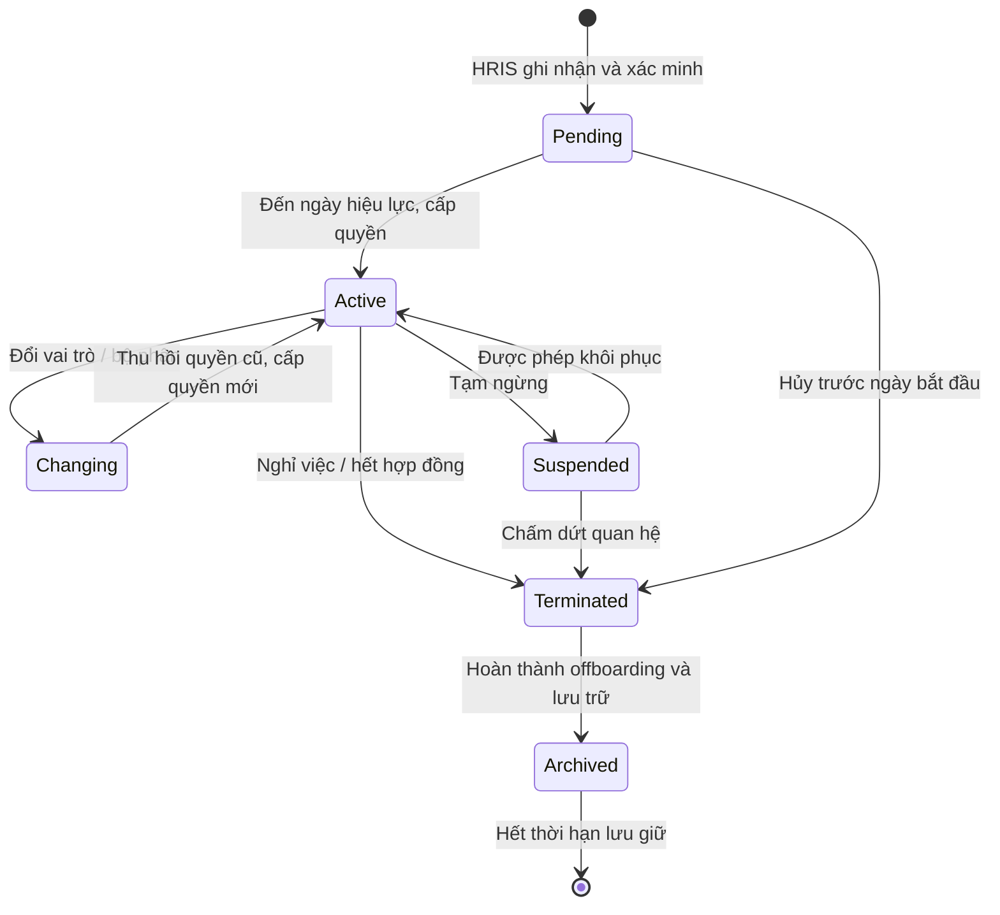
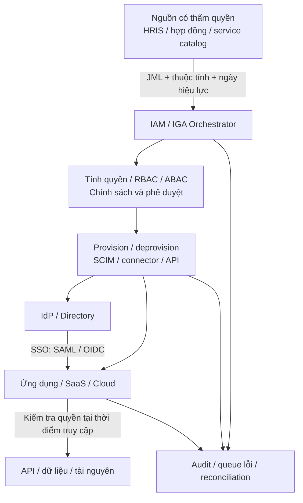
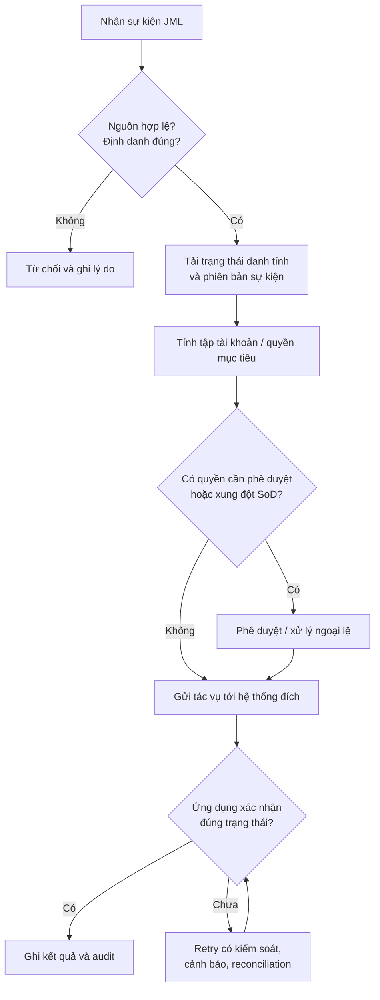

# Identity lifecycle là gì?

## 1. Vì sao một danh tính có “vòng đời”?

Trong doanh nghiệp, một nhân viên có thể được tuyển dụng, bắt đầu công việc, chuyển phòng ban, được giao dự án mới, tạm nghỉ, trở lại và cuối cùng rời tổ chức. Trong mỗi giai đoạn, nhu cầu truy cập email, hệ thống quản lý nhân sự, mã nguồn, dữ liệu khách hàng và hạ tầng sản xuất đều có thể thay đổi.

Một lỗi phổ biến là hệ thống **cấp thêm quyền** mỗi khi có yêu cầu mới nhưng **không thu hồi quyền cũ** khi công việc đã thay đổi. Một lỗi khác là khóa đăng nhập tập trung khi người dùng nghỉ việc, song tài khoản cục bộ, phiên đăng nhập hoặc token API vẫn còn giá trị. Kết quả là tổ chức có **quyền truy cập tồn dư** (residual access): người hoặc ứng dụng còn khả năng truy cập tài nguyên dù lý do cấp quyền đã hết.

**Identity lifecycle (vòng đời danh tính)** là quá trình quản lý một danh tính số từ lúc có căn cứ tạo ra, suốt các lần thay đổi trạng thái và quyền truy cập, cho đến khi danh tính không còn được phép hoạt động và các tài khoản, quyền, chứng thực liên quan được thu hồi hoặc lưu trữ theo chính sách.

Trong module `SECURITY_IDENTITY_ACCESS_MANAGEMENT_IDENTITY_LIFECYCLE`, khái niệm này là nền tảng để học cách **xác minh, tạo tài khoản, cấp quyền, rà soát, điều chỉnh và thu hồi** theo mô hình **Joiner–Mover–Leaver (JML)**. Hệ thống IAM thực thi vòng đời thông qua IdP, SSO, SCIM/connector, RBAC/ABAC, quy trình phê duyệt, quản lý tài khoản dịch vụ và kiểm toán.

**Mục tiêu không chỉ là biết một người đăng nhập được hay không.** Tổ chức cần trả lời được: ai là chủ sở hữu của danh tính, danh tính có còn hợp lệ, nên có quyền gì ở thời điểm hiện tại, quyền đó do ai phê duyệt, khi nào hết hạn và hệ thống đích đã thực thi quyết định hay chưa.

## 2. Vòng đời của danh tính, tài khoản và quyền truy cập khác nhau thế nào?

Ba khái niệm liên quan nhưng không đồng nhất:

| Đối tượng | Ý nghĩa | Ví dụ |
| --- | --- | --- |
| **Identity – danh tính** | Đại diện số của một người hoặc workload, gồm ID ổn định, thuộc tính và trạng thái | Nhân viên `person-1042` thuộc bộ phận hỗ trợ; workload `billing-api` thuộc đội thanh toán |
| **Account – tài khoản** | Bản ghi của danh tính trong một hệ thống cụ thể, có thể dùng để xác thực hoặc truy cập | Tài khoản IdP, tài khoản Jira, tài khoản Git, tài khoản cơ sở dữ liệu |
| **Entitlement – quyền truy cập** | Một vai trò, nhóm, phạm vi hoặc đặc quyền cụ thể được gán cho chủ thể | `crm.ticket.read`, thành viên nhóm `finance-viewers`, quyền deploy production |

Một danh tính có thể có **nhiều tài khoản**, mỗi tài khoản có **nhiều quyền**. Vì vậy, kết thúc danh tính cần dẫn tới nhiều hành động thu hồi tại nhiều hệ thống, không đơn thuần là thay đổi một cờ trạng thái.

Ví dụ:

- HRIS xác nhận **Mai** là nhân viên đang làm việc: danh tính nhân sự của Mai hợp lệ.
- IdP lưu tài khoản đăng nhập và nhóm của Mai: tài khoản tập trung của Mai hoạt động.
- CRM và kho mã nguồn có thể lưu tài khoản cục bộ tương ứng: hai tài khoản đích cần đồng bộ riêng.
- Mai chuyển sang nhóm khác: danh tính vẫn là Mai, nhưng một số **quyền** và thuộc tính phải đổi.
- Mai nghỉ việc: trạng thái danh tính phải chặn truy cập; tài khoản đích, phiên và credential liên quan cần được xử lý tùy hệ thống.

Có thể phân biệt thêm:

- **Identity lifecycle management:** quản lý tính hợp lệ, thuộc tính, sở hữu và trạng thái của danh tính.
- **Account lifecycle management:** tạo, liên kết, khóa, khôi phục hoặc vô hiệu hóa tài khoản tại từng ứng dụng.
- **Access lifecycle management:** yêu cầu, cấp, điều chỉnh, chứng nhận lại, đặt hết hạn và thu hồi quyền.
- **Credential/session lifecycle:** phát hành, sử dụng, luân chuyển, hết hạn hoặc thu hồi khóa, token và phiên đăng nhập.

Một hệ thống identity lifecycle hoàn chỉnh phải phối hợp các vòng đời này, vì chúng thường có thời điểm và cơ chế thực thi khác nhau.

## 3. “Bắt đầu” và “kết thúc” một vòng đời được xác định ở đâu?

Không nên định nghĩa vòng đời bằng thời điểm một người tự tạo tài khoản đầu tiên hoặc lần đăng nhập cuối. Doanh nghiệp cần **nguồn có thẩm quyền** (authoritative source) để xác định sự kiện kinh doanh tạo ra, thay đổi hoặc chấm dứt nhu cầu truy cập.

| Đối tượng | Nguồn dữ liệu có thẩm quyền thường gặp | Sự kiện vòng đời |
| --- | --- | --- |
| Nhân viên | Hệ thống nhân sự (HRIS), quy trình nhân sự được phê duyệt | Tuyển dụng, ngày bắt đầu, đổi bộ phận, nghỉ việc |
| Nhà thầu/đối tác | Hệ thống hợp đồng, nhà tài trợ nội bộ, quy trình quản lý đối tác | Bắt đầu hợp đồng, gia hạn, đổi phạm vi, hết hạn |
| Khách hàng | Hệ thống đăng ký, dữ liệu chủ tài khoản hoặc sự kiện hợp lệ của sản phẩm | Đăng ký, xác minh, khóa tự nguyện, đóng tài khoản |
| Tài khoản dịch vụ/workload | Service catalog, hệ thống triển khai, chủ ứng dụng | Tạo workload, đổi quyền API, chuyển chủ sở hữu, ngừng dịch vụ |

**Một danh tính cần mã định danh nội bộ ổn định**, không phụ thuộc vào email hay tên hiển thị. Email và tên có thể thay đổi; dùng email làm khóa duy nhất có thể gây tài khoản trùng hoặc liên kết nhầm khi địa chỉ được tái sử dụng.

### Dữ liệu đầu vào tối thiểu

Đối với nhân sự, các thuộc tính thường cần để tính chính sách gồm:

- ID nhân sự hoặc đối tác bất biến trong hệ thống nguồn;
- trạng thái và ngày hiệu lực bắt đầu/kết thúc;
- loại quan hệ làm việc (nhân viên, nhà thầu, thực tập sinh...);
- bộ phận, chức danh hoặc vai trò công việc, người quản lý;
- địa điểm/khu vực pháp lý nếu quyền phụ thuộc dữ liệu này;
- mã người phê duyệt, người bảo trợ hoặc chủ sở hữu quyền.

Không phải ứng dụng nào cũng cần tất cả thuộc tính. Chỉ đồng bộ dữ liệu cần thiết để thực thi chính sách, tuân thủ nguyên tắc tối thiểu hóa dữ liệu cá nhân.

## 4. Các giai đoạn và trạng thái điển hình

Mô hình **Joiner–Mover–Leaver** mô tả ba nhóm sự kiện chính:

- **Joiner:** một người hoặc workload trở thành đối tượng hợp lệ cần truy cập.
- **Mover:** mối quan hệ, nhiệm vụ, thuộc tính hoặc phạm vi công việc thay đổi; tập quyền phù hợp cần được tính lại.
- **Leaver:** mối quan hệ hoặc workload chấm dứt; quyền truy cập phải được thu hồi và kết quả được xác nhận.

JML là **mô hình nghiệp vụ**, không phải tập giá trị trạng thái bắt buộc cho mọi hệ thống. Một tổ chức có thể định nghĩa trạng thái vòng đời như sau:

| Trạng thái minh họa | Điều kiện | Kỳ vọng về truy cập |
| --- | --- | --- |
| **Pending / Pre-joiner** | Đã có thông tin được xác minh nhưng chưa tới ngày bắt đầu | Có thể chuẩn bị tài khoản; chưa cấp quyền dùng dữ liệu nhạy cảm |
| **Active** | Quan hệ có hiệu lực và các điều kiện sử dụng được đáp ứng | Chỉ cấp quyền theo vai trò, chính sách và phê duyệt hiện hành |
| **Changing / Mover** | Đang điều chỉnh bộ phận, người quản lý hoặc trách nhiệm | Đồng bộ quyền theo tập quyền mục tiêu, giải quyết quyền cũ |
| **Suspended** | Tạm ngừng theo chính sách/rủi ro; có thể trở lại | Hạn chế hoặc chặn đăng nhập/quyền; giữ hồ sơ cho phép khôi phục có kiểm soát |
| **Terminated / Leaver** | Đã chấm dứt quan hệ hoặc nguồn có thẩm quyền xác nhận kết thúc | Vô hiệu hóa truy cập, thu hồi quyền và credential, xử lý sở hữu |
| **Archived / Retained** | Tài khoản/danh tính đã ngừng hoạt động nhưng hồ sơ phải giữ trong thời gian phù hợp | Không được truy cập; dữ liệu còn lại phục vụ nghĩa vụ lưu trữ/kiểm toán |

Sơ đồ trạng thái minh họa:



Đây là ví dụ để giải thích khái niệm. Với trường hợp **tái tuyển dụng (rehire)**, cần có quy trình xác minh và quyết định liên kết danh tính cũ hay tạo bản ghi mới; tuyệt đối không tự kích hoạt lại toàn bộ quyền trước đây. Trạng thái “Changing” cũng có thể là một **sự kiện** thay vì trạng thái lưu lâu dài.

### Thời điểm hiệu lực và thời điểm xử lý

Hãy phân biệt:

- **Event time:** lúc sự kiện nghiệp vụ có hiệu lực, ví dụ hợp đồng kết thúc lúc 18:00.
- **Recorded time:** lúc hệ thống nguồn ghi nhận thay đổi.
- **Processing time:** lúc IAM nhận và xử lý sự kiện.
- **Enforcement time:** lúc ứng dụng thực sự áp dụng thay đổi quyền hoặc vô hiệu hóa tài khoản.

Bốn thời điểm này có thể khác nhau. Trong offboarding, chỉ số có ý nghĩa bảo mật là **thời điểm thực sự chặn truy cập ở từng hệ thống**, cùng với độ trễ và ngoại lệ, thay vì chỉ thời điểm bấm “hoàn tất” trên công cụ quản trị.

## 5. Joiner: Từ xác minh đến quyền sử dụng được

Joiner bắt đầu khi có căn cứ hợp lệ để tạo một danh tính. Quy trình nên vừa giúp người mới sẵn sàng làm việc, vừa tránh cấp quyền sớm hoặc quá rộng.

### Các bước thực hiện

1. **Xác minh đầu vào:** kiểm tra sự kiện tuyển dụng/hợp tác được phê duyệt, ID nguồn, ngày hiệu lực và chủ thể chịu trách nhiệm. Bước xác minh con người có thể thuộc quy trình nhân sự hoặc đối tác.
2. **Tạo hoặc liên kết danh tính:** tìm theo ID ổn định để tránh trùng, ghi nhận thuộc tính và nguồn dữ liệu có thẩm quyền.
3. **Tính tập quyền mục tiêu:** dựa trên chức danh, bộ phận, loại hợp đồng và chính sách; kiểm tra các quyền đặc biệt cần phê duyệt.
4. **Tạo tài khoản đích:** tạo tài khoản tại IdP/directory và ứng dụng thông qua SCIM, connector hoặc API phù hợp.
5. **Thiết lập xác thực an toàn:** đăng ký MFA/passkey theo chính sách; không phát secret chưa mã hóa qua kênh không an toàn.
6. **Kích hoạt đúng thời điểm:** quyền truy cập cần có ngày hiệu lực; với pre-joiner chỉ cho phép những quyền đã được phê duyệt trước khi nhận việc.
7. **Xác minh hệ thống đích:** đối soát trạng thái tài khoản và quyền đã cấp; lưu bằng chứng phê duyệt và kết quả thực thi.

**Ví dụ:** Kỹ sư mới vào đội phát triển được cấp email, tài liệu chung và quyền đọc repository liên quan. Quyền truy cập production không xuất hiện chỉ vì người đó thuộc nhóm “Engineer”; quyền này cần xác định rõ phạm vi, người phê duyệt và thời hạn.

### “Cấp quyền tối thiểu” không có nghĩa là gây cản trở

Có thể định nghĩa **birthright access** (quyền nền tảng phù hợp với tư cách công việc) như email, intranet hoặc công cụ chấm công. Quyền vượt baseline cần được yêu cầu/phê duyệt theo rủi ro.

Để tránh cấp quá ít hoặc quá nhiều, quyền nền nên được thiết kế theo vai trò và rà soát định kỳ. Đối với quyền nhạy cảm, có thể dùng **just-in-time (JIT)** và thời hạn hiệu lực.

## 6. Mover: Khi danh tính giữ nguyên nhưng quyền phải đổi

Mover là giai đoạn dễ tạo **privilege accumulation** (tích lũy đặc quyền). Một người chuyển bộ phận không mất đi danh tính của mình, song nhiều quyền gắn với vai trò cũ phải hết hiệu lực.

Giả sử **An** chuyển từ nhóm Hỗ trợ khách hàng sang nhóm Tài chính:

| | Trước chuyển nhóm | Sau chuyển nhóm kỳ vọng |
| --- | --- | --- |
| Vai trò công việc | Support Agent | Finance Analyst |
| Quyền đọc ticket | Có, theo phạm vi được giao | Thu hồi nếu không cần |
| Quyền sửa ticket | Có | Thu hồi |
| Quyền xem báo cáo tài chính | Không | Cấp theo chính sách/phê duyệt |
| Quyền duyệt thanh toán | Không | Không tự cấp chỉ vì thuộc nhóm Tài chính |

Một cách tính chênh lệch minh họa:

```text
Quyền hiện tại  = {ticket.read, ticket.update, knowledge.read}
Quyền mục tiêu  = {finance.report.read, knowledge.read}

Quyền cần thu hồi = hiện tại - mục tiêu
                 = {ticket.read, ticket.update}

Quyền cần cấp     = mục tiêu - hiện tại
                 = {finance.report.read}
```

Công thức này là điểm khởi đầu cho **quyền tự động quản lý theo vai trò**. Quyền ngoại lệ do yêu cầu riêng, quyền dùng chung dự án, giới hạn khu vực, phê duyệt, phân tách nhiệm vụ (SoD) và quyền có thời hạn cần được đánh giá bằng chính sách trước khi thu hồi/cấp thực tế.

Quy trình Mover cần:

1. Nhận sự kiện thay đổi từ nguồn có thẩm quyền cùng **ngày hiệu lực**.
2. Đọc các quyền đang có ở hệ thống đích, so sánh với tập quyền mục tiêu.
3. Xác định quyền cũ phải thu hồi, quyền mới cần cấp và quyền ngoại lệ cần phê duyệt.
4. Kiểm tra xung đột **separation of duties (SoD)**, ví dụ một người đồng thời tạo và phê duyệt giao dịch.
5. Áp dụng thay đổi theo thứ tự phù hợp với chính sách; xử lý tác vụ không thành công.
6. Kiểm tra lại quyền thực tế và ghi bằng chứng.
7. Đặt thời hạn rõ ràng cho quyền bàn giao tạm thời; tự thu hồi khi hết hạn.

**Lưu ý về quyền bàn giao:** Trong một số nghiệp vụ, cần giữ một quyền cũ vài ngày để hoàn thành chuyển giao. Nếu có ngoại lệ, hãy lưu lý do, người phê duyệt, ngày hết hạn và bằng chứng thu hồi. Không để quyền cũ tồn tại vĩnh viễn vì thiếu một sự kiện kế tiếp.

## 7. Leaver: Chấm dứt danh tính có nghĩa là thu hồi những gì?

Khi một người nghỉ việc hoặc đối tác hết hợp đồng, mục tiêu không dừng ở việc đánh dấu `inactive` trên bảng nhân sự. Cần xử lý **mọi con đường truy cập** có liên quan.

| Lớp cần xử lý | Hành động | Nguyên nhân |
| --- | --- | --- |
| **IdP/directory** | Vô hiệu hóa danh tính, chặn các lần xác thực mới | Ngăn đăng nhập tập trung |
| **Ứng dụng SaaS/nội bộ** | Khóa hoặc vô hiệu hóa tài khoản cục bộ và thu hồi vai trò/nhóm | Một số hệ thống có trạng thái tài khoản riêng |
| **Phiên và token** | Thu hồi phiên, refresh token và token/credential có thể thu hồi theo hỗ trợ thực tế | Một phiên trước đó có thể vẫn hoạt động dù IdP đã khóa |
| **API key, SSH key, PAT, secret** | Thu hồi/luân chuyển credential được cấp riêng; thay secret dùng chung khi thích hợp | Credential có thể không gắn với phiên đăng nhập SSO |
| **Quyền đặc quyền** | Thu hồi truy cập quản trị, cấp quyền tạm thời, VPN, quyền cloud | Giảm rủi ro còn đường quản trị độc lập |
| **Sở hữu tài nguyên** | Chuyển quyền sở hữu project, repository, lịch tác vụ, pipeline, service account | Tránh hệ thống dừng hoạt động hoặc có tài khoản vô chủ |
| **Audit và lưu trữ** | Lưu lịch sử thay đổi, chứng cứ, hồ sơ theo chính sách | Truy vết và nghĩa vụ vận hành/pháp lý |

### Vô hiệu hóa khác với xóa dữ liệu

**Disable/deactivate** ngăn sử dụng tài khoản; **delete** loại bỏ tài khoản hoặc dữ liệu theo chính sách. Không nên xóa ngay mọi bản ghi khi người dùng nghỉ việc, vì có thể cần giữ hồ sơ công việc, log và dữ liệu kinh doanh. Ngược lại, việc giữ bản ghi không được tạo ra quyền truy cập còn hoạt động.

### Thu hồi token không phải lúc nào cũng tức thời

Một số hệ thống phát hành **access token tự chứa** có thời gian sống riêng. Việc vô hiệu hóa người dùng tại IdP có thể **không làm token đã phát hành hết hiệu lực ngay** nếu hệ thống đích không kiểm tra trạng thái thu hồi hoặc không hỗ trợ cơ chế hủy phiên phù hợp.

Biện pháp giảm rủi ro có thể gồm:

- token sống ngắn và không tự gia hạn khi danh tính đã bị chặn;
- thu hồi refresh token/phiên khi có thể;
- kiểm tra trạng thái tại tài nguyên nhạy cảm hoặc dùng cơ chế thu hồi phù hợp;
- giảm thời gian tồn dư và theo dõi trường hợp hệ thống đích không đáp ứng mục tiêu thời gian.

**Không nên kết luận “đã offboard xong” chỉ từ việc một API quản trị trả về HTTP 200.** Cần biết tài khoản/quyền đích và con đường truy cập thực tế đã được xử lý.

## 8. IdP, SSO, SCIM và RBAC/ABAC nằm ở đâu trong vòng đời?

Vòng đời là bài toán điều phối **trạng thái nghiệp vụ + quyền truy cập + kết quả thực thi**. Các công nghệ IAM phụ trách những phần khác nhau.

| Công nghệ/cách tiếp cận | Đóng góp vào identity lifecycle | Giới hạn cần lưu ý |
| --- | --- | --- |
| **Identity Provider (IdP)** | Xác thực và phát hành thông tin phiên/danh tính; thường là điểm khóa đăng nhập tập trung | IdP có thể không kiểm soát mọi tài khoản hoặc credential ứng dụng |
| **SSO (SAML/OIDC)** | Giúp người dùng đăng nhập vào các ứng dụng liên kết bằng một luồng xác thực | Không tự tạo/xóa tài khoản hay thu hồi mọi quyền đích |
| **SCIM 2.0 / connector** | Tạo, cập nhật, vô hiệu hóa tài khoản và quản lý nhóm/thuộc tính khi được hỗ trợ | Hành vi ứng dụng, nhóm và phiên còn tùy triển khai |
| **RBAC** | Tính quyền từ các vai trò công việc | Cần thu hồi vai trò cũ khi chuyển nhóm; tránh tạo quá nhiều vai trò |
| **ABAC** | Giới hạn quyền dựa trên thuộc tính chủ thể, tài nguyên, hành động và bối cảnh | Thuộc tính phải đúng, cập nhật kịp và có cơ chế thực thi tại API/ứng dụng |
| **IGA / Access review** | Phê duyệt, phân tách nhiệm vụ, chứng nhận lại quyền, theo dõi ngoại lệ | Quyết định review phải được thực thi chứ không chỉ lưu trạng thái |
| **PAM** | Cấp/thu hồi và giám sát truy cập đặc quyền; hỗ trợ thời hạn và kiểm soát phiên | Không thay thế quản lý các tài khoản thông thường |
| **Audit / SIEM** | Lưu và phân tích các sự kiện tạo, sửa, cấp, thu hồi, đăng nhập, lỗi | Log cần liên kết với danh tính và yêu cầu, được bảo vệ phù hợp |

Một kiến trúc đơn giản:



Một minh họa về **SCIM PATCH** dùng để đặt tài khoản người dùng thành không hoạt động:

```http
PATCH /scim/v2/Users/7ce6d65b-9ae6-4b26-8bd5-2b2d6f6d96c2 HTTP/1.1
Content-Type: application/scim+json
Authorization: Bearer <redacted>

{
  "schemas": ["urn:ietf:params:scim:api:messages:2.0:PatchOp"],
  "Operations": [
    {
      "op": "replace",
      "path": "active",
      "value": false
    }
  ]
}
```

Theo mô hình SCIM, thuộc tính `active` thể hiện trạng thái hoạt động của tài khoản. Cách ứng dụng vô hiệu hóa tài khoản, cập nhật nhóm và xử lý phiên vẫn phụ thuộc triển khai. SCIM **không phải cơ chế đăng nhập**; SSO **không thay thế deprovisioning**.

### RBAC và ABAC hỗ trợ thay đổi vai trò

- **RBAC:** thay đổi nhóm/vai trò khi người dùng chuyển bộ phận, ví dụ từ `SupportAgent` sang `FinanceViewer`.
- **ABAC:** dùng thuộc tính `department`, `employmentStatus`, phân loại tài nguyên, khu vực hoặc điều kiện phiên để ra quyết định truy cập.
- **Kết hợp:** RBAC cấp quyền nền; ABAC giới hạn hành động cụ thể theo đối tượng và bối cảnh.

Ví dụ chính sách dạng giả mã:

```text
ALLOW document.read WHEN
    subject.status == "active"
    AND subject.department == resource.ownerDepartment
    AND subject.clearance >= resource.requiredClearance
    AND session.authenticationAssurance >= resource.minimumAssurance
OTHERWISE DENY
```

Chính sách trên chỉ có ý nghĩa nếu thuộc tính danh tính được cập nhật đúng lúc và ứng dụng/API thực thi kiểm tra quyền đối với thao tác cần bảo vệ.

## 9. Thiết kế một workflow lifecycle bền vững

Một lệnh “thêm user vào nhóm” chỉ là một bước kỹ thuật. Một quy trình vòng đời đủ tin cậy phải chuyển **sự kiện nghiệp vụ** thành **tập trạng thái/quyền đích** và xác nhận kết quả thực tế, ngay cả khi có lỗi mạng, sự kiện gửi trùng hoặc hệ thống đích ngừng hoạt động.

### Luồng xử lý sự kiện minh họa



### Các tình huống hệ thống cần xử lý

1. **Event trùng:** HRIS gửi cùng sự kiện hai lần. Tác vụ phải **idempotent**: chạy lại không tạo thêm tài khoản, cấp quyền ngoài ý muốn hoặc thay đổi trạng thái sai.
2. **Event đến sai thứ tự:** sự kiện chuyển phòng ban đến sau sự kiện nghỉ việc. Phải kiểm tra phiên bản/nguồn/thời điểm để tránh tự kích hoạt lại danh tính đã kết thúc.
3. **Lỗi từng phần:** IdP đã khóa nhưng ứng dụng SaaS thất bại. Workflow cần thể hiện **partial failure**, có retry, cảnh báo, người xử lý và bằng chứng đối soát.
4. **Thuộc tính không đồng nhất:** nhóm tại hệ thống đích bị chỉnh thủ công. **Reconciliation** so sánh trạng thái kỳ vọng và thực tế, phát hiện drift/tài khoản mồ côi.
5. **Thay đổi sát ngày:** sự kiện có thể được lên lịch cho ngày bắt đầu hoặc kết thúc; hệ thống cần dùng giờ và múi giờ nhất quán, xử lý chênh lệch thời gian.
6. **Hoãn, hủy hoặc đảo chiều:** nhân viên không đến nhận việc, đổi lịch nghỉ, hoặc được tuyển lại. Cần quy tắc rõ cho việc hủy pending, xác minh rehire, không tự phục hồi quyền cũ.

Giả mã dưới đây thể hiện cách nghĩ **desired state** (trạng thái mục tiêu) trong một workflow; đây không phải mã của sản phẩm IAM cụ thể:

```text
onLifecycleEvent(event):
    verifyTrustedSource(event)
    identity = resolveStableIdentity(event.subjectId)
    if event.isStaleComparedTo(identity.currentVersion):
        record("ignored-stale-event")
        return

    target = calculateDesiredState(
        identity = identity,
        effectiveAttributes = event.attributes,
        accessPolicy = currentPolicy,
        approvals = validApprovals
    )

    changes = diff(readActualTargetState(identity), target)

    for change in orderByRiskAndDependency(changes):
        result = applyIdempotently(change)
        recordAudit(event.id, change, result)
        if result.failed:
            queueForRetryAndAlert(change)

    reconcileTargetState(identity, target)
```

Đối với Leaver có rủi ro cao, hành động **chặn truy cập khẩn cấp** có thể cần chạy ngay trước các bước bàn giao hoặc đồng bộ chậm hơn. Hệ thống không nên trì hoãn việc chặn truy cập cho tới khi mọi tác vụ phụ hoàn tất.

## 10. Kiểm soát quyền tồn dư và rà soát định kỳ

Vòng đời danh tính không chỉ vận hành khi HRIS có sự kiện. Một quyền cấp nhiều tháng trước có thể không còn phù hợp dù người dùng vẫn mang chức danh cũ. Do đó cần **access review / recertification** và đối soát độc lập.

Các loại quyền cần đặc biệt chú ý:

- **Quyền tích lũy từ vai trò cũ:** chưa thu hồi sau Mover.
- **Quyền ngoài vai trò:** cấp qua ticket hoặc nhóm đặc biệt, không có thời hạn.
- **Quyền đặc quyền:** quản trị, thao tác tài chính nhạy cảm, truy cập production.
- **Quyền do chia sẻ hoặc ủy quyền:** tài khoản dùng chung, chia sẻ dữ liệu, ứng dụng OAuth được cấp quyền.
- **Danh tính máy vô chủ:** token/secret/workload vẫn hoạt động dù sản phẩm hoặc đội sở hữu đã thay đổi.
- **Tài khoản cục bộ ngoài IdP:** ít đăng nhập nhưng có quyền độc lập.

Một quy trình review hữu ích cần xác định **ai phải quyết định** (người quản lý, chủ tài nguyên, người sở hữu ứng dụng), **họ được xem bằng chứng gì**, **quyền nào phải thu hồi** và **việc thu hồi đã hoàn tất hay chưa**.

Các nguyên tắc hỗ trợ:

- **Least privilege:** chỉ duy trì quyền cần thiết cho nhiệm vụ hiện tại.
- **Deny by default:** khi thiếu điều kiện cho phép thì từ chối.
- **Just-in-time và time-bound access:** quyền nhạy cảm chỉ hoạt động khi được phê duyệt và trong thời hạn cần thiết.
- **Separation of duties:** ngăn một người sở hữu tổ hợp quyền xung đột.
- **Continuous verification:** đối soát hệ thống đích, không coi báo cáo gửi lệnh là bằng chứng đã thực thi.

## 11. Lifecycle cho tài khoản dịch vụ và workload

Vòng đời danh tính cũng áp dụng cho **non-human identity**: service account, tài khoản CI/CD, ứng dụng gọi API, workload chạy trên cloud hoặc nền tảng container.

Với workload, các giai đoạn tương ứng có thể là:

| Giai đoạn | Ví dụ nghiệp vụ | Hành động quản lý |
| --- | --- | --- |
| **Joiner** | Triển khai dịch vụ `invoice-worker` lần đầu | Tạo danh tính workload, gán chủ sở hữu, cấp quyền đọc queue và ghi dữ liệu cần thiết |
| **Mover** | Dịch vụ đổi phạm vi xử lý hoặc chuyển đội | Đánh giá lại quyền, thay chủ sở hữu, thay policy và credential khi cần |
| **Leaver** | Ngừng phiên bản hoặc hủy dịch vụ | Thu hồi role, trust relationship, token/key, xóa/quản lý tài khoản theo quy trình decommission |

Khác với nhân sự, nguồn có thẩm quyền có thể là **service catalog, hệ thống triển khai hoặc chủ ứng dụng**, không nhất thiết là HRIS. Mỗi danh tính máy nên có **mục đích, chủ sở hữu, môi trường, quyền, phương thức xác thực và quy tắc hết hạn**.

Biện pháp khuyến nghị:

1. Ưu tiên **workload identity/federation** và credential ngắn hạn khi hạ tầng hỗ trợ.
2. Hạn chế API key lâu dài; quản lý bí mật trong secret manager, có lịch luân chuyển và khả năng thu hồi.
3. Không dùng chung một credential giữa nhiều dịch vụ nếu cần phân biệt hoạt động của chúng.
4. Tách quyền cho môi trường development, staging và production; giới hạn tài nguyên theo phạm vi thực tế.
5. Gắn quy trình decommission với pipeline/IaC hoặc service catalog để quyền không bị bỏ quên khi xóa ứng dụng.
6. Khi nhân viên sở hữu service account nghỉ việc, chuyển ownership và rà soát credential liên quan; **không mặc nhiên xóa một workload vẫn đang phục vụ nghiệp vụ**.

## 12. Ví dụ xuyên suốt: Từ khi vào đến khi rời tổ chức

Một nhân viên tên **Lan** gia nhập đội chăm sóc khách hàng, sau đó chuyển sang vận hành sản phẩm và cuối cùng nghỉ việc.

| Mốc | Sự kiện nguồn | Hành động cần đạt | Cách xác minh |
| --- | --- | --- | --- |
| T–7 ngày | HRIS ghi nhận offer hợp lệ, ngày bắt đầu | Tạo bản ghi pending; chuẩn bị quyền nền chưa tới hạn | ID ổn định, chủ quản lý và ngày hiệu lực hợp lệ |
| T0 | Bắt đầu làm việc | Kích hoạt IdP, MFA; provision email, CRM và quyền hỗ trợ tương ứng | Kiểm tra tài khoản và quyền thực tế tại hệ thống đích |
| T+90 ngày | Chuyển sang vận hành | Thu hồi quyền cập nhật ticket; cấp quyền vận hành đúng phạm vi, thời hạn | Đối soát tập quyền trước/sau, kiểm tra phê duyệt và SoD |
| T+120 ngày | Quyền đọc log tạm hết hạn | Thu hồi quyền JIT và credential phát sinh liên quan | Kiểm tra không còn entitlement/phiên tương ứng |
| T+240 ngày | Ngày nghỉ việc có hiệu lực | Khóa IdP, deprovision SaaS, thu hồi phiên/token, chuyển ownership | Nhận xác nhận ở từng hệ thống, theo dõi lỗi còn tồn tại |
| Sau offboarding | Kỳ đối soát định kỳ | Phát hiện tài khoản còn hoạt động hoặc quyền mồ côi | Đối chiếu hệ thống đích với danh tính đã terminated |

Các mốc chỉ minh họa, không phải SLA chuẩn. Với sự kiện rủi ro cao, tổ chức cần thời gian xử lý khác và có thể cần khóa truy cập ngay khi nhận chỉ đạo hợp lệ.

### Nếu một bước thất bại thì sao?

Giả sử IdP đã khóa Lan nhưng CRM trả lỗi khi vô hiệu hóa tài khoản:

- Workflow ghi **Leaver đang hoàn tất một phần**; không đánh dấu mọi quyền đã thu hồi.
- Hệ thống retry, cảnh báo và chuyển tác vụ tới người có trách nhiệm nếu quá ngưỡng xử lý.
- Tùy kiến trúc, đội bảo mật áp dụng biện pháp chặn bổ sung cho CRM cho tới khi xử lý xong.
- Sau khi CRM xác nhận trạng thái, công cụ IAM đọc lại, ghi thời điểm hoàn tất và lưu bằng chứng.

Điểm quan trọng là **trạng thái nghiệp vụ mong muốn** và **trạng thái ứng dụng thực tế** phải được theo dõi riêng.

## 13. Kiểm toán và đo lường chất lượng vòng đời

Một bản ghi lifecycle cần đủ thông tin để chứng minh quyền được cấp và thu hồi đúng căn cứ:

| Trường thông tin | Ý nghĩa |
| --- | --- |
| `eventId` và `source` | Sự kiện nào, từ hệ thống có thẩm quyền nào |
| `subjectId` | Danh tính ổn định chịu tác động |
| `eventType` và `effectiveAt` | Joiner/Mover/Leaver hoặc thay đổi cụ thể và thời điểm hiệu lực |
| `targetSystem`, `accountId` | Tài khoản/hệ thống đích đã tác động |
| `change` và `result` | Quyền nào được cấp/thu hồi, thành công hay thất bại |
| `approvedBy`, `policyVersion` | Căn cứ phê duyệt/chính sách áp dụng |
| `enforcedAt`, `verifiedAt` | Khi nào ứng dụng áp dụng và xác nhận |
| `correlationId` | Nối sự kiện nguồn, yêu cầu, log ứng dụng và xử lý lỗi |

Ví dụ log minh họa:

```json
{
  "eventId": "hr-jml-20391",
  "source": "hris",
  "eventType": "employee.department.changed",
  "subjectId": "person-1042",
  "effectiveAt": "2026-11-23T08:00:00Z",
  "targetSystem": "crm",
  "change": {
    "operation": "revoke",
    "entitlement": "ticket.update"
  },
  "policyVersion": "2026-11",
  "approvedBy": "manager-82",
  "result": "success",
  "enforcedAt": "2026-11-23T08:00:37Z",
  "verifiedAt": "2026-11-23T08:00:42Z",
  "correlationId": "iam-req-771"
}
```

Schema này phục vụ minh họa. Trong thực tế, log cần được bảo vệ khỏi sửa/xóa trái phép, giới hạn truy cập, có chính sách lưu giữ và **không ghi access token, mật khẩu hoặc khóa bí mật ở dạng rõ**.

### Chỉ số vận hành hữu ích

| Chỉ số | Cách diễn giải |
| --- | --- |
| **Joiner readiness** | Tỷ lệ người mới có đủ quyền nền đúng ngày bắt đầu |
| **Leaver deprovision latency** | Khoảng thời gian từ hiệu lực nghỉ việc/sự kiện hợp lệ tới lúc truy cập ở từng hệ thống đích thực sự bị chặn |
| **Mover access drift** | Số hoặc tỷ lệ quyền cũ tồn tại sau thay đổi vai trò |
| **Orphan account count** | Tài khoản không có danh tính hoặc chủ sở hữu hợp lệ |
| **Provisioning success rate** | Tỷ lệ yêu cầu tạo/sửa/thu hồi được hệ thống đích xác nhận |
| **Review remediation completion** | Tỷ lệ quyền bị xác định không hợp lệ đã thực sự bị thu hồi |
| **Overdue privileged exceptions** | Số quyền đặc quyền ngoại lệ quá hạn nhưng vẫn còn hiệu lực |

Ngưỡng mục tiêu/SLA phụ thuộc rủi ro, loại tài khoản và yêu cầu của từng tổ chức; không có một con số chung đúng cho mọi hệ thống.

## 14. Sai lầm cần tránh

| Cách hiểu hoặc triển khai chưa đúng | Hệ quả | Cách khắc phục |
| --- | --- | --- |
| Xem danh tính là một email | Khó gắn đúng tài khoản khi email đổi hoặc tái sử dụng | Dùng ID ổn định và bảng liên kết tài khoản |
| Chỉ cấp quyền theo yêu cầu, không có sự kiện thu hồi | Quyền cũ tồn tại nhiều năm | Theo dõi Mover, expiry, access review và reconciliation |
| Cho rằng SSO đã giải quyết cả offboarding | Tài khoản cục bộ và token có thể còn hoạt động | Deprovisioning ứng dụng và xử lý credential/phiên |
| Xem “gửi lệnh thành công” là đã thu hồi xong | Bỏ sót lỗi đồng bộ hoặc thay đổi không được áp dụng | Readback/đối soát trạng thái thực tế |
| Xóa ngay mọi dữ liệu khi Leaver | Mất log và hồ sơ cần lưu, có thể làm gián đoạn nghiệp vụ | Tách khóa truy cập, chuyển giao sở hữu và chính sách lưu trữ |
| Không quản lý tài khoản dịch vụ | Khóa/token vô chủ, quyền tồn dư lâu dài | Áp dụng ownership, least privilege và decommission |
| Không xử lý sự kiện trùng, trễ hoặc sai thứ tự | Tạo tài khoản trùng, tái kích hoạt quyền đã thu hồi | Idempotency, versioning, retry và đối soát |
| Review quyền chỉ dừng ở phê duyệt trên giấy | Quyền bị từ chối vẫn còn ở hệ thống đích | Gắn quyết định review với lệnh thu hồi và xác nhận hoàn tất |

## 15. Tự kiểm tra kiến thức

Bạn có thể tự đánh giá một quy trình identity lifecycle bằng các câu hỏi:

1. Danh tính này đại diện cho ai hoặc workload nào? **Nguồn nào** xác nhận nó còn hợp lệ?
2. Khi danh tính được tạo, ai quyết định **quyền nền tảng** và quyền đặc biệt?
3. Một người chuyển vai trò, hệ thống sẽ **thu hồi quyền cũ** theo cách nào?
4. Khi người đó nghỉ việc, có những **tài khoản, phiên, token và khóa nào** vẫn có thể hoạt động?
5. Nếu SCIM hoặc connector lỗi, ai được cảnh báo, bao giờ retry và làm sao xác nhận đích đã cập nhật?
6. Tài khoản dịch vụ có người sở hữu, cơ chế credential ngắn hạn và quy trình thu hồi lúc ngừng dịch vụ không?
7. Ai chứng nhận lại quyền, theo chu kỳ nào và có bằng chứng về **thực thi thu hồi** không?
8. Có thể truy vết từ sự kiện nghiệp vụ đến quyết định quyền, người phê duyệt và kết quả ở ứng dụng không?

### Kết luận

**Identity lifecycle là quản lý tính hợp lệ của một danh tính và mọi quyền truy cập gắn với nó qua thời gian.** Joiner tạo và cấp đúng quyền, Mover điều chỉnh quyền theo trách nhiệm mới, Leaver chặn truy cập và thu hồi có xác nhận. IdP/SSO, SCIM, RBAC/ABAC, IGA/PAM, quản lý workload và kiểm toán cùng bảo đảm rằng **trạng thái thực tế tại hệ thống đích luôn tiến gần trạng thái quyền được phép theo chính sách**, từ đó hạn chế quyền tích lũy và truy cập tồn dư.

