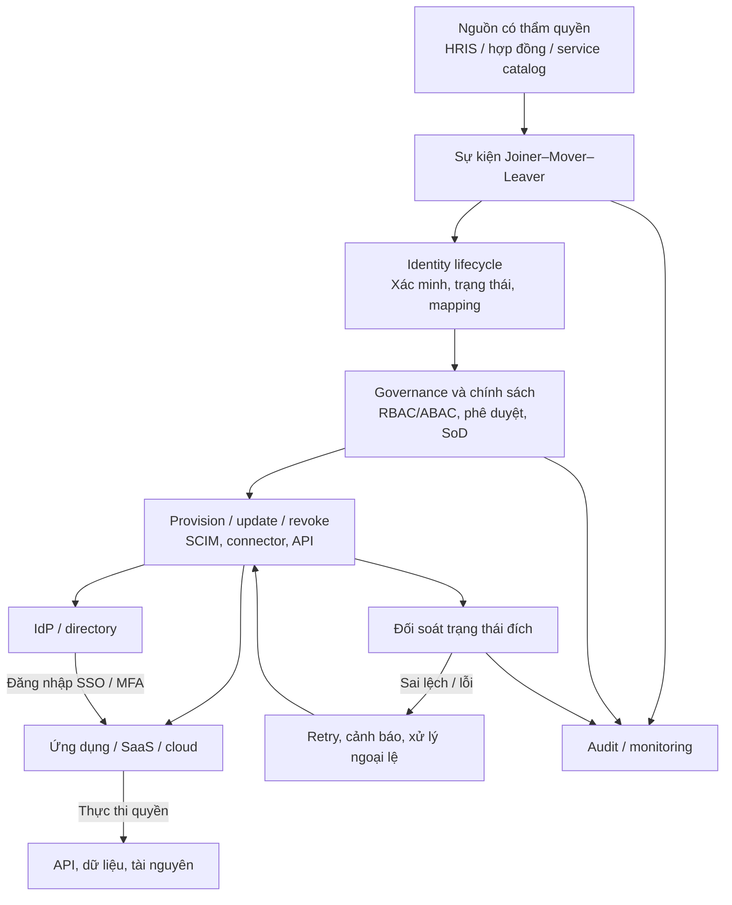

# Bài toán IAM giải quyết

## 1. Tình huống xuất phát: Một tổ chức có nhiều danh tính, tài khoản và quyền

Hãy xét một doanh nghiệp có nhân viên chính thức, thực tập sinh, nhà thầu, đối tác và nhiều dịch vụ tự động. Tổ chức sử dụng hệ thống nhân sự, email, công cụ quản lý công việc, kho mã nguồn, CRM, dữ liệu tài chính và hạ tầng đám mây. Một người có thể có tài khoản ở nhiều ứng dụng; một ứng dụng có thể sở hữu nhiều tài khoản dịch vụ, khóa API và quyền truy cập riêng.

Trong một tuần, doanh nghiệp gặp những việc sau:

1. **Nhân viên mới** đã bắt đầu làm việc nhưng chưa có tài khoản ở ứng dụng cần dùng. Bộ phận IT cấp thủ công từng quyền; mất thời gian và dễ sai.
2. **Nhân viên chuyển nhóm** được cấp quyền của nhóm mới nhưng vẫn giữ quyền chỉnh sửa dữ liệu nhóm cũ. Qua nhiều lần thay đổi, quyền truy cập tích lũy ngoài nhu cầu.
3. **Nhà thầu hết hợp đồng** bị khóa ở hệ thống đăng nhập tập trung nhưng vẫn còn một tài khoản ứng dụng cục bộ và token đã phát hành.
4. **Dịch vụ đã ngừng hoạt động** vẫn có khóa API và quyền truy cập dữ liệu. Không rõ ai đang chịu trách nhiệm thu hồi khóa.
5. **Người kiểm toán** yêu cầu giải thích một quyền quản trị: ai yêu cầu, ai phê duyệt, quyền có hiệu lực khi nào, đã dùng để làm gì và đã thu hồi chưa. Doanh nghiệp chỉ có lịch sử trao đổi rời rạc qua email.

Đây là các **bài toán Identity and Access Management (IAM)**: quản lý danh tính và quyền truy cập nhất quán qua con người, hệ thống, thời điểm và sự kiện thay đổi.

Trong module **`SECURITY_IDENTITY_ACCESS_MANAGEMENT_IDENTITY_LIFECYCLE`**, trọng tâm là **quản lý vòng đời danh tính** (identity lifecycle): xác minh danh tính, tạo tài khoản, cấp quyền, điều chỉnh khi thay đổi vai trò, rà soát và thu hồi khi quyền không còn hợp lệ. Mô hình **Joiner–Mover–Leaver (JML)** giúp tổ chức kiểm soát quá trình đó; IdP, SSO, SCIM, RBAC/ABAC, quản lý tài khoản dịch vụ và kiểm toán hỗ trợ thực thi.

**Mục tiêu cốt lõi:** đúng danh tính, đúng quyền, đúng tài nguyên, đúng thời điểm, có căn cứ phê duyệt và có bằng chứng thực thi.

## 2. Bản đồ các bài toán IAM

IAM không chỉ giải quyết việc “đăng nhập được hay không”. Các bài toán chính có thể phân thành nhiều lớp:

| Bài toán | Câu hỏi cần trả lời | Rủi ro nếu bỏ qua | Năng lực IAM liên quan |
| --- | --- | --- | --- |
| **Danh tính có đáng tin?** | Người hoặc workload này thực sự là ai, dựa trên nguồn nào? | Giả mạo danh tính, tài khoản trùng, danh tính vô chủ | Identity proofing, nguồn danh tính có thẩm quyền, định danh ổn định |
| **Truy cập có an toàn?** | Chủ thể chứng minh danh tính thế nào? | Chiếm đoạt tài khoản, chia sẻ mật khẩu, khó thu hồi phiên | IdP, MFA, SSO, quản lý phiên và credential |
| **Quyền có phù hợp?** | Ai được làm gì, trên tài nguyên nào, theo điều kiện nào? | Lộ dữ liệu, sửa/xóa trái phép, đặc quyền quá rộng | RBAC, ABAC, least privilege, SoD |
| **Tài khoản có được cấp đúng lúc?** | Người mới đã có đúng tài khoản/quyền để làm việc chưa? | Chậm onboarding, cấp thủ công sai, cấp quyền quá sớm | Joiner, provisioning, workflow phê duyệt |
| **Thay đổi vai trò có xóa quyền cũ?** | Quyền nào phải giữ, cấp thêm hoặc thu hồi? | Tích lũy quyền qua nhiều vị trí | Mover, tính tập quyền mục tiêu, access review |
| **Rời tổ chức đã hết truy cập chưa?** | Mọi tài khoản, phiên, token liên quan đã được xử lý chưa? | Tài khoản mồ côi, quyền truy cập tồn dư | Leaver, deprovisioning, revocation, reconciliation |
| **Danh tính máy có được quản lý?** | Ai sở hữu service account, khóa API, workload? | Credential lâu dài, tài khoản vô chủ, khó truy vết | Workload identity, secret lifecycle, ownership |
| **Có chứng minh được quyết định?** | Ai cấp quyền, vì sao, kết quả ở hệ thống đích thế nào? | Khó điều tra sự cố, không xác nhận được tuân thủ | IGA, audit log, kiểm soát thay đổi, giám sát |

Các bài toán này liên quan nhau. Ví dụ, **xác thực mạnh** không ngăn được người dùng đã đăng nhập hợp lệ nhưng **có quá nhiều quyền**; ngược lại, phân quyền đúng trên giấy vẫn thất bại nếu ứng dụng đích chưa thực thi lệnh thu hồi.

## 3. Bài toán 1: Làm sao biết danh tính nào là hợp lệ?

### Vấn đề

Nếu ứng dụng nào cũng cho phép tự tạo tài khoản và quản trị viên tự nhập dữ liệu, doanh nghiệp có thể không biết hai tài khoản có thuộc cùng một người hay không. Tên và email không đủ làm định danh bất biến: nhân viên có thể đổi tên, đổi email, đổi phòng ban, hoặc email cũ có thể được cấp lại.

Với nhà thầu, một tài khoản có thể tiếp tục hoạt động sau khi hợp đồng hết hạn nếu không có ai phát sự kiện kết thúc. Với workload, việc tạo service account bằng thao tác thủ công có thể khiến tổ chức không biết ứng dụng nào đang sở hữu nó.

### IAM xử lý thế nào?

- **Xác định nguồn có thẩm quyền (authoritative source):** HRIS cho nhân viên; hệ thống hợp đồng/người bảo trợ cho nhà thầu; service catalog hoặc hệ thống triển khai cho workload.
- **Identity proofing/verification:** kiểm tra bằng chứng và quy trình phê duyệt cần thiết trước khi tin danh tính. Mức kiểm tra phụ thuộc loại đối tượng và rủi ro, không mặc định giống nhau cho nhân viên, khách hàng và máy.
- **ID ổn định:** duy trì định danh nội bộ không thay đổi theo email; ánh xạ định danh đó với các tài khoản ở IdP và từng ứng dụng.
- **Thuộc tính và trạng thái có nguồn gốc:** bộ phận, loại hợp đồng, người quản lý, ngày hiệu lực, chủ sở hữu workload; định nghĩa hệ thống nào được phép thay đổi từng thuộc tính.
- **Kiểm soát trùng và tái tuyển dụng:** xác minh một bản ghi mới có phải danh tính cũ hay không trước khi liên kết; không tự mở lại toàn bộ quyền trong lần làm việc trước.

### Cách kiểm chứng

Chọn một tài khoản bất kỳ trong CRM và lần theo được **định danh nội bộ**, nguồn có thẩm quyền, người/bộ phận chịu trách nhiệm và trạng thái hiện tại. Nếu tài khoản không ánh xạ được đến một danh tính hợp lệ hoặc workload có chủ sở hữu, đó là dấu hiệu cần điều tra.

> **Nguyên tắc:** một danh tính hợp lệ có thể liên kết nhiều tài khoản, nhưng mỗi tài khoản truy cập cần có chủ thể hoặc chủ sở hữu được xác định rõ.

## 4. Bài toán 2: Người mới cần quyền nhanh, nhưng không được cấp thừa

### Vấn đề

Onboarding thủ công thường tạo hai loại lỗi đối nghịch:

- **Thiếu quyền:** nhân viên đã vào làm nhưng chưa đọc được tài liệu hoặc sử dụng công cụ, làm chậm công việc.
- **Thừa quyền:** để xử lý nhanh, nhân viên mới được thêm vào nhóm quá rộng như “toàn bộ hệ thống” hoặc được cấp quyền quản trị mặc định.

Tốc độ cấp quyền và tính bảo mật cần được giải quyết cùng nhau, dựa trên nhiệm vụ công việc.

### IAM xử lý thế nào?

Quy trình **Joiner** kết nối sự kiện hợp lệ từ HRIS với chính sách quyền và hệ thống ứng dụng:

1. **Xác minh** mã định danh, loại nhân sự, bộ phận, ngày bắt đầu và người quản lý.
2. **Tạo danh tính** và tài khoản trong directory/IdP; tránh bản ghi trùng.
3. **Tính quyền nền (birthright access)** phù hợp với vai trò, chẳng hạn email và công cụ nội bộ cơ bản.
4. **Yêu cầu phê duyệt** với quyền vượt vai trò hoặc quyền nhạy cảm như duyệt thanh toán và triển khai production.
5. **Provision** tài khoản/nhóm qua SCIM, connector hoặc API quản trị của ứng dụng.
6. **Kích hoạt** theo thời điểm có hiệu lực; bảo vệ quá trình thiết lập xác thực và MFA.
7. **Đọc lại trạng thái đích** để biết quyền đã được cấp thực sự, đồng thời ghi nhận lỗi cần xử lý.

Ví dụ, kỹ sư mới có thể được cấp quyền đọc repository của đội, nhưng quyền sửa cấu hình production cần phê duyệt riêng và có thời hạn.

### Cách kiểm chứng

Một ca Joiner thành công có thể chứng minh được cả **tính sẵn sàng** (quyền cần thiết hoạt động đúng ngày bắt đầu) lẫn **tính hợp lệ** (không có quyền ngoài chính sách, có phê duyệt đối với quyền đặc biệt).

## 5. Bài toán 3: Một người chuyển vai trò nhưng quyền cũ vẫn tồn tại

### Vấn đề

Một nhân viên chuyển từ Hỗ trợ khách hàng sang Tài chính. Hệ thống cấp quyền xem báo cáo thanh toán, song không thu hồi quyền cập nhật thông tin khách hàng. Vài lần chuyển vai trò như vậy tạo ra hiện tượng **privilege accumulation**: tập quyền hiện tại lớn hơn nhu cầu thực tế.

Đây là vấn đề **Mover** điển hình. Nó có thể xuất hiện ngay cả khi người dùng vẫn sử dụng cùng một tài khoản IdP và luôn đăng nhập đúng quy trình.

### IAM xử lý thế nào?

IAM quản lý **tập quyền mục tiêu** theo trạng thái và nhiệm vụ mới, rồi so sánh với tập quyền thực tế.

```text
Quyền đang có:
  {crm.customer.read, crm.customer.update, wiki.read}

Quyền mục tiêu sau khi chuyển nhóm:
  {finance.report.read, wiki.read}

Cần thu hồi:
  {crm.customer.read, crm.customer.update}

Cần cấp mới:
  {finance.report.read}

Quyền giữ lại:
  {wiki.read}
```

Đây là ví dụ tính chênh lệch quyền, chưa thay thế các kiểm tra chính sách khác. Quyền dự án, ngoại lệ có phê duyệt, quyền quản trị và giới hạn theo dữ liệu có thể cần quyết định riêng.

Một workflow Mover đáng tin cậy phải:

- Nhận **sự kiện thay đổi và thời điểm có hiệu lực** từ nguồn phù hợp.
- Tính quyền mới theo **RBAC** (vai trò) và **ABAC** (thuộc tính, tài nguyên, ngữ cảnh) nếu hệ thống hỗ trợ.
- Xác định quyền không còn phù hợp, kể cả các quyền được cấp thủ công hoặc qua nhóm lồng nhau.
- Kiểm tra **separation of duties (SoD)** để tránh tập quyền xung đột, ví dụ vừa tạo vừa tự phê duyệt một giao dịch.
- Thu hồi quyền cũ, cấp quyền mới, xác nhận hệ thống đích và lưu bằng chứng.
- Nếu cần bàn giao, đặt **ngày hết hạn và người chịu trách nhiệm** cho quyền cũ được giữ tạm.

### Cách kiểm chứng

Sau ngày chuyển nhóm, so sánh **quyền đang tồn tại trong từng ứng dụng** với tập quyền được phép; không chỉ kiểm tra người đó đã thuộc nhóm mới. Các quyền cũ còn lại phải có căn cứ, thời hạn và người phê duyệt.

## 6. Bài toán 4: Nghỉ việc rồi nhưng vẫn còn đường truy cập

### Vấn đề

Một nhà thầu hết hợp đồng. Bộ phận IT vô hiệu hóa tài khoản IdP; tuy nhiên:

- ứng dụng SaaS vẫn có tài khoản cục bộ độc lập;
- phiên đăng nhập trước đó chưa hết hạn;
- personal access token hoặc API key vẫn hợp lệ;
- tài khoản VPN, khóa SSH hoặc quyền quản trị cloud chưa được rà soát;
- dữ liệu hoặc automation do người đó sở hữu chưa được bàn giao.

Đây là **residual access**: đường truy cập vẫn tồn tại sau thời điểm không còn căn cứ truy cập.

### IAM xử lý thế nào?

Quy trình **Leaver** cần xác định từng lớp bị ảnh hưởng:

| Lớp truy cập | Hành động mong đợi | Cách xác nhận |
| --- | --- | --- |
| IdP/directory | Chặn xác thực mới, vô hiệu hóa danh tính khi đến thời điểm kết thúc | Đọc trạng thái IdP và kết quả chính sách đăng nhập |
| Tài khoản ứng dụng | Vô hiệu hóa tài khoản cục bộ, thu hồi nhóm/quyền qua SCIM/API/connector | Kiểm tra trạng thái thực tế ở từng ứng dụng |
| Phiên, refresh token | Thu hồi phiên/refresh token trong phạm vi nền tảng hỗ trợ | Kiểm tra khả năng sử dụng lại phiên theo chính sách |
| Access token độc lập | Áp dụng cơ chế thu hồi/kiểm tra trạng thái; giới hạn vòng đời token | Xác định thời hạn token và cơ chế chặn còn hiệu lực |
| SSH key, API key, PAT, secret | Thu hồi hoặc luân chuyển credential có liên quan | Đối soát danh sách credential hợp lệ |
| Quyền đặc quyền và ngoại lệ | Thu hồi JIT, quyền quản trị, VPN và các nhóm nhạy cảm | Kiểm tra tập quyền ở hệ thống đích |
| Quyền sở hữu tài nguyên | Bàn giao repository, workflow, bot, pipeline và service account | Có chủ sở hữu thay thế hợp lệ |

**Đặc biệt:** khóa tài khoản IdP **không bảo đảm** mọi access token đã phát hành bị hủy tức thời. Tùy kiến trúc, token tự chứa có thể được ứng dụng chấp nhận tới khi hết hạn nếu không có bước kiểm tra hoặc cơ chế thu hồi phù hợp.

### Cách kiểm chứng

Không đánh dấu offboarding hoàn tất chỉ vì một lệnh deprovision đã được gửi. Phải biết **hệ thống đích nào đã chặn truy cập**, **khi nào**, **bước nào lỗi**, **ai xử lý ngoại lệ** và **đường truy cập nào còn hiệu lực**.

Việc **vô hiệu hóa truy cập** cũng khác với **xóa dữ liệu**. Tổ chức có thể giữ hồ sơ, tài liệu và log theo chính sách lưu trữ trong khi đã chặn truy cập của người rời tổ chức.

## 7. Bài toán 5: Mỗi ứng dụng là một “ốc đảo” tài khoản

### Vấn đề

Nếu doanh nghiệp có nhiều ứng dụng, mỗi ứng dụng yêu cầu tự tạo, sửa, khóa tài khoản và quản lý nhóm riêng, thông tin rất dễ lệch nhau. Một tài khoản tại IdP có thể đã đổi bộ phận, trong khi CRM vẫn lưu vai trò cũ. Một ứng dụng có SSO nhưng việc tạo hoặc vô hiệu hóa tài khoản vẫn làm thủ công.

### IAM dùng công nghệ nào để giải quyết?

| Thành phần | Giải quyết phần việc nào? | Không nên nhầm với |
| --- | --- | --- |
| **IdP (Identity Provider)** | Xác thực danh tính, quản lý chính sách đăng nhập, phát hành assertion/token phù hợp | Hệ thống duy nhất bảo đảm mọi quyền tại ứng dụng đã thay đổi |
| **SSO qua SAML hoặc OIDC** | Cho phép người dùng đăng nhập các ứng dụng liên kết qua IdP | Tạo/xóa tài khoản ở mọi ứng dụng |
| **MFA** | Tăng mức bảo đảm xác thực, giảm rủi ro chiếm đoạt tài khoản | Quyết định chủ thể có được đọc dữ liệu cụ thể không |
| **SCIM 2.0 / connector / API** | Provision, cập nhật thuộc tính/nhóm, vô hiệu hóa tài khoản ở hệ thống đích | Giao thức đăng nhập hoặc sự bảo đảm phiên cũ đã bị hủy |
| **RBAC và ABAC** | Ra quyết định quyền theo vai trò, thuộc tính, tài nguyên và bối cảnh | Cơ chế tự động tạo tài khoản |
| **IGA/PAM** | Quản trị phê duyệt, rà soát, chứng nhận và truy cập đặc quyền | Thay thế kiểm tra quyền ở API ứng dụng |

**Ví dụ:** Nhân viên có thể đăng nhập CRM bằng **SSO**, tài khoản CRM được tạo trước bằng **SCIM**, và quyền xem khách hàng được ứng dụng thực thi bằng **RBAC/ABAC**. Ba cơ chế phải phối hợp nhưng không thay thế nhau.

### Kiểm soát sai lệch dữ liệu

IAM cần quy trình **reconciliation**: đối chiếu trạng thái kỳ vọng từ nguồn danh tính và chính sách với trạng thái thực tế trong ứng dụng.

- **Provisioning drift:** nhóm hoặc quyền đã bị chỉnh thủ công ở ứng dụng.
- **Orphan account:** tài khoản không còn liên kết với danh tính/chủ sở hữu hợp lệ.
- **Partial failure:** một hệ thống cập nhật thành công nhưng hệ thống khác thất bại.
- **Delayed update:** yêu cầu đã gửi nhưng ứng dụng chưa áp dụng.
- **Unsupported capability:** ứng dụng không có SCIM hoặc không hỗ trợ thu hồi phiên như mong muốn.

Trong các trường hợp này, cần theo dõi lỗi, có retry và phương án xử lý thủ công có bằng chứng khi công cụ không hỗ trợ tự động hóa.

## 8. Bài toán 6: Có danh tính đúng nhưng không biết nên được làm gì

### Vấn đề

**Authentication (AuthN)** trả lời “chủ thể đã chứng minh danh tính chưa?”. **Authorization (AuthZ)** trả lời “chủ thể này có được thực hiện hành động này, trên tài nguyên này, tại thời điểm này không?”.

Một nhân viên đăng nhập thành công không mặc nhiên được xem toàn bộ hồ sơ khách hàng. Một ứng dụng được cấp token gọi API không mặc nhiên được ghi mọi bảng dữ liệu.

### Phân quyền theo vai trò: RBAC

**Role-Based Access Control (RBAC)** gom quyền vào các vai trò có ý nghĩa nghiệp vụ.

| Vai trò ví dụ | Quyền cần thiết | Giới hạn |
| --- | --- | --- |
| `SupportAgent` | Đọc/cập nhật ticket được phân công | Không duyệt thanh toán |
| `FinanceViewer` | Đọc báo cáo tài chính được phép | Không tự thay dữ liệu kế toán |
| `DeployOperator` | Triển khai trong môi trường được giao | Không mặc định có quyền quản trị toàn bộ cloud |

RBAC hữu ích khi các nhóm công việc có trách nhiệm rõ ràng. Nếu tạo một vai trò cho mọi biến thể dự án, khu vực và trạng thái, hệ thống có thể bị **role explosion**, khó quản trị.

### Phân quyền theo thuộc tính: ABAC

**Attribute-Based Access Control (ABAC)** đánh giá thuộc tính của chủ thể, tài nguyên, hành động và bối cảnh.

Quy tắc dưới đây là **giả mã minh họa**, không phải cú pháp của một sản phẩm:

```text
ALLOW invoice.read WHEN
    subject.employmentStatus == "active"
    AND subject.department == "Finance"
    AND subject.region == resource.region
    AND resource.classification != "restricted"
    AND session.mfaSatisfied == true
OTHERWISE DENY
```

ABAC phù hợp khi cần điều kiện động, chẳng hạn chỉ đọc hóa đơn của khu vực được giao và khi phiên đáp ứng xác thực tăng cường. Thuộc tính không được cập nhật kịp có thể khiến chính sách cho phép hoặc từ chối sai.

### Nguyên tắc áp dụng

- **Least privilege:** chỉ cấp và duy trì quyền cần cho công việc.
- **Deny by default:** thiếu căn cứ cho phép thì từ chối.
- **Separation of duties:** hạn chế tập quyền xung đột.
- **Time-bound/JIT access:** quyền nhạy cảm có thể được cấp khi cần và tự hết hạn.
- **Enforcement tại ứng dụng/API:** mọi thao tác nhạy cảm cần được kiểm tra quyền thực tế; việc ứng dụng đã có SSO không thay cho kiểm tra này.

## 9. Bài toán 7: Tài khoản dịch vụ và credential không có vòng đời

### Vấn đề

Một pipeline CI/CD sử dụng API key không có hạn dùng. Nhân viên từng tạo key đã chuyển đội; pipeline sau đó ngừng hoạt động nhưng key vẫn có quyền truy cập object storage.

Đây không phải lỗi của vòng đời nhân sự đơn thuần. **Danh tính không phải con người (non-human identity)**, gồm service account, workload, bot và ứng dụng gọi API, cũng cần được quản lý.

### IAM xử lý thế nào?

1. **Đăng ký chủ sở hữu:** mỗi workload có tên định danh, mục đích, ứng dụng/đội chịu trách nhiệm và tài nguyên cần sử dụng.
2. **Cấp quyền theo workload:** tách quyền theo dịch vụ và môi trường; tránh dùng tài khoản chung có quyền toàn hệ thống.
3. **Quản lý credential:** ưu tiên workload identity/federation hoặc credential ngắn hạn khi được hỗ trợ; quản lý secret, luân chuyển và thu hồi khóa dài hạn.
4. **Theo dõi thay đổi:** khi ứng dụng đổi phạm vi hoặc chuyển chủ sở hữu, rà soát quyền và credential.
5. **Decommission:** khi workload dừng, thu hồi role, trust relationship, token/key và tài khoản tương ứng.
6. **Kiểm toán hoạt động:** xác định workload nào gọi tài nguyên nào; hạn chế chia sẻ cùng credential giữa nhiều ứng dụng.

Quy trình này tương ứng ba giai đoạn JML:

| Workload lifecycle | Tình huống | Hành động |
| --- | --- | --- |
| **Joiner** | Dịch vụ mới được triển khai | Tạo danh tính, xác định owner, cấp quyền tối thiểu |
| **Mover** | Dịch vụ được mở rộng hoặc đổi đội vận hành | Tính lại quyền, cập nhật owner, rà soát khóa |
| **Leaver** | Dịch vụ ngừng hoạt động | Thu hồi quyền và credential, xác nhận không còn workload dùng |

Khi một nhân viên nghỉ việc, không mặc nhiên xóa mọi tài khoản dịch vụ họ từng quản lý. Cần **chuyển chủ sở hữu hợp lệ** cho dịch vụ vẫn hoạt động và **thu hồi credential liên quan đến con người đó**.

## 10. Bài toán 8: Không truy vết được “vì sao người này có quyền”

### Vấn đề

Một tài khoản có quyền xuất dữ liệu nhạy cảm. Khi có sự cố, tổ chức phải biết quyền được cấp dựa trên quyết định nào, khi nào có hiệu lực và ai đã thực hiện thay đổi. Nếu bằng chứng nằm rải rác trong ticket, email và log ứng dụng, việc điều tra hoặc rà soát dễ chậm và thiếu sót.

### IAM xử lý thế nào?

**Identity Governance and Administration (IGA)** bổ sung quy trình quản trị quyền:

- **Access request:** người dùng đề nghị quyền, khai rõ mục đích, phạm vi, thời hạn.
- **Approval:** chủ tài nguyên hoặc người quản lý đủ thẩm quyền phê duyệt.
- **Policy/SoD checks:** xác định quyền có vi phạm nguyên tắc phân tách nhiệm vụ hay không.
- **Provisioning evidence:** ghi nhận kết quả thực thi tại hệ thống đích, không chỉ kết quả phê duyệt.
- **Access review/recertification:** định kỳ xem quyền còn cần thiết không; việc từ chối hoặc hết hạn phải dẫn tới thu hồi.
- **Audit trail:** liên kết sự kiện nghiệp vụ, danh tính, thay đổi quyền, người tác động, kết quả và thời điểm.

Một bản ghi audit minh họa:

```json
{
  "eventId": "iam-event-5821",
  "correlationId": "jml-request-724",
  "eventType": "entitlement.revoked",
  "subjectId": "person-1042",
  "targetSystem": "crm",
  "entitlement": "customer.export",
  "reason": "department-change",
  "actor": "iam-automation",
  "policyVersion": "v3",
  "result": "success",
  "enforcedAt": "2026-11-23T07:10:15Z"
}
```

Đây là schema ví dụ. Bản ghi cần có nguồn tin cậy, quyền truy cập log được kiểm soát và thời hạn lưu phù hợp. **Không ghi mật khẩu, token truy cập hoặc secret ở dạng rõ**.

### Cách kiểm chứng

Một kiểm toán viên có thể chọn một quyền bất kỳ, truy ngược tới **căn cứ cấp quyền**, người/phân hệ phê duyệt, các lần thay đổi trong JML và **bằng chứng trạng thái cuối cùng** ở ứng dụng.

## 11. Cách các bài toán liên kết trong một luồng JML

Giải quyết từng phần riêng lẻ là chưa đủ. IAM cần nối nguồn danh tính, quyết định quyền, hệ thống đích và giám sát.



Luồng có hai trạng thái cần phân biệt:

- **Desired state:** tài khoản và quyền mà danh tính **nên có** theo nguồn sự thật, chính sách, phê duyệt và thời điểm hiệu lực.
- **Actual state:** tài khoản và quyền **đang tồn tại thật** trong từng ứng dụng, bao gồm credential và phiên còn hoạt động khi đánh giá rủi ro truy cập.

**Độ lệch giữa desired state và actual state** cho biết kết quả IAM đã đạt hay chưa. Nếu sự kiện Leaver đã vào IAM nhưng tài khoản SaaS vẫn hoạt động, trạng thái mong muốn đã đúng nhưng mục tiêu bảo mật chưa đạt.

## 12. Minh họa một vòng đời và các lỗi IAM phải xử lý

Xét người dùng **Hà**, bắt đầu với vai trò chuyên viên hỗ trợ, chuyển sang vận hành rồi nghỉ việc.

| Thời điểm | Sự kiện nghiệp vụ | Quyền mục tiêu | Rủi ro nếu IAM thiếu kiểm soát |
| --- | --- | --- | --- |
| Ngày bắt đầu | HRIS xác nhận Hà gia nhập | Email, công cụ nội bộ, quyền ticket theo nhóm hỗ trợ | Tài khoản chậm; cấp quyền quản trị để “làm cho nhanh” |
| Chuyển nhóm | Hà sang vận hành | Thu hồi quyền sửa ticket; cấp quyền xem log được phê duyệt | Giữ quyền sửa dữ liệu hỗ trợ và tích lũy đặc quyền |
| Dự án khẩn cấp | Hà cần đọc log production một giờ | Quyền JIT có phạm vi và hết hạn | Quyền production tiếp tục tồn tại sau dự án |
| Nghỉ việc | HRIS phát sự kiện Leaver | Chặn IdP, deprovision ứng dụng, thu hồi credential liên quan | Tài khoản cục bộ/phiên/token còn giá trị |
| Sau nghỉ việc | Đối soát định kỳ | Không còn quyền truy cập; hồ sơ lưu trữ theo chính sách | Tài khoản mồ côi không bị phát hiện |

### Tình huống lỗi từng phần

Giả sử vào ngày nghỉ việc, IdP khóa Hà thành công nhưng connector CRM trả lỗi. Một hệ thống IAM có thể hiện thực hóa các bước sau:

1. Ghi nhận sự kiện Leaver và thời điểm hiệu lực từ nguồn hợp lệ.
2. **Ưu tiên chặn truy cập có rủi ro cao** theo chính sách, không chờ tất cả tác vụ bàn giao xong.
3. Phát tác vụ cho từng hệ thống đích và ghi trạng thái riêng.
4. Với CRM bị lỗi, đánh dấu **đang chờ xử lý**, retry có kiểm soát và gửi cảnh báo tới người phụ trách.
5. Khi CRM hoạt động trở lại, đọc trạng thái tài khoản/quyền để xác nhận đã vô hiệu hóa.
6. Đối soát lại toàn bộ tài khoản liên quan, kiểm tra quyền đặc quyền và credential, lưu bằng chứng hoàn tất.

**Không có bảo đảm giao dịch nguyên tử** giữa hàng chục dịch vụ độc lập. Vì vậy, IAM cần chấp nhận khả năng cập nhật từng phần, phát hiện sai lệch và có cơ chế khắc phục.

### Một ví dụ ngắn về logic xử lý

Đoạn sau là **giả mã**, minh họa cách chuyển sự kiện vòng đời thành trạng thái quyền mục tiêu:

```text
processLifecycleEvent(event):
    assert trustedSource(event)
    identity = resolveByStableId(event.subjectId)
    assert event.version is newer than identity.appliedVersion

    desired = evaluatePolicy(
        lifecycleStatus = event.status,
        effectiveAttributes = event.attributes,
        validApprovals = currentApprovals,
        serviceOwnership = identity.ownership
    )

    actual = readAccountsAndEntitlements(identity)
    changes = diff(actual, desired)

    for change in orderByRisk(changes):
        result = applyIdempotently(change)
        audit(event, change, result)
        if result.failed:
            queueRetryAndEscalation(change)

    reconcile(identity, desired)
```

Khi triển khai thực tế, cần bảo vệ việc kiểm tra phiên bản khỏi cập nhật đồng thời, xử lý event đến sai thứ tự, sự kiện trùng và thao tác lặp. Một tác vụ **idempotent** không tạo tài khoản/quyền trùng khi nhận cùng yêu cầu nhiều lần.

## 13. Bài toán không chỉ là “phòng ngừa” mà còn là “phát hiện và khắc phục”

Không hệ thống IAM nào bảo đảm mọi ứng dụng đồng bộ tức thời trong mọi tình huống. Kiểm soát hiệu quả thường kết hợp ba lớp:

| Lớp | Mục tiêu | Ví dụ |
| --- | --- | --- |
| **Preventive – phòng ngừa** | Ngăn cấp sai quyền hoặc truy cập trái phép từ đầu | MFA, RBAC/ABAC, least privilege, phê duyệt đặc quyền, SoD |
| **Detective – phát hiện** | Nhận biết tài khoản/quyền sai lệch và hành vi đáng ngờ | Access review, reconciliation, cảnh báo admin grant, phát hiện orphan account |
| **Corrective – khắc phục** | Đưa trạng thái thực tế trở về chính sách | Revoke, deprovision, khóa tài khoản, rotate secret, xử lý lỗi và xác nhận lại |

Ví dụ, chính sách role có thể ngăn cấp quyền quản trị không hợp lệ. Tuy nhiên, nếu quyền đã bị chỉnh thủ công trong ứng dụng, cơ chế **reconciliation** sẽ phát hiện và **corrective action** sẽ thu hồi hoặc chuyển cho người phụ trách xử lý.

Điều này cũng giải thích vì sao **IAM có quy trình, chủ sở hữu và kiểm toán** chứ không phải chỉ một phần mềm đăng nhập.

## 14. Đo IAM có giải quyết được vấn đề hay chưa

Các chỉ số nên phản ánh **trạng thái cuối cùng tại hệ thống đích**, không chỉ số ticket đã đóng.

| Chỉ số | Điều chỉ số trả lời | Cần chú ý |
| --- | --- | --- |
| **Joiner readiness** | Người mới đã có đủ quyền nền đúng thời điểm chưa? | Đo cả mức độ sẵn sàng lẫn quyền vượt nhu cầu |
| **Provisioning success rate** | Bao nhiêu thay đổi được hệ thống đích xác nhận thành công? | Phân biệt gửi yêu cầu với đã thực thi |
| **Mover residual access** | Bao nhiêu quyền cũ còn sau thay đổi vai trò? | Tách ngoại lệ đã phê duyệt và quyền chưa hợp lệ |
| **Leaver deprovisioning latency** | Mất bao lâu từ sự kiện có hiệu lực đến lúc chặn quyền ở từng hệ thống? | Theo dõi hệ thống có rủi ro cao và sự cố đồng bộ |
| **Orphan account count** | Có bao nhiêu tài khoản không gắn được chủ thể/owner hợp lệ? | Bao gồm tài khoản dịch vụ và tài khoản cục bộ |
| **Privileged access exception age** | Quyền đặc quyền ngoại lệ tồn tại bao lâu? | Cần thời hạn và người chịu trách nhiệm |
| **Access review remediation completion** | Bao nhiêu yêu cầu thu hồi từ rà soát đã được thực thi? | Không tính riêng số người đã bấm “review” |
| **Credential hygiene** | Credential dài hạn/quá hạn/vô chủ còn bao nhiêu? | Đo theo nhóm workload và mức độ nhạy cảm |

Mốc mục tiêu/SLA phải do tổ chức lựa chọn theo rủi ro và yêu cầu nghiệp vụ. Không có một con số chung phù hợp mọi ứng dụng. Một hệ thống lưu dữ liệu nhạy cảm có thể cần ưu tiên thu hồi nhanh hơn công cụ nội bộ ít rủi ro.

### Các câu hỏi kiểm tra hiệu quả

- Có thể lấy danh sách **tất cả tài khoản và quyền** liên kết với một danh tính đã nghỉ việc không?
- Có biết ai chịu trách nhiệm khi connector thất bại và đã quá hạn không?
- Có phân biệt được **quyền được phê duyệt** với **quyền thực sự tồn tại** không?
- Quyền cấp ngoài vai trò có người bảo trợ và ngày hết hạn không?
- Một service account còn hoạt động có mục đích và chủ sở hữu xác định không?
- Có bằng chứng quyền cũ đã bị thu hồi sau sự kiện Mover không?

Nếu câu trả lời thường là “không rõ”, IAM chưa kiểm soát đầy đủ vòng đời.

## 15. Các ngộ nhận phổ biến về bài toán IAM

| Ngộ nhận | Vì sao chưa đủ | Cách hiểu đúng |
| --- | --- | --- |
| “Dùng SSO là đã giải quyết IAM” | SSO chủ yếu giải quyết trải nghiệm xác thực liên kết; tài khoản cục bộ và quyền vẫn có thể tồn tại | Kết hợp SSO với provisioning, phân quyền, governance và deprovisioning |
| “Đăng nhập được thì có quyền” | AuthN khác AuthZ; tài khoản hợp lệ vẫn có thể truy cập sai phạm vi | Kiểm tra hành động và tài nguyên theo chính sách tại ứng dụng/API |
| “Khóa IdP là không còn truy cập nào” | Phiên, token, key và tài khoản đích có thể độc lập | Thu hồi theo từng đường truy cập và xác minh kết quả |
| “Chuyển phòng ban chỉ cần thêm nhóm mới” | Không thu hồi nhóm cũ tạo quyền tích lũy | Tính lại quyền mục tiêu, thu hồi quyền cũ và đối soát |
| “SCIM phản hồi thành công nghĩa là hoàn tất” | Phản hồi API không chứng minh mọi quyền và phiên đã hết hiệu lực | Kiểm tra trạng thái đích, lỗi đồng bộ và ngoại lệ |
| “Tài khoản máy không cần quản trị như nhân viên” | Credential và quyền máy cũng có thể tồn dư nhiều năm | Có owner, least privilege, rotation và decommission |
| “Rà soát quyền là xuất báo cáo” | Quyền bị từ chối vẫn có thể đang hoạt động | Liên kết kết quả review với hành động thu hồi đã xác nhận |
| “Xóa tài khoản là phải xóa luôn dữ liệu” | Dữ liệu và log có thể cần giữ theo chính sách | Tách chấm dứt quyền truy cập khỏi lưu trữ/tiêu hủy dữ liệu |

## 16. Bắt đầu cải thiện IAM từ đâu?

Khi chưa thể tự động hóa toàn bộ, nên ưu tiên các bài toán có **rủi ro và tác động vận hành rõ ràng**:

1. **Lập bản đồ danh tính và hệ thống:** nguồn có thẩm quyền, các ứng dụng quan trọng, tài khoản cục bộ, quyền đặc quyền và service account; xác định chủ sở hữu từng hệ thống.
2. **Chuẩn hóa sự kiện JML:** mọi lần gia nhập, thay đổi, rời đi đều có nguồn, ID ổn định, thời điểm hiệu lực và người chịu trách nhiệm.
3. **Ưu tiên Leaver và quyền nhạy cảm:** chặn truy cập đúng hạn; có phương án xử lý ứng dụng không hỗ trợ tự động hóa; thu hồi phiên/credential khi có thể.
4. **Thiết lập quyền nền và chính sách phê duyệt:** dùng RBAC/ABAC theo nhu cầu thực tế; phân tách nhiệm vụ và thời hạn cho đặc quyền.
5. **Tự động hóa provisioning và deprovisioning:** tận dụng IdP, SSO, SCIM hoặc connector phù hợp; xây retry và đối soát ngay từ đầu.
6. **Bổ sung access review và kiểm toán:** kiểm tra quyền tồn dư, tài khoản mồ côi và ngoại lệ; theo dõi việc thu hồi đến khi có kết quả thực tế.
7. **Quản lý danh tính máy:** gán owner, quyền tối thiểu, vòng đời credential và quy trình ngừng dịch vụ.

Thứ tự triển khai cụ thể phụ thuộc rủi ro. Chẳng hạn, tổ chức đã có SSO nhưng còn nhiều tài khoản ứng dụng vô chủ sẽ hưởng lợi nhiều từ **reconciliation và deprovisioning**. Tổ chức mới xây dựng IAM có thể cần chuẩn hóa ID và nguồn danh tính trước để tránh tự động hóa sai lệch.

## 17. Tự kiểm tra kiến thức qua tình huống

**Tình huống A:** Nhân viên có MFA nhưng vẫn đọc được dữ liệu khách hàng của bộ phận cũ. Đây chủ yếu là bài toán gì?

*Gợi ý:* kiểm tra Mover, chính sách RBAC/ABAC, tập quyền mục tiêu và quyền tồn dư; MFA không thay thế phân quyền.

**Tình huống B:** Ứng dụng dùng SSO, nhân viên nghỉ việc đã bị khóa IdP nhưng CRM vẫn có tài khoản `active`. Cần xử lý gì?

*Gợi ý:* xác định hệ thống đích hỗ trợ SCIM/API nào, vô hiệu hóa tài khoản và phiên/credential phù hợp, rồi đối soát kết quả.

**Tình huống C:** Một API key production tồn tại nhiều năm, không có owner và không rõ workload sử dụng. IAM phải giải quyết ra sao?

*Gợi ý:* truy vết nguồn và hoạt động, xác lập ownership, đánh giá phạm vi, thay thế bằng danh tính workload/credential ngắn hạn nếu khả thi, rotate hoặc revoke theo quy trình an toàn.

**Tình huống D:** Quyền quản trị đã bị từ chối trong kỳ access review nhưng vẫn còn trên cloud. Báo cáo review ghi “completed”. Vấn đề nằm ở đâu?

*Gợi ý:* quá trình quản trị quyền chưa gắn với thực thi và xác minh thu hồi tại hệ thống đích.

### Ghi nhớ

**IAM giải quyết sự không nhất quán giữa danh tính, nhu cầu công việc và quyền truy cập thực tế.** Trong quản lý vòng đời danh tính, tổ chức phải xác minh đúng chủ thể, cấp đủ quyền khi **Joiner**, điều chỉnh và thu hồi quyền cũ khi **Mover**, chặn mọi đường truy cập còn hiệu lực khi **Leaver**, đồng thời quản lý workload và giữ bằng chứng kiểm toán. IdP/SSO, SCIM, RBAC/ABAC, IGA, PAM và reconciliation là những cơ chế phối hợp để **giảm quyền truy cập tồn dư, rút ngắn công việc thủ công và giúp quyết định cấp quyền có thể giải thích, kiểm tra lại**.

