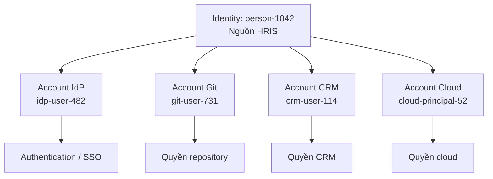
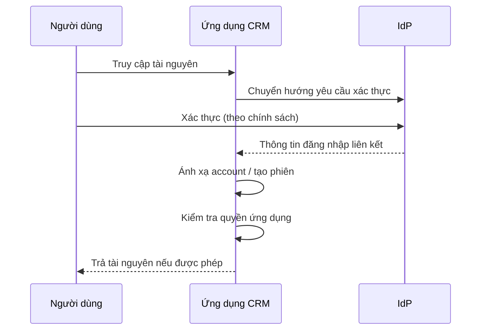
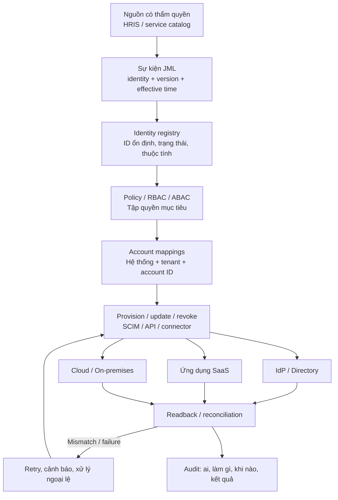

# Identity và account

## 1. Vì sao cần phân biệt identity và account?

Một nhân viên tên **Linh** làm việc trong tổ chức sử dụng hệ thống nhân sự, nền tảng đăng nhập tập trung, email, Git, CRM và hệ thống cloud. Linh là **một con người** có quan hệ làm việc với tổ chức, nhưng có thể có **nhiều tài khoản** ở những ứng dụng khác nhau. Mỗi tài khoản lại có quyền, phiên đăng nhập, thông tin xác thực và trạng thái riêng.

Giả sử Linh chuyển từ nhóm Hỗ trợ sang nhóm Vận hành. Tổ chức không cần tạo ra một con người mới, nhưng phải cập nhật thuộc tính và quyền trên một số tài khoản. Khi Linh nghỉ việc, việc khóa tài khoản đăng nhập tập trung có thể chưa đủ: tài khoản Git cục bộ hoặc token cá nhân có thể vẫn hoạt động.

**Identity (danh tính số)** trả lời: **“Chúng ta đang quản lý ai hoặc thực thể nào?”**

**Account (tài khoản)** trả lời: **“Danh tính đó được biểu diễn và sử dụng như thế nào trong một hệ thống cụ thể?”**

Phân biệt hai khái niệm là điều kiện đầu tiên để xây dựng quản lý vòng đời danh tính (identity lifecycle management) theo **Joiner–Mover–Leaver (JML)**: xác minh nguồn danh tính, tạo tài khoản khi gia nhập, điều chỉnh quyền khi chuyển vai trò và thu hồi các đường truy cập khi rời tổ chức.

Bài này thuộc module `SECURITY_IDENTITY_ACCESS_MANAGEMENT_IDENTITY_LIFECYCLE`, tập trung vào IAM (Identity and Access Management) cho con người và workload, liên hệ **IdP, SSO, SCIM, RBAC/ABAC, tài khoản dịch vụ, kiểm toán** và bài toán giảm **quyền truy cập tồn dư**.

## 2. Định nghĩa identity: Đối tượng được tổ chức nhận biết

Một **identity** là biểu diễn số của **người, tổ chức, ứng dụng hoặc workload** mà hệ thống cần phân biệt, nhận biết thuộc tính và quản lý trong một phạm vi tin cậy.

Identity có thể mang những thông tin như:

| Nhóm thông tin | Ví dụ với nhân viên | Ví dụ với workload |
| --- | --- | --- |
| **Định danh ổn định** | Mã nhân sự nội bộ `person-1042` | Mã dịch vụ `service-billing-01` |
| **Nguồn có thẩm quyền** | HRIS hoặc quy trình nhân sự được phê duyệt | Service catalog hoặc nền tảng triển khai |
| **Trạng thái vòng đời** | Pending, active, suspended, terminated | Planned, deployed, suspended, decommissioned |
| **Thuộc tính nghiệp vụ** | Bộ phận, vai trò công việc, ngày bắt đầu, người quản lý | Đội sở hữu, môi trường, mục đích, ứng dụng liên quan |
| **Mối liên kết** | Các tài khoản SaaS, IdP, hệ thống nội bộ | Service accounts, workload identities, tài khoản cloud |
| **Căn cứ quản trị** | Người phê duyệt, hợp đồng, thời điểm hiệu lực | Owner, tài liệu phê duyệt, ngày hết hạn hoặc lịch rà soát |

**Điểm quan trọng:** identity là **bản ghi quản trị về chủ thể**, không phải một mật khẩu, một địa chỉ email hay một tài khoản ở một ứng dụng.

Ví dụ: nhân viên Linh đổi họ tên hoặc địa chỉ email sau khi thay đổi thông tin nhân sự. Vẫn là một identity nếu các bằng chứng từ nguồn đáng tin và ID ổn định cho thấy đó là cùng một người.

### Identity không đồng nhất với dữ liệu cá nhân

Một identity có thể chứa hoặc tham chiếu dữ liệu cá nhân, nhưng IAM chỉ nên thu thập và đồng bộ **những thuộc tính cần thiết** cho xác minh, cấp quyền và vận hành. Không nên sao chép toàn bộ hồ sơ nhân sự sang mọi ứng dụng chỉ vì ứng dụng có tài khoản liên quan.

### Tính duy nhất luôn có phạm vi

Một mã như `1042` chỉ có thể duy nhất **trong một tổ chức hoặc hệ thống nguồn**. Khi liên kết nhiều tenant, tổ chức hoặc đối tác, cần xác định **namespace/source/tenant** để tránh đụng khóa. Có thể sử dụng định danh nội bộ toàn hệ thống, hoặc khóa tổng hợp gắn với nguồn, tùy kiến trúc.

## 3. Định nghĩa account: Bản ghi sử dụng trong một hệ thống cụ thể

Một **account** là bản ghi tại một hệ thống, ứng dụng, directory hoặc nhà cung cấp danh tính, đại diện cho chủ thể khi hệ thống đó xác thực, phân quyền hoặc quản trị truy cập.

Một account thường chứa:

- **Account ID** do hệ thống đích cấp, chỉ duy nhất trong phạm vi của hệ thống/tenant đó;
- **username/email hiển thị**, có thể thay đổi;
- **trạng thái** như enabled, disabled, locked hoặc deleted;
- **nhóm, vai trò và entitlement** được hệ thống đích áp dụng;
- **cơ chế xác thực hoặc liên kết SSO** và dữ liệu đăng nhập phù hợp;
- **dấu thời gian** tạo, sửa, đăng nhập, vô hiệu hóa nếu hệ thống hỗ trợ;
- **liên kết về identity nguồn** hoặc người/ứng dụng sở hữu.

Ví dụ, Linh có thể sở hữu các account sau:

| Hệ thống | Account ID minh họa | Mục đích |
| --- | --- | --- |
| IdP của tổ chức | `idp-user-482` | Xác thực tập trung, tham gia nhóm tổ chức |
| Email | `mailbox-902` | Nhận/gửi email và tài nguyên cộng tác |
| Git | `git-user-731` | Truy cập repository, pull request |
| CRM | `crm-user-114` | Xem và xử lý phiếu khách hàng |
| Cloud | `cloud-principal-52` | Truy cập tài nguyên cloud theo chính sách |

Cả năm account có thể liên kết với **cùng identity** `person-1042`. Nếu Linh rời tổ chức, IAM phải biết tài khoản nào liên quan để áp dụng chính sách deprovision cho từng hệ thống.

Một account cũng có thể tồn tại trước khi danh tính được kích hoạt chính thức, ví dụ tài khoản “pre-provisioned” để chuẩn bị ngày bắt đầu. Điều đó không có nghĩa quyền truy cập của nó đã được phép sử dụng ngay.

## 4. So sánh identity và account

| Tiêu chí | Identity | Account |
| --- | --- | --- |
| **Đại diện cho** | Người, đối tác hoặc workload được quản trị | Bản ghi của chủ thể trong một hệ thống |
| **Phạm vi** | Nguồn và mô hình danh tính của tổ chức | Ứng dụng, directory, tenant hoặc hệ thống đích |
| **Định danh** | ID chủ thể ổn định, gắn với namespace đáng tin | ID do hệ thống đích cấp, username hoặc thông tin đăng nhập |
| **Thời điểm tạo** | Khi có căn cứ nhận biết chủ thể | Khi hệ thống đích cần tạo/provision account |
| **Số lượng** | Thường một identity quản trị cho mỗi chủ thể trong phạm vi | Một identity có thể liên kết nhiều account |
| **Thuộc tính cốt lõi** | Trạng thái quan hệ, loại chủ thể, owner, bộ phận | Account status, nhóm ứng dụng, vai trò cục bộ |
| **Thay đổi khi chuyển vai trò** | Cập nhật thuộc tính và tập quyền mục tiêu | Cập nhật nhóm/quyền hoặc vô hiệu hóa account không cần thiết |
| **Khi nghỉ việc/ngừng dịch vụ** | Chuyển sang trạng thái chấm dứt theo chính sách | Khóa hoặc thu hồi quyền từng account, xử lý credential/phiên |
| **Kiểm toán** | Ai được đại diện, nguồn nào xác nhận và vì sao còn hợp lệ? | Account nào đã truy cập, được cấp quyền nào, thu hồi lúc nào? |

**Một identity có thể có 0, 1 hoặc nhiều account.** Identity đang ở trạng thái chờ bắt đầu có thể chưa có account nào; nhân viên đang làm việc có thể có nhiều account. Bản ghi identity vẫn có thể được giữ sau khi account bị vô hiệu hóa, tùy chính sách lưu trữ.

**Một account nên ánh xạ tới một chủ thể hoặc mục đích sử dụng có thể truy trách nhiệm.** Tài khoản dùng chung giữa nhiều người làm suy giảm khả năng truy vết; nếu không thể tránh trong trường hợp đặc biệt, cần các kiểm soát bổ sung để ghi nhận người thực hiện và thời hạn sử dụng.

## 5. Những khái niệm gần nhau nhưng không thay thế nhau

Khi thiết kế IAM, nhiều thuật ngữ liên quan thường bị gọi chung là “user account”. Phân biệt rõ giúp tránh triển khai sai.

| Khái niệm | Câu hỏi trả lời | Ví dụ |
| --- | --- | --- |
| **Identity** | Ai hoặc cái gì được quản trị? | Nhân viên Linh, workload `billing-api` |
| **Account** | Bản ghi truy cập ở hệ thống nào? | Tài khoản Git `git-user-731` |
| **Principal** | Hệ thống bảo mật đang xét yêu cầu từ chủ thể nào? | Subject trong phiên OIDC, service principal cloud |
| **Credential** | Chủ thể chứng minh danh tính bằng gì? | Passkey, mật khẩu, chứng chỉ, API key |
| **Authenticator** | Phương tiện/yếu tố dùng để xác thực | Thiết bị FIDO2, ứng dụng xác thực |
| **Session** | Trạng thái đăng nhập đã thiết lập tồn tại bao lâu? | Phiên web tại CRM |
| **Token** | Bằng chứng/ủy quyền theo giao thức gì? | ID token OIDC, OAuth access token, refresh token |
| **Entitlement** | Quyền cụ thể đang được cấp là gì? | `ticket.update`, nhóm `ops-readers` |
| **Role** | Tập quyền hoặc trách nhiệm được gom như thế nào? | `SupportAgent`, `FinanceViewer` |
| **Resource** | Đối tượng nào cần bảo vệ? | API, hóa đơn, repository, bucket |
| **Policy** | Điều kiện nào cho phép hoặc từ chối thao tác? | Chỉ đọc hóa đơn thuộc khu vực được giao |

### Identity, authentication và authorization

Một yêu cầu sử dụng tài nguyên thường gồm ba bước logic:

1. **Identification:** chủ thể khai báo hoặc hệ thống nhận diện danh tính được dùng.
2. **Authentication (AuthN):** hệ thống kiểm tra chứng cứ cho danh tính hoặc principal được khai báo.
3. **Authorization (AuthZ):** hệ thống đánh giá principal đã xác thực được làm hành động gì trên tài nguyên nào trong bối cảnh hiện tại.

Có account hợp lệ và đăng nhập thành công **không đồng nghĩa** được phép xem mọi dữ liệu. Account không còn quyền hoặc danh tính ở trạng thái suspended có thể bị từ chối tại bước authorization.

### Credential không phải là identity

Một người có thể đăng ký nhiều passkey hoặc thay mật khẩu mà identity không đổi. Một tài khoản dịch vụ có thể luân chuyển secret mà không cần tạo workload mới. Ngược lại, khi credential bị lộ, phải thu hồi hoặc thay credential và đánh giá quyền liên quan; xóa tên hiển thị của account không giải quyết sự cố.

## 6. Mối quan hệ giữa identity và account qua nhiều hệ thống

Mô hình đơn giản:



**Điểm quan trọng:** có thể có nhiều account liên kết với một identity, nhưng mỗi account vẫn có **trạng thái, quyền và phiên riêng**. Khi identity chuyển trạng thái, quy trình IAM phải tác động tới tất cả account chịu ảnh hưởng.

Các kiểu quan hệ thường gặp:

- **Một identity → nhiều account:** tình huống thông thường của nhân viên dùng nhiều SaaS.
- **Một identity → nhiều account trong cùng ứng dụng:** đôi khi tồn tại account chuẩn và account đặc quyền riêng, ví dụ quản trị viên có tài khoản dùng hàng ngày và tài khoản quản trị được kiểm soát đặc biệt.
- **Account chưa được liên kết:** tài khoản mồ côi (orphan account) hoặc dữ liệu migration chưa đối soát; cần xác minh trước khi gán owner.
- **Một account dùng chung bởi nhiều người:** trường hợp ngoại lệ có rủi ro cao về accountability, nên hạn chế, thay bằng account riêng hoặc truy cập qua cơ chế có lưu dấu thực thể gốc.
- **Một workload sử dụng nhiều danh tính kỹ thuật:** ứng dụng có thể dùng service principal khác nhau theo môi trường hoặc chức năng; tất cả phải có chủ sở hữu và mục đích rõ ràng.

### Không suy ra quan hệ chỉ từ email

Hai account có email giống nhau **chưa chắc** thuộc cùng danh tính; một người có thể đổi email. Việc join dữ liệu IAM nên dựa trên **mã nguồn ổn định và mapping có nguồn gốc**, không ghép tự động theo chuỗi email nếu không có bước xác minh.

## 7. Cách thiết kế bảng ánh xạ identity ↔ account

Một hệ thống quản lý vòng đời thường cần **identity registry** và **account inventory**. Sau đây là dữ liệu minh họa, không phải schema bắt buộc cho mọi sản phẩm.

**Identity record:**

```json
{
  "identityId": "person-1042",
  "identityType": "workforce",
  "source": {
    "system": "hris",
    "sourcePersonId": "HR-000482"
  },
  "lifecycleStatus": "active",
  "department": "Operations",
  "managerIdentityId": "person-0017",
  "effectiveFrom": "2026-11-01T00:00:00+07:00",
  "version": 12
}
```

**Account linkage record:**

```json
{
  "identityId": "person-1042",
  "targetSystem": "crm",
  "targetTenant": "company-prod",
  "accountId": "crm-user-114",
  "userName": "linh.nguyen@example.org",
  "accountStatus": "active",
  "provisioningMethod": "scim",
  "lastReconciledAt": "2026-11-23T07:20:00Z"
}
```

Các trường tối thiểu nên xác định được:

1. **Định danh chủ thể ổn định** (ví dụ `identityId`) và **nguồn có thẩm quyền**.
2. **Hệ thống và tenant đích** để xác định phạm vi duy nhất của account.
3. **Account ID do hệ thống đích cấp**, không phụ thuộc email hay tên hiển thị.
4. **Nguồn liên kết/bằng chứng mapping** để tránh tự ghép nhầm.
5. **Trạng thái mong muốn và thực tế** cùng thời điểm đồng bộ/đối soát.
6. **Chủ sở hữu và người chịu trách nhiệm xử lý lỗi** nếu account không còn khớp identity.
7. **Lịch sử thay đổi có thể kiểm toán** theo chính sách lưu giữ.

Dữ liệu tham chiếu trong ví dụ dùng địa chỉ miền `example.org` và ID giả; không đại diện cho người dùng thật.

### Định danh OIDC và SCIM cần hiểu đúng

Trong OIDC, cặp **`iss` (issuer) + `sub` (subject)** xác định chủ thể trong bối cảnh nhà phát hành; không nên mặc định `sub` toàn cục hay dùng địa chỉ email làm khóa thay thế. Một IdP có thể dùng định danh cặp theo ứng dụng (pairwise subject), nên cách ánh xạ phải dựa trên hợp đồng tích hợp.

Trong SCIM, trường **`id`** là mã tài nguyên do **SCIM service provider** cấp; **`externalId`** thường phục vụ ánh xạ với định danh từ hệ thống provisioning. `userName` là tên dùng để đăng nhập/hiển thị theo quy định của service provider, không nên mặc định bất biến. Tổ chức cần hiểu cơ chế ánh xạ của từng ứng dụng và tenant.

## 8. IdP và SSO thay đổi mối quan hệ identity–account như thế nào?

**Identity Provider (IdP)** là thành phần xác thực và phát hành thông tin danh tính cho ứng dụng tin cậy. **Single Sign-On (SSO)** dùng quan hệ tin cậy này để người dùng đăng nhập nhiều ứng dụng mà không phải xác thực lại riêng rẽ ở từng ứng dụng trong những tình huống phù hợp.

Ví dụ:

1. Linh có **identity** `person-1042` theo HRIS.
2. IdP có **account** `idp-user-482` liên kết với identity.
3. Linh xác thực tại IdP bằng cơ chế được hỗ trợ, chẳng hạn passkey hoặc MFA.
4. Ứng dụng CRM chấp nhận thông tin xác thực liên kết qua **OIDC hoặc SAML** và tạo phiên truy cập.
5. CRM xác định account cục bộ tương ứng, rồi kiểm tra quyền `ticket.read` hoặc `ticket.update` cho yêu cầu cụ thể.



SSO giúp nhất quán cơ chế xác thực, nhưng **không đảm bảo** hệ thống đã tạo tài khoản hoặc thu hồi tài khoản đích. Một số ứng dụng hỗ trợ **JIT (just-in-time) account provisioning** khi đăng nhập lần đầu; ứng dụng khác cần account đã được provision trước bằng SCIM hoặc API. Chính sách, hành vi tạo account và thu hồi phiên cần được kiểm tra cho từng tích hợp.

**Không nên đồng nhất:** “IdP đã khóa account của Linh” với “mọi account, phiên và token ứng dụng của Linh đều đã bị vô hiệu hóa”.

## 9. SCIM giải quyết phần quản lý account nào?

**SCIM (System for Cross-domain Identity Management)** là chuẩn giao diện và mô hình tài nguyên phục vụ **provisioning và đồng bộ danh tính/tài khoản** giữa hệ thống quản lý và dịch vụ đích.

Những tác vụ phổ biến:

- Tạo account người dùng tại ứng dụng đích khi Joiner.
- Cập nhật thuộc tính, ví dụ tên hiển thị, phòng ban hoặc email đã thay đổi.
- Quản lý thành viên nhóm theo khả năng hỗ trợ của ứng dụng.
- Vô hiệu hóa account khi Leaver hoặc khi chính sách yêu cầu.
- Đọc trạng thái và xác định sai lệch để đối soát.

Ví dụ PATCH để vô hiệu hóa account SCIM, dùng ID giả:

```http
PATCH /scim/v2/Users/7ce6d65b-9ae6-4b26-8bd5-2b2d6f6d96c2 HTTP/1.1
Content-Type: application/scim+json
Authorization: Bearer <redacted>

{
  "schemas": ["urn:ietf:params:scim:api:messages:2.0:PatchOp"],
  "Operations": [
    {
      "op": "replace",
      "path": "active",
      "value": false
    }
  ]
}
```

Thay đổi `active=false` thể hiện trạng thái không hoạt động theo SCIM User schema. Tuy nhiên, **cách ứng dụng thực thi vô hiệu hóa, xử lý session/token, và kiểm soát group** phụ thuộc triển khai của nhà cung cấp. Trả về phản hồi thành công không chứng minh mọi đường truy cập đã hết hiệu lực nếu ứng dụng còn phiên, credential hoặc đặc quyền độc lập.

### Khi hệ thống đích không hỗ trợ SCIM

Có thể dùng API quản trị, connector, đồng bộ theo file hoặc quy trình thủ công có kiểm soát. Dù dùng cơ chế nào, quy trình cần **kiểm tra account đích đã có trạng thái mong muốn** và có người xử lý khi thay đổi thất bại.

## 10. Account không đồng nghĩa với quyền: RBAC và ABAC

Một account có thể tồn tại để duy trì hồ sơ hoặc ứng dụng cần lưu lịch sử, nhưng tài khoản đó **không nên có quyền truy cập** khi danh tính không hợp lệ. Ngược lại, một account hoạt động có thể chỉ được cấp quyền rất hẹp.

### RBAC: quyền theo vai trò

Với **Role-Based Access Control (RBAC)**, quyền được nhóm thành vai trò và gán cho chủ thể/account theo trách nhiệm công việc.

| Vai trò | Ví dụ quyền | Điều kiện nghiệp vụ |
| --- | --- | --- |
| `SupportAgent` | Xem và cập nhật ticket được giao | Nhân viên đang làm trong nhóm Hỗ trợ |
| `FinanceViewer` | Đọc báo cáo tài chính cho phạm vi được giao | Nhân viên được phê duyệt ở vai trò Tài chính |
| `CloudOperator` | Vận hành tài nguyên cloud cần thiết | Đã qua kiểm soát đặc quyền và giới hạn môi trường |

Trong Mover, RBAC hỗ trợ **thu hồi role cũ và cấp role mới**. Chỉ cấp role mới mà không thu hồi role cũ dẫn tới tích lũy quyền.

### ABAC: quyền theo thuộc tính và bối cảnh

Với **Attribute-Based Access Control (ABAC)**, chính sách kiểm tra thuộc tính danh tính, tài nguyên và yêu cầu. Ví dụ giả mã:

```text
ALLOW customerRecord.read WHEN
    subject.lifecycleStatus == "active"
    AND subject.department == "Support"
    AND subject.region == resource.region
    AND resource.assignedTeam == subject.team
    AND session.authenticationAssurance >= resource.requiredAssurance
OTHERWISE DENY
```

Thuộc tính của identity phải cập nhật chính xác và được cung cấp an toàn cho điểm ra quyết định. Account cục bộ hoặc token chứa thuộc tính cũ có thể dẫn tới quyết định lỗi thời nếu ứng dụng không có chính sách làm mới/kiểm tra.

### Ba câu hỏi khác nhau

- **Identity hợp lệ?** HRIS hoặc nguồn tin cậy xác nhận quan hệ làm việc còn hiệu lực chưa?
- **Account sẵn sàng?** CRM có tài khoản tương ứng và account không bị khóa chưa?
- **Truy cập được phép?** Người dùng có quyền đọc bản ghi cụ thể theo chính sách hiện tại không?

Chỉ khi các điều kiện cần thiết đều thỏa, tài nguyên mới nên được phép truy cập.

## 11. Vòng đời Identity và Account qua Joiner–Mover–Leaver

Nhìn dưới góc identity, một quy trình JML thay đổi **trạng thái quan hệ** và **thuộc tính**. Nhìn dưới góc account, quy trình đó tạo/cập nhật/khóa những bản ghi cụ thể. Đầu ra phải được đối chiếu với hệ thống thực.

| Sự kiện | Identity cần thay đổi | Account cần thay đổi | Quyền và credential cần thay đổi |
| --- | --- | --- | --- |
| **Joiner** | Xác minh nguồn, tạo identity ổn định, xác định thời điểm hiệu lực | Provision IdP và những account bắt buộc | Cấp baseline theo vai trò; thiết lập xác thực và MFA; quyền đặc biệt qua phê duyệt |
| **Mover** | Cập nhật bộ phận, công việc, manager hoặc thuộc tính liên quan | Đồng bộ thuộc tính, nhóm/account theo nhu cầu mới | Thu hồi quyền cũ, cấp quyền mới, xử lý quyền ngoại lệ có hạn |
| **Leaver** | Chuyển trạng thái theo ngày hiệu lực; chặn quyền truy cập | Disable/deprovision account tại từng ứng dụng phù hợp | Thu hồi role, phiên, token và credential liên quan theo khả năng hệ thống; chuyển giao sở hữu |
| **Rehire** | Xác minh quan hệ mới, quyết định liên kết identity cũ theo chính sách | Provision/reactivate account thích hợp có kiểm soát | Tính quyền mới từ đầu, không tự phục hồi mọi quyền đã có |
| **Suspend** | Ghi lý do, thời điểm và điều kiện khôi phục | Khóa/hạn chế account theo chính sách | Dừng quyền hoặc phiên nhạy cảm, xác minh trạng thái trước khi mở lại |

### Ví dụ Joiner

Linh có identity đang chờ bắt đầu: `person-1042` với `status=pending`. Trước ngày làm việc, IAM chuẩn bị account IdP và email. Đến thời điểm có hiệu lực, tổ chức cấp quyền nền cho nhóm Hỗ trợ. Quyền nâng cao cần phê duyệt riêng.

### Ví dụ Mover

Linh chuyển sang Vận hành. Identity `person-1042` **không đổi**, nhưng `department` và tập quyền mục tiêu thay đổi. CRM giảm quyền ticket; cloud có thể thêm quyền đọc log theo phê duyệt; Git giữ quyền repository nếu nhiệm vụ vẫn cần. Nếu một hệ thống không xử lý thu hồi, trạng thái account tại hệ thống đó trở thành ngoại lệ cần khắc phục.

### Ví dụ Leaver

HRIS xác nhận Linh nghỉ việc. Identity chuyển sang `terminated` khi sự kiện có hiệu lực. IAM khóa IdP, vô hiệu hóa tài khoản ứng dụng, thu hồi quyền đặc quyền, xử lý phiên và credential. Bản ghi identity có thể được lưu phục vụ kiểm toán, còn quyền truy cập phải chấm dứt theo chính sách.

**Tách biệt quan trọng:** account bị disabled có thể vẫn tồn tại phục vụ lịch sử. **Không cần xóa identity/account ngay để chặn truy cập**; xóa dữ liệu và giữ hồ sơ là quyết định vòng đời dữ liệu khác, chịu chính sách riêng.

## 12. Cách xử lý tài khoản dịch vụ và identity của workload

Con người không phải chủ thể duy nhất của IAM. Một ứng dụng gọi API, pipeline CI/CD hoặc dịch vụ cloud cũng cần identity và account.

Ví dụ dịch vụ `invoice-worker` xử lý hóa đơn:

- **Workload identity:** bản ghi `service-invoice-worker`, liên kết với ứng dụng, môi trường, owner và mục đích sử dụng.
- **Cloud service principal/account:** bản ghi được nhà cung cấp cloud hoặc nền tảng hạ tầng sử dụng để nhận diện workload.
- **Credential:** cơ chế liên kết workload, chứng chỉ hoặc key dùng để xác thực; ưu tiên thông tin xác thực ngắn hạn nếu nền tảng hỗ trợ.
- **Entitlement:** quyền chỉ đọc hàng đợi `invoice-events` và ghi vào kho xử lý cụ thể.
- **Resource:** hàng đợi, bảng dữ liệu hoặc bucket mà workload được phép sử dụng.

Khi workload đổi đội phụ trách, **identity/mục đích có thể giữ nguyên** nhưng owner, account liên quan và quyền phải được đánh giá lại. Khi dịch vụ ngừng, phải thu hồi quyền và credential, decommission account liên quan. Một service account chưa có owner hợp lệ là rủi ro kiểm toán và vận hành, dù chưa từng đăng nhập bằng giao diện người dùng.

### Đặc điểm của non-human identity

| Đặc điểm | Nhân sự | Workload |
| --- | --- | --- |
| Nguồn có thẩm quyền | HRIS, hợp đồng | Service catalog, deployment registry, IaC |
| Chứng minh danh tính | MFA, passkey, cơ chế người dùng | Workload federation, chứng chỉ, token, secret |
| Thay đổi vòng đời | Đổi vị trí, chuyển nhóm | Đổi dịch vụ, môi trường, owner, phạm vi |
| Rủi ro nổi bật | Quyền tồn dư sau Mover/Leaver | Key tồn tại lâu, quyền rộng, owner biến mất |
| Kiểm soát khuyến nghị | JML, phê duyệt, review, offboarding | Owner, least privilege, rotation, expiry, decommission |

**Không dùng một service account chung cho nhiều ứng dụng** nếu việc đó khiến không thể xác định workload nào thực hiện thao tác. Khi không thể tránh một account chia sẻ, cần thiết kế kiểm soát và ghi log bổ sung để giữ khả năng truy vết.

## 13. Sai lầm thường gặp khi ánh xạ identity–account

### 13.1. Sử dụng email làm khóa duy nhất

Ví dụ hai người dùng ở các thời kỳ khác nhau đều từng được cấp email `support@example.org`. Nếu liên kết các account cũ và mới chỉ theo email, hệ thống có thể gán nhầm dữ liệu hoặc quyền.

**Giải pháp:** mapping bằng định danh ổn định, nguồn xác thực đáng tin, tenant và ID đích; thay đổi email là sự kiện cập nhật thuộc tính, không phải điều kiện tự tạo identity mới.

### 13.2. Cấp quyền tại account nhưng không biết identity sở hữu

Một tài khoản cloud `ops-admin-old` có quyền cao và chưa rõ người sở hữu. Khi nhân viên cũ rời tổ chức, IAM không thu hồi vì account không nằm trong danh sách liên kết.

**Giải pháp:** định kỳ đối soát account inventory với identity registry. Account không xác định được owner phải được phân loại, điều tra và giới hạn truy cập theo rủi ro.

### 13.3. Tin rằng khóa IdP là đủ

Tài khoản IdP disabled nhưng ứng dụng vẫn chấp nhận token đã phát hành hoặc giữ account cục bộ hoạt động.

**Giải pháp:** thiết kế bước deprovision tại ứng dụng và cơ chế thu hồi session/token/credential theo khả năng nền tảng; đo thời gian thực thi, không chỉ trạng thái IdP.

### 13.4. Đồng nhất trạng thái identity với trạng thái account

Identity `terminated` nhưng account Git vẫn `active`. Ngược lại, account CRM có thể bị khóa tạm do vi phạm chính sách dù identity nhân sự vẫn `active`.

**Giải pháp:** lưu riêng **desired state** từ chính sách và **actual state** từ ứng dụng; so sánh và cảnh báo độ lệch.

### 13.5. Rehire tự động phục hồi mọi quyền cũ

Người từng làm quản trị cloud quay lại với vai trò phân tích dữ liệu. Nếu bật lại account và toàn bộ nhóm cũ, người đó có thể được cấp đặc quyền không cần thiết.

**Giải pháp:** xác minh quan hệ mới, tính quyền dựa trên vai trò hiện tại và phê duyệt lại quyền đặc biệt.

### 13.6. Chuyển quyền sở hữu tài khoản dịch vụ mà không quản lý khóa

Một workload còn chạy bình thường nhưng người từng tạo API key đã nghỉ. Việc chỉ đổi owner trong bảng danh tính không làm key cũ mất hiệu lực.

**Giải pháp:** rà soát credential, secret, token và trust relationship; rotate/revoke theo quy trình tránh gián đoạn dịch vụ.

## 14. Xây dựng cơ chế đồng bộ an toàn giữa identity và account

Một kiến trúc IAM thường nhận sự kiện từ nguồn có thẩm quyền và chuyển thành thay đổi trên nhiều ứng dụng:



### Điều kiện cần để hệ thống tin cậy

1. **Authoritative source:** chỉ nguồn được phép mới cập nhật trạng thái/thuộc tính quan trọng.
2. **Stable identity key:** liên kết bằng ID ổn định thay vì email, có quản lý phạm vi tenant và nguồn.
3. **Idempotency:** nhận lại sự kiện không tạo account mới hoặc cấp trùng quyền.
4. **Event ordering/versioning:** sự kiện cũ đến trễ không kích hoạt lại account đã terminated.
5. **Effective time:** áp dụng thay đổi theo thời điểm có hiệu lực, chú ý múi giờ và điều kiện khẩn cấp.
6. **Least privilege:** tính tập quyền tối thiểu theo vai trò và bối cảnh; phê duyệt ngoại lệ.
7. **Retry và lỗi từng phần:** ứng dụng lỗi thì ghi nhận và xử lý lại, không giả định giao dịch nguyên tử xuyên nhiều hệ thống.
8. **Reconciliation:** đọc trạng thái đích để biết tài khoản/quyền còn sai lệch không.
9. **Audit và ownership:** mọi account và entitlement có thể truy ngược chủ thể, căn cứ và kết quả thực thi.

### Ví dụ giả mã xử lý sự kiện

```text
onLifecycleEvent(event):
    verifySourceAndSignature(event)
    identity = findByStableSourceId(event.source, event.subjectId)

    if event.version <= identity.lastAppliedVersion:
        audit("stale-or-duplicate-event", event)
        return

    updateIdentityAttributes(identity, event)
    desiredAccounts = calculateAccountsAndRights(identity, currentPolicy)

    for target in requiredTargetSystems(identity):
        account = resolveLinkedAccount(identity.id, target.tenant, target.system)
        change = diff(readActualAccountState(account), desiredAccounts[target])

        result = applyIdempotently(change)
        audit(event, account, result)
        if result.failed:
            recordExceptionAndScheduleRetry(account, change)

    reconcileLinkedAccounts(identity)
```

Đây là mô hình tư duy, không phải mã production hoàn chỉnh. Trong thực tế, cập nhật version và trạng thái phải có kiểm soát tranh chấp đồng thời (concurrency control); khi Leaver khẩn cấp, việc chặn truy cập có thể phải được ưu tiên trước các tác vụ ít quan trọng.

## 15. Kiểm toán nên ghi ở cấp identity hay account?

Cần **cả hai**. Nếu log chỉ ghi `crm-user-114`, người điều tra có thể không biết đó là Linh tại thời điểm sự kiện. Nếu chỉ ghi `person-1042`, người điều tra lại không biết ứng dụng và account nào thực hiện thao tác.

Ví dụ sự kiện thu hồi quyền:

```json
{
  "eventType": "account.entitlement.revoked",
  "time": "2026-11-23T07:30:00Z",
  "identityId": "person-1042",
  "sourceEventId": "hr-mover-782",
  "targetSystem": "crm",
  "targetTenant": "company-prod",
  "accountId": "crm-user-114",
  "entitlement": "ticket.update",
  "actor": "iam-automation",
  "reason": "department-change",
  "result": "success",
  "verifiedAt": "2026-11-23T07:30:08Z",
  "correlationId": "iam-workflow-582"
}
```

Những trường nên có trong audit trail:

- **Ai hoặc cái gì:** identity ID, loại chủ thể, account ID, tác nhân thực thi;
- **Ở đâu:** ứng dụng, tài nguyên, tenant;
- **Thay đổi gì:** account state, role/group/entitlement, credential hoặc session liên quan;
- **Vì sao:** sự kiện JML, yêu cầu/đơn phê duyệt, policy version;
- **Khi nào:** thời điểm hiệu lực, gửi lệnh, áp dụng và xác minh;
- **Kết quả:** thành công, thất bại, retry, xử lý thủ công và bằng chứng;
- **Liên kết:** correlation ID để nối các sự kiện qua HRIS, IAM, IdP và ứng dụng.

Log cần có kiểm soát truy cập, cơ chế giữ tính toàn vẹn và thời hạn lưu phù hợp. **Không lưu mật khẩu, API key, access token hoặc secret ở dạng rõ** trong audit log.

### Chỉ số gắn trực tiếp identity với account

| Chỉ số | Cách đo / ý nghĩa |
| --- | --- |
| **Account linkage coverage** | Tỷ lệ account ứng dụng ánh xạ được tới identity hoặc owner hợp lệ |
| **Orphan account count** | Số account không tìm được danh tính/chủ sở hữu được xác minh |
| **Identity–account state drift** | Số account có trạng thái không phù hợp lifecycle/policy |
| **Joiner account readiness** | Tỷ lệ account cần thiết sẵn sàng tại ngày hiệu lực |
| **Mover residual entitlements** | Số quyền còn trên account sau khi không còn thuộc tập quyền mục tiêu |
| **Leaver revocation latency** | Độ trễ từ sự kiện hợp lệ tới khi từng account/đường truy cập được xác nhận đã chặn |
| **Credential ownership coverage** | Tỷ lệ key/token/service account xác định được owner và vòng đời |

Mục tiêu SLA/SLO tùy mức độ nhạy cảm, yêu cầu nghiệp vụ và khả năng nền tảng; không có một ngưỡng duy nhất cho mọi hệ thống.

## 16. Bài tập tình huống

### Tình huống 1: Đổi email

Nhân viên `person-1042` đổi email từ `linh.old@example.org` sang `linh.new@example.org` nhưng vẫn cùng mã nhân sự.

**Câu hỏi:** Cần tạo identity mới không? Account Git và CRM phải xử lý thế nào?

**Hướng giải:** Giữ identity và ID ổn định. Cập nhật thuộc tính email ở account liên kết nếu ứng dụng yêu cầu; xác minh mapping bằng ID đích thay vì chỉ theo email. Kiểm tra ứng dụng nào sử dụng email làm login/identifier để có quy trình chuyển đổi an toàn.

### Tình huống 2: Chuyển phòng ban

Account CRM vẫn có role `SupportAgent` dù identity đã có `department=Finance`.

**Câu hỏi:** Identity hay account đang sai? Vì sao RBAC/ABAC có thể chịu ảnh hưởng?

**Hướng giải:** Identity có thể đã đúng, nhưng trạng thái entitlement trên account bị drift. So sánh desired với actual; thu hồi role cũ, cấp quyền mới theo phê duyệt và xác minh tại CRM. Nếu ABAC dùng thuộc tính cũ trong phiên, cần xử lý làm mới dữ liệu chính sách.

### Tình huống 3: Nhân viên nghỉ việc

IdP disabled account `idp-user-482` nhưng account Git `git-user-731` và personal access token vẫn hoạt động.

**Câu hỏi:** Có thể tuyên bố Leaver đã hoàn tất không?

**Hướng giải:** Chưa. Phải kiểm tra và deprovision account Git, thu hồi token/phiên/credential phù hợp, đối soát và ghi nhận thời điểm thực thi tại từng hệ thống.

### Tình huống 4: Service account vô chủ

Một service account có quyền production và credential dài hạn; người tạo account đã chuyển nhóm.

**Câu hỏi:** Chủ thể nào cần được quản lý?

**Hướng giải:** Xác định workload/ứng dụng sử dụng, nguồn có thẩm quyền và owner hiện tại. Liên kết account với workload identity hoặc đăng ký quản trị phù hợp, đánh giá lại quyền tối thiểu và thực hiện rotation/revocation khi cần.

### Tình huống 5: Tái tuyển dụng

Một nhân viên từng là quản trị viên trở lại sau một năm với công việc hỗ trợ khách hàng.

**Câu hỏi:** Có thể kích hoạt lại account cũ và giữ nguyên role không?

**Hướng giải:** Không tự khôi phục quyền. Cần xác minh mối quan hệ mới, quyết định tái sử dụng identity/account theo chính sách, tính quyền mới và phê duyệt lại mọi đặc quyền.

## 17. Danh sách tự kiểm tra khi thiết kế hệ thống

Trước khi tích hợp một ứng dụng mới vào IAM, hãy tự trả lời:

1. **Identity nào** đại diện cho chủ thể và nguồn nào xác nhận danh tính đó?
2. **Account ID** ở ứng dụng đích là gì, có tenant/namespace nào và được liên kết bằng khóa nào?
3. Username/email có thể đổi không? Nếu đổi, mapping có còn chính xác?
4. Ai là **chủ sở hữu** của account, đặc biệt account dịch vụ và account đặc quyền?
5. Ứng dụng dùng **SSO/OIDC/SAML** để xác thực? Có tài khoản cục bộ hoặc JIT provisioning không?
6. Có **SCIM/API/connector** để tạo, cập nhật, vô hiệu hóa account và nhóm không?
7. Quyền được quyết định bằng **RBAC, ABAC** hay chính sách cục bộ nào? Quyền có thời hạn không?
8. Khi **Mover**, account nào phải giảm quyền? Khi **Leaver**, tài khoản, phiên, token, key nào phải thu hồi?
9. Nếu ứng dụng lỗi hoặc sự kiện tới sai thứ tự, hệ thống có retry, versioning và reconciliation không?
10. Có thể truy vết từ identity đến **từng account, quyền và kết quả thu hồi thực tế** không?

### Ghi nhớ

**Identity là danh tính được tổ chức quản trị; account là sự hiện diện của danh tính đó trong một hệ thống cụ thể.** Một identity có thể liên kết nhiều account, và mỗi account có trạng thái, quyền, credential, phiên và lịch sử riêng. Quản lý vòng đời IAM theo **Joiner–Mover–Leaver** chỉ thực sự hiệu quả khi **trạng thái identity từ nguồn có thẩm quyền được chuyển thành thay đổi đúng trên mọi account liên quan**, sử dụng IdP/SSO, SCIM, RBAC/ABAC và cơ chế đối soát, kiểm toán để ngăn quyền truy cập tồn dư.

