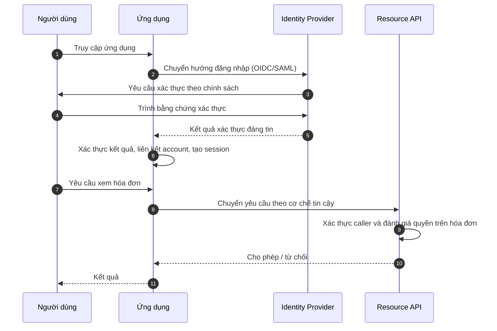
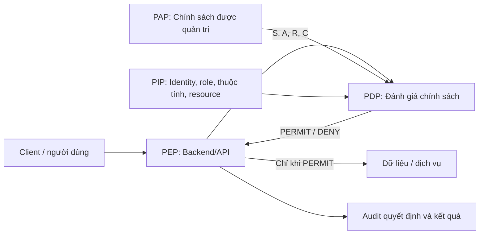
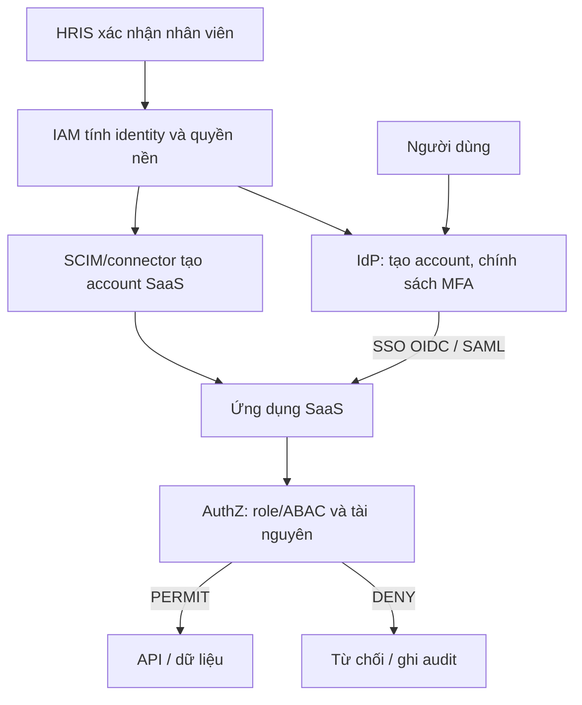

# Authentication và authorization

## 1. Bài toán: Đăng nhập thành công có đồng nghĩa được truy cập dữ liệu?

Một nhân viên tên **Hà** đăng nhập thành công vào ứng dụng quản lý hóa đơn bằng tài khoản doanh nghiệp. Hà đã vượt qua bước xác thực đa yếu tố (MFA), và ứng dụng hiển thị trang chủ. Tuy nhiên, khi Hà yêu cầu xem hóa đơn của một chi nhánh khác, hệ thống phải xác định liệu Hà có được phép đọc **hóa đơn cụ thể đó** hay không.

Hai câu hỏi này khác nhau:

- **Authentication (AuthN – xác thực):** Chủ thể đang gửi yêu cầu có chứng minh được danh tính mà họ khai báo không?
- **Authorization (AuthZ – phân quyền/ủy quyền truy cập):** Chủ thể đã xác thực có được phép thực hiện hành động cụ thể lên tài nguyên cụ thể trong điều kiện hiện tại không?

**Đăng nhập thành công chỉ là điều kiện để hệ thống biết ai đang yêu cầu; không phải giấy phép truy cập mọi tài nguyên.** Một danh tính hợp lệ có thể bị từ chối xem hồ sơ ngoài phạm vi công việc. Một tài khoản từng có quyền cũng có thể mất quyền sau khi chủ sở hữu chuyển vai trò hoặc nghỉ việc.

Trong module **`SECURITY_IDENTITY_ACCESS_MANAGEMENT_IDENTITY_LIFECYCLE`** về quản lý vòng đời danh tính (identity lifecycle), việc phân biệt AuthN và AuthZ quyết định chất lượng của cả mô hình **Joiner–Mover–Leaver (JML)**: người mới được tạo tài khoản và cấp đúng quyền; người chuyển vai trò phải thay đổi quyền; người rời tổ chức cần bị chặn các đường xác thực và quyền truy cập còn tồn tại. IdP, SSO, SCIM, RBAC/ABAC, tài khoản dịch vụ và kiểm toán đóng những vai trò khác nhau trong chuỗi đó.

## 2. Nhận diện, xác minh, xác thực, phân quyền và kiểm toán

Các khái niệm liên quan thường xuất hiện cùng nhau nhưng không thể dùng thay thế.

| Hoạt động | Câu hỏi | Ví dụ thực tế | Kết quả |
| --- | --- | --- | --- |
| **Identification – nhận diện/khai báo danh tính** | Chủ thể nói mình là ai? | Gửi username hoặc thông tin định danh workload | Một danh tính/principal được khai báo hoặc xác định |
| **Identity proofing – kiểm chứng danh tính ban đầu** | Có căn cứ đáng tin để liên kết người/thực thể với danh tính số không? | Quy trình tuyển dụng kiểm tra hồ sơ; đăng ký chủ sở hữu ứng dụng | Danh tính số được xác lập theo mức tin cậy phù hợp |
| **Authentication (AuthN)** | Yêu cầu hiện tại chứng minh chủ thể là danh tính đó bằng cách nào? | Passkey, MFA, chứng chỉ của workload | Kết quả xác thực và thông tin về phiên/chủ thể |
| **Authorization (AuthZ)** | Chủ thể được làm hành động gì với tài nguyên nào, theo điều kiện nào? | Chỉ nhân viên phụ trách được đọc phiếu hỗ trợ tương ứng | Quyết định cho phép hoặc từ chối |
| **Accounting/Auditing – ghi nhận và kiểm toán** | Ai đã yêu cầu, điều gì được quyết định, hệ thống đã làm gì? | Log truy cập, sự kiện cấp/thu hồi quyền và người phê duyệt | Bằng chứng để theo dõi, điều tra và rà soát |

Ví dụ một chuỗi xử lý:

1. Nguồn nhân sự xác nhận nhân viên **Minh** được nhận việc và tạo identity quản trị `person-1042`.
2. Hệ thống IdP tạo tài khoản và cho Minh đăng ký phương thức xác thực.
3. Minh đăng nhập, chứng minh danh tính qua IdP; ứng dụng nhận kết quả xác thực đáng tin cậy.
4. Minh yêu cầu `GET /invoices/INV-209`.
5. Ứng dụng kiểm tra Minh còn hoạt động, có vai trò được phép và hóa đơn thuộc phạm vi truy cập.
6. Hệ thống cho phép hoặc từ chối, đồng thời ghi log phù hợp.

**Điểm phân biệt:** bước 3 không thay thế bước 5. Bản thân một token hoặc phiên hợp lệ cũng chưa đủ để khẳng định người dùng được phép đọc mọi hóa đơn.

## 3. Những đối tượng tham gia một quyết định truy cập

Một quyết định AuthZ có ít nhất các thành phần sau:

- **Subject/principal (chủ thể):** người dùng, service account hoặc workload đang yêu cầu. Principal là cách hệ thống bảo mật biểu diễn chủ thể trong yêu cầu đã được xử lý.
- **Resource (tài nguyên):** API, bản ghi, tệp, repository, hàng đợi hoặc hạ tầng được bảo vệ.
- **Action (hành động):** đọc, tạo, cập nhật, xóa, xuất dữ liệu, phê duyệt, triển khai hoặc quản trị.
- **Context/environment (bối cảnh):** thời điểm, tenant, khu vực, phương thức xác thực, trạng thái thiết bị hoặc độ nhạy của thao tác.
- **Policy (chính sách):** tập quy tắc quyết định hành động được phép hay bị từ chối.
- **Entitlement (quyền được cấp):** vai trò, thành viên nhóm, scope hoặc quyền ứng dụng gắn với principal.

Ví dụ yêu cầu:

```text
subject:
  identityId: person-1042
  lifecycleStatus: active
  department: Finance
  roles: [FinanceReader]
  region: south

action: invoice.read

resource:
  invoiceId: INV-209
  tenantId: org-01
  region: north
  classification: internal

context:
  authenticationSatisfied: true
  mfaSatisfied: true
```

Người dùng đã xác thực và có vai trò `FinanceReader`, nhưng chính sách còn yêu cầu `subject.region == resource.region`. Vì vậy, quyết định có thể là **DENY** do khác khu vực.

### Account, credential, phiên và token cũng khác nhau

| Đối tượng | Chức năng | Điều cần tránh nhầm lẫn |
| --- | --- | --- |
| **Identity** | Bản ghi quản trị về một người/workload | Không đồng nhất với username hay email |
| **Account** | Bản ghi chủ thể trong IdP, ứng dụng hoặc cloud | Một identity có thể có nhiều account |
| **Credential** | Phương tiện chứng minh danh tính: passkey, mật khẩu, khóa, chứng chỉ | Credential có thể bị thay/thu hồi mà identity vẫn tồn tại |
| **Session** | Trạng thái đăng nhập đã thiết lập | Phiên có thể còn hoạt động sau khi người dùng bị khóa tại nơi khác |
| **Token** | Vật mang thông tin hoặc quyền theo giao thức và ngữ cảnh sử dụng | Không phải token nào cũng dành cho API; không phải mọi token chứa quyền ứng dụng |
| **Role/entitlement** | Quyền hoặc nhóm quyền được cấp | Có quyền ở ứng dụng A không có nghĩa tự động có quyền tương đương ở B |

## 4. Authentication: Chứng minh danh tính bằng cách nào?

AuthN xác minh **bằng chứng mà chủ thể cung cấp** đối với danh tính được khai báo. Cơ chế có thể khác nhau cho người dùng và workload.

### 4.1. Các yếu tố xác thực thường gặp

| Loại yếu tố | Ví dụ | Rủi ro cần xem xét |
| --- | --- | --- |
| **Something you know – điều biết** | Mật khẩu, PIN | Lộ lọt, sử dụng lại, phishing, đoán mật khẩu |
| **Something you have – điều sở hữu** | Khóa bảo mật FIDO2, thiết bị đăng ký, thẻ thông minh | Mất thiết bị, quy trình khôi phục yếu |
| **Something you are – đặc điểm sinh trắc** | Vân tay hoặc khuôn mặt dùng để mở khóa thiết bị xác thực | Cần xem cách thiết bị bảo vệ dữ liệu sinh trắc và phương án dự phòng |

**MFA** sử dụng nhiều yếu tố độc lập theo chính sách. Dùng mật khẩu cộng thêm một yếu tố sở hữu hợp lệ thường mạnh hơn chỉ dùng mật khẩu. Tuy nhiên, không phải mọi hình thức MFA chống phishing như nhau: **passkey/WebAuthn/FIDO2** có thể cung cấp tính kháng phishing dựa trên ràng buộc với tên miền và thử thách mật mã khi triển khai đúng.

**Lưu ý:** “mật khẩu + hai câu hỏi bí mật” không tự động trở thành MFA, vì cả hai có thể chỉ thuộc nhóm “điều người dùng biết”.

### 4.2. Mức bảo đảm xác thực và step-up authentication

Một ứng dụng có thể cho phép đọc tài liệu ít nhạy cảm sau xác thực thông thường nhưng yêu cầu **step-up authentication** trước khi đổi thông tin thanh toán, xuất dữ liệu lớn hoặc sử dụng quyền quản trị.

Ví dụ:

- Yêu cầu `document.read`: phiên hợp lệ và quyền đọc.
- Yêu cầu `payment.approve`: phiên hợp lệ, quyền phê duyệt, không xung đột SoD và mức xác thực phù hợp với rủi ro.
- Yêu cầu `admin.rotateKeys`: chính sách có thể đòi xác thực mạnh gần thời điểm thực hiện, quy trình phê duyệt và ghi nhận chi tiết.

Step-up làm tăng mức bảo đảm rằng yêu cầu đến từ đúng chủ thể. **Step-up không tự cấp thêm quyền**; nếu nhân viên không có quyền phê duyệt, xác thực lại thành công cũng không biến yêu cầu đó thành hợp lệ.

### 4.3. Vòng đời của xác thực

AuthN cần được quản lý cả trước và sau khi đăng nhập:

1. **Đăng ký ban đầu:** bảo vệ việc liên kết tài khoản với authenticator, khóa bảo mật hoặc thiết bị.
2. **Đăng nhập:** kiểm tra chứng cứ, chống tấn công đoán mật khẩu và giả mạo phiên.
3. **Duy trì phiên:** thiết lập thời hạn phù hợp, cookie bảo vệ, cơ chế làm mới và yêu cầu xác thực lại khi cần.
4. **Khôi phục tài khoản:** kiểm tra danh tính cẩn thận; không tạo đường vòng yếu hơn cơ chế đăng nhập chính.
5. **Thu hồi:** chặn đăng nhập và xử lý phiên, refresh token, credential theo khả năng từng nền tảng.
6. **Kiểm toán:** ghi sự kiện đáng ngờ, thay đổi phương thức xác thực, đăng nhập bất thường và quá trình khôi phục.

Một luồng xác thực an toàn còn phải xử lý chiếm quyền phiên, phishing, tái sử dụng token và đăng nhập từ môi trường bị xâm phạm. Phương thức xác thực mạnh không bảo đảm hệ thống ứng dụng tự động có phân quyền đúng.

## 5. IdP và SSO hỗ trợ Authentication như thế nào?

**Identity Provider (IdP)** là hệ thống xác thực danh tính và cung cấp thông tin xác thực theo quan hệ tin cậy. **Single Sign-On (SSO)** giúp người dùng truy cập nhiều ứng dụng liên kết bằng một quá trình xác thực tập trung khi các điều kiện phiên cho phép.

Một luồng đăng nhập liên kết minh họa:



Điều cần phân biệt:

- **SAML 2.0** và **OpenID Connect (OIDC)** được sử dụng phổ biến cho đăng nhập liên kết; giao thức và thông điệp cụ thể khác nhau.
- **OIDC** là lớp danh tính xây trên **OAuth 2.0**, cung cấp cơ chế xác thực người dùng và **ID token** cho bên sử dụng thông tin đăng nhập.
- **OAuth 2.0** chủ yếu cung cấp cơ chế **ủy quyền truy cập** cho client đối với tài nguyên được bảo vệ; bản thân OAuth access token không mặc định là bằng chứng đăng nhập người dùng cho mọi ứng dụng.
- **SCIM 2.0** thường dùng cho **tạo, cập nhật, vô hiệu hóa account và đồng bộ nhóm/thuộc tính**, không phải giao thức đăng nhập.

### Vai trò của ID token và access token

| Loại token | Mục tiêu chính | Bên thường tiếp nhận | Quy tắc sử dụng |
| --- | --- | --- | --- |
| **ID token (OIDC)** | Truyền kết quả/thông tin xác thực người dùng tới OIDC client | Client/relying party phù hợp | Kiểm tra issuer, audience, thời hạn và các giá trị liên quan theo giao thức; **không dùng như access token để gọi API** |
| **Access token (OAuth)** | Cho phép client truy cập resource server theo phạm vi được cấp | Resource server/API | Resource server xác thực token và đánh giá policy của riêng tài nguyên |
| **Refresh token** | Cho client lấy access token mới khi được phép | Authorization server/token endpoint | Bảo vệ chặt, giới hạn sử dụng và thu hồi theo chính sách |

Có token hợp lệ về mặt mật mã **không đồng nghĩa** token hợp lệ **cho API này**. Resource server phải kiểm tra các thông tin áp dụng như nguồn phát hành, đối tượng nhận (audience), thời hạn, phạm vi và loại token, cùng với trạng thái quyền hoặc các điều kiện cần thiết. Cách kiểm tra cụ thể phụ thuộc định dạng token và hợp đồng tích hợp (JWT hoặc opaque token, xác thực cục bộ hoặc introspection).

**Nguy cơ cần tránh:** dùng ID token được cấp cho ứng dụng web như bearer access token của API, chấp nhận token sai `aud`, hoặc tin các claim chưa được xác minh.

## 6. Authorization: Quyết định quyền dựa trên điều gì?

AuthZ xử lý một yêu cầu cụ thể có dạng:

> **Chủ thể S có được phép thực hiện hành động A trên tài nguyên R trong bối cảnh C không?**

Kết quả thường là **PERMIT / DENY**, hoặc kết quả có điều kiện tùy policy engine. Đối với chính sách không tìm được quy tắc cho phép, thiết kế an toàn thường áp dụng **deny by default**.

Một quy tắc minh họa:

```text
PERMIT invoice.read IF
    principal.authenticated == true
    AND principal.lifecycleStatus == "active"
    AND principal.tenantId == invoice.tenantId
    AND principal.hasEntitlement("invoice.read")
    AND principal.region == invoice.region
ELSE DENY
```

Ở đây, đăng nhập chỉ thỏa **một điều kiện**. Quyết định còn phụ thuộc entitlement, tenant, khu vực và tình trạng vòng đời danh tính.

### Authorization không đồng nghĩa với menu giao diện

Ẩn nút “Xóa hóa đơn” khỏi màn hình người dùng có thể cải thiện trải nghiệm, nhưng **không bảo vệ API** nếu người dùng vẫn gọi được endpoint xóa thông qua HTTP trực tiếp. Kiểm tra quyền cần được thực thi ở nơi yêu cầu thực sự truy cập tài nguyên, chẳng hạn backend hoặc API gateway và dịch vụ nghiệp vụ.

### Authorization phải đủ chi tiết

Một chính sách “người dùng có vai trò Support” có thể mới cho phép mở chức năng ticket. Hệ thống vẫn cần kiểm tra **ticket cụ thể** có thuộc khách hàng, tenant, đội hoặc phạm vi được giao hay không.

Đây là bài toán **object-level authorization**: không được để người dùng thay ID đối tượng trong URL rồi truy cập dữ liệu không thuộc quyền của mình.

## 7. Các mô hình phân quyền thường gặp

### 7.1. RBAC – Role-Based Access Control

**RBAC** gắn quyền với vai trò, sau đó gắn vai trò cho account/chủ thể theo trách nhiệm công việc.

| Vai trò minh họa | Quyền có thể được cấp | Không mặc định có |
| --- | --- | --- |
| `SupportAgent` | Đọc ticket thuộc phạm vi, cập nhật ticket được phân công | Đọc bảng lương hoặc duyệt thanh toán |
| `FinanceViewer` | Đọc báo cáo tài chính thuộc đơn vị được giao | Sửa thông tin người nhận tiền |
| `FinanceApprover` | Phê duyệt giao dịch trong hạn mức | Tự tạo và tự phê duyệt giao dịch nếu vi phạm SoD |
| `CloudOperator` | Đọc trạng thái hạ tầng, vận hành hệ thống được giao | Quyền quản trị toàn bộ tổ chức |

**Ưu điểm:** dễ diễn giải, cấp quyền và rà soát theo trách nhiệm. **Giới hạn:** tạo quá nhiều role cho từng biến thể phòng ban, dự án, khu vực có thể dẫn tới **role explosion**. RBAC đơn thuần cũng khó biểu diễn các điều kiện động như “chỉ xem hóa đơn thuộc tenant của người dùng”.

### 7.2. ABAC – Attribute-Based Access Control

**ABAC** đánh giá thuộc tính của **subject, resource, action và environment**.

Ví dụ:

```text
PERMIT invoice.read IF
    subject.department == "Finance"
    AND subject.lifecycleStatus == "active"
    AND subject.region == resource.region
    AND resource.classification IN ["internal", "finance"]
    AND environment.authenticationAssurance >= "required"
ELSE DENY
```

ABAC hữu ích với phạm vi tenant, độ nhạy dữ liệu, khu vực hoặc ngữ cảnh phiên. Nhược điểm là chính sách có thể khó kiểm tra hơn; dữ liệu thuộc tính sai hoặc chậm đồng bộ có thể dẫn tới quyết định sai. Nguồn thuộc tính phải có thẩm quyền và có cơ chế cập nhật đáng tin cậy.

### 7.3. ACL và quan hệ đối tượng

Trong **Access Control List (ACL)**, tài nguyên có thể lưu danh sách principal hoặc nhóm được phép truy cập. Ví dụ một tài liệu cho phép chủ sở hữu và ba cộng tác viên.

Một số hệ thống dùng **Relationship-Based Access Control (ReBAC)**, dựa trên các quan hệ như `owner`, `editor`, `memberOfTeam`, `parentFolder`. Ví dụ người được xác nhận là chủ sở hữu tài liệu mới có quyền chuyển quyền sở hữu.

RBAC, ABAC, ACL và ReBAC có thể được kết hợp. Điều quan trọng là **quyền trên tài nguyên phải được đánh giá chính xác**, kể cả khi vai trò hoặc quan hệ thay đổi.

### 7.4. Phân quyền theo phạm vi, thời hạn và xung đột

- **Least privilege:** cấp quyền tối thiểu phục vụ nhiệm vụ hiện tại.
- **Separation of Duties (SoD):** tránh tập quyền có thể tự thực hiện và tự phê duyệt thao tác quan trọng.
- **Time-bound access:** quyền ngoài vai trò hoặc đặc quyền có thời điểm hết hạn.
- **Just-in-time access (JIT):** cấp quyền nhạy cảm khi có nhu cầu được phê duyệt; thu hồi khi hết thời gian.
- **Tenant isolation:** bảo đảm quyền của tổ chức/khách hàng này không bị áp dụng cho tổ chức khác.
- **Deny by default:** không có quy tắc cho phép hợp lệ thì không thực hiện thao tác.

## 8. Policy Decision Point và Policy Enforcement Point

Khi hệ thống lớn lên, việc ra quyết định quyền và thực thi quyền có thể tách thành các thành phần logic:

| Thành phần | Vai trò | Ví dụ |
| --- | --- | --- |
| **PEP – Policy Enforcement Point** | Chặn yêu cầu, hỏi hoặc áp dụng quyết định và ngăn thao tác trái phép | API handler, middleware, gateway hoặc lớp truy cập dữ liệu |
| **PDP – Policy Decision Point** | Đánh giá chính sách và trả kết quả cho phép/từ chối | Policy engine trong ứng dụng hoặc dịch vụ chính sách |
| **PIP – Policy Information Point** | Cung cấp thuộc tính đáng tin cho việc ra quyết định | Identity registry, nguồn role, thông tin tenant, nhãn độ nhạy |
| **PAP – Policy Administration Point** | Nơi tạo, sửa và quản trị chính sách | Công cụ quản lý policy hoặc kho chính sách có kiểm soát |

Sơ đồ logic:



Cần lưu ý ba điểm:

1. **PEP phải thực thi quyết định**, không chỉ ghi log hoặc trả thông tin cho frontend.
2. **PDP phải có ngữ cảnh đầy đủ**, gồm định danh, hành động, tenant, thuộc tính tài nguyên và trạng thái liên quan.
3. **PIP phải đáng tin và được cập nhật đúng hạn**; thuộc tính từ client tự khai báo có thể bị sửa nên không được coi là căn cứ độc lập để cho phép.

Hệ thống nhỏ có thể thực thi cả PEP/PDP/PIP trong một ứng dụng. Mục đích của mô hình là phân định trách nhiệm, không bắt buộc phải triển khai bốn dịch vụ riêng.

## 9. OAuth scope, role và permission không phải cùng một thứ

Giả sử một ứng dụng được cấp access token chứa scope `invoices.read`. Scope này thường diễn tả **phạm vi mà authorization server cấp cho client** để gọi một API nhất định. Nó không tự động chứng minh rằng người dùng đứng sau client được đọc **tất cả** hóa đơn.

API có thể cần thêm:

- token còn hợp lệ, dành cho đúng API;
- client có scope phù hợp;
- người dùng hoặc service principal có quyền nghiệp vụ cần thiết;
- hóa đơn thuộc đúng tenant và phạm vi;
- danh tính không bị chặn theo chính sách;
- trạng thái phê duyệt và điều kiện bổ sung còn hiệu lực.

Ví dụ:

```text
Client access token: scope = "invoices.read"
Principal: person-1042, role = FinanceViewer, tenant = org-A
Requested invoice: INV-209, tenant = org-B

Kết quả: DENY vì không cùng tenant.
```

**OAuth authorization** giải quyết việc client được phép tiếp cận resource server theo các cơ chế của giao thức. **Business authorization** vẫn do API/chính sách ứng dụng đánh giá đối với người dùng, hành động và đối tượng cụ thể.

Không nên tự đồng nhất trường `scope` với mọi role nghiệp vụ hay dùng các trường token chưa kiểm chứng làm quyền trực tiếp.

## 10. Điểm giao giữa Authentication, Authorization và vòng đời JML

Vòng đời danh tính (identity lifecycle) ảnh hưởng đến cả AuthN và AuthZ, nhưng theo hai cơ chế riêng:

| Sự kiện | Thay đổi liên quan AuthN | Thay đổi liên quan AuthZ | Điều phải xác minh |
| --- | --- | --- | --- |
| **Joiner** | Tạo account IdP, đăng ký authenticator/MFA, chính sách đăng nhập | Cấp role/entitlement nền, phê duyệt quyền bổ sung | Người mới đăng nhập được đúng lúc, chỉ truy cập đúng phạm vi |
| **Mover** | Có thể giữ nguyên account và phiên; tăng yêu cầu xác thực nếu truy cập nhạy cảm | Thu hồi role cũ, cấp role mới, cập nhật thuộc tính ABAC | Không còn quyền từ bộ phận trước; quyền mới có căn cứ |
| **Suspended** | Tạm chặn đăng nhập, xem xét phiên và credential | Đình chỉ hoặc từ chối quyền theo trạng thái | Không còn đường truy cập trái chính sách trong thời gian đình chỉ |
| **Leaver** | Vô hiệu hóa IdP, thu hồi phiên/refresh token, khóa/credential liên quan nếu hỗ trợ | Deprovision ứng dụng, thu hồi nhóm và quyền, chặn API | Mỗi hệ thống đích đã xác nhận không còn đường truy cập trái phép |
| **Rehire** | Xác minh lại, đăng ký phương thức xác thực phù hợp | Tính quyền theo vai trò hiện tại, phê duyệt lại đặc quyền | Không tự khôi phục quyền cao của giai đoạn làm việc trước |

### Joiner: AuthN và AuthZ cùng được thiết lập

HRIS ghi nhận nhân viên bắt đầu. Hệ thống tạo identity, provision account tại IdP và ứng dụng, cung cấp phương thức xác thực được phê duyệt. RBAC/ABAC xác định quyền theo công việc và nguồn thuộc tính đáng tin.

**Lỗi thường gặp:** người dùng đăng nhập được nhưng chưa có quyền cần thiết; hoặc để “giải quyết nhanh”, tài khoản được gán role quản trị quá rộng.

### Mover: Người dùng vẫn đăng nhập được nhưng quyền cũ phải mất

Nhân viên từ đội Hỗ trợ chuyển sang Tài chính. Account IdP vẫn hợp lệ. Tuy nhiên, quyền chỉnh sửa ticket phải bị thu hồi, thuộc tính bộ phận phải cập nhật và quyền tài chính mới cần được phê duyệt.

**Lỗi thường gặp:** hệ thống chỉ thêm role mới mà không xóa role cũ. MFA mạnh cũng không bù đắp cho quyền nghiệp vụ bị cấp thừa.

### Leaver: Chặn đường xác thực và đường truy cập

Một người đã nghỉ việc vẫn có thể có account ứng dụng, phiên đã tạo trước đó, personal access token hoặc API key. Tổ chức cần xem xét:

- Khóa hoặc vô hiệu hóa đăng nhập tại IdP.
- Deprovision account và entitlement tại ứng dụng qua SCIM/API/connector phù hợp.
- Thu hồi refresh token/phiên và credential được cấp riêng trong khả năng nền tảng.
- Giảm thời gian tồn tại của access token, kiểm tra trạng thái thu hồi hoặc dùng cơ chế chặn phù hợp.
- Đối soát trạng thái thực tế, xử lý lỗi, lưu thời điểm và bằng chứng hoàn tất.

**Không được suy luận** rằng vì IdP đã disabled người dùng thì mọi token và phiên trước đó tự mất hiệu lực ngay. Token có thời gian sống riêng có thể còn được chấp nhận tới khi hết hạn nếu resource server không áp dụng cơ chế thu hồi thích hợp.

## 11. SSO, SCIM và phân quyền ứng dụng phối hợp ra sao?

Một hệ thống SaaS có thể hỗ trợ:

- **SSO:** ứng dụng tin cậy IdP để xác thực.
- **SCIM:** nền tảng IAM tạo/cập nhật/vô hiệu hóa account và một số nhóm/thuộc tính.
- **RBAC/ABAC nội bộ:** ứng dụng ra quyết định về tài nguyên cụ thể.

Ví dụ chuỗi Joiner:



Ba vấn đề kiểm tra độc lập:

1. Người dùng **đăng nhập** qua IdP có thành công?
2. Account ứng dụng **đã được tạo và đồng bộ** đúng trạng thái?
3. Quyền của account/chủ thể **đã được kiểm tra tại tài nguyên** đúng chính sách?

Một số ứng dụng có cơ chế **JIT account provisioning** khi người dùng đăng nhập SSO lần đầu. Điều này không đồng nghĩa mọi ứng dụng có quy trình deprovision đầy đủ. Hãy kiểm tra cơ chế cấp/khóa và trạng thái session thực tế của từng hệ thống.

## 12. Authentication và Authorization cho service account, workload

Không phải mọi principal là con người. Pipeline CI/CD, ứng dụng backend, container và service account có thể cần xác thực để truy cập API.

### Các cơ chế AuthN cho workload

| Cơ chế | Tình huống thường gặp | Rủi ro/kiểm soát |
| --- | --- | --- |
| **Workload identity/federation** | Workload nhận chứng thực từ nền tảng chạy và đổi lấy quyền truy cập phù hợp | Kiểm soát chặt nguồn, audience, điều kiện trust và môi trường |
| **mTLS / chứng chỉ client** | Hai dịch vụ xác thực qua kênh TLS | Quản lý cấp, thời hạn và thu hồi chứng chỉ |
| **OAuth 2.0 client credentials** | Client đại diện cho chính mình gọi API | Bảo vệ cách xác thực client; token phải giới hạn đúng resource/scope |
| **API key/secret** | Tích hợp legacy hoặc hệ thống chỉ hỗ trợ khóa tĩnh | Dễ tồn tại dài hạn; phải có owner, luân chuyển, hạn quyền và thu hồi |

**Ưu tiên credential ngắn hạn và danh tính workload có thể xác minh** khi nền tảng hỗ trợ. Một API key được nhúng cứng vào mã nguồn hoặc chia sẻ giữa nhiều ứng dụng gây khó truy vết và thu hồi.

### AuthZ cho workload

Giả sử dịch vụ `invoice-worker` gọi API xử lý hóa đơn. Nó có thể cần:

- Quyền đọc từ hàng đợi `invoice-events`;
- quyền ghi vào kho kết quả `invoice-processing`;
- **không có quyền** đọc hồ sơ lương hay quản trị toàn bộ cloud.

Một service principal đã được xác thực đúng vẫn phải chịu **least privilege**, tách tenant/môi trường, scope và chính sách tài nguyên. Danh tính máy không nên kế thừa quyền rộng chỉ vì ứng dụng do nhóm IT vận hành.

### Vòng đời máy vẫn có Joiner–Mover–Leaver

- **Joiner:** workload được đăng ký, có owner, nhận account và quyền cần thiết.
- **Mover:** thay đổi đội sở hữu, môi trường hoặc mục đích; tính lại quyền và rà soát credential.
- **Leaver:** ngừng dịch vụ; thu hồi account, role, trust relationship, chứng chỉ, token hoặc khóa liên quan.

Khi người quản lý workload nghỉ việc, cần kiểm tra và chuyển ownership; không tự xóa một service account vẫn phục vụ nghiệp vụ nhưng cũng không giữ credential do người đó sở hữu mà không rà soát.

## 13. Thiết kế một endpoint có AuthN và AuthZ đúng chỗ

Xét endpoint:

```http
GET /api/invoices/INV-209 HTTP/1.1
Host: api.example.org
Authorization: Bearer <access-token>
```

Một backend cần xử lý những bước logic:

1. **Xác thực request:** token/phiên hợp lệ theo cơ chế tin cậy của API, đúng issuer/audience, chưa hết hạn và đủ điều kiện bảo vệ.
2. **Xác định principal:** lấy định danh đáng tin, tránh dùng `userId` hoặc `role` tự khai báo từ query/body như chứng cứ.
3. **Xác định tài nguyên:** đọc hóa đơn đích và thuộc tính như owner, tenant, khu vực, trạng thái; hoặc truy vấn dữ liệu với bộ lọc quyền phù hợp.
4. **Đánh giá chính sách:** kiểm tra trạng thái vòng đời, vai trò/quyền, scope, phạm vi tenant và các điều kiện của hóa đơn.
5. **Thực thi:** chỉ trả dữ liệu nếu có quyết định cho phép, đồng thời áp dụng giới hạn dữ liệu/trường cần thiết.
6. **Ghi log:** lưu chủ thể, hành động, tài nguyên, quyết định và mã tương quan; tránh ghi token hoặc dữ liệu nhạy cảm không cần thiết.

Giả mã:

```text
readInvoice(request, invoiceId):
    principal = authenticateRequest(request)   # AuthN
    if principal is absent:
        return 401

    invoice = loadInvoiceForPolicy(invoiceId)
    if invoice is absent:
        return 404

    decision = authorize(
        subject = principal,
        action = "invoice.read",
        resource = invoice,
        context = request.securityContext
    )                                          # AuthZ

    auditAccess(principal, "invoice.read", invoiceId, decision)

    if decision != PERMIT:
        return 403

    return 200, projectPermittedFields(invoice)
```

Đây là **giả mã minh họa**, không phải đoạn thực thi production. Tùy yêu cầu chống lộ thông tin tồn tại của tài nguyên, API có thể chủ động trả `404` cho tài nguyên ngoài phạm vi thay vì trả `403`, nhưng vẫn phải kiểm tra quyền ở backend.

### 401 và 403 khác nhau

| Mã HTTP | Ý nghĩa phổ biến | Ví dụ |
| --- | --- | --- |
| **401 Unauthorized** | Yêu cầu thiếu thông tin xác thực hợp lệ cho tài nguyên theo cơ chế HTTP; có thể cần xác thực | Không có bearer token hoặc token không hợp lệ |
| **403 Forbidden** | Hệ thống hiểu yêu cầu nhưng từ chối cho thực hiện, kể cả khi đã biết principal | Nhân viên đã xác thực nhưng thiếu quyền đọc hóa đơn |
| **404 Not Found** | Không tìm thấy tài nguyên, hoặc ứng dụng chọn không tiết lộ sự tồn tại của tài nguyên không được phép | ID hóa đơn không tồn tại hoặc ngoài tenant theo thiết kế |

Tên `401 Unauthorized` trong HTTP dễ gây nhầm với “authorization” của IAM, nhưng 401 thường liên quan tới **authentication credentials** cần thiết để truy cập tài nguyên. Không dùng mã HTTP làm cơ chế bảo vệ thay cho kiểm tra quyền.

## 14. Những lỗ hổng thường xảy ra khi trộn lẫn AuthN và AuthZ

| Lỗi | Vì sao xảy ra | Kiểm soát cần có |
| --- | --- | --- |
| **Chỉ kiểm tra đăng nhập** | Backend trả mọi dữ liệu cho user đã xác thực | Kiểm tra quyền trên từng hành động và tài nguyên |
| **IDOR/BOLA** | Đổi ID trong URL để đọc/sửa đối tượng của người khác | Object-level authorization, tenant scoping |
| **Ẩn nút trên frontend** | API không có kiểm tra quyền tương đương | Enforcement tại backend/API |
| **Tin claim hoặc role do client tự khai báo** | Người dùng có thể sửa request | Lấy principal và quyền từ nguồn đáng tin, xác thực token |
| **Nhầm ID token với access token** | Chấp nhận token không dành cho API | Kiểm tra token type/use, issuer, audience và hợp đồng OAuth/OIDC |
| **Chỉ kiểm tra scope** | Scope không biểu đạt mọi ràng buộc nghiệp vụ | Thêm role, sở hữu tài nguyên, tenant, thuộc tính và policy |
| **Dùng role quá rộng** | Role quản trị kiêm nhiều chức năng | Least privilege, phân tách nhiệm vụ và quyền có hạn |
| **Quyền trong token/phiên bị cũ** | Role/thuộc tính đã đổi nhưng phiên còn cache | Thiết kế TTL, refresh hoặc kiểm tra trạng thái khi nhạy cảm |
| **Deprovision chỉ tại IdP** | Account cục bộ, phiên, PAT vẫn tồn tại | Thu hồi đích qua SCIM/API và xử lý credential/phiên |
| **Bỏ quên service account** | Chủ sở hữu nghỉ, khóa tĩnh vẫn hoạt động | Workload identity, owner, rotation, decommission |

### IDOR/BOLA: Ví dụ cụ thể

Người dùng A có quyền đọc hóa đơn `INV-100` của mình. Nếu API chỉ kiểm tra `authenticated == true` và sau đó đọc dữ liệu theo ID từ đường dẫn, A có thể đổi URL thành `/invoices/INV-101` để đọc hóa đơn của người B.

**Cách đúng:** quyền đọc phải được kiểm tra cho **`(principal A, action invoice.read, resource INV-101)`**. Nếu hóa đơn khác tenant, khác chủ sở hữu hoặc ngoài phạm vi chính sách, kết quả phải là từ chối. Không tin ID do client cung cấp là bằng chứng sở hữu.

### Cache quyền và trạng thái thu hồi

Một hệ thống có thể lưu role/attribute trong token hoặc cache để giảm độ trễ. Điều này tạo ra khoảng thời gian mà **quyền đã bị thu hồi về mặt nghiệp vụ nhưng request vẫn dùng thông tin cũ**.

Cần chọn chiến lược theo rủi ro, chẳng hạn:

- Access token có thời gian sống phù hợp;
- refresh token/session có thể bị thu hồi;
- PDP hoặc API kiểm tra trạng thái mới đối với thao tác nhạy cảm;
- cache chính sách/thuộc tính có cơ chế hết hạn hoặc vô hiệu hóa;
- deprovision tài khoản đích, kiểm tra kết quả và theo dõi độ trễ.

Không thể mặc định mọi token JWT tự hủy hiệu lực ngay khi một role thay đổi. Kiểm soát cụ thể phụ thuộc resource server và cơ chế thu hồi/cập nhật hiện có.

## 15. Kiểm toán AuthN và AuthZ khác nhau ra sao?

AuthN và AuthZ đều cần log nhưng theo **sự kiện và mục tiêu điều tra khác nhau**.

| Log AuthN | Log AuthZ |
| --- | --- |
| Lần đăng nhập thành công/thất bại, nguồn xác thực | Ai yêu cầu hành động nào lên tài nguyên nào |
| Phương thức MFA/step-up và kết quả | Quyết định PERMIT/DENY và quy tắc/chính sách liên quan |
| Thay đổi authenticator, khôi phục tài khoản | Cấp/thu hồi role, entitlement, thay đổi policy |
| Tạo/hết hạn/thu hồi phiên hoặc credential khi có hỗ trợ | Điều kiện tenant, trạng thái quyền và nguồn thuộc tính cần thiết |
| Dấu hiệu chiếm đoạt danh tính, bất thường phiên | Truy cập trái phạm vi, quyền đặc biệt, quyết định từ chối lặp lại |

Ví dụ sự kiện quyết định quyền:

```json
{
  "eventType": "authorization.decision",
  "timestamp": "2026-11-23T07:20:00Z",
  "subjectId": "person-1042",
  "accountId": "idp-user-482",
  "action": "invoice.read",
  "resourceId": "INV-209",
  "resourceTenant": "org-B",
  "decision": "DENY",
  "reasonCode": "TENANT_MISMATCH",
  "policyVersion": "iam-policy-2026-11",
  "correlationId": "req-18f4"
}
```

Đây là schema minh họa. Tùy tổ chức, một số trường có thể là dữ liệu cá nhân hoặc dữ liệu nhạy cảm nên log phải được phân quyền truy cập, giới hạn thời gian lưu và bảo vệ tính toàn vẹn. **Không ghi mật khẩu, access token, refresh token hay khóa bí mật ở dạng rõ**.

### Điều cần chứng minh khi audit JML

Khi một người chuyển nhóm hoặc nghỉ việc, audit cần giúp trả lời:

- Ai xác nhận sự kiện từ nguồn có thẩm quyền?
- Quyền nào được phê duyệt, cấp, thay đổi hoặc thu hồi?
- Hệ thống đích nào đã thực thi và xác nhận kết quả?
- Những phiên/credential hoặc quyền nào cần xử lý riêng?
- Có hệ thống nào thất bại, đang retry hoặc còn ngoại lệ chưa hoàn tất?

Việc “ticket đã đóng” không thay thế bằng chứng rằng quyền ở ứng dụng đích thực sự đã thay đổi.

## 16. Kiểm thử AuthN và AuthZ: Không chỉ kiểm tra happy path

Một hệ thống có thể cho phép đăng nhập hợp lệ và vẫn chứa lỗi phân quyền nghiêm trọng. Bộ kiểm thử nên phân biệt hai nhóm:

### Kiểm thử xác thực

- Không có credential hoặc credential hết hạn → yêu cầu bị từ chối theo chính sách.
- Token sai issuer, audience hoặc dành cho ứng dụng khác → không được chấp nhận.
- Phiên đã hết hạn hoặc bị thu hồi → không được tiếp tục sử dụng khi cơ chế hỗ trợ.
- Tài khoản bị đình chỉ → không thể tạo phiên mới trái chính sách.
- Thay đổi authenticator hoặc khôi phục tài khoản → cần chứng cứ hợp lệ và có log.
- Thao tác nhạy cảm đòi step-up → không được thực hiện chỉ với phiên có mức bảo đảm chưa đủ.

### Kiểm thử phân quyền

| Tình huống | Kỳ vọng |
| --- | --- |
| Người không đăng nhập gọi endpoint bảo vệ | Bị từ chối trước khi xử lý tài nguyên |
| `FinanceViewer` đọc hóa đơn thuộc tenant được giao | Cho phép nếu mọi điều kiện khác hợp lệ |
| `FinanceViewer` đọc hóa đơn tenant khác | Từ chối |
| `FinanceViewer` tự phê duyệt thanh toán khi không có quyền | Từ chối |
| Người dùng đổi `invoiceId` trên URL sang đối tượng của người khác | Từ chối dù đã xác thực |
| Nhân viên vừa chuyển nhóm vẫn còn role cũ | Hệ thống không được cho quyền trái chính sách; IAM phải đối soát/thu hồi |
| Tài khoản đã Leaver nhưng phiên/token cũ còn tồn tại | Phải đáp ứng thiết kế thu hồi và mục tiêu thời gian chặn truy cập |
| Workload `invoice-worker` gọi API ngoài scope và quyền được cấp | Từ chối |
| Attribute quan trọng bị thiếu hoặc không đáng tin | Không cấp quyền dựa trên giả định có lợi cho chủ thể |
| Hai thao tác đồng thời cấp/thu hồi quyền | Kết quả cuối cùng phải theo trạng thái và phiên bản chính sách hợp lệ |

Các trường hợp này nên được kiểm tra **tại backend/API và điểm thực thi**, không chỉ qua giao diện người dùng. Với phân quyền theo đối tượng, cần có test vượt tenant, vượt owner, sai hành động và trạng thái vòng đời thay đổi.

## 17. Chỉ số theo dõi chất lượng xác thực và phân quyền

Các chỉ số giúp nhìn nhận liệu AuthN/AuthZ có hỗ trợ tốt vòng đời IAM hay không:

| Chỉ số | Ý nghĩa |
| --- | --- |
| **MFA/passkey coverage** | Tỷ lệ tài khoản thuộc phạm vi bắt buộc đáp ứng phương thức xác thực theo chính sách |
| **High-risk authentication events** | Các tình huống bất thường cần xem xét, không chỉ số lần đăng nhập thất bại |
| **Unauthorized access attempts** | Yêu cầu AuthZ bị từ chối bất thường hoặc truy cập trái tenant/đối tượng |
| **Privileged role count và exception age** | Số quyền đặc quyền và ngoại lệ còn hiệu lực, thời gian tồn tại |
| **Mover residual entitlements** | Quyền cũ tồn tại sau khi vai trò đã thay đổi |
| **Leaver revocation latency** | Thời gian từ sự kiện có hiệu lực đến khi ứng dụng xác nhận chặn truy cập |
| **Orphan/service account coverage** | Tài khoản không gắn identity/owner hợp lệ và workload chưa quản trị |
| **Access review remediation completion** | Quyết định thu hồi đã được hệ thống đích thực thi thành công ở tỷ lệ nào |
| **Authorization test coverage** | Mức bao phủ các hành động, tài nguyên và tình huống vượt quyền quan trọng |

Không có một ngưỡng SLA áp dụng cho mọi tổ chức. Mục tiêu xác thực, thu hồi và rà soát phải dựa trên độ nhạy của hệ thống, loại danh tính, yêu cầu nghiệp vụ và khả năng kỹ thuật.

## 18. Ví dụ xuyên suốt Joiner–Mover–Leaver

Một nhân viên **Nam** gia nhập nhóm Hỗ trợ khách hàng, chuyển sang đội Tài chính rồi nghỉ việc.

| Giai đoạn | Authentication | Authorization | Kiểm tra cần hoàn thành |
| --- | --- | --- | --- |
| **Joiner** | Tạo account IdP, đăng ký MFA, kích hoạt đúng ngày | Cấp quyền ticket theo nhóm Hỗ trợ; không cấp quyền tài chính | Nam đăng nhập được và chỉ xem ticket trong phạm vi |
| **Mover** | Nam vẫn dùng account IdP; có thể tăng yêu cầu xác thực cho thao tác nhạy cảm | Thu hồi quyền ticket cũ, cấp `finance.report.read` theo phê duyệt | Không xem được ticket cũ; chỉ đọc báo cáo được giao |
| **Quyền tạm thời** | Yêu cầu step-up nếu cần | Cấp quyền xem một báo cáo nhạy cảm trong thời hạn ngắn | Quyền hết hạn và hệ thống đích đã xác nhận thu hồi |
| **Leaver** | Chặn đăng nhập, xử lý phiên/token và credential phù hợp | Deprovision SaaS, thu hồi role và quyền đặc quyền, xử lý account cục bộ | Không còn quyền truy cập tồn dư; lỗi đồng bộ được xử lý |
| **Sau Leaver** | Ngăn đăng nhập hoặc tái sử dụng phiên trái chính sách | Đối soát tài khoản/entitlement còn hoạt động | Log và bằng chứng đầy đủ cho kiểm toán |

Ví dụ quan trọng: Khi Nam chuyển sang Tài chính, một hệ thống AuthN có thể tiếp tục xác thực Nam hoàn toàn hợp lệ. Chính **AuthZ và workflow Mover** mới đảm bảo Nam không sử dụng được quyền mà công việc mới không còn cần.

## 19. Các câu hỏi tự kiểm tra

1. **Nếu người dùng đăng nhập thành công bằng MFA, họ có tự động được đọc mọi hồ sơ không?** Vì sao?
2. **ID token OIDC và OAuth access token** khác nhau về mục tiêu sử dụng như thế nào?
3. **Scope `invoices.read`** có đủ để chứng minh user được đọc hóa đơn của tenant khác không?
4. Endpoint chỉ ẩn nút “Xóa” trên frontend nhưng backend không kiểm tra quyền. Vấn đề thuộc AuthN hay AuthZ?
5. Với **RBAC**, chuyển người dùng từ `SupportAgent` sang `FinanceViewer` cần thao tác gì ngoài cấp role mới?
6. Với **ABAC**, việc bộ phận thay đổi nhưng token còn chứa claim cũ có thể gây hậu quả gì?
7. **SCIM** giúp gì cho vòng đời account? Vì sao SCIM không thay thế OIDC/SAML?
8. Khi **Leaver**, khóa IdP có đủ để ngăn mọi phiên, token và tài khoản cục bộ không?
9. Một **service account** đã xác thực bằng chứng chỉ hợp lệ có được đọc mọi bucket trên cloud không?
10. Audit nào giúp chứng minh ứng dụng thực sự đã thu hồi quyền sau một sự kiện Mover?

### Ghi nhớ

**Authentication xác minh chủ thể đang yêu cầu; authorization quyết định chủ thể được làm gì với tài nguyên cụ thể.** Trong vòng đời **Joiner–Mover–Leaver**, IdP/SSO và cơ chế xác thực giúp xác lập danh tính và phiên; SCIM/connector giúp quản lý account; RBAC/ABAC cùng chính sách ứng dụng xác định và thực thi quyền. Khi thay đổi vai trò hoặc rời tổ chức, phải điều chỉnh **cả đường xác thực lẫn quyền truy cập**, đọc lại trạng thái ở hệ thống đích và lưu bằng chứng kiểm toán để giảm quyền truy cập tồn dư.

