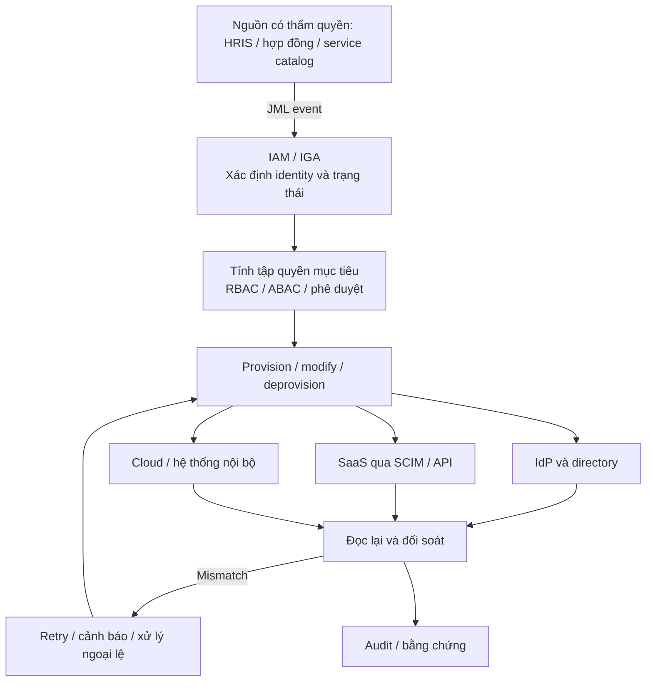
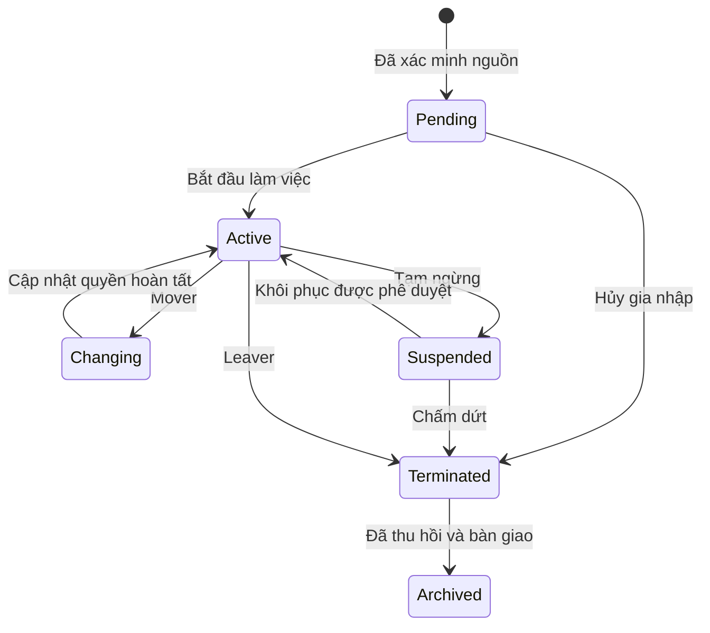

# Joiner mover leaver

## 1. Joiner–Mover–Leaver giải quyết vấn đề gì?

Trong một doanh nghiệp, quyền truy cập vào ứng dụng và dữ liệu phải thay đổi theo quan hệ làm việc. Một nhân viên mới cần có công cụ đúng ngày bắt đầu; người chuyển bộ phận cần được cấp quyền mới **và thu hồi quyền cũ**; người nghỉ việc phải bị chặn truy cập trên mọi hệ thống liên quan.

**Joiner–Mover–Leaver (JML)** là mô hình quản lý ba nhóm sự kiện quan trọng trong **vòng đời danh tính (identity lifecycle)**:

- **Joiner (gia nhập):** một người hoặc thực thể mới bắt đầu quan hệ hợp lệ với tổ chức; IAM xác minh danh tính, tạo/liên kết tài khoản và cấp những quyền cần thiết.
- **Mover (thay đổi):** người hoặc thực thể vẫn được tổ chức quản lý nhưng vai trò, nhóm, dự án, phạm vi hoặc điều kiện truy cập thay đổi; IAM tính lại tập quyền và điều chỉnh các hệ thống đích.
- **Leaver (rời tổ chức/kết thúc):** quan hệ hoặc mục đích sử dụng chấm dứt; IAM chặn đường đăng nhập, thu hồi quyền và credential, xác minh trạng thái thực tế, chuyển giao tài nguyên khi cần.

JML có thể áp dụng cho nhân viên, thực tập sinh, đối tác, nhà thầu và cả **danh tính workload/tài khoản dịch vụ**, dù nguồn sự kiện của chúng khác nhau.

Bài học thuộc module **`SECURITY_IDENTITY_ACCESS_MANAGEMENT_IDENTITY_LIFECYCLE`**, có mục tiêu tìm hiểu **xác minh, tạo tài khoản, cấp quyền, rà soát và thu hồi** trong IAM, kết nối **IdP, SSO, SCIM, RBAC/ABAC**, danh tính máy và kiểm toán nhằm **giảm quyền truy cập tồn dư**.

### Một ví dụ đầu tiên

**Trung** được tuyển vào đội hỗ trợ khách hàng, sau đó chuyển sang tài chính và cuối cùng nghỉ việc.

| Thời điểm | Sự kiện | Tập quyền mong muốn |
| --- | --- | --- |
| Ngày bắt đầu làm việc | Joiner | Email, công cụ nội bộ, quyền đọc/cập nhật ticket theo phạm vi được giao |
| Ngày chuyển phòng ban | Mover | Thu hồi quyền hỗ trợ không cần nữa; cấp quyền tài chính được phê duyệt |
| Ngày nghỉ việc có hiệu lực | Leaver | Không còn quyền đăng nhập hoặc truy cập ứng dụng, dữ liệu và credential liên quan |
| Sau nghỉ việc | Đối soát | Không còn tài khoản/phiên/quyền tồn dư trái chính sách; log được lưu theo quy định |

**Không thể coi quy trình JML hoàn tất chỉ vì HRIS đã ghi nhận thay đổi.** IAM phải biến sự kiện thành thay đổi **thực tế** tại các hệ thống đích và chứng minh kết quả đó.

## 2. Phân biệt sự kiện nghiệp vụ và thao tác kỹ thuật

Một sự kiện JML thường bắt đầu từ **nguồn có thẩm quyền (authoritative source)**, ví dụ:

- **HRIS** cho nhân viên: tuyển mới, đổi vị trí, tạm nghỉ, kết thúc hợp đồng.
- **Hệ thống hợp đồng hoặc người bảo trợ nội bộ** cho đối tác và nhà thầu: ký, gia hạn, đổi phạm vi, chấm dứt.
- **Service catalog, deployment registry hoặc IaC** cho workload: tạo dịch vụ, thay đổi môi trường/owner, ngừng dịch vụ.

Sự kiện nghiệp vụ `employee.terminated` **không phải** lệnh kỹ thuật `disable user`. Từ một sự kiện có thể phát sinh nhiều hành động:



**Điểm mấu chốt:** nguồn nghiệp vụ quyết định **điều gì được phép tồn tại**, còn IAM phải theo dõi **điều gì thực sự đang tồn tại** trong IdP và từng ứng dụng.

### Phân biệt identity, account và entitlement

| Khái niệm | Ví dụ | Cách JML tác động |
| --- | --- | --- |
| **Identity** | Người có ID nội bộ `person-701` | Tạo, thay đổi thuộc tính, chuyển trạng thái vòng đời |
| **Account** | Tài khoản IdP, Git, CRM, cloud | Provision, cập nhật, disable, liên kết hoặc xử lý lưu trữ |
| **Entitlement** | Vai trò `SupportAgent`, quyền `finance.report.read` | Cấp mới, giữ lại, giới hạn hoặc thu hồi |
| **Credential/session** | Passkey, SSH key, PAT, refresh token, phiên web | Cấp, luân chuyển, hết hạn hoặc thu hồi theo khả năng nền tảng |
| **Resource ownership** | Repository, pipeline, tài liệu, workflow | Bàn giao hoặc đổi owner khi Mover/Leaver |

Một identity có thể có nhiều account. Khóa một account không tự động thay đổi mọi account khác; thu hồi entitlement cũng chưa chắc làm phiên đã cấp trước đó mất hiệu lực.

## 3. Những dữ liệu tối thiểu để xử lý JML

Trước khi tự động hóa, hệ thống cần biết **danh tính nào**, **sự kiện nào**, **khi nào có hiệu lực** và **chính sách nào áp dụng**.

| Dữ liệu | Mục đích | Sai lầm thường gặp |
| --- | --- | --- |
| `sourceSystem`, `sourceSubjectId` | Xác định nguồn có thẩm quyền và bản ghi nguồn | Chỉ dùng email hoặc tên hiển thị làm khóa |
| `identityId` | ID quản trị ổn định, ánh xạ nhiều account | Tạo identity mới mỗi lần đổi email |
| `eventId`, `eventType` | Truy vết, tránh xử lý cùng sự kiện nhiều lần | Chạy lại sự kiện gây cấp trùng quyền |
| `effectiveAt` | Thời điểm nghiệp vụ có hiệu lực | Đồng nhất thời điểm nhận thông báo với thời điểm nghỉ việc |
| `eventVersion` / revision | Xử lý sự kiện cũ, sai thứ tự | Sự kiện Mover tới trễ làm mở lại quyền sau Leaver |
| `department`, `jobRole`, `managerId` | Tính quyền, luồng phê duyệt | Tin thuộc tính người dùng tự khai |
| `employmentType`, `contractEndAt` | Phân biệt nhân viên/nhà thầu và thời hạn | Tài khoản nhà thầu không bao giờ hết hạn |
| `requestedExceptions` / approval | Kiểm soát quyền ngoài baseline | Cấp đặc quyền theo yêu cầu không có người phê duyệt |
| `targetAccounts` / mapping | Xác định tài khoản đích cần tác động | Bỏ sót account cục bộ không liên kết |
| `correlationId` | Nối log sự kiện, yêu cầu, thao tác và kết quả | Không chứng minh được quyền đã bị thu hồi |

Ví dụ một sự kiện Mover, **dữ liệu minh họa**:

```json
{
  "eventId": "hr-event-906",
  "eventType": "employee.department.changed",
  "sourceSystem": "hris",
  "sourceSubjectId": "HR-0701",
  "identityId": "person-701",
  "eventVersion": 8,
  "effectiveAt": "2026-12-01T09:00:00+07:00",
  "attributes": {
    "oldDepartment": "Support",
    "newDepartment": "Finance",
    "newJobRole": "FinancialAnalyst",
    "managerId": "person-107"
  },
  "correlationId": "jml-2026-00418"
}
```

Các trường trong ví dụ không phải schema chuẩn chung. Tên sự kiện và cấu trúc tích hợp phụ thuộc nền tảng thực tế.

### Ba loại thời điểm cần quan sát

- **Effective time:** khi thay đổi nghiệp vụ bắt đầu có hiệu lực, chẳng hạn hết hợp đồng vào ngày được phê duyệt.
- **Processing time:** khi IAM nhận và xử lý sự kiện; có thể trễ do hàng đợi.
- **Enforcement/verification time:** khi quyền **thực sự** được cấp/thu hồi ở ứng dụng đích và được xác minh.

Với yêu cầu an toàn, đo độ trễ Leaver theo **thời điểm truy cập bị chặn**, không chỉ lúc cập nhật HRIS.

## 4. Quy trình Joiner: Xác minh, chuẩn bị và cấp quyền ban đầu

**Joiner** phải đạt hai mục tiêu đồng thời: người mới làm việc được đúng lúc và chỉ được cấp những quyền cần thiết.

### 4.1. Quy trình triển khai

1. **Nhận sự kiện đã được phê duyệt:** xác minh nguồn, mã nhân sự/đối tác, ngày bắt đầu và người quản lý. Tránh tự tin một email là bằng chứng danh tính.
2. **Xác minh danh tính và xử lý trùng:** tra theo ID ổn định; trường hợp rehire phải kiểm tra mối quan hệ với danh tính cũ.
3. **Tạo identity:** gán `identityId`, loại danh tính, trạng thái `pending` hoặc tương đương, owner/manager và nguồn thuộc tính.
4. **Xác định birthright/baseline access:** các ứng dụng cần cho loại công việc và bộ phận, ví dụ email, chấm công, tài liệu nội bộ.
5. **Đánh giá quyền bổ sung:** các quyền tài chính nhạy cảm, quản trị, production phải có căn cứ, phê duyệt và thời hạn nếu phù hợp.
6. **Provision account:** tạo tại IdP/directory và các hệ thống đích bằng SCIM, connector, API hoặc quy trình kiểm soát.
7. **Thiết lập AuthN:** đăng ký passkey, MFA hoặc phương thức xác thực phù hợp; đảm bảo bước khôi phục tài khoản an toàn.
8. **Kích hoạt theo thời điểm:** quyền truy cập chỉ có hiệu lực khi chính sách cho phép; pre-provision tài khoản không có nghĩa mở truy cập sớm.
9. **Xác minh và thông báo:** đọc trạng thái từng hệ thống đích, xử lý lỗi và lưu bằng chứng đã cấp tài khoản/quyền.

### 4.2. Ví dụ cấp quyền theo vai trò

Nhân viên **Mai** gia nhập bộ phận hỗ trợ:

| Quyền | Có cấp tự động? | Căn cứ |
| --- | --- | --- |
| Email và hệ thống nội bộ chung | Thường có, theo baseline | Quan hệ làm việc active |
| CRM: xem và cập nhật ticket của nhóm | Có thể cấp theo vai trò | `SupportAgent` và phạm vi nhóm |
| Xuất toàn bộ dữ liệu khách hàng | Không mặc định | Phê duyệt riêng, mục đích và thời hạn |
| Quản trị IdP | Không | Vai trò quản trị đặc biệt, kiểm soát PAM |
| Triển khai production | Không | Nhu cầu công việc, phê duyệt, quyền ngắn hạn |

Mô hình **Role-Based Access Control (RBAC)** có thể gán các quyền nền theo chức danh. **Attribute-Based Access Control (ABAC)** có thể giới hạn theo bộ phận, tenant, khu vực, trạng thái active hoặc điều kiện phiên.

### 4.3. Khác biệt giữa account sẵn sàng và quyền có hiệu lực

Một tài khoản có thể đã tạo thành công qua SCIM nhưng không có nhóm cần thiết. Ngược lại, tài khoản có thể đã có role nhưng vẫn ở trạng thái disabled vì chưa tới ngày bắt đầu. Do vậy Joiner cần xác nhận:

- Account có tồn tại với đúng người và đúng tenant?
- Account có trạng thái và nhóm phù hợp tại **thời điểm hiện tại**?
- Người dùng có cơ chế xác thực hợp lệ và an toàn?
- Các quyền nhạy cảm có đầy đủ phê duyệt?
- Quyền có hiệu lực ở chính API/ứng dụng hay mới chỉ được ghi trong yêu cầu IAM?

### 4.4. Các ca Joiner đặc biệt

- **Pre-joiner:** chuẩn bị danh tính/tài khoản nhưng giới hạn quyền và giữ nguyên ngày hiệu lực.
- **No-show / hủy nhận việc:** phải hủy kích hoạt và dọn các quyền đã provision, không để tài khoản pending tồn tại mãi.
- **Rehire:** xác minh chủ thể, quyết định liên kết identity/account trước đây; **không tự phục hồi đặc quyền cũ**.
- **Nhà thầu:** cần người bảo trợ, mục đích và ngày hết hạn hợp đồng; quyền không nên tiếp tục sau mốc hết hạn nếu không gia hạn hợp lệ.

## 5. Quy trình Mover: Cấp quyền mới và thu hồi quyền cũ

**Mover** xảy ra khi bộ phận, chức danh, dự án, quản lý, hợp đồng, môi trường hoặc phạm vi công việc thay đổi. Người dùng có thể vẫn đăng nhập bằng cùng một account IdP nhưng cần tập quyền khác.

### 5.1. Tại sao Mover dễ bị bỏ sót?

Hệ thống onboarding thường giỏi **cấp quyền**; khi thay đổi vai trò, đơn vị mới có thể yêu cầu cấp thêm nhóm, trong khi chẳng ai chịu trách nhiệm gỡ nhóm cũ. Đây là nguồn tạo **privilege accumulation** và **residual access**.

Ví dụ quyền của người chuyển Hỗ trợ → Tài chính:

```text
Quyền thực tế trước Mover:
  {crm.ticket.read, crm.ticket.update, docs.read}

Quyền mục tiêu sau Mover:
  {finance.report.read, docs.read}

Quyền cần thu hồi:
  {crm.ticket.read, crm.ticket.update}

Quyền cần cấp:
  {finance.report.read}

Quyền tiếp tục giữ:
  {docs.read}
```

Phép trừ tập hợp là cách biểu diễn đơn giản. Trong thực tế còn cần xử lý quyền cấp qua nhiều nhóm, quyền ngoại lệ, quyền dự án, phân tách nhiệm vụ và thuộc tính ABAC.

### 5.2. Các bước triển khai Mover

1. **Nhận sự kiện thay đổi hợp lệ** kèm ngày có hiệu lực, ID ổn định và các thuộc tính trước/sau.
2. **Tính quyền mục tiêu** từ vai trò hiện tại, thuộc tính, owner, chính sách tổ chức và ngoại lệ còn hiệu lực.
3. **Đọc quyền thực tế** ở IdP, ứng dụng, cloud và nguồn cấp quyền thủ công quan trọng.
4. **Phân loại chênh lệch** thành: giữ nguyên, cấp mới, thu hồi, quyền ngoại lệ cần xét lại.
5. **Kiểm tra SoD** (separation of duties) và quyền đặc quyền trước khi cấp vai trò mới.
6. **Thu hồi quyền cũ không còn hợp lệ**, cấp quyền mới theo thứ tự vận hành được phê duyệt; nếu cần bàn giao, phải có hạn và owner.
7. **Cập nhật account/nhóm/thuộc tính** qua SCIM, API hoặc connector, đồng thời bảo đảm điểm kiểm tra quyền ở ứng dụng dùng thông tin cập nhật.
8. **Đối soát kết quả**, ghi ngoại lệ do hệ thống đích chưa áp dụng.
9. **Rà soát sau chuyển đổi** để phát hiện quyền tồn dư hoặc quyền phát sinh ngoài hệ thống quản lý.

### 5.3. Mover và vai trò tạm thời

Một nhân viên có thể kiêm nhiệm trong hai tuần. Nếu công việc thực sự cần quyền cũ, chính sách có thể cho phép **overlap có thời hạn**:

| Trường | Giá trị minh họa |
| --- | --- |
| Quyền giữ tạm | `crm.ticket.read` |
| Lý do | Bàn giao ticket tồn đọng |
| Người phê duyệt | Quản lý nhóm cũ và chủ tài nguyên theo chính sách |
| Ngày hết hạn | 14 ngày sau chuyển nhóm |
| Hành động sau hạn | Thu hồi và xác nhận tại CRM |
| Bằng chứng | Ticket phê duyệt, log revoke, trạng thái đọc lại |

Quyền tạm **không** nên tồn tại vô thời hạn chỉ vì chưa phát sự kiện mới. Nếu ứng dụng không hỗ trợ expiry tự động, workflow phải có nhiệm vụ thu hồi và cảnh báo quá hạn.

### 5.4. Mover không nhất thiết thay đổi AuthN

Thông thường người dùng vẫn dùng một tài khoản IdP và phương thức đăng nhập như cũ. Vấn đề quan trọng của Mover là **AuthZ**: vai trò, thuộc tính, entitlement phải thay đổi. Tuy nhiên, nếu nhiệm vụ mới nhạy cảm hơn, có thể bổ sung MFA/step-up hoặc kiểm soát PAM phù hợp.

## 6. Quy trình Leaver: Thu hồi có xác nhận trên mọi đường truy cập

**Leaver** diễn ra khi người dùng kết thúc quan hệ hoặc workload ngừng mục đích sử dụng. Trạng thái `terminated` trong HRIS chỉ là tín hiệu để tổ chức **thực thi thu hồi**, chưa chứng minh truy cập đã chấm dứt.

### 6.1. Các lớp cần kiểm tra

| Lớp | Hành động có thể cần | Lý do |
| --- | --- | --- |
| **Nguồn danh tính / identity registry** | Đánh dấu ended/terminated theo thời điểm hiệu lực | Quyết định nguồn về tư cách truy cập |
| **IdP và directory** | Disable account, chặn xác thực mới | Giảm đường vào qua SSO |
| **Ứng dụng SaaS và nội bộ** | Deactivate, remove groups/roles hoặc revoke account | Có thể còn tài khoản cục bộ |
| **Cloud/VPN/đặc quyền** | Thu hồi IAM role, quyền admin, quyền truy cập hạ tầng | Đường quản trị không nhất thiết đi qua IdP |
| **Phiên, refresh token** | Revoke session/refresh token nếu hệ thống hỗ trợ | Phiên được tạo trước có thể tiếp tục hợp lệ |
| **Access token** | Dùng cơ chế thu hồi/introspection hoặc giới hạn thời gian sống theo kiến trúc | Token đã phát hành có thể chưa hết hạn |
| **SSH key, PAT, API key, secret** | Thu hồi hoặc rotate credential cá nhân/được chia sẻ khi cần | Credential có thể hoạt động độc lập |
| **Tài sản và ownership** | Chuyển repository, workflow, ứng dụng, tài khoản dịch vụ | Giảm rủi ro vô chủ và gián đoạn |
| **Audit và lưu trữ** | Lưu lịch sử theo chính sách, phân loại dữ liệu cần giữ | Cần chứng minh đã chặn truy cập mà không xóa bằng chứng |

### 6.2. Thứ tự ưu tiên khi Leaver

Thứ tự cụ thể tùy rủi ro và yêu cầu vận hành, nhưng thường cần:

1. **Nhận sự kiện hợp lệ với thời điểm chấm dứt**. Trường hợp rủi ro cao có thể cần khóa ngay theo quyết định được ủy quyền.
2. **Chặn đường xác thực tập trung** và quyền đặc quyền có tác động lớn.
3. **Vô hiệu hóa account đích** qua SCIM/API/connector, theo dõi từng hệ thống.
4. **Xử lý phiên và credential** phù hợp với khả năng ứng dụng và thông tin đã cấp.
5. **Chuyển giao ownership** đối với tài nguyên và automation còn cần thiết, tránh tự làm dừng hệ thống nghiệp vụ.
6. **Đọc lại và đối soát trạng thái**: xác minh tài khoản, nhóm/quyền và đường truy cập còn tồn tại.
7. **Ghi bằng chứng, đóng ngoại lệ** và lưu hồ sơ theo chính sách.

Một số bước bàn giao phải chuẩn bị **trước** thời điểm nghỉ. Không nên chờ bàn giao xong mới chặn quyền nếu đã có yêu cầu thu hồi có hiệu lực.

### 6.3. Vì sao khóa IdP chưa đủ?

Ứng dụng có thể tiếp tục chấp nhận:

- tài khoản cục bộ đăng nhập bằng credential riêng;
- phiên web đã tạo trước khi IdP disabled;
- access token tự chứa còn hạn và chưa có cơ chế thu hồi;
- personal access token, SSH key, API key hoặc dịch vụ ủy quyền;
- role/nhóm được quản lý riêng bởi hệ thống đích.

Ví dụ: API nhận JWT và chỉ xác minh chữ ký cùng ngày hết hạn. Nếu không có cơ chế kiểm tra trạng thái người dùng hoặc revoke phù hợp, token đã phát hành có thể vẫn được chấp nhận sau khi HRIS đánh dấu Leaver. Tùy mức rủi ro, cần chọn thời hạn ngắn, thu hồi refresh token, kiểm tra trạng thái hoặc chặn tại resource server.

### 6.4. Leaver và quyền riêng tư, lưu trữ

**Vô hiệu hóa truy cập** không đồng nghĩa **xóa ngay mọi hồ sơ**. Doanh nghiệp có thể cần giữ tài liệu, log và bản ghi nhân sự theo quy định. Việc xóa hay lưu trữ dữ liệu phải theo chính sách riêng; account giữ lại để lưu hồ sơ **không được có đường truy cập còn hợp lệ**.

## 7. Trạng thái vòng đời và các ngoại lệ ngoài ba chữ JML

JML là cách nhóm sự kiện nghiệp vụ, **không phải** tập trạng thái chuẩn bắt buộc ở mọi nền tảng. Tổ chức có thể định nghĩa:

| Trạng thái minh họa | Diễn giải | Nguyên tắc truy cập |
| --- | --- | --- |
| **Pending** | Đã được xác minh nhưng chưa tới ngày bắt đầu | Có thể chuẩn bị account; hạn chế quyền trước thời điểm có hiệu lực |
| **Active** | Quan hệ đang có hiệu lực | Cho phép theo chính sách hiện tại |
| **Changing** | Đang đổi bộ phận/vai trò | Phải hoàn tất điều chỉnh quyền mục tiêu |
| **Suspended** | Tạm ngừng do nghiệp vụ hoặc rủi ro | Chặn hoặc hạn chế truy cập theo quy trình có phê duyệt |
| **Terminated** | Quan hệ kết thúc | Thu hồi và xác minh quyền truy cập |
| **Archived** | Danh tính không hoạt động, chỉ giữ hồ sơ | Không cấp quyền sử dụng; quản lý dữ liệu lưu trữ |

Sơ đồ một vòng đời minh họa:



Một số tình huống đặc biệt:

- **Leave of absence:** nghỉ dài ngày nhưng chưa chấm dứt quan hệ; có thể cần hạn chế quyền tạm thời.
- **Termination cancelled:** nghỉ việc được hủy trước ngày hiệu lực; phải kiểm tra phiên bản sự kiện trước khi tác động.
- **Rehire:** tạo quan hệ mới đã xác minh, không tự khôi phục quyền cũ.
- **Dual employment/project:** một người có nhiều vai trò cùng thời điểm; cần xác định quyền nào vẫn có căn cứ.
- **Emergency suspension:** chặn truy cập khẩn cấp có thể cần nhanh hơn luồng HR thông thường, nhưng phải có tác nhân được ủy quyền và audit.

## 8. RBAC, ABAC và cách xác định quyền mục tiêu

JML nói **khi nào** cần thay đổi quyền. **RBAC/ABAC** hỗ trợ trả lời **quyền nào** cần tồn tại sau thay đổi.

### RBAC – Role-Based Access Control

RBAC gán tập quyền cho vai trò nghiệp vụ. Ví dụ:

| Vai trò | Quyền nền minh họa |
| --- | --- |
| `SupportAgent` | `crm.ticket.read`, `crm.ticket.update-assigned` |
| `FinanceViewer` | `finance.report.read` |
| `FinanceApprover` | `finance.payment.approve` theo hạn mức |
| `CloudOperator` | `cloud.logs.read`, vận hành tài nguyên được chỉ định |

Khi Mover, hệ thống phải tính lại vai trò **và thu hồi vai trò không còn cần**. Khi Leaver, quyền được gán qua vai trò cũng phải mất hiệu lực theo chính sách.

### ABAC – Attribute-Based Access Control

ABAC ra quyết định theo thuộc tính của chủ thể, tài nguyên, hành động và bối cảnh.

Ví dụ giả mã, **không phải cú pháp của sản phẩm cụ thể**:

```text
PERMIT invoice.read WHEN
    subject.lifecycleStatus == "active"
    AND subject.department == "Finance"
    AND subject.tenantId == resource.tenantId
    AND subject.region == resource.region
    AND session.authenticationStrength >= resource.requiredStrength
OTHERWISE DENY
```

Nếu người dùng chuyển phòng ban hoặc nghỉ việc, thuộc tính phải cập nhật đúng hạn. Role hoặc thuộc tính cache trong token/phiên có thể tạo **cửa sổ quyền cũ còn hiệu lực**; hệ thống cần chính sách TTL, refresh và kiểm tra trạng thái tương ứng với độ nhạy truy cập.

### Quyền ngoại lệ và SoD

Phép tính tập quyền chỉ là điểm xuất phát. IAM cần xét:

- các quyền ngoài role đã được phê duyệt còn hạn;
- quyền dự án/bàn giao có owner;
- SoD: tập quyền xung đột, ví dụ vừa tạo vừa duyệt giao dịch;
- quyền đặc quyền và khả năng dùng JIT/PAM;
- quyền ở hệ thống legacy chưa có connector;
- ràng buộc môi trường, tenant, dữ liệu hoặc khu vực.

**Default deny/least privilege** giúp giới hạn rủi ro khi thiếu dữ liệu đáng tin cậy hoặc chưa có phê duyệt.

## 9. IdP, SSO và SCIM hỗ trợ JML như thế nào?

Các cơ chế đóng vai trò bổ sung, không thể thay thế lẫn nhau.

| Thành phần | Vai trò đối với JML | Điều cần kiểm tra |
| --- | --- | --- |
| **HRIS / nguồn có thẩm quyền** | Phát sự kiện và trạng thái quan hệ | ID ổn định, dữ liệu đúng, ngày hiệu lực |
| **IdP / Directory** | Xác thực, quản lý account tập trung, nhóm và chính sách đăng nhập | Tài khoản/nhóm/phiên đã cập nhật phù hợp chưa? |
| **SSO qua OIDC/SAML** | Cho phép ứng dụng tin cậy kết quả đăng nhập của IdP | SSO không tự tạo hoặc thu hồi mọi account đích |
| **SCIM 2.0 / connector** | Tạo, cập nhật, deactivate account/nhóm ở ứng dụng | Hỗ trợ của từng ứng dụng và khả năng đối soát |
| **RBAC/ABAC** | Xác định entitlement hoặc điều kiện sử dụng | Tài nguyên/API có thực thi quyết định không? |
| **IGA** | Yêu cầu/phê duyệt quyền, chứng nhận lại, kiểm soát SoD | Quyết định đã được thực thi tại đích chưa? |
| **PAM** | Kiểm soát quyền quản trị và truy cập đặc quyền | Quyền/phiên đặc quyền đã hết hạn hoặc bị thu hồi chưa? |
| **Audit / SIEM** | Theo dõi thay đổi, lỗi và sự kiện truy cập | Có nối được sự kiện HR với kết quả đích không? |

Ví dụ một yêu cầu SCIM PATCH để **deactivate** account (ID và endpoint minh họa):

```http
PATCH /scim/v2/Users/6a0bd642-4492-48c6-91e0-f9638c9657ad HTTP/1.1
Authorization: Bearer <redacted>
Content-Type: application/scim+json

{
  "schemas": ["urn:ietf:params:scim:api:messages:2.0:PatchOp"],
  "Operations": [
    {
      "op": "replace",
      "path": "active",
      "value": false
    }
  ]
}
```

Trong mô hình SCIM, thuộc tính `active` biểu thị trạng thái hoạt động của User. Tuy nhiên, **không nên suy ra** rằng thao tác này tự thu hồi toàn bộ session/token. Cách ứng dụng triển khai và hỗ trợ deprovisioning cần được xác nhận và kiểm thử.

### JIT account provisioning khác JIT privilege

- **JIT account provisioning:** một ứng dụng có thể tạo account khi người dùng đăng nhập SSO lần đầu.
- **JIT privileged access:** quyền nhạy cảm được cấp **trong thời gian ngắn** khi có yêu cầu/phê duyệt hợp lệ.

Hai khái niệm có chữ JIT nhưng phục vụ hai nhu cầu khác nhau. Một ứng dụng tạo account qua SSO vẫn cần có cách vô hiệu hóa account khi Leaver.

## 10. Desired state và actual state: Chìa khóa để xác nhận JML

Các hệ thống IAM thường có hai trạng thái cần giữ riêng:

- **Desired state:** identity, account, quyền và thuộc tính **được phép** tồn tại theo nguồn tin cậy, vai trò, phê duyệt và thời điểm.
- **Actual state:** account, quyền và credential **đang thực sự tồn tại** tại IdP, SaaS, cloud và hệ thống nội bộ.

Ví dụ sau sự kiện Leaver:

| Thành phần | Desired state | Actual state | Kết luận |
| --- | --- | --- | --- |
| IdP account | Disabled | Disabled | Đạt |
| CRM account | Inactive | Active | **Chưa đạt** |
| Git personal access token | Revoked | Token còn hiệu lực | **Chưa đạt** |
| Nhóm cloud admin | Không còn thành viên | Đã thu hồi | Đạt |
| Ownership pipeline | Đã bàn giao | Chưa có owner mới | Cần xử lý vận hành |

**Reconciliation** là quá trình so sánh desired và actual, phát hiện **drift**, xử lý sai lệch hoặc báo người chịu trách nhiệm.

Tránh đánh dấu `COMPLETED` khi chỉ gửi xong lệnh. Trong một workflow nhiều ứng dụng, có thể cần trạng thái **PARTIALLY_COMPLETED**, **RETRY_PENDING**, **ESCALATED** hoặc tương đương để minh bạch tiến độ thực tế.

## 11. Xử lý lỗi, sự kiện trùng và sự kiện sai thứ tự

Một hệ thống JML production cần tính tới những trường hợp không suôn sẻ:

### 11.1. Sự kiện trùng

HRIS gửi lại cùng sự kiện Joiner. Nếu handler không **idempotent**, nó có thể tạo account trùng hoặc cấp quyền sai. Khi xử lý lại, hệ thống cần xác định trạng thái hiện có và chỉ áp dụng thay đổi cần thiết.

### 11.2. Sự kiện đến sai thứ tự

Sự kiện chuyển nhóm tới trễ sau khi Leaver có hiệu lực. Nếu không kiểm tra revision/thời điểm, hệ thống có thể vô tình cấp lại quyền.

**Kiểm soát:** dùng event version hoặc cơ chế xác định trạng thái mới nhất từ nguồn có thẩm quyền; xử lý tranh chấp đồng thời. Không chỉ dựa vào thứ tự các thông điệp đến trong hàng đợi.

### 11.3. Ứng dụng đích bị lỗi

IdP khóa account thành công nhưng CRM trả lỗi HTTP hoặc không phản hồi. Hệ thống nên:

1. Lưu thất bại riêng cho CRM, không coi toàn bộ Leaver đã hoàn tất.
2. Thử lại có giới hạn theo chiến lược phù hợp; tránh gửi lặp gây tác động phụ.
3. Cảnh báo/đẩy xử lý thủ công khi quá thời hạn hoặc cần ưu tiên rủi ro.
4. Áp dụng kiểm soát bù trừ khi có thể, như chặn tại điểm truy cập khác theo chính sách.
5. Đọc lại trạng thái CRM sau khi thực thi và lưu bằng chứng.

### 11.4. Thuộc tính bị chỉnh thủ công

Quản trị viên ứng dụng thêm role ngoài IAM. Reconciliation cần phát hiện role không thuộc desired state và áp dụng chính sách: thu hồi tự động nếu được ủy quyền, hoặc đưa vào review với owner và thời hạn.

### 11.5. Phụ thuộc không thể tháo ngay

Một service account đang chạy workload có owner là người sắp nghỉ. Nếu vô hiệu hóa toàn bộ ngay mà không bàn giao, hệ thống sản xuất có thể dừng. Ngược lại, bỏ nguyên credential vô hạn cũng không an toàn.

**Cách làm:** chuẩn bị chuyển ownership, đổi credential liên quan, chia lại quyền và xác minh workload vẫn vận hành an toàn; thu hồi các quyền gắn với người đã nghỉ.

### 11.6. Mẫu xử lý sự kiện có kiểm soát

Giả mã mô tả ý tưởng, **không phải code có thể triển khai trực tiếp**:

```text
processJmlEvent(event):
    verifyAuthoritativeSource(event)
    identity = resolveStableIdentity(event.sourceId, event.subjectId)

    if event.isStaleComparedTo(identity.lastAppliedVersion):
        audit("ignored-stale-event", event)
        return

    updateIdentityFromEvent(identity, event)

    desired = computeDesiredState(
        identity = identity,
        rolePolicy = activePolicy,
        approvals = validApprovals,
        effectiveAt = event.effectiveAt
    )

    actual = readActualAccountsAndEntitlements(identity)
    changes = diff(actual, desired)

    for change in prioritizeRisk(changes):
        result = applyIdempotently(change)
        recordResult(event, change, result)

        if result.failed:
            queueRetryAndEscalation(change)

    reconcileWithTargetSystems(identity, desired)
```

Khi triển khai thật, cần đảm bảo kiểm tra version và cập nhật trạng thái có cơ chế **concurrency control**, bảo vệ các thông điệp nguồn và không làm mất sự kiện khi xử lý lại. Đối với Leaver nhạy cảm, tác vụ chặn truy cập có thể phải được ưu tiên trước các công việc ít rủi ro.

## 12. Phân công trách nhiệm trong JML

JML liên quan tới nhiều đội. Nếu không xác định ai chịu trách nhiệm, các lỗi có thể nằm trong hàng đợi mà không được xử lý.

| Vai trò tổ chức | Trách nhiệm tiêu biểu |
| --- | --- |
| **HR / quản lý hợp đồng** | Cung cấp sự kiện đáng tin về gia nhập, chuyển vị trí, kết thúc và ngày hiệu lực |
| **Line manager / sponsor** | Xác nhận nhu cầu truy cập, phê duyệt quyền hoặc bảo trợ nhà thầu trong phạm vi được ủy quyền |
| **IAM / IGA team** | Quản lý chính sách, định danh, provisioning, quy trình phê duyệt, vận hành connector và đối soát |
| **Chủ ứng dụng / data owner** | Xác định quyền ứng dụng, phê duyệt quyền nhạy cảm, xác nhận thu hồi và xử lý ngoại lệ |
| **Security / PAM** | Quản lý kiểm soát đặc quyền, tình huống khẩn cấp, giám sát bất thường và điều tra |
| **Platform / DevOps** | Quản lý workload identity, account dịch vụ, trust, credential và quá trình decommission |
| **Audit / compliance** | Kiểm tra bằng chứng, hiệu lực và kết quả của các kiểm soát |

Phân công có thể thay đổi theo tổ chức; điều quan trọng là **mỗi sự kiện, quyền nhạy cảm và lỗi thực thi đều có người chịu trách nhiệm rõ ràng**.

### Phê duyệt và phân tách nhiệm vụ

Ví dụ, quyền tài chính có thể phải được chủ tài nguyên hoặc cấp quản lý được ủy quyền phê duyệt; người yêu cầu không được tự phê duyệt đặc quyền của mình. Quy trình nên kiểm tra **SoD (Separation of Duties)** với những tổ hợp quyền xung đột.

Phê duyệt là **căn cứ để cấp quyền**, nhưng hoàn tất phê duyệt không có nghĩa account đích đã được cập nhật. IAM phải theo dõi riêng phần thực thi.

## 13. Access review: Nếu không có sự kiện JML thì sao?

Ngay cả khi nhân viên không chuyển nhóm, một quyền từng cần thiết vẫn có thể hết nhu cầu vì dự án kết thúc hoặc phạm vi công việc đổi mà nguồn nhân sự chưa phản ánh đầy đủ. Do đó JML cần kết hợp **access review/recertification**.

Một chu kỳ review nên:

1. Trích xuất **quyền thực tế** từ hệ thống đích, không chỉ dữ liệu IAM dự kiến.
2. Gắn mỗi quyền với danh tính, vai trò, owner và căn cứ cấp quyền.
3. Gửi tới đúng người có trách nhiệm: line manager, chủ ứng dụng hoặc chủ dữ liệu.
4. Yêu cầu quyết định **giữ / thu hồi / yêu cầu giải thích**, đặc biệt với quyền đặc quyền và tài khoản dịch vụ.
5. Chuyển quyết định thu hồi thành tác vụ thực thi.
6. Xác nhận quyền đã bị thu hồi và lưu bằng chứng hoàn tất.
7. Theo dõi các quyền không có owner hoặc ngoại lệ quá hạn.

Một review chỉ ghi “quyền này không phù hợp” nhưng không thu hồi tại ứng dụng **chưa giảm được quyền truy cập tồn dư**.

## 14. Áp dụng JML cho tài khoản dịch vụ và workload

**Non-human identity** gồm service account, workload, ứng dụng gọi API, CI/CD, bot và automation. Chúng không vào/ra công ty như nhân viên nhưng vẫn có **vòng đời** tương ứng.

| JML | Ví dụ workload | Kiểm soát nên có |
| --- | --- | --- |
| **Joiner** | Triển khai dịch vụ `invoice-worker` lần đầu | Tạo workload identity, gán owner, xác định mục đích, cấp scope/role tối thiểu |
| **Mover** | Dịch vụ chuyển đội, đổi môi trường, mở rộng tính năng | Cập nhật owner, đánh giá lại quyền, giới hạn trust và credential |
| **Leaver** | Ngừng dịch vụ hoặc xóa pipeline | Thu hồi account, role, key, chứng chỉ, trust relationship và secret liên quan |
| **Access review** | Dịch vụ tồn tại lâu nhưng ít hoạt động | Xác nhận owner, mục đích, credential và thời gian hiệu lực |

Các nguyên tắc quan trọng:

- Mỗi workload có **chủ sở hữu và mục đích** rõ, liên kết với service catalog hoặc nguồn quản lý tương đương.
- Ưu tiên **workload identity/federation** và credential ngắn hạn khi nền tảng hỗ trợ; hạn chế khóa tĩnh lâu dài.
- Phân chia quyền theo dịch vụ, tenant và môi trường; tránh tái sử dụng một credential trên nhiều ứng dụng.
- Có quy trình **rotate, revoke, expire** cho credential và policy.
- Decommission workload phải đi kèm thu hồi quyền, chứ không chỉ xóa container hoặc code.
- Khi người sở hữu workload nghỉ việc, phải **chuyển ownership và rà soát secret/token**, tránh tự xóa hệ thống vẫn đang phục vụ nghiệp vụ.

Ví dụ tài khoản dịch vụ vẫn hoạt động sau khi đội cũ giải thể là một dạng **orphan identity** cần điều tra. Một service account có quyền mạnh không nên tồn tại chỉ vì “chưa ai yêu cầu xóa”.

## 15. Kiểm toán JML cần lưu bằng chứng gì?

Muốn chứng minh quyền truy cập đã được quản lý đúng, log cần nối được **sự kiện nguồn → quyết định IAM → thao tác đích → kết quả xác nhận**.

| Nhóm bằng chứng | Trường ví dụ |
| --- | --- |
| **Nguồn và chủ thể** | `eventId`, `source`, `sourceSubjectId`, `identityId` |
| **Thời điểm** | `effectiveAt`, `processedAt`, `enforcedAt`, `verifiedAt` |
| **Loại thay đổi** | `joiner`, `mover`, `leaver`, account created, entitlement revoked |
| **Hệ thống đích** | `targetSystem`, `tenant`, `targetAccountId` |
| **Căn cứ** | Policy version, manager, sponsor, approval ID, lý do ngoại lệ |
| **Kết quả** | Success, failure, retry, escalated, tài khoản/quyền thực tế |
| **Liên kết** | Correlation ID, workflow run ID, đối tượng chịu tác động |

Ví dụ log **thu hồi quyền sau Mover**:

```json
{
  "eventType": "jml.entitlement.revoked",
  "eventId": "hr-event-906",
  "correlationId": "jml-2026-00418",
  "identityId": "person-701",
  "source": "hris",
  "targetSystem": "crm",
  "targetAccountId": "crm-user-201",
  "entitlement": "ticket.update",
  "reason": "department-change",
  "actor": "iam-automation",
  "policyVersion": "policy-2026-12",
  "result": "success",
  "enforcedAt": "2026-12-01T02:00:21Z",
  "verifiedAt": "2026-12-01T02:00:30Z"
}
```

Đây chỉ là schema minh họa. Log thực tế phải phù hợp hệ thống và chính sách dữ liệu. Cần bảo vệ log khỏi chỉnh sửa/xóa trái phép, có thời hạn lưu và kiểm soát truy cập. **Không ghi mật khẩu, access token hoặc secret ở dạng rõ**.

### Cách trả lời khi có sự cố

Nếu có truy cập trái phép sau khi một nhân viên nghỉ việc, chuỗi audit cần hỗ trợ điều tra:

1. Sự kiện Leaver được tạo và có hiệu lực khi nào?
2. Hệ thống IAM nhận và ra quyết định thu hồi khi nào?
3. Hệ thống đích nào thất bại hoặc phản hồi chậm?
4. Token, phiên, role nào còn hoạt động ở thời điểm xảy ra truy cập?
5. Cơ chế cảnh báo/đối soát có phát hiện sai lệch không?
6. Việc khắc phục được áp dụng và xác nhận lúc nào?

## 16. Các chỉ số đo chất lượng JML

Một hệ thống JML không nên chỉ đo số tài khoản tạo hoặc số ticket đóng. Mục tiêu là **sẵn sàng đúng lúc và chặn quyền sai lệch đúng hạn**.

| Chỉ số | Ý nghĩa | Gợi ý cách đo |
| --- | --- | --- |
| **Joiner readiness** | Người mới có đủ quyền nền khi bắt đầu? | Tỷ lệ account/quyền cần thiết được xác nhận có hiệu lực đúng lúc |
| **Joiner overprovisioning** | Người mới có quyền vượt baseline? | Số quyền không có căn cứ phù hợp/không được phê duyệt |
| **Mover residual entitlements** | Quyền cũ có tồn tại sau đổi vai trò? | Số hoặc tỷ lệ quyền ngoài desired state sau hiệu lực Mover |
| **Leaver revocation latency** | Truy cập còn kéo dài bao lâu sau Leaver? | Chênh lệch từ mốc hiệu lực đến lúc đích xác nhận chặn |
| **Deprovisioning success rate** | Tác vụ thu hồi thành công bao nhiêu? | Số tác vụ được hệ thống đích xác nhận / tổng phải thu hồi |
| **Orphan account count** | Còn tài khoản không có identity/owner hợp lệ? | Reconciliation giữa inventory account và registry |
| **Expired exceptions** | Quyền tạm đã quá hạn nhưng chưa thu hồi? | Số ngoại lệ quá hạn và thời gian quá hạn |
| **Review remediation completion** | Quyền được quyết định thu hồi có bị thu hồi thật? | Tỷ lệ quyết định đã có bằng chứng thực thi |
| **Workload ownership coverage** | Các danh tính máy có chủ sở hữu? | Tỷ lệ service account/workload gắn owner hợp lệ |

Không có mức SLA chung đúng cho mọi tổ chức. Ngưỡng thời gian và chu kỳ review cần dựa trên mức nhạy cảm dữ liệu, loại chủ thể, rủi ro đặc quyền và tính sẵn sàng của hệ thống đích.

### Cẩn thận với chỉ số đánh lừa

Ví dụ, `100% Leaver tickets closed` có thể nghe tốt nhưng không có ý nghĩa an toàn nếu CRM còn tài khoản active. Phải phân biệt **trạng thái workflow**, **kết quả gọi API** và **trạng thái truy cập thực tế**.

## 17. Tình huống xuyên suốt: Một nhân viên qua toàn bộ JML

**An** gia nhập bộ phận Hỗ trợ ngày 1/12, chuyển sang Tài chính sau ba tháng và nghỉ việc cuối năm sau.

### Mốc A – Joiner

1. HRIS cung cấp ID ổn định, ngày bắt đầu, bộ phận, manager.
2. IAM tạo identity `person-701`, liên kết account IdP.
3. Công cụ provisioning tạo tài khoản CRM và cấp `SupportAgent`.
4. An đăng ký MFA, đăng nhập qua SSO vào CRM.
5. IAM đối soát: account active đúng thời điểm, chỉ có quyền hỗ trợ theo phạm vi.

**Điểm cần kiểm soát:** quyền mặc định đủ dùng, không cấp quyền tài chính hoặc production không có căn cứ.

### Mốc B – Mover

1. HRIS đổi `department=Finance` với ngày hiệu lực.
2. IAM xác định quyền mới: `finance.report.read`; quyền cũ `crm.ticket.update` phải thu hồi.
3. Chủ tài nguyên phê duyệt quyền tài chính, kiểm tra SoD.
4. CRM được cập nhật qua connector; ứng dụng tài chính được provision.
5. IAM đọc lại trạng thái đích và theo dõi các quyền cũ chưa thu hồi.

Nếu cần bàn giao ticket một tuần, quyền đọc tạm phải có phê duyệt và expiry. MFA thành công không giải quyết được sai lệch quyền ứng dụng.

### Mốc C – Leaver

1. HRIS xác nhận mốc kết thúc quan hệ.
2. IdP được khóa đúng thời điểm; các quyền tài chính và cloud được thu hồi.
3. Các ứng dụng đích được vô hiệu hóa; token, phiên và khóa liên quan được xử lý theo khả năng.
4. Các báo cáo và lịch tác vụ do An sở hữu được bàn giao.
5. IAM rà soát quyền tồn dư và lưu bằng chứng offboarding.

### Mốc D – Có lỗi tại một hệ thống

Giả sử IdP đã khóa nhưng ứng dụng tài chính không phản hồi. Khi đó:

- Workflow phải thể hiện **đang hoàn tất một phần**, chỉ rõ ứng dụng lỗi.
- Cần retry và cảnh báo; nếu mức độ rủi ro cao, áp dụng kiểm soát bù trừ thích hợp.
- Sau khi hệ thống hoạt động, IAM xác nhận account inactive và entitlement đã thu hồi.
- Ghi timestamp thực thi và xác minh, không thay đổi ngược lịch sử sự kiện.

Quy trình này thể hiện đặc điểm quan trọng của JML: **điều phối nhiều hệ thống không phải lúc nào cũng nguyên tử**, nên phải có cơ chế đối soát và khắc phục.

## 18. Những sai lầm phổ biến khi triển khai JML

| Sai lầm | Hệ quả | Cách khắc phục |
| --- | --- | --- |
| Chỉ dựa vào email để xác định identity | Trùng tài khoản, ánh xạ nhầm khi email đổi/tái sử dụng | Dùng ID ổn định và nguồn có thẩm quyền |
| Chỉ tạo quyền lúc Joiner, không tự động thu hồi lúc Mover | Privilege accumulation | Tính chênh lệch desired/actual; thu hồi quyền cũ |
| Cấp role mới trước rồi quên gỡ role cũ | Tập quyền xung đột, SoD | Rà soát vai trò cũ và tập quyền tổng thể |
| Khóa IdP là coi Leaver hoàn tất | Ứng dụng cục bộ, token và phiên có thể còn hiệu lực | Deprovision từng hệ thống, xử lý credential, xác minh đích |
| Không quản lý ngày hiệu lực | Cấp quá sớm hoặc thu hồi quá muộn | Đồng bộ thời gian/múi giờ và kiểm soát lịch |
| Không có idempotency/versioning | Sự kiện trùng, cũ làm tạo lại hoặc mở lại quyền | ID sự kiện, kiểm tra version và desired state |
| Review chỉ ghi quyết định | Quyền bị từ chối vẫn tồn tại | Gắn review với tác vụ revoke và readback |
| Không có owner cho tài khoản dịch vụ | Khóa lâu dài, quyền máy vô chủ | Service catalog, owner, rotate, decommission |
| Gửi lệnh là đánh dấu thành công | Bỏ qua lỗi đồng bộ và sai lệch thực tế | Retry, reconciliation, audit kết quả |
| Không có kiểm soát đặc quyền tạm thời | Quyền khẩn cấp tồn tại không thời hạn | JIT/PAM, expiry và hậu kiểm |

## 19. Danh sách kiểm tra triển khai JML

Một thiết kế JML đáng tin cần trả lời được các câu hỏi sau:

1. Sự kiện Joiner/Mover/Leaver đến từ **nguồn có thẩm quyền** nào?
2. Danh tính có **ID ổn định**, mapping đến các account và owner phù hợp không?
3. Sự kiện có **ngày hiệu lực, phiên bản, correlation ID** và khả năng xử lý trùng/sai thứ tự không?
4. Với Joiner, account/quyền nền sẵn sàng đúng lúc và quyền đặc biệt được phê duyệt chưa?
5. Với Mover, hệ thống có **thu hồi quyền cũ**, xử lý SoD và ngoại lệ có hạn không?
6. Với Leaver, IdP, account đích, phiên, token, SSH/PAT/API key và quyền đặc quyền đã được kiểm tra chưa?
7. Ứng dụng dùng SSO nhưng không có SCIM thì **quy trình deprovision** là gì?
8. RBAC/ABAC có dùng thuộc tính đúng và được thực thi tại backend/API không?
9. Mỗi tác vụ thất bại có retry, owner, cảnh báo và hướng xử lý rõ ràng không?
10. Có thể đọc lại **trạng thái thực tế** và so với desired state không?
11. Account dịch vụ có owner, mục đích, credential và quy trình decommission không?
12. Audit có nối được **sự kiện nguồn → phê duyệt → thay đổi quyền → kết quả đích** không?

### Tổng kết

**Joiner–Mover–Leaver là mô hình điều phối quyền truy cập theo vòng đời thực của danh tính.** Joiner tạo và cấp đúng quyền khi quan hệ bắt đầu; Mover cập nhật **và thu hồi** quyền theo trách nhiệm mới; Leaver chặn các đường truy cập và xác nhận quyền đã kết thúc. Để triển khai hiệu quả, IAM phải kết hợp nguồn sự kiện có thẩm quyền, IdP/SSO, SCIM/connector, RBAC/ABAC, quản trị tài khoản dịch vụ, retry, reconciliation và audit. Thành công của JML được đánh giá bằng **trạng thái tài khoản và quyền thực tế ở hệ thống đích**, qua đó giảm quyền truy cập tồn dư.

