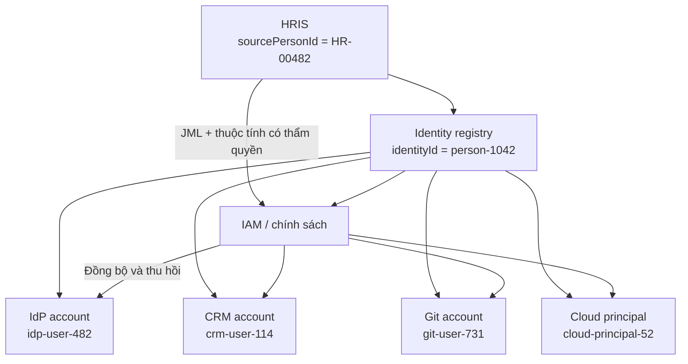
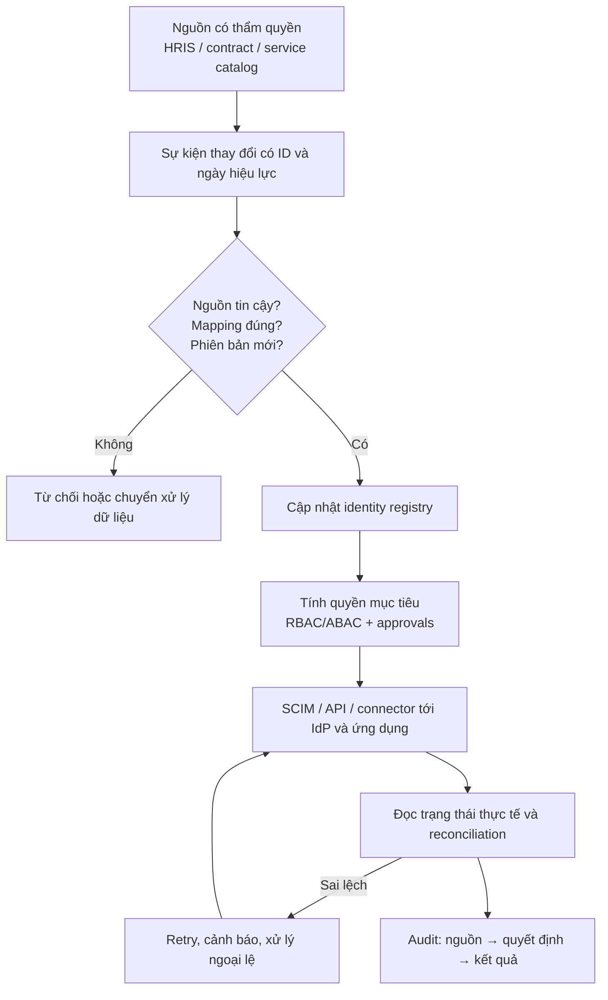
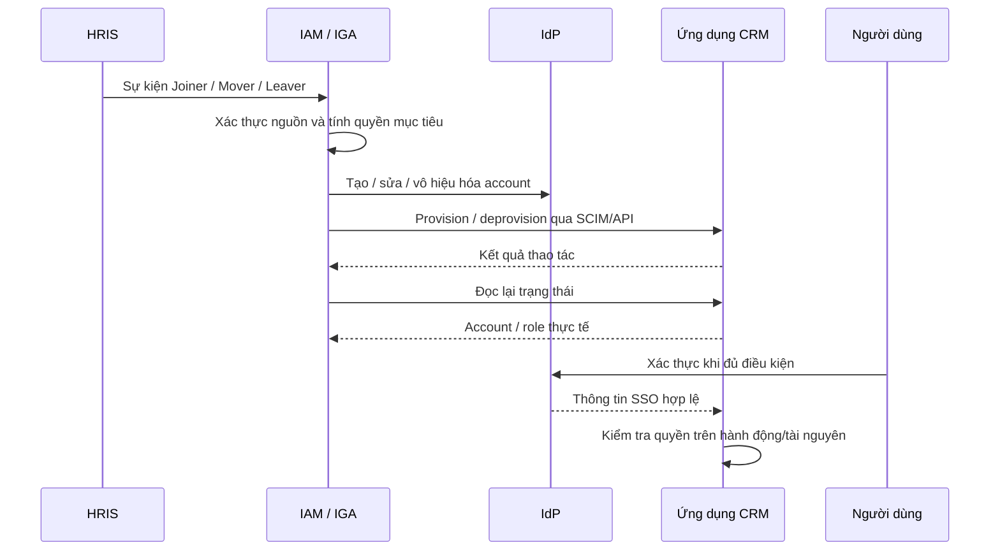

# Nguồn sự thật về identity

## 1. Bài toán: Khi nhiều hệ thống cùng khẳng định một danh tính đang hoạt động

Giả sử một công ty có hệ thống nhân sự (HRIS), Identity Provider (IdP), ứng dụng quản lý khách hàng (CRM), nền tảng Git và dịch vụ cloud. Một nhân viên tên **Lan** đã nghỉ việc:

- HRIS ghi nhận hợp đồng kết thúc vào cuối ngày hôm qua.
- IdP vẫn hiển thị tài khoản `active` do quá trình đồng bộ bị lỗi.
- CRM lưu bản sao thuộc tính `department = Sales` từ ba tháng trước.
- Ứng dụng cloud có một vai trò quản trị được cấp thủ công nhưng không được ghi nhận trong công cụ IAM.

Nếu hỏi **“Lan có còn là nhân viên hợp lệ không?”**, HRIS có thể là nơi có thẩm quyền trả lời. Nếu hỏi **“Tài khoản CRM của Lan hiện có hoạt động không?”**, phải quan sát CRM. Nếu hỏi **“Lan được phép có quyền nào?”**, phải xét chính sách và phê duyệt. Ba câu hỏi liên quan nhưng không thể giao cho cùng một trường dữ liệu hoặc cùng một hệ thống quyết định.

**Nguồn sự thật về identity (source of truth / authoritative source)** là nguồn dữ liệu được tổ chức công nhận là **có thẩm quyền xác định một hoặc một nhóm sự kiện, thuộc tính của danh tính**. Trong quản lý vòng đời danh tính, nguồn này khởi phát và xác nhận các thay đổi quan trọng như **Joiner, Mover, Leaver**.

Mục tiêu của bài học thuộc chương **Tổng quan IAM lifecycle** và module `SECURITY_IDENTITY_ACCESS_MANAGEMENT_IDENTITY_LIFECYCLE` là hiểu cách lấy thông tin danh tính đáng tin từ nguồn phù hợp, chuyển thành account/quyền trong IdP và ứng dụng, đối soát kết quả để ngăn **quyền truy cập tồn dư**. Các thành phần như SSO, SCIM, RBAC/ABAC, quản lý tài khoản dịch vụ và audit là một phần của quá trình này.

## 2. Những khái niệm cần phân biệt

| Khái niệm | Vai trò | Ví dụ |
| --- | --- | --- |
| **Source of truth / authoritative source** | Nguồn được giao thẩm quyền quyết định dữ liệu hoặc sự kiện nhất định | HRIS quyết định ngày kết thúc quan hệ lao động |
| **System of record (SoR)** | Hệ thống lưu bản ghi nghiệp vụ chính thức; thường là nguồn gốc cho một miền dữ liệu | Hồ sơ hợp đồng và phòng ban trong HRIS |
| **Identity registry** | Nơi duy trì identity ID ổn định, liên kết nguồn và trạng thái quản trị | Bản ghi `identityId=person-1042` trong IAM |
| **IdP / directory** | Quản lý tài khoản, thuộc tính phục vụ đăng nhập và phát thông tin xác thực | Tài khoản Microsoft Entra ID, Okta hoặc directory nội bộ |
| **Provisioning target** | Hệ thống nhận thao tác tạo, cập nhật, khóa account/quyền | CRM nhận yêu cầu SCIM từ IAM |
| **Policy authority** | Nơi quản trị quy tắc quyền và phê duyệt | IGA, kho chính sách RBAC/ABAC và chủ dữ liệu |
| **Actual-state source** | Nơi quan sát trạng thái account/quyền thực tế | Danh sách thành viên nhóm và account hiện tại trong CRM |
| **Audit trail** | Bằng chứng về nguồn, quyết định, thao tác và kết quả | Log sự kiện JML, ticket phê duyệt, xác nhận thu hồi |

Một **system of record** thường được lựa chọn làm nguồn sự thật cho một số thuộc tính. Tuy nhiên, không nên suy ra có một ứng dụng là **nguồn duy nhất cho mọi thứ**: HRIS có thể có thẩm quyền về ngày nghỉ việc nhưng không biết trạng thái phiên web trong CRM. IdP có thể cung cấp dữ liệu xác thực đáng tin nhưng không nên tự trở thành nguồn quyết định hợp đồng nhân sự.

### Nguồn sự thật không đồng nghĩa với nơi đọc dữ liệu nhanh nhất

Ứng dụng có thể lưu cache phòng ban để ra quyết định quyền nhanh. Cache là **bản sao** có thể đã cũ. Khi thông tin khác nhau, quyền quyết định thuộc về **nguồn có thẩm quyền của trường đó**, sau đó cần sửa sai lệch ở các bản sao và thực thi lại chính sách.

### Một thuộc tính cần có thẩm quyền, không nhất thiết toàn bộ identity chỉ có một nguồn

Ví dụ ngày bắt đầu và loại hợp đồng thuộc HRIS; trạng thái xác minh MFA thuộc IdP; quyền ứng dụng thuộc chủ ứng dụng hoặc chính sách IGA; chủ sở hữu service account thuộc service catalog. Mô hình này gọi là **attribute-level authority** khi tổ chức xác định rõ trách nhiệm tới từng nhóm thuộc tính.

## 3. Vì sao chọn sai nguồn sự thật gây rủi ro IAM?

### 3.1. Tài khoản hoạt động dù quan hệ đã chấm dứt

Nếu IAM lấy cờ `active` tại IdP để kết luận nhân viên còn làm việc, hệ thống có thể bỏ qua thông báo Leaver từ HRIS. IdP còn active đôi khi là **triệu chứng lỗi deprovision**, không phải bằng chứng nghiệp vụ rằng quan hệ lao động còn hiệu lực.

### 3.2. Cấp quyền theo thuộc tính đã cũ

CRM lưu `department=Support` từ tháng trước, trong khi HRIS đã ghi `department=Finance`. Nếu CRM sử dụng thuộc tính cũ để đánh giá ABAC, người dùng có thể tiếp tục xem dữ liệu hỗ trợ hoặc bị từ chối sai trong công việc mới.

### 3.3. Tạo identity trùng vì đổi email

Tên, email và username có thể đổi hoặc tái sử dụng. Nếu ứng dụng dùng email làm khóa duy nhất để ghép bản ghi, một thay đổi email có thể tạo ra account mới, còn account cũ trở thành **orphan account** không được thu hồi trong sự kiện Leaver.

### 3.4. Quyền được cấp thủ công nhưng không có căn cứ

Hệ thống IAM cho rằng người dùng chỉ có quyền đọc, nhưng quản trị viên ứng dụng đã thêm role `admin`. Trạng thái quyền thực tế ở ứng dụng bị lệch khỏi tập quyền mục tiêu. Không có reconciliation, lệch này có thể tồn tại vô thời hạn.

### 3.5. Danh tính workload không còn chủ sở hữu

Một service account được tạo khi triển khai dự án, sau đó ứng dụng bị dừng. Nếu không có service catalog hoặc nguồn xác định owner, IAM không nhận được sự kiện ngừng dịch vụ và credential tiếp tục tồn tại.

**Bài học:** quản lý nguồn sự thật là điều kiện của cả bảo mật, tính nhất quán, tốc độ onboarding và khả năng kiểm toán, không đơn thuần là bài toán đồng bộ dữ liệu.

## 4. Xác định nguồn có thẩm quyền theo loại danh tính

Doanh nghiệp thường quản lý nhiều loại identity:

| Loại danh tính | Nguồn có thẩm quyền thường gặp | Sự kiện chính | Trách nhiệm bổ sung |
| --- | --- | --- | --- |
| **Nhân viên** | HRIS và quy trình nhân sự được phê duyệt | Tuyển dụng, bắt đầu, chuyển vị trí, nghỉ việc | Manager và bộ phận, thời điểm có hiệu lực |
| **Thực tập sinh** | HRIS hoặc hệ thống quản lý chương trình | Bắt đầu, kéo dài, kết thúc kỳ thực tập | Thời hạn, người phụ trách, quyền hạn phù hợp |
| **Nhà thầu** | Hệ thống hợp đồng, vendor management, người bảo trợ nội bộ | Ký, gia hạn, đổi dự án, hết hạn hợp đồng | Sponsor/owner, ngày hết hạn và phạm vi |
| **Đối tác bên ngoài** | Hệ thống quản lý đối tác hoặc quy trình xác minh đối tác | Mời, chấp thuận, thay đổi, chấm dứt | Chủ quan hệ kinh doanh, điều kiện chia sẻ |
| **Khách hàng** | Hệ thống tài khoản khách hàng và quy trình định danh của sản phẩm | Đăng ký, xác minh, thay đổi, đóng tài khoản | Đồng ý dữ liệu, tự phục vụ, chính sách riêng tư |
| **Service account / workload** | Service catalog, nền tảng triển khai, IaC hoặc registry dịch vụ | Triển khai, đổi scope, đổi owner, ngừng dịch vụ | Chủ ứng dụng, môi trường, credential, expiry |
| **Tài khoản đặc quyền khẩn cấp** | Quy trình an toàn được phê duyệt, hệ thống PAM | Tạo/bật, sử dụng, hậu kiểm, thu hồi | Độc lập hợp lý khi IdP gặp sự cố và có kiểm toán |

Không được mặc định mọi loại danh tính đều bắt đầu trong HRIS. Với nhà thầu, **hợp đồng có hiệu lực** và **người bảo trợ chịu trách nhiệm** có thể là căn cứ; với workload, trạng thái triển khai và ownership có thể xuất phát từ hệ thống kỹ thuật.

### Cần làm gì nếu nguồn dữ liệu chưa có bản ghi phù hợp?

Nếu danh tính không có nguồn đáng tin, tổ chức cần quy trình **kiểm chứng ngoại lệ** trước khi cấp quyền. Ví dụ người dùng ngoài tổ chức chưa có bản ghi nhà thầu có thể được tạo yêu cầu onboarding, nhưng quyền nhạy cảm phải chờ xác nhận quan hệ và người bảo trợ. Không nên tự đặt `active=true` trong IdP để vượt qua kiểm soát.

## 5. Lập ma trận thẩm quyền ở cấp thuộc tính

Một **authority matrix** cho biết ai hoặc hệ thống nào được phép sửa từng nhóm dữ liệu, hệ thống nào chỉ đọc hoặc nhận bản sao.

| Thuộc tính / Quyết định | Nguồn có thẩm quyền đề xuất | Nơi tiêu thụ | Quy tắc khi mâu thuẫn |
| --- | --- | --- | --- |
| `personId`, tình trạng hợp đồng | HRIS | IAM, IdP, ứng dụng | Ưu tiên nguồn xác thực; kiểm tra khóa ổn định |
| `employmentStatus` và ngày kết thúc | HRIS | IAM, IdP, SCIM targets | Sự kiện Leaver hợp lệ có thể kích hoạt thu hồi khẩn |
| `department`, `jobRole`, `manager` | HRIS hoặc quy trình tổ chức được ủy quyền | IAM, policy engine, directory | Không dùng bản sao ứng dụng cũ để ghi ngược tự động |
| `contractEndAt` của nhà thầu | Contract/vendor management | IAM và ứng dụng liên quan | Không kéo dài quyền khi hết hạn mà không có gia hạn hợp lệ |
| `mfaEnrollment`, trạng thái authenticator | IdP / hệ thống xác thực | Ứng dụng và policy engine | HRIS không quyết định thiết bị xác thực hợp lệ |
| `roleAssignment` ngoài baseline | IGA/quy trình phê duyệt hoặc chủ tài nguyên | Ứng dụng, PDP/PEP | Ghi rõ approval, owner, expiry, kiểm tra SoD |
| `targetAccountId`, account hiện active? | Ứng dụng đích | IAM/reconciliation | Quan sát thực tế ở đích; trạng thái kỳ vọng do chính sách quyết định |
| `serviceOwner`, `environment` | Service catalog và chủ dịch vụ | IAM, cloud, workload IAM | Bắt buộc owner trước khi duy trì quyền nhạy cảm |
| Token/phiên còn hợp lệ? | IdP/token issuer và resource server theo kiến trúc | Hệ thống bảo vệ tài nguyên | Đánh giá theo cơ chế token/phiên thực tế |
| `dataClassification`, chủ tài nguyên | Data catalog/chủ dữ liệu | PDP/ứng dụng | Không tin nhãn do client tự khai báo |

Ma trận trên là ví dụ, **không phải sơ đồ tổ chức bắt buộc**. Có nơi quyền dự án do hệ thống quản lý dự án cung cấp; có nơi HRIS không quản lý chính xác nhóm kỹ thuật. Điều kiện cốt lõi là **chỉ định rõ nguồn, người chịu trách nhiệm, quy tắc xử lý mâu thuẫn và bằng chứng thay đổi**.

### Thẩm quyền ghi và thẩm quyền đọc

Một ứng dụng có thể **đọc** thuộc tính `department` từ IdP qua SSO để thực hiện ABAC. Điều này không trao cho ứng dụng quyền **ghi lại department vào HRIS**. Cần tránh luồng hai chiều thiếu quy tắc dễ gây vòng lặp cập nhật.

## 6. Mô hình dữ liệu: Stable identity ID và liên kết các account

Một người có thể được thể hiện tại nhiều hệ thống:



**Identity ID** nên ổn định và gắn được với định danh từ nguồn đáng tin. **Account ID** do từng hệ thống cấp có thể khác nhau. Có thể hình dung một bảng ánh xạ:

| Identity ID | Source key | Hệ thống | Tenant | Account ID |
| --- | --- | --- | --- | --- |
| `person-1042` | `hris:HR-00482` | IdP | `company` | `idp-user-482` |
| `person-1042` | `hris:HR-00482` | CRM | `company-prod` | `crm-user-114` |
| `person-1042` | `hris:HR-00482` | Git | `engineering` | `git-user-731` |

Lưu ý:

1. **Email và tên không phải khóa bất biến.** Email có thể thay đổi và có thể được tái sử dụng.
2. **Phạm vi ID phải rõ.** `accountId=123` chỉ có thể duy nhất trong một hệ thống/tenant; với nguồn có nhiều tổ chức cần namespace đầy đủ.
3. **Không tự ghép account theo email chưa xác minh.** Việc ánh xạ sai có thể đưa quyền của người này sang người khác.
4. **Tách lifecycle status và account status.** HRIS có thể xác nhận người đã nghỉ, nhưng ứng dụng vẫn báo `active` cho đến khi khắc phục đồng bộ.
5. **Giữ thông tin nguồn/provenance.** Biết bản ghi từ đâu, khi nào được cập nhật, do ai hoặc phiên bản nào xác nhận.

### Ví dụ bản ghi identity trong IAM

```json
{
  "identityId": "person-1042",
  "identityType": "workforce",
  "authoritativeKey": {
    "sourceSystem": "hris",
    "sourceTenant": "company",
    "sourceSubjectId": "HR-00482"
  },
  "lifecycleStatus": "active",
  "attributes": {
    "department": "Finance",
    "managerIdentityId": "person-0017"
  },
  "sourceVersion": 25,
  "effectiveAt": "2026-11-23T08:00:00+07:00"
}
```

Đây là mô hình minh họa. Trong thực tế, có thể tách metadata nguồn và từng thuộc tính thành bảng riêng để theo dõi provenance; không phải mọi hệ thống đều cung cấp `sourceVersion`.

## 7. Luồng sự kiện từ nguồn sự thật đến IAM

Trong JML, IAM cần tiếp nhận sự kiện có căn cứ để tạo trạng thái danh tính và tập quyền **mong muốn**.



Một sự kiện cần tối thiểu xác định:

- **Nguồn và chủ thể:** `sourceSystem`, `sourceSubjectId`, `identityId` hoặc dữ liệu mapping đáng tin.
- **Loại thay đổi:** Joiner, Mover, Leaver hoặc thay đổi thuộc tính cụ thể.
- **Thời điểm:** `effectiveAt` và thời điểm ghi nhận, xử lý theo múi giờ thống nhất.
- **Thứ tự/phiên bản:** số revision hoặc cơ chế truy vấn trạng thái mới nhất để ngăn sự kiện cũ ghi đè.
- **Định danh sự kiện:** `eventId` hỗ trợ chống xử lý trùng và audit.
- **Ngữ cảnh phê duyệt:** nếu thay đổi bao gồm quyền ngoại lệ hoặc đặc quyền.

Ví dụ sự kiện Mover:

```json
{
  "eventId": "hr-event-2051",
  "sourceSystem": "hris",
  "sourceSubjectId": "HR-00482",
  "eventType": "employee.department.changed",
  "sourceVersion": 26,
  "effectiveAt": "2026-12-01T09:00:00+07:00",
  "changes": {
    "department": {"from": "Support", "to": "Finance"},
    "jobRole": {"from": "SupportAgent", "to": "FinancialAnalyst"}
  },
  "correlationId": "iam-jml-892"
}
```

**Sự kiện đầu vào không tự cấp quyền.** IAM còn phải kiểm tra chính sách, phê duyệt, xung đột SoD và trạng thái ứng dụng.

## 8. Nguồn sự thật điều khiển Joiner như thế nào?

**Joiner** bắt đầu khi nguồn có thẩm quyền xác nhận một cá nhân hoặc workload đủ điều kiện tham gia hệ thống.

### Các bước điển hình

1. HRIS hoặc hệ thống hợp đồng xác minh quan hệ, ID nguồn, người quản lý/người bảo trợ, ngày bắt đầu và thời hạn nếu có.
2. IAM tra cứu identity theo định danh ổn định, kiểm tra trùng hoặc trường hợp tái tuyển dụng.
3. IAM tạo danh tính ở trạng thái chờ (nếu chưa đến ngày hiệu lực) và liên kết account đúng tenant.
4. Chính sách **RBAC** tính quyền nền theo công việc; **ABAC** có thể giới hạn theo bộ phận, khu vực hoặc trạng thái.
5. Quyền ngoài baseline phải có phê duyệt; quyền đặc quyền có thể yêu cầu JIT/PAM và thời hạn.
6. Provision tài khoản qua IdP, SCIM hoặc connector phù hợp; chuẩn bị SSO/MFA theo chính sách.
7. Tại ngày hiệu lực, xác nhận account hoạt động và quyền cần thiết đã được cấp thực sự ở hệ thống đích.

**Ví dụ:** Một nhân viên đã nhận thư mời làm việc nhưng chưa đến ngày bắt đầu. HRIS là nguồn xác nhận ngày hiệu lực; IAM có thể tạo account pending để chuẩn bị, nhưng không nên tự mở quyền dữ liệu nhạy cảm trước thời hạn.

### Vì sao IdP không nên tự quyết định Joiner hợp lệ?

Tài khoản IdP có thể được tạo bởi quản trị viên hoặc bộ phận IT. Việc tồn tại account **chưa phải bằng chứng** rằng quan hệ lao động/hợp đồng được xác minh. IAM cần một căn cứ nguồn hợp lệ trước khi tính quyền nền.

## 9. Nguồn sự thật điều khiển Mover như thế nào?

**Mover** là sự kiện thay đổi vai trò, phòng ban, dự án, manager, loại hợp đồng hoặc phạm vi công việc. Người dùng thường giữ nguyên identity và account đăng nhập, nhưng tập quyền đích phải thay đổi.

Giả sử HRIS đã chuyển **Lan** từ Hỗ trợ sang Tài chính:

| Thành phần | Trạng thái cũ | Trạng thái mong muốn |
| --- | --- | --- |
| Department | Support | Finance |
| CRM role | `SupportAgent` | Thu hồi nếu không còn công việc hỗ trợ |
| Finance role | Chưa có | `FinanceViewer` theo chính sách/phê duyệt |
| IdP account | Active | Vẫn active nếu quan hệ còn hiệu lực |
| Mức MFA | Theo chính sách cũ | Có thể cần tăng yêu cầu với thao tác tài chính nhạy cảm |

IAM có thể tính chênh lệch:

```text
Quyền thực tế:
  {crm.ticket.read, crm.ticket.update, docs.read}

Quyền mục tiêu:
  {finance.report.read, docs.read}

Quyền cần thu hồi:
  {crm.ticket.read, crm.ticket.update}

Quyền cần cấp:
  {finance.report.read}
```

Tập quyền mục tiêu không chỉ phụ thuộc `department`: quyền tài chính quan trọng có thể phải được chủ tài nguyên phê duyệt, bị giới hạn tenant, yêu cầu phân tách nhiệm vụ hoặc có thời hạn.

### Rủi ro khi HRIS cập nhật nhưng token vẫn chứa thuộc tính cũ

Nếu ứng dụng dùng claim `department=Support` được lưu trong token/phiên cũ để ra quyết định ABAC, HRIS đúng chưa chắc khiến quyền bị chặn ngay. Tùy rủi ro, hệ thống cần thời hạn phiên/token phù hợp, cơ chế làm mới thuộc tính, kiểm tra trạng thái online hoặc vô hiệu hóa phiên.

**Nguồn sự thật quyết định trạng thái đúng; kiểm soát thực tế còn phụ thuộc độ mới dữ liệu tại điểm đánh giá quyền.**

## 10. Nguồn sự thật điều khiển Leaver như thế nào?

**Leaver** bắt đầu từ sự kiện chấm dứt quan hệ hoặc mục đích sử dụng. Với nhân viên, HRIS có thể là nguồn. Với nhà thầu, ngày hết hạn hợp đồng hoặc quyết định sponsor có thể là căn cứ. Với workload, cần nhận tín hiệu decommission từ service catalog/deployment.

Sau sự kiện Leaver hợp lệ, tập quyền mục tiêu thường là **không còn đường truy cập**, dù account/record có thể được giữ cho lưu trữ.

| Đối tượng | Trạng thái nguồn | Trạng thái IAM mong muốn | Kiểm chứng đích |
| --- | --- | --- | --- |
| Quan hệ nhân sự | Terminated | Identity không còn quyền sử dụng | HRIS event được ghi nhận |
| IdP | Có thể đang Active | Chặn đăng nhập / disabled | Kiểm tra IdP và chính sách phiên |
| CRM | Có thể đang Active | Account inactive và quyền thu hồi | Đọc lại account/quyền CRM |
| Git/PAT | Có thể còn token | Token/credential liên quan bị thu hồi | Inventory token và xác nhận |
| Cloud role | Có thể có nhóm admin | Không còn quyền đặc quyền | Đối soát cloud IAM |
| Ownership | Tài nguyên do người rời đi quản lý | Chuyển cho owner hợp lệ | Xác nhận repository/workflow/service account |

**Không nên dùng cờ trạng thái từ một hệ thống đích làm điều kiện duy nhất để quyết định Leaver đã hoàn tất.** Đích có thể phản ánh sai lệch và chính sai lệch đó cần được khắc phục.

### Trường hợp khẩn cấp

Trong sự kiện rủi ro cao, một nguồn/đầu mối được ủy quyền ngoài luồng HR có thể phát lệnh khóa khẩn cấp. Thiết kế phải xác định thẩm quyền, kiểm soát phê duyệt và log của hành động đó. Không nên đòi hỏi chờ một chu kỳ đồng bộ HRIS thông thường nếu chính sách cho phép chặn ngay.

## 11. IdP, SSO và SCIM: Những bản sao và cơ chế thực thi

Một nhầm lẫn thường gặp là **IdP trở thành “nguồn sự thật” về mọi vấn đề chỉ vì người dùng đăng nhập qua IdP**.

Thực tế:

- **IdP** là nguồn đáng tin cho nhiều thông tin **xác thực**, account và một số thuộc tính/quyền được tổ chức quản lý tại đó.
- **SSO** dùng SAML hoặc OpenID Connect để ứng dụng tin cậy kết quả đăng nhập của IdP.
- **SCIM** hỗ trợ quản lý **vòng đời tài khoản và nhóm/thuộc tính** qua API. SCIM không phải giao thức đăng nhập.
- **RBAC/ABAC** xác định quyền dựa trên vai trò, thuộc tính, tài nguyên và ngữ cảnh. Quyết định cuối cùng phải được ứng dụng/API thực thi.
- **IGA** quản trị yêu cầu, phê duyệt, chứng nhận lại và ngoại lệ quyền.
- **PAM** kiểm soát quyền quản trị và đường truy cập đặc quyền.

Một luồng thông thường:



Trong một ứng dụng, trường `active=false` của SCIM có thể là cách vô hiệu hóa account. Tuy nhiên việc thực thi phiên hiện hữu, role cục bộ và token phụ thuộc khả năng của từng nhà cung cấp. **Thành công của lệnh SCIM không mặc nhiên chứng minh các phiên/token cũ đã mất hiệu lực.**

## 12. Trạng thái mong muốn và trạng thái thực tế

Nên định nghĩa riêng hai lớp dữ liệu:

1. **Desired state:** trạng thái danh tính, account và quyền được phép theo nguồn có thẩm quyền, chính sách, phê duyệt và ngày hiệu lực.
2. **Actual state:** trạng thái account, nhóm/quyền, phiên hoặc credential thực tế tại ứng dụng/IdP.

Ví dụ:

| Nguồn / thành phần | Giá trị | Vai trò trong quyết định |
| --- | --- | --- |
| HRIS | `employmentStatus=terminated` | Nguồn thẩm quyền: quan hệ đã kết thúc |
| IAM policy | Không có quyền khi terminated | Desired state |
| IdP | `accountStatus=disabled` | Actual state IdP: phù hợp |
| CRM | `accountStatus=active` | Actual state CRM: sai lệch |
| Git | Token cá nhân chưa thu hồi | Actual state Git: cần xử lý |

**Reconciliation** là quá trình đối chiếu desired và actual, xác định độ lệch (drift) và đưa ra hành động sửa hoặc tạo ngoại lệ có owner.

### Không tất cả hệ thống đều có cùng tính nhất quán tức thời

Đồng bộ qua API, hàng đợi hoặc SCIM có thể có độ trễ. Đừng giả định một giao dịch HRIS cập nhật được đồng thời mọi ứng dụng. Tổ chức cần:

- mục tiêu thời gian thu hồi theo mức rủi ro;
- retry có giới hạn, theo dõi lỗi và cảnh báo quá hạn;
- xác nhận ở hệ thống đích, không chỉ kết quả gửi lệnh;
- phân biệt workflow `PENDING`, `PARTIAL_FAILURE`, `VERIFIED` hoặc trạng thái tương đương;
- kiểm soát bù trừ nếu đích đang lỗi mà rủi ro truy cập cao.

## 13. Xung đột dữ liệu: Nên tin ai khi hai nguồn mâu thuẫn?

Giả sử HRIS nói `department=Finance` còn IdP nói `department=Support`. Nếu ma trận thẩm quyền xác định HRIS quản lý department thì **HRIS quyết định giá trị mong muốn**; IdP cần được cập nhật. Tuy nhiên cần bảo đảm sự kiện HRIS là hợp lệ và có hiệu lực, không đơn thuần ghi đè mù quáng.

Một quy trình xử lý xung đột:

1. **Xác định chính xác trường nào xung đột.** Tránh quy kết cả identity sai khi chỉ một thuộc tính lệch.
2. **Tra ma trận thẩm quyền.** Nguồn nào được quyền quyết định trường đó?
3. **Kiểm chứng provenance.** Giá trị đến từ hệ thống, tenant, ID chủ thể, phiên bản và thời điểm nào?
4. **Đánh giá thời điểm có hiệu lực.** Mover tương lai không nên thay quyền từ hôm nay nếu chưa được phép.
5. **Áp dụng chính sách rủi ro.** Đối với quyền nhạy cảm, nguồn không xác thực hoặc thuộc tính không rõ nên dẫn tới từ chối/trì hoãn cấp quyền hoặc kiểm tra thủ công.
6. **Sửa bản sao và xác minh.** Gửi lệnh tới hệ thống đích, readback kết quả, ghi audit.
7. **Điều tra nguyên nhân gốc.** API bị lỗi, đồng bộ vòng, sửa thủ công hay mapping sai?

### Khi hai nguồn đều có thẩm quyền cho những khía cạnh khác nhau

Ví dụ HRIS quản lý bộ phận còn chủ dự án quản lý danh sách nhân sự được cấp quyền cho dự án. Một người có `department=Finance` nhưng vẫn có quyền đọc kho tài liệu dự án theo phê duyệt hợp lệ. **Không nên dùng một nguồn phủ quyết máy móc mọi thuộc tính khác**; phải xét chính sách kết hợp, phạm vi và thời hạn từng quyền.

### Khi nguồn có thẩm quyền không khả dụng

Tổ chức cần quy định rõ khả năng xử lý khi HRIS, IdP hoặc source API tạm ngưng:

- Có thể giữ dữ liệu đã xác minh gần nhất cho mục đích vận hành ít rủi ro theo thời hạn được phép.
- Không dùng dữ liệu cũ để tự động mở rộng đặc quyền nếu thiếu căn cứ mới.
- Sự kiện thu hồi đã nhận phải được bảo toàn, retry và cảnh báo.
- Trường hợp đặc biệt cần người có thẩm quyền xác nhận và ghi audit.

Không có một cách xử lý mặc định phù hợp mọi ứng dụng; ưu tiên phụ thuộc hậu quả của việc từ chối nhầm so với cho phép nhầm.

## 14. Event ordering, duplicate, replay và idempotency

Nguồn sự thật đáng tin vẫn có thể gửi sự kiện trùng hoặc truyền chậm. Nếu xử lý sự kiện không đúng, một cập nhật cũ có thể mở lại quyền sau Leaver.

### Sự kiện cũ đến sau sự kiện mới

Ví dụ:

1. 08:00: HRIS phát `Mover v14`: chuyển sang Finance.
2. 09:00: HRIS phát `Leaver v15`: nghỉ việc ngay.
3. 09:01: IAM nhận và xử lý `Leaver v15`, khóa account.
4. 09:05: `Mover v14` đến trễ.

Nếu IAM xử lý `Mover v14` như yêu cầu mới, nó có thể cấp lại quyền tài chính cho người đã nghỉ. **Versioning hoặc đối chiếu với trạng thái có thẩm quyền mới nhất** phải ngăn điều đó.

### Sự kiện trùng

Cùng một `eventId` có thể tới hai lần. Handler cần **idempotent**: xử lý lần hai không tạo account trùng hoặc cấp quyền thêm ngoài ý muốn. Cần thiết kế tính idempotent tại cả thao tác với ứng dụng đích, vì hệ thống nhận có thể trả timeout sau khi đã áp dụng thành công.

### Giả mã xử lý có nguồn và phiên bản

```text
processIdentityEvent(event):
    verifyTrustedSource(event.source, event.signature)
    identity = resolveStableIdentity(event.sourceSubjectId)

    if isStaleOrDuplicate(event, identity.lastProcessedVersion):
        audit("ignored-stale-or-duplicate", event)
        return

    desired = calculateDesiredIdentityAndAccess(
        authoritativeAttributes = fetchOrValidateSourceState(event),
        lifecycleRules = activeJmlRules,
        authorizationPolicy = approvedPolicy,
        approvals = validApprovals
    )

    commitDesiredStateWithVersionCheck(identity, event.version, desired)

    for target in mappedTargetSystems(identity):
        actual = readActualAccountAndRights(identity, target)
        changes = diff(actual, desired.forTarget(target))
        result = applyChangesIdempotently(target, changes)
        recordAuditAndVerification(event, target, result)

        if result.failedOrUnverified:
            queueRetryAndEscalate(target, event)

    reconcileAllTargetSystems(identity)
```

Đây là **giả mã minh họa**, không phải triển khai có thể đưa trực tiếp vào production. Trong hệ thống thật cần xử lý concurrency, commit/queue bền vững, xác thực nguồn event, thay đổi lịch và các hoạt động khẩn cấp.

## 15. Identity source cho tài khoản dịch vụ và workload

Với workload, câu hỏi **“ai xác nhận dịch vụ này còn tồn tại và cần quyền?”** quan trọng tương tự câu hỏi HRIS đối với nhân viên.

Ví dụ dịch vụ `billing-worker` có:

| Thông tin | Nguồn có thẩm quyền |
| --- | --- |
| Tên/mục đích dịch vụ | Service catalog hoặc hồ sơ kiến trúc |
| Đội chịu trách nhiệm | Service ownership registry |
| Môi trường `production`/`staging` | Deployment/IaC và chính sách nền tảng |
| Trạng thái triển khai | Pipeline/deployment controller |
| Quyền đọc queue, ghi storage | Chính sách IAM và chủ tài nguyên |
| Danh tính cloud/workload và credential | Nền tảng cloud hoặc hệ thống quản lý workload |
| Thời điểm ngừng hoạt động | Quy trình decommission được phê duyệt |

Một service account có thể được tạo thủ công trong cloud, nhưng điều đó **không chứng minh** có workload hợp lệ đang sở hữu nó. Nếu ứng dụng đã ngừng hoạt động hoặc không tìm được owner, hệ thống cần đánh giá và thu hồi/giới hạn quyền theo mức rủi ro.

### JML cho workload

- **Joiner:** xác minh dịch vụ, owner, môi trường, mục đích; cấp danh tính máy và quyền tối thiểu.
- **Mover:** dịch vụ đổi đội, môi trường hoặc chức năng; cập nhật owner và tính lại quyền, credential, trust.
- **Leaver:** triển khai ngừng hoặc dịch vụ bị loại bỏ; thu hồi service principal, token/key, role và trust relationship liên quan.

Ưu tiên **workload identity federation** và credential ngắn hạn thay cho secret tĩnh lâu đời khi nền tảng hỗ trợ. Không dùng chung một credential cho nhiều ứng dụng nếu khiến không xác định được workload nào đã truy cập.

## 16. Ảnh hưởng của nguồn thuộc tính đến RBAC và ABAC

### RBAC: vai trò dựa trên nguồn tổ chức

RBAC có thể gán vai trò `SupportAgent` khi HRIS xác nhận `jobRole=Support`. Khi Mover sang Finance, vai trò hỗ trợ phải bị đánh giá và thu hồi.

Nhưng tên chức danh từ HRIS không tự động đủ để cấp tất cả quyền: `FinanceApprover` có thể đòi phê duyệt từ chủ hệ thống tài chính và kiểm tra phân tách nhiệm vụ (SoD). Do đó phải kết hợp **thuộc tính có thẩm quyền + chính sách + phê duyệt hợp lệ**.

### ABAC: thuộc tính phải đáng tin và đủ mới

Một quy tắc ví dụ:

```text
PERMIT customer.read IF
    subject.employmentStatus == "active"
    AND subject.department == "Support"
    AND subject.tenantId == resource.tenantId
    AND subject.region == resource.region
    AND session.authenticationAssurance >= requiredAssurance
ELSE DENY
```

Nếu `department` bị sai hoặc đã cũ, quyết định ABAC có thể sai. Chính sách cần xác định nguồn cung cấp thuộc tính, thời hạn dùng cache, cách làm mới và hành vi khi nguồn không khả dụng.

**Không tin thuộc tính do client tự khai báo** như `department=Finance` trong body/query để cấp quyền. Điểm thực thi quyền (PEP) và điểm quyết định (PDP) phải sử dụng nguồn đáng tin.

### Mối quan hệ với SSO claims

OIDC ID token và SAML assertion có thể truyền một số thuộc tính của người dùng. Những claim này là **bản diễn đạt tại thời điểm phát hành**, không mặc định là trạng thái HRIS trực tiếp và không tự đảm bảo quyền truy cập tại API. Với quyền nhạy cảm, application/resource server phải kiểm tra các ràng buộc phù hợp và quản lý độ mới của claim/token.

## 17. Ownership, quản trị và quyền riêng tư

Nguồn sự thật cần có **chủ sở hữu vận hành** chứ không chỉ một endpoint kỹ thuật.

| Trách nhiệm | Bên thường chịu trách nhiệm |
| --- | --- |
| Xác minh và điều chỉnh quan hệ lao động | HR và người quản lý được ủy quyền |
| Quản trị hợp đồng/nhà thầu | Procurement/vendor management, sponsor |
| Quy tắc identity mapping và JML | IAM/IGA |
| Cấp quyền theo vai trò/chính sách | Chủ ứng dụng, chủ dữ liệu, Security/IAM |
| Quản lý IdP/SSO/MFA | IAM hoặc đội identity platform |
| Thực thi account, token và phiên tại ứng dụng | Chủ ứng dụng, nhóm vận hành |
| Chủ sở hữu workload | Service owner, Platform/DevOps |
| Kiểm toán và bảo vệ log | Security, audit/compliance theo trách nhiệm được giao |

Khi một trường được sửa thủ công, cần rõ **ai được phép sửa**, có phê duyệt không và liệu thay đổi đó có bị đồng bộ nguồn ghi đè. Quyền sửa trên một bản sao ứng dụng không đồng nghĩa với thẩm quyền sửa dữ liệu gốc.

### Tối thiểu hóa và bảo vệ dữ liệu

- Chỉ đồng bộ thuộc tính cần thiết cho xác thực, phân quyền và vận hành.
- Không đưa toàn bộ hồ sơ nhân sự vào token, log hoặc các ứng dụng không cần.
- Bảo vệ dữ liệu từ nguồn có thẩm quyền trên đường truyền và khi lưu trữ.
- Áp dụng kiểm soát truy cập cho API provisioning, audit và thông tin định danh.
- Xác định thời hạn lưu dữ liệu, quy trình sửa sai và xử lý yêu cầu liên quan tới quyền riêng tư theo chính sách.
- Tránh ghi mật khẩu, access token, secret hoặc thông tin nhạy cảm không cần thiết vào audit log.

Dữ liệu identity là nền cho các quyết định bảo mật nên một sự kiện sửa thuộc tính trái phép cũng có thể dẫn đến cấp quyền trái phép.

## 18. Kiểm toán: Chứng minh dữ liệu đến từ đâu và quyền đã thay đổi ra sao

Một sự kiện IAM có thể được kiểm tra tốt khi truy ngược được **nguồn → giá trị/phiên bản → quyết định → tác vụ đích → kết quả xác minh**.

Ví dụ log minh họa:

```json
{
  "eventType": "identity.lifecycle.changed",
  "eventId": "hr-event-2051",
  "source": "hris",
  "sourceSubjectId": "HR-00482",
  "sourceVersion": 26,
  "identityId": "person-1042",
  "change": {
    "department": {"from": "Support", "to": "Finance"}
  },
  "effectiveAt": "2026-12-01T09:00:00+07:00",
  "targetSystem": "crm",
  "targetAccountId": "crm-user-114",
  "operation": "revoke",
  "entitlement": "support.ticket.update",
  "policyVersion": "policy-2026-12",
  "result": "success",
  "verifiedAt": "2026-12-01T02:00:31Z",
  "correlationId": "iam-jml-892"
}
```

Log thực tế có thể tách nguồn event và kết quả từng hệ thống thành nhiều bản ghi nối bằng correlation ID. Nội dung ví dụ không phải schema chuẩn.

Một audit đáng tin cần giúp trả lời:

1. Ai hoặc hệ thống nào có thẩm quyền phát thay đổi?
2. Identity nào được ánh xạ từ source key?
3. Thuộc tính nào thay đổi, khi nào có hiệu lực?
4. Policy và approval nào dẫn tới thay đổi quyền?
5. Ứng dụng/account nào đã thực thi?
6. Kết quả thực tế được xác minh khi nào?
7. Nếu có lỗi, ai xử lý và ngoại lệ đã được đóng chưa?

## 19. Đo chất lượng nguồn sự thật và đồng bộ

Đánh giá một chương trình IAM không chỉ bằng việc có bao nhiêu tài khoản. Những chỉ số sau giúp nhìn thấy độ tin cậy của nguồn và khả năng kiểm soát quyền.

| Chỉ số | Ý nghĩa thực tế |
| --- | --- |
| **Identity linkage coverage** | Bao nhiêu account liên kết được với identity và nguồn có thẩm quyền hợp lệ |
| **Orphan account count** | Bao nhiêu tài khoản không có danh tính/owner xác minh được |
| **Source-data conflict rate** | Tỷ lệ thuộc tính mâu thuẫn giữa nguồn chính và bản sao |
| **Attribute freshness** | Độ trễ từ thay đổi nguồn đến khi thuộc tính được sử dụng tại ứng dụng/policy |
| **JML event processing latency** | Từ thời điểm hiệu lực/ghi nhận đến lúc IAM xử lý được sự kiện |
| **Leaver revocation latency** | Từ sự kiện Leaver hợp lệ đến khi từng đích xác nhận đã chặn quyền |
| **Reconciliation closure rate** | Tỷ lệ sai lệch được khắc phục và xác nhận hoàn tất |
| **Stale event rejection** | Khả năng phát hiện và từ chối sự kiện cũ/trùng; cần phân tích khi tỷ lệ tăng bất thường |
| **Workload ownership coverage** | Tỷ lệ account dịch vụ xác định được owner, mục đích và trạng thái triển khai |
| **Unauthorized attribute-change alerts** | Sự kiện chỉnh sửa trái thẩm quyền hoặc không có phê duyệt hợp lệ |

Các ngưỡng SLO/SLA phải phù hợp với mức rủi ro và khả năng của từng hệ thống. Chẳng hạn, thuộc tính dùng để quyết định quyền quản trị có thể cần độ mới chặt hơn thuộc tính hiển thị hồ sơ.

### Chỉ số dễ gây hiểu nhầm

`100% HRIS records synchronized` không có nghĩa mọi quyền đã thu hồi thành công. Có thể dữ liệu HRIS sang IdP đúng nhưng CRM còn một tài khoản active. Cần đo **kết quả thực thi ở tất cả hệ thống đích liên quan**, nhất là quyền nhạy cảm.

## 20. Những ngộ nhận phổ biến

| Ngộ nhận | Sai ở đâu? | Cách hiểu đúng |
| --- | --- | --- |
| “Có một nguồn sự thật cho mọi dữ liệu IAM” | Một hệ thống thường không có thẩm quyền trên tất cả thuộc tính và trạng thái đích | Xây ma trận theo loại danh tính và thuộc tính |
| “IdP chính là HRIS” | IdP quản lý xác thực/account, không nhất thiết quyết định hợp đồng | HRIS xác nhận quan hệ; IdP thực thi đăng nhập theo chính sách |
| “Email là ID bất biến” | Email đổi hoặc tái sử dụng | Dùng ID ổn định và mapping theo nguồn/tenant |
| “HRIS báo terminated nghĩa là đã thu hồi quyền” | Ứng dụng, token và phiên có thể còn hiệu lực | Deprovision, revoke, readback, reconciliation |
| “Ứng dụng báo active nghĩa là nhân viên còn hợp lệ” | Ứng dụng có thể chưa đồng bộ sự kiện Leaver | Nguồn có thẩm quyền xác định quan hệ, ứng dụng chỉ phản ánh actual state |
| “Có SCIM thì toàn bộ vòng đời đã tự động hoàn chỉnh” | Không phải ứng dụng nào cũng hỗ trợ nhóm/phiên/token như nhau | Kiểm tra phạm vi hỗ trợ và kết quả thực tế |
| “Có SSO là không cần quản lý account đích” | Account cục bộ và role vẫn có thể tồn tại | Quản lý provisioning và deprovision riêng |
| “Nguồn dữ liệu đã cập nhật thì ABAC luôn đúng” | Token hoặc cache thuộc tính có thể đã cũ | Kiểm soát freshness và thực thi policy tại API |
| “Service account không cần source of truth” | Key tồn dư hoặc workload vô chủ | Dùng service catalog/owner và sự kiện decommission |
| “Retry sự kiện cũ luôn an toàn” | Sự kiện Mover cũ có thể cấp lại quyền sau Leaver | Versioning, idempotency và desired-state checks |

## 21. Bài tập tình huống

### Tình huống A: Nhân viên nghỉ việc nhưng IdP còn active

HRIS đánh dấu `terminated` từ 18:00. IdP nhận lỗi đồng bộ và vẫn cho phép đăng nhập lúc 19:00.

**Câu hỏi:** Hệ thống nào có thẩm quyền quyết định quan hệ làm việc? Kiểm tra nào xác nhận Leaver hoàn tất?

**Hướng giải:** HRIS là nguồn nghiệp vụ được chỉ định. IdP là trạng thái thực tế cần sửa. IAM chặn truy cập theo quy trình hợp lệ, xử lý ứng dụng đích, token/phiên và ghi thời điểm xác minh thu hồi.

### Tình huống B: Email mới tạo ra hai account

Nhân viên đổi email từ `lan.old@example.org` sang `lan.new@example.org`. CRM tự động tạo account mới khi đăng nhập SSO và account cũ vẫn có quyền.

**Câu hỏi:** Lỗi mapping xuất phát từ đâu? Sửa như thế nào?

**Hướng giải:** Không dùng email làm khóa duy nhất. Xác minh nhân viên qua source ID ổn định, tìm account đích đúng, hợp nhất/quản lý account trùng theo khả năng hệ thống, thu hồi đường truy cập không còn hợp lệ và đối soát.

### Tình huống C: Hai nguồn đều cho phép cấp quyền

HRIS xác nhận nhân viên thuộc Finance, nhưng công cụ dự án nói nhân viên đang tham gia nhóm Support trong 10 ngày bàn giao.

**Câu hỏi:** Có phải một trong hai nguồn sai?

**Hướng giải:** Chưa chắc. HRIS có thẩm quyền về phòng ban; công cụ dự án/approval có thể có thẩm quyền về quyền bàn giao tạm. Chính sách phải kết hợp các điều kiện, giới hạn phạm vi/thời hạn và kiểm tra thu hồi sau 10 ngày.

### Tình huống D: Mover đến trễ sau Leaver

IAM xử lý Leaver phiên bản 18 trước Mover phiên bản 17.

**Câu hỏi:** Vì sao không nên chạy Mover phiên bản 17 như sự kiện mới?

**Hướng giải:** Sự kiện cũ có thể kích hoạt lại quyền. Cần từ chối theo version hoặc xác nhận trạng thái mới nhất ở nguồn có thẩm quyền, ghi audit và duy trì desired state terminated.

### Tình huống E: Tài khoản dịch vụ vô chủ

Một service principal có quyền đọc dữ liệu production, còn service catalog ghi dự án đã ngừng. Account cloud vẫn hoạt động.

**Câu hỏi:** Nguồn nào quyết định mục đích còn hiệu lực? Hành động nào cần thiết?

**Hướng giải:** Service catalog và chủ dịch vụ cần xác nhận workload có còn sử dụng hay không. IAM đối soát quyền cloud, thu hồi role/credential khi ngừng, hoặc cập nhật ownership và quyền tối thiểu nếu dịch vụ vẫn hoạt động hợp lệ.

## 22. Checklist thiết kế nguồn sự thật về identity

Trước khi tích hợp một nguồn hoặc ứng dụng với IAM, hãy kiểm tra:

1. **Loại identity** là nhân viên, đối tác, khách hàng hay workload?
2. **Nguồn nào có thẩm quyền** xác định sự tồn tại, trạng thái, ngày hiệu lực và owner?
3. Có **ma trận thẩm quyền theo thuộc tính** để tránh ghi đè vòng hoặc tự sửa không?
4. Có **ID ổn định và namespace** của source/tenant để ánh xạ account đúng không?
5. Có **provenance, event ID, revision và timestamp** để xử lý trùng, trễ, sai thứ tự không?
6. Khi Joiner, ai xác minh danh tính và quyết định quyền baseline/ngoại lệ?
7. Khi Mover, IAM có **tính lại quyền mục tiêu và thu hồi quyền cũ** không?
8. Khi Leaver, hệ thống có chặn IdP, app account, phiên/token/credential liên quan và **xác minh** kết quả không?
9. SSO/SCIM và connector có phạm vi hỗ trợ cụ thể nào; phần nào phải có xử lý bổ sung?
10. Các quyền RBAC/ABAC có dùng **thuộc tính đáng tin và đủ mới** không?
11. Có theo dõi **desired state so với actual state**, retry và cảnh báo xử lý lỗi không?
12. Workload/service account có **source, owner và sự kiện decommission** rõ ràng không?
13. Audit có nối được **sự kiện nguồn → policy/approval → thao tác đích → kết quả thực tế** không?
14. Chỉ những thuộc tính cần thiết mới được chia sẻ và được bảo vệ theo chính sách dữ liệu không?

### Ghi nhớ

**Nguồn sự thật về identity là nơi có thẩm quyền xác định sự kiện và thuộc tính của danh tính trong một phạm vi rõ ràng.** HRIS, hệ thống hợp đồng, service catalog, IdP, ứng dụng đích và IGA có thể đảm nhận **những loại sự thật khác nhau**. Với Joiner–Mover–Leaver, IAM phải lấy dữ liệu đúng nguồn, liên kết identity với account bằng ID ổn định, tính quyền theo chính sách RBAC/ABAC, thực thi qua IdP/SCIM/connector và **đối soát trạng thái thực tế**. Chỉ khi quyền đã cấp hoặc thu hồi được xác nhận tại hệ thống đích, chương trình IAM mới có bằng chứng giảm quyền truy cập tồn dư.

