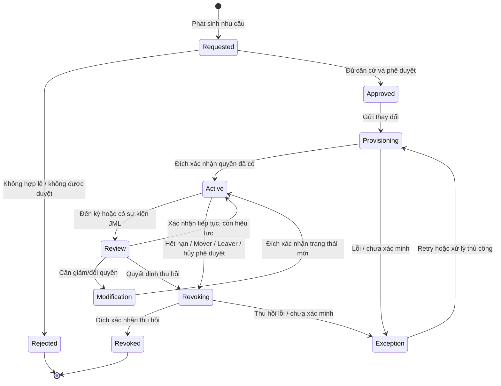

# Vòng đời quyền truy cập

## 1. Vì sao quyền truy cập cũng có vòng đời?

Một nhân viên được phép xem báo cáo tài chính trong thời gian tham gia dự án. Ba tháng sau, nhân viên chuyển sang nhóm hỗ trợ khách hàng. Nếu tài khoản của người đó vẫn hoạt động và quyền xem báo cáo không được thu hồi, doanh nghiệp đã tạo ra **quyền truy cập tồn dư** (*residual access*).

Có những trường hợp khác:

- Một quản trị viên được cấp quyền production trong hai giờ để xử lý sự cố, nhưng hết ca trực vẫn giữ quyền.
- Nhà thầu kết thúc hợp đồng, tài khoản IdP bị khóa nhưng ứng dụng SaaS còn một role được quản lý cục bộ.
- Service account của pipeline có quyền ghi dữ liệu, dù pipeline đã ngừng sử dụng từ lâu.
- Người quản lý đã từ chối một quyền trong kỳ rà soát nhưng không có ai xác minh ứng dụng thực sự thu hồi quyền đó.

Những tình huống này chứng minh: **quyền truy cập không nên được xem là một giá trị “cấp một lần, dùng mãi mãi”.** Nó xuất hiện vì một nhu cầu hợp lệ, chỉ được sử dụng trong phạm vi cho phép và phải thay đổi hoặc chấm dứt khi điều kiện không còn đáp ứng.

**Access lifecycle (vòng đời quyền truy cập)** là quá trình quản lý một quyền từ khi có nhu cầu và yêu cầu cấp quyền, qua phê duyệt, cấp phát, sử dụng, giám sát, rà soát, điều chỉnh, hết hạn, đến khi thu hồi và xác minh thu hồi thành công.

Trong chương **Tổng quan IAM lifecycle** thuộc module `SECURITY_IDENTITY_ACCESS_MANAGEMENT_IDENTITY_LIFECYCLE`, chủ đề này kết nối trực tiếp với quản lý vòng đời danh tính theo **Joiner–Mover–Leaver (JML)**: xác minh, tạo tài khoản và cấp quyền khi gia nhập; tính lại quyền khi chuyển vai trò; rà soát, thu hồi khi kết thúc. IdP, SSO, SCIM, RBAC/ABAC, tài khoản dịch vụ và kiểm toán hỗ trợ các bước khác nhau trong cùng một vòng đời.

## 2. Quyền truy cập là gì và khác gì với danh tính, tài khoản?

Trước khi thiết kế vòng đời quyền, cần phân biệt các thực thể:

| Khái niệm | Câu hỏi | Ví dụ |
| --- | --- | --- |
| **Identity** | Ai hoặc workload nào đang được quản lý? | Nhân viên `person-204` hoặc dịch vụ `billing-worker` |
| **Account** | Identity có bản ghi nào ở hệ thống đích? | `crm-user-77` hoặc cloud service principal |
| **Entitlement / access right** | Chủ thể được cấp khả năng nào? | `invoice.read`, `ticket.update`, vai trò `FinanceViewer` |
| **Role / group** | Nhiều quyền được gom và gán theo cách nào? | `SupportAgent`, nhóm `prod-log-readers` |
| **Policy** | Điều kiện nào quyết định yêu cầu được phép? | Chỉ đọc hóa đơn cùng tenant và khi nhân viên còn active |
| **Credential / session** | Chủ thể xác thực hoặc tiếp tục truy cập bằng gì? | Passkey, API key, access token, phiên SSO |
| **Resource** | Đối tượng nào được bảo vệ? | API, hóa đơn, repository, bucket hoặc môi trường cloud |

Một **identity** có thể có nhiều **account**. Mỗi account có thể có nhiều **entitlement**: một số được gán trực tiếp, một số có được do thành viên nhóm/role, một số chỉ phát sinh sau khi chính sách ABAC được đánh giá.

Vì vậy, vòng đời quyền là một phần của vòng đời danh tính, nhưng **không hoàn toàn trùng với vòng đời account**:

- Account đang hoạt động không nhất thiết có quyền truy cập dữ liệu nhạy cảm.
- Một entitlement có thể bị thu hồi trong khi account tiếp tục hoạt động.
- Một role có thể tồn tại trong directory, nhưng không có hiệu lực ở ứng dụng nếu đồng bộ lỗi.
- Một phiên hoặc token đã phát hành có thể duy trì khả năng truy cập trong thời gian nhất định, dù entitlement gốc đã thay đổi.

**Ví dụ:** Chuyển từ hỗ trợ khách hàng sang tài chính thường không cần xóa account IdP, nhưng cần thu hồi quyền sửa ticket và chỉ cấp quyền tài chính phù hợp.

## 3. Các giai đoạn trong vòng đời quyền truy cập

Có thể hình dung một quyền đi qua những bước sau:

1. **Nhu cầu và yêu cầu (request):** có mục đích công việc, đối tượng yêu cầu, tài nguyên, hành động và thời hạn.
2. **Đánh giá/phê duyệt (evaluate/approve):** xác nhận nhu cầu, chính sách, chủ tài nguyên, mức rủi ro và xung đột quyền.
3. **Cấp phát (provision/grant):** gán role, group, entitlement hoặc policy ở hệ thống đích.
4. **Kích hoạt và sử dụng (activate/use):** quyền chỉ có hiệu lực trong thời gian và ngữ cảnh cho phép; ứng dụng/API kiểm tra mỗi thao tác cần bảo vệ.
5. **Giám sát và rà soát (monitor/review):** phát hiện quyền không sử dụng, quyền thừa, quyền đặc biệt và thay đổi về điều kiện công việc.
6. **Điều chỉnh/gia hạn (modify/renew):** tăng, giảm hoặc thay phạm vi dựa trên căn cứ mới; quyền ngoài vai trò cần phê duyệt lại.
7. **Hết hạn/thu hồi (expire/revoke):** chấm dứt quyền khi hết mục đích, thời gian, vai trò hoặc quan hệ hợp lệ.
8. **Đối soát và lưu bằng chứng (verify/audit):** xác nhận ứng dụng đích thực sự áp dụng thay đổi và ghi nhận kết quả.

Các trạng thái quản trị có thể mô hình hóa như sau:



Đây là **mô hình minh họa**, không phải quy định trạng thái chung của mọi sản phẩm IAM. Có tổ chức tự động cấp **birthright access** theo chính sách, không cần một phê duyệt thủ công cho từng người. Một quyền có thể được điều chỉnh trực tiếp hoặc hết hạn theo lịch thay vì luôn đi qua cùng một workflow.

### Trạng thái trên hệ thống quản lý khác trạng thái thực tế

Một quyền được đánh dấu `approved` mới có căn cứ cấp; điều đó chưa có nghĩa hệ thống đích đã cấp quyền. Một quyền ở trạng thái `revocation_requested` cũng chưa thể xem là `revoked` cho tới khi kiểm tra được thực tế.

Cần phân biệt:

- **Desired state:** quyền **nên có** theo nguồn danh tính, chính sách và phê duyệt còn hiệu lực.
- **Actual state:** quyền **thực sự đang có** ở IdP, ứng dụng, cloud và các cơ chế truy cập liên quan.
- **Verified state:** kết quả đã được kiểm chứng bằng nguồn đích/điểm thực thi và bằng chứng đáng tin.

## 4. Mô hình hóa một quyền đủ thông tin để quản lý

Một bản ghi entitlement hoặc yêu cầu cấp quyền nên cho biết nhiều hơn tên role:

| Thuộc tính | Mục đích |
| --- | --- |
| `subjectId` | Identity hoặc workload được cấp quyền, dùng ID ổn định |
| `targetSystem` / `targetTenant` | Hệ thống, tenant và môi trường áp dụng |
| `resource` / `action` | Tài nguyên và thao tác được phép |
| `entitlementId` / `role` | Định danh quyền/role tại đích nếu có |
| `accessOrigin` | Quyền đến từ baseline, role, nhóm, yêu cầu trực tiếp hay ngoại lệ |
| `businessJustification` | Nhu cầu công việc có thể đánh giá lại |
| `owner` / `approver` | Chủ tài nguyên và người có thẩm quyền quyết định |
| `effectiveFrom` / `expiresAt` | Khi nào bắt đầu và hết hiệu lực |
| `policyVersion` | Chính sách được dùng khi tính quyền |
| `approvalId` / `sourceEventId` | Căn cứ truy vết yêu cầu hoặc sự kiện JML |
| `desiredState` / `actualState` | Trạng thái mong muốn và trạng thái từ hệ thống đích |
| `lastVerifiedAt` | Thời điểm xác nhận trạng thái gần nhất |

Ví dụ một yêu cầu cấp quyền chỉ đọc log trong thời hạn ngắn:

```json
{
  "requestId": "access-req-4802",
  "subjectId": "person-204",
  "targetSystem": "cloud",
  "targetTenant": "production",
  "resource": "service/orders/logs",
  "actions": ["logs.read"],
  "accessOrigin": "temporary-request",
  "businessJustification": "Điều tra sự cố xử lý đơn hàng",
  "requestedBy": "person-204",
  "resourceOwner": "person-18",
  "approvedBy": "person-18",
  "effectiveFrom": "2026-11-23T08:00:00Z",
  "expiresAt": "2026-11-23T10:00:00Z",
  "desiredState": "active",
  "provisioningState": "verified",
  "lastVerifiedAt": "2026-11-23T08:00:18Z"
}
```

Đây là **dữ liệu minh họa**, không phải schema chuẩn bắt buộc. Một nguồn policy có thể lưu điều kiện ABAC thay vì tạo một bản ghi quyền cho mọi cặp chủ thể–tài nguyên.

### Nguồn gốc quyền giúp thu hồi chính xác

Một người có thể thuộc hai nhóm cùng cấp `document.read`. Nếu gỡ một nhóm mà nhóm còn lại vẫn cấp quyền tương đương, người đó **vẫn có quyền**. Do đó, muốn biết đã thu hồi quyền thực sự chưa phải kiểm tra các **đường cấp quyền trực tiếp và gián tiếp**, không chỉ xác nhận thao tác xóa một role thành công.

## 5. Giai đoạn yêu cầu quyền: Đúng nhu cầu, đúng phạm vi

Không phải mọi yêu cầu quyền đều hợp lệ chỉ vì người dùng cần hoàn thành công việc. Bước đầu tiên là mô tả **nhiệm vụ nghiệp vụ cụ thể**.

Một yêu cầu tốt nên trả lời:

- Ai hoặc workload nào cần quyền? Có liên kết với danh tính và owner hợp lệ không?
- Cần truy cập hệ thống và tài nguyên nào, trong tenant/môi trường nào?
- Cần **đọc**, **ghi**, **xuất**, **phê duyệt** hay **quản trị**? Không gộp các hành động có rủi ro khác nhau.
- Vì sao cần, ai chịu trách nhiệm cho dữ liệu/tài nguyên?
- Cần quyền từ khi nào đến khi nào? Có thể dùng quyền ngắn hạn không?
- Quyền đã nằm trong **baseline/role chuẩn** hay là ngoại lệ?
- Có thông tin về rủi ro, phân tách nhiệm vụ hoặc đối tượng dữ liệu nhạy cảm không?

**Ví dụ yêu cầu thiếu thông tin:** “Cấp quyền admin để xử lý ticket.” Yêu cầu này không xác định được tài nguyên, hành động tối thiểu và thời hạn.

**Ví dụ yêu cầu đủ rõ:** “Cấp quyền đọc log của dịch vụ Orders trong production, cho nhân viên thuộc đội On-call từ 15:00 đến 17:00 để điều tra mã lỗi 5xx; phê duyệt bởi service owner.” Quyền này có thể được cấp hẹp hơn vai trò quản trị toàn môi trường.

### Quyền nền (birthright) và quyền theo yêu cầu

- **Birthright access:** tự động cấp theo trạng thái danh tính và vai trò công việc đã được phê chuẩn, chẳng hạn email, tài liệu nội bộ.
- **Role-based access:** quyền gắn với nhóm công việc cụ thể, ví dụ `SupportAgent` chỉ xử lý ticket trong phạm vi.
- **Request-based access:** quyền cần được yêu cầu riêng, phê duyệt trước khi cấp.
- **Exceptional/privileged access:** quyền ngoài mô hình chuẩn, có rủi ro cao hoặc cần xử lý khẩn cấp; phải có kiểm soát bổ sung.

Không nên yêu cầu phê duyệt thủ công mọi quyền nền nếu việc đó gây chậm trễ mà không giảm rủi ro. Ngược lại, không nên đưa quyền quản trị production vào birthright chỉ để giảm số ticket.

## 6. Đánh giá và phê duyệt quyền

Quy trình phê duyệt kết nối **nội dung yêu cầu** với **quyền quyết định của tổ chức**:

1. **Kiểm tra danh tính:** người dùng/workload còn hợp lệ theo nguồn có thẩm quyền không?
2. **Kiểm tra chính sách:** quyền được phép theo role, nhóm, loại nhân sự và loại dữ liệu không?
3. **Kiểm tra người phê duyệt:** người quản lý có quyền xác nhận nhu cầu; chủ tài nguyên có thể quyết định phạm vi dữ liệu.
4. **Đánh giá mức rủi ro:** sản xuất, dữ liệu nhạy cảm, quyền xuất dữ liệu, quản trị, tài khoản máy và quyền dùng chung có thể cần bước bổ sung.
5. **Kiểm tra xung đột SoD:** tổ hợp quyền có tạo khả năng lạm dụng quy trình không?
6. **Chốt phạm vi và thời hạn:** cân nhắc JIT, quyền chỉ đọc, giới hạn tenant hoặc tài nguyên trước khi cấp role rộng.
7. **Lưu quyết định:** yêu cầu, người phê duyệt, thời điểm, phiên bản chính sách, lý do từ chối hoặc điều kiện bổ sung.

**Separation of Duties (SoD)** đặc biệt quan trọng trong nghiệp vụ tài chính. Ví dụ cùng một người không nên được quyền tạo người nhận tiền **và** tự phê duyệt khoản chuyển tiền theo chính sách kiểm soát của doanh nghiệp.

### Phê duyệt chưa phải là cấp quyền

Nếu yêu cầu chuyển sang trạng thái `APPROVED` nhưng connector cloud thất bại, người dùng chưa có quyền thực tế. Ngược lại, nếu quản trị viên cấp tay một quyền không có phê duyệt, quyền thực tế vẫn tồn tại dù hệ thống IGA không có bản ghi cấp.

Vì vậy cần tách **approval state**, **provisioning state** và **actual entitlement state**.

## 7. Cấp phát và kích hoạt quyền trên hệ thống đích

Quyền có thể được cấp thông qua:

| Cơ chế | Cách vận hành | Điểm cần xác minh |
| --- | --- | --- |
| **Gán nhóm/role trong IdP** | Thêm chủ thể vào nhóm được ứng dụng sử dụng | Ứng dụng có thực sự nhận và thực thi nhóm tương ứng không? |
| **SCIM 2.0** | Đồng bộ account, trạng thái và nhóm/thuộc tính tới SaaS khi được hỗ trợ | Nhóm/role đích, trạng thái account và khả năng xử lý lỗi |
| **API quản trị ứng dụng** | Gán role hoặc entitlement trực tiếp qua API | Đúng account ID, tenant, resource và kết quả readback |
| **Cloud IAM policy** | Gán role/policy cho principal trên tài nguyên | Scope thực tế của role, quyền kế thừa và trust |
| **PAM/JIT access** | Cấp hoặc kích hoạt quyền đặc biệt có thời hạn | Thời điểm bắt đầu, hết hạn và cơ chế thu hồi |
| **Quy trình thủ công có kiểm soát** | Chủ ứng dụng thao tác khi không có API phù hợp | Người thực hiện, ticket, xác nhận quyền đích và audit |

**IdP/SSO và SCIM giải quyết những công việc khác nhau.** SSO qua SAML hoặc OIDC thường giúp xác thực tập trung; SCIM hỗ trợ quản lý tài khoản/thuộc tính/nhóm. Cả hai không tự bảo đảm API nghiệp vụ kiểm tra đúng quyền cho từng tài nguyên.

Ví dụ SCIM có thể giúp tạo account SaaS và đồng bộ thành viên nhóm. Tuy nhiên, việc nhóm đó ánh xạ ra quyền nào phụ thuộc vào triển khai của ứng dụng; cần kiểm tra kết quả sau provision.

### Quyền trực tiếp và quyền kế thừa

Giả sử một tài khoản có quyền `invoice.read` nhờ:

- role `FinanceViewer` được gán trực tiếp;
- nhóm `Finance-Team` được đồng bộ từ IdP;
- quyền kế thừa từ tài nguyên cha;
- ngoại lệ dự án còn hiệu lực.

Khi thu hồi một nguồn, **effective access** có thể vẫn còn nhờ ba nguồn khác. Do đó cần hiểu cơ chế tổng hợp chính sách của từng nền tảng. Một số hệ thống có quy tắc deny ưu tiên, một số lại kết hợp nhiều nguồn cho phép; không được giả định mọi sản phẩm dùng cùng phép cộng quyền.

## 8. Quyền có hiệu lực tại thời điểm sử dụng: Authorization

Cấp quyền trên hệ thống quản trị mới là một phần công việc. Khi API nhận yêu cầu, ứng dụng phải đánh giá:

> **Subject S có được thực hiện action A trên resource R trong context C ở thời điểm hiện tại không?**

Ví dụ chính sách minh họa:

```text
PERMIT invoice.read WHEN
    subject.lifecycleStatus == "active"
    AND subject.hasEntitlement("invoice.read")
    AND subject.tenantId == resource.tenantId
    AND subject.region == resource.region
    AND currentTime IN access.validityWindow
ELSE DENY
```

Đây là **giả mã chính sách**, không phải cú pháp chuẩn của sản phẩm IAM.

### RBAC và ABAC trong vòng đời quyền

- **RBAC (Role-Based Access Control):** nhóm quyền thành vai trò có ý nghĩa công việc. Khi nhân viên chuyển vai trò, IAM thay đổi các role cần thiết.
- **ABAC (Attribute-Based Access Control):** dùng thuộc tính chủ thể, tài nguyên, hành động, bối cảnh để quyết định. Khi một thuộc tính như department hoặc employmentStatus đổi, quyền truy cập có thể thay đổi mà không cần gán role mới.
- **Kết hợp:** RBAC cấp quyền nền, ABAC giới hạn khả năng sử dụng tại API theo tenant, khu vực, mức xác thực hoặc độ nhạy dữ liệu.

### Xác thực không đồng nghĩa phân quyền

**Authentication (AuthN)** xác minh chủ thể; **Authorization (AuthZ)** kiểm tra quyền cho hành động cụ thể. Người dùng có phiên SSO hợp lệ vẫn phải bị từ chối đọc tài nguyên ngoài tenant hoặc khi quyền hết hạn.

**Không chỉ ẩn nút trên frontend.** Backend hoặc API phải thực thi object-level authorization, tránh lỗi đổi ID trên URL để truy cập dữ liệu của người khác (IDOR/BOLA).

### Hiệu lực trong cache và token

Một số hệ thống lưu role/thuộc tính trong phiên hoặc access token. Khi quyền đã bị thu hồi trong IGA nhưng token cũ còn hiệu lực, hệ thống đích có thể tiếp tục cho phép nếu không có kiểm tra trạng thái hoặc cơ chế thu hồi phù hợp.

Biện pháp giảm cửa sổ sai lệch bao gồm thời hạn token phù hợp, kiểm tra chính sách tại resource server, thu hồi refresh token/phiên khi hỗ trợ và cơ chế cập nhật/đánh dấu hết hạn cache cho thao tác nhạy cảm.

## 9. Thời gian hiệu lực, quyền tạm và Just-in-Time

Một quyền nên có **căn cứ tồn tại theo thời gian**. Quyền vĩnh viễn có thể phù hợp với baseline cần thiết, nhưng quyền ngoài vai trò hoặc quyền đặc quyền thường nên có thời hạn.

| Kiểu quyền | Ví dụ | Kiểm soát phù hợp |
| --- | --- | --- |
| **Quyền nền theo vai trò** | Email, công cụ làm việc cơ bản | Liên kết trạng thái active và chính sách JML |
| **Quyền theo dự án** | Đọc tài liệu dự án trong ba tháng | Thời hạn dự án, owner, review khi đổi nhóm |
| **Quyền ngoại lệ** | Xuất báo cáo chỉ một lần | Lý do, người phê duyệt, hạn ngắn và bằng chứng hoàn tất |
| **Quyền đặc quyền JIT** | Quản trị một hệ thống trong 90 phút | Yêu cầu hợp lệ, xác thực mạnh nếu cần, tự thu hồi |
| **Break-glass** | Quyền khẩn cấp khi hệ thống đăng nhập lỗi | Giới hạn quyền tiếp cận, cảnh báo, ghi log, hậu kiểm |
| **Quyền workload** | API đọc queue khi dịch vụ chạy | Chủ sở hữu, quyền tối thiểu, credential ngắn hạn/decommission |

### Quyền JIT không phải JIT account provisioning

**JIT privileged access** là kích hoạt một quyền có rủi ro cao chỉ khi thật sự cần và tự hết hạn. **JIT account provisioning** là tạo account ứng dụng khi người dùng đăng nhập liên kết lần đầu. Hai cơ chế có thể cùng tồn tại nhưng không giải quyết cùng một vấn đề.

### Tránh gia hạn mặc định không kiểm soát

Khi quyền đến hạn, câu hỏi cần đặt là **“nhu cầu này còn hợp lệ và đã được phê duyệt chưa?”**, không phải “chủ thể đã từng có quyền này chưa?”. Gia hạn có thể cần đánh giá lại role, dự án, chủ tài nguyên, SoD và lịch sử sử dụng.

## 10. Theo dõi sử dụng và rà soát quyền định kỳ

Quyền đã được cấp vẫn có thể trở nên không phù hợp mà không có sự kiện chuyển phòng ban rõ ràng. Doanh nghiệp cần **access review / recertification**.

Quy trình điển hình:

1. **Lấy danh sách quyền thực tế** từ hệ thống đích, gồm trực tiếp, nhóm/role và quyền đặc biệt có thể liệt kê.
2. **Ánh xạ tới identity và owner** bằng ID ổn định; phân loại account không có chủ thể hợp lệ.
3. **Xác định người quyết định:** quản lý, chủ tài nguyên, chủ ứng dụng hoặc người bảo trợ bên ngoài theo chính sách.
4. **Cung cấp ngữ cảnh:** vai trò công việc, tài nguyên, độ nhạy, lần sử dụng gần nhất nếu tin cậy, ngày cấp, thời hạn và phê duyệt.
5. **Ghi quyết định:** giữ, thu hồi, giảm phạm vi hoặc gia hạn có lý do.
6. **Thực thi thay đổi** tại ứng dụng đích và kiểm tra kết quả.
7. **Theo dõi ngoại lệ** đến khi thu hồi hoàn tất, không kết thúc chỉ vì người duyệt bấm nút.

### “Không sử dụng gần đây” có đồng nghĩa phải thu hồi?

Không nhất thiết. Một số quyền cần cho tình huống hiếm gặp nhưng quan trọng, chẳng hạn khôi phục sự cố. Dữ liệu “last used” hữu ích để gợi ý rà soát, song có thể thiếu hoặc không phản ánh hết cách quyền được sử dụng. Quyết định phải dựa trên mục đích, rủi ro, trách nhiệm và chính sách.

### Quyền mồ côi

Một entitlement của account không còn người/đội quản lý, hoặc quyền không truy ngược được về nguồn cấp hợp lệ, là dấu hiệu cần rà soát. Với account máy, phải xác định **workload owner**, không mặc định người cuối cùng đăng nhập là chủ sở hữu dịch vụ.

## 11. Mover: Điều chỉnh quyền khi trách nhiệm thay đổi

Một sự kiện **Mover** có thể đổi department, vai trò, nhóm, dự án, tenant, người quản lý hoặc phạm vi được giao. Thay đổi này phải tác động tới **quyền đã tồn tại**, không chỉ bổ sung quyền mới.

Ví dụ **An** chuyển từ Support sang Finance:

```text
Quyền thực tế:
  {ticket.read, ticket.update, docs.read, finance.report.read}

Quyền mục tiêu theo vai trò mới:
  {docs.read, finance.report.read}

Quyền ngoài mục tiêu:
  {ticket.read, ticket.update}

Quyền cần giữ:
  {docs.read, finance.report.read}
```

**Tập quyền mục tiêu** phải tính từ nhiều nguồn:

- quyền baseline theo trạng thái làm việc;
- quyền role RBAC và điều kiện ABAC của vị trí mới;
- quyền dự án hoặc ngoại lệ đã phê duyệt **và vẫn còn hạn**;
- các giới hạn SoD;
- quyền trực tiếp hoặc kế thừa đang tồn tại tại hệ thống đích.

### Trình tự Mover

1. Nhận sự kiện thay đổi đáng tin từ HRIS/nguồn có thẩm quyền và ngày hiệu lực.
2. Tính quyền mục tiêu theo chính sách hiện hành.
3. Đọc entitlement thực tế và nguồn cấp quyền của các hệ thống liên quan.
4. Đánh giá những quyền cũ cần thu hồi, quyền mới cần cấp, ngoại lệ cần gia hạn/phê duyệt lại.
5. Thực thi theo thứ tự kiểm soát rủi ro và phụ thuộc nghiệp vụ; kiểm tra SoD trong quá trình chuyển.
6. Đọc lại effective access và ghi nhận quyền còn lệch.
7. Theo dõi quyền bàn giao tạm cho tới khi hết hạn và thu hồi.

Quyền hỗ trợ được giữ hai tuần để bàn giao cần có **người phê duyệt, lý do, phạm vi hẹp và thời hạn**. Nếu không có expiry tự động, phải có tác vụ thu hồi và cảnh báo.

### Kiểm tra nhiều đường cấp quyền

Gỡ nhóm `SupportAgent` khỏi IdP có thể chưa loại bỏ quyền `ticket.update` nếu account CRM còn một role cục bộ được gán trực tiếp. Mover chỉ đạt yêu cầu khi effective access sau thay đổi phù hợp desired state.

## 12. Leaver: Thu hồi quyền khi quan hệ kết thúc

**Leaver** là sự kiện chấm dứt quan hệ nhân sự/hợp đồng hoặc workload. Đây thường là giai đoạn ưu tiên thu hồi cao vì toàn bộ căn cứ truy cập có thể mất hiệu lực.

Cần xử lý nhiều đường truy cập:

| Lớp | Hành động thường cần | Kiểm chứng |
| --- | --- | --- |
| **Nguồn danh tính/identity registry** | Đánh dấu quan hệ kết thúc đúng hiệu lực | Sự kiện có thẩm quyền và phiên bản hợp lệ |
| **IdP/directory** | Vô hiệu hóa account, chặn đăng nhập mới | Đọc trạng thái và chính sách xác thực |
| **Ứng dụng SaaS/nội bộ** | Thu hồi role, nhóm, vô hiệu hóa account khi phù hợp | Đọc lại entitlement/account ở từng đích |
| **Cloud/VPN/PAM** | Thu hồi quyền đặc quyền, quyền tạm và kết nối quản trị | Đối soát policy và các thành viên còn hoạt động |
| **Phiên/refresh token** | Thu hồi trong khả năng nền tảng | Kiểm tra trạng thái hoặc cơ chế chặn phiên |
| **Access token/API key/PAT/SSH key** | Thu hồi, làm hết hạn hoặc rotate theo loại credential và rủi ro | Kiểm tra inventory/đường truy cập còn hợp lệ |
| **Ownership tài nguyên** | Chuyển quyền quản lý tài liệu, repository, pipeline hoặc workload còn chạy | Có owner hợp lệ và kế hoạch vận hành liên tục |
| **Audit** | Lưu căn cứ, thời gian và xác nhận từng bước | Chuỗi bằng chứng truy nguyên được |

### Khóa IdP chưa chắc thu hồi được mọi quyền

Có ứng dụng giữ phiên độc lập hoặc chấp nhận access token đã cấp trong thời gian sống của token. Nếu resource server không kiểm tra trạng thái thu hồi, việc khóa IdP có thể không làm token tự chứa hết hiệu lực ngay.

Biện pháp tùy kiến trúc: giảm TTL, thu hồi refresh token, đăng xuất phiên, dùng introspection hoặc cơ chế kiểm tra trạng thái, vô hiệu hóa tài khoản đích và hạn chế credential lâu dài.

### Xóa dữ liệu khác với thu hồi truy cập

Vô hiệu hóa account để chặn truy cập không đồng nghĩa phải xóa toàn bộ hồ sơ và log ngay. Tổ chức có thể cần giữ dữ liệu theo chính sách lưu trữ, chuyển giao sở hữu rồi tiêu hủy khi hết thời hạn; hồ sơ giữ lại **không được trở thành đường truy cập còn hiệu lực**.

## 13. Joiner: Khởi tạo tập quyền theo nguồn có thẩm quyền

Ở giai đoạn Joiner, nguồn như HRIS xác nhận ID, quan hệ làm việc, ngày bắt đầu, bộ phận và người quản lý. IAM dùng các thuộc tính này để tính **quyền nền**, sau đó provision account và entitlement tương ứng.

Ví dụ một nhân viên mới vào nhóm Kỹ thuật:

| Quyền | Căn cứ | Thời điểm |
| --- | --- | --- |
| Email, intranet | Birthright theo nhân viên active | Ngày bắt đầu |
| Đọc tài liệu kỹ thuật | Nhóm Engineer và phạm vi dự án | Khi được gán vào nhóm hợp lệ |
| Viết repository dự án | Team assignment và chính sách chủ repository | Sau kiểm tra/phê duyệt phù hợp |
| Đọc log production | Quyền theo nhu cầu hoặc trực on-call | Trong phiên hạn chế có căn cứ |
| Quản trị cloud toàn tổ chức | Không thuộc baseline | Chỉ cấp nếu có quy trình đặc biệt được phê duyệt |

**Không được lấy việc account đã tạo làm bằng chứng đủ để cấp quyền.** Joiner cần kiểm tra trạng thái có hiệu lực và tránh quyền vượt nhu cầu. Nếu ứng viên không nhận việc, các account pre-provisioned phải được xử lý để không tồn tại như quyền truy cập mồ côi.

## 14. Quyền truy cập của tài khoản dịch vụ và workload

Vòng đời quyền không chỉ dành cho nhân viên. **Non-human identities** như service account, container workload, job tự động và pipeline CI/CD cũng có quyền truy cập tài nguyên.

Ví dụ `billing-worker` được cấp:

- `queue:consume` trên hàng đợi sự kiện hóa đơn;
- `storage:write` trên một bucket kết quả cụ thể;
- không có quyền `billing.admin` hay truy cập database nhân sự.

### Vòng đời theo workload

| Giai đoạn | Sự kiện | Thay đổi quyền |
| --- | --- | --- |
| **Joiner** | Dịch vụ được triển khai và đăng ký owner | Cấp principal và quyền tối thiểu theo môi trường |
| **Mover** | Dịch vụ đổi chức năng, region, đội hoặc dự án | Tính lại quyền; loại bỏ policy không còn cần |
| **Review/rotation** | Đến hạn kiểm tra | Đánh giá owner, scope, secret, token và mức sử dụng |
| **Leaver** | Dịch vụ hoặc pipeline ngừng hoạt động | Thu hồi principal, role, trust relationship, key/cert và secret liên quan |

Cần phân biệt **service identity** (workload nào), **service account/principal** (đại diện tại hệ thống) và **credential** (bằng chứng xác thực). Rotate một khóa không tự động giảm quyền của principal; xóa container cũng không mặc nhiên thu hồi policy cloud.

**Khuyến nghị thiết kế:** ưu tiên workload federation và credential ngắn hạn khi nền tảng hỗ trợ, tách quyền theo môi trường, gắn mỗi service account với chủ sở hữu và mục đích, không chia sẻ credential tùy tiện.

Nếu nhân viên từng tạo secret nghỉ việc nhưng dịch vụ vẫn hoạt động, phải đánh giá việc chuyển owner và rotate/revoke credential liên quan theo kế hoạch an toàn, tránh xóa bừa workload còn phục vụ khách hàng.

## 15. Sai lệch trạng thái, retry và reconciliation

Một hệ thống IAM phải coi **“đã gửi yêu cầu”** và **“đã hoàn thành ở đích”** là hai trạng thái khác nhau.

Ví dụ sự kiện Leaver:

| Hệ thống | Desired state | Actual state | Xử lý |
| --- | --- | --- | --- |
| IdP | Disabled | Disabled | Đã phù hợp |
| CRM | Không còn `SupportAgent` | Role vẫn còn | Revoke, kiểm tra lại |
| Git | PAT đã thu hồi | PAT còn hợp lệ | Thu hồi credential, xác minh |
| Cloud | Không còn policy admin | Policy đã gỡ | Đã phù hợp |
| Dịch vụ do người đó sở hữu | Owner đã chuyển giao | Chưa chuyển | Bàn giao và xác minh |

### Các nguyên nhân sai lệch thường gặp

- Connector thất bại, hết quyền API hoặc bị rate limit.
- Sự kiện JML đến trễ hoặc sai thứ tự.
- Quản trị viên ứng dụng gán role trực tiếp ngoài IAM.
- Nhóm lồng nhau hoặc quyền kế thừa tạo effective access ngoài dự kiến.
- Thời hạn token/cache chưa hết.
- Account được ghép sai vì đổi email hoặc tenant.
- Quyền được rà soát rồi từ chối nhưng không tạo tác vụ revoke.

### Thiết kế xử lý tin cậy

1. **Idempotency:** xử lý lại một yêu cầu không cấp trùng quyền hoặc gây lỗi phá hoại.
2. **Versioning/order:** sự kiện Mover cũ không được tái cấp quyền sau Leaver mới hơn.
3. **Readback:** xác nhận quyền tại hệ thống đích thay vì chỉ dựa vào phản hồi API.
4. **Retry có kiểm soát:** thử lại với lỗi tạm thời, có giới hạn và backoff; không lặp vô hạn.
5. **Escalation:** có owner, ưu tiên và thời hạn xử lý trường hợp chưa xác minh được.
6. **Reconciliation định kỳ:** phát hiện drift ngay cả khi không có sự kiện mới.
7. **Compensating controls:** khi hệ thống không thể thu hồi đúng hạn, cân nhắc chặn tại điểm truy cập khác theo rủi ro.
8. **Audit:** lưu kết quả từng đích, không đánh dấu workflow hoàn tất toàn bộ khi còn sai lệch quan trọng.

### Giả mã hướng trạng thái mục tiêu

```text
reconcileAccess(identity, event):
    require trustedSource(event)
    ensure eventIsCurrent(event, identity)

    desired = computeAccessFrom(
        identity.lifecycleStatus,
        authoritativeAttributes(identity),
        approvedRolesAndExceptions(identity),
        policyVersion
    )

    for system in mappedTargetSystems(identity):
        actual = readEffectiveAccess(system, identity)
        delta = compare(actual, desired.for(system))

        for change in prioritizeRevocationsAndRisk(delta):
            outcome = applyIdempotently(system, change)
            audit(event, identity, system, change, outcome)

            if outcome.failedOrUnverified:
                queueRetryWithOwner(system, change)

        verifyTargetState(system, identity, desired.for(system))
```

Đây là **giả mã minh họa**, không phải triển khai production. Một hệ thống thật cần kiểm soát cập nhật đồng thời, bảo mật event, chính sách xử lý trường hợp không đọc được mọi effective permission và các điều kiện ngừng quyền khẩn cấp.

## 16. Audit: Bằng chứng quyền được cấp hoặc thu hồi vì sao

Một sự kiện access lifecycle cần đủ thông tin để truy ngược **nguồn, người phê duyệt, tác động, tài nguyên và kết quả**.

Ví dụ một log thu hồi:

```json
{
  "eventType": "access.entitlement.revoked",
  "eventId": "iam-change-901",
  "sourceEventId": "hr-mover-830",
  "subjectId": "person-204",
  "targetSystem": "crm",
  "targetTenant": "company-prod",
  "targetAccountId": "crm-user-77",
  "entitlement": "support.ticket.update",
  "reason": "department-transfer",
  "actor": "iam-automation",
  "policyVersion": "2026-11",
  "approvalId": "review-decision-220",
  "result": "verified",
  "enforcedAt": "2026-11-23T08:11:00Z",
  "verifiedAt": "2026-11-23T08:11:14Z",
  "correlationId": "iam-workflow-418"
}
```

Log là dữ liệu minh họa; schema thực tế phụ thuộc sản phẩm. Cần bảo vệ tính toàn vẹn và kiểm soát truy cập log. **Không ghi mật khẩu, API key, access token hoặc secret ở dạng rõ**.

### Những câu hỏi audit cần trả lời

- Quyền được cấp vì sự kiện Joiner, vai trò chuẩn, dự án hay yêu cầu ngoại lệ nào?
- Người nào hoặc chính sách nào đã quyết định cấp quyền?
- Quyền có thời hạn gì và đã từng được gia hạn chưa?
- Lần review gần nhất có kết luận giữ/thu hồi không?
- Khi Mover hoặc Leaver, hệ thống đích có thực sự thu hồi quyền không?
- Có đường cấp quyền gián tiếp hoặc phiên/credential còn hiệu lực không?
- Ai xử lý sai lệch và bằng chứng hoàn tất ở đâu?

## 17. Đo chất lượng vòng đời quyền truy cập

Các chỉ số nên đo **hiệu quả nghiệp vụ và kết quả quyền thực tế**, không chỉ số ticket đóng.

| Chỉ số | Cách hiểu |
| --- | --- |
| **Access request fulfillment time** | Từ yêu cầu hợp lệ đến lúc hệ thống đích xác nhận quyền sẵn sàng |
| **Approval turnaround time** | Thời gian chờ người/cơ chế có thẩm quyền ra quyết định |
| **Overprovisioned entitlements** | Số quyền vượt desired state hoặc không có căn cứ hợp lệ |
| **Mover residual access** | Số quyền từ vai trò cũ còn hiệu lực sau thời điểm chuyển |
| **Leaver revocation latency** | Khoảng thời gian từ mốc chấm dứt hợp lệ đến khi quyền ở đích bị chặn |
| **Expired access still active** | Số quyền hết hạn vẫn đang có hiệu lực |
| **Access review remediation completion** | Tỷ lệ quyền bị quyết định thu hồi đã được xác minh thu hồi |
| **Orphan entitlement/account count** | Quyền hoặc account không ánh xạ được chủ thể/owner hợp lệ |
| **Provisioning/deprovisioning verification rate** | Tỷ lệ thao tác có readback/đối soát thành công |
| **Privileged exception age** | Thời gian đặc quyền ngoại lệ tồn tại và số ngoại lệ quá hạn |
| **Workload entitlement ownership coverage** | Tỷ lệ quyền máy có owner, mục đích và phạm vi rõ ràng |

Không có một SLA phù hợp cho mọi hệ thống. Quyền quản trị production, dữ liệu tài chính hoặc quyền truy cập của nhà thầu sắp hết hợp đồng có thể đòi ngưỡng xử lý chặt hơn quyền đọc tài liệu thông thường.

### Cảnh giác chỉ số đẹp nhưng sai mục tiêu

`100% access reviews completed` không cho thấy quyền bị từ chối đã bị thu hồi. `100% deprovision API calls succeeded` cũng không xác nhận role gián tiếp hay token vẫn còn sử dụng được. Chỉ số cần gắn với **readback hoặc bằng chứng từ điểm thực thi**.

## 18. Ví dụ xuyên suốt: Một quyền từ khi phát sinh tới khi bị thu hồi

Giả sử **Mai** là kỹ sư hỗ trợ ứng dụng, cần quyền đọc log production trong giai đoạn điều tra sự cố.

| Mốc | Giai đoạn | Hành động và bằng chứng |
| --- | --- | --- |
| 09:00 | Request | Mai yêu cầu `logs.read` trên dịch vụ Orders, lý do điều tra lỗi, thời hạn hai giờ |
| 09:05 | Approve | Service owner xác nhận mục đích và phạm vi, IAM kiểm tra role/SoD |
| 09:07 | Provision | PAM/cloud IAM cấp role chỉ đọc đúng tài nguyên |
| 09:08 | Verify activation | IAM đọc lại policy/role và ghi trạng thái đã cấp |
| 09:20 | Use | Mai đăng nhập qua IdP/SSO, API/log service đánh giá quyền đúng tài nguyên |
| 10:00 | Monitor | Sự kiện truy cập được ghi, quyền vẫn trong thời hạn |
| 11:00 | Expire | Workflow thu hồi role theo expiry; phiên/credential liên quan được xử lý theo cơ chế nền tảng |
| 11:01 | Verify revocation | IAM đọc lại trạng thái, xác nhận effective access không còn |
| Sau đó | Audit | Giữ liên kết request → approval → grant → revoke → verification |

Nếu Mai chuyển sang bộ phận khác lúc 10:00, quy trình **Mover** có thể kích hoạt thu hồi sớm nếu quyền không còn căn cứ; hệ thống không nên mặc định giữ quyền tới 11:00 chỉ vì từng được duyệt.

### Giả sử lệnh thu hồi thất bại

Nếu cloud API trả lỗi lúc 11:00, quyền đang ở trạng thái **thu hồi chưa được xác minh**:

1. Lưu kết quả lỗi kèm resource, identity và request ID.
2. Gửi retry và cảnh báo theo mức rủi ro.
3. Áp dụng kiểm soát bổ sung nếu cần, chẳng hạn hạn chế phiên/đường truy cập liên quan.
4. Sau khi cloud trở lại, kiểm tra effective role và quyền kế thừa.
5. Chỉ đánh dấu `REVOKED_VERIFIED` khi xác nhận trạng thái phù hợp.

Đây là cách vòng đời quyền ngăn một **ngoại lệ tạm thời** trở thành **đặc quyền vĩnh viễn**.

## 19. Các sai lầm điển hình và cách khắc phục

| Sai lầm | Hệ quả | Cách làm phù hợp |
| --- | --- | --- |
| Coi quyền được cấp là vĩnh viễn | Quyền tồn dư sau dự án hoặc thay đổi vai trò | Gắn căn cứ, owner, thời hạn và sự kiện thu hồi |
| Dựa vào trạng thái account để suy mọi quyền | Account active có thể chứa role đặc biệt, account disabled có token cũ | Kiểm tra entitlement, session, credential theo hệ thống |
| Chỉ cấp quyền mới khi Mover | Quyền cũ tích lũy | So sánh quyền hiện có với desired state, revoke và readback |
| Chỉ khóa IdP khi Leaver | Ứng dụng cục bộ, role, PAT/token vẫn có thể hoạt động | Deprovision ứng dụng và xử lý đường truy cập độc lập |
| Dùng SSO thay provisioning | Người dùng đăng nhập được nhưng account/role đích sai lệch | Quản lý account/nhóm riêng qua SCIM/API/connector |
| Không kiểm tra đối tượng cụ thể tại API | Đã đăng nhập có thể đọc dữ liệu tenant khác | Object-level authorization, RBAC/ABAC tại backend |
| Review chỉ ghi quyết định | Quyền bị từ chối vẫn active | Tạo tác vụ thu hồi và xác minh đích |
| Không xử lý quyền qua nhiều nhóm | Gỡ một role nhưng effective access vẫn còn | Phân tích mọi đường cấp quyền trực tiếp và kế thừa |
| Quyền ngoại lệ không có expiry | Admin tạm thành admin lâu dài | JIT, giới hạn thời gian và theo dõi quá hạn |
| Không có owner cho workload | Service account/key tồn dư khi dịch vụ ngừng | Service catalog, ownership, credential lifecycle |
| Không kiểm tra event trễ/trùng | Có thể tái cấp quyền sau Leaver | Idempotency, versioning, trạng thái nguồn mới nhất |
| Xem kết quả API là xác nhận hoàn tất | Sai lệch tại hệ thống đích bị bỏ sót | Readback, reconciliation và xử lý lỗi từng phần |

## 20. Checklist khi thiết kế access lifecycle

Hãy dùng những câu hỏi sau để đánh giá một luồng cấp quyền:

1. Có xác định **identity/workload**, nguồn có thẩm quyền và account đích không?
2. Quyền mô tả đủ **tài nguyên, hành động, tenant, môi trường** không?
3. Yêu cầu có **lý do nghiệp vụ**, thời hạn và người chịu trách nhiệm không?
4. Quyền đã thuộc **baseline/role hợp lệ** hay cần phê duyệt ngoại lệ?
5. Có chính sách **least privilege, SoD, JIT và giới hạn thời gian** cho quyền nhạy cảm không?
6. Tác vụ grant/revoke có thể lặp lại an toàn và xử lý sự kiện trễ không?
7. Ứng dụng dùng IdP/SSO và SCIM/API với phạm vi hỗ trợ cụ thể nào?
8. **RBAC/ABAC** được kiểm tra tại API, có giới hạn theo tài nguyên và tenant không?
9. Khi Mover, có đánh giá và **thu hồi quyền cũ** cùng quyền gián tiếp không?
10. Khi Leaver, đã kiểm tra IdP, SaaS, cloud, phiên, token, key và tài khoản dịch vụ liên quan chưa?
11. Nếu quyền đến hạn, cơ chế tự động thu hồi và xử lý lỗi hoạt động như thế nào?
12. Access review có chuyển quyết định sang **thu hồi thực tế** không?
13. Desired state và actual state được **đối soát**, cảnh báo và gán owner xử lý ra sao?
14. Audit có thể chứng minh **ai yêu cầu, ai duyệt, quyền nào được cấp và thu hồi khi nào** không?

### Ghi nhớ

**Vòng đời quyền truy cập bắt đầu bằng nhu cầu hợp lệ và kết thúc bằng bằng chứng quyền đã được thu hồi hoặc điều chỉnh đúng chính sách.** Joiner cấp quyền phù hợp, Mover tính lại và loại bỏ quyền cũ, Leaver chấm dứt các đường truy cập không còn căn cứ. RBAC/ABAC xác định khả năng truy cập, IdP/SSO hỗ trợ xác thực, SCIM/connector thực thi thay đổi account/nhóm và IGA/PAM quản trị phê duyệt/đặc quyền. Đối soát trạng thái thực tế, quản lý credential của workload và kiểm toán là những bước cần thiết để **ngăn quyền truy cập tồn dư**.

