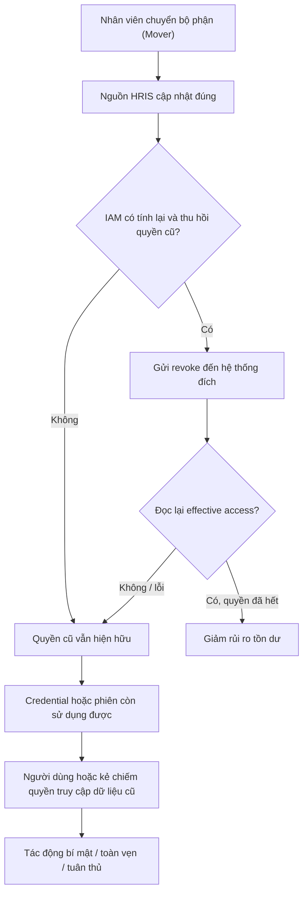
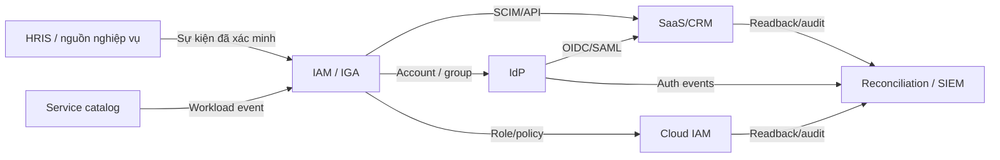

# Rủi ro IAM

## 1. Vì sao IAM là một lĩnh vực quản trị rủi ro?

Hãy tưởng tượng một doanh nghiệp có hệ thống nhân sự, Identity Provider (IdP), email, kho mã nguồn, CRM, ứng dụng tài chính và tài nguyên cloud. Nhân viên **Huy** chuyển từ bộ phận chăm sóc khách hàng sang vận hành. Huy được cấp vai trò mới, nhưng quyền xuất dữ liệu khách hàng của bộ phận cũ vẫn còn. Vài tháng sau Huy nghỉ việc, bộ phận IT khóa tài khoản SSO; một personal access token của Huy vẫn sử dụng được để truy cập API.

Trong tình huống này, ít nhất ba rủi ro xuất hiện:

1. **Privilege creep:** quyền cũ tích lũy qua lần chuyển vai trò và vượt quá nhu cầu công việc.
2. **Residual access:** một đường truy cập vẫn còn sau khi quan hệ làm việc chấm dứt.
3. **Thiếu khả năng phát hiện và chứng minh thu hồi:** nếu chỉ nhìn trạng thái IdP, tổ chức có thể kết luận nhầm rằng việc offboarding đã hoàn tất.

**Rủi ro IAM (Identity and Access Management risk)** là khả năng xảy ra tổn thất do danh tính, thông tin xác thực, tài khoản, quyền truy cập, quy trình hoặc hệ thống kiểm soát truy cập không được xác lập, bảo vệ, sử dụng, thay đổi hay thu hồi đúng cách.

Rủi ro IAM có thể tác động đồng thời đến:

- **Confidentiality – tính bí mật:** dữ liệu bị đọc, trích xuất hoặc chia sẻ ngoài thẩm quyền.
- **Integrity – tính toàn vẹn:** dữ liệu, giao dịch, mã nguồn hoặc cấu hình bị sửa trái phép.
- **Availability – tính sẵn sàng:** người hợp lệ không đăng nhập được, hệ thống bị khóa nhầm hoặc dịch vụ dừng do thu hồi sai.
- **Accountability – khả năng quy trách nhiệm:** không xác định được ai đã thực hiện hành động, vì quyền và tài khoản dùng chung hoặc log không đầy đủ.
- **Tuân thủ và uy tín:** không chứng minh được quyền được cấp/thu hồi có căn cứ hoặc không bảo vệ dữ liệu theo nghĩa vụ áp dụng.

Trong module **`SECURITY_IDENTITY_ACCESS_MANAGEMENT_IDENTITY_LIFECYCLE`**, trọng tâm là giảm rủi ro xuyên suốt **Joiner–Mover–Leaver (JML)**: xác minh danh tính, tạo tài khoản, cấp quyền, rà soát khi thay đổi vai trò và thu hồi khi chấm dứt quan hệ. Các thành phần **IdP, SSO, SCIM, RBAC/ABAC, tài khoản dịch vụ, kiểm toán** được sử dụng như những lớp kiểm soát phối hợp, không phải các giải pháp đơn lẻ có thể loại bỏ toàn bộ rủi ro.

## 2. Phân biệt mối đe dọa, lỗ hổng, tác động và rủi ro

Để quản trị IAM có hệ thống, cần phân biệt:

| Khái niệm | Câu hỏi | Ví dụ IAM |
| --- | --- | --- |
| **Asset – tài sản** | Điều gì cần bảo vệ? | Dữ liệu khách hàng, API thanh toán, kho mã nguồn, IdP |
| **Threat – mối đe dọa** | Ai hoặc điều gì có thể gây hại? | Kẻ đánh cắp credential, nhân viên lạm dụng quyền, lỗi tích hợp |
| **Vulnerability – điểm yếu** | Vì sao mối đe dọa có thể khai thác? | Không có MFA, API thiếu kiểm tra tenant, tài khoản mồ côi |
| **Threat event – sự kiện đe dọa** | Kịch bản rủi ro xảy ra thế nào? | Token cũ bị sử dụng để trích xuất dữ liệu sau Leaver |
| **Impact – tác động** | Nếu xảy ra, hậu quả là gì? | Lộ dữ liệu, sửa giao dịch, ngừng vận hành, vi phạm nghĩa vụ |
| **Likelihood – khả năng xảy ra** | Kịch bản có thể xảy ra trong điều kiện hiện tại đến mức nào? | Phụ thuộc mức phơi nhiễm, khả năng khai thác và kiểm soát |
| **Inherent risk – rủi ro vốn có** | Rủi ro trước khi xét hiệu quả kiểm soát là gì? | Quyền quản trị rộng trên hệ thống thanh toán |
| **Residual risk – rủi ro còn lại** | Sau khi kiểm soát được áp dụng, còn rủi ro gì? | Token chưa thể thu hồi tức thời hoặc ứng dụng legacy chưa có connector |

**Không nên đồng nhất rủi ro với số lượng sự cố.** Một lỗ hổng phân quyền nghiêm trọng chưa bị khai thác vẫn có thể là rủi ro cao. Ngược lại, nhiều lần đăng nhập thất bại vô hại không đương nhiên là rủi ro lớn nhất của hệ thống.

Công thức diễn giải ở mức khái niệm:

```text
Rủi ro ≈ Khả năng xảy ra × Mức tác động

Rủi ro còn lại = Rủi ro sau khi xét tính hiệu quả
                 và giới hạn của các kiểm soát hiện có
```

Đây **không phải công thức định lượng chuẩn bắt buộc**. Tổ chức cần xác định thang đo, tiêu chí đánh giá và cách xử lý độ không chắc chắn riêng. Rủi ro không thể được suy ra đáng tin chỉ bằng phép nhân hai số tùy ý.

## 3. Bản đồ rủi ro IAM theo vòng đời

| Giai đoạn / lớp | Kịch bản rủi ro | Hậu quả chính | Kiểm soát then chốt |
| --- | --- | --- | --- |
| **Nguồn danh tính** | Danh tính giả, trùng, sai owner hoặc trạng thái không cập nhật | Cấp quyền cho sai chủ thể | Authoritative source, identity proofing, stable ID |
| **Joiner** | Cấp quyền rộng hoặc kích hoạt trước ngày hiệu lực | Truy cập ngoài nhu cầu | Birthright phù hợp, approval, least privilege |
| **Authentication** | Phishing, chiếm đoạt phiên hoặc khôi phục tài khoản yếu | Kẻ tấn công đăng nhập như người hợp lệ | MFA kháng phishing khi khả thi, session controls |
| **Authorization** | IDOR/BOLA, vượt tenant, role quá rộng | Truy cập/sửa dữ liệu trái phép | Kiểm tra quyền tại backend, RBAC/ABAC |
| **Mover** | Quyền cũ không bị thu hồi khi chuyển vai trò | Privilege creep, vi phạm SoD | Desired-state diff, revoke, access review |
| **Leaver** | IdP bị khóa nhưng token/tài khoản đích vẫn hoạt động | Residual access | Deprovisioning, token/credential revocation, reconciliation |
| **Non-human identity** | Service account vô chủ, API key lâu dài, secret lộ | Truy cập máy khó quy trách nhiệm | Owner, workload federation, rotation, decommission |
| **Đặc quyền** | Quyền admin thường trực hoặc break-glass bị lạm dụng | Tác động phạm vi lớn | PAM, JIT, approval, giám sát phiên |
| **Hạ tầng IAM** | IdP/connector ngừng hoạt động hoặc bị chiếm quyền | Mất truy cập hoặc cấp/thu hồi sai | Resilience, least privilege cho automation, cảnh báo |
| **Audit** | Không thấy sai lệch hoặc không có bằng chứng | Không phát hiện/sửa được rủi ro kịp thời | Correlation, đối soát, bảo vệ log, owner xử lý |

Bảng này dùng để định hướng. Mức độ ưu tiên thực tế phụ thuộc tính nhạy cảm của dữ liệu, phạm vi hệ thống, mức độ phơi nhiễm và các kiểm soát đang có.

## 4. Rủi ro từ nguồn sự thật về identity

Một IAM workflow chỉ đáng tin khi sự kiện và thuộc tính đầu vào đáng tin. Đặc biệt trong JML, **nguồn có thẩm quyền (authoritative source)** quyết định một danh tính còn hợp lệ hay không.

### 4.1. Rủi ro danh tính không được xác minh

Một quản trị viên tạo account IdP cho địa chỉ email chưa gắn với hợp đồng hoặc chủ thể xác minh được. Nếu IAM tự động cấp nhóm mặc định theo domain email, tài khoản này có thể được truy cập ứng dụng mà không có căn cứ nghiệp vụ.

**Kiểm soát:**

- Xác định nguồn cho từng loại identity: HRIS cho nhân viên, hệ thống hợp đồng/sponsor cho nhà thầu, service catalog cho workload.
- Có identity ID ổn định và thẩm quyền tạo/khôi phục bản ghi.
- Thẩm định người bảo trợ, ngày hiệu lực và loại quan hệ trước khi cấp quyền.
- Kiểm tra tài khoản trùng và trường hợp rehire; không tự khôi phục quyền cũ.

### 4.2. Rủi ro ánh xạ account sai người

Nếu email được dùng làm khóa duy nhất, việc đổi tên, tái sử dụng email hoặc chuyển tenant có thể khiến account đích được liên kết với sai identity.

Ví dụ email `finance.shared@example.org` từng thuộc nhà thầu A, sau đó gán cho người B. Nếu một connector tự ghép account theo email mà không kiểm chứng source ID, B có thể thừa hưởng tài khoản hoặc dữ liệu của A.

**Kiểm soát:** sử dụng ID nội bộ bất biến trong phạm vi rõ ràng, mapping theo source/tenant/account ID, lưu nguồn gốc liên kết và đối soát account mồ côi.

### 4.3. Rủi ro dữ liệu trễ hoặc mâu thuẫn

HRIS đã đổi `department=Finance` nhưng IdP còn `Support`. Ứng dụng dùng thuộc tính cũ để quyết định quyền có thể tiếp tục cho phép truy cập tài nguyên bộ phận cũ.

**Kiểm soát:** authority matrix ở cấp thuộc tính, event version, kiểm soát thời điểm hiệu lực, cơ chế làm mới thuộc tính, reconciliation và cảnh báo khi sai lệch quá ngưỡng.

Nguồn có thẩm quyền quyết định **trạng thái mong muốn**; trạng thái thực tế ở ứng dụng vẫn phải được quan sát riêng.

## 5. Rủi ro Joiner: Cấp quyền quá sớm, quá nhiều hoặc sai người

**Joiner** là quá trình xác minh, tạo identity/account và cấp quyền cần thiết khi chủ thể bắt đầu quan hệ với tổ chức.

Các lỗi thường gặp:

1. **Pre-provision không kiểm soát:** account chuẩn bị trước ngày bắt đầu đã có quyền truy cập dữ liệu nhạy cảm.
2. **Birthright quá rộng:** mọi nhân viên mới thuộc nhóm chung có thể xem dữ liệu tài chính hoặc quyền quản trị.
3. **Cấp quyền theo chức danh không đủ:** role tên `Engineer` được hiểu đồng nghĩa với quyền production dù nhiệm vụ không yêu cầu.
4. **Thiếu kiểm tra danh tính trùng:** một nhân viên có hai account, một account nằm ngoài lifecycle.
5. **Quyền được cấp thủ công ngoài luồng:** service owner thêm role trực tiếp mà IAM không biết.
6. **Quy trình onboarding bị hủy:** ứng viên không nhận việc nhưng account pending vẫn tồn tại.

### Ví dụ Joiner với quyền chuẩn và quyền ngoại lệ

| Nhu cầu | Phương án giảm rủi ro | Bằng chứng cần kiểm tra |
| --- | --- | --- |
| Email, chấm công, intranet | Birthright theo nhân viên active | Account đúng chủ thể, hiệu lực đúng ngày |
| CRM của nhóm hỗ trợ | RBAC `SupportAgent` giới hạn nhóm | Role/tenant thực tế và API enforcement |
| Đọc log production | Yêu cầu/phê duyệt riêng, quyền hẹp có hạn | Owner, thời hạn, readback grant/revoke |
| Quản trị IdP | PAM, người phê duyệt phù hợp, SoD | Không nằm trong baseline, có log đặc quyền |

**Rủi ro còn lại:** ngay cả khi quyết định cấp quyền đúng, provisioning có thể thất bại hoặc gán nhầm account. Vì vậy phải xác minh kết quả tại hệ thống đích và không coi trạng thái `APPROVED` là quyền đã được cấp chính xác.

## 6. Rủi ro Mover: Privilege creep và quyền xung đột

**Mover** thường là giai đoạn làm phát sinh quyền truy cập tồn dư: người chuyển phòng ban, nhóm, dự án hoặc trách nhiệm được cấp quyền mới nhưng không bị gỡ quyền cũ.

Một nhân viên chuyển từ Support sang Finance:

```text
Quyền hiện có:
  {crm.ticket.read, crm.ticket.update, docs.read}

Quyền mục tiêu:
  {finance.report.read, docs.read}

Quyền phải xem xét thu hồi:
  {crm.ticket.read, crm.ticket.update}

Quyền cần cấp theo phê duyệt:
  {finance.report.read}
```

### Tại sao Mover khó kiểm soát hơn phép trừ tập hợp?

- Một quyền có thể đến từ **nhóm lồng nhau, role trực tiếp hoặc chính sách cloud kế thừa**.
- Nhân viên có thể giữ quyền dự án hợp lệ nhưng phải có **owner, lý do và thời hạn**.
- Thay đổi `department` có thể chưa được phản ánh trong token/phiên của ứng dụng.
- Quyền mới và quyền cũ có thể tạo tổ hợp vi phạm **Separation of Duties (SoD)**.
- Hệ thống đích có thể nhận lệnh gỡ nhóm thành công nhưng một đường cấp quyền khác vẫn tồn tại.

Ví dụ SoD: một người vừa tạo thông tin người nhận thanh toán vừa có quyền tự phê duyệt giao dịch. Cả hai quyền có thể hợp lệ trong những công việc riêng, nhưng **kết hợp** chúng làm tăng nguy cơ gian lận và sai sót.

### Kiểm soát Mover

1. Nhận sự kiện thay đổi có thẩm quyền cùng ngày hiệu lực.
2. Tính lại **desired access** từ vai trò mới, ABAC, quyền dự án và phê duyệt.
3. Đọc **actual effective access** từ hệ thống đích, gồm quyền trực tiếp và gián tiếp khi có thể.
4. Kiểm tra SoD và quyền đặc quyền; không tự động cấp trước khi có căn cứ cần thiết.
5. Thu hồi quyền cũ; với quyền bàn giao, đặt expiry và chủ sở hữu.
6. Đối soát quyền thực tế, giải quyết các ngoại lệ chưa thu hồi.

**KPI phù hợp:** số quyền ngoài tập quyền mục tiêu còn hoạt động sau Mover, đặc biệt trên hệ thống nhạy cảm; không chỉ số yêu cầu chuyển nhóm đã đóng.

## 7. Rủi ro Leaver: Residual access sau khi quan hệ chấm dứt

**Leaver** là giai đoạn thu hồi quyền khi một người rời tổ chức, nhà thầu hết hợp đồng hoặc một workload ngừng hoạt động.

Một tình huống nguy hiểm là coi **khóa IdP** đồng nghĩa với **mọi quyền đã thu hồi**. Trên thực tế, đường truy cập có thể vẫn tồn tại qua:

| Đường truy cập | Vì sao có thể tồn tại? | Hành động giảm rủi ro |
| --- | --- | --- |
| **Account SaaS cục bộ** | Ứng dụng có trạng thái và credential riêng | Deactivate/deprovision qua SCIM/API hoặc quy trình kiểm soát |
| **Phiên web đã tạo** | Session có vòng đời độc lập với đăng nhập mới | Session revocation hoặc cơ chế chặn tại ứng dụng |
| **OAuth refresh token** | Client có thể lấy token mới nếu chưa bị thu hồi | Revoke theo hỗ trợ của IdP/authorization server |
| **Access token đã phát hành** | JWT tự chứa có thể còn được resource server chấp nhận đến khi hết hạn | TTL phù hợp, introspection/thu hồi/kiểm tra trạng thái khi hỗ trợ |
| **PAT/SSH key/API key** | Credential có thể không phụ thuộc vào phiên SSO | Thu hồi hoặc rotate credential liên quan |
| **Cloud IAM role** | Gán trực tiếp hoặc qua nhóm khác với IdP | Đối soát toàn bộ role/policy có hiệu lực |
| **Tài khoản quản trị đặc biệt** | Có đường đăng nhập hoặc ủy quyền riêng | PAM, inventory đặc quyền, thu hồi theo quy trình |
| **Quyền sở hữu dịch vụ** | Automation và tài khoản máy có thể do người đó quản lý | Chuyển owner, đánh giá và thu hồi credential có liên quan |

### Thời gian thu hồi mới là yếu tố rủi ro

Cần phân biệt:

- `effectiveAt`: khi quan hệ kết thúc theo nguồn có thẩm quyền;
- `processedAt`: khi IAM xử lý sự kiện;
- `enforcedAt`: khi hệ thống đích thực sự chặn quyền;
- `verifiedAt`: khi việc chặn được xác minh.

Nếu HRIS ghi Leaver lúc 18:00 nhưng account cloud chỉ được chặn lúc 22:00, đó là **cửa sổ truy cập tồn dư bốn giờ** tại hệ thống này, không thể coi hoàn tất từ mốc 18:00.

### Thu hồi khẩn cấp và lưu trữ

Một sự kiện rủi ro cao có thể cần hành động khóa nhanh qua đầu mối được ủy quyền, không chờ đủ các tác vụ bàn giao không quan trọng. Mặt khác, **vô hiệu hóa truy cập không có nghĩa xóa ngay dữ liệu**: hồ sơ và log có thể được giữ theo chính sách mà không duy trì quyền hoạt động.

## 8. Rủi ro Authentication: Chiếm đoạt tài khoản và phiên

Một hệ thống phân quyền tốt vẫn có thể thất bại nếu kẻ tấn công dùng được credential hoặc phiên của một người có quyền.

### Các kịch bản thường gặp

| Kịch bản | Điểm yếu | Hậu quả |
| --- | --- | --- |
| **Phishing** | Người dùng nhập credential tại trang giả | Kẻ tấn công chiếm tài khoản |
| **Password reuse / credential stuffing** | Mật khẩu bị lộ và dùng ở nhiều dịch vụ | Tài khoản bị truy cập trái phép |
| **MFA fatigue / social engineering** | Người dùng bị dụ phê duyệt yêu cầu hoặc cung cấp mã | Vượt qua bước xác thực bổ sung |
| **Account recovery yếu** | Helpdesk hoặc self-service reset không xác minh đủ | Kẻ tấn công liên kết authenticator mới |
| **Session theft** | Cookie/refresh token bị đánh cắp | Có thể sử dụng phiên dù không biết mật khẩu |
| **Credential không bị thu hồi** | Key/token lâu hạn hoặc không có owner | Truy cập tồn dư sau Mover/Leaver |
| **Quá nhiều account admin** | Credential đặc quyền có phạm vi lớn | Tác động lan rộng khi bị chiếm quyền |

### Những lớp kiểm soát

- Ưu tiên **phương thức xác thực kháng phishing** như passkey/WebAuthn/FIDO2 khi phù hợp và nền tảng hỗ trợ.
- Áp dụng MFA theo mức rủi ro; đánh giá **phương thức recovery** vì recovery yếu có thể vô hiệu hóa lợi ích của MFA mạnh.
- Bảo vệ phiên, refresh token và cookie; giới hạn vòng đời và thu hồi theo thiết kế.
- Yêu cầu **step-up authentication** cho thao tác nhạy cảm khi cần, nhưng không nhầm xác thực mạnh với quyền nghiệp vụ.
- Giám sát thay đổi authenticator, đăng nhập bất thường, phiên có rủi ro và hành động đặc quyền.
- Với sự kiện Leaver hoặc sự cố credential, xử lý cả đường đăng nhập **lẫn** token/phiên có thể còn hợp lệ.

**MFA giảm rủi ro chiếm đoạt, không giải quyết cấp quyền quá rộng.** Một tài khoản được xác thực hợp lệ vẫn có thể bị lạm dụng nếu role và phạm vi truy cập sai.

## 9. Rủi ro Authorization: Đăng nhập đúng nhưng vượt quyền

**Authentication (AuthN)** xác minh danh tính; **Authorization (AuthZ)** quyết định chủ thể có được thực hiện hành động trên tài nguyên trong bối cảnh hiện tại hay không.

Những lỗi AuthZ nghiêm trọng:

1. **Broken object-level authorization (BOLA/IDOR):** API chỉ xác thực người dùng, không kiểm tra họ có quyền trên **đối tượng cụ thể**.
2. **Broken function-level authorization:** endpoint quản trị không kiểm tra role/permission.
3. **Cross-tenant access:** thiếu điều kiện tenant khi truy vấn hoặc đọc dữ liệu.
4. **Mass assignment / quyền cập nhật sai trường:** cho phép người dùng thay đổi thuộc tính không thuộc thẩm quyền của mình.
5. **Overly broad role:** nhóm `AllEmployees` có quyền xem dữ liệu nhạy cảm.
6. **Policy/cache stale:** ABAC dùng department/role từ phiên cũ sau Mover/Leaver.
7. **Chỉ kiểm soát trên frontend:** ẩn nút hoặc route nhưng API vẫn chấp nhận thao tác trực tiếp.

### Ví dụ BOLA

Người dùng A đăng nhập và gọi:

```http
GET /api/invoices/INV-100 HTTP/1.1
Authorization: Bearer <redacted>
```

Ứng dụng chỉ kiểm tra token hợp lệ rồi đọc bản ghi theo ID. A đổi URL thành `INV-101` thuộc tenant khác và đọc được hóa đơn. Đây là lỗi phân quyền **ở đối tượng**, dù AuthN hoàn toàn hoạt động.

### Kiểm soát tại API

Một chính sách minh họa:

```text
PERMIT invoice.read WHEN
    subject.isAuthenticated == true
    AND subject.lifecycleStatus == "active"
    AND subject.hasEntitlement("invoice.read")
    AND subject.tenantId == resource.tenantId
    AND subject.region == resource.region
    AND resource.classification IN subject.allowedClassifications
ELSE DENY
```

Đây là **giả mã**, không phải cú pháp của một sản phẩm cụ thể.

- **RBAC** giúp quản lý role và tập quyền gắn với trách nhiệm.
- **ABAC** bổ sung giới hạn tenant, vùng, loại tài nguyên và bối cảnh phiên.
- **PEP (Policy Enforcement Point)** phải thực thi quyết định tại backend/API; một PDP (Policy Decision Point) có thể hỗ trợ ra quyết định.
- **Deny by default** khi thiếu căn cứ đáng tin hoặc không có quy tắc cho phép.

**Không được dùng claim role do client tự nhập** làm căn cứ quyền. Các thông tin như issuer, audience, hiệu lực token, nguồn thuộc tính và quan hệ với tài nguyên phải được xác thực theo giao thức/kiến trúc.

## 10. Rủi ro IdP, SSO và federation

**IdP và SSO** giúp thống nhất xác thực nhưng đồng thời trở thành thành phần có ảnh hưởng lớn tới nhiều ứng dụng.

### Các rủi ro điển hình

| Rủi ro | Kịch bản | Giảm thiểu |
| --- | --- | --- |
| **IdP bị xâm phạm** | Kẻ tấn công thay nhóm, cấu hình trust, phát hành phiên sai thẩm quyền | Bảo vệ admin, PAM, MFA mạnh, giám sát thay đổi, phân tách nhiệm vụ |
| **Sai cấu hình OIDC/SAML** | Ứng dụng chấp nhận issuer/audience hoặc assertion không phù hợp | Kiểm chứng chữ ký, issuer, audience, thời hạn, nonce/state và điều kiện áp dụng |
| **Tài khoản SSO không ánh xạ đúng** | Ghép theo email bị tái sử dụng | Dùng subject ID/nguồn phù hợp, xác minh account mapping |
| **Single point of failure** | IdP hoặc kết nối IdP ngừng hoạt động, nhiều app không đăng nhập được | Thiết kế HA/DR, giám sát, runbook và đường khẩn cấp có kiểm soát |
| **Privilege propagation** | Nhóm IdP sai được đồng bộ sang nhiều ứng dụng | Phê duyệt thay đổi nhóm nhạy cảm, reconciliation, cảnh báo |
| **Session/token tồn dư** | Đổi trạng thái tại IdP nhưng phiên app còn hoạt động | Session/credential lifecycle, thời hạn và cơ chế thu hồi phù hợp |

Trong OIDC, **ID token** mang kết quả xác thực người dùng tới client; **OAuth access token** dành cho truy cập resource server theo hợp đồng ủy quyền. API không nên chấp nhận nhầm ID token như access token. Resource server phải xác thực token phù hợp với chính nó và kiểm tra quyền tài nguyên.

### Rủi ro tính sẵn sàng và break-glass

Khi IdP gặp sự cố, người dùng hợp lệ có thể mất khả năng truy cập, tạo áp lực mở đường vòng không an toàn. **Break-glass account** có thể phục vụ phục hồi trong tình huống khẩn cấp, nhưng bản thân là tài khoản đặc quyền rủi ro cao.

Kiểm soát cần gồm: phạm vi tối thiểu, bảo vệ credential mạnh, lưu giữ an toàn, hạn chế người được dùng, cảnh báo khi kích hoạt, ghi log/hậu kiểm và kiểm thử phương án phục hồi định kỳ.

## 11. Rủi ro SCIM và provisioning connector

**SCIM 2.0**, connector và API quản trị hỗ trợ tạo, cập nhật, vô hiệu hóa account/nhóm. Chúng nối **sự kiện JML** với hệ thống đích, do đó lỗi ở lớp này có thể làm quyền sai lệch hàng loạt.

### Những rủi ro cần phân biệt

- **Provisioning sai đích:** mapping nhầm account hoặc tenant, tạo account trùng.
- **Connector quá quyền:** credential của connector có quyền quản trị toàn bộ ứng dụng; bị lộ có thể tác động diện rộng.
- **Không đồng bộ đủ:** ứng dụng chỉ nhận một phần thuộc tính/nhóm, hoặc không hỗ trợ xử lý phiên.
- **Lỗi từng phần:** IdP đã khóa nhưng SaaS trả lỗi; workflow kết thúc giả dù app còn active.
- **Out-of-order events:** Mover cũ đến sau Leaver và vô tình mở lại quyền.
- **Manual drift:** quyền được chỉnh thủ công tại ứng dụng đích ngoài IAM.
- **Provisioning vòng lặp:** hai hệ thống cùng được cho phép ghi thuộc tính, liên tục ghi đè qua lại.
- **API rate limit/outage:** hàng đợi JML bị chậm, đặc biệt nguy hiểm với yêu cầu thu hồi.

### Ví dụ SCIM deactivation

```http
PATCH /scim/v2/Users/6a0bd642-4492-48c6-91e0-f9638c9657ad HTTP/1.1
Content-Type: application/scim+json
Authorization: Bearer <redacted>

{
  "schemas": ["urn:ietf:params:scim:api:messages:2.0:PatchOp"],
  "Operations": [
    {
      "op": "replace",
      "path": "active",
      "value": false
    }
  ]
}
```

Yêu cầu này biểu đạt việc đặt thuộc tính `active` của SCIM User thành `false`. **Ứng dụng có thu hồi session, token, quyền cục bộ ngay hay không vẫn phụ thuộc triển khai**. Do đó cần kiểm thử và đối soát kết quả, không chỉ dựa vào HTTP 200/204.

### Kiểm soát connector

1. Áp dụng **least privilege** cho token/credential provisioning và giới hạn phạm vi tenant.
2. Bảo vệ secret trong kho phù hợp; có owner, rotation và quy trình thu hồi.
3. Dùng event ID/version và thao tác **idempotent** để xử lý trùng an toàn.
4. Có retry với backoff, xử lý lỗi cuối cùng, cảnh báo và người chịu trách nhiệm.
5. Thực hiện **readback/reconciliation** đối chiếu desired và actual state.
6. Theo dõi thay đổi cấu hình connector và các batch thay đổi bất thường.
7. Kiểm thử quy tắc thay đổi khi account bị suspended, terminated hoặc rehire.

## 12. Rủi ro service account và non-human identity

**Non-human identity (NHI)** gồm service account, workload, bot, ứng dụng gọi API, pipeline và automation. Chúng thường có truy cập liên tục, ít tương tác với con người và có thể dùng credential tự động.

### Các rủi ro nổi bật

| Rủi ro | Ví dụ | Hệ quả |
| --- | --- | --- |
| **Không có owner** | Service account còn quyền production dù đội tạo ra đã giải thể | Không ai rà soát/thu hồi |
| **Long-lived secret** | API key tồn tại nhiều năm trong biến môi trường cũ | Khó phát hiện lộ và thu hồi |
| **Shared credential** | Nhiều pipeline dùng chung một key | Không truy được workload nào đã gọi API |
| **Overprivileged role** | Bot chỉ cần đọc queue nhưng có quyền admin storage | Mở rộng tác động khi token lộ |
| **Secret trong repository/log** | Key được commit nhầm hoặc in vào log | Tăng khả năng bị sử dụng trái phép |
| **Không gắn decommission** | Xóa container nhưng giữ principal, key và IAM policy | Quyền máy mồ côi |
| **Trust policy rộng** | Workload từ môi trường khác có thể mạo nhận service principal | Truy cập vượt môi trường/tenant |

### Kiểm soát theo JML cho workload

- **Joiner:** xác định service catalog, owner, mục đích, môi trường, principal và quyền tối thiểu.
- **Mover:** khi đổi đội, môi trường hoặc chức năng, đánh giá lại role, trust relationship và credential.
- **Leaver:** khi ngừng dịch vụ, thu hồi principal/role/key/chứng chỉ/trust và xác minh không còn sử dụng được.
- **Review:** rà soát định kỳ account không sử dụng, role rộng, credential không có hạn và owner thay đổi.

Ưu tiên **workload identity federation**, token ngắn hạn hoặc cơ chế nhận chứng thực theo môi trường khi nền tảng hỗ trợ. Điều này giảm nhu cầu giữ khóa tĩnh lâu dài nhưng **không thay thế** chính sách quyền tối thiểu và kiểm soát trust.

Nếu một người sở hữu service account nghỉ việc, nên **chuyển owner và rà soát credential** cho workload còn hoạt động; không xóa máy móc tài khoản đang chạy dịch vụ nghiệp vụ.

## 13. Rủi ro quyền đặc quyền và tài khoản khẩn cấp

Quyền đặc quyền (privileged access) có thể cho phép thay cấu hình bảo mật, truy xuất lượng dữ liệu lớn, phát hành token, quản trị IdP hoặc thay policy cloud. Một sai sót nhỏ ở quyền này có thể tạo phạm vi tác động lớn.

### Đặc điểm rủi ro

- Quyền admin được cấp **thường trực** cho công việc chỉ cần sử dụng thỉnh thoảng.
- Người yêu cầu có thể **tự phê duyệt** quyền của mình.
- Tài khoản quản trị được dùng đồng thời cho email/browsing hàng ngày, tăng bề mặt phishing.
- Tài khoản chia sẻ không có khả năng quy trách nhiệm từng người.
- Quyền khẩn cấp không có điều kiện kích hoạt, log và hậu kiểm.
- Quyền đặc biệt còn hiệu lực sau Mover hoặc Leaver.

### Biện pháp kiểm soát

**Privileged Access Management (PAM)**, **Just-in-Time (JIT)** và **Just-Enough-Administration (JEA)** hoặc khả năng tương đương giúp giảm thời gian và phạm vi đặc quyền. Cần kết hợp:

- Phê duyệt từ người/chủ tài nguyên có thẩm quyền và kiểm tra SoD.
- Xác thực mạnh/step-up phù hợp với mức rủi ro.
- Cấp quyền chỉ cho thao tác/tài nguyên cần thiết.
- Thời hạn ngắn và cơ chế tự thu hồi, xác minh sau expiry.
- Giám sát phiên/hành động quản trị theo chính sách và quyền riêng tư.
- Rà soát ngoại lệ và thử nghiệm khả năng phục hồi khi IdP/PAM gián đoạn.

**JIT không đồng nghĩa với tự động an toàn.** Một yêu cầu JIT sai phạm vi hoặc không xác minh chủ thể vẫn có thể cấp đặc quyền nguy hiểm; cần thiết kế chính sách, approval và enforcement phù hợp.

## 14. Rủi ro từ nhà thầu, đối tác và danh tính bên ngoài

Danh tính bên ngoài thường có thời gian hợp tác hữu hạn và nhiều lớp chịu trách nhiệm: bên cung cấp dịch vụ, sponsor nội bộ và chủ ứng dụng.

Các kịch bản rủi ro:

1. **Hết hợp đồng nhưng không có sự kiện Leaver:** sponsor không gia hạn/đóng hợp đồng kịp thời; account vẫn hoạt động.
2. **Quyền được tái sử dụng cho dự án mới:** quyền cũ khác phạm vi nhưng không được rà soát.
3. **Tài khoản guest không có sponsor:** không ai có trách nhiệm quyết định giữ hay thu hồi.
4. **Dùng identity federated của bên thứ ba:** tổ chức phụ thuộc vào một số thông tin xác thực/thuộc tính từ đối tác mà không xác minh trust và giới hạn.
5. **Cross-tenant sharing quá rộng:** quyền truy cập tài liệu, nhóm hoặc app cho khách ngoài phạm vi mong đợi.
6. **Đổi nhân sự phía nhà cung cấp:** người mới sử dụng account/chứng thực của người trước, mất accountability.

Giảm rủi ro bằng thời hạn truy cập gắn hợp đồng, sponsor bắt buộc, onboarding có kiểm chứng, RBAC/ABAC giới hạn tài nguyên/tenant, đánh giá quyền định kỳ và thu hồi khi hợp tác kết thúc.

Với quyền nhạy cảm, cần xác định **ai được phép xác nhận thông tin từ bên ngoài**, dữ liệu danh tính nào phải tươi mới và có phương án chặn khẩn cấp khi phát hiện rủi ro.

## 15. Rủi ro kiểm toán và khả năng quan sát

Một tổ chức có thể áp dụng nhiều kiểm soát nhưng vẫn không biết chúng có hiệu quả hay không nếu log và quy trình đối soát thiếu tin cậy.

### Những điểm yếu thường gặp

- Log chỉ ghi “gửi lệnh revoke” mà không ghi trạng thái thực tế đích.
- Không liên kết được `person-204` với tài khoản `crm-user-77` và token liên quan.
- Không biết quyền được cấp qua nhóm, role, ngoại lệ hay sửa thủ công.
- Các sự kiện thất bại bị xóa khỏi hàng đợi hoặc không có người phụ trách.
- Quản trị viên có thể sửa/xóa log không để lại dấu vết.
- Log chứa access token hoặc dữ liệu cá nhân quá mức cần thiết.
- Kỳ access review đánh dấu hoàn tất dù quyền bị từ chối vẫn còn hoạt động.

### Một bản ghi audit cần giúp trả lời

**Ai → được quyết định điều gì → trên tài nguyên nào → vì sao → khi nào → thực thi ở đâu → đã xác minh chưa?**

Ví dụ log minh họa:

```json
{
  "eventType": "access.entitlement.revocation",
  "eventId": "iam-evt-901",
  "sourceEventId": "hr-leaver-812",
  "identityId": "person-204",
  "targetSystem": "crm",
  "targetTenant": "company-prod",
  "accountId": "crm-user-77",
  "entitlement": "customer.export",
  "reason": "employment-ended",
  "actor": "iam-automation",
  "policyVersion": "policy-2026-11",
  "result": "verified",
  "effectiveAt": "2026-11-23T09:00:00Z",
  "enforcedAt": "2026-11-23T09:00:16Z",
  "verifiedAt": "2026-11-23T09:00:20Z",
  "correlationId": "jml-req-882"
}
```

Đây là **schema minh họa**, không phải yêu cầu chung của mọi nền tảng. Audit thực tế có thể tách nhiều bản ghi nối bằng correlation ID. Phải bảo vệ tính toàn vẹn, hạn chế quyền đọc, quản lý thời hạn lưu và **không ghi secret, mật khẩu hay bearer token ở dạng rõ**.

### Access review là kiểm soát phát hiện và khắc phục

Rà soát có ý nghĩa khi người quản lý/chủ tài nguyên xác nhận **quyền thực tế**, đưa ra quyết định giữ hoặc thu hồi, và việc thu hồi được **thực thi rồi xác minh**. Báo cáo review chỉ có số lần bấm duyệt chưa chứng minh quyền tồn dư đã được loại bỏ.

## 16. Threat model: Từ lỗi vòng đời đến truy cập trái phép

Một chuỗi rủi ro có thể bắt đầu từ sự kiện nghiệp vụ bình thường rồi trở thành sự cố bảo mật:



Khi lập threat model, không chỉ hỏi **“Ai có thể đăng nhập?”**, mà còn hỏi:

- **Chủ thể nào** có đường truy cập tới dữ liệu hoặc hành động nhạy cảm?
- Đường truy cập hình thành qua **nhóm, role, token, API key, trust, delegation hay account cục bộ**?
- Điều kiện nào khiến đường truy cập đó phải hết hiệu lực?
- Nếu hệ thống nguồn, connector hoặc ứng dụng đích lỗi, điều gì sẽ xảy ra?
- Có thể **phát hiện**, **chặn**, **thu hồi** và **chứng minh** trạng thái cuối cùng không?

Một kiểm soát hiệu quả có thể nằm ở nhiều nơi: nguồn danh tính, chính sách, provisioning, resource server, PAM hoặc giám sát. Đừng xây một điểm kiểm soát duy nhất rồi giả định đã loại bỏ mọi đường truy cập.

## 17. Đánh giá mức rủi ro và ưu tiên xử lý

### 17.1. Xác định kịch bản cụ thể

Không nên ghi mục rủi ro chung chung như “IAM có thể không an toàn”. Một kịch bản tốt cần có **tài sản, chủ thể, đường truy cập, điểm yếu và hậu quả**.

Ví dụ:

> “Tài khoản nhà thầu của hệ thống báo cáo vẫn active sau ngày hết hạn hợp đồng vì không có kết nối Leaver từ hệ thống hợp đồng; account có quyền xuất dữ liệu khách hàng nên có nguy cơ lộ dữ liệu.”

Kịch bản này có thể thiết kế kiểm soát, owner và chỉ số rõ ràng.

### 17.2. Ma trận ưu tiên định tính minh họa

Dùng khả năng xảy ra và tác động để hỗ trợ ưu tiên:

| Tác động \ Khả năng | Thấp | Trung bình | Cao |
| --- | --- | --- | --- |
| **Thấp** | Thấp | Thấp–trung bình | Trung bình |
| **Trung bình** | Thấp–trung bình | Trung bình | Cao |
| **Cao** | Trung bình | Cao | Rất cao |

Đây chỉ là **thang minh họa**, không phải mô hình chấm điểm tiêu chuẩn áp dụng cho mọi tổ chức. Cần mô tả tiêu chí cho từng mức; rủi ro quyền quản trị cloud không thể so với lỗi chậm cấp quyền đọc tài liệu chỉ bằng tên mức.

### 17.3. Các yếu tố cần xem xét

- **Mức nhạy cảm** của dữ liệu và khả năng thay đổi tài nguyên.
- **Quy mô/độ rộng quyền:** chỉ một tài nguyên, một tenant hay toàn tổ chức?
- **Đường khai thác:** Internet-exposed, chỉ nội bộ, qua account người dùng hay workload?
- **Khả năng phát hiện:** có log/alert và owner xử lý hay không?
- **Thời gian tồn dư:** vài phút, vài giờ hay nhiều tháng?
- **Kiểm soát đã có:** MFA, ABAC, PAM, phiên ngắn, reconciliation và độ hiệu quả đã kiểm chứng.
- **Khả năng khắc phục:** có revoke API, readback, runbook và đội chịu trách nhiệm không?
- **Ràng buộc nghiệp vụ:** chặn nhầm có gây mất tính sẵn sàng dịch vụ quan trọng không?

Một rủi ro được **chấp nhận** theo quy trình vẫn phải có owner, căn cứ, thời hạn rà soát và giới hạn; không nên dùng trạng thái “accepted” để bỏ qua tài khoản mồ côi không ai chịu trách nhiệm.

## 18. Ví dụ risk register cho IAM lifecycle

Một risk register cần cho phép theo dõi rủi ro từ phát hiện tới khắc phục:

| ID | Kịch bản | Tác động | Kiểm soát dự kiến | Owner | Bằng chứng cần có |
| --- | --- | --- | --- | --- | --- |
| R-01 | Leaver còn account SaaS sau ngày nghỉ | Lộ dữ liệu | SCIM/API revoke, cảnh báo quá hạn | IAM + chủ app | Readback account inactive |
| R-02 | Mover tích lũy role nhóm cũ | Vượt quyền/SoD | Desired-state diff, access review | IAM + manager | Effective access sau thay đổi |
| R-03 | Admin account không MFA mạnh | Chiếm đặc quyền | MFA kháng phishing, PAM, JIT | Identity Security | Báo cáo enrollment và kiểm thử |
| R-04 | API cho phép đọc hóa đơn khác tenant | Lộ dữ liệu đa khách hàng | Object-level ABAC/backend checks | Chủ API | Kiểm thử âm tính và log quyết định |
| R-05 | Service account có khóa không owner | Truy cập máy tồn dư | Ownership, rotation, workload federation | Platform owner | Inventory và bằng chứng revoke |
| R-06 | Connector lỗi nhưng workflow báo hoàn tất | Sai lệch quyền | Retry, reconciliation, alert | IAM Operations | Kết quả thực thi từng đích |
| R-07 | IdP downtime không có phương án phục hồi | Mất khả dụng truy cập | HA/DR, runbook, break-glass kiểm soát | Identity Platform | Bài diễn tập và kết quả phục hồi |

Các giá trị ở đây minh họa cách mô tả risk register, không phải kết luận rằng tổ chức cụ thể đang có các lỗi này.

### Một risk item đủ dùng

```yaml
riskId: R-02
title: "Residual entitlement after department change"
asset: "CRM customer records"
scenario: "Mover retains legacy export permission"
riskOwner: "CRM application owner"
controlOwner: "IAM operations"
desiredControls:
  - "Authoritative Mover event"
  - "Role diff and SoD check"
  - "Target-side entitlement reconciliation"
evidence:
  - "HR change event"
  - "Policy decision and approval"
  - "CRM role readback after revocation"
reviewCadence: "risk-based"
status: "mitigation-in-progress"
```

Dữ liệu chỉ minh họa, không phải schema bắt buộc. Trong triển khai thực tế cần bổ sung đánh giá mức độ vốn có/còn lại, ngày mục tiêu, action owner, trạng thái khắc phục và các quyết định phê duyệt.

## 19. Thiết kế kiểm soát: Phòng ngừa, phát hiện và khắc phục

Một bài toán rủi ro IAM thường cần ba lớp kiểm soát:

| Loại kiểm soát | Mục tiêu | Ví dụ |
| --- | --- | --- |
| **Preventive – phòng ngừa** | Giảm khả năng cấp sai quyền, bị chiếm tài khoản | Identity proofing, MFA, approval, RBAC/ABAC, SoD, least privilege |
| **Detective – phát hiện** | Biết khi quyền/thao tác vượt chính sách hoặc hệ thống không đồng bộ | Reconciliation, audit, cảnh báo role admin, access review, phát hiện account mồ côi |
| **Corrective – khắc phục** | Trả trạng thái thực tế về chính sách | Revoke, deprovision, rotate secret, khóa phiên, retry/escalation |

Một ví dụ với rủi ro quyền còn sau Mover:

- **Phòng ngừa:** tính lại tập quyền mục tiêu và tự động thu hồi nhóm cũ.
- **Phát hiện:** định kỳ đối soát role CRM với vai trò công việc đã cập nhật.
- **Khắc phục:** tạo tác vụ revoke với owner, cảnh báo nếu quá hạn, kiểm tra lại role đích.
- **Chứng minh:** lưu event nguồn, kết quả connector và readback quyền ở CRM.

### Desired state, actual state và độ trễ chấp nhận được

Đối với một quyền:

```text
Desired state = Quyền được phép tồn tại theo JML + policy + approvals
Actual state  = Quyền đang thực sự hoạt động ở hệ thống đích

Drift = Phần khác biệt giữa actual và desired state
```

Một độ lệch không nhất thiết có thể khắc phục tức thời vì hệ thống phân tán, nhưng IAM phải **phát hiện và quản lý rõ độ trễ**. Quyền nhạy cảm có thể cần cơ chế chặn khẩn hoặc kiểm soát bù trừ trong khi đích lỗi.

## 20. Kịch bản xử lý sự cố: Phát hiện token còn hoạt động sau Leaver

Giả sử HRIS xác nhận nhân viên **Minh** nghỉ việc lúc 18:00. IdP bị khóa đúng thời điểm, nhưng một API phát hiện personal access token của Minh được dùng lúc 18:15.

Quy trình xử lý nên gồm:

1. **Xác minh tín hiệu:** token/principal nào, request nào, tài nguyên nào, kết quả truy cập thực tế ra sao?
2. **Kiềm chế (containment):** dùng cơ chế hỗ trợ để thu hồi token, khóa account đích hoặc chặn quyền tại API/resource server; ưu tiên bảo vệ tài nguyên có rủi ro cao.
3. **Khoanh phạm vi:** xác định các account, phiên, API key, role/nhóm và quyền kế thừa liên quan tới identity đó.
4. **Điều tra nguyên nhân:** provisioning connector thất bại, token không được đăng ký inventory, ứng dụng giữ phiên hay mapping sai?
5. **Khắc phục bền vững:** sửa workflow Leaver, bổ sung readback, cơ chế thu hồi credential, cảnh báo và retry.
6. **Xác minh:** kiểm tra token không còn được sử dụng theo cơ chế nền tảng, account/entitlement ở đích phù hợp.
7. **Lưu bằng chứng và hậu kiểm:** timestamp, tài nguyên chịu ảnh hưởng, người xử lý, lỗ hổng kiểm soát và hành động phòng ngừa tái diễn.

Không nên thử sử dụng credential của người khác như một bước “kiểm thử” không được phép. Việc xác minh phải thực hiện bằng công cụ/đường kiểm tra đã được tổ chức ủy quyền và không làm tăng nguy cơ lộ secret.

### Nếu hệ thống đích không sẵn sàng

Một connector có thể báo lỗi trong khi account đích còn active. Workflow nên biểu thị **partial failure**, có owner xử lý và đánh giá biện pháp chặn bù trừ. Tránh ghi “Leaver completed” khi chỉ một phần tác vụ đã được xác minh.

## 21. Đo lường và cảnh báo rủi ro IAM

Chỉ số cần phản ánh **quyền và đường truy cập thực tế**, không chỉ số lượng ticket.

| Chỉ số | Ý nghĩa quản trị rủi ro | Điểm dễ hiểu sai |
| --- | --- | --- |
| **Leaver revocation latency** | Thời gian từ hiệu lực nghỉ việc tới khi từng đích xác nhận chặn | Đo lúc gửi lệnh thay cho lúc chặn thực tế |
| **Mover residual entitlement count** | Số quyền ngoài desired state sau thay đổi vai trò | Chỉ đếm nhóm IdP, bỏ quyền ứng dụng cục bộ |
| **Orphan account rate** | Tài khoản không liên kết identity/owner hợp lệ | Không tính service account và guest |
| **Privileged standing access** | Số principal giữ đặc quyền thường trực | Không phân biệt quyền cần thiết và ngoại lệ quá hạn |
| **Expired exception still active** | Quyền đã hết hạn nhưng còn dùng được | Xem `expiresAt` trong ticket mà không readback |
| **MFA/phishing-resistant coverage** | Tỷ lệ tài khoản trong phạm vi đáp ứng phương thức xác thực yêu cầu | Đếm MFA bất kể phương thức và đối tượng rủi ro |
| **Provisioning failure/age** | Tác vụ grant/revoke lỗi và thời gian chưa xử lý | Chỉ báo tỷ lệ API thành công |
| **Access review remediation completion** | Quyết định revoke đã thực thi và xác minh | Đếm số người hoàn thành review |
| **Workload owner/credential coverage** | Tỷ lệ NHI có owner, phạm vi, expiry/rotation phù hợp | Bỏ qua các account legacy hoặc pipeline không có catalog |
| **Authorization negative-test coverage** | Mức kiểm thử từ chối vượt quyền, BOLA, cross-tenant | Chỉ kiểm thử người hợp lệ truy cập đúng |
| **IAM recovery exercise outcomes** | Khả năng phục hồi IdP/connector mà không mở đường vòng nguy hiểm | Chỉ có tài liệu DR nhưng chưa thử |
| **Audit linkage coverage** | Sự kiện có nối được source, policy, target và verification | Có log nhưng không thể ghép theo identity |

### Thiết lập cảnh báo theo ưu tiên

Một số tín hiệu cần xem xét cảnh báo nhanh:

- Account thuộc identity `terminated` vẫn active tại ứng dụng nhạy cảm.
- Quyền admin bất thường được cấp ngoài quy trình hoặc sau Mover.
- Connector deprovisioning lỗi/quá hạn.
- Credential hoặc token của NHI không owner, quá hạn hoặc hoạt động không phù hợp.
- Tạo authenticator mới cho account nhạy cảm hoặc sử dụng break-glass ngoài lịch.
- Một principal truy cập bất thường nhiều tenant hoặc bị từ chối quyền liên tiếp.

Ngưỡng và tần suất alert phải dựa trên hành vi bình thường, tác động tiềm năng và năng lực xử lý; cảnh báo quá nhiều nhưng không có người nhận có thể làm suy giảm khả năng phát hiện.

## 22. Thực hành lập threat model cho một hệ thống JML

Xét hệ thống có:

- HRIS là nguồn Joiner/Mover/Leaver cho nhân viên.
- IAM orchestrator tính quyền theo RBAC/ABAC.
- IdP cung cấp đăng nhập SSO và MFA.
- Connector SCIM đồng bộ account/nhóm tới CRM.
- Cloud IAM quản lý tài khoản dịch vụ và quyền production.
- Audit pipeline thu thập thay đổi và trạng thái thực tế.

### Câu hỏi 1: Ranh giới tin cậy ở đâu?



Ở mỗi mũi tên, cần xác minh:

- Ai được phép gửi thay đổi và bằng chứng nguồn là gì?
- Nếu thông điệp bị trễ/trùng/sai thứ tự thì sao?
- Credential tích hợp có quyền rộng tới đâu?
- Có kiểm tra tenant, account ID và phạm vi tài nguyên đích không?
- Khi nhận lỗi, ai được cảnh báo và bao lâu phải xử lý?
- Có dữ liệu đủ tin cậy để chứng minh trạng thái cuối cùng không?

### Câu hỏi 2: Thử ba tình huống tiêu cực

**Tình huống A – Mover:** HRIS đổi department, IdP cập nhật nhóm nhưng CRM vẫn giữ quyền xuất dữ liệu qua role trực tiếp.

Kỳ vọng: reconciliation thấy quyền ngoài desired state, tạo revoke và xác minh effective access ở CRM.

**Tình huống B – Leaver:** IdP vô hiệu hóa account nhưng access token đã phát hành còn được ứng dụng chấp nhận.

Kỳ vọng: cơ chế thu hồi/giới hạn token và kiểm soát resource server theo mức rủi ro; không báo hoàn tất khi chưa chặn đường truy cập còn hợp lệ.

**Tình huống C – Workload:** pipeline ngừng chạy nhưng principal cloud có quyền admin vẫn còn.

Kỳ vọng: service catalog/decommission phát sự kiện, owner chịu trách nhiệm và role/credential bị thu hồi có bằng chứng.

### Câu hỏi 3: Lưu bằng chứng gì?

Cần ghi được chuỗi:

```text
Sự kiện có thẩm quyền
  -> Identity/account mapping
  -> Policy / phê duyệt
  -> Tập quyền mục tiêu
  -> Thay đổi tại từng hệ thống đích
  -> Đọc lại trạng thái
  -> Sai lệch còn lại / khắc phục / đóng ngoại lệ
```

Đây là cơ sở đo rủi ro tồn dư và đánh giá liệu kiểm soát thực sự đã vận hành.

## 23. Những ngộ nhận cần tránh

| Ngộ nhận | Vì sao chưa đúng? | Cách tiếp cận phù hợp |
| --- | --- | --- |
| “Dùng SSO là IAM an toàn” | SSO giải quyết xác thực liên kết, không bảo đảm quyền đúng và account đã thu hồi | Kết hợp AuthN, AuthZ, provisioning và governance |
| “Bật MFA là không còn nguy cơ chiếm tài khoản” | Phishing, session theft, recovery yếu vẫn có thể xảy ra | MFA mạnh, session controls, giám sát và recovery an toàn |
| “SCIM trả 200 nghĩa là quyền đã hết” | Account/phiên/token và quyền cục bộ có thể không bị thu hồi theo mong đợi | Readback và kiểm thử hành vi từng ứng dụng |
| “Chỉ cần thêm role mới khi Mover” | Tích lũy role cũ tạo quyền tồn dư | Tính lại desired state và thu hồi quyền cũ |
| “Leaver chỉ cần khóa IdP” | PAT, SSH key, account cục bộ hoặc token có thể còn hiệu lực | Deprovision toàn bộ đường truy cập liên quan |
| “ABAC luôn cập nhật tức thời” | Thuộc tính/token/cache có thể cũ | Attribute freshness, TTL, kiểm tra trạng thái ở API |
| “Không có sự cố nghĩa là không có rủi ro” | Nhiều lỗi phân quyền có thể chưa bị khai thác hoặc chưa phát hiện | Threat modeling, kiểm thử và audit |
| “Account dịch vụ không cần JML” | Workload cũng được tạo, thay đổi và ngừng | Service catalog, owner, privilege lifecycle |
| “Quyền hết hạn trong ticket là đã thu hồi” | Hệ thống đích có thể không thực thi | Đọc actual state và đánh giá effective access |
| “Nhiều log đồng nghĩa kiểm soát tốt” | Log có thể không đủ ngữ cảnh hoặc không được hành động | Correlation, alert có owner, kiểm toán và khắc phục |

## 24. Checklist đánh giá rủi ro IAM

Trước khi kết luận một hệ thống có kiểm soát IAM hiệu quả, hãy trả lời:

1. **Identity nào** là con người, đối tác hoặc workload và nguồn nào xác nhận còn hợp lệ?
2. Có stable ID và mapping để biết **toàn bộ account đích** của một chủ thể không?
3. Quyền Joiner có đúng vai trò, tài nguyên, tenant và **ngày có hiệu lực** không?
4. Quyền nhạy cảm có approval, SoD, thời hạn và owner rõ ràng không?
5. Khi **Mover**, có thu hồi quyền cũ và đối soát quyền trực tiếp/gián tiếp không?
6. Khi **Leaver**, IdP, SaaS, cloud, phiên, token, PAT, SSH key và credential liên quan đã được xem xét chưa?
7. Các ứng dụng dùng SSO/SCIM có hành vi deprovisioning và revocation đã được **kiểm thử** không?
8. Backend có thực thi **RBAC/ABAC và object-level authorization** trên từng tài nguyên, không chỉ frontend không?
9. Service account có owner, mục đích, quyền tối thiểu, kế hoạch rotation và sự kiện decommission không?
10. Credential connector và IdP admin có được bảo vệ như tài sản đặc quyền không?
11. Hệ thống xử lý sự kiện **trễ, trùng và sai thứ tự** mà không tái cấp quyền đã thu hồi không?
12. Có theo dõi **desired vs actual state** và retry/cảnh báo khi hệ thống đích lỗi không?
13. Access review có dẫn tới **thu hồi đã xác minh**, chứ không chỉ một quyết định trên ticket không?
14. IdP/PAM/connector có phương án khôi phục và **break-glass được kiểm soát** không?
15. Audit có truy ngược được **sự kiện nguồn → policy/approval → tác vụ đích → bằng chứng thực thi** không?
16. Rủi ro còn lại có owner, mức ưu tiên, hành động, thời hạn và quyết định chấp nhận phù hợp không?

### Ghi nhớ

**Rủi ro IAM xuất hiện khi danh tính, quyền truy cập và trạng thái thực tế không còn phù hợp với quan hệ công việc, chính sách hoặc cơ chế bảo vệ.** Joiner có thể cấp thừa, Mover có thể tích lũy quyền, Leaver có thể để lại account hoặc credential còn hiệu lực. IdP/SSO hỗ trợ xác thực, SCIM/connector quản lý account, RBAC/ABAC bảo vệ tài nguyên, PAM/JIT giới hạn đặc quyền và audit/reconciliation chứng minh kết quả. Quản trị rủi ro hiệu quả cần kết hợp **phòng ngừa, phát hiện, khắc phục**, có owner và bằng chứng **quyền truy cập tồn dư đã được xử lý thực sự ở hệ thống đích**.

