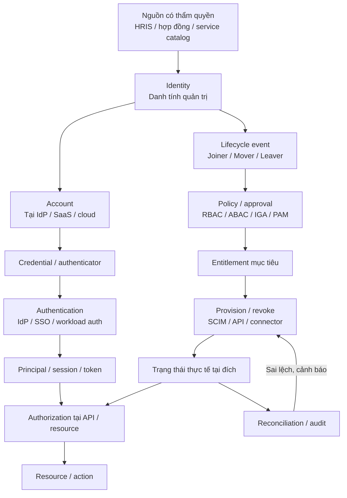
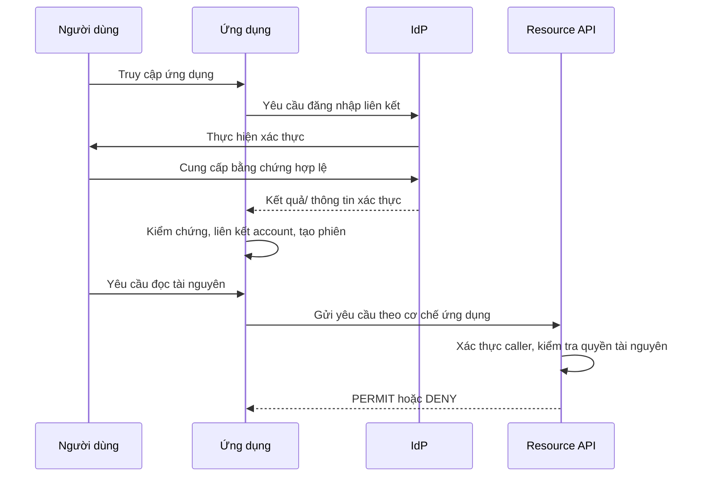
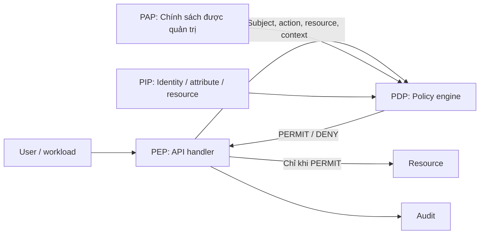
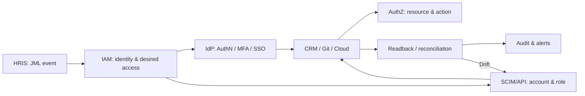

# Thuật ngữ cốt lõi

## 1. Cách đọc và sử dụng bảng thuật ngữ IAM lifecycle

Trong hệ thống Identity and Access Management (IAM), các từ **identity**, **account**, **principal**, **credential**, **role**, **permission**, **token** và **entitlement** dễ bị dùng thay nhau. Nếu không phân biệt, một workflow có thể đánh dấu người nghỉ việc đã được thu hồi quyền chỉ vì tài khoản IdP bị khóa, trong khi ứng dụng vẫn còn một API key hợp lệ.

Ví dụ: Nhân viên **Minh** có một danh tính nhân sự, tài khoản tại IdP, tài khoản CRM và tài khoản Git. Minh đang có quyền đọc ticket qua một nhóm và quyền xem log production được phê duyệt trong một giờ. Khi Minh chuyển phòng ban, **danh tính vẫn là Minh**, nhưng **tập quyền mục tiêu thay đổi**; khi Minh nghỉ việc, tổ chức phải ngăn các đường truy cập qua cả tài khoản, phiên và credential còn hiệu lực.

Bài **“Thuật ngữ cốt lõi”** thuộc chương **Tổng quan IAM lifecycle**, trong module `SECURITY_IDENTITY_ACCESS_MANAGEMENT_IDENTITY_LIFECYCLE`. Nội dung giúp đọc đúng các khái niệm dùng trong quản lý vòng đời danh tính theo **Joiner–Mover–Leaver (JML)**: xác minh, tạo tài khoản, cấp quyền, thay đổi vai trò, rà soát và thu hồi. Những thuật ngữ về **IdP, SSO, SCIM, RBAC/ABAC, tài khoản dịch vụ và kiểm toán** được đặt trong mối quan hệ thực tế với mục tiêu **giảm quyền truy cập tồn dư**.

### Quy ước sử dụng

- **Tên tiếng Anh** được giữ kèm cách diễn giải tiếng Việt vì nhiều sản phẩm, API và tài liệu kỹ thuật dùng thuật ngữ gốc.
- **Ví dụ và mã giả** chỉ minh họa nguyên lý, không phải cấu hình chạy được ngay của một nhà cung cấp.
- Cùng một thuật ngữ có thể có nghĩa hẹp hơn trong một giao thức hoặc nền tảng. Khi triển khai, cần đọc rõ phạm vi của tài liệu sản phẩm, không tự suy diễn hành vi giữa các hệ thống.
- Một **trạng thái được ghi nhận trong hệ thống IAM** không luôn đồng nghĩa **quyền đang có hiệu lực thực tế** ở hệ thống đích.

## 2. Bản đồ tổng thể các nhóm thuật ngữ

| Nhóm | Thuật ngữ tiêu biểu | Câu hỏi nhóm này trả lời |
| --- | --- | --- |
| **Đối tượng được quản lý** | Identity, subject, principal, account, service account | Ai hoặc workload nào có thể truy cập? |
| **Danh tính đáng tin** | Identity proofing, authoritative source, HRIS, system of record | Dựa vào đâu biết danh tính và thuộc tính đúng? |
| **Xác thực** | AuthN, authenticator, credential, MFA, passkey, session | Chủ thể chứng minh mình là ai bằng cách nào? |
| **Liên kết đăng nhập và token** | IdP, SSO, federation, OIDC, SAML, OAuth, token, claim | Hệ thống nào xác thực và truyền kết quả ra sao? |
| **Quyết định truy cập** | AuthZ, role, permission, entitlement, scope, RBAC, ABAC, PEP/PDP | Chủ thể được thực hiện hành động nào với tài nguyên nào? |
| **Vòng đời** | Joiner, Mover, Leaver, provisioning, deprovisioning, SCIM | Quyền và account thay đổi theo công việc ra sao? |
| **Quản trị và đặc quyền** | IGA, PAM, least privilege, SoD, JIT, access review | Ai phê duyệt, kiểm soát và kiểm tra lại quyền? |
| **Danh tính máy** | Workload identity, non-human identity, API key, secret rotation | Dịch vụ và automation có được quản lý như một chủ thể không? |
| **Vận hành và rủi ro** | Reconciliation, drift, residual access, audit, idempotency | Đã thực thi đúng, phát hiện lỗi và chứng minh được chưa? |

### Sơ đồ quan hệ khái niệm



Sơ đồ là mô hình logic. Trong một kiến trúc thực tế, principal không nhất thiết luôn tồn tại dưới dạng một object riêng, và ứng dụng có thể thực thi chính sách trực tiếp mà không cần dịch vụ policy độc lập.

## 3. Identity, subject, principal và account

### 3.1. Identity – danh tính

**Identity** là biểu diễn số của một **người, đối tác, thiết bị, ứng dụng hoặc workload** mà tổ chức cần nhận biết và quản trị. Identity thường có ID ổn định, trạng thái vòng đời, thuộc tính và liên kết tới các account.

Ví dụ `person-1042` là identity của một nhân viên; `service-invoice-worker` là identity được quản trị của dịch vụ xử lý hóa đơn.

Một danh tính có thể liên kết với nhiều account ở nhiều tenant/ứng dụng. Thay email không nhất thiết tạo một identity mới. Ngược lại, một account không ánh xạ được tới identity hoặc owner hợp lệ cần được điều tra.

### 3.2. Subject – chủ thể

**Subject** là thực thể được mô hình chính sách hoặc hệ thống bảo mật xét tới. Trong một yêu cầu truy cập, subject có thể là người dùng, tiến trình hoặc workload. Từ này thường xuất hiện trong mô hình kiểm soát truy cập.

Trong OIDC, claim `sub` là định danh subject do issuer phát hành trong phạm vi của nó. Không nên giả định một chuỗi `sub` tự nó duy nhất trên toàn cầu; cần xem thêm `iss` và loại subject identifier mà hệ thống phát hành.

### 3.3. Principal – danh tính bảo mật được hệ thống sử dụng

**Principal** là biểu diễn của chủ thể trong một **security context** hoặc hệ thống phân quyền. Ví dụ, một API xác định request thuộc principal `user:1042`; cloud dùng service principal cho một ứng dụng tự động.

Không phải mọi principal đều tương đương một nhân viên. Principal có thể đại diện cho một workload, một service account hoặc một account đặc quyền.

### 3.4. Account – tài khoản ở một hệ thống

**Account** là bản ghi tại IdP, directory, SaaS, ứng dụng nội bộ hoặc cloud. Nó có thể chứa ID hệ thống, trạng thái enable/disable, nhóm, role, credential liên quan và lịch sử.

Ví dụ:

| Danh tính | Tài khoản | Phạm vi |
| --- | --- | --- |
| `person-1042` | `idp-user-482` | IdP của tổ chức |
| `person-1042` | `crm-user-114` | CRM production |
| `person-1042` | `git-user-731` | Nền tảng quản lý mã nguồn |
| `service-invoice-worker` | `cloud-service-principal-82` | Cloud production |

**Quy tắc:** account ID nên được hiểu trong **hệ thống và tenant** cụ thể. Đừng dùng username/email làm định danh bất biến nếu nền tảng cho phép thay đổi hoặc tái sử dụng.

### Bốn khái niệm dễ nhầm

| Từ | Nhấn mạnh vào | Sai lầm cần tránh |
| --- | --- | --- |
| Identity | Chủ thể được tổ chức nhận biết và quản lý | Dùng email như ID toàn cục của con người |
| Subject | Thực thể đang được xét trong mô hình bảo mật | Mặc định subject luôn là nhân viên |
| Principal | Chủ thể theo security context của hệ thống | Nhầm một service principal với người dùng đang ngồi máy |
| Account | Bản ghi kỹ thuật tại hệ thống cụ thể | Khóa account IdP rồi suy ra mọi account khác đã khóa |

## 4. Identity proofing, authoritative source và thuộc tính danh tính

**Identity proofing** là hoạt động kiểm chứng bằng chứng để xác lập, với mức tin cậy phù hợp, một danh tính số liên quan đến chủ thể thực sự nào. Đây thường là bước **trước hoặc trong đăng ký danh tính**. Nó khác với việc kiểm tra credential vào mỗi lần đăng nhập.

**Authoritative source (nguồn có thẩm quyền)** là hệ thống hoặc quy trình được tổ chức công nhận có quyền quyết định một loại dữ liệu hoặc sự kiện nhất định.

**System of record (SoR)** là hệ thống lưu bản ghi nghiệp vụ chính thức trong một miền thông tin. SoR thường là nguồn có thẩm quyền cho một số thuộc tính, nhưng không nhất thiết quyết định mọi trạng thái IAM.

**Identity attribute (thuộc tính danh tính)** là dữ liệu mô tả danh tính phục vụ quy trình và chính sách: bộ phận, loại nhân sự, ngày hiệu lực, chủ sở hữu workload, khu vực, mức tin cậy, v.v.

**Attribute provenance** mô tả thuộc tính đến từ nguồn nào, do ai thay đổi, có hiệu lực khi nào và phiên bản nào đang được sử dụng.

| Thuộc tính/sự kiện | Nguồn có thể có thẩm quyền | Không nên suy ra từ |
| --- | --- | --- |
| Ngày bắt đầu/nghỉ của nhân viên | HRIS | Cờ `active` hiện tại trong CRM |
| Ngày hết hạn nhà thầu | Hệ thống hợp đồng/sponsor | Việc nhà thầu vẫn đăng nhập được |
| Người sở hữu workload | Service catalog / đội vận hành được ủy quyền | Người cuối cùng tạo API key |
| Phương thức MFA đã đăng ký | IdP/hệ thống xác thực | Hồ sơ nhân sự |
| Trạng thái account CRM hiện tại | CRM | Yêu cầu SCIM đã được gửi nhưng chưa xác minh |
| Quyền nghiệp vụ được phê duyệt | IGA/policy/chủ tài nguyên | Claim tự khai từ client |

**Điểm quan trọng:** có thể có nhiều nguồn có thẩm quyền **theo từng thuộc tính**. HRIS là nguồn tốt để xác định quan hệ làm việc, nhưng không phải nguồn sự thật về phiên SaaS còn hiệu lực hay token đã bị thu hồi.

### Stable ID – định danh ổn định

Một `identityId` ổn định giúp liên kết người hoặc workload qua các lần đổi email, tên hoặc phòng ban. Khi có nhiều tenant, khóa duy nhất phải bao gồm phạm vi nguồn/tenant thích hợp.

Ví dụ ánh xạ:

```json
{
  "identityId": "person-1042",
  "authoritativeSource": "hris",
  "sourceSubjectId": "HR-00482",
  "targetAccounts": [
    {"system": "idp", "tenant": "company", "accountId": "idp-user-482"},
    {"system": "crm", "tenant": "production", "accountId": "crm-user-114"}
  ]
}
```

Đây là schema minh họa, không phải chuẩn lưu trữ bắt buộc.

## 5. Authentication, credential, authenticator và MFA

### Authentication (AuthN) – xác thực

**Authentication** là quá trình kiểm tra chứng cứ rằng chủ thể yêu cầu thực sự nắm giữ phương tiện xác thực hợp lệ cho danh tính/principal được khai báo. Câu hỏi: **“Chủ thể đã chứng minh mình là ai chưa?”**

### Credential – thông tin chứng thực

**Credential** là dữ liệu hoặc chứng cứ được sử dụng trong xác thực hoặc ủy quyền truy cập, tùy cơ chế: mật khẩu, cặp khóa, chứng chỉ, API key hoặc một token có chức năng truy cập.

**Authenticator – phương tiện xác thực** là phương tiện/yếu tố dùng để tạo hoặc cung cấp bằng chứng xác thực: khóa bảo mật, thiết bị FIDO2, ứng dụng tạo mã hoặc thiết bị chứa khóa. Thuật ngữ credential và authenticator đôi khi được sản phẩm dùng gần nhau; phải xem cách triển khai cụ thể.

### Authentication factors – các yếu tố xác thực

| Yếu tố | Ví dụ | Ghi chú |
| --- | --- | --- |
| **Something you know** – điều biết | Mật khẩu, PIN | Hai mật khẩu không tạo thành hai loại yếu tố khác nhau |
| **Something you have** – điều sở hữu | Khóa bảo mật, thiết bị xác thực | Cần bảo vệ đăng ký, khôi phục và mất thiết bị |
| **Something you are** – sinh trắc | Vân tay/khuôn mặt được hệ thống sử dụng phù hợp | Cơ chế bảo vệ mẫu sinh trắc và vị trí đối chiếu rất quan trọng |

**MFA (Multi-Factor Authentication)** sử dụng nhiều yếu tố độc lập để xác thực. **Phishing-resistant authentication** dùng cơ chế khó bị lừa chuyển chứng cứ sang website giả, ví dụ FIDO2/WebAuthn/passkey khi triển khai phù hợp.

**Step-up authentication** là yêu cầu xác thực bổ sung hoặc mạnh hơn trước thao tác có rủi ro cao.

**Account recovery** là quá trình lấy lại khả năng sử dụng tài khoản; recovery yếu có thể tạo đường vòng cho kẻ tấn công dù đăng nhập chính dùng MFA mạnh.

### So sánh nhanh

| Thuật ngữ | Ý nghĩa | Không có nghĩa là |
| --- | --- | --- |
| AuthN | Xác nhận chứng cứ về chủ thể | Được xem mọi dữ liệu |
| MFA | Nhiều yếu tố xác thực | Mọi phương thức đều kháng phishing như nhau |
| Step-up | Tăng mức bảo đảm cho hành động cụ thể | Tự cấp thêm quyền nghiệp vụ |
| Credential rotation | Thay khóa/secret/chứng chỉ | Thu hồi role hay permission của principal |
| Account disabled | Chặn chức năng tài khoản theo thiết kế | Mọi token/phiên độc lập lập tức hết hiệu lực |

## 6. Session, token và trạng thái đăng nhập

**Session (phiên)** là trạng thái liên tục giúp ứng dụng nhận biết các request sau khi xác thực, chẳng hạn phiên web dựa vào cookie. Phiên có thể tồn tại độc lập với sự kiện đổi trạng thái ở hệ thống nhân sự.

**Token** là vật mang thông tin xác thực hoặc quyền theo một giao thức. Không phải mọi token có cùng mục đích hoặc định dạng.

**Session expiration** là khi phiên hết hạn theo chính sách. **Session revocation** là hành động làm phiên không còn được chấp nhận trước hạn hoặc tại thời điểm cần thiết, nếu nền tảng hỗ trợ.

**Token revocation** là cơ chế thu hồi hiệu lực hoặc ngăn tái sử dụng token. Cách triển khai khác nhau giữa token tham chiếu (opaque token), token tự chứa và các dịch vụ liên quan.

### Ba loại token dễ nhầm

| Token | Mục đích chính | Được dùng ở đâu? | Sai lầm phổ biến |
| --- | --- | --- | --- |
| **ID token (OIDC)** | Truyền thông tin kết quả xác thực người dùng cho OIDC client | OIDC relying party/client | Dùng ID token thay access token để gọi API |
| **Access token (OAuth)** | Cho client truy cập resource server trong phạm vi được cấp | API/resource server phù hợp | Cho rằng token hợp lệ nghĩa là có quyền trên mọi đối tượng |
| **Refresh token (OAuth)** | Cho client yêu cầu access token mới theo chính sách | Authorization server/token endpoint | Lưu không an toàn hoặc không xử lý thu hồi |

Một token hợp lệ về chữ ký có thể **không dành cho API nhận**. Cần kiểm tra issuer (`iss`), audience (`aud`), thời hạn và các điều kiện liên quan theo loại token/giao thức. Không sử dụng claim chưa xác thực làm căn cứ cấp quyền.

### Những claim cơ bản

| Claim/khái niệm | Ý nghĩa | Lưu ý |
| --- | --- | --- |
| `iss` – issuer | Ai phát hành token | Kiểm tra đúng nguồn tin cậy |
| `sub` – subject | Chủ thể được mô tả | Xét cùng issuer và cơ chế mapping |
| `aud` – audience | Đối tượng token hướng tới | API không nhận token cấp cho đối tượng khác |
| `exp` – expiration | Hạn sử dụng | Hết hạn không tương đương đã thu hồi sớm |
| `iat` – issued at | Thời điểm phát hành | Hỗ trợ kiểm tra ngữ cảnh, không thay thế AuthZ |
| `scope` – scope | Phạm vi ủy quyền của client trong OAuth | Không thay thế kiểm tra sở hữu bản ghi/tenant |

Trong hệ thống chấp nhận token tự chứa và **chỉ kiểm tra chữ ký cùng thời hạn**, việc khóa account IdP có thể không khiến access token mất hiệu lực ngay. Phải thiết kế TTL, session revocation, token introspection hoặc kiểm tra trạng thái ở resource server tùy mức rủi ro.

## 7. IdP, directory, SSO và federation

**Identity Provider (IdP)** là thành phần xác thực và cung cấp thông tin danh tính cho bên tin cậy. Ví dụ phổ biến trong doanh nghiệp là một hệ thống quản lý tài khoản và đăng nhập tập trung.

**Directory** là nơi lưu trữ account, nhóm và các thuộc tính phục vụ tra cứu hoặc xác thực; có thể là một thành phần của nền tảng identity hoặc hệ thống riêng.

**SSO (Single Sign-On)** là trải nghiệm đăng nhập liên kết cho phép người dùng truy cập nhiều ứng dụng qua kết quả xác thực tại IdP trong điều kiện phù hợp.

**Federation (liên kết danh tính)** là quan hệ tin cậy giữa các miền/hệ thống nhằm trao đổi thông tin về danh tính hoặc xác thực. Một tổ chức có thể tin cậy IdP của đối tác cho truy cập được giới hạn.

**Relying party / Service Provider (SP)** là ứng dụng tin cậy kết quả xác thực của IdP. Trong OIDC thường gọi là relying party/client; trong SAML thường gọi là service provider.

### Sơ đồ luồng xác thực liên kết



**SSO không tự động provisioning hoặc deprovisioning mọi account đích.** Một ứng dụng có thể đăng nhập qua SSO nhưng vẫn tồn tại tài khoản cục bộ và role riêng; khi Leaver cần xử lý chúng.

### JIT account provisioning

**Just-in-Time account provisioning** là cơ chế ứng dụng tạo account khi người dùng đăng nhập liên kết lần đầu theo chính sách. Nó khác với **JIT privileged access**, là cấp đặc quyền có thời hạn ngắn. Việc tạo account khi đăng nhập không chứng minh ứng dụng sẽ tự vô hiệu hóa account khi nguồn danh tính hết hiệu lực.

## 8. SAML, OpenID Connect, OAuth và SCIM

Các chuẩn này thường xuất hiện gần nhau nhưng giải quyết những lớp vấn đề khác nhau:

| Công nghệ | Chức năng trọng tâm | Ví dụ sử dụng | Không phải |
| --- | --- | --- | --- |
| **SAML 2.0** | Trao đổi assertion phục vụ đăng nhập liên kết | Nhân viên đăng nhập SaaS qua IdP | Giao thức quản lý account SaaS |
| **OpenID Connect (OIDC)** | Lớp danh tính/xác thực dựa trên OAuth 2.0 | Ứng dụng đăng nhập và nhận ID token từ IdP | Tự động bảo đảm quyền nghiệp vụ tại API |
| **OAuth 2.0** | Khung ủy quyền cho client truy cập tài nguyên bảo vệ | Client nhận access token cho API | Một giao thức đăng nhập người dùng đầy đủ nếu dùng riêng |
| **SCIM 2.0** | Mô hình và API quản lý tài khoản/người dùng/nhóm | Tạo, cập nhật, deactivate account SaaS | Giao thức xác thực người dùng qua trình duyệt |
| **WebAuthn/FIDO2** | Giao thức/cơ chế xác thực bằng khóa mật mã | Passkey hoặc khóa bảo mật | Mô hình cấp quyền RBAC |
| **LDAP** | Giao thức truy cập dịch vụ thư mục | Tra cứu account/nhóm trong directory | Quy trình governance hoàn chỉnh |
| **Kerberos** | Giao thức xác thực dựa trên ticket trong môi trường phù hợp | Xác thực tài khoản trong hệ thống nội bộ | Cơ chế tự quản lý quyền theo JML |

### Trong OIDC: issuer, subject, client

Ứng dụng phải kiểm tra những dữ liệu phù hợp với luồng và loại token. Cặp `iss + sub` là cơ sở xác định subject trong phạm vi issuer; cần tránh ghép identity chỉ vì hai account có cùng email.

### Trong SCIM: id và externalId

| Thuộc tính SCIM | Ý nghĩa phổ biến |
| --- | --- |
| `id` | ID tài nguyên do SCIM service provider cấp, trong phạm vi dịch vụ đó |
| `externalId` | Định danh phục vụ liên kết với hệ thống cung cấp dữ liệu/provisioning bên ngoài |
| `userName` | Tên người dùng theo yêu cầu của service provider, không nên mặc định không đổi |
| `active` | Cờ thể hiện người dùng đang hoạt động theo schema và hành vi nhà cung cấp |
| `Groups` / membership | Tài nguyên nhóm và các quan hệ thành viên khi được hỗ trợ |

Ví dụ đặt user không hoạt động qua SCIM:

```http
PATCH /scim/v2/Users/bb7d1e42-e29f-46c0-8af9-5b2f8a0d38f7 HTTP/1.1
Authorization: Bearer <redacted>
Content-Type: application/scim+json

{
  "schemas": ["urn:ietf:params:scim:api:messages:2.0:PatchOp"],
  "Operations": [
    {"op": "replace", "path": "active", "value": false}
  ]
}
```

Thao tác trên nhằm thay đổi trạng thái account SCIM; **không tự bảo đảm** phiên đã tạo, token hoặc quyền truy cập cục bộ khác đều mất hiệu lực ngay. Đó là lý do phải kiểm thử hành vi ứng dụng và đọc lại trạng thái.

## 9. Authorization, permission, role, entitlement và scope

**Authorization (AuthZ)** là quyết định có cho **chủ thể** thực hiện **hành động** trên **tài nguyên** trong **ngữ cảnh** hiện tại hay không.

Một cách diễn đạt thường dùng:

```text
authorize(subject, action, resource, context) -> PERMIT | DENY
```

**Permission** là quyền thực hiện một hành động, chẳng hạn `invoice.read` hoặc `repository.write`.

**Entitlement** là quyền hoặc lợi ích truy cập được **cấp** cho identity/account trong một hệ thống. Entitlement có thể là role, group membership, ACL entry hoặc một permission được gán.

**Role** là tập hợp quyền hoặc trách nhiệm được định nghĩa, ví dụ `FinanceViewer`.

**Group** là tập hợp thành viên; một nhóm có thể dùng để gán quyền nhưng **không mặc định đồng nghĩa role**.

**Scope** trong OAuth là chỉ báo phạm vi ủy quyền cho client. Scope `invoices.read` **không tự động chứng minh** chủ thể được đọc mọi hóa đơn; API vẫn phải đánh giá tenant, chủ sở hữu hoặc chính sách dữ liệu.

**Resource** là tài nguyên được bảo vệ: hóa đơn, bản ghi, API, file, bucket, repository.

**Action** là thao tác: read, write, delete, approve, export, administer.

**Policy** là tập quy tắc cho phép hoặc từ chối dựa trên subject, action, resource và context.

### So sánh một ví dụ

Người dùng `person-1042`:

- Có account `crm-user-114`;
- thuộc nhóm `Finance-Team`;
- được cấp role `FinanceViewer`;
- role có permission `invoice.read`;
- token của client có scope `invoices.read`;
- yêu cầu đọc hóa đơn của tenant **khác**.

API vẫn phải trả **DENY** nếu policy yêu cầu cùng tenant. Việc tồn tại role hoặc scope **không phải** sự chấp thuận không giới hạn.

## 10. RBAC, ABAC, ACL và ReBAC

### RBAC – Role-Based Access Control

**RBAC** là mô hình kiểm soát truy cập theo **vai trò**. Người dùng được gán role, và role gắn với các quyền phù hợp với trách nhiệm.

| Role minh họa | Quyền chính | Không mặc định có |
| --- | --- | --- |
| `SupportAgent` | Xem/cập nhật ticket được giao | Xuất toàn bộ dữ liệu khách hàng |
| `FinanceViewer` | Đọc báo cáo được phép | Phê duyệt thanh toán |
| `FinanceApprover` | Phê duyệt trong giới hạn chính sách | Tự tạo và tự duyệt giao dịch xung đột SoD |
| `CloudOperator` | Vận hành tài nguyên được giao | Admin toàn tổ chức |

**Role explosion** là tình trạng có quá nhiều role cho những biến thể nhỏ, khiến chính sách khó quản trị, review và thu hồi.

### ABAC – Attribute-Based Access Control

**ABAC** quyết định dựa trên thuộc tính của **chủ thể, tài nguyên, hành động và môi trường**.

Ví dụ:

```text
PERMIT invoice.read IF
    subject.lifecycleStatus == "active"
    AND subject.department == "Finance"
    AND subject.tenantId == invoice.tenantId
    AND subject.region == invoice.region
    AND context.mfaSatisfied == true
ELSE DENY
```

Đây là giả mã. ABAC đòi **nguồn thuộc tính đáng tin và đủ mới**. Nếu bộ phận thay đổi nhưng policy còn dùng claim cũ trong phiên, quyết định có thể không còn phù hợp.

### ACL – Access Control List

**ACL** là danh sách những principal/nhóm được phép hoặc bị từ chối truy cập trên một tài nguyên. Ví dụ tài liệu chỉ cho chủ sở hữu và ba người cộng tác đọc.

### ReBAC – Relationship-Based Access Control

**ReBAC** xét các quan hệ giữa chủ thể và đối tượng, như `owner`, `memberOfTeam`, `editorOfProject`. Chẳng hạn người là chủ sở hữu project được phép phân công thành viên, nhưng không tự động có quyền quản trị tenant khác.

Các mô hình có thể kết hợp. Dù dùng mô hình nào, hệ thống cần **enforce quyền thực tế tại backend/API**, không chỉ ẩn chức năng ở giao diện.

## 11. PDP, PEP, PIP, PAP và điểm thực thi quyền

Trong kiến trúc policy, bốn tên sau phân định trách nhiệm:

| Viết tắt | Tên đầy đủ | Nhiệm vụ |
| --- | --- | --- |
| **PDP** | Policy Decision Point | Đánh giá chính sách và trả quyết định cho phép/từ chối |
| **PEP** | Policy Enforcement Point | Chặn request và thực thi quyết định trước khi truy cập tài nguyên |
| **PIP** | Policy Information Point | Cung cấp thuộc tính/trạng thái đáng tin cho PDP |
| **PAP** | Policy Administration Point | Quản trị và thay đổi chính sách |



**PEP và PDP có thể được triển khai trong cùng một ứng dụng**; sơ đồ không bắt buộc phải có bốn microservice.

**Deny by default**: không có căn cứ cho phép hợp lệ thì từ chối. **Fail closed**: khi không đánh giá được quyền và rủi ro không cho phép tiếp tục, từ chối thay vì tự cấp quyền; cần thiết kế phương án xử lý tình huống hệ thống policy không khả dụng theo nghiệp vụ.

**Object-level authorization**: kiểm tra quyền trên **bản ghi/tài nguyên cụ thể**, không chỉ quyền mở chức năng. Nếu một API cho người dùng thay `invoiceId` để đọc hóa đơn tenant khác, đó là lỗi **BOLA/IDOR**.

## 12. Joiner, Mover, Leaver và các trạng thái vòng đời

### Joiner – gia nhập

Sự kiện chủ thể bắt đầu quan hệ hợp lệ. Quy trình thường gồm kiểm chứng, tạo identity, tạo hoặc liên kết account, cấp quyền nền, thiết lập AuthN và xác nhận trạng thái đích.

### Mover – thay đổi vai trò hoặc điều kiện

Chủ thể vẫn thuộc phạm vi quản lý nhưng bộ phận, dự án, công việc, hợp đồng, owner hoặc phạm vi thay đổi. IAM phải **tính lại quyền mục tiêu**, thu hồi quyền cũ không còn hợp lệ và cấp quyền mới có căn cứ.

### Leaver – kết thúc quan hệ hoặc mục đích

Chủ thể rời tổ chức, hợp đồng hết hạn, tài khoản đối tác hết điều kiện hoặc workload bị decommission. IAM phải **chặn các đường truy cập và xác nhận quyền đã thu hồi** trên hệ thống đích.

| Giai đoạn | Thay đổi identity | Thay đổi account/quyền |
| --- | --- | --- |
| **Joiner** | Tạo identity hoặc xác minh liên kết với identity cũ | Provision account, cấp birthright và quyền được phê duyệt |
| **Mover** | Cập nhật thuộc tính, owner, trạng thái/quan hệ | Cấp quyền mới, thu hồi quyền cũ, kiểm tra SoD |
| **Leaver** | Chuyển trạng thái kết thúc | Deactivate account, revoke entitlement/credential/phiên phù hợp |
| **Suspend** | Tạm đình chỉ nhưng chưa kết thúc quan hệ | Hạn chế/khóa theo chính sách, xác nhận việc khôi phục khi được duyệt |
| **Rehire** | Xác minh quan hệ mới và cách sử dụng identity cũ | Không tự phục hồi mọi đặc quyền trước đây |

### Birthright access và exceptional access

**Birthright access (quyền nền)**: những quyền được cấp tự động theo trạng thái và vai trò công việc hợp lệ; không cần yêu cầu riêng trong mọi trường hợp.

**Exceptional access (quyền ngoại lệ)**: quyền ngoài baseline, cần căn cứ, chủ tài nguyên, thời hạn và phê duyệt bổ sung theo chính sách.

### Account enabled, disabled, deleted

- **Enabled:** account cho phép một số hoạt động trong phạm vi chính sách và triển khai.
- **Disabled/deactivated:** account bị vô hiệu hóa theo cơ chế hệ thống; cần kiểm tra thêm phiên, token và credential độc lập.
- **Deleted:** bản ghi account bị xóa theo chính sách; việc xóa không nhất thiết tương đương đã xử lý toàn bộ dữ liệu, audit, tài sản hoặc credential ở mọi dịch vụ.

Không nên đồng nhất ba trạng thái này với trạng thái nhân sự `active` / `terminated`.

## 13. Provisioning, deprovisioning và các thao tác vòng đời

**Provisioning** là quá trình tạo hoặc cấu hình tài khoản, tài nguyên và quyền theo trạng thái mong muốn.

**Deprovisioning** là quá trình loại bỏ hoặc vô hiệu hóa khả năng truy cập không còn hợp lệ, có thể bao gồm account, group, role, policy, token, secret hoặc credential liên quan.

**Reprovisioning** là cấp lại hoặc cập nhật có kiểm soát sau thay đổi, sự cố hoặc tái tuyển dụng; không có nghĩa tự cấp lại mọi quyền trước đây.

**Revocation** là thu hồi hiệu lực của quyền, phiên hoặc credential theo cơ chế phù hợp.

**Access request** là yêu cầu cấp hoặc sửa quyền với mục đích, tài nguyên, thời hạn và owner.

**Approval** là quyết định cho phép từ người hoặc chính sách đủ thẩm quyền. Phê duyệt **khác với** quyền đã được thực thi ở hệ thống đích.

**Access review / recertification** là rà soát định kỳ hoặc theo sự kiện để xác nhận quyền còn cần thiết hay phải thu hồi.

**Access expiration** là thời điểm quyền hết hạn theo chính sách; đến hạn phải bảo đảm cơ chế thu hồi được thực thi và xác minh, không chỉ có ngày hết hạn trong ticket.

**Effective access** là tập khả năng truy cập **thực sự** có thể sử dụng sau khi tổng hợp role trực tiếp, group lồng nhau, ACL, quyền kế thừa và chính sách khác theo kiến trúc.

### Ví dụ thay đổi quyền khi Mover

```text
Actual entitlements trước Mover:
  {crm.ticket.read, crm.ticket.update, docs.read}

Desired entitlements sau Mover:
  {finance.report.read, docs.read}

Cần thu hồi:
  {crm.ticket.read, crm.ticket.update}

Cần cấp:
  {finance.report.read}

Cần xác minh:
  Quyền CRM cũ thực sự không còn qua mọi đường cấp quyền.
```

Một nhóm đã gỡ có thể chưa đủ: ứng dụng có thể còn quyền gán trực tiếp. Đó là lý do **effective access** và **reconciliation** quan trọng.

## 14. IGA, PAM, least privilege, SoD và JIT

**IGA (Identity Governance and Administration)** tập trung vào quản trị yêu cầu, phê duyệt, chứng nhận, chính sách quyền, phân tách trách nhiệm và bằng chứng ai được truy cập vì sao.

**PAM (Privileged Access Management)** kiểm soát truy cập đặc quyền như quản trị cloud, IdP, database hoặc production, thường có cơ chế hạn quyền, giám sát và kiểm soát phiên/credential đặc biệt.

**Least privilege (đặc quyền tối thiểu)**: chỉ cấp những quyền cần thiết để hoàn thành công việc, trong đúng phạm vi và thời gian.

**SoD (Separation of Duties – phân tách nhiệm vụ)**: tránh một chủ thể sở hữu tổ hợp quyền có thể tự hoàn thành và tự phê duyệt giao dịch nhạy cảm.

**JIT (Just-in-Time privileged access)**: cấp hoặc kích hoạt đặc quyền trong khoảng thời gian ngắn theo nhu cầu và điều kiện hợp lệ.

**JEA (Just-Enough Administration)**: giới hạn chức năng quản trị tới những thao tác cần thiết thay vì full admin.

**Break-glass / emergency access**: cơ chế truy cập khẩn cấp trong những trường hợp hệ thống thông thường không khả dụng hoặc cần xử lý đặc biệt, có giám sát và hậu kiểm.

| Thuật ngữ | Trọng tâm | Ví dụ |
| --- | --- | --- |
| IGA | Vì sao quyền được cấp và còn hợp lệ? | Manager xác nhận tiếp tục hoặc thu hồi quyền trong access review |
| PAM | Ai có đặc quyền và sử dụng ra sao? | Phiên admin production theo cơ chế đặc biệt |
| Least privilege | Phạm vi quyền nhỏ nhất cần thiết | `logs.read` thay vì `cloud.admin` |
| SoD | Kiểm soát xung đột trách nhiệm | Không đồng thời tạo và tự duyệt khoản thanh toán |
| JIT | Giảm thời gian giữ đặc quyền | Cấp quyền 60 phút để xử lý sự cố |
| Break-glass | Khả năng khôi phục khẩn cấp | Account được bảo vệ đặc biệt khi IdP gián đoạn |

**Chú ý:** JIT không tự đảm bảo an toàn nếu quá trình xác minh, phê duyệt hoặc policy sai. Một quyền JIT với phạm vi quá rộng vẫn là rủi ro đáng kể.

## 15. Service account, workload identity và non-human identity

**Non-human identity (NHI)** là danh tính của tác nhân không phải con người: dịch vụ, container, bot, pipeline, ứng dụng, thiết bị hoặc tác vụ tự động.

**Service account** là tài khoản kỹ thuật dùng để chạy hoặc đại diện cho một ứng dụng/quy trình. Trong những nền tảng khác nhau, service account có thể dùng mật khẩu, key hoặc cơ chế xác thực của môi trường.

**Workload identity** là danh tính gắn với workload đang chạy, thường có thể xác nhận thông qua nền tảng vận hành hoặc trust với hệ thống phát hành token.

**Service principal** là biểu diễn danh tính ứng dụng/dịch vụ trong một hệ thống bảo mật, thường gặp trên nền tảng cloud.

**API key** là chuỗi khóa dùng để nhận diện hoặc xác thực một client trong những tích hợp cụ thể. API key thường không có đầy đủ bảo đảm bảo mật như cơ chế federation hiện đại nếu không có kiểm soát bổ sung.

**Secret** là dữ liệu nhạy cảm dùng để chứng minh quyền truy cập hoặc mã hóa, như client secret, password, key. **Rotation** là thay secret/credential có kiểm soát; **revocation** là làm credential cũ không còn được chấp nhận.

**Workload federation** cho phép workload sử dụng chứng thực được phát hành bởi môi trường tin cậy để lấy quyền truy cập phù hợp, thường giảm nhu cầu giữ secret tĩnh lâu dài.

### JML cho workload

| Giai đoạn | Ví dụ | Nhiệm vụ quản trị |
| --- | --- | --- |
| Joiner | Dịch vụ `invoice-worker` được triển khai | Đăng ký owner, mục đích, identity, quyền tối thiểu |
| Mover | Dịch vụ chuyển team hoặc sang production | Đánh giá lại owner, trust, policy và credential |
| Leaver | Pipeline ngừng hoạt động | Thu hồi account, role, token/key, trust và xác minh |
| Review | Service account nhiều tháng không được dùng | Kiểm tra owner, lý do tồn tại, phạm vi và expiry |

**Không mặc định service account của người nghỉ việc cũng phải bị xóa ngay nếu workload còn hoạt động hợp lệ.** Cần chuyển ownership, rà soát quyền và credential, rồi thu hồi đường truy cập gắn với người đó theo quy trình an toàn.

## 16. Quyền tồn dư, đặc quyền tích lũy và tài khoản mồ côi

**Residual access (quyền truy cập tồn dư)** là đường truy cập còn tồn tại sau khi không còn căn cứ hợp lệ, ví dụ tài khoản SaaS hoặc PAT vẫn hoạt động sau Leaver.

**Privilege creep / privilege accumulation** là hiện tượng quyền truy cập tích lũy qua thời gian, thường do Mover chỉ cấp quyền mới mà không thu hồi quyền cũ.

**Overprovisioning** là cấp nhiều quyền hơn nhu cầu và chính sách thực tế.

**Orphan account** là tài khoản không ánh xạ được tới identity/owner hợp lệ hoặc chủ thể không còn được quản trị phù hợp.

**Standing privilege** là đặc quyền được duy trì thường trực, trái với quyền được kích hoạt có thời hạn theo nhu cầu.

**Privilege escalation** là việc một chủ thể đạt quyền cao hơn mức được cho phép qua lỗ hổng, sai cấu hình hoặc cơ chế cấp quyền không phù hợp.

**Access drift** là sự sai khác giữa tập quyền chính sách mong muốn và quyền thực tế tại hệ thống đích.

### Cặp thuật ngữ dễ nhầm: residual access và residual risk

| Thuật ngữ | Ý nghĩa | Ví dụ |
| --- | --- | --- |
| **Residual access** | Một quyền/đường truy cập không còn căn cứ nhưng vẫn hoạt động | Leaver vẫn dùng được PAT |
| **Residual risk** | Mức rủi ro còn lại sau khi áp dụng kiểm soát | Access token có thể còn hiệu lực tối đa tới khi hết TTL trong thiết kế hiện tại |
| **Access drift** | Chênh lệch thực tế so với quyền mục tiêu | CRM có role admin không có trong chính sách |
| **Privilege creep** | Quyền tích lũy từ các lần thay đổi | Nhân viên giữ role của ba phòng ban |
| **Orphan account** | Tài khoản không còn liên kết quản trị rõ ràng | Service account không có owner |

Điều cần làm không chỉ là phát hiện tên rủi ro, mà còn xác định **tài khoản/tài nguyên nào, tại thời điểm nào và ai chịu trách nhiệm khắc phục**.

## 17. Desired state, actual state và reconciliation

**Desired state (trạng thái mong muốn)** là tập identity, account và entitlement **được phép có** theo nguồn danh tính, chính sách, phê duyệt và thời điểm hiệu lực.

**Actual state (trạng thái thực tế)** là những tài khoản, quyền, credential hoặc đường truy cập **đang thực sự tồn tại** ở IdP, SaaS, cloud và ứng dụng.

**Reconciliation (đối soát)** so sánh desired với actual để phát hiện **drift**, xác định nguyên nhân và xử lý hoặc ghi ngoại lệ có kiểm soát.

Ví dụ Leaver:

| Thành phần | Desired | Actual | Kết luận |
| --- | --- | --- | --- |
| IdP account | Disabled | Disabled | Phù hợp |
| CRM account | Inactive | Active | Sai lệch, cần revoke |
| Cloud admin role | Không còn | Đã gỡ | Phù hợp |
| Git PAT | Thu hồi | Còn hiệu lực | Sai lệch, cần xử lý |
| Service ownership | Đã bàn giao | Chưa có owner mới | Rủi ro vận hành |

**Readback** là đọc lại kết quả trực tiếp từ hệ thống đích hoặc nguồn tin cậy phù hợp sau khi thực thi. Phản hồi HTTP thành công từ connector chưa luôn chứng minh effective access cuối cùng đã thay đổi.

**Connector** là thành phần tích hợp giữa IAM và ứng dụng đích để provisioning, cập nhật, thu hồi hoặc đọc trạng thái. Nó cần credential được bảo vệ, quyền tối thiểu và xử lý lỗi.

**Retry** là thử lại thao tác lỗi tạm thời; cần idempotency và giới hạn hợp lý.

**Idempotency** là đặc tính xử lý cùng một yêu cầu nhiều lần nhưng không tạo thêm tác dụng phụ ngoài kết quả mong đợi.

**Event ordering/versioning** là cơ chế tránh sự kiện cũ tới trễ làm ghi đè trạng thái mới, chẳng hạn Mover cũ không được mở quyền sau Leaver mới hơn.

**Eventual consistency** mô tả hệ thống phân tán có thể chỉ hội tụ về trạng thái đúng sau một độ trễ, chứ không cập nhật đồng thời tức thì. Điều này **không cho phép** bỏ qua SLA thu hồi của hệ thống nhạy cảm; phải đo và xử lý cửa sổ sai lệch.

### Ví dụ giả mã

```text
processLifecycleEvent(event):
    verifyAuthoritativeSource(event)
    identity = resolveByStableId(event.subjectId)

    if eventIsStaleOrDuplicate(event, identity):
        audit("ignored-stale-or-duplicate", event)
        return

    desired = calculateAccess(
        identity = identity,
        effectiveAttributes = event.attributes,
        approvedPolicies = currentPolicies,
        validExceptions = currentApprovals
    )

    for target in mappedTargetSystems(identity):
        actual = readEffectiveAccess(target, identity)
        delta = diff(actual, desired.forTarget(target))
        result = applyIdempotently(target, delta)

        if result.failedOrUnverified:
            queueRetryAndEscalate(target, delta)

        audit(event, target, delta, result)

    reconcile(identity, desired)
```

Đây là mã giả về **tư duy xử lý**, không giải quyết đầy đủ race condition, transaction hay lưu trữ bền vững của hệ thống production.

## 18. Access review, audit, compliance và các chỉ số

**Access review** là quy trình yêu cầu người có thẩm quyền xem xét quyền còn cần thiết không. **Recertification** thường chỉ việc xác nhận lại định kỳ các quyền này.

**Audit trail** là chuỗi log/bằng chứng cho phép truy nguyên nguồn sự kiện, quyết định, thao tác và kết quả thực thi.

**Correlation ID** là mã liên kết các bản ghi trong cùng workflow qua HRIS, IAM, IdP, connector và ứng dụng.

**Control owner** là người/đơn vị chịu trách nhiệm cho việc vận hành kiểm soát; **risk owner** chịu trách nhiệm về quyết định quản trị rủi ro. Có thể là các vai trò khác nhau.

**SLA/SLO** thể hiện cam kết/mục tiêu mức dịch vụ, ví dụ thời gian tối đa được cho phép để xác nhận thu hồi quyền sau Leaver. Ngưỡng phải do tổ chức định nghĩa theo rủi ro.

**KPI/KRI** là chỉ số hiệu quả và chỉ số rủi ro. Một số chỉ số cần phân loại theo mục đích, có thể đóng cả hai vai trò.

### Những chỉ số IAM lifecycle quan trọng

| Chỉ số | Câu hỏi trả lời | Cách tránh đo sai |
| --- | --- | --- |
| **Joiner readiness** | Người mới có đủ quyền nền đúng thời điểm? | Đo quyền tại đích, không chỉ yêu cầu đã gửi |
| **Mover residual entitlements** | Quyền vai trò cũ còn sau ngày chuyển? | Tính effective access, không chỉ nhóm IdP |
| **Leaver deprovisioning latency** | Mất bao lâu đến khi đường truy cập thực sự bị chặn? | Đo mốc enforced/verified thay vì ticket closed |
| **Orphan account count** | Có bao nhiêu account không có chủ thể/owner hợp lệ? | Bao gồm guest và service account |
| **Access review remediation** | Quyết định thu hồi đã được thực thi chưa? | Ghi nhận kết quả revoke/readback |
| **Expired privileged exceptions** | Bao nhiêu đặc quyền ngoài vai trò đã hết hạn vẫn còn? | Đối soát quyền thực tế sau expiry |
| **Credential ownership coverage** | API key và workload có owner rõ? | Không bỏ qua secret legacy |
| **Provisioning failure age** | Lỗi đồng bộ tồn tại bao lâu? | Phân biệt lỗi grant với lỗi revoke có rủi ro cao |

### Bản ghi audit minh họa

```json
{
  "eventType": "entitlement.revoked",
  "sourceEventId": "hr-mover-209",
  "identityId": "person-1042",
  "targetSystem": "crm",
  "targetAccountId": "crm-user-114",
  "entitlement": "ticket.update",
  "reason": "department-transfer",
  "actor": "iam-automation",
  "policyVersion": "v4",
  "result": "verified",
  "enforcedAt": "2026-11-23T08:20:00Z",
  "verifiedAt": "2026-11-23T08:20:12Z",
  "correlationId": "iam-workflow-881"
}
```

Không ghi password, API key, access token hay secret ở dạng rõ trong log. Hạn chế dữ liệu nhạy cảm, bảo vệ tính toàn vẹn và áp dụng chính sách lưu giữ phù hợp.

## 19. Những cặp thuật ngữ thường bị dùng sai

| Dễ nhầm | Phân biệt đúng |
| --- | --- |
| **Identity vs account** | Identity là chủ thể được quản trị; account là bản ghi tại hệ thống cụ thể |
| **Authentication vs authorization** | AuthN chứng minh chủ thể; AuthZ quyết định chủ thể được làm gì |
| **Identity proofing vs authentication** | Proofing xác lập danh tính dựa trên bằng chứng; AuthN kiểm tra chứng cứ khi truy cập |
| **IdP vs HRIS** | IdP tập trung xác thực/account; HRIS có thể quyết định quan hệ lao động |
| **SSO vs SCIM** | SSO hỗ trợ đăng nhập liên kết; SCIM giúp quản lý account/nhóm |
| **OIDC vs OAuth 2.0** | OIDC bổ sung xác thực danh tính người dùng; OAuth là cơ chế ủy quyền truy cập |
| **ID token vs access token** | ID token cho OIDC client; access token cho resource server |
| **Role vs permission** | Role gom nhiều quyền; permission diễn tả hành động cho phép |
| **Group vs role** | Group tập hợp thành viên; role mô tả quyền/trách nhiệm |
| **Scope vs business authorization** | Scope hạn chế quyền truy cập của client; API vẫn kiểm tra user/resource/tenant |
| **RBAC vs ABAC** | RBAC dựa trên role; ABAC dựa trên thuộc tính và bối cảnh |
| **PAM vs IGA** | PAM tập trung đặc quyền; IGA quản trị quyền, phê duyệt và chứng nhận |
| **JIT account vs JIT privilege** | Một bên tạo account khi đăng nhập; bên kia cấp đặc quyền ngắn hạn |
| **Disable account vs revoke all access** | Khóa account chưa luôn chặn session/token/credential độc lập |
| **Approve vs provision** | Được duyệt không có nghĩa quyền đã có ở đích |
| **Provision vs verify** | Gửi lệnh thành công chưa chắc effective access đã đúng |
| **Leaver vs delete data** | Chặn quyền khi kết thúc khác với chính sách lưu/xóa hồ sơ |
| **Rotate secret vs revoke role** | Thay credential không nhất thiết thay quyền của principal |
| **Desired vs actual state** | Chính sách muốn quyền nào khác với quyền đang thực sự tồn tại |
| **Access review vs remediation** | Quyết định thu hồi phải được biến thành hành động và xác minh ở đích |
| **Residual access vs residual risk** | Một quyền còn tồn dư khác với mức rủi ro còn lại sau kiểm soát |

## 20. Ví dụ xuyên suốt kết nối các thuật ngữ

### Tình huống: Nhân viên chuyển đội rồi rời tổ chức

Nhân viên **Linh** có identity `person-1042` từ HRIS, account IdP `idp-user-482`, account CRM `crm-user-114` và account Git `git-user-731`. Linh đăng nhập CRM bằng OIDC SSO. Việc cấp account CRM do SCIM connector đảm nhiệm; CRM dùng RBAC cho chức năng và ABAC để giới hạn dữ liệu theo tenant.

**Joiner:**

1. HRIS xác nhận ngày bắt đầu và thông tin công việc.
2. IAM tạo/liên kết identity, tạo account IdP, yêu cầu phương thức MFA phù hợp.
3. SCIM provision account CRM; chính sách RBAC cấp `SupportAgent`.
4. Ứng dụng CRM thực thi object-level authorization.
5. IAM đọc lại account và quyền thực tế để xác nhận đã sẵn sàng.

**Mover:**

1. HRIS chuyển Linh từ Support sang Finance.
2. Policy tính quyền mục tiêu: thu hồi `ticket.update`, cấp `report.read` theo phê duyệt.
3. IAM cập nhật nhóm, account và thuộc tính ABAC ở hệ thống liên quan.
4. Reconciliation xác minh CRM không còn quyền ticket qua role trực tiếp/gián tiếp.
5. Nếu còn quyền bàn giao, ngoại lệ phải có owner và thời hạn cụ thể.

**Leaver:**

1. HRIS phát sự kiện kết thúc có thời điểm hiệu lực.
2. IdP chặn đăng nhập mới; ứng dụng đích được deprovision qua SCIM/API.
3. IAM xử lý session, PAT, API key và quyền đặc quyền liên quan theo khả năng từng nền tảng.
4. Nếu CRM báo lỗi, workflow đánh dấu chưa hoàn tất, retry và cảnh báo.
5. Chỉ đóng Leaver sau khi đối soát và có bằng chứng thu hồi những đường truy cập phải chặn.



### Nếu Linh quay lại làm việc?

**Rehire** phải được xác minh như một quan hệ mới, tính lại quyền theo vai trò hiện tại và quyết định việc nối identity/account cũ theo chính sách. Không nên tự bật lại toàn bộ role quản trị của lần làm việc trước.

## 21. Tra cứu nhanh theo thứ tự chữ cái

Bảng sau giúp nhớ tên gọi khi đọc tài liệu kỹ thuật:

| Thuật ngữ | Định nghĩa một câu |
| --- | --- |
| **ABAC** | Phân quyền dựa trên thuộc tính subject, resource, action và environment |
| **Access review** | Rà soát để giữ, giảm hoặc thu hồi quyền không còn cần |
| **Account** | Bản ghi của chủ thể trong một hệ thống |
| **ACL** | Danh sách quyền truy cập của principal/nhóm trên tài nguyên |
| **Actual state** | Trạng thái thực tế từ hệ thống đích |
| **API key** | Khóa dùng trong xác thực hoặc nhận diện client theo cơ chế tích hợp |
| **Approval** | Quyết định có thẩm quyền về yêu cầu truy cập |
| **Audit trail** | Bằng chứng có thể truy nguyên quyết định và thao tác |
| **Authentication (AuthN)** | Xác minh bằng chứng của chủ thể |
| **Authoritative source** | Nguồn có thẩm quyền xác định dữ liệu/sự kiện thuộc phạm vi của nó |
| **Authorization (AuthZ)** | Quyết định cho phép hoặc từ chối một hành động trên tài nguyên |
| **Birthright access** | Quyền nền được cấp theo quan hệ và role hợp lệ |
| **Credential** | Chứng cứ hoặc thông tin dùng để xác thực/truy cập |
| **Deprovisioning** | Thu hồi/vô hiệu hóa account và quyền không còn hợp lệ |
| **Desired state** | Trạng thái quyền/account nên có theo chính sách |
| **Entitlement** | Quyền truy cập được gán cho chủ thể/account |
| **Federation** | Quan hệ tin cậy giữa các miền danh tính |
| **IGA** | Quản trị yêu cầu, phê duyệt và chứng nhận quyền |
| **IdP** | Hệ thống cung cấp xác thực/thông tin danh tính cho bên tin cậy |
| **JIT privileged access** | Đặc quyền ngắn hạn chỉ khi có nhu cầu hợp lệ |
| **Joiner** | Sự kiện chủ thể gia nhập và cần danh tính/quyền ban đầu |
| **Leaver** | Sự kiện kết thúc quan hệ và yêu cầu thu hồi truy cập |
| **Least privilege** | Giới hạn quyền theo nhu cầu thực tế |
| **MFA** | Xác thực sử dụng nhiều yếu tố |
| **Mover** | Sự kiện thay đổi vai trò/phạm vi và cần tính lại quyền |
| **NHI** | Danh tính không phải con người, như ứng dụng hoặc workload |
| **OIDC** | Giao thức xác thực danh tính xây trên OAuth 2.0 |
| **PAM** | Quản lý truy cập đặc quyền |
| **PDP/PEP** | Điểm quyết định và điểm thực thi quyền |
| **Principal** | Chủ thể trong security context của hệ thống |
| **Provisioning** | Cấp/tạo account và quyền theo trạng thái mục tiêu |
| **RBAC** | Phân quyền dựa trên vai trò |
| **Reconciliation** | Đối soát quyền thực tế với quyền mục tiêu |
| **Residual access** | Quyền còn tồn tại sau khi căn cứ cấp quyền đã hết |
| **Role** | Tập quyền hoặc trách nhiệm được mô hình hóa |
| **SCIM** | Chuẩn API và tài nguyên quản lý account/nhóm xuyên hệ thống |
| **Service account** | Tài khoản kỹ thuật đại diện tác vụ/dịch vụ |
| **Session** | Trạng thái đăng nhập liên tục theo ứng dụng |
| **SoD** | Phân tách nhiệm vụ để tránh tổ hợp quyền xung đột |
| **SSO** | Đăng nhập liên kết giữa nhiều ứng dụng |
| **Token** | Vật mang thông tin quyền hoặc xác thực theo giao thức |
| **Workload identity** | Danh tính được quản lý của workload đang chạy |

## 22. Tự kiểm tra khả năng dùng đúng thuật ngữ

**Câu 1:** Một nhân viên có ba account SaaS nhưng chỉ một hồ sơ HRIS. Có bao nhiêu identity và account trong mô hình quản trị đơn giản này?

*Gợi ý:* phân biệt bản ghi danh tính với các bản ghi ở hệ thống đích.

**Câu 2:** Người dùng qua MFA nhưng truy cập hóa đơn tenant khác. Đây là bài toán AuthN hay AuthZ?

*Gợi ý:* xác thực thành công nhưng quyền ở tài nguyên cụ thể chưa được chứng minh.

**Câu 3:** SCIM đã vô hiệu hóa account CRM, nhưng access token trước đó vẫn được API chấp nhận. Thuật ngữ nào mô tả rủi ro và kiểm soát cần bổ sung?

*Gợi ý:* residual access; token/session lifecycle; readback và kiểm tra trạng thái thực tế.

**Câu 4:** Người dùng chuyển nhóm, role mới được cấp nhưng role cũ vẫn còn. Thuật ngữ nào mô tả việc quyền tích lũy?

*Gợi ý:* privilege creep; Mover; desired vs actual access; reconciliation.

**Câu 5:** Một service principal được tạo bởi kỹ sư đã nghỉ và không ai nhận trách nhiệm. Cần xác định điều gì trước khi duy trì quyền?

*Gợi ý:* non-human identity, owner, mục đích, nguồn sự thật workload và quy trình rà soát/decommission.

**Câu 6:** Chủ dữ liệu chọn “thu hồi” trong access review nhưng không có tác vụ gửi tới ứng dụng. Bước nào còn thiếu?

*Gợi ý:* remediation, deprovision/revoke và verification.

**Câu 7:** Một ứng dụng nhận OIDC ID token và dùng nó như bearer token cho API. Vì sao đáng nghi?

*Gợi ý:* phân biệt ID token với access token và kiểm tra audience, issuer, mục đích sử dụng.

**Câu 8:** Quyền `logs.read` được cấp một giờ rồi mất hiệu lực. Đây là mô hình quản trị nào?

*Gợi ý:* time-bound/JIT access, least privilege và expiry verification.

### Ghi nhớ

Các thuật ngữ IAM tạo thành một chuỗi logic: **nguồn có thẩm quyền xác lập identity; identity liên kết với account; credential và IdP/SSO phục vụ authentication; role, entitlement, RBAC/ABAC và policy quyết định authorization; Joiner–Mover–Leaver làm thay đổi tập quyền theo thời gian; SCIM/connector thực thi provisioning và deprovisioning; reconciliation cùng audit chứng minh trạng thái cuối cùng.**

Nắm rõ mối quan hệ này giúp tránh nhầm lẫn giữa **“người dùng đã đăng nhập”**, **“quyền được phê duyệt”**, **“lệnh thu hồi đã gửi”** và **“đường truy cập đã thật sự hết hiệu lực”** — khác biệt cốt lõi để quản lý vòng đời IAM và giảm quyền truy cập tồn dư.

